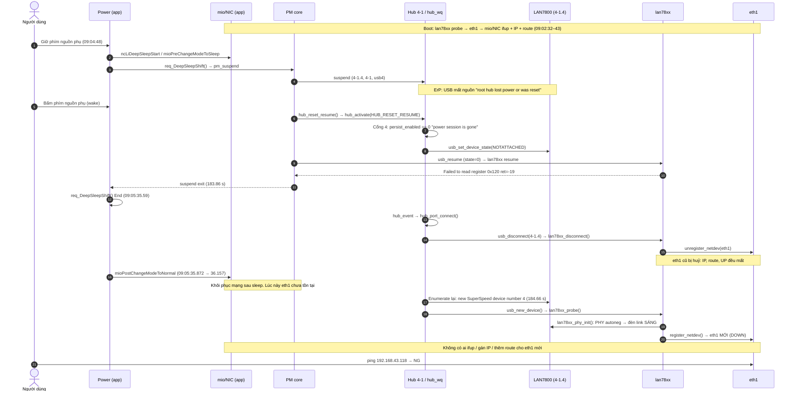
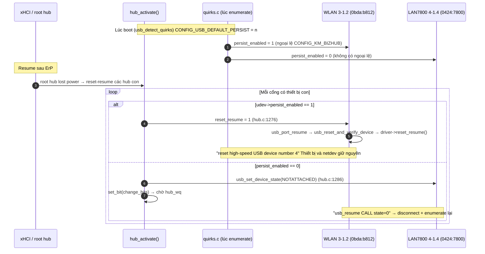
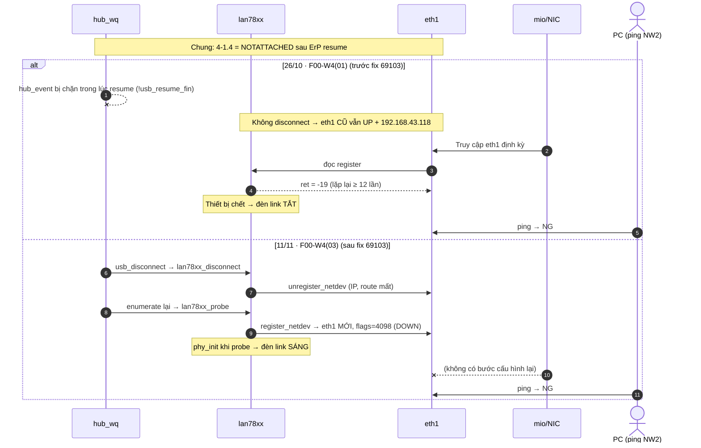
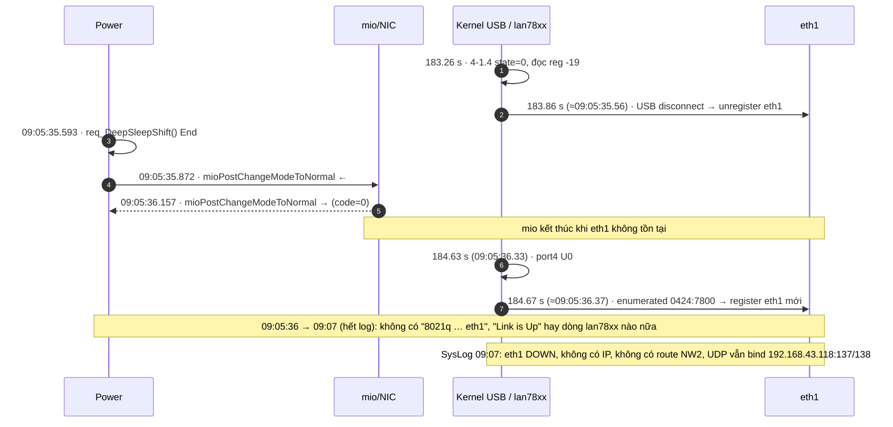
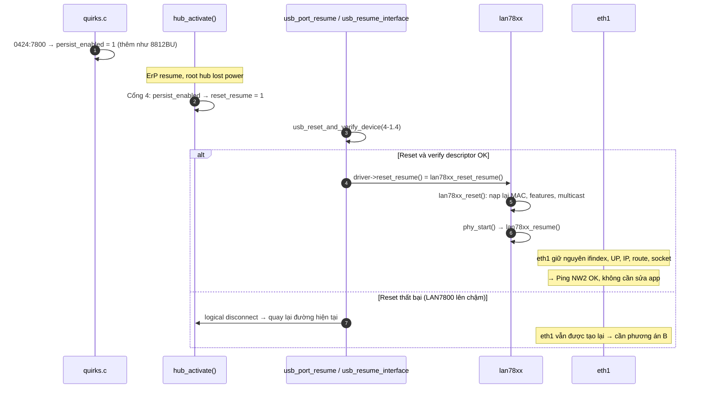
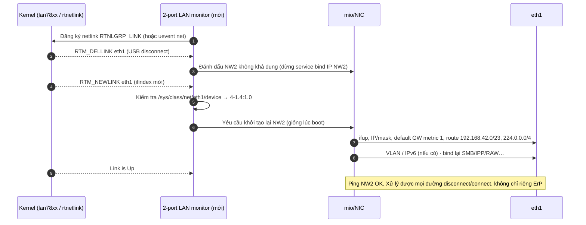

# OP_BTS-71327: sequence diagram root cause

Bug: 2-port LAN, sau khi thoát ErP thì không ping được NW2 (eth1, LAN mở rộng). Log re-open 11/11 (F00-W4(03)), có đối chiếu với log 26/10 (F00-W4(01)).
Báo cáo đầy đủ: [`OP_BTS-71327_analysis.html`](../../OP_BTS-71327_analysis.html).

Nguồn đối chiếu:

- `Kernel/Src/drivers/usb/core/hub.c`: `hub_activate` 1064 (nhánh persist 1274–1287), `usb_disconnect` 2312, `hub_port_connect` 5527, `usb_new_device` 2651, `usb_port_resume` 3800
- `Kernel/Src/drivers/usb/core/quirks.c:743–755`: persist mặc định, ngoại lệ KM cho 8812BU
- `Kernel/Src/drivers/usb/core/driver.c`: `usb_resume` 1766, `usb_resume_interface` 1388 (gọi `reset_resume` ở 1419)
- `Kernel/Src/drivers/net/usb/lan78xx.c`: `lan78xx_disconnect` 3876 (`unregister_netdev`), `lan78xx_probe` 3967 (`phy_init` 4089, `register_netdev` 4093), `lan78xx_reset_resume` 4661
- `arch/arm64/configs/EagleZp_defconfig:3416`: `# CONFIG_USB_DEFAULT_PERSIST is not set`
- Log: `SysLogALL/messages` (11/11) dòng 728–862, `垂れ流しログ` dòng 2728–2890, ifconfig ở `202611110907_001.log` dòng 127405–127521

## Thành phần tham gia

| Tên | Vai trò |
|---|---|
| **Power** | `sys:PowerControl` trong `mfp000_hwQt`: vào và ra ErP (`setErpMode` → `req_DeepSleepShift`) |
| **mio/NIC** | Middleware mạng (mio, NicFum, ncLi). Cấu hình eth0/eth1 lúc boot, khôi phục mạng khi wake (`mioPostChangeModeToNormal`). Không có source trong repo |
| **PM core** | `pm_suspend` / resume hệ thống của kernel |
| **Hub 4-1** | Hub driver của USB core cho hub SS `4-1` (045b:0210), gồm `hub_activate`, `hub_wq` (`hub_event`) |
| **LAN7800** | Chip LAN USB `0424:7800` ở cổng `4-1.4` (phần cứng) |
| **lan78xx** | Driver netdev cho LAN7800 |
| **eth1** | `net_device` của NW2 (IP 192.168.43.118/23) |
| **WLAN** | RTL8812BU `0bda:b812` ở `3-1.2`, dùng làm đối chứng |

---

## Sơ đồ 1: Root cause tổng quan (11/11, F00-W4(03))

**Cách đọc:** Bước 7–8 là nơi kernel quyết định bỏ thiết bị, vì LAN7800 không có USB-persist. Bước 14–15 là hệ quả của fix OP_BTS-69103: disconnect giờ chạy được nên eth1 cũ bị huỷ. Bước 16 (`mio` khôi phục mạng) chạy xong trước khi eth1 mới được tạo ở bước 17–20, và sau đó không có trigger nào cấu hình lại eth1 mới.

---

## Sơ đồ 2: Nhánh quyết định trong `hub_activate`: WLAN sống sót, LAN7800 bị bỏ

---

## Sơ đồ 3: So sánh trước và sau fix OP_BTS-69103

**Cách đọc:** Cả hai lần đều có chung gốc là bước "NOTATTACHED". Trước fix 69103 thì thiết bị chết mà netdev cũ vẫn còn. Sau fix thì thiết bị chạy lại, nhưng netdev mới không được cấu hình. Triệu chứng đèn link vì thế đảo ngược (tắt thành sáng), còn ping thì vẫn NG.

---

## Sơ đồ 4: Race giữa khôi phục mạng của app và re-enumerate của kernel (11/11)

Quy đổi thời gian: kernel `184.631414` ↔ wall `09:05:36.332` (垂れ流しログ dòng 2888).

---

## Sơ đồ 5: Phương án A (BSP): bật persist cho LAN7800, giữ nguyên eth1

Có thể kiểm chứng mà không cần build: `echo 1 > /sys/bus/usb/devices/4-1.4/power/persist` rồi vào và ra ErP. Kỳ vọng log có `usb 4-1.4: reset SuperSpeed …` thay vì `USB disconnect`.

---

## Sơ đồ 6: Phương án B (2-port LAN): phát hiện eth1 được tạo lại và cấu hình lại

