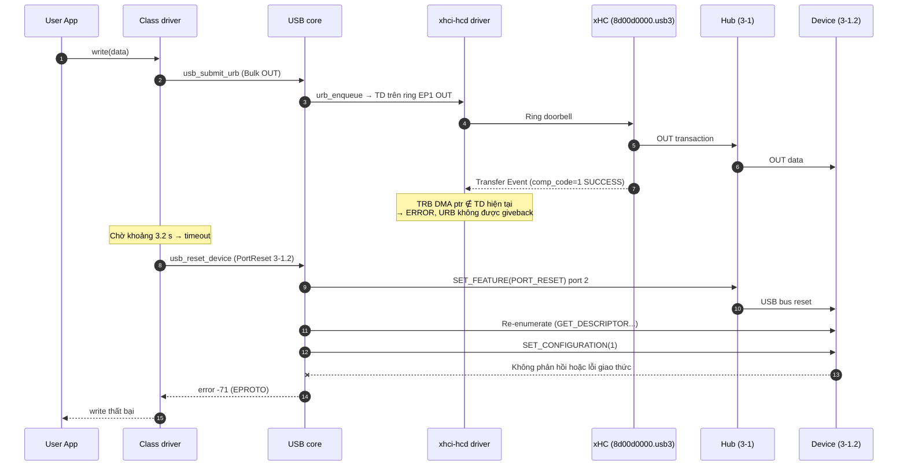
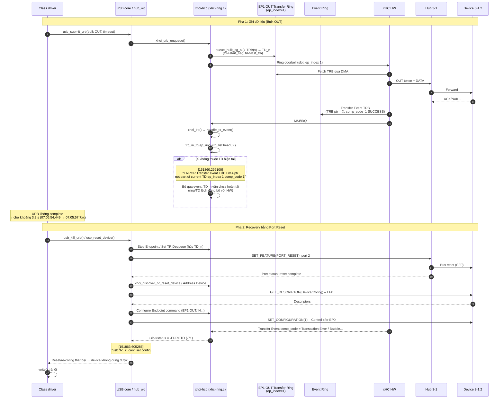

# Phân tích lỗi USB 3-1.2: TRB DMA ptr mismatch → PortReset → error -71

## Log

```
[2026-10-08 07:05:54.449] [151860.296100] xhci-hcd 8d00d0000.usb3: ERROR Transfer event TRB DMA ptr not part of current TD ep_index 1 comp_code 1
[2026-10-08 07:05:57.777] [151863.605286] usb 3-1.2: can't set config #1, error -71
```

Ghi thất bại sau 3.2 s → **PortReset** (`3-1.2`), kèm theo `can't set config #1, error -71`.

## Tóm tắt

Log cho thấy hai pha lỗi trên thiết bị `3-1.2` (bus 3 → root port 1 → port 2 của hub):

1. Event báo hoàn tất của xHC không khớp với TD hiện tại trên EP1 OUT, nên lệnh ghi bị treo.
2. Sau khoảng 3.2 s, driver reset port, nhưng lúc enumerate lại thì `SET_CONFIGURATION` thất bại với `-71` (`-EPROTO`, lỗi giao thức/truyền dẫn).

> Hai diagram dưới đây dựa trên luồng chuẩn của Linux xHCI/USB core. Log không ghi tên class driver nên gọi chung là "Class driver" (usblp, usb-storage hoặc driver riêng).

## 1. High-level sequence



## 2. Detailed sequence (theo timestamp)



## Đọc diagram


| Điểm            | Ý nghĩa                                                                                                                                                                    |
| ----------------- | ---------------------------------------------------------------------------------------------------------------------------------------------------------------------------- |
| `ep_index 1`      | EP1 OUT, tính theo công thức`epnum*2 + dir - 1`, nên khớp với thao tác ghi                                                                                            |
| `comp_code 1`     | HW báo SUCCESS, nhưng con trỏ TRB không nằm trong TD mà driver đang chờ, tức là ring giữa driver và HW đã lệch nhau                                           |
| ~3.2 s            | Timeout của class driver trước khi gọi PortReset                                                                                                                         |
| `-71` (`-EPROTO`) | Lỗi ở mức truyền dẫn (CRC, timeout hoặc bit-stuff) khi gửi control transfer; thường liên quan đến tín hiệu, nguồn hoặc device/hub chưa ổn định sau reset |

## Giả thuyết cho report

- **(a)** Lỗi phần mềm hoặc HW ở xHC (ring/TD lệch đồng bộ) đã gây ra treo.
- **(b)** Đường truyền vật lý (hub 3-1, cáp, VBUS) không ổn định, gây ra cả event bất thường lẫn `-71` sau reset.

Nếu `-71` lặp lại ở các lần reset sau, giả thuyết **(b)** đáng tin hơn.


Câu chuyện tóm gọn thế này: máy in gửi dữ liệu xuống một thiết bị USB, nhưng hai bên hiểu sai nhau về việc đã gửi đến đâu. Lệnh ghi vì thế bị treo, hệ thống phải khởi động lại thiết bị, và đến lần kết nối lại thì thiết bị cũng không phản hồi được.

## Bối cảnh: các nhân vật

Trong máy có một **bộ điều khiển USB** (xHC, ở địa chỉ `8d00d0000.usb3`). Có thể hình dung nó như một bưu cục chuyên chở hàng giữa CPU và các thiết bị USB. Từ bưu cục này đi ra một **hub** (`3-1`), giống một ổ chia. Cổng số 2 của hub nối với **thiết bị cần ghi dữ liệu** (`3-1.2`). Bên phía phần mềm, Linux có **driver xhci-hcd** làm việc trực tiếp với bưu cục, **USB core** lo các việc chung như nhận diện và cấu hình thiết bị, và một **class driver** là người thực sự muốn ghi dữ liệu.

## Pha 1: Gửi dữ liệu và hai bên lệch sổ sách

Khi chương trình muốn ghi dữ liệu, class driver tạo một yêu cầu gọi là URB và đưa cho USB core, USB core chuyển tiếp xuống driver xHCI. Driver xHCI không gửi dữ liệu ngay. Nó viết "phiếu gửi hàng" (TRB) rồi xếp vào một danh sách vòng (transfer ring) dành riêng cho đường ghi, ở đây là `ep_index 1`, tức endpoint 1 chiều OUT. Một nhóm phiếu thuộc cùng một lần gửi gọi là TD. Viết xong, driver "bấm chuông" (doorbell) báo cho bộ điều khiển rằng có hàng cần chuyển.

Bộ điều khiển tự đọc các phiếu đó từ RAM qua DMA rồi gửi dữ liệu qua hub đến thiết bị. Gửi xong, nó ghi một **biên nhận** (transfer event) vào một danh sách khác, trong đó có địa chỉ của phiếu vừa xử lý, rồi ngắt CPU để báo cho driver.

Lỗi xảy ra ở bước này. Biên nhận ghi kết quả **thành công** (`comp_code 1`), nhưng địa chỉ phiếu trên biên nhận **không thuộc lô hàng mà driver đang chờ**. Giống như bưu cục báo "đã giao xong phiếu số 57", trong khi sổ của driver ghi rằng đơn đang chờ gồm các phiếu từ 40 đến 45. Driver không dám nhận bừa, nên in ra dòng log *"Transfer event TRB DMA ptr not part of current TD"* và bỏ qua biên nhận này.

Hệ quả là lô hàng mà driver đang chờ không bao giờ được đánh dấu hoàn tất. Class driver cứ đợi kết quả của lệnh ghi mà không thấy trả về.

## Khoảng chờ 3.2 giây

Class driver không chờ mãi. Từ thời điểm 07:05:54.449, nó đợi khoảng 3.2 giây. Không thấy phản hồi, nó kết luận rằng đường truyền đã có vấn đề và chọn cách mạnh tay nhất: **reset thiết bị**.

## Pha 2: Reset và kết nối lại thất bại

Trước tiên, hệ thống hủy yêu cầu ghi đang treo và dọn lại danh sách phiếu cho sạch. Sau đó USB core yêu cầu hub reset cổng số 2 (PortReset). Với thiết bị, việc này giống như bị rút ra cắm lại bằng điện.

Thiết bị vừa reset thì như mới cắm vào, nên USB core phải làm lại toàn bộ thủ tục làm quen. Đầu tiên nó gán địa chỉ cho thiết bị. Tiếp theo nó hỏi thiết bị là gì và có những chức năng nào (GET\_DESCRIPTOR). Bước cuối là ra lệnh "hãy dùng cấu hình số 1" (SET\_CONFIGURATION), sau lệnh này thiết bị mới sẵn sàng làm việc.

Chính ở bước cuối này, thiết bị **không trả lời đúng**. Bộ điều khiển báo lỗi đường truyền, và Linux quy lỗi đó thành mã `-71` (EPROTO, nghĩa là lỗi giao thức). Lỗi kiểu này thường có nghĩa là tín hiệu trên dây bị hỏng hoặc thiếu: dữ liệu sai CRC, thiết bị không phản hồi kịp, hoặc tín hiệu điện không ổn định. Vì vậy lúc 07:05:57.777 mới có dòng *"can't set config #1, error -71"*. Thiết bị không cấu hình được nên không dùng được, và lệnh ghi ban đầu cuối cùng trả lỗi về cho chương trình.

## Vậy nguyên nhân có thể là gì?

Có hai hướng giải thích.

**Hướng thứ nhất:** lỗi nằm ở bộ điều khiển USB hoặc driver xHCI. Sổ sách giữa phần mềm và phần cứng bị lệch, gây ra treo, và lỗi `-71` chỉ là hậu quả của trạng thái rối sau đó.

**Hướng thứ hai:** lỗi nằm ở phần vật lý, gồm hub, dây cáp, nguồn VBUS hoặc chính thiết bị. Nếu đường truyền chập chờn thì cả biên nhận bất thường ở pha 1 lẫn lỗi `-71` khi cấu hình lại đều giải thích được.

Muốn biết hướng nào đúng thì nên xem các lần reset sau đó. Nếu lần nào cũng gặp `-71`, hướng thứ hai đáng tin hơn, và nên kiểm tra nguồn, hub, cáp hoặc thử đổi thiết bị.
