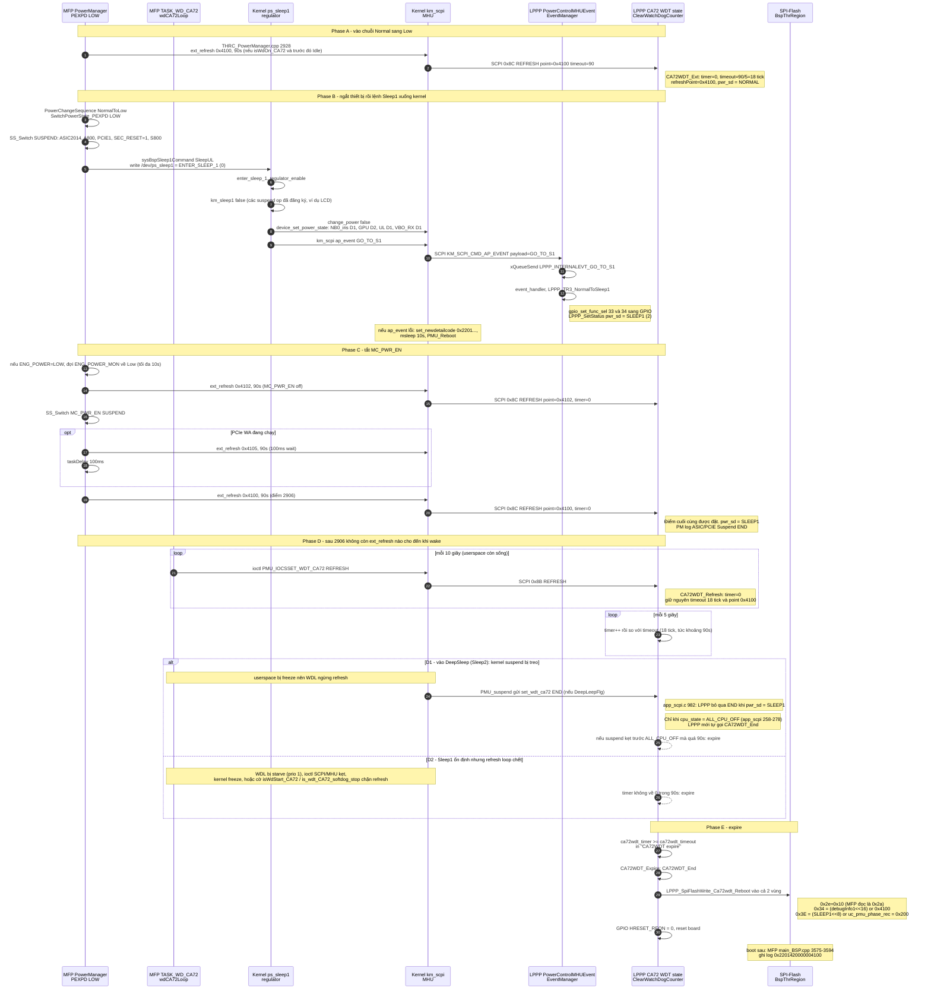
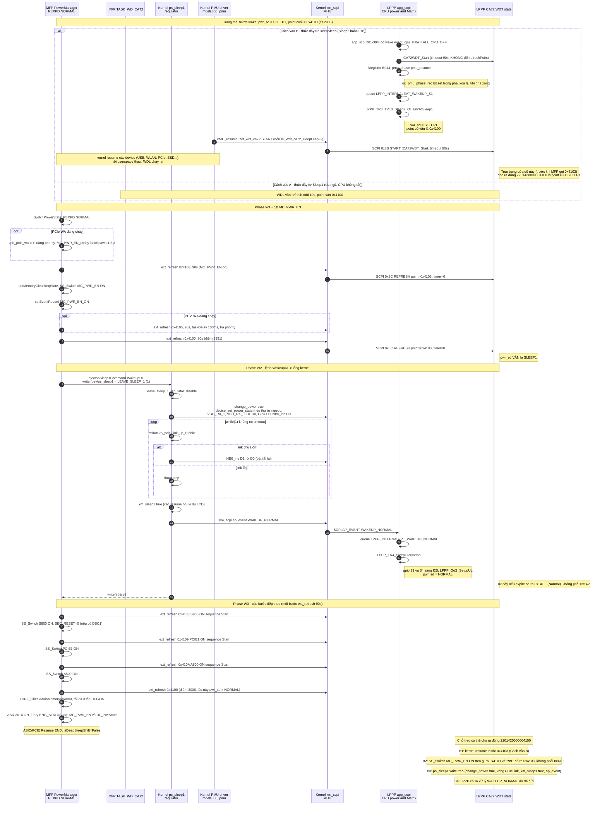

# 1. `0x2201420000004100`
**Ý nghĩa:** `0x2201420000004100` là mã chi tiết cho lần reboot do CA72 WDT hết hạn. Mã cho biết LPPP đang ở trạng thái **Sleep1** và điểm refresh cuối cùng là **`0x4100` ("Sleep sequence")**. Không có pha PMU nào đang chạy lúc đó. Mã được ghép ở [main_BSP.cpp:3583-3594](vscode-webview://1v7kr62lml590cb3gndmegc6ml88sjdjv7262pvi3l6t2rv5t7fr/IT6_Controller/KM3/application/mfp/Linux/main_BSP.cpp#L3583-L3594) theo công thức `(0x22<<56)|(0x014<<44)|ul_ca72code|(pmu_phase_rec<<32)|(CPUOccup<<31)`.

## Giải mã từng trường

```
0x22 | 014 | 200 | 0 | 0000 4100
 |     |     |    |    └ ul_ca72code = (debugInfo1<<16)|refreshPoint
 |     |     |    └ bit31: uc_CPUOccup
 |     |     └ bit32-43: pmu_phase_rec
 |     └ số thứ tự "014" = CA72WDT
 └ module 0x22 (BSP)
```

| Trường                   | Giá trị  | Ý nghĩa                                                                                                                                                                                                                                                                                        |
| ------------------------ | -------- | ---------------------------------------------------------------------------------------------------------------------------------------------------------------------------------------------------------------------------------------------------------------------------------------------- |
| Module                   | `0x22`   | BSP                                                                                                                                                                                                                                                                                            |
| Số thứ tự                | `0x014`  | CA72WDT reboot (nhánh `uc_subset_wd == 0`, không phải Subset WDT)                                                                                                                                                                                                                              |
| `pmu_phase_rec` (12 bit) | `0x200`  | byte cao `0x02` = `LPPP_GetStatus(pwr_sd)` = `PWR_STATUS_SLEEP1`; byte thấp `0x00` = không pha `pmu_phase()` nào đang chạy (bitmask các phase, [power.c:1898](vscode-webview://1v7kr62lml590cb3gndmegc6ml88sjdjv7262pvi3l6t2rv5t7fr/IT6_Kernel/lppp_s800/Hal/quartz/asic/build/power.c#L1898)) |
| `uc_CPUOccup` (bit 31)   | 0        | CPU chưa bị chiếm dụng cao khi expire                                                                                                                                                                                                                                                          |
| `debugInfo1`             | `0x0000` | không phải chế độ debug nên đã reset board thật                                                                                                                                                                                                                                                |
| `refreshPoint`           | `0x4100` | điểm refresh cuối cùng gọi `ca72wdt_ext_refresh(0x4100, 90, ...)`                                                                                                                                                                                                                              |

Thứ tự enum `pwr_status_t` ([LPPP_KM_Status.h:12](vscode-webview://1v7kr62lml590cb3gndmegc6ml88sjdjv7262pvi3l6t2rv5t7fr/IT6_Kernel/lppp_s800/ApplicationKM/LPPP_KM_Status.h#L12)): `POWEROFF=0, NORMAL=1, SLEEP1=2, SLEEP2=3, ERP=4`. Vì vậy `0x142…` là Sleep1, còn `0x141…` là Normal. Mã `0x2201410000004100` được nhắc trong comment OP_BTS-34676 ở [THRC_PowerManagerDevice.cpp:2994-3006](vscode-webview://1v7kr62lml590cb3gndmegc6ml88sjdjv7262pvi3l6t2rv5t7fr/IT6_Controller/KM3/application/mfp/system/thr_it6/thrcom/THRC_PowerManagerDevice.cpp#L2994-L3006), cùng điểm `0x4100` nhưng status là Normal.

## `0x4100` là gì

Tất cả các lần gọi `ca72wdt_ext_refresh( 0x4100, 90, 0x0000, "Sleep sequence.\n" )` đều có timeout **90 giây**. Chúng nằm trong chuỗi chuyển nguồn Normal ⇄ Sleep:

- [THRC_PowerManager.cpp:2928](vscode-webview://1v7kr62lml590cb3gndmegc6ml88sjdjv7262pvi3l6t2rv5t7fr/IT6_Controller/KM3/application/mfp/system/thr_it6/thrcom/THRC_PowerManager.cpp#L2928): bắt đầu chuyển Normal → Low (vào sleep), trước `PowerChangeSequence(NormalToLow)`.
- [THRC_PowerManagerDevice.cpp:2906](vscode-webview://1v7kr62lml590cb3gndmegc6ml88sjdjv7262pvi3l6t2rv5t7fr/IT6_Controller/KM3/application/mfp/system/thr_it6/thrcom/THRC_PowerManagerDevice.cpp#L2906): ngay sau khi `MC_PWR_EN` tắt xong (ASIC/PCIe Suspend END).
- [THRC_PowerManagerDevice.cpp:2991](vscode-webview://1v7kr62lml590cb3gndmegc6ml88sjdjv7262pvi3l6t2rv5t7fr/IT6_Controller/KM3/application/mfp/system/thr_it6/thrcom/THRC_PowerManagerDevice.cpp#L2991): sau khi `MC_PWR_EN` bật, ngay trước `sysBspSleep1Command(WakeupUL)`.
- [THRC_PowerManagerDevice.cpp:3006](vscode-webview://1v7kr62lml590cb3gndmegc6ml88sjdjv7262pvi3l6t2rv5t7fr/IT6_Controller/KM3/application/mfp/system/thr_it6/thrcom/THRC_PowerManagerDevice.cpp#L3006): sau khi A800 ON xong.

Ý nghĩa thực tế: sau lần refresh `0x4100` cuối, **90 giây trôi qua mà không có refresh hoặc END nào tiếp theo**, trong lúc LPPP vẫn ở Sleep1.

## Các tình huống có thể xảy ra (cần log để xác định)

Status = Sleep1 loại trừ điểm 3006 (lúc đó đã là Normal, như trong comment OP_BTS-34676). Còn lại hai hướng:

1. **Đường wake, điểm 2991**: LPPP vẫn là Sleep1 cho đến khi lệnh `WakeupUL` được xử lý. Nếu `sysBspSleep1Command(WakeupUL)` hoặc bước ngay sau nó (S800 ON `0x4108`) treo hơn 90 giây thì sẽ ra đúng mã này.
2. **Đường sleep, điểm 2906 hoặc 2928**: sau refresh, LPPP kỳ vọng kernel suspend rồi gọi END (kernel gửi `set_wdt_ca72(END)` ở [mdels800_pmu.c:4576](vscode-webview://1v7kr62lml590cb3gndmegc6ml88sjdjv7262pvi3l6t2rv5t7fr/IT6_Kernel/Kernel/K-S800/Src/drivers/mfp/pmu/mdels800_pmu.c#L4576), chỉ khi `bl_Wdt_ca72_DeepLeepFlg == true`; LPPP cũng gọi `CA72WDT_End()` khi `cpu_state == ALL_CPU_OFF` ở [app_scpi.c:278](vscode-webview://1v7kr62lml590cb3gndmegc6ml88sjdjv7262pvi3l6t2rv5t7fr/IT6_Kernel/lppp_s800/ApplicationMrvl/Test/app_scpi.c#L278)). Nếu kernel suspend treo, hoặc `bl_Wdt_ca72_DeepLeepFlg` tắt nên không gửi END, WDT sẽ expire khi LPPP đã ở Sleep1. Lệnh END từ ngoài bị bỏ qua ở Sleep1 ([app_scpi.c:982](vscode-webview://1v7kr62lml590cb3gndmegc6ml88sjdjv7262pvi3l6t2rv5t7fr/IT6_Kernel/lppp_s800/ApplicationMrvl/Test/app_scpi.c#L982)), đây là chỗ dễ không dừng được WDT.

Tôi chưa xác nhận hướng nào, vì còn thiếu thông tin về thời điểm chuyển `pwr_sd` sang Sleep1 trong từng đường.

## Cách phân biệt

Trong log LPPP của lần lỗi, tìm các dòng ngay trước `############# CA72WDT expire`:

- `## wd_refresh p:0x4100 ...` và dòng sau nó (có `p:0x4108` hoặc không).
- `KM_SCPI_WD_CA72_END` / `wd_end`: nếu chưa thấy END trước lúc expire thì đúng hướng 2.
- Log MFP dòng `@@ MC_PWR OFF end` hoặc `@@ MC_PWR ON end` để biết đang ở đường sleep hay đường wake.

Bạn có log MFP và LPPP quanh thời điểm này không? Tôi sẽ đối chiếu để chốt hướng.

Tôi đã đọc thêm LPPP (`LPPP_Matrix`, `LPPP_Task`, `app_scpi`), kernel (`quartz-ps-sleep1`, `quartz-regulator`, `mdels800_pmu`, `km_scpi`) và `THRC_PowerManager*` để vẽ hai diagram dưới đây.

**Sửa lại câu trả lời trước.** Tôi đã nhầm "đường sleep" thành kernel suspend. Sleep1 của LPPP là trạng thái **UL/MC ngủ nhưng CA72 vẫn chạy**. Kernel suspend và tắt CPU là Sleep2/ErP. Hai trạng thái này khác nhau, nên hai diagram dưới đây tách chúng ra.

## Diagram 1: điểm 2906, kết thúc chuỗi vào Sleep1

Điểm này nằm ở [THRC_PowerManagerDevice.cpp:2906](vscode-webview://1v7kr62lml590cb3gndmegc6ml88sjdjv7262pvi3l6t2rv5t7fr/IT6_Controller/KM3/application/mfp/system/thr_it6/thrcom/THRC_PowerManagerDevice.cpp#L2906).



**Cách đọc diagram 1**

- Sau điểm 2906, **không còn lệnh ext nào** nên point luôn là `0x4100`. Chỉ `wdCA72Loop` refresh timer mỗi 10 giây ([THRC_PowerManager.cpp:1642-1674](vscode-webview://1v7kr62lml590cb3gndmegc6ml88sjdjv7262pvi3l6t2rv5t7fr/IT6_Controller/KM3/application/mfp/system/thr_it6/thrcom/THRC_PowerManager.cpp#L1642-L1674)).
- Vì vậy mã `…4100` + Sleep1 nghĩa là refresh dừng hơn 90 giây khi LPPP ở Sleep1. Hai nguyên nhân hợp lý nhất là nhánh D1 (suspend kẹt) và D2 (refresh loop chết).
- Nếu nguyên nhân là PowerManager tự timeout (`wdExpire`), điểm sẽ là `0x4200`, không phải `0x4100`.
Tôi đã đọc code thật của cả ba phía (MFP, kernel, LPPP) để giải thích, nên có vài chỗ khác sơ đồ. Chúng nằm ở mục 6.

Mọi link bên dưới đều tương đối so với thư mục `Source`. Tôi chỉ đọc bản `thr/`, không đọc bản `thr_it6/`.

## 1. Kiến thức nền

**Ba "bên" tham gia.** Chúng chạy trên ba bộ xử lý khác nhau.

|Bên|Chạy ở đâu|Vai trò|
|---|---|---|
|**MFP**|Userspace trên CPU chính (CA72)|Chương trình ứng dụng. `PowerManager` quyết định bật tắt nguồn từng khối.|
|**Kernel**|Cũng trên CA72|Driver. MFP nói chuyện với nó qua file thiết bị như `/dev/ps_sleep1`.|
|**LPPP**|Một vi điều khiển nhỏ, luôn sống|Giữ nguồn và canh watchdog cho CA72. Khi CA72 ngủ, LPPP vẫn chạy.|

Kernel và LPPP nói chuyện bằng **SCPI qua MHU**. Hiểu đơn giản, đó là hộp thư giữa hai bộ xử lý. Hàm gửi là `scpi_send_message_ext`, ví dụ ở [km_scpi.c:337](vscode-webview://1v7kr62lml590cb3gndmegc6ml88sjdjv7262pvi3l6t2rv5t7fr/IT6_Kernel/Kernel/K-S800/Src/drivers/firmware/km_scpi.c#L337).

**Trạng thái nguồn.** LPPP giữ biến `pwr_sd`, định nghĩa ở [LPPP_KM_Status.h:13-17](vscode-webview://1v7kr62lml590cb3gndmegc6ml88sjdjv7262pvi3l6t2rv5t7fr/IT6_Kernel/lppp_s800/ApplicationKM/LPPP_KM_Status.h#L13-L17):

- `POWEROFF=0`
- `NORMAL=1`
- `SLEEP1=2`
- `SLEEP2=3`
- `ERP=4`

Chính con số này làm `0x141...` khác `0x142...`. Số `1` là NORMAL, số `2` là SLEEP1.

**Watchdog CA72 và "point".** LPPP đếm giờ. Nếu CA72 không báo "tôi còn sống" trong 90 giây thì LPPP kéo reset CA72. Xem `CA72WDT_Expire` ở [LPPP_Task.c:694-706](vscode-webview://1v7kr62lml590cb3gndmegc6ml88sjdjv7262pvi3l6t2rv5t7fr/IT6_Kernel/lppp_s800/ApplicationKM/LPPP_Task.c#L694-L706), nó kéo chân `HRESET_REQN` xuống 0.

Mỗi lần MFP báo còn sống, nó gửi kèm một con số "point". Point chỉ là một nhãn nói "tôi đang ở bước này". Khi watchdog nổ, LPPP biết lần báo cuối ở bước nào. Hàm MFP dùng là `ca72wdt_ext_refresh`, ở [THRC_PowerManager.cpp:9231](vscode-webview://1v7kr62lml590cb3gndmegc6ml88sjdjv7262pvi3l6t2rv5t7fr/IT6_Controller/KM3/application/mfp/system/thr/thrcom/THRC_PowerManager.cpp#L9231).

**Mã `2201420000004100` được tạo thế nào.** Khi watchdog nổ, LPPP ghi vào flash ở [LPPP_Matrix.c:443-447](vscode-webview://1v7kr62lml590cb3gndmegc6ml88sjdjv7262pvi3l6t2rv5t7fr/IT6_Kernel/lppp_s800/ApplicationKM/LPPP_Matrix.c#L443-L447):

- `data2 = debugInfo1<<16 | refreshPoint`
- `data3 = pwr_sd<<8 | uc_pmu_phase_rec`

Ghép lại thì đọc được như sau. Tôi suy ra từ cách lưu flash, chưa đọc đoạn code ghép chuỗi cuối cùng.

- `22014` là mã module và mã chi tiết.
- `2` là `pwr_sd`, tức SLEEP1.
- `4100` là point cuối.
- Các số 0 ở giữa là `debugInfo1` và phase record. MFP luôn truyền `0x0000`, ví dụ [dòng 2991](vscode-webview://1v7kr62lml590cb3gndmegc6ml88sjdjv7262pvi3l6t2rv5t7fr/IT6_Controller/KM3/application/mfp/system/thr/thrcom/THRC_PowerManagerDevice.cpp#L2991).

Vậy `2201420000004100` có nghĩa là: lần báo sống cuối cùng là point `0x4100`, và lúc watchdog nổ LPPP vẫn tưởng máy đang ở SLEEP1.

## 2. Một lệnh refresh đi qua những đâu

1. MFP gọi `ca72wdt_ext_refresh(0x4103, 90, ...)`. Hàm này mở `/dev/pmu` rồi gọi `ioctl(THRD_PMU_IOCSSET_WDT_CA72_EXT)` ([PowerManager.cpp:9253](vscode-webview://1v7kr62lml590cb3gndmegc6ml88sjdjv7262pvi3l6t2rv5t7fr/IT6_Controller/KM3/application/mfp/system/thr/thrcom/THRC_PowerManager.cpp#L9253)).
2. Kernel PMU nhận ioctl ở [mdels800_pmu.c:4392-4398](vscode-webview://1v7kr62lml590cb3gndmegc6ml88sjdjv7262pvi3l6t2rv5t7fr/IT6_Kernel/Kernel/K-S800/Src/drivers/mfp/pmu/mdels800_pmu.c#L4392-L4398), rồi gọi `set_wdt_ca72_ext`.
3. `km_scpi_set_wdt_ca72_ext` đóng gói event, point, timeout và chuỗi debug rồi gửi SCPI ([km_scpi.c:312-343](vscode-webview://1v7kr62lml590cb3gndmegc6ml88sjdjv7262pvi3l6t2rv5t7fr/IT6_Kernel/Kernel/K-S800/Src/drivers/firmware/km_scpi.c#L312-L343)).
4. LPPP nhận ở `CA72WDT_Ext` ([LPPP_Task.c:723](vscode-webview://1v7kr62lml590cb3gndmegc6ml88sjdjv7262pvi3l6t2rv5t7fr/IT6_Kernel/lppp_s800/ApplicationKM/LPPP_Task.c#L723)). Timeout được chia 5 ([dòng 748](vscode-webview://1v7kr62lml590cb3gndmegc6ml88sjdjv7262pvi3l6t2rv5t7fr/IT6_Kernel/lppp_s800/ApplicationKM/LPPP_Task.c#L748)), vì vòng đếm của LPPP chạy mỗi 5 giây ([dòng 872](vscode-webview://1v7kr62lml590cb3gndmegc6ml88sjdjv7262pvi3l6t2rv5t7fr/IT6_Kernel/lppp_s800/ApplicationKM/LPPP_Task.c#L872)). 90 giây nghĩa là 18 nhịp.
5. Với `REFRESH`, LPPP đặt lại bộ đếm về 0 và lưu `ca72wdte_refreshPoint = point` ([dòng 789-794](vscode-webview://1v7kr62lml590cb3gndmegc6ml88sjdjv7262pvi3l6t2rv5t7fr/IT6_Kernel/lppp_s800/ApplicationKM/LPPP_Task.c#L789-L794)). Nó chỉ nhận khi watchdog đang chạy.

Điểm quan trọng: point chỉ đổi khi có một lần refresh mới. Nếu code treo ở giữa hai lần refresh, point vẫn là giá trị cũ.

## 3. Trước khi wake

Lúc đi ngủ, MFP chạy nhánh `LOW` của `SwitchPowerState_PEXPD`. Bước cuối là refresh point `0x4100` ở [PowerManagerDevice.cpp:2906](vscode-webview://1v7kr62lml590cb3gndmegc6ml88sjdjv7262pvi3l6t2rv5t7fr/IT6_Controller/KM3/application/mfp/system/thr/thrcom/THRC_PowerManagerDevice.cpp#L2906). Do đó đầu pha wake, point là `0x4100` và `pwr_sd` là SLEEP1.

## 4. Hai cách vào pha wake

**Cách A, thức từ Sleep1.** CPU không tắt, WDL tiếp tục chạy. Không có gì đặc biệt.

**Cách B, thức từ DeepSleep (Sleep2 hoặc ErP).** CPU đã tắt hẳn.

- Lúc tắt hết CPU, LPPP gọi `CA72WDT_End()` ([app_scpi.c:278](vscode-webview://1v7kr62lml590cb3gndmegc6ml88sjdjv7262pvi3l6t2rv5t7fr/IT6_Kernel/lppp_s800/ApplicationMrvl/Test/app_scpi.c#L278)).
- Lúc có wake event, LPPP chạy `CA72WDT_Start()` ([app_scpi.c:288](vscode-webview://1v7kr62lml590cb3gndmegc6ml88sjdjv7262pvi3l6t2rv5t7fr/IT6_Kernel/lppp_s800/ApplicationMrvl/Test/app_scpi.c#L288)). Hàm này chỉ đặt timer về 0 và timeout 90 giây, không đụng `refreshPoint` ([LPPP_Task.c:623-640](vscode-webview://1v7kr62lml590cb3gndmegc6ml88sjdjv7262pvi3l6t2rv5t7fr/IT6_Kernel/lppp_s800/ApplicationKM/LPPP_Task.c#L623-L640)). Point vẫn là `0x4100`.
- Tiếp theo LPPP chạy `pmu_phase(pmu_resume)` ([dòng 293](vscode-webview://1v7kr62lml590cb3gndmegc6ml88sjdjv7262pvi3l6t2rv5t7fr/IT6_Kernel/lppp_s800/ApplicationMrvl/Test/app_scpi.c#L293)) và đưa `WAKEUP_S1` vào hàng đợi ([dòng 300](vscode-webview://1v7kr62lml590cb3gndmegc6ml88sjdjv7262pvi3l6t2rv5t7fr/IT6_Kernel/lppp_s800/ApplicationMrvl/Test/app_scpi.c#L300)).
- `LPPP_TR8_TR10_Sleep2_Or_ErPToSleep1` trả về `PWR_STATUS_SLEEP1` ([LPPP_Matrix.c:387](vscode-webview://1v7kr62lml590cb3gndmegc6ml88sjdjv7262pvi3l6t2rv5t7fr/IT6_Kernel/lppp_s800/ApplicationKM/LPPP_Matrix.c#L387)).
- Phía kernel, `PMU_resume` gọi `set_wdt_ca72(START)` nếu cờ `bl_Wdt_ca72_DeepLeepFlg` bật ([mdels800_pmu.c:4594-4596](vscode-webview://1v7kr62lml590cb3gndmegc6ml88sjdjv7262pvi3l6t2rv5t7fr/IT6_Kernel/Kernel/K-S800/Src/drivers/mfp/pmu/mdels800_pmu.c#L4594-L4596)).

Kết quả: sau DeepSleep, đồng hồ 90 giây chạy lại ngay, trong khi kernel còn đang resume hàng loạt thiết bị.

## 5. Pha wake trong `SwitchPowerState_PEXPD` (nhánh `NORMAL`)

Nhánh này bắt đầu ở [PowerManagerDevice.cpp:2908](vscode-webview://1v7kr62lml590cb3gndmegc6ml88sjdjv7262pvi3l6t2rv5t7fr/IT6_Controller/KM3/application/mfp/system/thr/thrcom/THRC_PowerManagerDevice.cpp#L2908).

### W1: bật MC_PWR_EN (dòng 2917 đến 2991)

1. **[2917-2943](vscode-webview://1v7kr62lml590cb3gndmegc6ml88sjdjv7262pvi3l6t2rv5t7fr/IT6_Controller/KM3/application/mfp/system/thr/thrcom/THRC_PowerManagerDevice.cpp#L2917-L2943):** nếu PCIe workaround đang chạy, MFP ghi `Y` vào `/sys/module/usbcore/parameters/usb_pcie_wa`, nâng priority của thread, và spawn 3 task delay.
2. **[2945](vscode-webview://1v7kr62lml590cb3gndmegc6ml88sjdjv7262pvi3l6t2rv5t7fr/IT6_Controller/KM3/application/mfp/system/thr/thrcom/THRC_PowerManagerDevice.cpp#L2945):** refresh point **`0x4103`** ("MC_PWR_EN on").
3. **[2950](vscode-webview://1v7kr62lml590cb3gndmegc6ml88sjdjv7262pvi3l6t2rv5t7fr/IT6_Controller/KM3/application/mfp/system/thr/thrcom/THRC_PowerManagerDevice.cpp#L2950):** `SS_SwitchPowerState(MC_PWR_EN, ON)` bật nguồn MC thật.
4. **[2953](vscode-webview://1v7kr62lml590cb3gndmegc6ml88sjdjv7262pvi3l6t2rv5t7fr/IT6_Controller/KM3/application/mfp/system/thr/thrcom/THRC_PowerManagerDevice.cpp#L2953):** ghi event `MC_PWR_EN_ON`.
5. **[2960](vscode-webview://1v7kr62lml590cb3gndmegc6ml88sjdjv7262pvi3l6t2rv5t7fr/IT6_Controller/KM3/application/mfp/system/thr/thrcom/THRC_PowerManagerDevice.cpp#L2960):** nếu có PCIe WA, refresh `0x4105`, đợi 100 ms ([2984](vscode-webview://1v7kr62lml590cb3gndmegc6ml88sjdjv7262pvi3l6t2rv5t7fr/IT6_Controller/KM3/application/mfp/system/thr/thrcom/THRC_PowerManagerDevice.cpp#L2984)), rồi trả priority.
6. **[2991](vscode-webview://1v7kr62lml590cb3gndmegc6ml88sjdjv7262pvi3l6t2rv5t7fr/IT6_Controller/KM3/application/mfp/system/thr/thrcom/THRC_PowerManagerDevice.cpp#L2991):** refresh lại về **`0x4100`**, nhãn vẫn ghi "Sleep sequence".

Điểm này quan trọng: sau dòng 2991, point là `0x4100` và `pwr_sd` vẫn là SLEEP1.

### W2: lệnh WakeupUL xuống kernel ([dòng 2992](vscode-webview://1v7kr62lml590cb3gndmegc6ml88sjdjv7262pvi3l6t2rv5t7fr/IT6_Controller/KM3/application/mfp/system/thr/thrcom/THRC_PowerManagerDevice.cpp#L2992))

`sysBspSleep1Command` ([dòng 981-1005](vscode-webview://1v7kr62lml590cb3gndmegc6ml88sjdjv7262pvi3l6t2rv5t7fr/IT6_Controller/KM3/application/mfp/system/thr/thrcom/THRC_PowerManagerDevice.cpp#L981-L1005)) mở `/dev/ps_sleep1` rồi `write()` một lệnh vào. Đây là lời gọi hệ thống chặn: MFP đứng chờ đến khi kernel trả về.

Phía kernel, `ps_sleep1_write` ([quartz-ps-sleep1.c:140-168](vscode-webview://1v7kr62lml590cb3gndmegc6ml88sjdjv7262pvi3l6t2rv5t7fr/IT6_Kernel/Kernel/K-S800/Src/drivers/regulator/quartz-ps-sleep1.c#L140-L168)) đọc 1 byte cờ. Nếu là `LEAVE_SLEEP_1` (=1, [dòng 36](vscode-webview://1v7kr62lml590cb3gndmegc6ml88sjdjv7262pvi3l6t2rv5t7fr/IT6_Kernel/Kernel/K-S800/Src/drivers/regulator/quartz-ps-sleep1.c#L36)) thì gọi `leave_sleep_1` ([dòng 115-133](vscode-webview://1v7kr62lml590cb3gndmegc6ml88sjdjv7262pvi3l6t2rv5t7fr/IT6_Kernel/Kernel/K-S800/Src/drivers/regulator/quartz-ps-sleep1.c#L115-L133)). Hàm này làm hai việc **theo đúng thứ tự**:

1. `regulator_disable(r)` ([dòng 122](vscode-webview://1v7kr62lml590cb3gndmegc6ml88sjdjv7262pvi3l6t2rv5t7fr/IT6_Kernel/Kernel/K-S800/Src/drivers/regulator/quartz-ps-sleep1.c#L122)). Tắt "regulator giả lập Sleep1" nghĩa là bật nguồn lại.
2. Sau khi bước 1 xong hẳn, mới gửi `ap_event(WAKEUP_NORMAL)` cho LPPP ([dòng 125](vscode-webview://1v7kr62lml590cb3gndmegc6ml88sjdjv7262pvi3l6t2rv5t7fr/IT6_Kernel/Kernel/K-S800/Src/drivers/regulator/quartz-ps-sleep1.c#L125)).

Bước 1 dẫn tới `quartz_regulator_disable` ([quartz-regulator.c:228-240](vscode-webview://1v7kr62lml590cb3gndmegc6ml88sjdjv7262pvi3l6t2rv5t7fr/IT6_Kernel/Kernel/K-S800/Src/drivers/regulator/quartz-regulator.c#L228-L240)):

- **`change_power(true)`** ([dòng 160-188](vscode-webview://1v7kr62lml590cb3gndmegc6ml88sjdjv7262pvi3l6t2rv5t7fr/IT6_Kernel/Kernel/K-S800/Src/drivers/regulator/quartz-regulator.c#L160-L188)). Hàm này bật nguồn các khối theo thứ tự ngược với lúc ngủ ([dòng 168-170](vscode-webview://1v7kr62lml590cb3gndmegc6ml88sjdjv7262pvi3l6t2rv5t7fr/IT6_Kernel/Kernel/K-S800/Src/drivers/regulator/quartz-regulator.c#L168-L170)). Sau đó có vòng `while(1)` kiểm tra PCIe ([dòng 172-182](vscode-webview://1v7kr62lml590cb3gndmegc6ml88sjdjv7262pvi3l6t2rv5t7fr/IT6_Kernel/Kernel/K-S800/Src/drivers/regulator/quartz-regulator.c#L172-L182)):
    - Gọi `msb0125_pcie_link_up_Stable()`.
    - Nếu link đứt (trả 0) thì tắt rồi bật lại NB0_iris và kiểm tra lại.
    - Nếu link ổn thì thoát.
- **`km_sleep1(true)`** ([dòng 113-126](vscode-webview://1v7kr62lml590cb3gndmegc6ml88sjdjv7262pvi3l6t2rv5t7fr/IT6_Kernel/Kernel/K-S800/Src/drivers/regulator/quartz-regulator.c#L113-L126)). Hàm này gọi lần lượt các resume op đã đăng ký, ví dụ LCD.

Hàm kiểm tra link ([pcie-mv-msb0125.c:246-271](vscode-webview://1v7kr62lml590cb3gndmegc6ml88sjdjv7262pvi3l6t2rv5t7fr/IT6_Kernel/Kernel/K-S800/Src/drivers/pci/controller/pcie-mv-msb0125.c#L246-L271)) trả về:

- 1 ngay nếu máy không có A800 ([251-253](vscode-webview://1v7kr62lml590cb3gndmegc6ml88sjdjv7262pvi3l6t2rv5t7fr/IT6_Kernel/Kernel/K-S800/Src/drivers/pci/controller/pcie-mv-msb0125.c#L251-L253)).
- 0 nếu thấy link đứt.
- 1 nếu link ổn, hoặc nếu quá `jiffies + 1000` mà chưa đứt.

Phía LPPP nhận `ap_event` ở [LPPP_Task.c:323-325](vscode-webview://1v7kr62lml590cb3gndmegc6ml88sjdjv7262pvi3l6t2rv5t7fr/IT6_Kernel/lppp_s800/ApplicationKM/LPPP_Task.c#L323-L325) và chuyển thành `LPPP_INTERNALEVT_WAKEUP_NORMAL`. Hàm xử lý `LPPP_TR4_Sleep1ToNormal` ([LPPP_Matrix.c:259-270](vscode-webview://1v7kr62lml590cb3gndmegc6ml88sjdjv7262pvi3l6t2rv5t7fr/IT6_Kernel/lppp_s800/ApplicationKM/LPPP_Matrix.c#L259-L270)) chuyển GPIO 33/34 sang I2S, cấu hình QoS, rồi trả `PWR_STATUS_NORMAL`. **Chỉ từ lúc này `pwr_sd` mới thành NORMAL.**

### W3: các bước còn lại (dòng 2994 đến 3081)

|Dòng|Point|Việc|
|---|---|---|
|[2994-2995](vscode-webview://1v7kr62lml590cb3gndmegc6ml88sjdjv7262pvi3l6t2rv5t7fr/IT6_Controller/KM3/application/mfp/system/thr/thrcom/THRC_PowerManagerDevice.cpp#L2994-L2995)|`0x4108`|Bật S800|
|[3002-3003](vscode-webview://1v7kr62lml590cb3gndmegc6ml88sjdjv7262pvi3l6t2rv5t7fr/IT6_Controller/KM3/application/mfp/system/thr/thrcom/THRC_PowerManagerDevice.cpp#L3002-L3003)|`0x4109`|Bật PCIE1|
|[3004-3005](vscode-webview://1v7kr62lml590cb3gndmegc6ml88sjdjv7262pvi3l6t2rv5t7fr/IT6_Controller/KM3/application/mfp/system/thr/thrcom/THRC_PowerManagerDevice.cpp#L3004-L3005)|`0x410A`|Bật A800|
|[3006](vscode-webview://1v7kr62lml590cb3gndmegc6ml88sjdjv7262pvi3l6t2rv5t7fr/IT6_Controller/KM3/application/mfp/system/thr/thrcom/THRC_PowerManagerDevice.cpp#L3006)|`0x4100`|Quay về nhãn chung|
|[3010-3021](vscode-webview://1v7kr62lml590cb3gndmegc6ml88sjdjv7262pvi3l6t2rv5t7fr/IT6_Controller/KM3/application/mfp/system/thr/thrcom/THRC_PowerManagerDevice.cpp#L3010-L3021)||Kiểm tra bộ nhớ A800, tối đa 3 lần OFF/ON|
|[3022](vscode-webview://1v7kr62lml590cb3gndmegc6ml88sjdjv7262pvi3l6t2rv5t7fr/IT6_Controller/KM3/application/mfp/system/thr/thrcom/THRC_PowerManagerDevice.cpp#L3022)||Bật ASIC2014/Fiery|
|[3040-3048](vscode-webview://1v7kr62lml590cb3gndmegc6ml88sjdjv7262pvi3l6t2rv5t7fr/IT6_Controller/KM3/application/mfp/system/thr/thrcom/THRC_PowerManagerDevice.cpp#L3040-L3048)||Đợi `MC_PWR_EN` và `UL_PwrState`|
|[3052](vscode-webview://1v7kr62lml590cb3gndmegc6ml88sjdjv7262pvi3l6t2rv5t7fr/IT6_Controller/KM3/application/mfp/system/thr/thrcom/THRC_PowerManagerDevice.cpp#L3052), [3081](vscode-webview://1v7kr62lml590cb3gndmegc6ml88sjdjv7262pvi3l6t2rv5t7fr/IT6_Controller/KM3/application/mfp/system/thr/thrcom/THRC_PowerManagerDevice.cpp#L3081)||"Resume END", `isDeepSleepShift = False`|

Ở các dòng này `pwr_sd` đã là NORMAL, nên nếu treo ở đây mã sẽ là `0x141...`. Nhãn cũ [`2201410000004100`](vscode-webview://1v7kr62lml590cb3gndmegc6ml88sjdjv7262pvi3l6t2rv5t7fr/IT6_Controller/KM3/application/mfp/system/thr/thrcom/THRC_PowerManagerDevice.cpp#L2994) xuất hiện ngay trong comment của các dòng này.

## 6. Bốn chỗ có thể treo để ra đúng `2201420000004100`

Mã này cần đồng thời hai điều kiện: point cuối là `0x4100` và LPPP vẫn ở SLEEP1. Khoảng thời gian thỏa cả hai bắt đầu từ lần refresh `0x4100` (dòng 2991, hoặc từ lúc vào wake nếu là Cách B) và kết thúc khi LPPP chạy xong `TR4`.

- **B1: kernel resume sau DeepSleep.** Đồng hồ 90 giây đã chạy lại từ [app_scpi.c:288](vscode-webview://1v7kr62lml590cb3gndmegc6ml88sjdjv7262pvi3l6t2rv5t7fr/IT6_Kernel/lppp_s800/ApplicationMrvl/Test/app_scpi.c#L288), nhưng MFP chưa kịp refresh sang `0x4103` vì userspace chưa được thaw. Nếu resume USB, WLAN, PCIe hay SSD quá lâu thì ra đúng mã này.
- **B2: treo ở `SS_Switch MC_PWR_EN ON`.** Loại trừ được, vì lúc đó point là `0x4103` hoặc `0x4105` chứ không phải `0x4100`. Code còn có sẵn các chỗ treo giả để test ([dòng 2958](vscode-webview://1v7kr62lml590cb3gndmegc6ml88sjdjv7262pvi3l6t2rv5t7fr/IT6_Controller/KM3/application/mfp/system/thr/thrcom/THRC_PowerManagerDevice.cpp#L2958) và [2988](vscode-webview://1v7kr62lml590cb3gndmegc6ml88sjdjv7262pvi3l6t2rv5t7fr/IT6_Controller/KM3/application/mfp/system/thr/thrcom/THRC_PowerManagerDevice.cpp#L2988): `wdTestCode == 13/14`).
- **B3: treo trong `write()` của `/dev/ps_sleep1`.** Đây là nghi phạm mạnh nhất. Chỗ rõ nhất là vòng `while(1)` ở [quartz-regulator.c:172-182](vscode-webview://1v7kr62lml590cb3gndmegc6ml88sjdjv7262pvi3l6t2rv5t7fr/IT6_Kernel/Kernel/K-S800/Src/drivers/regulator/quartz-regulator.c#L172-L182): hàm kiểm tra bên trong có timeout, nhưng vòng ngoài không có giới hạn số lần. Nếu link PCIe cứ đứt mãi thì tắt bật NB0_iris vô hạn. Lúc đó point là `0x4100` và `ap_event` chưa được gửi vì nó nằm sau, ở [quartz-ps-sleep1.c:125](vscode-webview://1v7kr62lml590cb3gndmegc6ml88sjdjv7262pvi3l6t2rv5t7fr/IT6_Kernel/Kernel/K-S800/Src/drivers/regulator/quartz-ps-sleep1.c#L125). Hơn nữa, comment [quartz-regulator.c:158](vscode-webview://1v7kr62lml590cb3gndmegc6ml88sjdjv7262pvi3l6t2rv5t7fr/IT6_Kernel/Kernel/K-S800/Src/drivers/regulator/quartz-regulator.c#L158) và [171](vscode-webview://1v7kr62lml590cb3gndmegc6ml88sjdjv7262pvi3l6t2rv5t7fr/IT6_Kernel/Kernel/K-S800/Src/drivers/regulator/quartz-regulator.c#L171) ghi rõ vòng này được thêm để sửa một lỗi cũ mang mã `2201410000004100` (PCIe1 đứt link, OP_BTS-34999). Nghĩa là lỗi lớp này đã từng xảy ra.
- **B4: LPPP chưa xử lý `WAKEUP_NORMAL`.** Kernel đã gửi nhưng LPPP chưa chạy `TR4`. Phải xem log LPPP để biết.

## 7. Điểm khác sơ đồ và điểm chưa kiểm chứng

- **Một lỗi thật ở nhánh NORMAL.** Ở [PowerManagerDevice.cpp:3041](vscode-webview://1v7kr62lml590cb3gndmegc6ml88sjdjv7262pvi3l6t2rv5t7fr/IT6_Controller/KM3/application/mfp/system/thr/thrcom/THRC_PowerManagerDevice.cpp#L3041), `ul_LoopCnt` được khai báo _bên trong_ thân vòng `while` ở dòng 3040. Nó bị đặt lại về 0 mỗi vòng, nên điều kiện timeout ở [dòng 3043](vscode-webview://1v7kr62lml590cb3gndmegc6ml88sjdjv7262pvi3l6t2rv5t7fr/IT6_Controller/KM3/application/mfp/system/thr/thrcom/THRC_PowerManagerDevice.cpp#L3043) không bao giờ đúng, và vòng này có thể đợi vô hạn. Nhánh SLEEP ở [dòng 2825](vscode-webview://1v7kr62lml590cb3gndmegc6ml88sjdjv7262pvi3l6t2rv5t7fr/IT6_Controller/KM3/application/mfp/system/thr/thrcom/THRC_PowerManagerDevice.cpp#L2825) thì khai báo đúng chỗ. Lỗi này nằm ở pha NORMAL (`0x141...`), không giải thích mã `0x142...`.
- **Kernel cũng tự refresh watchdog.** [pcie-mv-msb0125.c:1000-1017](vscode-webview://1v7kr62lml590cb3gndmegc6ml88sjdjv7262pvi3l6t2rv5t7fr/IT6_Kernel/Kernel/K-S800/Src/drivers/pci/controller/pcie-mv-msb0125.c#L1000-L1017) gửi `0x410B` và `0x410C`, [mdels800_pmu.c:1043-1045](vscode-webview://1v7kr62lml590cb3gndmegc6ml88sjdjv7262pvi3l6t2rv5t7fr/IT6_Kernel/Kernel/K-S800/Src/drivers/mfp/pmu/mdels800_pmu.c#L1043-L1045) gửi `0x4104` và `0x4106`. Tôi chưa kiểm tra các đoạn này có chạy trong lúc wake hay không. Nếu có thì point cuối sẽ không phải `0x4100`, và có thể loại bớt giả thuyết.
- **Các số sơ đồ ghi mà tôi chưa kiểm chứng:**
    - Mã SCPI `0x8B` và `0x8C`.
    - Việc WDL refresh mỗi 10 giây.
    - Giá trị số của `THRE_Sleep1CommandArg_WakeupUL`. Kernel chỉ đọc 1 byte và so với `LEAVE_SLEEP_1 = 1`.

Muốn thu hẹp nguyên nhân, bạn nên lấy log kernel và log LPPP của một lần lỗi thật. Hãy tìm dòng `NB0_iris Power Off/On` lặp lại (B3), và dòng `Scenario function is called.(LPPP_TR4_Sleep1ToNormal)` (B4). Tôi có thể hướng dẫn cụ thể hơn nếu bạn có log.

## Diagram 2: điểm 2991, đường wake

Điểm này nằm ở [THRC_PowerManagerDevice.cpp:2991](vscode-webview://1v7kr62lml590cb3gndmegc6ml88sjdjv7262pvi3l6t2rv5t7fr/IT6_Controller/KM3/application/mfp/system/thr_it6/thrcom/THRC_PowerManagerDevice.cpp#L2991). Có hai cách vào, nên diagram chia nhánh.



**Cách đọc diagram 2**

- Trong mọi trường hợp, trạng thái chỉ chuyển từ SLEEP1 sang NORMAL ở cuối `leave_sleep_1`, tức khi `ap_event(WAKEUP_NORMAL)` được xử lý. Vì vậy mọi treo từ điểm 2991 đến lúc đó đều ra `0x142…`. Treo sau đó ra `0x141…`.
- Vòng `while(1)` kiểm tra link PCIe trong `change_power(true)` không có timeout ([quartz-regulator.c:172-182](vscode-webview://1v7kr62lml590cb3gndmegc6ml88sjdjv7262pvi3l6t2rv5t7fr/IT6_Kernel/Kernel/K-S800/Src/drivers/regulator/quartz-regulator.c#L172-L182)). Comment OP_BTS-34999 ngay tại đó ghi "2201410000004100_PCIe1リンク切れ".
- Điểm 2991 chỉ đặt point ngay trước `sysBspSleep1Command(WakeupUL)`. Treo trước 2991 (ví dụ ở `SS_Switch MC_PWR_EN ON`) sẽ ra point `0x4103`. Vì vậy `0x4100` + SLEEP1 tại đường wake có hai khả năng:
    - **B1** (nhánh B ở diagram 2): treo trong kernel resume sau DeepSleep, point cũ `0x4100` từ điểm 2906 còn nguyên vì LPPP `CA72WDT_Start()` không đổi point.
    - **B3**: treo trong `ps_sleep1` (`change_power(true)`, vòng PCIe, `km_sleep1(true)`, `ap_event`), tức sau điểm 2991.

## Kết luận về dữ liệu của bạn

Mã `0x2201420000004100` có `pmu_phase_rec = 0x200`: byte cao là SLEEP1 và byte thấp bằng 0 (không có pha `pmu_phase` nào đang chạy). Điều này loại trừ việc treo **bên trong** `pmu_phase()` của LPPP. Các kịch bản phù hợp với dữ liệu hiện có, xếp theo mức độ khớp:

1. **D1**: vào DeepSleep và suspend kẹt trước khi tất cả CPU tắt.
2. **B1**: kernel resume treo sau DeepSleep.
3. **B3**: kẹt trong `ps_sleep1` hoặc vòng PCIe link khi wake.
4. **D2**: Sleep1 bình thường nhưng refresh loop chết.

Tôi chưa trace được: (a) MFP kích hoạt kernel suspend (DeepSleep) bằng đường nào, (b) chỗ đặt `is_wdt_CA72_softdog_stop` (chỉ thấy comment OP_BTS-28671 nói đến watchdog reboot). Hai điểm này ảnh hưởng đến D1 và D2.

Để chốt kịch bản, bạn cần log kernel (dmesg) và log LPPP. Cụ thể, tìm các dòng sau, theo thứ tự:

- `Now in SLEEP1`, `Regulator power down` (vào Sleep1).
- `PMU_resume`, `NB0_iris Power Off/On`, `Regulator power up` (wake).
- `KM_SCPI_WD_CA72_END` (và có dòng `wd_end ... not started` hay không), `wd_start`, `CA72WDT timer`, `CA72WDT expire`.

Gửi log cho tôi nếu bạn có, tôi sẽ đối chiếu với từng nhánh trên.