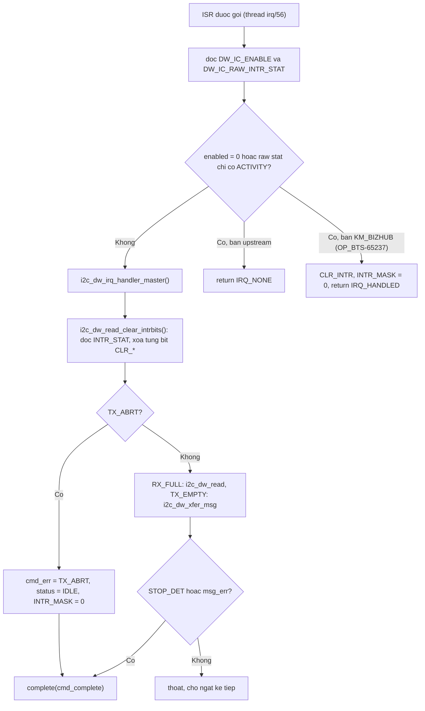
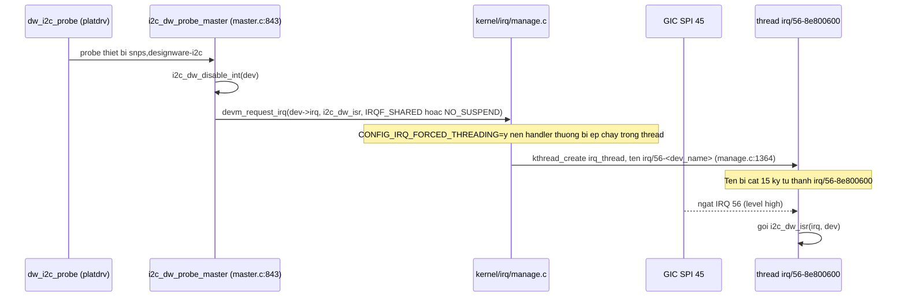
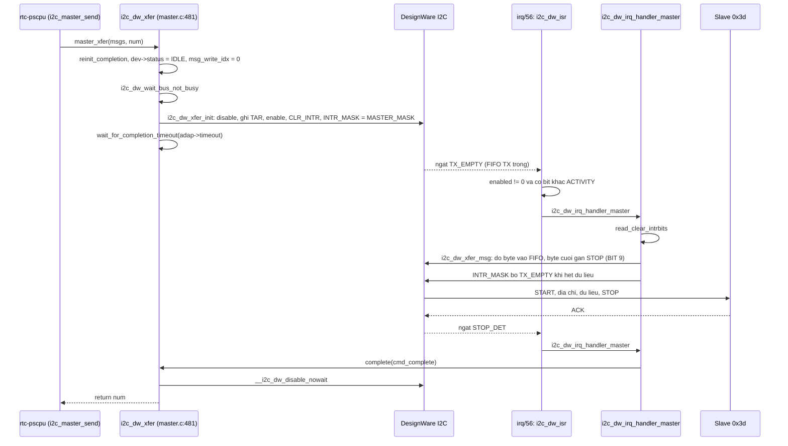
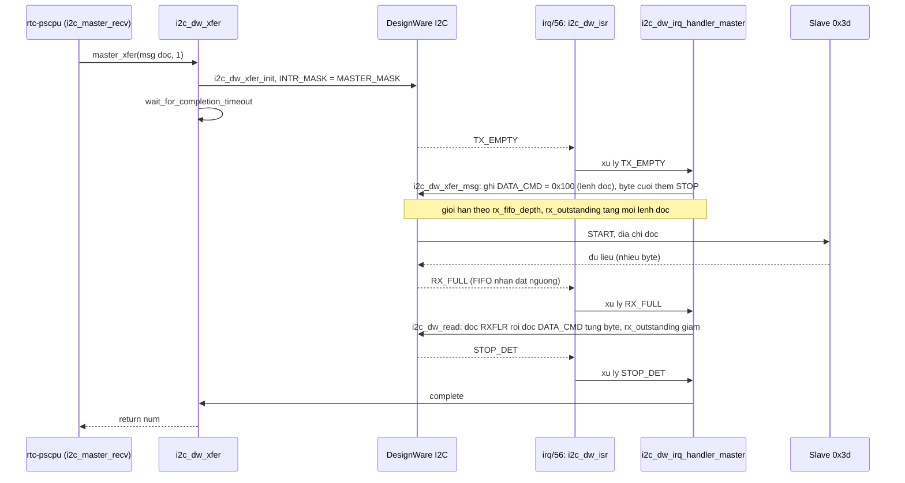
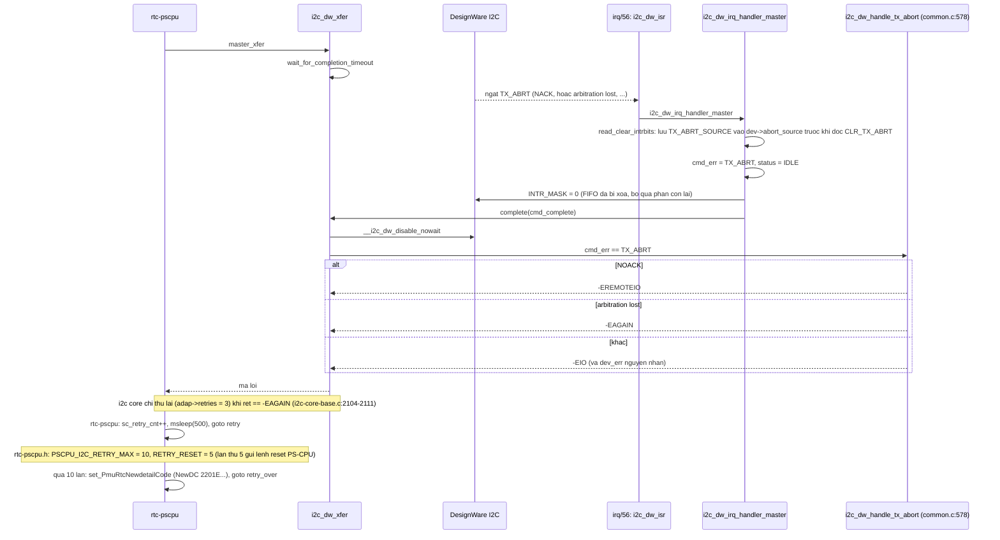
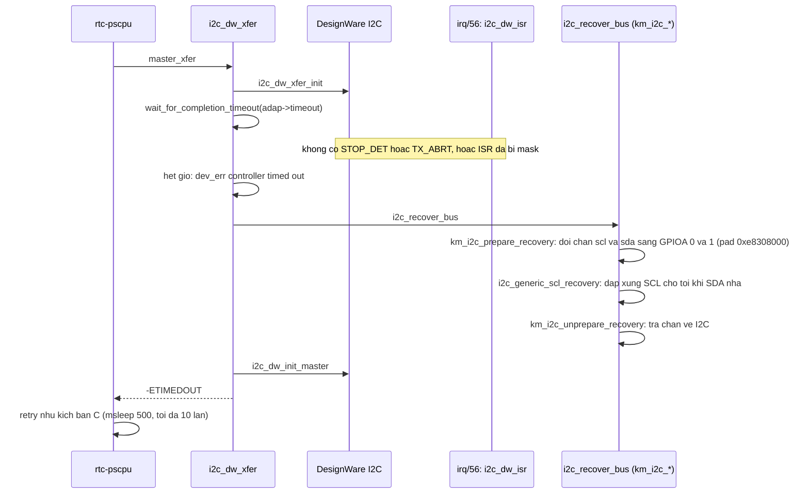
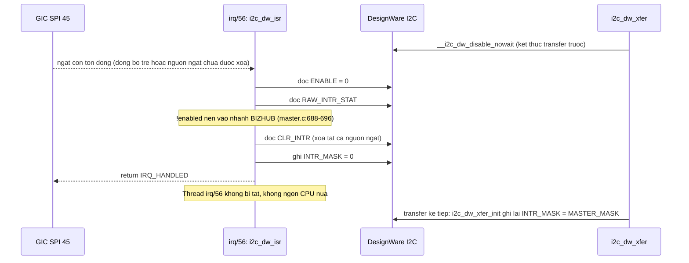
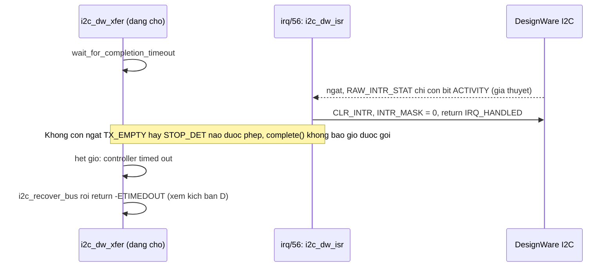

# Các kịch bản gọi `i2c_dw_isr()` (thread `irq/56-8e800600`, I2C1 DesignWare)

> Bám code thật trong `Kernel/Src`. File chính: `drivers/i2c/busses/i2c-designware-master.c`.
> Thiết bị: `i2c1@8e8006000` (`quartz-sb.dtsi:340`), `GIC_SPI 45`, 100 kHz, slave: `pscpu_rtc@3d`, `pscpu@3e`.
> Client chính trên bus này: `drivers/rtc/rtc-pscpu.c` (gọi `i2c_master_send` rồi `i2c_master_recv`).
> Các nhánh `CONFIG_KM_BIZHUB` được đánh dấu rõ. Phần suy luận được ghi chú là "giả thuyết".

## 0. Cây quyết định bên trong `i2c_dw_isr()` (dòng 680)

## 1. Boi canh: ISR duoc dang ky va vi sao chay trong thread `irq/56`

Lưu ý: forced threading chỉ chạy thật nếu cmdline có `threadirqs`. Tôi chưa kiểm tra bootargs.

## 2. Kịch bản A: ghi bình thường (`i2c_master_send`)

Ví dụ: RTC driver ghi địa chỉ thanh ghi (`rtc-pscpu.c:116`).

## 3. Kịch bản B: đọc bình thường (`i2c_master_recv`)

Nếu message có `I2C_M_RECV_LEN` (SMBus block read) thì ISR tắt `TX_EMPTY` trong lúc chờ byte độ dài rồi `i2c_dw_recv_len` bật lại (dòng 396).
Tôi chưa thấy driver trên bus này dùng kiểu đó.

## 4. Kịch bản C: slave NACK hoặc mất trọng tài (TX_ABRT)

Điểm cần nhớ: với `-EREMOTEIO` và `-EIO`, driver I2C không tự thử lại; việc thử lại 10 lần là của `rtc-pscpu.c`.

## 5. Kịch bản D: ISR không đến, hoặc đến mà không ra `complete()` (timeout và recovery)

Khi bus bị kẹt (SDA/SCL giữ thấp), hoặc ngắt không đến, hoặc ISR đã mask hết.

Recovery GPIO chỉ có cho bus có `scl-gpios`/`sda-gpios`. Trong dtsi chỉ `i2c1` có, và địa chỉ pad/gpio ghi cứng trong code (OP_BTS-45386).

## 6. Kịch bản E: ngắt "thừa" (IRQ storm) và nhánh `KM_BIZHUB`

### E1. Ngắt đến khi controller đang tắt (`enabled == 0`)

Controller bị tắt trong `i2c_dw_xfer_init` (`__i2c_dw_disable`) và sau mỗi transfer (`__i2c_dw_disable_nowait`).
Nếu đường ngắt vẫn còn báo lúc đó, upstream trả `IRQ_NONE` và kernel có thể tắt IRQ ("nobody cared"); bản BIZHUB xử lý thế này:

### E2. Giả thuyết: raw stat chỉ có ACTIVITY giữa lúc đang transfer

Chưa chứng minh được. Nếu xảy ra, bản BIZHUB mask hết ngắt, transfer đang chờ sẽ treo tới timeout:

Cơ sở để nghi: `INTR_MASK` còn được ghi từ `i2c_dw_xfer_init` và `i2c_dw_xfer_msg`, không có lock chung với ISR.
Ngược lại, `TX_EMPTY` thô thường đã bật khi FIFO trống, nên khả năng bit duy nhất là `ACTIVITY` giữa lúc chờ thấp.

## 7. Bảng tóm tắt kịch bản

| Kịch bản | Cách ISR được gọi | Kết thúc | Kết quả `i2c_dw_xfer` |
|---|---|---|---|
| A. Ghi OK | `TX_EMPTY` (nhiều lần), rồi `STOP_DET` | `complete()` | `num` |
| B. Đọc OK | `TX_EMPTY`, `RX_FULL` (nhiều lần), `STOP_DET` | `complete()` | `num` |
| C. NACK/mất trọng tài | `TX_ABRT` | `complete()` | `-EREMOTEIO`/`-EAGAIN`/`-EIO` |
| D. Kẹt bus | không đến, hoặc không ra `complete()` | timeout | `-ETIMEDOUT` sau recovery |
| E1. Ngắt thừa lúc tắt | `enabled == 0` | không `complete()`, chỉ mask | không ảnh hưởng transfer sau |
| E2. Ngắt chỉ ACTIVITY giữa transfer | giả thuyết | timeout | `-ETIMEDOUT` |

## 8. Chưa xác minh

- Thật sự có `threadirqs` trong bootargs hay không (cơ sở để `irq/56` tồn tại).
- Có xảy ra E2 trên máy thật hay không. Cần log `controller timed out` kèm `RAW_INTR_STAT` mới kết luận.
- `INTR_MASK` có race giữa ISR và `i2c_dw_xfer_msg` hay không (không có lock chung trong code đã đọc).
- Cơ chế `i2c_dw_acquire_lock`/`wait_bus_not_busy` chi tiết (chưa đọc).
