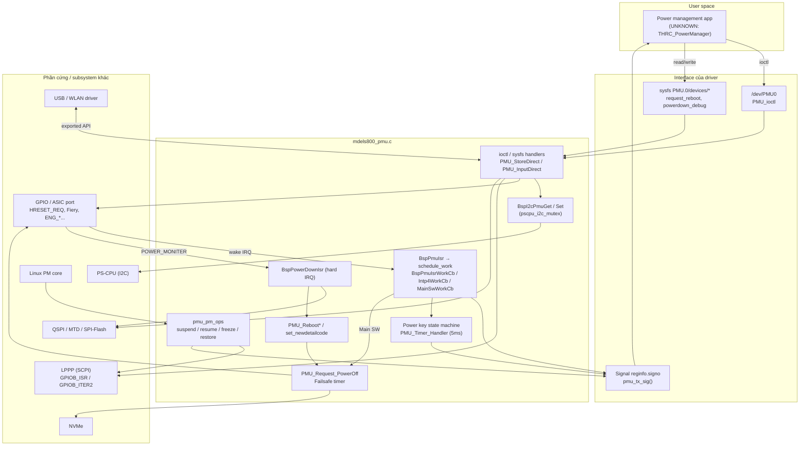
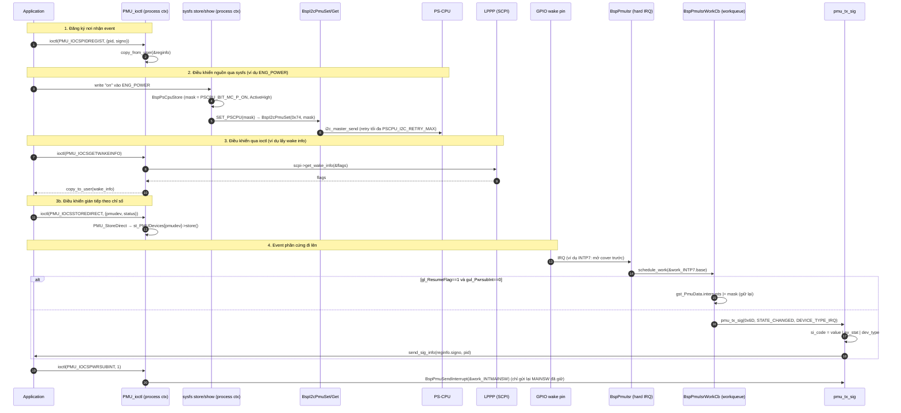
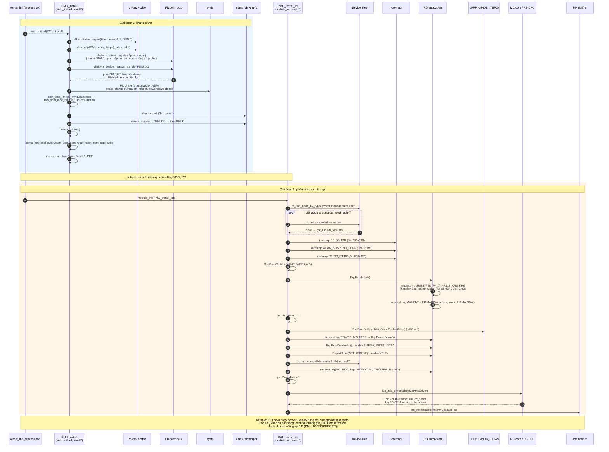
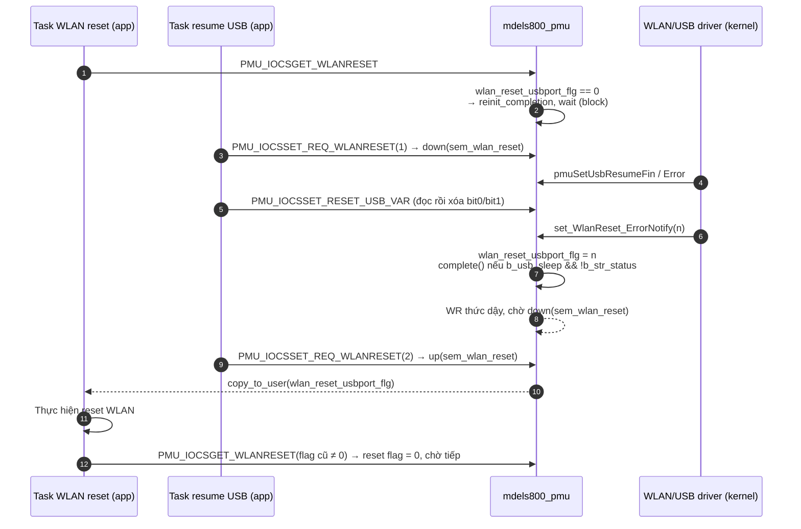
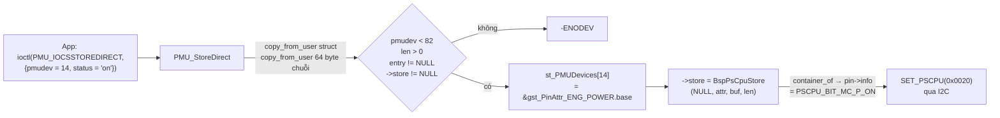

# Phân tích `mdels800_pmu.c` — Phần 1: Bức tranh tổng thể

> Nguồn: `mdels800_pmu.c` (driver PMU phía kernel, 省電力制御ドライバ).
> Một số điểm tham chiếu chéo từ `main_BSP.cpp`.

**Quy ước nhãn**

| Nhãn | Ý nghĩa |
|---|---|
| **FACT** | Xác nhận trực tiếp từ code trong file |
| **INFERENCE** | Suy luận hợp lý từ code |
| **UNKNOWN** | Phụ thuộc header, Device Tree, application hoặc file khác. Chưa thể xác nhận từ file hiện tại |

---

## 1.1. Driver này làm gì

1. **FACT:** Header file ghi `省電力制御ドライバ` (driver điều khiển tiết kiệm điện). Driver được tạo năm 2017, dựa trên `mdels72_pmu.c`.
2. Driver là **cầu nối** giữa ứng dụng power management ở user space và phần cứng quản lý nguồn của MFP. Nó cung cấp `/dev/PMU0` (ioctl) và một nhóm sysfs `devices` dưới platform device `PMU`.
3. Driver điều khiển 3 loại phần cứng:
   - **GPIO và ASIC port** trực tiếp: `gpio_set_value`, `THRF_CbBitPort_Out_Long`.
   - **PS-CPU (Power Sub-CPU)** qua I2C, bằng các macro `GET_PSCPU` / `SET_PSCPU` / `CLR_PSCPU`.
   - **LPPP** qua SCPI, bằng `get_km_scpi_ops()`.
4. Driver nhận các **interrupt wake**: power key, mở cover, đặt bản gốc, FAX, PHY, sensor, VBUS, Main SW. Nó chuyển chúng xuống workqueue rồi báo lên ứng dụng bằng **signal** qua `pmu_tx_sig()`.
5. Driver có **state machine cho power key** (`powerSaveKey_info`, timer 5 ms) để lọc nhiễu và phân biệt nhấn ngắn với nhấn dài.
6. Driver tham gia **suspend/resume và Warp**: `PMU_suspend`, `PMU_resume`, `PMU_freeze`, `PMU_restore`, cùng `pm_notifier`.
7. Driver xử lý **Main SW OFF**: power-off timer, failsafe timer, rồi tắt nguồn bằng `PMU_Request_PowerOff()`. Hàm này gọi `ksys_sync`, `km_nvme_shutdown`, sau đó đặt `/HRESET_REQ = 0`.
8. Driver xử lý **mất điện tức thời** trong hard IRQ (`BspPowerDownIsr`): ghi dữ liệu xuống QSPI rồi reboot.
9. Ngoài ra, driver còn chứa: đọc/ghi **B-register** trên QSPI (B013/B014/B015), **update firmware PS-CPU**, **watchdog** (CA72, MC), phối hợp **USB/WLAN resume**, và ghi **new detail code** trước khi reboot.

---

## 1.2. Các bên tương tác

| Bên | Driver giao tiếp qua | Mức xác nhận |
|---|---|---|
| **User-space application** | ioctl trên `/dev/PMU0`, ghi/đọc sysfs, nhận signal từ `pmu_tx_sig`. Ứng dụng đăng ký PID và số signal qua `PMU_IOCSPIDREGIST`, driver lưu vào `reginfo`. | FACT. Ứng dụng cụ thể là `THRC_PowerManager`: **UNKNOWN** trong file này |
| **`/dev/PMU0`** | `alloc_chrdev_region(..., "PMU")`, `class_create("km_pmu")`, `device_create(..., "PMU0")`. `fops` chỉ có `open`, `release`, `unlocked_ioctl` (không có `read/write`). | FACT. Node `/dev/PMU0` do udev tạo: INFERENCE |
| **sysfs** | `sysfs_create_group` với nhóm `PMU_attr_group` (`.name = "devices"`), cộng thêm `request_reboot` và `powerdown_debug`. | FACT. `main_BSP.cpp` dùng đường dẫn `/sys/bus/platform/devices/PMU.0/devices/B015` và `EVENT_RECORD` |
| **GPIO/IRQ** | Số GPIO đọc từ DT node `type = "power management unit"` qua `dts_read_table[]`. Wake IRQ dùng `WAKE_GPIO(gpio) = gpio + 288`. | FACT. Giá trị GPIO thực tế: UNKNOWN (nằm trong DTS) |
| **PS-CPU (I2C)** | `BspI2cPmuDriver` (id `"pscpu"`). Các register: `PSCPU_REG_GET 0x70`, `SET 0x74`, `CLR 0x78`, `IN 0x80`, `SUM 0x88`, `VER 0x8C`, `MCIR 0x5C`, `PWROFF_FACTOR 0x5E`, `PWROFF_TIM_SET 0xB0`, `PWROFF_SEQTIME 0xBC`, `EVENT 0xC0`, `CHECK_I2C 0xFC`. Dùng chung `pscpu_i2c_mutex`. | FACT. Mutex được định nghĩa ở file khác (`extern`), có thể là `rtc-pscpu.c`: INFERENCE |
| **LPPP (SCPI)** | Các hàm `scpi->rewrite_request`, `set_wdt_ca72`, `set_wdt_ca72_ext`, `get_wake_info`, `get_pmu_event`, `set_ap_status`. Ngoài ra ghi trực tiếp register `GPIOB_ITER2` (bit 30, MAINSW) để bật/tắt ngắt Main SW phía LPPP. | FACT. Hiện thực SCPI: UNKNOWN |
| **Linux PM core** | `pmu_pm_ops` (`suspend`, `resume`, `freeze`, `thaw`, `restore`) và `pm_notifier(BspPmuPmCallback)` với event `PM_POST_HIBERNATION`. | FACT |
| **NVMe** | `km_nvme_shutdown()` trước khi cắt nguồn. | FACT. Hiện thực: UNKNOWN |
| **QSPI / SPI-Flash** | MTD (`mtd_read`, `mtd_erase`, `mtd_write`) cho B-register. Trong ISR mất điện dùng `qspi_powerdown_write`. Ngoài ra có `THRF_writeFlash`, `THRG_setBspThrRegion`, và `PMU_QSPI_CLK` (0xe82401b0). | FACT. Bên trong các hàm extern: UNKNOWN |
| **USB/WLAN driver** | Các hàm export: `pmuSetUsbResumeFin`, `pmuSetUsbResumeError`, `pmuGetUsbResumeFin`, `set_WlanReset_ErrorNotify`, `BspPmuRegisterVbusCallback`. Đồng bộ bằng `completion_recv__WlanReset` và `sem_wlan_reset`. | FACT. Driver nào gọi các hàm này: UNKNOWN |
| **Module khác trong BSP** | `sendMessageDrv`, `int_sendMessageDrv` (gửi message cho task), `PanelCom_GetAndroidStatus`, `set_enable_irq_ttyS1/2/3`, `THRL_BIOS_Dev0110_Fiery_*`, `change_power_mc`, `pscpu_read_alarm`... | FACT là có `extern`. Hành vi bên trong: UNKNOWN |

---

## 1.3. Architecture diagram



---

## 1.4. Sequence tổng thể: Application → driver → phần cứng → signal



**Ghi chú về bước cuối (FACT):** `BspPmuSendInterrupt` chỉ được gọi với `&work_INTMAINSW`, nên nó chỉ gửi lại bit `PMU_INTMAINSW`. Các bit khác đang nằm trong `gst_PmuData.interrupts` không được gửi lại qua đường này. Khi `PMU_IOCSPWRSUBINT(0)` được gọi, `gst_PmuData.interrupts` bị xóa về 0. Ngoài ra, ứng dụng có thể đọc và xóa các bit đó qua sysfs `INT_SOURCE` (`BspIntSourceShow`).

---

## 1.5. External interface của driver

### a) Character device

| Mục | Giá trị trong code | Ghi chú |
|---|---|---|
| Đăng ký số device | `alloc_chrdev_region(&dev_num, 0, 1, "PMU")` | Major động |
| Class / device | `class_create(THIS_MODULE, "km_pmu")`, `device_create(..., "PMU0")` | |
| `file_operations` | `PMU_open`, `PMU_close` (chỉ in log), `PMU_ioctl` | Không có `read`, `write`, `poll` |
| Kiểm tra command | `_IOC_TYPE(cmd) != PMU_IOC_MAGIC` hoặc `_IOC_NR(cmd) > PMU_IOC_MAXNR` thì trả về `-ENOTTY` | Giá trị macro: **UNKNOWN** (nằm trong header) |

### b) ioctl (32 command trong `switch` của `PMU_ioctl`)

Mã số ioctl và layout struct nằm trong header: **UNKNOWN**. Toàn bộ ioctl chạy trong **process context**.

| Nhóm | Command | Chức năng (FACT) | Block/sleep, ghi chú |
|---|---|---|---|
| Đăng ký event | `PMU_IOCSPIDREGIST` | `copy_from_user(&reginfo)` | Ghi đè PID cũ (OP_BTS-13677) |
| | `PMU_IOCSPIDUNREGIST` | `reginfo.pid = 0` nếu PID khớp | |
| | `PMU_IOCSINPUTCYCLE` | Trả về `-ENOTTY` | Không còn dùng |
| Truy cập thiết bị theo chỉ số | `PMU_IOCSSTOREDIRECT` | `PMU_StoreDirect` → `st_PMUDevices[pmudev]->store` | Có thể sleep (I2C, msleep) tùy device |
| | `PMU_IOCSSFROMINPUT` | `PMU_InputDirect` → `->show` → `copy_to_user` | Mapping enum `pmudev`: UNKNOWN |
| Interrupt / event | `PMU_IOCSREQESTFACTOR` | `BspPmuSendInterrupt(&work_INTMAINSW)` | |
| | `PMU_IOCSPWRSUBINT` | Đặt `gul_PwrsubInt` = 0 hoặc 1. Khi = 0 thì xóa `interrupts`, khi = 1 thì gửi lại MAINSW | Không có lock trên các cờ |
| | `PMU_IOCSSUBSWINT` | Đặt `gul_SubSwInt` và reset `powerSaveKey_info` | |
| | `PMU_IOCSGETWAKEINFO` | `scpi->get_wake_info` | |
| Dữ liệu mất điện | `PMU_IOCSGET_POWERDOWN_DATAAREA` | `kmalloc(4KB)`, trả về địa chỉ vật lý `__pa()` | Mỗi lần gọi lại cấp phát mới, vùng cũ không được giải phóng: **potential risk** |
| | `PMU_IOCSGET_RTCFAXBACKUPDATAAREA` | `copy_from_user(uc_timePowerDown)` dưới `timePowerDown_Sem` | `down()` có thể sleep |
| Firmware PS-CPU | `PMU_IOCSSET_DOWNLOAD_MODE` | `BspUpdateRequest` | msleep 500 ms |
| | `PMU_IOCSSET_DOWNLOAD_DATA` | `BspWriteFirm`. Khi đủ `UPDATE_BLOCKS` (20) thì gọi `BspWriteChecksum` | |
| LPPP / AP | `PMU_IOCSSET_APSTATUS` | `set_ap_status` và `enable_irq/disable_irq(POWER_MONITER)` | **Cần xem lại:** phần thân nằm trong `if(res)`, mà `res` là kết quả của `copy_from_user`. Phần thân chỉ chạy khi copy **thất bại** |
| Watchdog | `PMU_IOCSGET_WDT_MC` | `BspGetPmuEvent` | Cũng dùng `if(res)` giống trên. Kết quả không được `copy_to_user` |
| | `PMU_IOCSSET_WDT_CA72` | `scpi->set_wdt_ca72(event)`, trừ khi `is_wdt_CA72_softdog_stop` | |
| | `PMU_IOCSSET_WDT_CA72_EXT` | `scpi->set_wdt_ca72_ext(...)` | Không kiểm tra giá trị trả về của `copy_from_user` |
| | `PMU_IOCSSETREBOOT_CRANK` | `bl_Wdt_ca72_DeepLeepFlg = true` | |
| | `PMU_IOCSGET_WD_EXPIRE` | `set_newdetailcode`, `msleep(10000)`, `PMU_Reboot()` | Block 10 s |
| Debug / chẩn đoán | `PMU_IOCSGET_IRQ_DISABLE_FLG` | `copy_to_user(irq_disable_flg)` | |
| | `PMU_IOCSGET_DETAILFLG` | Đặt `bl_DetailUsbDisconectFlg` | |
| | `PMU_IOCSLINKCHECK` | `debug_link_check()` (đọc PCIe AStat) | |
| | `PMU_IOCSGET_TEMPERATURE` | `sysBspTsen_getApTemp()` → `copy_to_user` | |
| | `PMU_IOCRESEARCHSUSPENDPREPARE` | `setNewdetailCode_SuspendPrepare()` (msleep 1 s) | **FACT:** thiếu `break`, nên chạy tiếp vào `PMU_IOCSGET_PCIE_WA_FLG` và ghi đè `uc_Pcie_Wa_flg = (char)arg` |
| Engine / PCIe | `PMU_IOCSMCPOWEWR_OFFON` | `PMU_ENG_OFFON()` (chỉ khi `c_BootType` = 3 hoặc 9) | Nhiều lần msleep, tổng khoảng 1,7 s |
| | `PMU_IOCSGET_MC_PWR_EN_DELAY` | Core1–3 chờ và `mdelay` đồng bộ với `ui_DelayRunnig` | Busy-wait bằng `mdelay` (tối đa khoảng 1 s) |
| | `PMU_IOCSGET_PCIE_WA_FLG` | `uc_Pcie_Wa_flg = (char)arg` | |
| USB / WLAN | `PMU_IOCSGET_WLANRESET` | `wait_for_completion_interruptible`, sau đó `down/up(sem_wlan_reset)`, rồi `copy_to_user` | **Block** cho đến khi có `complete()` |
| | `PMU_IOCSSET_REQ_WLANRESET` | arg 1 = `down(sem_wlan_reset)`, arg 2 = `up` | |
| | `PMU_IOCSSET_RESET_USB_VAR` | Đọc và xóa `b_usb_resume_fin/error` dưới `raw_spin_lock_irqsave` | |
| | `PMU_IOCSSET_APP_REQ_WLANRESET` | `set_WlanReset_ErrorNotify(1..3)` | |
| | `PMU_IOCSSET_STR_STATUS` | Đặt `b_str_status` (0 hoặc 1) | |

### c) sysfs

Các attribute nằm trong `PMU_attrs[]`, nhóm `"devices"`. Riêng `request_reboot` và `powerdown_debug` được tạo trực tiếp dưới platform device. Tất cả chạy trong **process context**.

| Nhóm | Attribute | Callback → tác động (FACT) |
|---|---|---|
| GPIO | `HRESET_REQ` (ActiveLow), `IMGSYS_PNL`, `Fiery_PT_R`, `ENG_MORTION_ENABLE` (L), `ENG_IRC_MORTION_ENABLE` (L), `REBOOT_REQEST` (L) | `BspGpioShow/Store` → `gpio_get/set_value`. Ghi `"on"` hoặc `"suspend"` |
| GPIO chỉ đọc | `UTILITY_KEY`, `POWER_MONITER`, `Fiery_WAKE`, `SUB_POWER` (có store `BspIntStore_NoWAKE_GPIO`) | `BspGpioShow` |
| Fiery | `Fiery_ENG_STATUS1/2` | `BspEng1Store/BspEng2Store`: GPIO và `pmu_tx_sig(...SWITCH_COMPLETED)`. STATUS1 lên `"on"` thì lên lịch `fiery_enable_work` sau 900 ms |
| ASIC | `WAKE_FAXMFPC`, `BOX_FAN` | `THRF_CbBitPort_Out/In_Long` và `pmu_tx_sig` báo hoàn tất. `BOX_FAN` có 3 mức: `on`, `suspend`, `suspend_l2` |
| PS-CPU (I2C) | `MC_PWR_EN`, `ENG_POWER` (MC_P_ON), `IR_RY` (IR_P_ON), `ENG_SENSOR` (/ERP) | `BspPsCpuStore/Show` → `SET/CLR/GET_PSCPU`. `MC_PWR_EN` có xử lý delay Core1–3. `MC_P_ON` có kiểm tra QSPI clock |
| PS-CPU thông tin | `POWER_STATUS`, `PWRSUBCPU_VERSION`, `PWRSUBCPU_CHECKSUM`, `PSCPU_CHECK_I2C`, `EVENT_RECORD`, `PowerOffFactor` | Đọc/ghi register PS-CPU qua I2C |
| Điều khiển interrupt | `SET_INTP4..7`, `SET_KR0..6`, `SET_INTRTC` (`BspIntStore` → `enable_irq/disable_irq`), `SET_MAINSW` (`BspKeyStore`, chỉ đặt cờ `data`), `SET_INT_ALL` (bitmask hex), `SET_INT_ALL2` (chỉ đọc) | **FACT:** IRQ của KR0, KR4 và INTRTC **không được `request_irq`** (đã bị comment out), nhưng `SET_KR0/KR4/INTRTC` vẫn gọi `enable_irq/disable_irq` lên các IRQ này: **potential risk**, cần kiểm tra log kernel khi ghi các attribute này |
| Trạng thái interrupt | `INT_SOURCE` (đọc rồi xóa `gst_PmuData.interrupts`), `INT_STATUS`, `INT_PIN_STATUS` | Đọc mức GPIO |
| Main power off | `PowerOffDelay` (1 = hoãn, 0 = gọi `PMU_Request_PowerOff`), `PowerOffTimer` (I2C 0xB0), `PowerOffSeqTime` (0xBC) | |
| B-register (QSPI) | `B013`, `B014`, `B015` | `mtd_read` / `Bsp_mtd_write`. `B015` ghép thêm bit từ PS-CPU (`PSCPU_REG_MCIR`) |
| LPPP | `LPPP_REWRITE_REQUEST`, `CA72WDT` (ghi bất kỳ giá trị nào sẽ dừng CA72 WDT) | SCPI |
| UART IRQ | `EDH_UART`, `DSC_UART1`, `DSC_UART2` | `set_enable_irq_ttyS1/2/3` |
| Chẩn đoán | `ForcedLogOut` (GPIO 249), `NEW_DETAIL_CODE`, `NEW_DETAIL_CODE_ISREBOOT` | |
| Dummy (đã bỏ) | `L000`, `ENG_MORTION_ENABLE_RESUME`, `ENG_POWER_RESUME` | `BspDummyShow/Store` chỉ lưu chuỗi |
| Ngoài nhóm | `request_reboot`, `powerdown_debug` | Lưu vào biến `requestReboot` và `powerDownDebug` |

### d) Exported symbol

| Loại | Symbol |
|---|---|
| `EXPORT_SYMBOL_GPL` | `PMU_I2cSet_RST_SLP2n`, `PMU_I2cSet_USB2_OE`, `PMU_Reboot`, `BspPmuRegisterVbusCallback`, `BspPmuUnregisterVbusCallback`, `BspPmuRegistCPUEvent`, `set_newdetailcode`, `set_DetailUsbDisconectFlg`, `get_DetailUsbDisconectFlg`, `set_WlanReset_ErrorNotify`, `is_WlanResetPermitFlg` (biến), `pmuSetUsbResumeFin`, `pmuSetUsbResumeError`, `pmuGetUsbResumeFin`, `pmuSemOpLPPP` |
| Hàm global không export (dùng được vì driver build-in) | `pmu_tx_sig`, `set_newdetailcode_sig`, `PMU_Reboot_RCU`, `PMU_Reboot_Nowork`, `PMU_Reboot_Flicker`, `PMU_requestReboot`, `set_PmuRtcNewdetailCode`, `setNewdetailCode_SuspendPrepare`, `BspHubPortStatusFailed`, `pmuPsCpuEventRecordWrapper`, `PMU_I2cSetControl`, `PMU_ENG_OFFON`, `Bsp_mtd_write`, cùng 4 hàm rỗng `PMU_enable_irq` và các hàm tương tự |
| Biến global có thể bị file khác truy cập | `gul_PwrsubInt`, `gul_SubSwInt`, `bl_Wdt_ca72_DeepLeepFlg`, `irq_disable_flg`, `ull_PowerDownData_v`, `core_delay`, `ui_DelayRunnig`, `uc_Pcie_Wa_flg`, `wlan_reset_usbport_flg`, `bl_DetailUsbDisconectFlg`, `is_wdt_CA72_softdog_stop`, `bl_PowerOff_Flicker`, `irq_ttyS*_local` |

Module nào gọi các symbol này: **UNKNOWN** trong file hiện tại.

### e) Interrupt

Theo comment trong code, trigger (rising/falling) do LPPP cấu hình, không do driver.

| IRQ / tên | GPIO | Flag | Handler (context) | Work → event gửi lên app |
|---|---|---|---|---|
| `SUBSW` | `SUB_POWER.info` | `IRQF_SHARED` | `BspPmuIsr` (hard IRQ) | `BspPmuIntp4WorkCb` |
| `INTP4` (power key) | `WAKE_GPIO(INTP4)` | `SHARED` + `NO_SUSPEND` | `BspPmuIsr` | `BspPmuIntp4WorkCb` → `0x03`, `0x62`, short/long |
| `INTP5` / `INTP6` (bản gốc / EDH) | WAKE_GPIO | `SHARED` + `NO_SUSPEND` | `BspPmuIsr` | `BspPmuIsrWorkCb` → `0x69` |
| `INTP7` (cover trước) | WAKE_GPIO | `SHARED` + `NO_SUSPEND` | `BspPmuIsr` | → `0x6D` |
| `INTKR1` FAX / `KR2` modem RI / `KR3` PHY WOL / `KR5` sensor | WAKE_GPIO | `SHARED` + `NO_SUSPEND` | `BspPmuIsr` | → `0x65` / `0x66` / `0x64` / `0x61` |
| `INTKR6` (VBUS) | WAKE_GPIO | `SHARED` + `NO_SUSPEND` | `BspPmuIsr` | → `0x03` (`TYPE_ETC`). Khi đang suspend thì gọi thêm `gp_vbus_callback` |
| `MAINSW` + `INTMAINSW` | GPIO thường **và** WAKE_GPIO | `SHARED` / `SHARED` + `NO_SUSPEND` | `BspPmuIsr` | Cả hai dùng **chung** `work_INTMAINSW` → `BspPmuMainSwWorkCb` → `0x6A` |
| `POWER_MONITER` | GPIO thường | `IRQF_SHARED` | **`BspPowerDownIsr`**, xử lý toàn bộ trong hard IRQ | Không qua workqueue. Cuối cùng gọi `PMU_Reboot_Flicker` |
| `MC_WDT` | DT `compatible = "kmbt,mc_wdt"` | `IRQF_TRIGGER_RISING` | **`Bsp_MCWDT_Isr`** (hard IRQ) | Gọi `pmu_tx_sig(0x79)` ngay trong hard IRQ |
| KR0 (WLAN), KR4 (Fiery), RTC | — | **Không đăng ký** (bị comment out) | — | Được phát hiện trong `PMU_resume` qua `GPIOB_ISR` bit 26, 20, 19 → `0x64`, `0x67`, `0x63` |

**INFERENCE:** vì `MAINSW` và `INTMAINSW` dùng chung một `work_struct`, nếu cả hai IRQ đến khi work còn đang pending thì `schedule_work` chỉ chạy work đó một lần.

### f) PM callback, timer và work khác

| Loại | Đối tượng | Context |
|---|---|---|
| `dev_pm_ops` | `.suspend = PMU_suspend`, `.resume = PMU_resume`, `.freeze = PMU_freeze`, `.thaw = PMU_restore`, `.restore = PMU_restore` | Suspend/resume callback |
| PM notifier | `BspPmuPmCallback`. Khi `PM_POST_HIBERNATION` và `pm_device_down == WARP_STATE_RESUME` thì đặt `bl_pmu_PowerOffDelay = false` | Process context. `pm_device_down` thuộc Warp: UNKNOWN |
| Timer | `pmu_timer` → `PMU_Timer_Handler` (power key, `timeout = 5` ms), `mswoff_failsafe_timer` → `BspPowerOffFailSafe_Handler` | Timer callback (softirq) |
| Work | `fiery_enable_work` (delayed 900 ms), `PMU_mcpon_work`, `work_MswOffFailSafe`, `PMU_Reboot_work`, `PMU_Reboot_work_rcu`, `PMU_Reboot_Flicker_work` | Workqueue |
| Initcall | `arch_initcall(PMU_install)`, `module_init(PMU_install_int)`, `module_exit(PMU_uninstall)` | **FACT:** comment ghi `subsys_initcall_sync(PMU_install_int)`, nhưng code thực tế dùng `module_init`. Khi build-in, `module_init` tương đương `device_initcall` (INFERENCE) |

---

## Các điểm cần lưu ý về context (phát hiện ở mức tổng thể)

Các điểm này sẽ được phân tích kỹ ở Phần 6, 11 và 16.

- **`Bsp_MCWDT_Isr` gọi `pmu_tx_sig` trong hard IRQ.** `pmu_tx_sig` gọi `find_task_by_vpid()` mà không có `rcu_read_lock()`, và đặt `si_pid = task_pid_vnr(current->parent)` trong khi `current` ở hard IRQ là task bất kỳ. Đây là **potential risk**.
- **`BspPowerDownIsr` làm rất nhiều việc trong hard IRQ:** `udelay`, `smp_send_stop_powerdown`, `show_state`, `qspi_powerdown_write`, nhiều `printk`, cùng các vòng chờ nguồn ổn định. Việc `qspi_powerdown_write` có sleep hay không: **UNKNOWN** (hàm nằm ở file khác).
- **`PMU_Timer_Handler` (timer callback) gọi `sendMessageDrv`.** Hàm này có sleep hay không: **UNKNOWN**.
- **Các cờ `reginfo`, `gl_ResumeFlag`, `gul_PwrsubInt`, `gul_SubSwInt`** được đọc/ghi từ nhiều context (ioctl, workqueue, PM callback, timer) mà không có lock hay atomic. Đây là **potential risk**, sẽ lập bảng chi tiết ở Phần 16.
# Phân tích `mdels800_pmu.c` — Phần 2: Khởi tạo và hủy driver

> Nguồn: `mdels800_pmu.c` (driver PMU phía kernel, 省電力制御ドライバ).

**Quy ước nhãn**

| Nhãn | Ý nghĩa |
|---|---|
| **FACT** | Xác nhận trực tiếp từ code trong file |
| **INFERENCE** | Suy luận hợp lý từ code |
| **UNKNOWN** | Phụ thuộc header, Device Tree, application hoặc file khác. Chưa thể xác nhận từ file hiện tại |

---

## Tóm tắt

Driver khởi tạo theo **2 giai đoạn**:

- **`PMU_install`** (`arch_initcall`) chạy sớm, tạo phần "khung": character device, platform driver/device, sysfs, lock và `/dev/PMU0`.
- **`PMU_install_int`** (`module_init`) chạy muộn hơn, làm phần phụ thuộc phần cứng: đọc Device Tree, `ioremap`, đăng ký IRQ, đăng ký I2C driver và PM notifier.

Ở cả hai giai đoạn, code chạy trong **process context** (thread `kernel_init`, trước khi có user space), nên được phép sleep.

---

## 2.1. Vì sao có cả `arch_initcall()` và `module_init()`

**FACT:** Cuối file có:

```c
arch_initcall(PMU_install);
module_init(PMU_install_int);
module_exit(PMU_uninstall);
```

Comment đầu hàm `PMU_install_int` giải thích lý do. Nếu đăng ký interrupt trước khi interrupt controller khởi tạo xong thì sẽ lỗi, nên phải đăng ký sau đó:

```c
/*!		PMUドライバ:          arch_initcall(PMU_install);         */
/*!		割り込みコントローラ: subsys_initcall_sync(PMU_install_int); */
```

Thứ tự initcall của kernel (khi driver build-in):

| Level | Macro | Trong file này |
|---|---|---|
| 3 | `arch_initcall` | `PMU_install` |
| 4 | `subsys_initcall` / `_sync` | Theo comment là interrupt controller |
| 6 | `device_initcall` = `module_init` khi build-in | `PMU_install_int` |

**Lý do tách (INFERENCE):**

1. **`PMU_install` chạy sớm** để các driver khởi tạo sau đó có thể dùng ngay lock, semaphore và các API export của PMU (ví dụ `pmuSetUsbResumeFin` dùng `gst_UsbResumeCtl`, `pmuSemOpLPPP` dùng `sem_qspi_write`).
2. **`PMU_install_int` chạy muộn** vì nó cần nhiều thứ đã sẵn sàng: interrupt controller, GPIO controller (để `gpio_to_irq` trả về IRQ hợp lệ), I2C core (cho `i2c_add_driver`), SCPI (cho `get_km_scpi_ops`) và DT node của MC WDT.

**Các điểm cần lưu ý:**

- **FACT:** Comment ghi `subsys_initcall_sync(PMU_install_int)`, nhưng code thực tế dùng `module_init`. Comment đã lệch so với code. Chạy ở level 6 thì muộn hơn comment mô tả, nên vẫn an toàn về mặt thứ tự.
- **INFERENCE:** Driver này **chỉ build-in được**, không build thành `.ko` được. Khi build module (`MODULE` được define), `arch_initcall(fn)` bị biến thành `module_init(fn)`. Một file có hai `module_init` sẽ bị lỗi compile do trùng `init_module`.
- **INFERENCE:** Với driver build-in, `module_exit(PMU_uninstall)` **không bao giờ chạy**. Các lỗi cleanup trong `PMU_uninstall` (mục 2.8) vì vậy gần như không ảnh hưởng thực tế.
- **UNKNOWN:** GPIO controller có probe xong trước level 6 hay không phụ thuộc DTS và driver GPIO. Nếu chưa xong, `gpio_to_irq` trả về số âm, `request_irq` thất bại, và `PMU_install_int` nhảy tới `int_error`.

---

## 2.2. `PMU_install`: thứ tự tạo char device, platform driver, sysfs và `/dev/PMU0`

**FACT:** Thứ tự chính xác trong code:

| Bước | Code | Kết quả | Lỗi thì |
|---|---|---|---|
| 1 | `dev_num = MKDEV(major, minor)` (cả hai đều 0) | | |
| 2 | `alloc_chrdev_region(&dev_num, 0, 1, "PMU")` | Cấp major động, thấy trong `/proc/devices` với tên `PMU` | `goto error` |
| 3 | `cdev_init(&PMU_cdev, &fops)`, `cdev_add(...)` | Kernel đã biết file operations (`open`, `release`, `unlocked_ioctl`). **Chưa có node `/dev`** | `goto error` |
| 4 | `platform_driver_register(&pmu_driver)` | Driver tên `"PMU"` với `.pm = &pmu_pm_ops`, **không có `.probe`** | `goto error` |
| 5 | `pdev = platform_device_register_simple("PMU", 0, NULL, 0)` | Device `PMU.0` được tạo và bind với driver theo tên. Từ đây PM callback có hiệu lực | `IS_ERR` thì `goto error` |
| 6 | `PMU_sysfs_add(&pdev->dev)` | Tạo `/sys/bus/platform/devices/PMU.0/devices/*`, `request_reboot`, `powerdown_debug` | **Không kiểm tra giá trị trả về** |
| 7 | `spin_lock_init(&gst_PmuData.lock)`, `raw_spin_lock_init(&gst_UsbResumeCtl)` | | |
| 8 | `pmu_class = class_create(THIS_MODULE, "km_pmu")` | `/sys/class/km_pmu` | `goto error` |
| 9 | `device_create(pmu_class, NULL, dev_num, NULL, "PMU0")` | Phát uevent, devtmpfs hoặc udev tạo **`/dev/PMU0`** | `goto error` |
| 10 | `timeout = 5` | Chu kỳ timer của power key là 5 ms (`PMU_Timer_Register` chưa được gọi) | |
| 11 | `sema_init(&timePowerDown_Sem, 1)`, `sema_init(&sem_wlan_reset, 1)`, `sema_init(&sem_qspi_write, 1)` | Ba semaphore nhị phân | |
| 12 | `memset(uc_timePowerDown, 0, ...)`, `memset(uc_timePowerDown_DEF, 0, ...)` | Dữ liệu backup RTC FAX bằng 0 | |

**Giải thích dễ hiểu:** bước 2–3 giống như "đăng ký số điện thoại và gắn tổng đài" cho driver. Bước 9 mới "in số đó ra danh bạ" (`/dev/PMU0`) để ứng dụng gọi được. Bước 4–5 là phần giúp driver được Linux PM core gọi khi suspend/resume.

**Một số nhận xét:**

- **INFERENCE:** Device `PMU.0` do chính driver tự tạo bằng `platform_device_register_simple`, không lấy từ Device Tree. Vì vậy `pmu_driver` không cần `.probe` hay `of_match_table`. Driver chỉ bind theo tên để mượn cơ chế `dev_pm_ops`.
- **FACT:** sysfs được tạo trực tiếp trên `pdev->dev.kobj` bằng `sysfs_create_group` và `sysfs_create_file`, không dùng `dev_groups` của driver.
- **INFERENCE:** sysfs (bước 6) và `/dev/PMU0` (bước 9) xuất hiện **trước** khi các semaphore được init (bước 11). Về lý thuyết có cửa sổ gọi `down()` trên semaphore chưa init. Thực tế ở level `arch_initcall` chưa có user space, nên không xảy ra.
- **FACT:** `class_create(THIS_MODULE, ...)` dùng signature 2 tham số. Đây là API của kernel trước 6.4 (INFERENCE về phiên bản kernel).

---

## 2.3. `PMU_install_int`: đọc GPIO từ Device Tree

**FACT:**

```c
node = of_find_node_by_type(NULL, "power management unit");
if (node == NULL) { ... goto int_error; }

for (num = 0; num < sizeof(dts_read_table) / sizeof(struct pmu_gpio_read); num++) {
    p = of_get_property(node, dts_read_table[num].key_name, &length);
    if (p == NULL) { ... goto int_error; }
    *(dts_read_table[num].pGpioPort) = (unsigned int)be32_to_cpu(*p++);
    printk("LOG mdels800_pmu.c Use GPIO=[%d]\n", ...);
}
```

**Cơ chế:** node được tìm theo `device_type = "power management unit"`, không theo `compatible`. Mỗi property là một số GPIO dạng big-endian 32-bit. Giá trị đọc ra được ghi thẳng vào field `.info` của các `pin_attribute`.

**Bảng `dts_read_table[]` (25 property):**

| Nhóm | Property DT → biến |
|---|---|
| Nguồn / reset | `gpio_sub_power` → `SUB_POWER`, `gpio_power_monitor` → `POWER_MONITER`, `gpio_hreset_req` → `HRESET_REQ`, `gpio_reboot_request` → `REBOOT_REQEST`, `gpio_msw_on` → `SET_MAINSW` |
| Chỉ đọc | `gpio_utility_key` → `UTILITY_KEY` |
| Panel / engine | `gpio_imgsys_pnl`, `gpio_eng_motion_enable`, `gpio_eng_irc_motion_enable` |
| Fiery | `gpio_fiery_pt_r`, `gpio_fiery_eng_status1`, `gpio_fiery_eng_status2`, `gpio_fiery_wake` |
| Wake source | `gpio_set_intp4` … `gpio_set_intp7`, `gpio_set_kr0` … `gpio_set_kr6`, `gpio_set_intrtc` |

**Các điểm cần biết khi debug:**

- **FACT:** Chỉ cần **thiếu một property** là toàn bộ `PMU_install_int` thất bại: không đăng ký IRQ, I2C driver hay PM notifier nào. Log nhận biết: `dts not found GPIO port [<tên>] @@@`.
- **FACT:** Code không kiểm tra `length`, chỉ đọc cell đầu tiên.
- **FACT:** Trong file **không có** `gpio_request()` hay `gpio_direction_*()`. Driver dùng số GPIO "thô". **UNKNOWN:** chiều in/out của các chân được cấu hình ở đâu (bootloader, LPPP hay pinctrl).
- **FACT:** Có GPIO không lấy từ DT: `CB_GPIO_PORT_LOG_SW` = 249, được hard-code cho sysfs `ForcedLogOut`.
- **FACT:** Wake IRQ không dùng GPIO đọc từ DT trực tiếp mà dùng `WAKE_GPIO(gpio) = gpio + 288`. Ý nghĩa của offset 288: **UNKNOWN** (có thể là GPIO bank phía LPPP, nhưng chưa xác nhận được).
- **INFERENCE:** `of_find_node_by_type` và `of_find_compatible_node` tăng refcount của node, nhưng code không gọi `of_node_put`. Đây là refcount leak nhỏ, xảy ra một lần, không ảnh hưởng thực tế.

---

## 2.4. Các vùng register được `ioremap`

**FACT:** Cả ba vùng đều map 4 byte, trong `PMU_install_int`:

| Biến | Địa chỉ vật lý | Ý nghĩa (theo comment) | Dùng ở đâu |
|---|---|---|---|
| `gpiob_isr_adr` | `GPIOB_ISR` = `0xe830a118` | Interrupt status của GPIOB. Thêm vào khi đổi WAKE_WLAN sang level interrupt (2018) | `PMU_resume`: bit 19 (WAKE_UP/RTC), bit 20 (WAKE_FIERY), bit 26 (WAKE_WLAN) |
| `wlan_flag_adr` | `WLAN_SUSPEND_FLAG_ADDR` = `0xe823fff0` | Cờ WLAN suspend | `PMU_resume`: bit 26 |
| `gpiob_iter2_adr` | `GPIOB_ITER2` = `0xe830a158` | "Interrupt Enable Register for LPPP" (OP_BTS-65250) | `BspPmuSetLpppMainSwIrqEnable`: bit 30 (MAINSW) |

**Các vùng khác được `ioremap` ngoài init** (map tạm, rồi `iounmap` ngay):

- `PMU_QSPI_CLK` (`0xe82401b0`) trong `BspPsCpuStore`, `PMU_mcpon_work_function` và `PMU_ENG_OFFON`.
- `pcie_base` (`0xd00a0000`, 4 KB) trong `debug_link_check`. Vùng này **không bao giờ được `iounmap`**.

**INFERENCE:** `gpiob_iter2_adr` là register **dùng chung với LPPP**. Hàm `BspPmuSetLpppMainSwIrqEnable` làm read-modify-write không có khóa liên CPU; comment cũng thừa nhận chỉ dùng `__iowmb()` để "giảm" khả năng đụng độ (`LPPPとのアクセス競合範囲を減らすため一応入れる`). Đây là **potential risk** nếu LPPP ghi register này cùng lúc.

---

## 2.5. `BspPmuWorkInit`: gắn work callback

**FACT:** Hàm này gọi `INIT_WORK` cho 14 work object được khai báo tĩnh bằng `DECLARE_PMU_WORK`. Mỗi work chứa `mask` (bit trong `gst_PmuData.interrupts`), `info` (giá trị gửi lên app) và `type`:

| Work | Callback | mask / info / type |
|---|---|---|
| `work_SUBSW`, `work_INTP4` | `BspPmuIntp4WorkCb` | 0 / 0 / 0 (callback không dùng các field này) |
| `work_INTP5`, `work_INTP6` | `BspPmuIsrWorkCb` | `PMU_INTP5`/`PMU_INTP6` / `0x69` / IRQ |
| `work_INTP7` | `BspPmuIsrWorkCb` | `PMU_INTP7` / `0x6D` / IRQ |
| `work_INTKR0` | `BspPmuIsrWorkCb` | `PMU_INTKR0` / `0x64` / IRQ |
| `work_INTKR1` / `KR2` / `KR3` | `BspPmuIsrWorkCb` | `0x65` / `0x66` / `0x64` / IRQ |
| `work_INTKR4` | `BspPmuIsrWorkCb` | `PMU_INTKR4` / `0x67` / IRQ |
| `work_INTKR5` | `BspPmuIsrWorkCb` | `PMU_INTKR5` / `0x61` / IRQ |
| `work_INTKR6` | `BspPmuIsrWorkCb` | `PMU_INTKR6` / `0x03` / **ETC** |
| `work_INTRTC` | `BspPmuIsrWorkCb` | `PMU_INTRTC` / `0x63` / IRQ |
| `work_INTMAINSW` | `BspPmuMainSwWorkCb` | `PMU_INTMAINSW` / `0x6A` / IRQ |

**Cách callback lấy lại thông tin:** `struct pmu_isr_work` đặt `struct work_struct base` làm field đầu tiên. Callback dùng `container_of(pst_Work, struct pmu_isr_work, base)` để lấy `mask`, `info`, `type`. Đây là pattern chuẩn.

**FACT:** `work_INTKR0`, `work_INTKR4` và `work_INTRTC` được init nhưng **không có IRQ nào trỏ tới** (request_irq đã bị comment out, xem 2.6). Các wake source này được phát hiện bằng đường khác trong `PMU_resume`.

---

## 2.6. `BspPmuIsrInit`: IRQ nào được đăng ký

**FACT:** Comment `RISING/FALLING等トリガー設定はLPPP側で行われる` cho biết trigger do LPPP cấu hình. Driver **không truyền flag trigger** khi gọi `request_irq` (trừ MC_WDT), nên kernel dùng trigger từ DT hoặc irqchip: **UNKNOWN**.

Mọi IRQ đi qua `BspPmuRequestIrq` đều dùng chung handler `BspPmuIsr` (hard IRQ). Handler này chỉ gọi `schedule_work(work)` rồi trả về `IRQ_HANDLED`. Phần xử lý thật chạy trong **workqueue** (kworker, process context, được phép sleep).

| # | Tên IRQ | Số IRQ lấy từ | Flag | dev_id → callback | Sau khi đăng ký |
|---|---|---|---|---|---|
| 1 | `SUBSW` | `gpio_to_irq(SUB_POWER.info)` (GPIO thường) | `IRQF_SHARED` | `work_SUBSW` → `BspPmuIntp4WorkCb` | `SUB_POWER.data = 1` |
| 2 | `INTP4` | `WAKE_GPIO(SET_INTP4.info)` | `SHARED` + `NO_SUSPEND` | `work_INTP4` → `BspPmuIntp4WorkCb` | `SET_INTP4.data = 1` |
| 3 | `INTP5` | WAKE_GPIO | `SHARED` + `NO_SUSPEND` | `BspPmuIsrWorkCb` | |
| 4 | `INTP6` | WAKE_GPIO | `SHARED` + `NO_SUSPEND` | `BspPmuIsrWorkCb` | |
| 5 | `INTP7` | WAKE_GPIO | `SHARED` + `NO_SUSPEND` | `BspPmuIsrWorkCb` | `SET_INTP7.data = 1` |
| – | `INTKR0` | **comment out** (2018, WAKE_WLAN chuyển sang level interrupt) | | | |
| 6–8 | `INTKR1`, `INTKR2`, `INTKR3` | WAKE_GPIO | `SHARED` + `NO_SUSPEND` | `BspPmuIsrWorkCb` | |
| – | `INTKR4` | **comment out** | | | |
| 9 | `INTKR5` | WAKE_GPIO | `SHARED` + `NO_SUSPEND` | `BspPmuIsrWorkCb` | |
| 10 | `INTKR6` | WAKE_GPIO | `SHARED` + `NO_SUSPEND` | `BspPmuIsrWorkCb` | |
| – | `INTRTC` | **comment out**, nằm trong `if (pscpu_rtc) { }` rỗng | | | |
| 11 | `MAINSW` | `gpio_to_irq(SET_MAINSW.info)` (GPIO thường) | `IRQF_SHARED` | `work_INTMAINSW` → `BspPmuMainSwWorkCb` | |
| 12 | `INTMAINSW` | `WAKE_GPIO(SET_MAINSW.info)` | `SHARED` + `NO_SUSPEND` | **cùng** `work_INTMAINSW` | |
| – | | | | | `gul_SubSwInt = 1`, `BspPmuSetLpppMainSwIrqEnable(false)` |
| 13 | `POWER_MONITER` | `gpio_to_irq(POWER_MONITER.info)` | `IRQF_SHARED` | **`BspPowerDownIsr`** trực tiếp, dev_id = `&gst_PinAttr_POWER_MONITER` | Comment: `PowerMoniterだけはワークキューを使用しない` |

**IRQ đăng ký ngoài `BspPmuIsrInit`** (trong `PMU_install_int`):

| Tên | Nguồn | Flag | Handler |
|---|---|---|---|
| `MC_WDT` | `of_find_compatible_node(NULL, NULL, "kmbt,mc_wdt")` → `irq_of_parse_and_map(node, 0)` | `IRQF_TRIGGER_RISING` (IRQ duy nhất có trigger tường minh) | `Bsp_MCWDT_Isr` (hard IRQ, gọi `pmu_tx_sig(0x79)` ngay trong ISR) |

**Giải thích các lựa chọn trong code:**

- **`IRQF_NO_SUSPEND`:** các wake IRQ vẫn được kernel xử lý trong giai đoạn suspend/resume. Nhờ vậy `BspPmuIntp4WorkCb` có thể thấy `gl_ResumeFlag == 0` và coi đó là wake factor.
- **Main SW đăng ký 2 IRQ cho cùng một chân:** một IRQ qua GPIO thường và một qua WAKE_GPIO, cả hai dùng chung `work_INTMAINSW`. **INFERENCE:** việc này bảo đảm bắt được Main SW OFF ở cả hai đường (lúc chạy bình thường và lúc LPPP đang quản lý). Nếu cả hai IRQ cùng đến khi work còn pending, `schedule_work` chỉ chạy work **một lần**, và đây chính là hành vi mong muốn.
- **`BspPmuSetLpppMainSwIrqEnable(false)`** (OP_BTS-65250): khi Linux đang chạy, tắt ngắt MAINSW phía LPPP để LPPP không xóa mất interrupt status trước khi main CPU kịp đọc.
- **Partial failure:** nếu `request_irq` thứ N thất bại, hàm `return -1` ngay mà **không `free_irq` N−1 IRQ đã đăng ký trước đó** (xem 2.9).

---

## 2.7. `BspPmuDisableIrq`: tắt ngắt ngay sau khi đăng ký

**FACT:** Hàm được thêm cho OP_BTS-21031 (`起動時割込抑制`, chặn interrupt lúc khởi động):

```c
BspIntStore_NoWAKE_GPIO(NULL, &gst_PinAttr_SUB_POWER.base, "0\n", 2);  // disable_irq(gpio_to_irq(SUB_POWER))
BspIntStore(NULL, &gst_PinAttr_SET_INTP4.base,  "0\n", 2);             // disable_irq(WAKE_GPIO(INTP4))
BspIntStore(NULL, &gst_PinAttr_SET_INTP7.base,  "0\n", 2);             // disable_irq(WAKE_GPIO(INTP7))
```

Ngay sau đó, `PMU_install_int` tắt thêm VBUS:

```c
BspIntStore(NULL, &gst_PinAttr_SET_KR6.base, "0\n", 2);
```

**Cơ chế tránh mất cân bằng enable/disable (FACT):** `BspIntStore` chỉ gọi `disable_irq` khi `pin->data == 1`, sau đó đặt `data = 0`. Ngược lại, nó chỉ gọi `enable_irq` khi `data == 0`. Field `data` đóng vai trò cờ trạng thái, giúp `disable_irq`/`enable_irq` không bị gọi lặp. Đó là lý do `BspPmuIsrInit` gọi `BspIntStoreData(..., "1")` ngay sau `request_irq`.

**Trạng thái IRQ khi init xong:**

| IRQ | Trạng thái |
|---|---|
| `SUBSW`, `INTP4` (power key), `INTP7` (cover), `KR6` (VBUS) | **Disabled.** Ứng dụng phải bật lại qua sysfs (`SUB_POWER`, `SET_INTP4`, `SET_INTP7`, `SET_KR6` hoặc `SET_INT_ALL`) |
| `INTP5`, `INTP6`, `KR1`, `KR2`, `KR3`, `KR5`, `MAINSW`, `INTMAINSW`, `POWER_MONITER`, `MC_WDT` | Enabled |

**INFERENCE, cửa sổ race:** `request_irq` bật IRQ ngay lập tức. Từ lúc `BspPmuIsrInit` đăng ký `SUBSW/INTP4/INTP7` đến lúc `BspPmuDisableIrq` chạy, các IRQ này vẫn có thể đến. Hậu quả không nghiêm trọng, vì lúc này `gul_PwrsubInt` vẫn bằng giá trị ban đầu 0 (chỉ được đặt bằng 1 ở gần cuối `PMU_install_int`). Do đó `BspPmuIntp4WorkCb` chỉ ghi bit vào `gst_PmuData.interrupts`, không gửi signal.

**INFERENCE, Main SW lúc boot:** `MAINSW` không bị tắt. Nếu Main SW đã OFF khi `PMU_install_int` chạy, `BspPmuMainSwWorkCb` sẽ thấy `bl_pmu_PowerOffDelay == false` và gọi `PMU_Request_PowerOff()` để tắt máy. Đây là hành vi hợp lý (người dùng đã tắt công tắc chính).

---

## 2.8. `PMU_uninstall` và `BspPmuIsrFree`

**FACT:** Thứ tự trong `PMU_uninstall`:

1. Nếu `powerSaveKey_info.state != PSKEY_STATE_OFF` thì đặt về `OFF` và gọi `PMU_Timer_Del()` (`del_timer_sync`).
2. `BspPmuIsrFree()`: `free_irq` các IRQ đã đăng ký ở 2.6, đặt `data = 0` cho `SUB_POWER`, `INTP4`, `INTP7`, rồi gọi `BspPmuSetLpppMainSwIrqEnable(true)` để **trả lại ngắt MAINSW cho LPPP**.
3. `iounmap` ba vùng register.
4. `i2c_del_driver(&BspI2cPmuDriver)`.
5. `device_destroy`, `class_destroy`, `cdev_del`, `unregister_chrdev_region`.
6. `platform_device_unregister(pdev)`.

**Những gì `PMU_uninstall` bỏ sót:**

| Bỏ sót | Hậu quả nếu uninstall thật sự chạy |
|---|---|
| `free_irq` cho `POWER_MONITER` và `MC_WDT` | Handler trỏ vào code đã bị gỡ |
| `platform_driver_unregister(&pmu_driver)` | Driver vẫn còn đăng ký |
| `unregister_pm_notifier` | Không gỡ được, vì `pm_notifier()` là macro tạo `notifier_block` **static cục bộ** trong block |
| `cancel_work_sync` / `flush` cho các work, `del_timer_sync(mswoff_failsafe_timer)`, `cancel_delayed_work_sync(fiery_enable_work)` | Work hoặc timer có thể chạy sau khi tài nguyên đã giải phóng |
| `kfree(ull_PowerDownData_v)`, `iounmap(pcie_base)` | Rò rỉ bộ nhớ |
| Thứ tự gỡ | `iounmap` được gọi trước khi chắc chắn không còn work đang chạy (`BspPmuMainSwWorkCb` có thể đang dùng `gpiob_iter2_adr`) |

**INFERENCE:** Vì driver chỉ build-in được (2.1), `PMU_uninstall` không bao giờ chạy. Các thiếu sót này là **potential risk về mặt code**, không gây lỗi thực tế. Không nên ưu tiên sửa chúng trong một ticket bug.

---

## 2.9. Cleanup khi một bước init thất bại

### a) Nhánh `error:` của `PMU_install`

**FACT:**

```c
int res_cdev = -1, res_cdev_alloc = -1;
...
error:
	if( pmu_class_device ) device_destroy( pmu_class, dev_num );
	if( pmu_class )        class_destroy( pmu_class );
	if( pdev )             platform_device_unregister( pdev );
	if( res_cdev )         cdev_del( &PMU_cdev );
	if( res_cdev_alloc )   unregister_chrdev_region( dev_num, 1 );
	return -1;
```

| Vấn đề | Phân loại | Giải thích |
|---|---|---|
| **Điều kiện cleanup của `res_cdev` và `res_cdev_alloc` bị đảo ngược** | **Confirmed issue (logic)** | Hai biến bằng **0 khi thành công**. Vì vậy nếu `alloc_chrdev_region` và `cdev_add` đều thành công rồi một bước sau thất bại, `cdev_del` và `unregister_chrdev_region` **không được gọi**, gây rò rỉ. Ngược lại, nếu `cdev_add` thất bại thì `cdev_del` lại được gọi trên cdev chưa add thành công. |
| Không có `platform_driver_unregister(&pmu_driver)` | Confirmed issue | Nếu `platform_device_register_simple` hoặc các bước sau thất bại, driver vẫn còn đăng ký |
| `pdev`, `pmu_class`, `pmu_class_device` có thể là `ERR_PTR` (khác NULL) | Potential risk, phụ thuộc phiên bản kernel | Code kiểm tra `!= NULL` chứ không kiểm tra `IS_ERR`. `class_destroy` và `device_destroy` thường an toàn với giá trị này. `platform_device_unregister(ERR_PTR)` có an toàn hay không: **UNKNOWN** (tùy phiên bản kernel) |
| `PMU_sysfs_add` không được kiểm tra kết quả | Potential risk | Nếu tạo sysfs lỗi, driver vẫn chạy nhưng ứng dụng không thấy attribute |
| Semaphore và memset nằm **sau** điểm có thể lỗi | Potential risk | Nếu `device_create` thất bại, `sem_qspi_write` và các semaphore khác không bao giờ được init. Các API export như `pmuSemOpLPPP` sẽ dùng semaphore chưa init |

**INFERENCE:** Ở giai đoạn `arch_initcall`, các bước này gần như không thất bại (chỉ khi hết bộ nhớ). Mức độ ảnh hưởng thực tế thấp, nhưng nếu cần sửa thì đây là các điểm rõ ràng nhất.

### b) Nhánh `int_error:` của `PMU_install_int`

**FACT:**

```c
int_error:
	iounmap(gpiob_isr_adr);
	iounmap(wlan_flag_adr);
	if(gpiob_iter2_adr) { iounmap(gpiob_iter2_adr); gpiob_iter2_adr = NULL; }
	return -1;
```

| Vấn đề | Phân loại | Giải thích |
|---|---|---|
| **IRQ đã đăng ký không được `free_irq`** | **Confirmed issue** | Nếu `BspPmuIsrInit` thất bại giữa chừng, hoặc bước MC WDT thất bại sau đó, các IRQ wake, `MAINSW` và `POWER_MONITER` vẫn còn hoạt động |
| `gpiob_isr_adr` và `wlan_flag_adr` không được đặt về NULL sau `iounmap` | **Potential risk (use-after-unmap)** | `PMU_install` đã đăng ký PM callback thành công. Khi resume, `PMU_resume` kiểm tra hai con trỏ `!= NULL` (vẫn đúng) rồi `readl_relaxed` lên vùng đã unmap |
| `iounmap(NULL)` khi lỗi xảy ra trước `ioremap` (ví dụ không tìm thấy DT node) | Thường an toàn trên arm64 | Phụ thuộc hiện thực `iounmap` của kiến trúc: UNKNOWN |
| LPPP đã bị tắt ngắt MAINSW (`BspPmuSetLpppMainSwIrqEnable(false)`) nhưng không được bật lại khi lỗi | Potential risk | Sau đó `gpiob_iter2_adr` bị đặt NULL, nên `PMU_suspend`/`PMU_resume` không thể bật lại phía LPPP được nữa |
| `i2c_add_driver` không kiểm tra kết quả | Potential risk | Nếu lỗi, `gst_PmuData.i2c_client` vẫn là NULL. `BspI2cPmuSet` kiểm tra NULL, nhưng **`BspI2cPmuGet` và `BspI2cPmuGetWithVariableLen` thì không** |
| Lỗi ở `PMU_install_int` không hoàn tác `PMU_install` | Thiết kế | Driver vẫn còn "nửa sống": có `/dev/PMU0` và sysfs nhưng không có IRQ |

**Log nhận biết lỗi init khi debug:**

| Log | Bước thất bại |
|---|---|
| `LOG mdels800_pmu.c DTS not found.` | Không có DT node `power management unit` |
| `dts not found GPIO port [xxx] @@@` | Thiếu property GPIO |
| `gpiob_isr_adr ioremap error` (và tương tự) | `ioremap` |
| `Failed to register IRQ-Chip(1) subcpu int. si_Ret=-1` | Một trong các `request_irq` của `BspPmuIsrInit` |
| `[PMU]MC WDT DTS not found!!`, `MC WDT get irq error`, `MC WDT interrupt setting error` | Bước MC WDT |
| Không thấy `[PMU] PowerSubCPU version=...` | I2C driver chưa probe, hoặc `BspI2cPmuProbe` không chạy |

---

## 2.10. Sequence khởi tạo chi tiết



**Ghi chú về `BspI2cPmuProbe`:** probe chạy đồng bộ trong `i2c_add_driver` chỉ khi I2C client `"pscpu"` (khai báo trong DTS, comment ghi địa chỉ `0x3E`) đã tồn tại. Nếu chưa, probe chạy sau khi I2C adapter sẵn sàng. Thời điểm cụ thể: **UNKNOWN**.

---

## 2.11. Tóm tắt nhanh để debug init

| Câu hỏi | Kiểm tra |
|---|---|
| `/dev/PMU0` không có | `PMU_install` lỗi trước `device_create`. Xem `cat /proc/devices \| grep PMU`, `ls /sys/class/km_pmu` |
| Có `/dev/PMU0` nhưng không nhận event | `PMU_install_int` lỗi: tìm log `DTS not found`, `Failed to register IRQ-Chip`, `MC WDT`. Xem `cat /proc/interrupts \| grep -E "INTP\|KR\|MAINSW\|POWER_MONITER\|MC_WDT"` |
| Power key hoặc cover không phản hồi sau boot | Bình thường, vì `BspPmuDisableIrq` đã tắt. Kiểm tra app đã ghi `SET_INTP4`, `SET_INTP7`, `SUB_POWER` = 1 chưa. Đọc `SET_INT_ALL2` để xem trạng thái |
| Lỗi I2C hoặc không có version PS-CPU | Không có log `PowerSubCPU version` thì probe chưa chạy hoặc I2C lỗi |
| Main SW OFF không bắt được | `BspPmuSetLpppMainSwIrqEnable` và bit 30 của `GPIOB_ITER2` (OP_BTS-65250). Kiểm tra cả hai IRQ `MAINSW` và `INTMAINSW` trong `/proc/interrupts` |

# Phân tích `mdels800_pmu.c` — Phần 3: User space interface (`PMU_ioctl`)

> Nguồn: `mdels800_pmu.c` (driver PMU phía kernel, 省電力制御ドライバ).

**Quy ước nhãn**

| Nhãn | Ý nghĩa |
|---|---|
| **FACT** | Xác nhận trực tiếp từ code trong file |
| **INFERENCE** | Suy luận hợp lý từ code |
| **UNKNOWN** | Phụ thuộc header, Device Tree, application hoặc file khác. Chưa thể xác nhận từ file hiện tại |
| **Confirmed issue** | Lỗi chứng minh được từ code |
| **Potential risk** | Nguy cơ, cần thêm ngữ cảnh để kết luận |

---

## Tóm tắt

`PMU_ioctl` có **32 command**. Toàn bộ chạy trong **process context**, không có mutex chung, và dùng `arg` lúc là giá trị, lúc là con trỏ user. Phân tích cho thấy **6 lỗi logic xác nhận được từ code**, trong đó hai lỗi có tác động thực tế rõ nhất:

- **`PMU_IOCSSET_APSTATUS` bị đảo điều kiện:** phần thân chỉ chạy khi `copy_from_user` **thất bại**.
- **`PMU_InputDirect` dùng buffer 64 byte trên stack:** khi gọi với `SET_INT_ALL2`, callback `show` ghi khoảng 156 byte, gây **tràn stack**.

---

## 3.0. Đặc điểm chung của `PMU_ioctl`

| Điểm | Mô tả | Nhãn |
|---|---|---|
| Kiểm tra cmd | Chỉ kiểm tra `_IOC_TYPE(cmd) != PMU_IOC_MAGIC` và `_IOC_NR(cmd) > PMU_IOC_MAXNR`, sai thì trả `-ENOTTY`. Không kiểm tra `_IOC_DIR`, `_IOC_SIZE`, `access_ok` | FACT |
| Không có `default:` | cmd nằm trong khoảng hợp lệ nhưng không khớp case nào vẫn trả về **0 (thành công)** | FACT |
| Return cuối hàm | `return 0`. Nhiều lỗi `copy_*` bị bỏ qua hoặc chỉ in `printk` | FACT |
| Concurrency | `unlocked_ioctl`, không có lock chung. Nhiều thread có thể gọi cùng lúc (`PMU_IOCSGET_MC_PWR_EN_DELAY` được thiết kế để gọi đồng thời từ nhiều core) | FACT |
| Đặt tên | Nhiều command tên `GET_*` nhưng thực ra **ghi** giá trị vào driver: `GET_DETAILFLG`, `GET_PCIE_WA_FLG`, `GET_RTCFAXBACKUPDATAAREA`, `GET_WD_EXPIRE`, `GET_MC_PWR_EN_DELAY` | FACT |
| Mã số cmd và layout struct | `PMU_IOC_MAGIC`, `PMU_IOC_MAXNR`, `struct pmu_ioc_regist`, `pmu_store_direct`, `pmu_download_data`, `pmu_wake_info`, `ca72_wdt_ext_data` | **UNKNOWN** (nằm trong header) |

---

## 3.1. Đăng ký PID/signal

| ioctl | Input → Output | Global thay đổi | Hàm gọi | copy | Return / error | Sleep |
|---|---|---|---|---|---|---|
| `PMU_IOCSPIDREGIST` | `arg` = con trỏ `struct pmu_ioc_regist {pid, signo}` | `reginfo` (ghi đè hoàn toàn) | — | `copy_from_user(&reginfo, ...)` | `-EFAULT` nếu copy lỗi | Có thể (page fault) |
| `PMU_IOCSPIDUNREGIST` | `arg` = con trỏ `int pid` | `reginfo.pid = 0` nếu khớp | — | `get_user` | `-EFAULT` | Có thể (page fault) |
| `PMU_IOCSINPUTCYCLE` | — | — | — | — | Luôn `-ENOTTY` (không còn dùng) | Không |

**Vấn đề:**

- **Potential risk:** copy **thẳng vào global `reginfo`**. Nếu copy lỗi giữa chừng, `reginfo` có thể bị ghi một phần. Đồng thời `pmu_tx_sig` đọc `reginfo` từ workqueue và từ hard IRQ (`Bsp_MCWDT_Isr`) mà không có lock, nên có thể đọc được `pid` mới đi với `signo` cũ.
- **Potential risk (bảo mật):** driver không kiểm tra `pid` hay `signo`. Bất kỳ process nào mở được `/dev/PMU0` đều có thể khiến kernel gửi signal tới **một PID bất kỳ**. Quyền truy cập `/dev/PMU0`: **UNKNOWN**.
- **FACT:** `PIDUNREGIST` chỉ xóa `pid`, không xóa `signo`. Việc này vô hại, vì `pmu_tx_sig` kiểm tra cả hai.

---

## 3.2. Đọc/ghi device trực tiếp

| ioctl | Input → Output | Hàm gọi | Return | Sleep |
|---|---|---|---|---|
| `PMU_IOCSSTOREDIRECT` | `arg` = `struct pmu_store_direct* {pmudev, status}`, trong đó `status` là con trỏ tới chuỗi user | `PMU_StoreDirect` → `st_PMUDevices[pmudev]->store()` | Giá trị trả về của `PMU_StoreDirect` | **Có**, tùy callback (I2C, `msleep`, `mtd_*`, `mdelay` 100 ms ở `MC_PWR_EN`) |
| `PMU_IOCSSFROMINPUT` | Giống trên, `status` là buffer nhận kết quả | `PMU_InputDirect` → `->show()` | Giá trị trả về của `PMU_InputDirect` | **Có**, tùy callback |

Phân tích chi tiết ở mục 3.12.

---

## 3.3. Enable/disable interrupt

| ioctl | Input → Output | Global thay đổi | Hàm gọi | copy | Return | Sleep |
|---|---|---|---|---|---|---|
| `PMU_IOCSPWRSUBINT` | `arg` = giá trị 0 hoặc khác 0 | `gul_PwrsubInt`. Khi = 0: `gst_PmuData.interrupts = 0` | Khi chuyển 0→1: `BspPmuSendInterrupt(&work_INTMAINSW)` → có thể gọi `pmu_tx_sig` | — | 0 | Không |
| `PMU_IOCSSUBSWINT` | `arg` = 0 hoặc khác 0 | `gul_SubSwInt`, `powerSaveKey_info.state = OFF`, `cnt = 0`, `cnt_nc = 0` | — | — | 0 | Không |
| `PMU_IOCSREQESTFACTOR` | — | `gst_PmuData.interrupts` (xóa bit MAINSW) | `BspPmuSendInterrupt(&work_INTMAINSW)` | — | 0 | Không |
| `PMU_IOCSSET_APSTATUS` | `arg` = con trỏ `int` | — | `scpi_ops->set_ap_status`, `enable_irq`/`disable_irq(POWER_MONITER)` | `copy_from_user` | 0 | `disable_irq` có thể chờ handler đang chạy |
| `PMU_IOCSGET_IRQ_DISABLE_FLG` | Output `int32_t irq_disable_flg` | — | — | `copy_to_user` | `-EFAULT` | Có thể (page fault) |

**Vấn đề:**

- **Confirmed issue:** `PMU_IOCSPWRSUBINT(0)` ghi `gst_PmuData.interrupts = 0` **không giữ `gst_PmuData.lock`**, trong khi workqueue cập nhật biến này dưới `spin_lock`. Bit do work ghi vào đúng lúc này có thể bị mất.
- **FACT:** Khi bật lại (0→1), chỉ **MAINSW** được gửi lại. Các bit khác đang giữ (INTP4, INTP7, KR...) vẫn nằm trong `gst_PmuData.interrupts`, ứng dụng phải tự đọc qua sysfs `INT_SOURCE`. **INFERENCE:** `req_DeepSleepShift` đọc `INT_SOURCE` đúng vì lý do này (theo phân tích `THRC_PowerManager.cpp` ở các lượt trước).
- **Confirmed issue, `PMU_IOCSSET_APSTATUS`:**

  ```c
  res = copy_from_user( (void*)&data, (int __user*)arg, sizeof(int) );
  if(res){   // res = số byte KHÔNG copy được
      scpi_ops->set_ap_status((int)data);
      if(data) enable_irq(...POWER_MONITER); else disable_irq(...POWER_MONITER);
  }
  ```

  Phần thân chỉ chạy khi copy **thất bại**. Lúc đó `data` vẫn bằng 0, nên driver luôn gọi `set_ap_status(0)` và `disable_irq(POWER_MONITER)`. Khi copy thành công thì ioctl không làm gì.
  - **INFERENCE:** Nếu ứng dụng truyền giá trị trực tiếp thay vì con trỏ (ví dụ `ioctl(fd, PMU_IOCSSET_APSTATUS, 1)`), copy từ địa chỉ 1 sẽ lỗi, nên **ngắt mất điện tức thời bị tắt** đúng vào lúc ứng dụng muốn bật. Cách ứng dụng gọi ioctl này: **UNKNOWN**, cần kiểm tra trong source app.
  - **Potential risk:** mỗi lần gọi `disable_irq` sẽ tăng depth, nên gọi nhiều lần sẽ làm enable/disable mất cân bằng.
- **Potential risk:** `PMU_IOCSSUBSWINT` reset state mà không giữ lock và không gọi `PMU_Timer_Del`. Nếu `PMU_Timer_Handler` đang chạy song song trên core khác, nó có thể ghi đè state vừa reset. Ngoài ra `cnt_irq` không được reset.

---

## 3.4. Wake information

| ioctl | Input → Output | Hàm gọi | copy | Return | Sleep |
|---|---|---|---|---|---|
| `PMU_IOCSGETWAKEINFO` | Output `struct pmu_wake_info {flags}` (khởi tạo `{0}`) | `BspGetWakeInfo` → `scpi->get_wake_info(&flags)` | `copy_to_user` | `-EIO` nếu SCPI lỗi hoặc `get_km_scpi_ops()` trả NULL. `-EFAULT` nếu copy lỗi | **UNKNOWN** (phụ thuộc SCPI, thường dùng mailbox và chờ phản hồi) |

**FACT:** Đây là ioctl hiếm hoi xử lý đúng cả hai đường lỗi. Ý nghĩa các bit trong `flags` (USB, PROXY, SNMP2, WOL như phân tích trước): **UNKNOWN** trong file này.

---

## 3.5. Watchdog

| ioctl | Input → Output | Global thay đổi | Hàm gọi | copy | Return | Sleep |
|---|---|---|---|---|---|---|
| `PMU_IOCSSET_WDT_CA72` | `arg` = giá trị `event` | — | `scpi_ops->set_wdt_ca72(event)` nếu `is_wdt_CA72_softdog_stop == false` | — | 0 | UNKNOWN (SCPI) |
| `PMU_IOCSSET_WDT_CA72_EXT` | `arg` = con trỏ `struct ca72_wdt_ext_data` | — | `scpi_ops->set_wdt_ca72_ext(event, point, timeout, debugInfo1, debugInfo2)` | `copy_from_user` (**không kiểm tra**) | 0 | UNKNOWN |
| `PMU_IOCSSETREBOOT_CRANK` | — | `bl_Wdt_ca72_DeepLeepFlg = true` | — | — | 0 | Không |
| `PMU_IOCSGET_WDT_MC` | `arg` = con trỏ `uint64_t` | — | `BspGetPmuEvent` | `copy_from_user` | 0 | UNKNOWN |
| `PMU_IOCSLINKCHECK` | — | `pcie_base` (lần đầu), `last_link` | `debug_link_check` → `set_wdt_ca72_ext(REFRESH, 0x4106 hoặc 0x4104)` | — | 0 | Không |

**Vấn đề:**

- **Confirmed issue, `PMU_IOCSGET_WDT_MC`:** bị đảo điều kiện `if(res)` giống `SET_APSTATUS`. Ngoài ra kết quả `data` **không bao giờ được `copy_to_user`**. ioctl này thực tế không trả gì về cho ứng dụng; thông tin chỉ xuất hiện trong log `MC WDT happened.` khi copy lỗi.
- **Potential risk, `PMU_IOCSSET_WDT_CA72_EXT`:**
  - Kết quả `copy_from_user` không được kiểm tra, nên nếu copy lỗi thì `data` chứa rác trên stack và vẫn được gửi xuống LPPP.
  - Ở nơi khác trong file, `set_wdt_ca72_ext` nhận tham số cuối là chuỗi (`"PCIe link up\n"`) hoặc `NULL`. **INFERENCE:** nếu `data.debugInfo2` là con trỏ, ioctl này đang đưa **con trỏ user-space** cho kernel dùng mà không copy. Kiểu của field này: **UNKNOWN**.
- **FACT:** `scpi_ops` không được kiểm tra NULL trong `SET_WDT_CA72`, `SET_WDT_CA72_EXT` và `debug_link_check`.
- **FACT:** `bl_Wdt_ca72_DeepLeepFlg` chỉ được set `true`, không có chỗ nào reset về `false` trong file. Biến này quyết định `PMU_suspend`/`PMU_resume` có dừng và khởi động lại CA72 WDT hay không.
- **FACT:** `is_wdt_CA72_softdog_stop` được khởi tạo `false` và không được set ở đâu trong file. Nơi set `true`: **UNKNOWN** (có thể ở file khác qua `extern`).
- **FACT:** `pcie_base` được `ioremap` một lần và không bao giờ `iounmap`. `last_link` là static, đọc/ghi không có lock.

---

## 3.6. WLAN/USB resume

| ioctl | Input → Output | Global thay đổi | Hàm gọi | copy | Return | Sleep / block |
|---|---|---|---|---|---|---|
| `PMU_IOCSGET_WLANRESET` | In/out `int32_t` (giá trị lần reset trước / giá trị flag hiện tại) | `wlan_reset_usbport_flg` (có thể = 0), `completion_recv__WlanReset` | `set_bl_wlan_suspend_error(false)`, `reinit_completion`, `wait_for_completion_interruptible`, `down`/`up(sem_wlan_reset)` hoặc `msleep(3000)` | `copy_from_user` (không kiểm tra), `copy_to_user` (lỗi chỉ `printk`) | Luôn 0 | **Block vô thời hạn** cho tới khi có `complete()`, hoặc sleep 3 s |
| `PMU_IOCSSET_REQ_WLANRESET` | `arg` = 1 hoặc 2 | `sem_wlan_reset` | 1: `down()`, 2: `up()` | — | 0 | **Block** khi `down()` |
| `PMU_IOCSSET_RESET_USB_VAR` | Output `uint32_t`: bit0 = resume xong, bit1 = lỗi resume | `b_usb_resume_fin = false`, `b_usb_resume_error = false` (đọc rồi xóa) | `raw_spin_lock_irqsave(&gst_UsbResumeCtl)` | `copy_to_user` (không kiểm tra) | 0 | Không (chỉ spinlock) |
| `PMU_IOCSSET_APP_REQ_WLANRESET` | `arg` = 1..3 | `wlan_reset_usbport_flg` | `set_WlanReset_ErrorNotify` → `pmu_tx_sig(0x05)` nếu = 3, `complete()` nếu `b_usb_sleep && !b_str_status` | — | 0 | Không |
| `PMU_IOCSSET_STR_STATUS` | `arg` = 0 hoặc 1 | `b_str_status` | — | — | 0 | Không |
| `PMU_IOCSGET_DETAILFLG` | `arg` = bool | `bl_DetailUsbDisconectFlg` | — | — | 0 | Không |

**Cách các ioctl phối hợp (INFERENCE từ code và phân tích `THRC_PowerManager.cpp` trước đó):**



**Vấn đề:**

- **Potential risk (mất `complete()`):** code kiểm tra `if (0 == wlan_reset_usbport_flg)` **trước** `reinit_completion()`. Nếu `set_WlanReset_ErrorNotify` chạy đúng giữa hai bước này, `complete()` của nó bị `reinit_completion` xóa mất, và task phải chờ tới lần thông báo kế tiếp, dù flag đã khác 0.
- **FACT:** Giá trị trả về của `wait_for_completion_interruptible` bị bỏ qua. Nếu task nhận signal (ví dụ chính signal PMU), ioctl vẫn tiếp tục và trả flag hiện tại, có thể vẫn là 0.
- **Potential risk:** `sem_wlan_reset` được giữ **xuyên qua hai lần gọi ioctl** (1 = `down`, 2 = `up`). Nếu ứng dụng crash giữa chừng, semaphore không bao giờ được trả, và `PMU_IOCSGET_WLANRESET` bị kẹt vĩnh viễn ở `down()`. Ngược lại, gọi `up()` mà không có `down()` tương ứng sẽ làm count > 1 và mất tác dụng loại trừ.
- **FACT:** Câu lệnh `if (arg == 0){...}if (arg == 1){...} else {;}` trong `SET_STR_STATUS` thiếu `else` giữa hai `if`. Kết quả vẫn đúng, nhưng định dạng dễ gây hiểu nhầm.
- **FACT:** `RESET_USB_VAR` chỉ xóa `b_usb_resume_fin` và `b_usb_resume_error`, không xóa `b_usb_sleep`. `b_usb_sleep` ảnh hưởng điều kiện `complete()` trong `set_WlanReset_ErrorNotify`.

---

## 3.7. Firmware update (PS-CPU)

| ioctl | Input → Output | Global thay đổi | Hàm gọi | copy | Return | Sleep |
|---|---|---|---|---|---|---|
| `PMU_IOCSSET_DOWNLOAD_MODE` | — | `gst_PmuData.downloads = 0`. Tắt `SET_INTRTC`, `pscpu_set_iap_mode(..., 1)` | `BspUpdateRequest` → `BspI2cPmuSet(0x90, 0x11223344)`, `msleep(500)`, `BspCheckDataStatus`, ghi status, xóa checksum | — | `-EIO` nếu lỗi | **Có** (≥ 500 ms, I2C mutex) |
| `PMU_IOCSSET_DOWNLOAD_DATA` | `arg` = con trỏ `struct pmu_download_data`. **INFERENCE:** field `data` là con trỏ user tới block 1024 byte | `gst_PmuData.downloads++`, `pscpu_checksum_cache = false` | `BspWriteFirm`, và `BspWriteChecksum` khi `downloads >= UPDATE_BLOCKS` (20) | `copy_from_user` 2 lần (struct, rồi 1024 byte trong `BspWriteFirm`) | `-EIO` cho **mọi** lỗi, kể cả lỗi copy | **Có** (`kmalloc`, I2C, `msleep(500)` mỗi block, tổng ≥ 10 s) |

**Vấn đề:**

- **Confirmed issue:** trong `BspWriteFirm`, nếu `copy_from_user(&buf[1], puc_Data, 1024)` thất bại, hàm bỏ qua toàn bộ thân `if (err == 0)` rồi `return 0`. **Lỗi copy bị coi là thành công**: block đó không được gửi, nhưng `downloads` vẫn tăng. Checksum cuối sẽ sai và PS-CPU báo lỗi ở bước `BspWriteChecksum`, xa nơi gây ra lỗi thật.
- **FACT:** `downloads` được tăng **trước** khi ghi block. Nếu ghi lỗi, ứng dụng không thể retry đúng block đó mà phải gọi lại `DOWNLOAD_MODE` từ đầu.
- **Potential risk:** trong `BspCheckDataStatus`, nếu bit status được set đúng ở lần đọc cuối (khi `i1` vừa tăng lên 10), vòng lặp thoát với `i1 == 10` và điều kiện `if(i1 >= 10)` vẫn báo **timeout giả**.
- **FACT:** `DOWNLOAD_MODE` tắt RTC interrupt và đặt RTC driver vào IAP mode. Trong file này **không có đường nào khôi phục lại**. **INFERENCE:** sau khi update, máy cần reboot.
- **FACT:** Không có lock giữa các lần gọi. Hai thread cùng update sẽ làm hỏng chuỗi block.

---

## 3.8. Power-down data

| ioctl | Input → Output | Global thay đổi | Hàm gọi | copy | Return | Sleep |
|---|---|---|---|---|---|---|
| `PMU_IOCSGET_POWERDOWN_DATAAREA` | Output `unsigned long long` (địa chỉ **vật lý**) | `ull_PowerDownData_v`, `ull_PowerDownData_phy` | `kmalloc(4KB, GFP_KERNEL)`, `memset`, `__pa` | `copy_to_user` | `-ENOMEM`, `-EFAULT` | **Có** (`kmalloc GFP_KERNEL`) |
| `PMU_IOCSGET_RTCFAXBACKUPDATAAREA` | Input 7 byte thời gian RTC FAX | `uc_timePowerDown[7]` | `down`/`up(timePowerDown_Sem)` | `copy_from_user` (**không kiểm tra**) | 0 | **Có** (`down`) |

**Cơ chế (INFERENCE):** ứng dụng nhận địa chỉ vật lý rồi map vùng đó (ví dụ qua `/dev/mem`) để ghi trực tiếp "dữ liệu cần lưu khi mất điện". Format: 4 byte đầu là độ dài, tiếp theo là dữ liệu. Khi mất điện, `BspPowerDownIsr` ghi `length + 4` byte xuống QSPI. Khi Main SW OFF, `BspPmuMainSwWorkCb` dùng `THRF_writeFlash`.

**Vấn đề:**

- **Confirmed issue (memory leak):** mỗi lần gọi đều `kmalloc` buffer mới và ghi đè `ull_PowerDownData_v`, buffer cũ không được `kfree`. Ngoài ra, nếu `copy_to_user` thất bại, buffer mới đã được gán vào global nhưng ứng dụng không biết địa chỉ.
- **Potential risk (race):** con trỏ global bị thay trong khi `BspPowerDownIsr` (hard IRQ) hoặc `BspPmuMainSwWorkCb` có thể đang đọc nó.
- **FACT, giới hạn độ dài không thống nhất:** ISR dùng `<= 256*7-4` (1788), còn MainSw work dùng `< 1788`. Buffer cấp phát 4 KB nhưng chỉ ghi được tối đa 1792 byte.
- **Potential risk, RTC FAX:** `BspPowerDownIsr` đọc `uc_timePowerDown` trong hard IRQ **không giữ semaphore** (không thể giữ trong IRQ). Nếu mất điện đúng lúc ioctl đang copy, dữ liệu ghi xuống QSPI có thể bị lẫn byte cũ và mới. Copy lỗi giữa chừng cũng để lại dữ liệu nửa cũ nửa mới, vì `err` không được kiểm tra.

---

## 3.9. Temperature

| ioctl | Input → Output | Hàm gọi | copy | Return | Sleep |
|---|---|---|---|---|---|
| `PMU_IOCSGET_TEMPERATURE` | Output `int32_t` nhiệt độ AP | `sysBspTsen_getApTemp()` (OP_BTS-28675) | `copy_to_user` | **Luôn 0**, kể cả khi copy lỗi (chỉ `printk`) | UNKNOWN (phụ thuộc driver sensor) |

**Confirmed issue (nhẹ):** ứng dụng không phân biệt được "đọc thành công" với "copy lỗi". Đơn vị nhiệt độ: **UNKNOWN**.

---

## 3.10. Reboot / detail code

| ioctl | Input → Output | Global thay đổi | Hàm gọi | Return | Sleep / block |
|---|---|---|---|---|---|
| `PMU_IOCSGET_WD_EXPIRE` | `arg` = detail code 64-bit | `newdetailcode_first` (trong `set_newdetailcode`) | `set_newdetailcode` (ghi `/ata0a/bsp_newdetailcode.bin`, `emergency_sync` ×3), `msleep(10000)`, `PMU_Reboot()` → `schedule_work` | 0 (trả về **trước** khi reboot thực sự xảy ra) | **Block 10 s** |
| `PMU_IOCRESEARCHSUSPENDPREPARE` | `arg` (không dùng trong case này) | Có thể ghi detail code. **Rơi xuống case sau** và ghi `uc_Pcie_Wa_flg` | `setNewdetailCode_SuspendPrepare()` → `set_newdetailcode(0x22026FF0... \| point<<28 \| xorg<<20)` nếu đang trong vùng ghi và chưa ở giai đoạn freeze task, sau đó `msleep(1000)` | 0 | **Block 1 s** |

**Vấn đề:**

- **Confirmed issue (thiếu `break`):** `PMU_IOCRESEARCHSUSPENDPREPARE` chạy tiếp vào `PMU_IOCSGET_PCIE_WA_FLG` và ghi `uc_Pcie_Wa_flg = (char)arg`. Mỗi lần ứng dụng gọi ioctl này, cờ PCIe workaround bị ghi đè bằng `arg` của lần gọi đó. Cờ này quyết định `BspPsCpuStore(MC_PWR_EN)` có chạy cơ chế delay Core1–3 hay không (OP_BTS-37178). Tác động cụ thể phụ thuộc giá trị `THRE_PCIE_WA_CONDUCT` và `arg`: **UNKNOWN**.
- **FACT:** `set_newdetailcode` chỉ ghi file **lần đầu tiên** (`newdetailcode_first`). Nếu trước đó đã có detail code khác (ví dụ lỗi I2C), detail code của WD_EXPIRE sẽ không được ghi; log chỉ in `Newdetail Code Registered`.
- **INFERENCE:** `WD_EXPIRE` tương ứng nhánh `wdExpire` (detail code `0x200A`) của `WD_PowerManager` trong `THRC_PowerManager.cpp`, theo phân tích ở các lượt trước.
- **FACT:** `set_newdetailcode` chỉ được định nghĩa trong `#if defined(CONFIG_KM_BIZHUB)`. Nếu cấu hình build không bật macro này: **UNKNOWN** (có thể lỗi link).

---

## 3.11. Nhóm khác: engine power, MC_PWR_EN, PCIe workaround

Nhóm này không nằm trong danh sách nhóm chức năng ban đầu, nhưng cần nêu để đủ 32 command.

| ioctl | Input | Global thay đổi | Hàm gọi | Sleep / block |
|---|---|---|---|---|
| `PMU_IOCSMCPOWEWR_OFFON` | — | — | `PMU_ENG_OFFON()`: chỉ chạy khi `c_BootType == 3 \|\| 9` và không phải DenebMLK. Tắt MC_P_ON, reset MC và UL, tắt MC_PWR_EN, **ghi trực tiếp QSPI clock = `0x60507`**, sau đó bật lại theo thứ tự ngược | **Block khoảng 1,7 s** (7 × `msleep(100)` + `msleep(1000)`) |
| `PMU_IOCSGET_MC_PWR_EN_DELAY` | — | `core_delay++`, có thể reset `core_delay = 0` | Vòng `msleep(10)` (tối đa 1 s) chờ `ui_DelayRunnig == CoreDelayRunnig`, sau đó vòng `mdelay(10)` (tối đa 1 s, **busy-wait**) chờ về `CoreDelayStop` | Block tối đa khoảng 2 s, trong đó tối đa 1 s là busy-wait |
| `PMU_IOCSGET_PCIE_WA_FLG` | `arg` = char | `uc_Pcie_Wa_flg` | — | Không |

**Cơ chế `MC_PWR_EN_DELAY` (FACT, OP_BTS-22870 và OP_BTS-30727):** khi ứng dụng ghi `MC_PWR_EN` qua `BspPsCpuStore` (Core0), driver đặt `ui_DelayRunnig = CoreDelayPreparation` rồi chờ `core_delay >= 3`. **INFERENCE:** ba thread ứng dụng được pin vào Core1–3 gọi ioctl này để "giam" các core đó trong `mdelay` trong lúc Core0 đổi nguồn MC, tránh lỗi SSD Phison khi chuyển trạng thái.

**Vấn đề:**

- **Potential risk:** `core_delay++` không atomic, và được gọi đồng thời từ 3 core, nên có thể mất lượt tăng. Khi đó Core0 phải chờ hết timeout 1 s. Lệnh `core_delay = 0` ở nhánh else cũng race với các lần tăng của core khác.
- **Potential risk:** `ui_DelayRunnig` và `core_delay` là biến thường, không dùng `READ_ONCE`/`WRITE_ONCE`. Code hoạt động được là nhờ `msleep`/`mdelay` đóng vai trò compiler barrier.
- **Potential risk:** `PMU_ENG_OFFON` ghi QSPI clock **không lấy `sem_qspi_write`** (`pmuSemOpLPPP`), trong khi `BspPsCpuStore(MC_P_ON)` có cơ chế bảo vệ này (OP_BTS-47566).

---

## 3.12. `PMU_StoreDirect`, `PMU_InputDirect` và `st_PMUDevices[]`

### a) Ý tưởng

Thay vì mở file sysfs (`open`/`write`/`close`) cho từng thiết bị, ứng dụng gửi **một ioctl** kèm **chỉ số thiết bị** (`pmudev`) và chuỗi trạng thái. Driver tra `st_PMUDevices[pmudev]` để lấy `struct device_attribute*`, rồi gọi thẳng `->store()` hoặc `->show()`, **đúng các callback mà sysfs dùng**. Có thể hiểu đây là "sysfs qua ioctl": cùng logic, nhưng nhanh hơn và không phụ thuộc đường dẫn file.



**Tại sao callback biết phải điều khiển chân nào (FACT):** `PIN_ATTR` tạo `struct pin_attribute`, trong đó `struct device_attribute base` là **field đầu tiên**. `st_PMUDevices[]` lưu `&gst_PinAttr_X.base`. Callback nhận `pst_Attr` và dùng `container_of(pst_Attr, struct pin_attribute, base)` để lấy `info` (số GPIO, port hoặc mask PS-CPU), `type` (ActiveHigh/Low) và `data`. Với các entry dùng `DEVICE_ATTR` (ví dụ `dev_attr_BOX_FAN`), callback không cần thông tin thêm.

### b) `PMU_StoreDirect`, từng bước

| Bước | Code | Lỗi trả về |
|---|---|---|
| 1 | `pst_StoreDirect == NULL` | `-EINVAL` |
| 2 | `copy_from_user(&storedirect, pst_StoreDirect, sizeof)`. Sau OP_BTS-57647, code kiểm tra `storedirect.status` (bản sao trong kernel), không còn dereference con trỏ user trực tiếp | `-EINVAL` nếu copy lỗi hoặc `status == NULL` |
| 3 | `copy_from_user(buf, storedirect.status, 64)`. Nếu thành công thì `len = strnlen(buf, 64)` | Copy lỗi thì `len = 0` |
| 4 | Kiểm tra `pmudev < ARRAY_SIZE`, `len > 0`, entry khác NULL, `->store` khác NULL | `-ENODEV` |
| 5 | `ret = ->store(NULL, attr, buf, len)`. Nếu `ret > 0` thì trả 0, ngược lại trả `ret` (errno âm của callback) | errno của callback |

**Vấn đề:**

- **Potential risk:** luôn copy **cố định 64 byte**. Nếu chuỗi của ứng dụng nằm sát cuối một trang bộ nhớ, copy có thể lỗi dù chuỗi ngắn và hợp lệ. Khi đó lỗi trả về là `-ENODEV`, gây hiểu nhầm (đúng ra phải là `-EFAULT`).
- **Potential risk:** `buf` không được đảm bảo kết thúc bằng `'\0'`. Nếu chuỗi dài ≥ 64 byte, `len = 64`; các callback dùng `simple_strtoul` hoặc `sscanf` có thể đọc vượt `buf`.
- **FACT, an toàn chỉ số:** phép so sánh `ARRAY_SIZE > storedirect.pmudev` thực hiện trên `size_t`, nên `pmudev` âm (nếu là `int`) sẽ bị chuyển thành số rất lớn và bị loại. Không có out-of-bounds.
- **Potential risk (race với sysfs):** cùng callback có thể được gọi đồng thời qua sysfs và qua ioctl. Ví dụ `BspIntStore` dùng mẫu "kiểm tra `pin->data` rồi mới `enable_irq`" không có lock. Hai lời gọi song song có thể gọi `enable_irq` hai lần, gây cảnh báo `Unbalanced enable`.

### c) `PMU_InputDirect`, từng bước

| Bước | Code | Lỗi trả về |
|---|---|---|
| 1 | `pst_StoreDirect == NULL` | `-EINVAL` |
| 2 | Copy struct; kiểm tra `status`, `pmudev`, entry và `->show` | `-EINVAL` |
| 3 | `len = ->show(NULL, attr, buf)`, với **`char buf[64]` trên stack** | |
| 4 | Nếu `len > 0`: `copy_to_user(status, buf, len)` (không kèm `'\0'`) | `-EINVAL` nếu copy lỗi |
| 5 | Nếu `len <= 0` | `-ENODEV` (errno thật của callback, ví dụ `-EIO`, bị mất) |

**Confirmed issue (stack buffer overflow):** các callback `show` được viết cho sysfs, nơi buffer có kích thước `PAGE_SIZE`. `PMU_InputDirect` chỉ cấp **64 byte**.

- `BspSetIntAllShow2` (`st_PMUDevices[80]`, `SET_INT_ALL2`) ghi 14 dòng dạng `SUB_POWER=1\n`, `SET_KR0=0\n`... **Tổng khoảng 156 byte cộng `'\0'`**, nên tràn stack của `PMU_InputDirect`.
- `BspPsCpuEventRecordShow` (`[75]`, `EVENT_RECORD`) ghi tối đa `THRD_EVENT_BUFFER_MAX_NUM × sizeof(THRS_EventBuff_Internal)` byte (giá trị **UNKNOWN**). Cũng có nguy cơ tràn nếu có nhiều hơn khoảng 8 entry.
- Ứng dụng có gọi `InputDirect` với các chỉ số này hay không: **UNKNOWN**. Nếu có, đây là lỗi nghiêm trọng (hỏng stack kernel).

### d) Bảng ánh xạ `st_PMUDevices[]`

**FACT:** Mảng có **82 phần tử**. Chỉ số dưới đây là **vị trí trong mảng**. Tên enum `pmudev` tương ứng trong header (ví dụ `PMU_THRD_STOREDIRECTDEVICE_RECORD`, dùng trong `pmuPsCpuEventRecordWrapper`): **UNKNOWN**. Thứ tự mảng **phải khớp chính xác** với enum mà ứng dụng dùng; chèn hoặc xóa một dòng sẽ làm lệch toàn bộ chỉ số phía sau. Các ô `NULL` là thiết bị đã bỏ, được giữ lại để không lệch chỉ số.

| Idx | Entry | store | show |
|---|---|---|---|
| 0 | `SUB_POWER` | `BspIntStore_NoWAKE_GPIO` | `BspGpioShow` |
| 1 | `UTILITY_KEY` | — | `BspGpioShow` |
| 2 | `POWER_MONITER` | — | `BspGpioShow` |
| 3 | `IMGSYS_PNL` | `BspGpioStore` | `BspGpioShow` |
| 4 | NULL (`POWER_OFF_HDD`) | | |
| 5 | `HRESET_REQ` | `BspGpioStore` (**ghi `"on"` là cắt nguồn**) | `BspGpioShow` |
| 6–13 | NULL (`RS232C_SEL`, `RST_PEX`, `DEV0106_XRS_TXXX`, `RST_ETHERPHY`, `RST_SOUND`, `RST_SATA`, `RST_USBHUB`, `DEV0106_XON_PLLC`) | | |
| 14 | `ENG_POWER` (MC_P_ON) | `BspPsCpuStore` | `BspPsCpuShow` |
| 15 | `IR_RY` (IR_P_ON) | `BspPsCpuStore` | `BspPsCpuShow` |
| 16 | `ENG_MORTION_ENABLE` | `BspGpioStore` | `BspGpioShow` |
| 17 | `ENG_IRC_MORTION_ENABLE` | `BspGpioStore` | `BspGpioShow` |
| 18–21 | `SET_INTP4` … `SET_INTP7` | `BspIntStore` | `BspIntShow` |
| 22–28 | `SET_KR0` … `SET_KR6` | `BspIntStore` | `BspIntShow` |
| 29 | NULL (`SET_KR7`) | | |
| 30 | `SET_INTRTC` | `BspIntStore` | `BspIntShow` |
| 31 | `INT_SOURCE` | — | `BspIntSourceShow` (**đọc rồi xóa** `gst_PmuData.interrupts`) |
| 32 | `INT_STATUS` | — | `BspIntStatusShow` |
| 33 | `POWER_STATUS` | — | `BspPowerStatusShow` (I2C) |
| 34 | NULL (`LCDC_LVDS`) | | |
| 35 | `Fiery_WAKE` | — | `BspGpioShow` |
| 36 | `BOX_FAN` | `BspBoxFanStore` | `BspBoxFanShow` |
| 37 | `WAKE_FAXMFPC` | `BspAsicStore` | `BspAsicShow` |
| 38 | `PWRSUBCPU_VERSION` | — | `BspPsCpuVersionShow` |
| 39 | `SET_INT_ALL` | `BspSetIntAllStore` | `BspSetIntAllShow` |
| 40–47 | NULL (`DEV0201_DOTCLKEN`, `ENG_UART`, `IR_SERIES_UART`, `IRC_RESET`, `ASIC_RESET_*` ×3, `PCIe_CLK`) | | |
| 48 | `Fiery_PT_R` | `BspGpioStore` | `BspGpioShow` |
| 49–50 | NULL (`Fiery_PT_T`, `Fiery_ENG_PG`) | | |
| 51 | `Fiery_ENG_STATUS1` | `BspEng1Store` | `BspGpioShow` |
| 52 | `Fiery_ENG_STATUS2` | `BspEng2Store` | `BspGpioShow` |
| 53–54 | NULL (`Fiery_ENG_RDY`, `IMGSYS_READY`) | | |
| 55 | `REBOOT_REQEST` | `BspGpioStore` | `BspGpioShow` |
| 56 | `ENG_SENSOR` (/ERP) | `BspPsCpuStore` | `BspPsCpuShow` |
| 57–58 | NULL (`BOARD_ISSET_1/2`) | | |
| 59 | `EDH_UART` | `EDH_UART_store` | `EDH_UART_show` |
| 60 | `PWRSUBCPU_CHECKSUM` | — | `BspPsCpuChecksumShow` |
| 61–63 | `B013`, `B014`, `B015` | `BspSpiB01xStore` (MTD, B015 thêm I2C) | `BspSpiB01xShow` |
| 64–66 | `ENG_MORTION_ENABLE_RESUME`, `ENG_POWER_RESUME`, `L000` | `BspDummyStore` | `BspDummyShow` |
| 67 | `MC_PWR_EN` | `BspPsCpuStore` (+ delay Core1–3) | `BspPsCpuShow` |
| 68 | `INT_PIN_STATUS` | — | `BspIntPinStatusShow` |
| 69 | `PowerOffTimer` | `BspPowerOffTimerStore` | — |
| 70 | `PowerOffDelay` | `BspPowerOffDelayStore` (**ghi 0 là tắt nguồn**) | `BspPowerOffDelayShow` |
| 71 | `PowerOffFactor` | `BspPowerOffFactorStore` | `BspPowerOffFactorShow` |
| 72 | `PowerOffSeqTime` | `BspPowerOffSeqTimeStore` | — |
| 73 | `SET_MAINSW` | `BspKeyStore` (chỉ đặt cờ) | `BspIntShow` |
| 74 | `PSCPU_CHECK_I2C` | `BspPsCpuCheckI2cStore` | `BspPsCpuCheckI2cShow` |
| 75 | `EVENT_RECORD` | `BspPsCpuEventRecordStore` | `BspPsCpuEventRecordShow` (**nguy cơ tràn 64 byte**) |
| 76–77 | `DSC_UART1`, `DSC_UART2` | `DSC_UARTx_store` | `DSC_UARTx_show` |
| 78 | `LPPP_REWRITE_REQUEST` | `BspLpppRewriteRequestStore` | — |
| 79 | `CA72WDT` | `BspLpppCa72wdtStore` (ghi bất kỳ là dừng CA72 WDT) | — |
| 80 | `SET_INT_ALL2` | — | `BspSetIntAllShow2` (**tràn 64 byte, xác nhận được**) |
| 81 | `ForcedLogOut` | — | `BspForcedLogOutShow` |

**FACT, khác biệt giữa `st_PMUDevices[]` và `PMU_attrs[]` (sysfs):** `NEW_DETAIL_CODE` và `NEW_DETAIL_CODE_ISREBOOT` chỉ có trong sysfs, không có trong `st_PMUDevices` (comment ghi rõ là không cần đăng ký). Entry chỉ có `show` mà bị gọi qua `StoreDirect` sẽ trả `-ENODEV`. Entry chỉ có `store` mà bị gọi qua `InputDirect` sẽ trả `-EINVAL`.

---

## 3.13. Tổng hợp

### ioctl có thể block hoặc sleep

| Mức | ioctl |
|---|---|
| **Block vô thời hạn** | `GET_WLANRESET` (completion, semaphore), `SET_REQ_WLANRESET(1)` (`down`) |
| **Block dài và cố định** | `GET_WD_EXPIRE` (10 s), `SET_DOWNLOAD_DATA` (≥ 0,5 s mỗi block), `MCPOWEWR_OFFON` (khoảng 1,7 s), `GET_MC_PWR_EN_DELAY` (tối đa khoảng 2 s, có busy-wait), `RESEARCHSUSPENDPREPARE` (1 s), `SET_DOWNLOAD_MODE` (≥ 0,5 s) |
| **Có thể sleep** | `STOREDIRECT`/`SFROMINPUT` (tùy callback), `GET_POWERDOWN_DATAAREA` (`kmalloc`), `GET_RTCFAXBACKUPDATAAREA` (`down`), `SET_APSTATUS` (`disable_irq`), mọi ioctl có `copy_*` (page fault) |
| **Phụ thuộc SCPI hoặc driver khác: UNKNOWN** | `GETWAKEINFO`, `SET_WDT_CA72`, `SET_WDT_CA72_EXT`, `GET_WDT_MC`, `LINKCHECK`, `GET_TEMPERATURE` |
| **Không sleep** | `PIDUNREGIST` (trừ page fault), `PWRSUBINT`, `SUBSWINT`, `REQESTFACTOR`, `GET_DETAILFLG`, `SETREBOOT_CRANK`, `GET_PCIE_WA_FLG`, `SET_RESET_USB_VAR` (spinlock), `SET_APP_REQ_WLANRESET`, `SET_STR_STATUS` |

### Các lỗi xác nhận được từ code

| # | Vị trí | Lỗi | Mức độ |
|---|---|---|---|
| 1 | `PMU_IOCSSET_APSTATUS` | `if(res)` bị đảo: chỉ chạy khi copy lỗi, và khi đó luôn `disable_irq(POWER_MONITER)` | **Cao** (có thể tắt ngắt mất điện tức thời) |
| 2 | `PMU_InputDirect` + `SET_INT_ALL2` | `show` ghi khoảng 156 byte vào buffer 64 byte trên stack | **Cao** nếu ứng dụng có gọi |
| 3 | `PMU_IOCRESEARCHSUSPENDPREPARE` | Thiếu `break`, nên ghi đè `uc_Pcie_Wa_flg` | Trung bình |
| 4 | `BspWriteFirm` | Lỗi `copy_from_user` bị coi là thành công | Trung bình |
| 5 | `PMU_IOCSGET_WDT_MC` | Đảo `if(res)` và không trả kết quả cho ứng dụng | Thấp (ioctl không có tác dụng) |
| 6 | `PMU_IOCSGET_POWERDOWN_DATAAREA` | Rò rỉ buffer cũ mỗi lần gọi | Thấp (thường chỉ gọi một lần khi boot, INFERENCE) |

Ngoài ra còn các điểm **potential risk** đã nêu: `PWRSUBINT(0)` xóa `interrupts` không có lock, cửa sổ race trước `reinit_completion`, semaphore WLAN bị giữ xuyên ioctl, `core_delay++` không atomic, `SET_WDT_CA72_EXT` không kiểm tra copy, và `StoreDirect` race với sysfs.

**Đề xuất kiểm tra tiếp:** trước khi kết luận lỗi 1 và 2 có ảnh hưởng thực tế, cần xem phía ứng dụng gọi `PMU_IOCSSET_APSTATUS` như thế nào (truyền giá trị hay con trỏ), và có gọi `PMU_IOCSSFROMINPUT` với chỉ số 75 hoặc 80 hay không.
