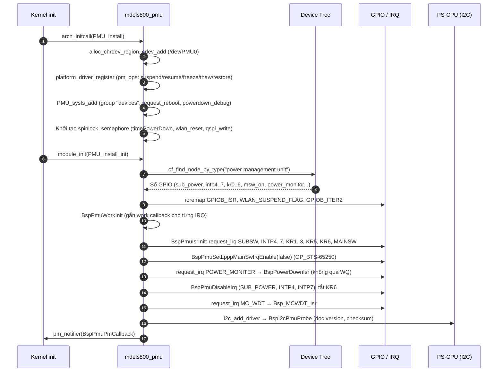
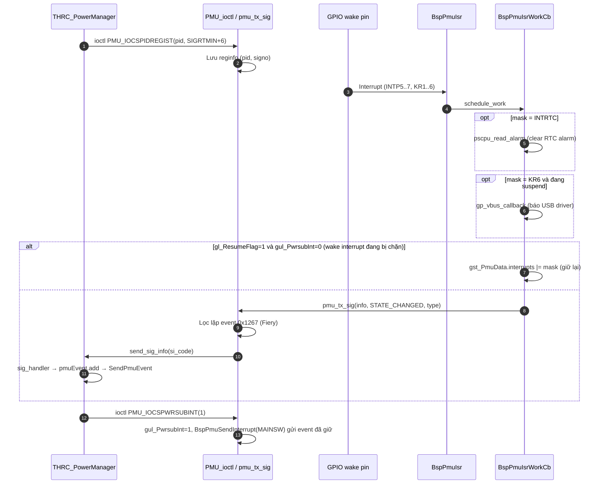
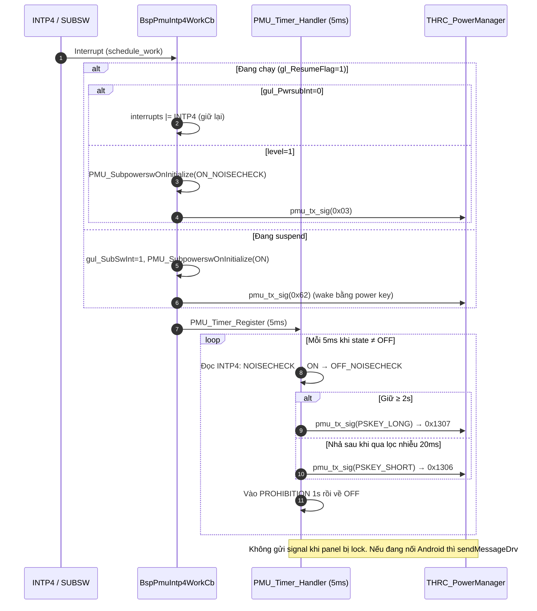
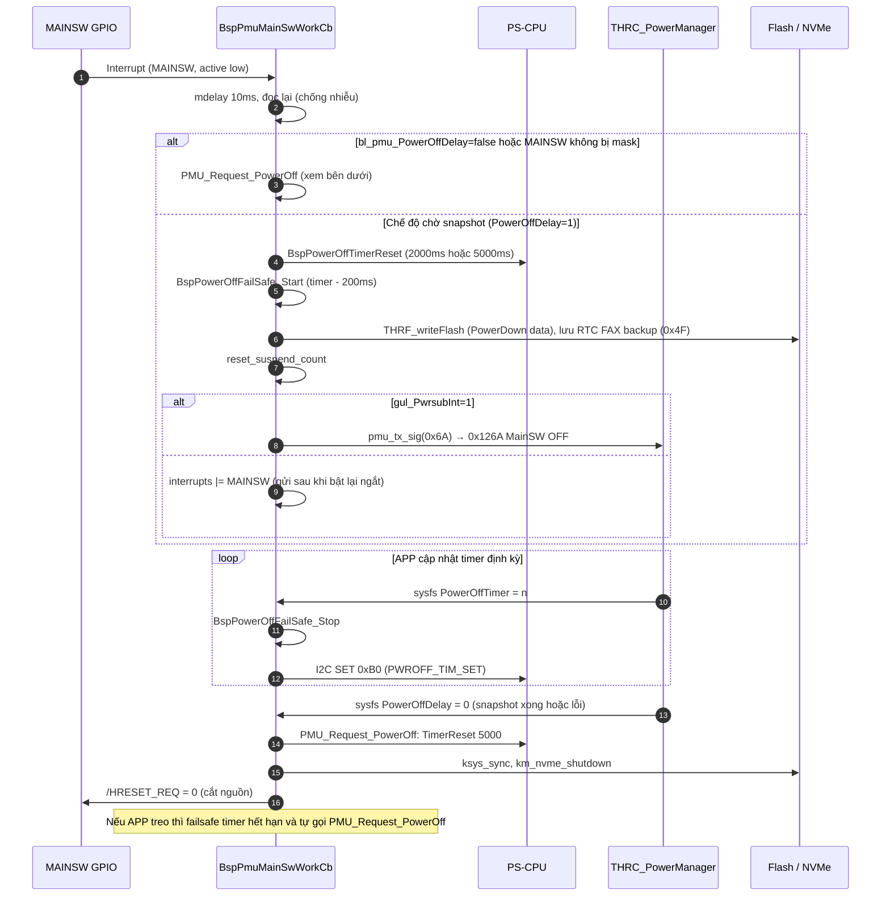
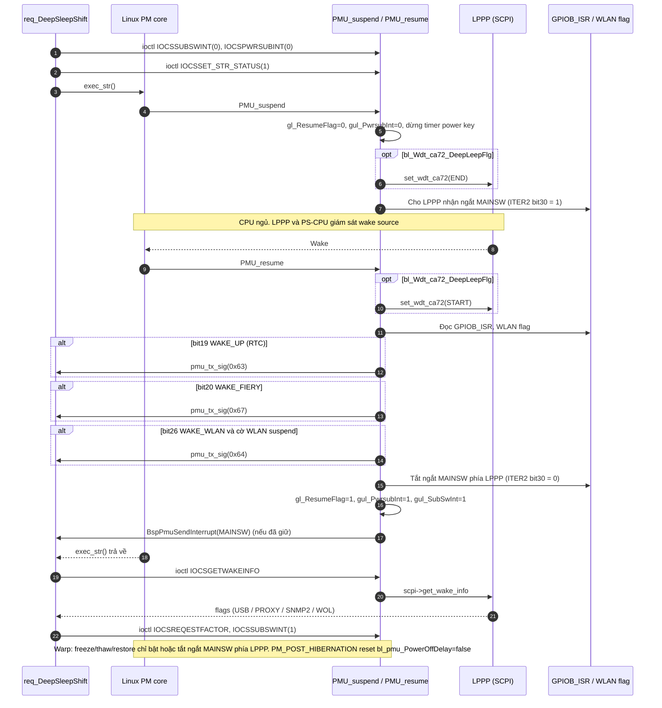
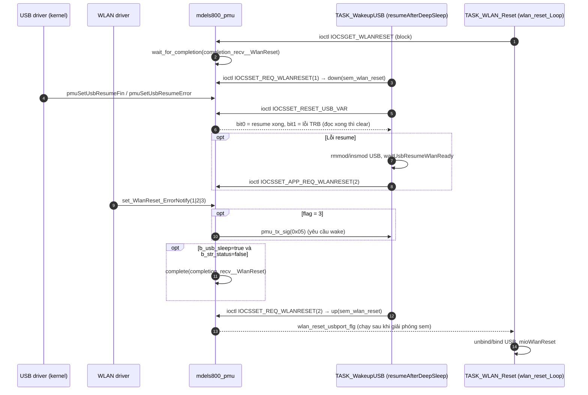
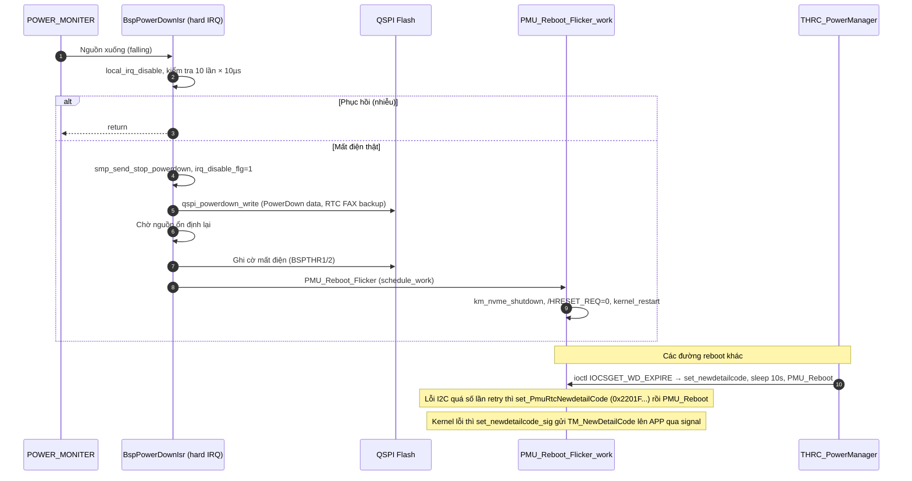
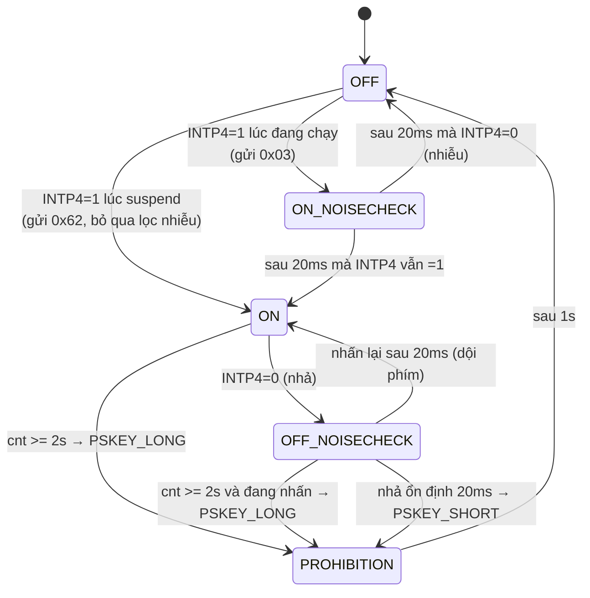
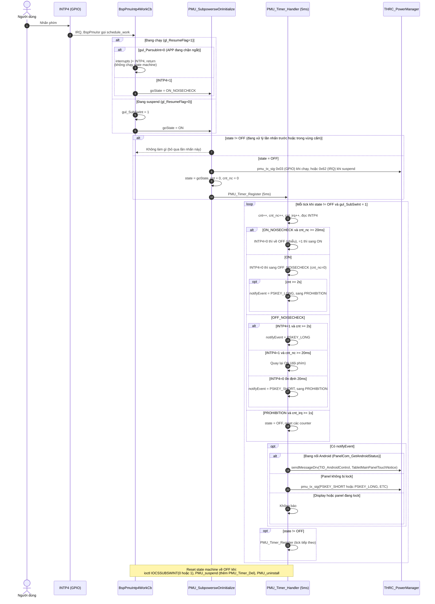

# Sequence diagram: mdels800_pmu.c (PMU driver)

Tài liệu mô tả các luồng xử lý chính của driver PMU phía kernel (`mdels800_pmu.c`) và cách nó tương tác với `THRC_PowerManager.cpp`.

## 0. Các thành phần tham gia

| Participant | Vai trò |
|---|---|
| **APP** (`THRC_PowerManager`) | Userland gọi `/dev/PMU0` (ioctl) và sysfs `/sys/.../PMU.0/devices/*` |
| **PMU** (`mdels800_pmu.c`) | Driver kernel |
| **WQ** | Workqueue (`BspPmuIsrWorkCb`, `BspPmuIntp4WorkCb`, `BspPmuMainSwWorkCb`) |
| **PSCPU** | Power Sub-CPU, giao tiếp qua I2C (`SET/CLR/GET_PSCPU`) |
| **LPPP** | Core quản lý nguồn, giao tiếp qua SCPI (`get_km_scpi_ops()`) |
| **GPIO/HW** | Các chân wake (INTP4–7, KR0–6, MAINSW, POWER_MONITER) |

## 1. Khởi tạo driver

## 2. Đăng ký và truyền event: interrupt → signal → APP

## 3. Power key (INTP4): phân biệt nhấn ngắn và nhấn dài

## 4. Main SW OFF và đường tắt nguồn

## 5. Suspend / Resume (STR) và Warp

## 6. USB resume và WLAN reset

## 7. Mất điện tức thời (POWER_MONITER) và reboot

## Ánh xạ nhanh sang `THRC_PowerManager.cpp`

| Code phía APP | Phía driver |
|---|---|
| `THRD_PMU_IOCSPIDREGIST` | Lưu `reginfo`, đích của `pmu_tx_sig` |
| `THRD_PMU_IOCSPWRSUBINT` / `IOCSSUBSWINT` | Cờ `gul_PwrsubInt` / `gul_SubSwInt`, dùng để giữ hoặc gửi event |
| `SwitchPowerState(SET_KRx/INTPx)` | sysfs `SET_KRx` → `enable_irq` / `disable_irq` |
| `SwitchPowerState(ENG_POWER, MC_PWR_EN, IR_RY...)` | `BspPsCpuStore` → I2C `SET/CLR_PSCPU` |
| `THRF_setPowerOffDelay` / `THRF_setPowerOffTimer` | sysfs `PowerOffDelay` / `PowerOffTimer` |
| `ca72wdt_ext_refresh` | `IOCSSET_WDT_CA72_EXT` → `scpi->set_wdt_ca72_ext` |
| `getNewDetailCode` | sysfs `NEW_DETAIL_CODE(_ISREBOOT)` |
| B013 / B014 | sysfs → `mtd_read` / `Bsp_mtd_write` (QSPI) |

# powerSaveKey_info

powerSaveKey_info là state machine của phím tiết kiệm điện (副電源SW, INTP4) trong mdels800_pmu. Nó dùng để chống nhiễu (debounce), phân biệt nhấn ngắn với nhấn dài, và bỏ qua các lần nhấn liên tiếp. Driver chỉ báo lên APP một event cho mỗi lần nhấn, không báo theo từng cạnh ngắt.

## Các field

| Field | Ý nghĩa | Reset khi |
|---|---|---|
| state | Trạng thái phím: OFF, ON_NOISECHECK, ON, OFF_NOISECHECK, PROHIBITION | Về OFF |
| cnt | Số tick kể từ lúc bắt đầu nhấn, dùng để phát hiện nhấn dài | Init / phát hiện xong |
| cnt_nc | Số tick trong giai đoạn lọc nhiễu | Mỗi lần đổi pha nhấn/nhả |
| cnt_irq | Số tick trong vùng cấm (PROHIBITION) | Hết vùng cấm |

Các ngưỡng tính theo tick 5ms (timeout = 5):

SUBSWITCH_NOISECHECK = 20/5: lọc nhiễu 20ms
SUBSWITCH_THRESHOLD = 2000/5: từ 2s trở lên là nhấn dài
SUBSWITCH_PROHIBITED_SECTION = 1000/5: vùng cấm 1s sau khi đã báo event

## State diagram

## Sequence
