# panelcomdrv.c – Sequence Diagrams các luồng chức năng chính

> Tài liệu phân tích `panelcomdrv.c` – Linux kernel driver giao tiếp giữa hệ thống MFP và Panel MCU qua UART.
> Mỗi luồng có sequence diagram (Mermaid) và bảng giải thích từng action: **cơ chế / mục đích / output**.

## Mục lục

1. [Tổng quan kiến trúc](#tổng-quan-kiến-trúc)
2. [Luồng 1: Khởi tạo và hủy driver](#luồng-1-khởi-tạo-và-hủy-driver)
3. [Luồng 2: Gửi lệnh xuống Panel MCU (TX)](#luồng-2-gửi-lệnh-xuống-panel-mcu-tx)
4. [Luồng 3: Nhận và phân tích dữ liệu từ Panel MCU (RX)](#luồng-3-nhận-và-phân-tích-dữ-liệu-từ-panel-mcu-rx)
5. [Luồng 4: Xử lý input (touch và hard key)](#luồng-4-xử-lý-input-touch-và-hard-key)
6. [Luồng 5: Điều khiển thiết bị panel](#luồng-5-điều-khiển-thiết-bị-panel)
7. [Luồng 6: Suspend và resume](#luồng-6-suspend-và-resume)
8. [Luồng 7: Truyền dữ liệu nhiều bước](#luồng-7-truyền-dữ-liệu-nhiều-bước)
9. [Luồng 8: Logging, xử lý lỗi và test](#luồng-8-logging-xử-lý-lỗi-và-test)
10. [Tổng kết](#tổng-kết)

---

## Tổng quan kiến trúc

```text
Ứng dụng/User space
        ↕ read / poll / ioctl
panelcomdrv.c
        ↕ UART serial protocol
Panel MCU
        ↕
Touch panel, hard key, LED, backlight, buzzer, NFC...
```

**Cách đọc nhanh:** gần như mọi thao tác đều đi qua hai "đường ống" chung:

- **Gửi (TX):** `RequestXxx` → `SetTxRingBuffer` → `AnalyzeControlTask` → UART
- **Nhận (RX):** UART → analyze ring buffer → `AnalyzeControlTask` → `AnalyzeSerialCommand`

Các luồng còn lại chủ yếu tái sử dụng hai đường ống này.

**Frame giao thức UART:**

```text
| Header | Length | Code | Data ... | Checksum |
Checksum = (~sum(Code + Data) + 1) & 0x7F   (7-bit two's complement)
```

---

## Luồng 1: Khởi tạo và hủy driver

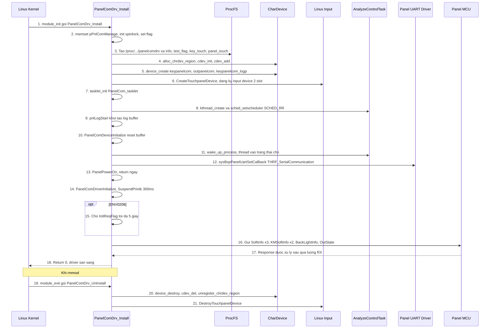

| # | Action | Cơ chế / Mục đích | Output |
|---|---|---|---|
| 1 | `module_init` | Kernel gọi hàm khởi tạo khi load module. | Driver bắt đầu setup. |
| 2 | Reset `pPnlComManage` | Xóa sạch trạng thái trung tâm và khởi tạo spinlock. Các cờ ban đầu: `InitFlag=WAIT`, `AnalyzeFlag=WAIT`, `bl_LoggingFlag=True`. `InitReqFlag` phụ thuộc việc U-Boot đã khởi tạo panel hay chưa (dựa trên `ul_VramAddr`). | Trạng thái driver sạch, các khóa sẵn sàng. |
| 3 | Tạo procfs | Tạo các entry dùng để debug và test. | Có các file trong `/proc/km/panelcomdrv/`. |
| 4 | Đăng ký char device | Xin major number và gắn bảng `file_operations` gồm open, read, poll, ioctl, close. | Kernel biết hàm nào xử lý file của driver. |
| 5 | `device_create` | Tạo device node để application mở được. | Có 3 file `/dev/...`. |
| 6 | Tạo input device | Đăng ký touch panel với Linux Input Subsystem, gồm trục X/Y và 2 slot multi-touch. | Touch event được phát theo chuẩn Linux. |
| 7 | `tasklet_init` | Chuẩn bị cơ chế chuyển phần việc từ context ngắt sang kernel thread. | Tasklet sẵn sàng. |
| 8 | Tạo `AnalyzeControlTask` | Tạo thread xử lý trung tâm, đặt lịch real-time để phản hồi nhanh. | Thread được tạo nhưng chưa chạy. |
| 9 | `pnlLogStart` | Khởi tạo ring buffer log TX/RX 64KB. | Có thể ghi log UART. |
| 10–11 | `PanelComDeviceInitialize` | Reset TX ring, analyze ring, key ring, trạng thái buzzer, sau đó đánh thức thread. | Thread chạy và chờ ở `wait_event`. |
| 12 | Đăng ký callback UART | Khi UART nhận dữ liệu, BSP sẽ gọi `THRF_SerialCommunication`. | Luồng RX được kết nối. |
| 13 | `PanelPowerOn` | Hàm có `return` ngay đầu nên phần GPIO phía sau không chạy. | Không thay đổi GPIO. |
| 14 | `SuspendPrintk` | Tạm tắt console 300ms vì `printk` có thể gây overrun UART của panel. | Console tự bật lại sau 300ms. |
| 15 | Chờ initial request | Chỉ với `ENV0208`: chờ Panel MCU sẵn sàng, tối đa 5 giây. | Tránh gửi lệnh khi MCU chưa sẵn sàng. |
| 16–17 | Gửi lệnh truy vấn | Hỏi version, KM software info, độ sáng backlight và trạng thái output. | Response cập nhật `strPnlSoftInfo`, `strKMSoftInfo`, `strBackLightInfo`... |
| 18 | Return | Load module thành công. | Driver hoạt động. |
| 19–21 | UnInstall | Hủy device, `cdev`, major number và input device. | Tài nguyên chính được giải phóng. |

> **Lưu ý:** `PanelComDrv_UnInstall` không dừng `AnalyzeControlTask`, không xóa procfs entry và không hủy timer. Cần chú ý nếu module bị unload rồi load lại.

---

## Luồng 2: Gửi lệnh xuống Panel MCU (TX)

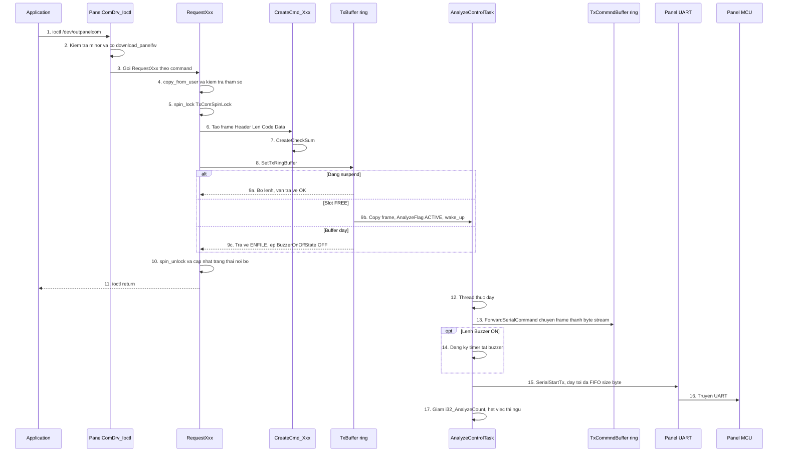

| # | Action | Cơ chế / Mục đích | Output |
|---|---|---|---|
| 1 | `ioctl` | Application yêu cầu điều khiển panel, ví dụ bật LED. | Vào driver. |
| 2 | Kiểm tra | Chỉ `/dev/outpanelcom` được nhận `ioctl`. Khi `download_panelfw=True`, các lệnh có gửi UART bị bỏ qua để không chen vào firmware download. | Lệnh bị chặn hoặc tiếp tục. |
| 3 | Dispatch | `switch(aioCmd)` chọn hàm `RequestXxx` tương ứng. | Chạy hàm xử lý đúng chức năng. |
| 4 | Validate | Copy dữ liệu từ user space vào kernel và kiểm tra giá trị hợp lệ (LED number, blink time...). | Trả `-EINVAL` / `-EFAULT` nếu lỗi. |
| 5 | Lock | Không cho nhiều luồng ghi TX ring cùng lúc. | Có quyền ghi độc quyền. |
| 6–7 | Tạo frame | Đóng gói theo giao thức `Header, Length, Code, Data, Checksum`. | Một frame hoàn chỉnh. |
| 8 | Đưa vào TX ring | TX ring là hàng đợi nhiều ô, mỗi ô chứa một frame. | Frame được xếp hàng. |
| 9a | Suspend | Khi `iIsSuspend=1`, lệnh bị bỏ nhưng vẫn trả thành công. | Lệnh mất mà caller không biết. |
| 9b | Bình thường | Đánh dấu ô `WAIT`, tăng con trỏ ghi, tăng `i32_AnalyzeCount`, đánh thức thread. | Thread được báo có việc. |
| 9c | Overflow | Hàng đợi đầy, trả `-ENFILE`. Buzzer state bị ép về `OFF` vì có thể không còn chỗ gửi lệnh tắt. | Báo lỗi lên caller. |
| 10–11 | Unlock và return | Cập nhật trạng thái driver (ví dụ `LedDutyState`), trả kết quả. | Application nhận mã kết quả. **Thành công chỉ có nghĩa lệnh đã vào hàng đợi, chưa phải đã gửi UART.** |
| 12–13 | Forward | Thread lấy frame khỏi TX ring, chuyển sang byte ring để UART đọc theo từng byte. | Dữ liệu sẵn sàng truyền. |
| 14 | Buzzer timer | Nếu là lệnh `Buzzer ON`, hẹn giờ kiểm tra để tắt buzzer (xem luồng 5b). | Timer được đăng ký. |
| 15–16 | Gửi UART | Đẩy byte vào FIFO, ghi log TX, kích hoạt UART. Phần còn lại UART driver lấy tiếp qua `PanelCom_getTxCommand`. | Panel MCU nhận lệnh. |
| 17 | Counter | Còn yêu cầu thì lặp lại, không thì thread ngủ. | Không bỏ sót yêu cầu. |

---

## Luồng 3: Nhận và phân tích dữ liệu từ Panel MCU (RX)

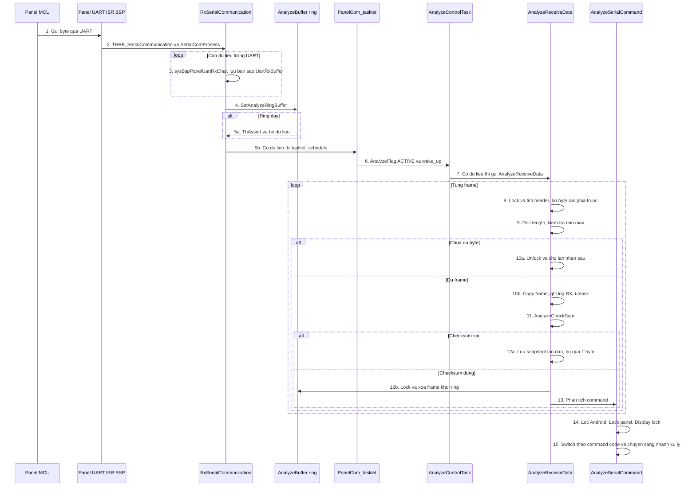

| # | Action | Cơ chế / Mục đích | Output |
|---|---|---|---|
| 1–2 | UART ngắt | MCU gửi dữ liệu, ISR của BSP gọi callback đã đăng ký ở luồng 1. | Driver được thông báo. |
| 3 | Đọc byte | Đọc hết FIFO. Mỗi byte được sao vào `UartRxBuffer` (vòng 2048 byte) để điều tra lỗi. | Có dữ liệu thô. |
| 4–5a | Vào analyze ring | Ghi vào ring 2048 byte. Ring đầy → assert và bỏ dữ liệu. | Dữ liệu chờ phân tích. |
| 5b–6 | Tasklet | **Không phân tích trong ngắt** vì ngắt phải kết thúc nhanh. Tasklet chỉ đánh thức thread. | Thread được báo có việc. |
| 7 | Bắt đầu phân tích | Thread kiểm tra ring còn dữ liệu. | Vào vòng xử lý frame. |
| 8 | Tìm header | Dữ liệu có thể nhiễu nên bỏ mọi byte trước header. Dùng `sysBspPanelSpinLock` vì ISR cũng ghi vào cùng ring. | Con trỏ ring nằm tại đầu frame. |
| 9 | Kiểm tra length | Độ dài phải trong khoảng hợp lệ. Sai → nhảy 1 byte rồi tìm header tiếp. | Loại frame hỏng. |
| 10a | Thiếu byte | Frame chưa đủ thì giữ nguyên, chờ lần nhận sau. | Không mất dữ liệu. |
| 10b | Copy frame | Copy frame ra buffer cục bộ, ghi log RX. | Có một frame đầy đủ. |
| 11–12a | Checksum sai | Lần lỗi đầu tiên chụp snapshot (UART buffer, ring, command) phục vụ điều tra D403. Sau đó nhảy 1 byte. | Frame lỗi bị loại, bằng chứng được giữ. |
| 12b | Checksum đúng | Xóa frame khỏi ring. | Ring giảm số byte chiếm. |
| 13–14 | Lọc | Ngoài ACK, suspend, NFC, các lệnh khác bị bỏ khi panel/tablet bị lock hoặc màn hình lock. Khi Android đang kết nối, chỉ một số key được xử lý. | Input bị chặn đúng điều kiện. |
| 15 | Dispatch | Chuyển sang nhánh touch, key, ACK/NACK, soft info, firmware response, NFC, suspend... | Sự kiện được xử lý (luồng 4–8). |

---

## Luồng 4: Xử lý input (touch và hard key)

### 4a. Touch panel

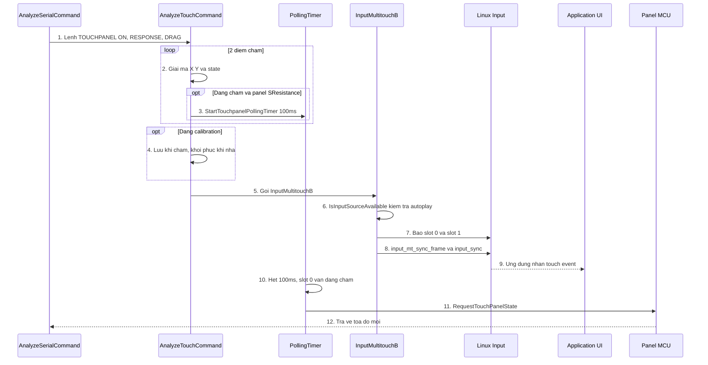

| # | Action | Cơ chế / Mục đích | Output |
|---|---|---|---|
| 1 | Nhận lệnh touch | MCU báo ngón tay chạm, kéo hoặc phản hồi tọa độ. | Vào hàm giải mã. |
| 2 | Giải mã | X/Y nằm trong 2 byte, mỗi byte 7 bit. Bit `0x40` cho biết đang chạm hay nhả. `0xFF` là không có dữ liệu. | Có `TOUCHPANEL_INFO[2]`. |
| 3 | Polling timer | Panel resistive single-touch không tự báo liên tục khi giữ tay, nên driver chủ động hỏi lại. | Timer chạy. |
| 4 | Calibration | Tọa độ lúc nhả có thể sai, nên dùng tọa độ lúc chạm và chỉ đổi state sang nhả. | Calibration chính xác hơn. |
| 5–6 | Kiểm tra nguồn | Khi autoplay đang chạy, chỉ input từ autoplay được chấp nhận. | Chặn tay người dùng chen vào test. |
| 7 | Báo slot | Mỗi ngón tay là một slot. Báo `ON/HOLD` kèm X/Y hoặc `OFF` khi nhả. Slot 2 chỉ dùng cho panel không phải resistive single-touch. | Event multi-touch type B. |
| 8–9 | Sync | Đánh dấu kết thúc một khung sự kiện để userspace nhận trọn vẹn. | Ứng dụng nhận tap, kéo, thả. |
| 10–12 | Polling | Hết 100ms mà vẫn chạm thì hỏi tọa độ mới; response quay lại bước 1. | Kéo trên resistive panel liên tục hơn. |

### 4b. Hard key

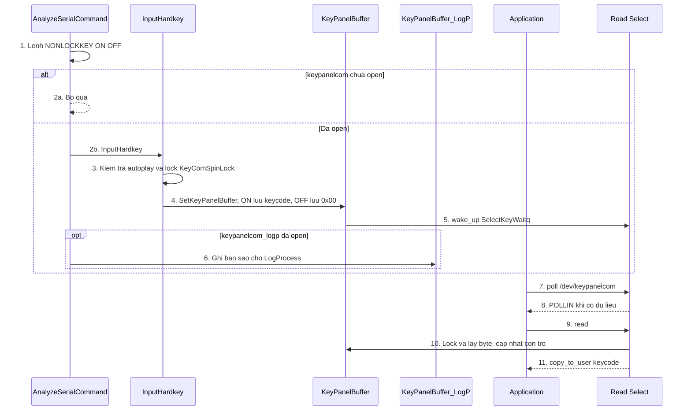

| # | Action | Cơ chế / Mục đích | Output |
|---|---|---|---|
| 1 | Key event | MCU báo phím nhấn kèm keycode, hoặc phím nhả. | Vào nhánh key. |
| 2a/2b | Kiểm tra open | Chưa có application mở `/dev/keypanelcom` thì không lưu event. | Tránh đầy buffer vô ích. |
| 3–4 | Lưu event | Ghi vào ring buffer dạng byte: khác 0 là keycode khi nhấn, `0x00` là nhả. | Event được xếp hàng. |
| 5 | Đánh thức | Báo process đang chờ `poll`. | Application được đánh thức. |
| 6 | Bản sao log | LogProcess dùng ring riêng nên không lấy mất event của application chính. | Hai consumer độc lập. |
| 7–8 | `poll` | Application ngủ đến khi có dữ liệu, không tốn CPU. | Nhận `POLLIN`. |
| 9–11 | `read` | Lấy tối đa số byte yêu cầu. Buffer rỗng → `-EAGAIN`. | Application nhận keycode. |

---

## Luồng 5: Điều khiển thiết bị panel

LED, brightness, CTSC, vibrator, sound, EEPROM write... đều theo mẫu của **luồng 2**. Hai ví dụ có logic riêng là backlight và buzzer.

### 5a. Backlight (đồng bộ với LCD/LVDS)

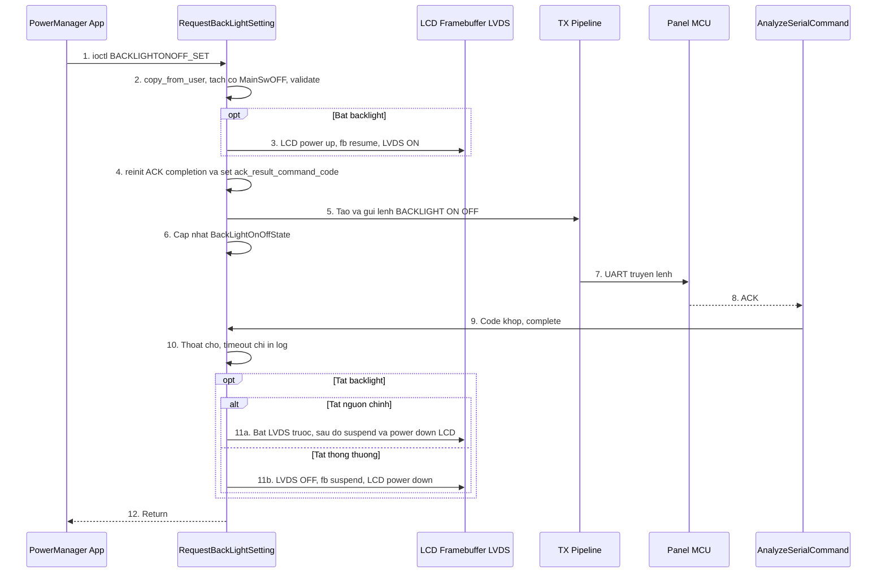

| # | Action | Cơ chế / Mục đích | Output |
|---|---|---|---|
| 1–2 | Nhận yêu cầu | Bit `MAINSWOFF` cho biết thao tác tắt đến từ tắt nguồn chính; driver tách bit này trước khi kiểm tra ON/OFF. | Có giá trị ON/OFF hợp lệ. |
| 3 | Bật LCD trước | Cần nguồn LCD, clock, tín hiệu hình trước khi bật đèn, nếu không có thể thấy màn đen/nhiễu. | LCD sẵn sàng hiển thị. |
| 4 | Chuẩn bị chờ ACK | `ack_result_command_code` cho biết ACK đang chờ thuộc lệnh nào. | Sẵn sàng chờ phản hồi. |
| 5–7 | Gửi lệnh | Lệnh đi qua TX pipeline (luồng 2). | MCU bật/tắt đèn. |
| 8–10 | Nhận ACK | ACK đúng code → `complete` đánh thức caller. Timeout chỉ log rồi tiếp tục. | Đèn đổi trạng thái hoặc có log timeout. |
| 11a | Tắt nguồn chính | Giữ LVDS ON để SuperWarp chụp snapshot không bị khung đen. | Tránh lỗi màn đen sau SuperWarp. |
| 11b | Tắt thường | Tắt ngược thứ tự bật: tín hiệu → clock → nguồn. | LCD ngừng hoạt động sạch. |
| 12 | Return | Trả kết quả cho application. | Kết thúc. |

### 5b. Buzzer (ưu tiên âm thanh và tự tắt)

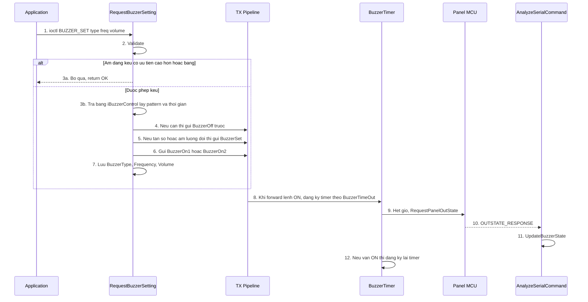

| # | Action | Cơ chế / Mục đích | Output |
|---|---|---|---|
| 1–2 | Nhận yêu cầu | Kiểm tra loại âm, tần số, âm lượng. | Tham số hợp lệ. |
| 3a | Ưu tiên | Âm quan trọng (cảnh báo lỗi) không bị âm kém quan trọng cắt ngang. Riêng âm input confirm được phép lặp. | Âm hiện tại tiếp tục. |
| 3b | Tra bảng | Mỗi loại âm có pattern bật/tắt và thời lượng riêng (ví dụ âm lỗi 8,5 giây). | Có thông số phát. |
| 4–6 | Gửi lệnh | Tắt âm cũ, đổi cấu hình nếu cần, phát âm mới. | MCU phát âm. |
| 7 | Lưu trạng thái | Dùng để so ưu tiên ở lần gọi sau. | Trạng thái cập nhật. |
| 8–12 | Theo dõi kết thúc | Driver không tự biết khi nào MCU phát xong nên hỏi trạng thái theo chu kỳ. MCU báo OFF thì timer dừng. | Trạng thái buzzer trong driver khớp phần cứng. |

---

## Luồng 6: Suspend và resume

### 6a. Do PowerManager điều khiển qua ioctl

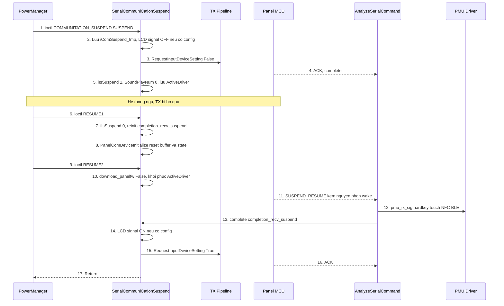

| # | Action | Cơ chế / Mục đích | Output |
|---|---|---|---|
| 1–2 | Bắt đầu suspend | Ghi nhớ pha hiện tại vào `iComSuspend_tmp` để luồng 6b sử dụng. | Pha được lưu. |
| 3–4 | Tắt input | Không nhận touch/key khi hệ thống chuyển sang ngủ; chờ ACK. | Panel ngừng gửi input. |
| 5 | Chặn TX | `iIsSuspend=1` khiến `SetTxRingBuffer` bỏ mọi lệnh. Lưu trạng thái open của các device. | Không gửi UART khi panel sắp tắt. |
| 6–8 | RESUME1 | Mở lại TX, reset toàn bộ buffer vì dữ liệu cũ không còn hợp lệ sau khi panel được cấp nguồn lại. | Driver ở trạng thái sạch. |
| 9–10 | RESUME2 | Khôi phục cờ `ActiveDriver` đã lưu (vì `PanelComDeviceInitialize` đã reset). | Application tiếp tục đọc key được. |
| 11–13 | MCU báo đã thức | Gửi lý do đánh thức cho PMU rồi `complete` để caller tiếp tục. | PMU biết nguồn đánh thức. |
| 14–16 | Bật input lại | Bật tín hiệu LCD nếu config hỗ trợ, enable touch/key, chờ ACK. | Panel hoạt động trở lại. |
| 17 | Return | Kết thúc resume. | Dùng bình thường. |

### 6b. Panel MCU tự khởi động lại (initial request/response)

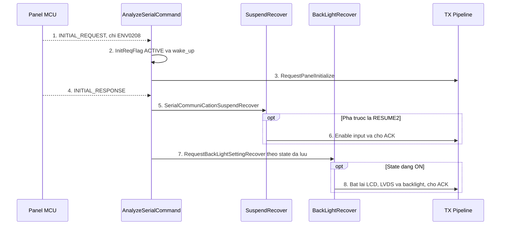

| # | Action | Cơ chế / Mục đích | Output |
|---|---|---|---|
| 1–3 | MCU xin khởi tạo | Mở khóa chỗ chờ ở luồng 1 bước 15, rồi gửi lệnh initialize (phần sửa OP_BTS-20828). | MCU được khởi tạo lại. |
| 4–6 | Khôi phục input | MCU reset sau resume làm mất cấu hình touch/key nên driver bật lại. | Input hoạt động lại. |
| 7–8 | Khôi phục đèn | Bật lại backlight theo state đã lưu. State là OFF thì hàm trả `-EINVAL`, không làm gì. | Panel sáng lại. |

---

## Luồng 7: Truyền dữ liệu nhiều bước

### 7a. Download firmware cho Panel MCU

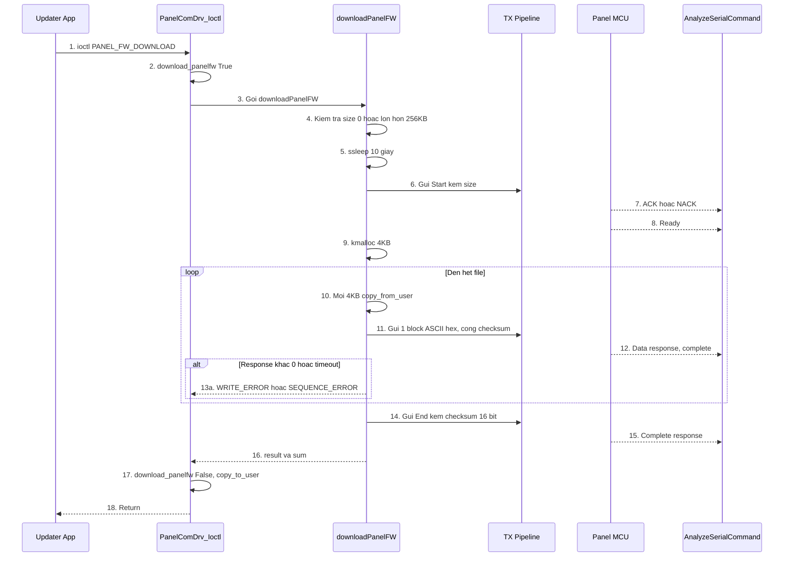

| # | Action | Cơ chế / Mục đích | Output |
|---|---|---|---|
| 1–3 | Bắt đầu | Bật cờ để chặn các `ioctl` khác gửi UART chen vào. | Chế độ download độc quyền. |
| 4 | Kiểm tra size | Không cho phép file rỗng hoặc vượt dung lượng ROM. | Có thể trả `DO_NOT_UPDATE`. |
| 5 | Chờ 10 giây | Cho hệ thống ổn định trước khi ghi ROM. | Mất cố định 10 giây. |
| 6–8 | Bắt tay | Gửi `Start`, chờ ACK rồi chờ Ready. NACK/timeout dừng ngay. | MCU vào chế độ ghi. |
| 9–10 | Lấy dữ liệu | Copy từng khối 4KB để không cấp phát bộ nhớ lớn trong kernel. | Có dữ liệu trong kernel. |
| 11 | Gửi block | Mỗi byte đổi thành 2 ký tự ASCII hex (`0x3A` → `'3''A'`) để tránh xung đột với byte header. | Một block được gửi. |
| 12–13a | Chờ từng block | **Stop-and-wait**: block trước chưa xác nhận thì chưa gửi block sau. | Phát hiện lỗi ngay tại block hỏng. |
| 14–15 | Kết thúc | MCU so checksum tổng để xác nhận toàn bộ firmware. | Có thể trả `CHECKSUM_ERROR`. |
| 16–18 | Trả kết quả | Mở lại các `ioctl` khác, báo kết quả cho application. | `result=0` nếu thành công. |

### 7b. NFC authentication (MCU chủ động gửi dữ liệu lên)

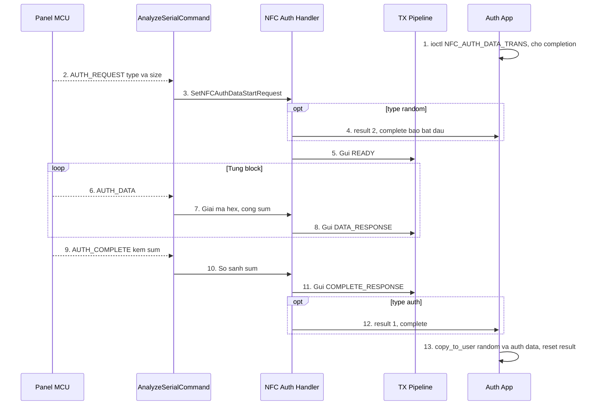

| # | Action | Cơ chế / Mục đích | Output |
|---|---|---|---|
| 1 | Application chờ | Ngược với FW download: MCU là bên gửi. Application chờ dữ liệu đến. | Thread application ngủ. |
| 2–4 | Bắt đầu | Phân biệt random data / auth data, đọc size. Nhận random data thì báo application quá trình đã bắt đầu. | Buffer sẵn sàng. |
| 5 | READY | Báo MCU được phép gửi dữ liệu. | MCU bắt đầu truyền. |
| 6–8 | Nhận block | Đổi ASCII hex về byte, cộng checksum, xác nhận từng block. | Buffer được lấp dần. |
| 9–11 | Kiểm tra tổng | Checksum sai thì trả `0x7F`. | Xác nhận toàn vẹn dữ liệu. |
| 12–13 | Hoàn tất | Đánh thức application để copy dữ liệu ra user space. | Application có dữ liệu xác thực. |

**Các luồng nhiều bước khác cùng mô hình:**

- **NFC pairing:** giống firmware download nhưng dùng completion NFC riêng, tự retry thêm một lần nếu thất bại.
- **EEPROM read:** gửi lệnh đọc rồi chờ completion tối đa 1 giây.
- **Calibration:** application chờ từng điểm calibration qua `completion_recv_CalibrationPoint`.

---

## Luồng 8: Logging, xử lý lỗi và test

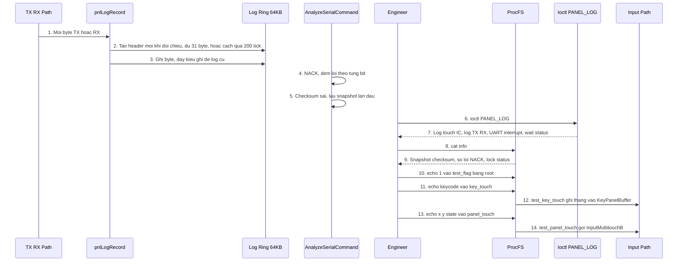

| # | Action | Cơ chế / Mục đích | Output |
|---|---|---|---|
| 1–3 | Ghi log | Gom byte thành bản ghi `TX/RX` kèm tick. Đầy 64KB thì ghi đè log cũ. | Có lịch sử giao tiếp gần nhất. |
| 4 | Đếm NACK | Mỗi bit trong mã lỗi ứng với một loại: overrun, overflow, parity, initial, checksum, length. | Thống kê lỗi theo loại. |
| 5 | Snapshot | Chỉ chụp lần checksum error đầu tiên để giữ đúng bằng chứng gốc. | Có dữ liệu điều tra D403. |
| 6–7 | `PANEL_LOG` | Dump tất cả log ra console/syslog. | Đối chiếu được TX/RX. |
| 8–9 | `/proc/.../info` | Xem snapshot, bộ đếm lỗi, trạng thái lock. | Báo cáo dạng text. |
| 10 | Bật test mode | Chỉ root được bật; điều kiện để dùng `key_touch`, `panel_touch`. | Test mode ON. |
| 11–12 | Giả lập phím | Ghi thẳng vào key buffer, **bỏ qua** kiểm tra autoplay và spinlock. | Application nhận phím giả lập. |
| 13–14 | Giả lập touch | Đi qua `InputMultitouchB` như touch thật. | Application nhận touch giả lập. |

> **Lưu ý:** Ngoài procfs còn có các `ioctl` `PSEUDO_INPUT_TOUCH`, `PSEUDO_INPUT_HARDKEY`, `SET_AUTOPLAY_STATE` cho test tự động. Trong code test qua procfs có hai điểm nên xem lại:
> - Khi test mode tắt, `proc_key_touch_write` trả `EINVAL` dương thay vì `-EINVAL`.
> - `sscanf(buf, "%d", &KeyCode)` ghi một `int` vào biến `unsigned char`, có thể ghi đè vùng nhớ stack lân cận.

---

## Tổng kết

| Luồng | Hàm trọng tâm | Cơ chế đồng bộ chính |
|---|---|---|
| 1. Install/Uninstall | `PanelComDrv_Install`, `PanelComDriverInitialize` | kthread, tasklet, wait queue |
| 2. TX | `RequestXxx`, `SetTxRingBuffer`, `ForwardSerialCommand` | `TxComSpinLock`, wake_up |
| 3. RX | `RxSerialCommunication`, `AnalyzeReceiveData`, `AnalyzeSerialCommand` | `sysBspPanelSpinLock`, tasklet |
| 4. Input | `AnalyzeTouchCommand`, `InputMultitouchB`, `InputHardkey` | `KeyComSpinLock`, poll wait queue, timer |
| 5. Device control | `RequestBackLightSetting`, `RequestBuzzerSetting` | completion ACK, buzzer timer |
| 6. Suspend/Resume | `SerialCommuniCationSuspend`, `SerialCommuniCationSuspendRecover` | `iIsSuspend`, completion suspend/ACK |
| 7. Multi-step | `downloadPanelFW`, `transNFCPairingData`, NFC auth handler | nhiều completion, stop-and-wait |
| 8. Log/Debug/Test | `pnlLogRecord`, `show_info`, `test_panel_touch` | ring buffer log, procfs |

**Hai đường ống cốt lõi cần nhớ:**

```text
TX: PanelComDrv_Ioctl → RequestXxx → SetTxRingBuffer → AnalyzeControlTask → UART
RX: UART → AnalyzeReceiveData → AnalyzeSerialCommand → xử lý sự kiện
```
