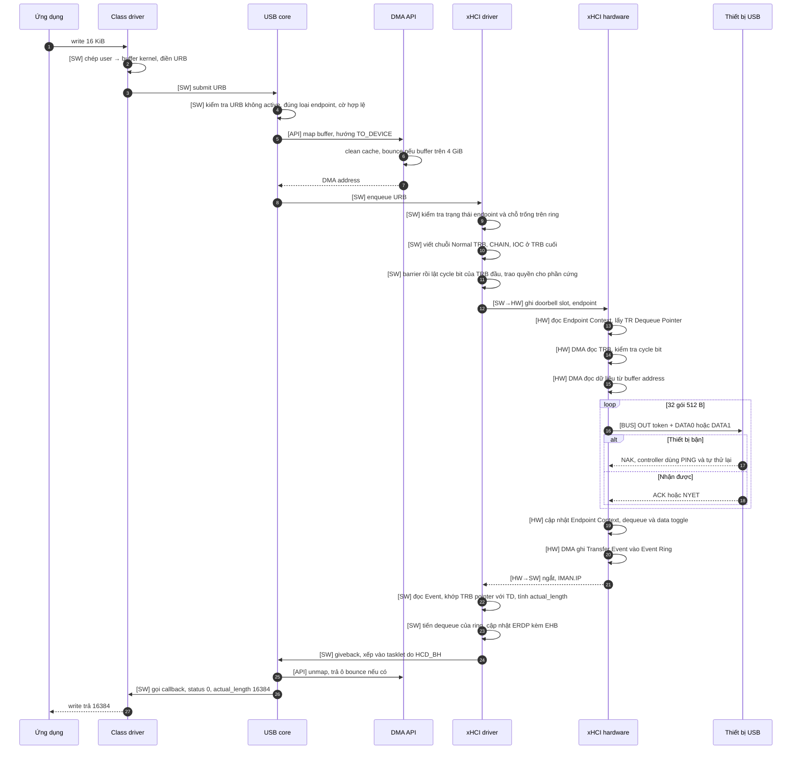
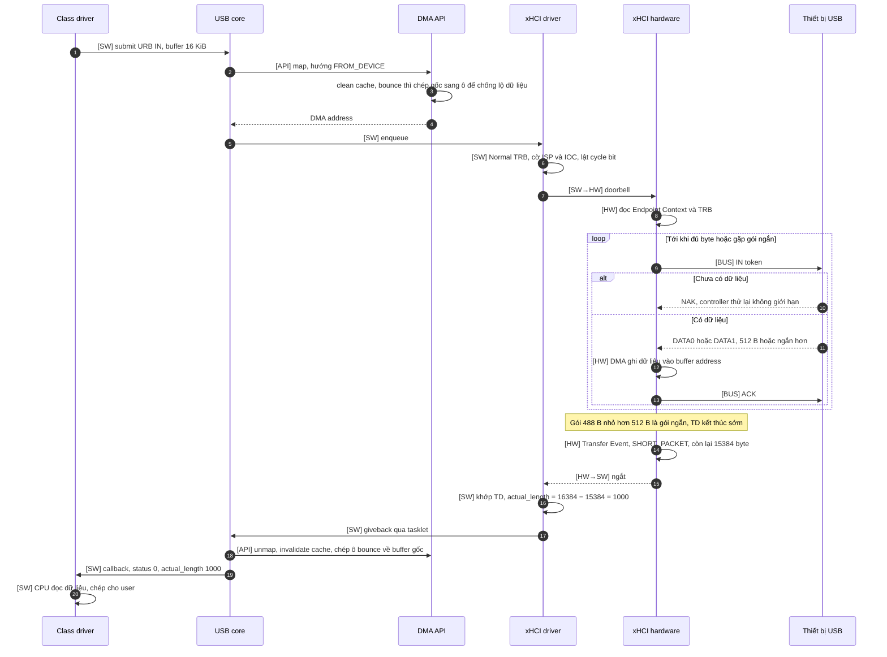
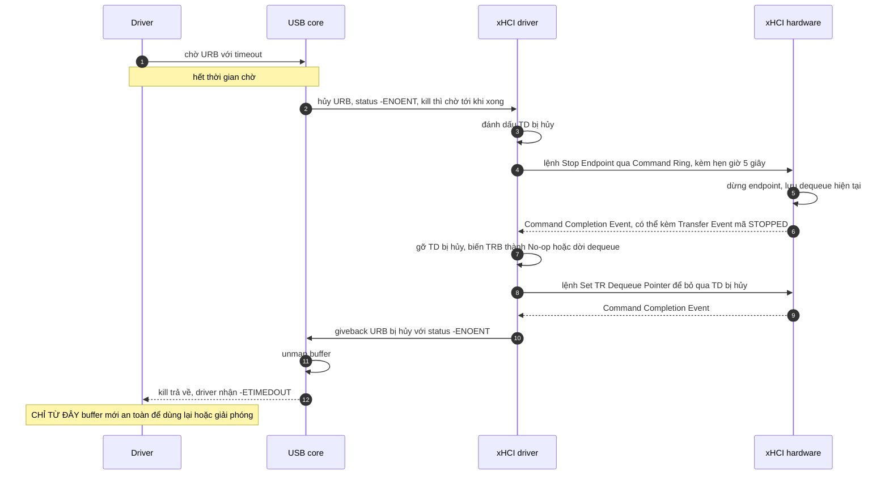

# Chương 3: Vòng đời hoàn chỉnh của một lần truyền USB DMA

> Khoá học USB DMA trên Linux Kernel. Baseline: **Linux 5.10.258** (`Kernel/Src`), board Marvell Armada Quartz EMU 800 (arm64, xHCI mask 32-bit, non-coherent, không IOMMU, SWIOTLB 64 MiB). Sơ đồ trình tự dùng Mermaid; mở bằng VS Code, GitHub hoặc mermaid.live.

## 3.0 Mục tiêu và quy ước bốn làn

Chương này theo một gói dữ liệu từ lúc ứng dụng gọi `write()`/`read()` cho tới khi URB được trả về. Mỗi bước đều được gắn vào **đúng một làn**:

| Làn | Ký hiệu | Ai thực thi | Ví dụ |
|---|---|---|---|
| CPU software | **[SW]** | CPU chạy code driver, USB core, HCD | tạo URB, viết TRB, xử lý Event |
| DMA subsystem | **[API]** | CPU chạy DMA API | đổi địa chỉ, dọn cache, chép bounce |
| Host controller hardware | **[HW]** | xHCI tự chạy | đọc TRB, đọc/ghi dữ liệu qua DMA, ghi Event |
| USB bus transaction | **[BUS]** | xHCI và thiết bị trao đổi gói | OUT/IN token, DATA, ACK/NAK |

---

## 3.1 Kiến trúc thành phần và ai làm gì

### Sơ đồ kiến trúc

```
 ┌───────────────────────────── USER SPACE ─────────────────────────────┐
 │  Ứng dụng: write(fd, buf, n) / read(fd, buf, n)                      │
 └──────────────────────────────────┬───────────────────────────────────┘
                     syscall        │  (dữ liệu user KHÔNG được DMA trực tiếp,
 ┌──────────────────────────────────▼──── KERNEL (CPU) ───────────────┐  phải chép vào kernel)
 │ [SW] Class driver (usbfax, usb-storage, cdc-acm…)                   │
 │       • chép dữ liệu user ↔ buffer kernel                           │
 │       • tạo URB, chọn endpoint, gọi submit, nhận callback           │
 │ [SW] USB Core                                                       │
 │       • kiểm tra URB (đang active? đúng loại endpoint? cờ hợp lệ?)  │
 │       • gọi map DMA, chuyển cho HCD, trả URB (giveback) + unmap     │
 │ [API] Linux DMA API (dma-direct + SWIOTLB trên Quartz)              │
 │       • virtual → DMA address, clean/invalidate, bounce             │
 │ [SW] HCD: xHCI driver                                                │
 │       • URB → TD → chuỗi TRB trên Transfer Ring                     │
 │       • bấm doorbell, xử lý ngắt, đọc Event, khớp Event ↔ TD        │
 └───────────────┬──────────────────────────────────────▲──────────────┘
          MMIO   │ doorbell, thanh ghi              IRQ │
 ┌───────────────▼──────────────────────────────────────┴──────────────┐
 │ [HW] xHCI controller (bus master)                                    │
 │       • đọc Endpoint Context, TRB, dữ liệu OUT; ghi dữ liệu IN, Event│
 └───────┬───────────────────────────────────────────────┬─────────────┘
    DMA  │ đọc/ghi                                [BUS] │ gói USB
 ┌───────▼────────────────────┐                ┌────────▼────────────┐
 │ RAM: ring, context (coherent│                │ Hub 3-1 → thiết bị  │
 │ không cache), buffer dữ liệu│                │ (FK-513, ổ USB…)    │
 │ (streaming / coherent),     │                └─────────────────────┘
 │ SWIOTLB 64 MiB              │
 └─────────────────────────────┘
```

### Cùng một dữ liệu, bốn "hình dạng" ở bốn tầng

```
 write(16384 byte)                           ← Ứng dụng
     └► 1 URB (bulk OUT, 16384 byte)         ← Class driver / USB core
          └► 1 TD (Transfer Descriptor)      ← xHCI driver: "một URB bulk = một TD"
               └► N TRB nối chuỗi (CHAIN)    ← cấu trúc phần cứng đọc, mỗi TRB ≤ 64 KiB
                    └► 32 gói DATA × 512 B   ← trên bus USB 2.0 High-Speed
                         └► 1 Transfer Event ← phần cứng báo khi xong TD (cờ IOC ở TRB cuối)
```

### Trách nhiệm từng thành phần

| Thành phần | Sở hữu gì | Làm gì | Không làm gì |
|---|---|---|---|
| Class driver | buffer dữ liệu, URB | điền URB, xử lý callback, đặt timeout và **hủy URB khi timeout** | không chạm TRB, không map trực tiếp (trừ khi tự cấp coherent) |
| USB Core | hàng đợi URB theo endpoint | kiểm tra, map/unmap, giveback, gọi callback | không biết TRB là gì |
| DMA API | không sở hữu gì lâu dài | đổi địa chỉ, giữ nhất quán cache, bounce | không chuyển dữ liệu qua USB |
| xHCI driver | ring, context, TD | dịch URB thành TRB, xử lý Event, hủy TD | không quyết định timeout của URB |
| xHCI hardware | trạng thái endpoint nội bộ | DMA, lập lịch bus, retry, báo Event | không biết URB, chỉ biết TRB |
| Thiết bị | FIFO endpoint | nhận/gửi gói, NAK khi chưa sẵn sàng | không biết gì về DMA của host |

---

## 3.2 Những gì phải có sẵn trước khi truyền

Trước khi URB đầu tiên tới một endpoint, các cấu trúc sau đã được tạo khi thiết bị được enumerate. Tất cả là bộ nhớ **coherent** (không cache trên Quartz):

```
 Thanh ghi DCBAAP ──► DCBAA (mảng con trỏ, chỉ mục = slot ID)
                        └► [slot 5] ──► Output Device Context (controller ghi, CPU đọc)
                                          ├ Slot Context (địa chỉ USB, tốc độ, cổng/hub)
                                          ├ EP0 Context
                                          ├ EP1 OUT Context ── TR Dequeue Pointer ──► Transfer Ring EP1 OUT
                                          │                    + Dequeue Cycle State     (segment ← Link TRB → segment)
                                          └ EP1 IN  Context ──► Transfer Ring EP1 IN
 Thanh ghi ERSTBA ──► ERST ──► Event Ring segment(s)      Thanh ghi ERDP: CPU đã đọc tới đâu
 Interrupter 0: IMAN (bật ngắt, cờ đang chờ), IMOD (khoảng cách tối thiểu giữa hai ngắt)
```

Chương 5 sẽ đi sâu từng cấu trúc. Ở chương này chỉ cần nhớ: **controller tìm ra TRB tiếp theo của endpoint thông qua Endpoint Context**, và báo kết quả vào **một Event Ring dùng chung** cho mọi endpoint.

---

## 3.3 Kịch bản A: Bulk OUT (host → thiết bị)

Ví dụ: ứng dụng ghi 16 KiB tới một thiết bị High-Speed, endpoint bulk OUT, max packet 512 B, buffer là `kmalloc` (streaming).

### Sơ đồ trình tự



### Diễn giải 12 bước

| # | Bước | Làn | Chuyện gì xảy ra bên trong | Có thể hỏng ở đâu, dấu hiệu |
|---|---|---|---|---|
| 1 | Ứng dụng yêu cầu gửi | SW | Driver chép dữ liệu user vào buffer kernel. Buffer user không được đưa thẳng cho DMA (trừ usbfs có cơ chế riêng) | buffer kernel cấp sai loại (stack, vmalloc) → bước 4 từ chối |
| 2 | USB core nhận URB | SW | Kiểm tra: URB **không đang active**, loại pipe khớp loại endpoint, cờ hợp lệ, độ dài hợp lệ. Tăng bộ đếm sử dụng của URB | `URB … submitted while active`, `BOGUS urb xfer …`, `BOGUS urb flags …` |
| 3 | HCD chuẩn bị | SW | USB core gọi map rồi chuyển URB cho xHCI driver. xHCI cấp cấu trúc riêng cho URB (danh sách TD), kiểm tra trạng thái endpoint | `WARN urb submitted to disabled ep`, `WARN waiting for error on ep to be cleared` |
| 4 | DMA mapping | API | (Chương 2) Clean cache. Buffer > 4 GiB thì bounce. URB ≤ 8 byte thì không map, dữ liệu nằm trong TRB (IDT) | `swiotlb buffer is full`, `transfer buffer is on stack`, submit trả `-EAGAIN` |
| 5 | Chuẩn bị TRB | SW | Số TRB = phần làm tròn lên của (độ dài + độ lệch trong khối 64 KiB) / 64 KiB. Mỗi Normal TRB mang: DMA address, độ dài, **TD Size** (số gói còn lại), interrupter. Cờ: **CHAIN** cho mọi TRB trừ TRB cuối; **IOC** ở TRB cuối. Có `URB_ZERO_PACKET` và độ dài chia hết cho max packet thì thêm một TRB rỗng. Ring hết chỗ thì nới rộng ring. **Cycle bit của TRB đầu được ghi sau cùng, sau barrier**: đây là lúc trao quyền cho phần cứng | `Ring expansion failed` |
| 6 | Controller đọc TRB | HW | Doorbell (một lần ghi MMIO, chứa slot ID và số endpoint) đánh thức endpoint. Controller dùng TR Dequeue Pointer trong Endpoint Context, đọc TRB qua DMA (có thể đọc trước nhiều TRB). TRB có cycle bit khác Cycle State nghĩa là "chưa tới lượt" thì dừng. Gặp Link TRB thì nhảy sang segment khác, có cờ Toggle Cycle thì đảo Cycle State | ring lệch đồng bộ → Event chỉ tới TRB lạ (Chương 8) |
| 7 | Controller đọc dữ liệu | HW | Đọc burst từ DMA address trong TRB vào FIFO nội bộ. CPU không tham gia | DMA address sai → **đọc nhầm RAM, không có fault** (không IOMMU) |
| 8 | Truyền trên bus | BUS | HS: token OUT + DATA0/1 512 B; thiết bị trả ACK, NAK hoặc NYET. Bị NAK thì controller dùng giao thức **PING** rồi thử lại. SS: Data Packet có số thứ tự, thiết bị trả ACK TP hoặc NRDY/ERDY. Lỗi đường truyền được thử lại tối đa 3 lần (CErr) | hết số lần thử → completion code *USB Transaction Error*, endpoint bị **Halt** |
| 9 | Controller cập nhật trạng thái | HW | Cập nhật dequeue pointer, data toggle hoặc sequence number và trạng thái endpoint trong Output Endpoint Context | trạng thái Halted/Error nếu bước 8 lỗi |
| 10 | Sinh Event | HW | Ghi **Transfer Event TRB** vào Event Ring: *địa chỉ TRB vừa xong*, completion code, *số byte chưa truyền*, slot, endpoint, cycle bit. Bật IMAN.IP, phát ngắt theo nhịp IMOD | Event Ring đầy → controller dừng ghi (Chương 8) |
| 11 | Linux xử lý | SW | Hàm ngắt kiểm tra USBSTS (lỗi hệ thống), xóa IMAN.IP, đọc từng Event khi cycle bit khớp. Với Transfer Event: tìm ring của endpoint, xét completion code, **khớp TRB pointer với TD đầu danh sách**, tính `actual_length = requested − remaining`, tiến dequeue của ring (giải phóng chỗ). Cuối cùng ghi ERDP kèm cờ EHB | `ERROR Transfer event TRB DMA ptr not part of current TD …`, `WARN Event TRB … with no TDs queued?` |
| 12 | Trả URB | SW + API | xHCI dùng **HCD_BH**, nên giveback được đẩy sang tasklet thay vì chạy trong hard IRQ. Trong tasklet: **unmap** (dọn cache, chép/trả bounce), rồi gọi callback, giảm bộ đếm sử dụng. Từ đây URB được phép submit lại | callback không bao giờ được gọi → driver timeout (xem 3.6) |

---

## 3.4 Kịch bản B: Bulk IN (thiết bị → host)

Ví dụ: driver đọc tối đa 16 KiB, thiết bị chỉ có 1000 byte để gửi.



| # | Bước | Làn | Điểm khác với OUT |
|---|---|---|---|
| 1 | Submit URB | SW | Độ dài buffer nên là bội số của max packet. Nếu thiết bị gửi nhiều hơn chỗ trống sẽ thành *babble* |
| 2 | Map `FROM_DEVICE` | API | Clean khi map (5.10.258). Bounce thì vẫn chép gốc → ô (chống lộ dữ liệu) |
| 3 | TRB | SW | Thêm cờ **ISP** (Interrupt on Short Packet) để controller báo ngay khi gói ngắn kết thúc TD |
| 4 | Bắt đầu | SW→HW | Doorbell |
| 5 | Thiết bị gửi | BUS | Thiết bị chưa có dữ liệu thì NAK (HS) hoặc NRDY (SS). **Controller thử lại không giới hạn**: một endpoint IN có thể "treo" mãi. Timeout là việc của driver |
| 6 | Controller nhận | HW | Nhận gói vào FIFO, kiểm tra CRC và data toggle |
| 7 | **Ghi vào RAM** | HW | Ghi qua DMA vào DMA address (vào ô bounce nếu có). Lúc này cache CPU có thể còn dòng cũ của vùng đó |
| 8 | Kết thúc | HW | Đủ byte → SUCCESS. Gói ngắn → **SHORT_PACKET**, kèm số byte còn lại. Thiết bị gửi quá dài → **BABBLE** (`-EOVERFLOW`), endpoint Halt |
| 9 | CPU xử lý | SW | `actual_length = requested − remaining`. Một số controller xHCI ≥ 1.0 gửi thêm một Event SUCCESS sau gói ngắn; driver bỏ qua nhờ quirk `XHCI_SPURIOUS_SUCCESS` (đây chính là nhánh đã xét ở OP_BTS-71095) |
| 10 | Unmap | API | **Invalidate** cache, rồi **chép ô bounce → buffer gốc**. Chỉ sau bước này CPU mới được đọc |

### So sánh chi tiết IN và OUT

| Tiêu chí | Bulk OUT | Bulk IN |
|---|---|---|
| Dữ liệu trong RAM do ai ghi | CPU (trước khi map) | xHCI (giữa map và unmap) |
| xHCI dùng DMA để | **đọc** dữ liệu | **ghi** dữ liệu |
| Điều tiết luồng | NAK/PING (HS), NRDY/ERDY (SS) | NAK (HS), NRDY/ERDY (SS) |
| Kết thúc TD | gửi hết và được ACK | đủ byte hoặc gặp gói ngắn |
| Gói ngắn | chỉ là gói cuối cùng | **kết thúc TD sớm**, là điều bình thường |
| Gói dài 0 byte (ZLP) | driver yêu cầu bằng `URB_ZERO_PACKET` | thiết bị gửi ZLP để báo hết dữ liệu |
| Lỗi dữ liệu đặc trưng | thiết bị nhận dữ liệu cũ (cache chưa clean, DMA address sai) | CPU đọc dữ liệu cũ (chưa invalidate, đọc trước unmap), **babble** |
| Bounce chép lúc | map | map (chống lộ) **và** unmap (dữ liệu thật) |
| Treo vô hạn khi | thiết bị NAK mãi | thiết bị không bao giờ gửi (thường gặp hơn) |

---

## 3.5 Bốn làn trên toàn vòng đời

| Giai đoạn | [SW] CPU | [API] DMA | [HW] xHCI | [BUS] USB |
|---|---|---|---|---|
| Chuẩn bị | điền URB, submit, kiểm tra | map: địa chỉ, cache, bounce | | |
| Giao việc | viết TRB, barrier, cycle bit, doorbell | | | |
| Thực thi | (CPU rảnh) | | đọc context, TRB, dữ liệu; ghi dữ liệu IN | token, DATA, ACK/NAK, retry |
| Báo cáo | | | cập nhật context, ghi Event, ngắt | |
| Hoàn tất | xử lý Event, khớp TD, giveback | unmap: cache, bounce | | |
| Gọi lại | callback của driver, có thể submit lại | | | |

**Quy tắc vàng:** trong suốt giai đoạn *Thực thi* và *Báo cáo*, buffer và các TRB đã trao thuộc về phần cứng. Software chỉ được chạm lại vào chúng sau khi Event đã được xử lý **và** URB đã được unmap, hoặc sau khi endpoint đã được **dừng hẳn** (mục 3.6).

---

## 3.6 Kịch bản C: hết thời gian chờ và hủy URB

Đây là luồng quan trọng nhất cho an toàn DMA. Khi driver hết kiên nhẫn, **phần cứng vẫn đang giữ buffer**. Nếu giải phóng hoặc dùng lại buffer ngay, controller có thể ghi vào bộ nhớ đã thuộc về người khác. Trên Quartz không có IOMMU nên việc này diễn ra âm thầm.

### Cách hủy đúng (ví dụ `usb_bulk_msg` với timeout)



| Bước | Ý nghĩa với DMA |
|---|---|
| Stop Endpoint | buộc controller ngừng truy cập buffer và TRB của endpoint |
| Gỡ TD / Set TR Dequeue | bảo đảm controller không quay lại TD đã hủy khi endpoint chạy lại |
| Giveback + unmap | trả ô bounce, dọn cache, buffer về lại CPU |
| Kill chờ tới khi xong | driver không thể vô tình dùng lại buffer quá sớm |

**Nếu controller không phản hồi Stop Endpoint trong 5 giây** (`XHCI_STOP_EP_CMD_TIMEOUT`), driver in `xHCI host not responding to stop endpoint command.` cùng `USBSTS:…`, rồi `xHCI host controller not responding, assume dead`. Controller bị coi là đã chết, và mọi URB được trả về với lỗi (Chương 8).

### Cách hủy sai: trường hợp `usbfax` trong OP_BTS-71095

```
 usbfax_write: chờ 3 s ──► hết giờ ──► return 0          (KHÔNG hủy URB)
                                       │
           URB vẫn "active" trong USB core, TD vẫn nằm trên Transfer Ring,
           buffer coherent vẫn thuộc về phần cứng
                                       │
 lần ghi sau: điền lại CHÍNH URB đó ──► submit ──► USB core: "URB … submitted while active"
                                                   ──► -EBUSY ──► driver báo lỗi EIO
```

Trường hợp này vô hại về bộ nhớ chỉ vì buffer là coherent cấp sẵn, không bị giải phóng. Nếu đây là buffer streaming bị `kfree` sau khi hết giờ, controller hoàn toàn có thể ghi vào vùng đã giải phóng.

---

## 3.7 Log trên đường truyền

Mọi log dưới đây có **câu chữ đã kiểm tra trong source 5.10.258**. Hai log đánh dấu ★ **xuất hiện thật** trong log OP_BTS-71095 của board.

### Bảng tra nhanh theo bước

| Log | Nguồn | Bước | Mức độ |
|---|---|---|---|
| ★ `URB %pK submitted while active` | `core/urb.c:378` (WARN_ONCE kèm stack) | 2 | lỗi driver |
| `BOGUS urb xfer, pipe %x != type %x` | `core/urb.c:493` | 2 | lỗi driver (cảnh báo) |
| `BOGUS urb flags, %x --> %x` | `core/urb.c:517` | 2 | lỗi driver |
| `transfer buffer is on stack` | `core/hcd.c:1501` | 4 | lỗi driver |
| `swiotlb buffer is full …` | `kernel/dma/swiotlb.c:589` | 4 | thiếu tài nguyên hoặc rò |
| `WARN urb submitted to disabled ep` | `host/xhci-ring.c:3158` | 3 | lỗi trình tự (endpoint chưa cấu hình/đã gỡ) |
| `WARN waiting for error on ep to be cleared` | `host/xhci-ring.c:3161` | 3 | endpoint đang lỗi, chờ khôi phục |
| `Ring expansion failed` | `host/xhci-ring.c:3193` | 5 | hết bộ nhớ coherent |
| ★ `ERROR Transfer event TRB DMA ptr not part of current TD ep_index %d comp_code %u` | `host/xhci-ring.c:2788` | 11 | **nghiêm trọng**: ring lệch đồng bộ |
| `WARN Event TRB for slot %d ep %d with no TDs queued?` | `host/xhci-ring.c:2682` | 11 | lệch đồng bộ (nhẹ hơn) |
| `WARN Successful completion on short TX` | `host/xhci-ring.c:2391` | 11 | quirk của controller |
| `WARN Successful completion on short TX for slot %u ep %u: needs XHCI_TRUST_TX_LENGTH quirk?` | `host/xhci-ring.c:2542` | 11 | quirk của controller |
| `URB req %u and actual %u transfer length mismatch` | `host/xhci-ring.c:805` | 11 | controller báo sai độ dài |
| `xHCI host not responding to stop endpoint command.` + `USBSTS:…` | `host/xhci-ring.c:1169-1170` | 3.6 | **nghiêm trọng** |
| `xHCI host controller not responding, assume dead` | `host/xhci-ring.c:1115` | 3.6 | **chết controller** |
| `WARN Set TR Deq Ptr cmd failed due to incorrect slot or ep state.` | `host/xhci-ring.c:1281` | 3.6 | hủy URB không trọn vẹn |

### Phân tích chi tiết

#### ★ `URB … submitted while active`

Log thật trên board (OP_BTS-71095, dòng 1677055–1677061):
```
[151955.637710] URB 00000000330743d7 submitted while active
[151955.643695] WARNING: CPU: 0 PID: 1619 at usb_submit_urb+0x4f4/0x500
 … Call trace: usb_submit_urb+0x4f4/0x500 ← usbfax_write+0xec/0x2b0 ← vfs_write ← ksys_write …
```

| Mục | Giải thích |
|---|---|
| Ý nghĩa | Driver submit một URB **vẫn chưa được trả về** từ lần submit trước |
| Nguồn | USB core, bước kiểm tra đầu tiên khi submit |
| Điều kiện | Bộ đếm sử dụng của URB khác 0, tức HCD chưa giveback |
| Trước đó | Một lần submit trước không bao giờ hoàn tất và driver không hủy nó |
| Sau đó | Submit trả `-EBUSY`. `WARN_ONCE` chỉ in lần đầu, các lần sau âm thầm |
| Cơ chế | USB core bảo vệ không để một URB (và buffer của nó) nằm trên ring hai lần |
| Nguyên nhân | (1) Driver không hủy URB khi timeout (đúng trường hợp `usbfax`). (2) HCD làm rơi Event nên không giveback (`TRB DMA ptr not part of current TD`). Thường là (2) kéo theo (1) |
| Bình thường hay lỗi | **Luôn là lỗi** |
| Cần kiểm tra | Stack trace → driver. Tìm lý do lần trước không hoàn tất: các log xHCI ngay trước đó |

#### ★ `ERROR Transfer event TRB DMA ptr not part of current TD …`

Log thật trên board: `xhci-hcd 8d00d0000.usb3: ERROR Transfer event TRB DMA ptr not part of current TD ep_index 1 comp_code 1`

| Mục | Giải thích |
|---|---|
| Ý nghĩa | Controller báo đã xong một TRB không thuộc TD mà driver đang chờ |
| Nguồn | xHCI driver, bước 11 |
| Điều kiện | Event có TRB pointer nằm ngoài khoảng [dequeue … TRB cuối của TD đầu], không rơi vào các trường hợp được bỏ qua |
| Trước đó | Bước 10: controller ghi Event. Trạng thái ring giữa phần cứng và phần mềm đã lệch từ trước |
| Sau đó | **Event bị bỏ.** TD không hoàn tất → URB không giveback → không unmap → driver timeout. Hệ quả dây chuyền: `submitted while active`, có thể `swiotlb buffer is full` nếu là buffer bounce |
| Nguyên nhân | Hủy URB sai cách, khôi phục endpoint sai, trạng thái controller sau suspend/resume, lỗi phần cứng (xem bài phân tích OP_BTS-71095) |
| Bình thường hay lỗi | **Luôn là lỗi nghiêm trọng** |
| Cần kiểm tra | Bật dump Event (đoạn `#if 0` sau dòng log), trace `xhci-hcd`, debugfs ring của endpoint |

#### `WARN urb submitted to disabled ep` và `WARN waiting for error on ep to be cleared`

| Mục | Giải thích |
|---|---|
| Ý nghĩa | xHCI driver từ chối xếp TRB vì Endpoint Context đang ở trạng thái **Disabled** hoặc **Error** |
| Điều kiện | Disabled: endpoint đã bị gỡ (đổi alternate setting, thiết bị đang bị gỡ) hoặc chưa cấu hình. Error: một lỗi trước đó làm endpoint dừng, việc khôi phục chưa xong |
| Sau đó | Submit thất bại (`-EINVAL` hoặc `-EPIPE`). Driver lớp trên nhận lỗi |
| Liên quan DMA | Buffer đã map ở bước 4 sẽ được unmap ngay khi submit thất bại |
| Cần kiểm tra | Log ngay trước: có tháo cắm, reset thiết bị, hay một lỗi STALL hoặc transaction trước đó không |

#### `Ring expansion failed`

| Mục | Giải thích |
|---|---|
| Ý nghĩa | Transfer Ring hết chỗ và không cấp thêm được segment |
| Cơ chế | Nới ring cần bộ nhớ coherent trong ngữ cảnh atomic, lấy từ atomic pool 512 KiB (log boot `DMA: preallocated …`) |
| Nguyên nhân | Driver submit dồn dập rất nhiều URB, hoặc TD **không bao giờ được hoàn tất** nên ring không giải phóng (lại là hậu quả của Event bị bỏ) |
| Cần kiểm tra | Số URB đang chờ trên endpoint; debugfs `enqueue`/`dequeue` của ring |

#### `xHCI host not responding to stop endpoint command.` → `… assume dead`

| Mục | Giải thích |
|---|---|
| Ý nghĩa | Lệnh Stop Endpoint (gửi khi hủy URB) không có Command Completion trong 5 giây |
| Trước đó | Driver hủy URB, ví dụ vì timeout |
| Sau đó | Controller bị đánh dấu chết, mọi URB được trả về với lỗi, các thiết bị biến mất |
| Cơ chế | Command Ring hoặc Event Ring không còn chạy: controller halt, gặp lỗi hệ thống (HSE), mất clock, hoặc ngắt không tới |
| Cần kiểm tra | Giá trị USBSTS in ra ngay sau (HCH halted, HSE host system error, HCE controller error). Chi tiết ở Chương 8 |

### Log-to-flow: chuỗi thật trong OP_BTS-71095

```
 lần ngược ▲                                                   chiều xuôi ▼
 ───────────────────────────────────────────────────────────────────────────
 [Hệ quả cuối]   B197 (FaxP hết bước khôi phục)
        ▲
 [Log]  write error … errno 5 ◄── submit trả -EBUSY ◄── "URB … submitted while active"   (bước 2)
        ▲
 [Log]  write error … 0x0 errno 2 ◄── usbfax_write hết 3 s, KHÔNG hủy URB                 (3.6, sai cách)
        ▲
 [Sự kiện] callback không được gọi ◄── URB không giveback ◄── TD không hoàn tất          (bước 12)
        ▲
 [Log]  "ERROR Transfer event TRB DMA ptr not part of current TD ep_index 1 comp_code 1" (bước 11)
        ▲
 [Phần cứng] controller đã truyền xong (comp_code SUCCESS), ghi Event với TRB pointer lệch (bước 10)
        ▲
 [Nguyên nhân gốc] trạng thái Transfer Ring giữa phần cứng và phần mềm không khớp sau SLEEP1
```

---

## 3.8 Tóm tắt Chương 3

1. Cùng một dữ liệu có bốn hình dạng: **write → URB → TD → TRB → gói USB**, và một **Transfer Event** khi xong.
2. USB core kiểm tra và map, xHCI driver dịch thành TRB, **phần cứng làm toàn bộ việc truyền**, CPU chỉ quay lại ở bước xử lý Event.
3. **Cycle bit của TRB đầu được ghi sau cùng** để trao quyền cho phần cứng. Doorbell chỉ là lời đánh thức.
4. Điểm hoàn tất của mọi lần truyền là **khớp TRB pointer trong Event với TD**. Hỏng ở đây thì URB không bao giờ trả về.
5. xHCI dùng **HCD_BH**: unmap và callback chạy trong tasklet, không phải trong hard IRQ.
6. **Bulk IN có thể treo vô hạn** vì controller thử lại NAK mãi. Timeout là trách nhiệm của driver.
7. **Hủy URB đúng** = Stop Endpoint → gỡ TD → Set TR Dequeue → giveback → unmap. Chỉ sau đó buffer mới an toàn. Không làm vậy (như `usbfax`) sẽ dẫn tới `submitted while active`, và với buffer streaming là nguy cơ ghi vào vùng nhớ đã giải phóng.

## Câu hỏi kiểm tra

1. Một URB bulk OUT 200 KiB, buffer bắt đầu ở DMA address 0x0801_F000. Cần bao nhiêu Normal TRB? TRB nào có cờ CHAIN, TRB nào có IOC?
2. Vì sao xHCI driver ghi cycle bit của **TRB đầu tiên** sau cùng, chứ không phải của TRB cuối?
3. Trong Bulk IN, gói 488 byte tới khi URB yêu cầu 16 KiB. Event mang completion code gì, `actual_length` bằng bao nhiêu, và vì sao đây là điều bình thường?
4. Vì sao unmap phải xảy ra **trước** callback của driver, chứ không phải sau?
5. HCD_BH thay đổi điều gì về ngữ cảnh chạy callback của driver? Nó ảnh hưởng gì tới việc gọi các hàm có thể ngủ trong callback?
6. Driver dùng buffer `kmalloc`, hết thời gian thì `kfree(buffer)` mà không hủy URB. Mô tả chuyện có thể xảy ra trên Quartz, và vì sao không có log nào báo.
7. Bạn thấy `Ring expansion failed` lặp lại trên một endpoint bulk IN. Hãy nêu hai giả thuyết và log nào giúp phân biệt chúng.
8. Từ log `xHCI host not responding to stop endpoint command.`, hãy lần ngược: driver đang làm gì, phần cứng có thể đang ở trạng thái nào, và giá trị USBSTS nào cần đọc trước tiên?
9. Trong chuỗi OP_BTS-71095, nếu `usbfax_write` đã hủy URB đúng cách khi hết giờ thì log `submitted while active` có còn xuất hiện không? Lỗi gốc có biến mất không?

---

**Chương tiếp theo:** Chương 4 đi sâu cơ chế DMA của EHCI (QH, qTD, iTD, siTD, Asynchronous và Periodic Schedule), để làm nền so sánh khi vào xHCI ở Chương 5.
