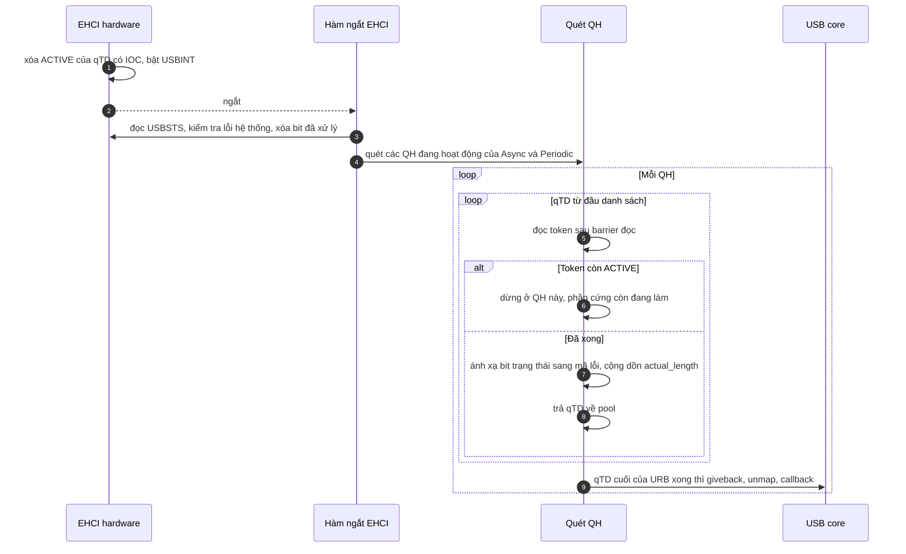
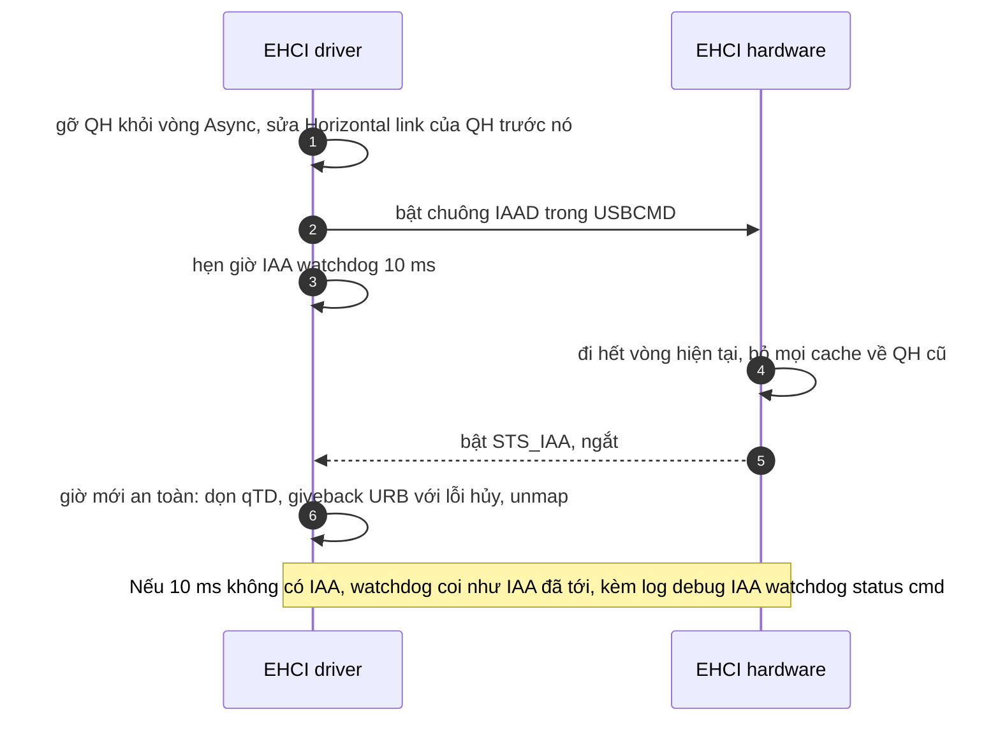
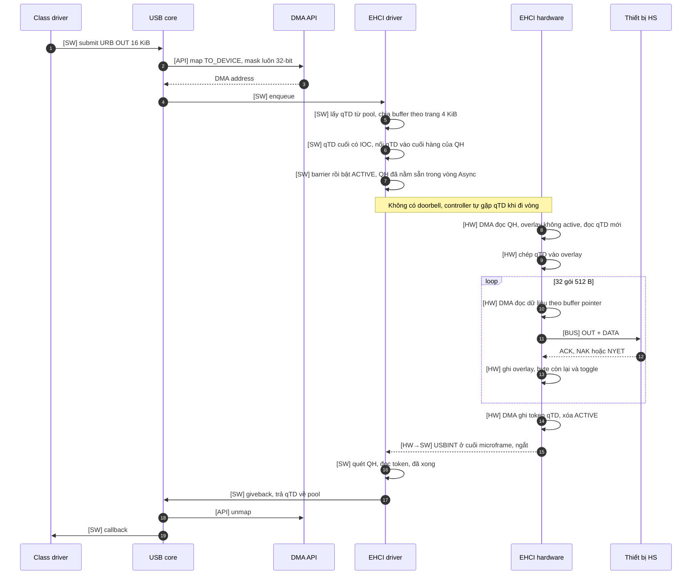

# Chương 4: Cơ chế DMA của EHCI

> Khoá học USB DMA trên Linux Kernel. Baseline: **Linux 5.10.258** (`drivers/usb/host/ehci-*.c`, `ehci.h`). Chương này học EHCI ở mức kiến trúc để làm nền so sánh với xHCI (Chương 5).

## 4.0 EHCI ở đâu trên board Quartz

- **Phần host USB của Quartz dùng xHCI cho cả USB 2.0.** Node `usb2@8D00E0000` trong DT cũng là `generic-xhci`.
- Driver EHCI được build dạng module (`CONFIG_USB_EHCI_HCD=m`).
- Danh sách module có `ci_hdrc*` (ChipIdea, IP dual-role). Ở chế độ host, IP này dùng lõi EHCI. Trên board có `g_printer`, nên ChipIdea có vẻ đang chạy ở chế độ **device**, nhưng điều này cần xác nhận.

**Vì sao vẫn cần học EHCI:** rất nhiều SoC ARM vẫn dùng EHCI (hoặc lõi EHCI trong ChipIdea). Hơn nữa, hiểu EHCI giúp thấy rõ vì sao xHCI được thiết kế lại hoàn toàn.

---

## 4.1 Bức tranh tổng thể

EHCI (Enhanced Host Controller Interface) chỉ phục vụ **USB 2.0 High-Speed**. Thiết bị Full/Low-Speed đi qua controller đồng hành (OHCI/UHCI) hoặc qua Transaction Translator (TT) trong hub High-Speed (split transaction).

### Thanh ghi chính (MMIO)

| Thanh ghi | Vai trò liên quan DMA |
|---|---|
| USBCMD | Run/Stop, bật Async Schedule (ASE), bật Periodic Schedule (PSE), chuông **Interrupt on Async Advance** (IAAD) |
| USBSTS | USBINT (hoàn tất), USBERRINT (lỗi), IAA, **Host System Error** (lỗi truy cập bộ nhớ), HCHalted |
| PERIODICLISTBASE | **DMA address** của Periodic Frame List |
| ASYNCLISTADDR | **DMA address** của QH hiện tại trong Async Schedule |
| FRINDEX | chỉ số frame/microframe hiện tại |
| CTRLDSSEGMENT | 32 bit cao của địa chỉ (chỉ dùng khi bật 64-bit) |

### Hai lịch trình (schedule) nằm trong RAM

```
            ┌──────────────────────────── RAM (coherent, không cache trên SoC non-coherent) ────────┐
 PERIODIC   │ Periodic Frame List: 1024 mục × 4 byte (mặc định)                                       │
 LISTBASE ─►│ [0] ─► iTD ─► siTD ─► QH(int 8ms) ─► QH(int 1ms) ─► T                                    │
            │ [1] ─► QH(int 1ms) ─► T          ◄── nhiều frame chia sẻ chung nhánh cây                │
            │ ...                                (isoc + interrupt: phục vụ theo thời gian)          │
            │                                                                                         │
 ASYNC      │ Async Schedule: vòng tròn QH (control + bulk: phục vụ khi còn thời gian)               │
 LISTADDR ─►│   ┌─► QH(H=1, đầu vòng) ─► QH(bulk ep1 OUT) ─► QH(bulk ep2 IN) ─► QH(ep0) ─┐           │
            │   └──────────────────────────────────────────────────────────────────────┘           │
            │        mỗi QH ─► qTD ─► qTD ─► qTD ─► T  (danh sách qTD của endpoint)                  │
            └─────────────────────────────────────────────────────────────────────────────────────────┘
```

### Bộ nhớ DMA do driver EHCI cấp (tên thật trong source)

| Đối tượng | Cách cấp | Tên pool |
|---|---|---|
| Periodic Frame List | `dma_alloc_coherent` | (không qua pool) |
| QH | DMA pool | `ehci_qh` |
| qTD | DMA pool | `ehci_qtd` |
| iTD | DMA pool | `ehci_itd` |
| siTD | DMA pool | `ehci_sitd` |

**Chi tiết quan trọng về địa chỉ:** EHCI hỗ trợ 64-bit (bit trong HCCPARAMS), nhưng trong Linux 5.10.258 đoạn bật mask 64-bit bị **tắt bằng `#if 0`** kèm comment "deeply broken on almost all architectures" (`ehci-hcd.c:598-606`). Driver chỉ ghi 0 vào CTRLDSSEGMENT. Vì vậy **EHCI trên Linux luôn dùng DMA 32-bit**: trên hệ có RAM trên 4 GiB, buffer cao luôn phải bounce.

---

## 4.2 Queue Head (QH) và qTD: vì sao cần cả hai

### Ý tưởng

| Cấu trúc | Đại diện cho | Sống bao lâu |
|---|---|---|
| **QH** (Queue Head) | **một endpoint**: địa chỉ thiết bị, số endpoint, tốc độ, max packet, thông tin hub/TT, bộ đếm NAK, cùng một **vùng overlay** chứa bản sao làm việc của qTD đang chạy | suốt thời gian endpoint được dùng |
| **qTD** (Queue Element Transfer Descriptor) | **một đoạn dữ liệu** cần truyền: bao nhiêu byte, buffer ở đâu, chiều nào, trạng thái | một lần truyền |

Tách hai lớp như vậy để thông tin "đi tới đâu" (QH) chỉ khai báo một lần, còn "truyền cái gì" (qTD) thì xếp hàng liên tục phía sau.

### Cấu trúc qTD (32 byte cơ bản)

```
 qTD
 ┌──────────────────────────────────────────────────────────────────────┐
 │ Next qTD pointer          → qTD kế tiếp (DMA address) hoặc T (kết thúc)│
 │ Alternate Next qTD pointer → nhảy tới đây nếu gặp GÓI NGẮN (IN)        │
 │ Token:                                                                │
 │   [31] data toggle   [30:16] tổng số byte CÒN LẠI   [15] IOC          │
 │   [11:10] CERR (bộ đếm lỗi, thường 3)   [9:8] PID (OUT/IN/SETUP)      │
 │   [7] ACTIVE  [6] HALTED  [5] Data Buffer Error  [4] Babble           │
 │   [3] Transaction Error  [2] Missed Micro-Frame  [1] Split state [0] Ping│
 │ Buffer pointer 0 (DMA address, có offset trong trang)                 │
 │ Buffer pointer 1..4 (DMA address đầu trang 4 KiB)                     │
 └──────────────────────────────────────────────────────────────────────┘
```

- Một qTD mang tối đa **5 con trỏ trang 4 KiB**: tối đa 20 KiB nếu buffer bắt đầu ở đầu trang, ít hơn nếu bắt đầu giữa trang. Linux chia dữ liệu theo trang trong `qtd_fill` (`ehci-q.c:37`).
- **Các trang không cần liên tục về vật lý.** Đây là một dạng scatter-gather nhỏ nằm sẵn trong descriptor.
- URB lớn được chia thành **chuỗi qTD**. qTD cuối có **IOC**.

### Cấu trúc QH

```
 QH
 ┌────────────────────────────────────────────────────────────────┐
 │ Horizontal link → QH kế tiếp trong schedule                     │
 │ Endpoint characteristics: địa chỉ, ep, tốc độ, max packet, H bit│
 │ Endpoint capabilities: S-mask/C-mask (periodic), hub, port      │
 │ Current qTD pointer  ← controller ghi: qTD đang chạy            │
 │ ─── OVERLAY (bản sao của qTD đang chạy) ───                     │
 │ Next qTD, Alt Next qTD, Token, Buffer pointer 0..4              │
 └────────────────────────────────────────────────────────────────┘
```

---

## 4.3 Phần cứng truy cập descriptor trong RAM như thế nào

### Async Schedule (bulk và control)

```
 Mỗi microframe (125 µs), sau khi xong phần periodic:
  ┌────────────────────────────────────────────────────────────────────────┐
  │ 1. DMA đọc QH tại ASYNCLISTADDR                                          │
  │ 2. Overlay đang ACTIVE?                                                   │
  │      ├─ Có → thực thi tiếp giao dịch của qTD trong overlay                │
  │      └─ Không → đọc "Next qTD" → DMA đọc qTD đó                           │
  │              → qTD ACTIVE? Có: CHÉP qTD vào overlay ("advance queue")    │
  │                            Không: bỏ qua QH này                          │
  │ 3. Thực hiện giao dịch USB (dùng buffer pointer trong overlay)           │
  │ 4. DMA GHI overlay; khi qTD xong: DMA GHI token về qTD gốc (xóa ACTIVE)  │
  │ 5. Theo Horizontal link sang QH kế tiếp, vòng tròn,                      │
  │    cho tới khi hết thời gian microframe hoặc cả vòng không có việc       │
  └────────────────────────────────────────────────────────────────────────┘
```

- Controller **liên tục đi vòng (poll)** qua danh sách. Không có doorbell cho từng endpoint: chỉ cần qTD được nối vào và có cờ ACTIVE là controller sẽ tự gặp nó.
- QH có cờ **H** (head of reclamation list) đánh dấu điểm đầu vòng, để controller biết khi nào nó đã đi hết một vòng mà không làm được gì.

### Periodic Schedule (interrupt và isochronous)

```
 FRINDEX (frame hiện tại) ─► Frame List[FRINDEX % 1024] ─► chuỗi iTD/siTD/QH cho frame đó
                                                           (cây: QH interrupt chu kỳ dài được
                                                            nhiều frame dùng chung)
 Với QH interrupt: S-mask chỉ microframe nào được phép Start; C-mask cho Complete-split.
```

---

## 4.4 Buffer dữ liệu được truy cập như thế nào

1. Buffer pointer 0 = DMA address chính xác của byte đầu (có offset trong trang).
2. Controller tự tính vị trí hiện tại = trang hiện tại + offset. Vượt ranh giới 4 KiB thì chuyển sang buffer pointer kế tiếp.
3. OUT: DMA **đọc** từ đó rồi gửi. IN: nhận gói rồi DMA **ghi** vào đó.
4. Số byte còn lại được trừ dần trong token của overlay.

---

## 4.5 Phần cứng cập nhật trạng thái thế nào

| Sự kiện | Controller ghi gì (qua DMA) |
|---|---|
| Giao dịch thành công | giảm "byte còn lại", đổi data toggle |
| Hết dữ liệu của qTD | xóa ACTIVE trong token (overlay **và** qTD gốc) |
| Gói ngắn (IN) | xóa ACTIVE, giữ số byte còn lại > 0; nếu Alt Next hợp lệ thì nhảy theo đó |
| Lỗi giao dịch (CRC, timeout) | giảm CERR, bật XactErr; CERR về 0 → **HALTED** |
| Babble | **HALTED** + Babble |
| Không kịp đọc/ghi bộ nhớ | **Data Buffer Error**: controller không kịp lấy dữ liệu (OUT underrun) hoặc không kịp ghi (IN overrun) vì truy cập RAM quá chậm |
| STALL từ thiết bị | **HALTED**, CERR vẫn khác 0 |
| qTD có IOC hoàn tất | bật USBSTS.USBINT ở cuối microframe |
| qTD lỗi | bật USBSTS.USBERRINT |

Khi một qTD bị **HALTED**, **cả QH dừng lại**. Các qTD phía sau không chạy cho tới khi phần mềm dọn dẹp.

---

## 4.6 Phần mềm phát hiện hoàn tất như thế nào

**EHCI không có Event Ring.** Ngắt chỉ báo "có gì đó xong". Driver phải **tự đi tìm**:



- Chi phí phát hiện tỉ lệ với **số QH đang hoạt động**, không phải số việc đã xong.
- Thông tin hoàn tất nằm **ngay trong descriptor** (token). Driver đọc vùng nhớ coherent mà phần cứng đã ghi.

### Ánh xạ trạng thái qTD sang mã lỗi URB (`ehci-q.c:200-245`)

| Trạng thái token | Mã lỗi | Ý nghĩa |
|---|---|---|
| Gói ngắn khi đọc (IN, còn byte) | `-EREMOTEIO` (bị xóa nếu URB chấp nhận gói ngắn) | thường không phải lỗi |
| HALTED + Babble | `-EOVERFLOW` | thiết bị gửi nhiều hơn mong đợi |
| HALTED + Missed Micro-Frame + IN | `-EPROTO` | lỡ complete-split |
| HALTED + CERR khác 0 | `-EPIPE` | **STALL** |
| HALTED + Data Buffer Error | IN: `-ENOSR`, OUT: `-ECOMM` | controller không theo kịp RAM: **lỗi phía DMA/bus bộ nhớ** |
| HALTED + Transaction Error | `-EPROTO` | 3 lần lỗi liên tiếp (CRC, timeout, PID sai). Có log debug `3strikes` |
| HALTED khác | `-EPROTO` | không rõ |

**Tự thử lại Transaction Error:** nếu qTD halt vì XactErr và CERR đã về 0, driver tự đặt lại token cho chạy tiếp, tối đa **32 lần** (`QH_XACTERR_MAX`), kèm log debug `detected XactErr len …/… retry …`. Đây là "lưới an toàn" bằng phần mềm cho đường truyền kém.

---

## 4.7 Khi descriptor không hoàn tất

### Trường hợp 1: thiết bị không trả lời (NAK mãi)

qTD giữ ACTIVE mãi, không có ngắt. Chỉ có **timeout của driver** phát hiện được. Lúc đó phải **unlink** URB.

### Trường hợp 2: unlink một QH khỏi Async Schedule (vì sao cần IAA)

Controller có thể **đang giữ bản cache** của QH trong lúc phần mềm gỡ QH khỏi vòng. Nếu phần mềm giải phóng QH hoặc buffer ngay, controller có thể vẫn đọc/ghi vào đó.



Với QH interrupt trong Periodic Schedule, driver chờ hết một frame (khoảng 1.125 ms) trước khi coi là đã gỡ xong.

**So sánh với xHCI:** IAA của EHCI tương đương bộ đôi **Stop Endpoint + Set TR Dequeue** của xHCI (Chương 3, mục 3.6). Cả hai đều nhằm cùng một việc: **chắc chắn phần cứng đã thôi chạm vào descriptor và buffer trước khi phần mềm lấy lại**.

### Trường hợp 3: qTD bị HALTED

Cả QH dừng. Driver giveback URB lỗi, dọn các qTD còn lại của URB đó, đặt lại overlay rồi cho QH chạy tiếp với URB kế tiếp. Với STALL, lớp trên phải gửi CLEAR_FEATURE(ENDPOINT_HALT).

---

## 4.8 iTD và siTD (isochronous)

| | iTD (Isochronous Transfer Descriptor) | siTD (split iTD) |
|---|---|---|
| Dùng cho | isoc **High-Speed** | isoc **Full-Speed** qua TT của hub |
| Phạm vi | **1 frame (1 ms) = 8 microframe**, mỗi microframe một slot giao dịch | 1 frame, dùng start-split/complete-split |
| Buffer | 7 con trỏ trang | 2 con trỏ trang |
| Trạng thái | mỗi slot có Active và độ dài riêng | một token trạng thái |
| Không có | retry, không có HALTED như qTD | |
| Lỗi tiêu biểu | Data Buffer Error (không kịp RAM), Babble, XactErr | Missed Micro-Frame (lỡ complete-split) |

iTD/siTD được gắn **trực tiếp vào Frame List** theo frame cần chạy. Controller chỉ chạm vào chúng đúng frame đó. Lỡ thời điểm là mất dữ liệu, vì không có thử lại.

---

## 4.9 Sơ đồ DMA hoàn chỉnh: Bulk OUT 16 KiB trên EHCI



---

## 4.10 Log của EHCI

Câu chữ đã kiểm tra trong source 5.10.258. Các log `ehci_dbg` chỉ thấy khi bật `DEBUG` hoặc dynamic debug (Quartz đang tắt).

| Log | Nguồn | Mức | Liên quan DMA |
|---|---|---|---|
| `USB %x.%x started, EHCI %x.%02x%s` | `ehci-hcd.c:659` | info, bình thường | controller đã chạy, schedule đã gắn DMA address |
| `USB %x.%x, controller refused to start: %d` | `ehci-hcd.c:651` | **lỗi** | controller không vào trạng thái Run |
| `fatal error` | `ehci-hcd.c:844` | **nghiêm trọng** | USBSTS **Host System Error**: lỗi khi controller truy cập bộ nhớ |
| `HC died; cleaning up` | `core/hcd.c:2396` | **nghiêm trọng** | USB core tuyên bố controller chết |
| `Waited too long for the controller to stop, giving up` | `ehci-timer.c:197` | lỗi | controller chết không chịu Halt |
| `qh %p should be inactive!` | `ehci-q.c:129` | cảnh báo | overlay QH còn ACTIVE khi phần mềm nghĩ nó đã dừng |
| `can't reschedule qh %p, err %d` | `ehci-sched.c:723` | lỗi | không đủ băng thông periodic để đặt lại QH interrupt |
| `port %d reset error %d` / `port %d resume error %d` | `ehci-hub.c:1088` / `1068` | lỗi | lỗi ở cổng, không phải DMA |
| `devpath %s ep%d%s 3strikes` | `ehci-q.c:237` | debug | Transaction Error sau 3 lần thử của phần cứng |
| `detected XactErr len %zu/%zu retry %d` | `ehci-q.c:376` | debug | phần mềm thử lại XactErr |
| `detected DataBufferErr for urb %p ep%d%s len %d, qtd %p [qh %p]` | `ehci-q.c:355` | debug | **controller không kịp truy cập RAM** |
| `IAA watchdog: status %x cmd %x` | `ehci-timer.c:354` | debug | ngắt IAA bị lỡ |

### Phân tích chi tiết: `fatal error` → `HC died; cleaning up`

| Mục | Giải thích |
|---|---|
| Ý nghĩa | Controller báo **Host System Error** (STS_FATAL). Theo đặc tả, nó tự Halt |
| Nguồn | Hàm ngắt EHCI, rồi USB core |
| Điều kiện phần cứng | Một giao dịch **DMA của controller thất bại trên bus hệ thống**: địa chỉ không tồn tại (master abort, decode error), lỗi chẵn lẻ hoặc ECC, IOMMU từ chối, interconnect báo lỗi |
| Trước đó | Controller đang đọc QH/qTD/frame list hoặc buffer theo một DMA address |
| Sau đó | Driver: ghi trạng thái debug → **USB core đánh dấu controller chết** → tắt Run, ASE, PSE, tắt ngắt → chờ Halt (quá lâu thì `Waited too long …`) → mọi URB được trả về lỗi (thường `-ESHUTDOWN`) → thiết bị biến mất |
| Nguyên nhân | DMA address hỏng trong descriptor (use-after-free, bộ nhớ coherent bị ghi đè), buffer bị unmap/giải phóng khi controller còn dùng, địa chỉ vượt vùng mà bus cho phép, IOMMU chưa map, lỗi phần cứng bộ nhớ |
| Bình thường hay lỗi | **Luôn nghiêm trọng** |
| Cần kiểm tra | Log IOMMU/SMMU ngay trước đó (nếu có). DMA API debug. KASAN cho use-after-free. Xem lại luồng unlink (IAA) có bị đi tắt không |

**Log-to-flow** (luồng đã đối chiếu với source 5.10.258):

```
 USB transfer đang chạy (Async hoặc Periodic)
      │
      ▼
 [HW] Controller DMA đọc/ghi theo một địa chỉ trong QH/qTD/iTD/frame list
      │  bus hệ thống trả lỗi (địa chỉ sai, IOMMU fault, lỗi bộ nhớ)
      ▼
 [HW] USBSTS.Host System Error = 1, controller tự Halt, phát ngắt
      │
      ▼
 [SW] Hàm ngắt EHCI thấy STS_FATAL ──────────────► log "fatal error"
      │
      ▼
 [SW] USB core đánh dấu controller chết ─────────► log "HC died; cleaning up"
      │
      ▼
 [SW] tắt Run/ASE/PSE, tắt ngắt, chờ Halt ───────► (nếu quá lâu) "Waited too long for the controller to stop, giving up"
      │
      ▼
 [SW] trả mọi URB về với lỗi, ngắt kết nối thiết bị

 Lần ngược: Log → hàm ngắt EHCI → bit STS_FATAL → địa chỉ DMA nào controller vừa dùng → vì sao địa chỉ đó sai
```

### Phân tích chi tiết: Data Buffer Error

| Mục | Giải thích |
|---|---|
| Ý nghĩa | Controller **không kịp** lấy dữ liệu từ RAM để gửi (OUT underrun), hoặc không kịp đổ dữ liệu nhận được xuống RAM (IN overrun) |
| Liên quan DMA | Đây là lỗi **thuần túy về độ trễ truy cập bộ nhớ** của controller, không phải lỗi đường USB |
| Nguyên nhân | Bus bộ nhớ quá tải (DMA khác chiếm băng thông), QoS interconnect ưu tiên thấp, DDR vào chế độ tiết kiệm điện có độ trễ đánh thức lớn |
| Sau đó | qTD HALTED → URB lỗi (`-ENOSR` hoặc `-ECOMM`) |
| Cần kiểm tra | Tải DMA đồng thời (màn hình, camera, mạng), cấu hình QoS của interconnect, chế độ tiết kiệm điện DDR |

---

## 4.11 Xem trước: EHCI và xHCI khác nhau ở đâu

| | EHCI | xHCI |
|---|---|---|
| Cấu trúc | danh sách liên kết (QH → qTD), 2 schedule | ring vòng tròn cho mỗi endpoint |
| Báo phần cứng có việc | không cần, controller tự đi vòng | **doorbell** |
| Báo hoàn tất | bit trong descriptor + ngắt chung, **phần mềm tự quét** | **Event Ring** ghi rõ TRB nào xong |
| DMA trên Linux | luôn 32-bit | 32 hoặc 64-bit (Quartz: 32-bit do quirk) |
| Gỡ endpoint an toàn | IAA doorbell | Stop Endpoint + Set TR Dequeue |
| Buffer trong một descriptor | tối đa 5 trang 4 KiB, không cần liên tục | một vùng liên tục, không vắt qua mốc 64 KiB |
| Tốc độ phục vụ | chỉ HS (FS/LS qua companion hoặc TT) | mọi tốc độ |

So sánh đầy đủ ở Chương 12.

---

## 4.12 Tóm tắt Chương 4

1. EHCI dùng **hai schedule trong RAM**: Periodic (Frame List → iTD/siTD/QH, theo thời gian) và Async (vòng tròn QH, khi còn thời gian).
2. **QH** = endpoint + overlay. **qTD** = một đoạn dữ liệu (≤ 5 trang 4 KiB, có thể không liên tục).
3. Controller **tự đi vòng**, không có doorbell cho từng endpoint. qTD có ACTIVE là sẽ được chạy.
4. Phần cứng báo kết quả **bằng cách ghi token** vào chính descriptor. Phần mềm phải **quét** để biết cái nào xong.
5. **HALTED** dừng cả QH. Các bit Babble, Data Buffer Error, XactErr, MMF được ánh xạ sang mã lỗi URB. **Data Buffer Error là lỗi độ trễ DMA.**
6. Gỡ QH an toàn cần **IAA**, tương đương Stop Endpoint của xHCI.
7. **Host System Error** (`fatal error` → `HC died; cleaning up`) là lỗi DMA nghiêm trọng nhất: controller đã truy cập một địa chỉ bộ nhớ không hợp lệ.
8. Driver EHCI của Linux **không dùng DMA 64-bit**.

## Câu hỏi kiểm tra

1. Vì sao QH cần vùng overlay, thay vì controller đọc thẳng qTD mỗi lần?
2. Một buffer 10 KiB bắt đầu ở offset 0xE00 trong trang. Cần bao nhiêu buffer pointer trong qTD? Một qTD có chứa hết không?
3. EHCI không có doorbell cho từng endpoint. Vậy làm sao controller biết có qTD mới? Bước nào của phần mềm "trao quyền" cho phần cứng?
4. So sánh chi phí phát hiện hoàn tất của EHCI (quét QH) với xHCI (Event Ring) khi có 50 endpoint đang mở nhưng chỉ 1 endpoint vừa xong.
5. Vì sao phải chờ IAA rồi mới giải phóng một QH đã gỡ khỏi vòng Async? Bỏ qua bước này thì điều gì có thể xảy ra trên một SoC không có IOMMU?
6. qTD báo HALTED kèm Data Buffer Error trên một endpoint bulk IN. Đây là lỗi của thiết bị, của cáp, hay của hệ thống bộ nhớ? Bạn kiểm tra gì trước?
7. Log `fatal error` rồi `HC died; cleaning up` xuất hiện ngay sau khi một driver hủy URB. Hãy nêu một giả thuyết liên quan đến unlink, và cách kiểm chứng.
8. Trên một SoC có RAM trên 4 GiB, dùng EHCI. Vì sao mọi buffer streaming nằm trên 4 GiB đều phải bounce, kể cả khi controller hỗ trợ 64-bit?

---

**Chương tiếp theo:** Chương 5 đi sâu cơ chế DMA của xHCI: Command/Transfer/Event Ring, TRB, Link TRB, Doorbell, DCBAA, Input/Output/Device Context, Interrupter, Cycle State và cách phần mềm với phần cứng phối hợp quyền sở hữu ring.
