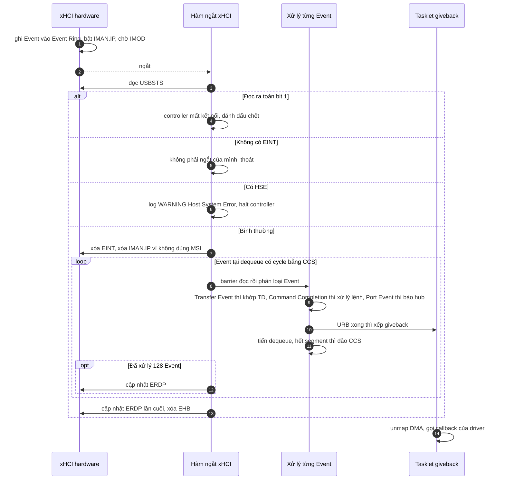
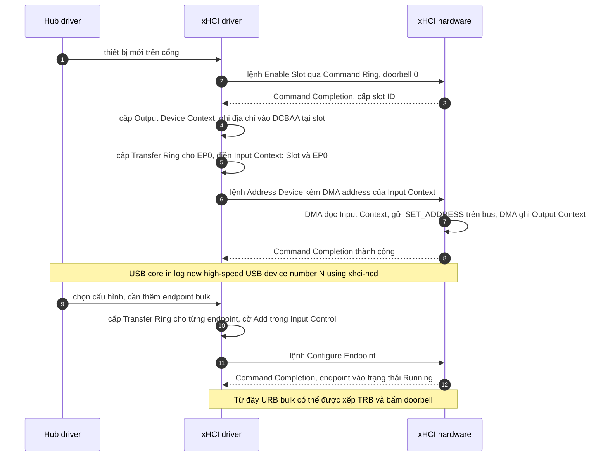

# Chương 5: Cơ chế DMA của xHCI

> Khoá học USB DMA trên Linux Kernel. Baseline: **Linux 5.10.258** (`drivers/usb/host/xhci*.c`, `xhci.h`), board Marvell Armada Quartz EMU 800: xHCI `8d00d0000.usb3` và `8d00e0000.usb2`, mask 32-bit, non-coherent, ngắt dây (SPI), không IOMMU. Hằng số và log trong chương đều đã đối chiếu với source.

## 5.0 Vì sao xHCI thiết kế lại từ đầu

| Vấn đề của thế hệ trước (UHCI/OHCI/EHCI) | Cách xHCI giải quyết |
|---|---|
| Mỗi tốc độ một loại controller (EHCI cho HS, OHCI/UHCI cho FS/LS) | **Một controller cho mọi tốc độ** (LS/FS/HS/SS) |
| Controller liên tục đi vòng qua danh sách trong RAM, kể cả khi không có việc | Controller chỉ làm việc khi được bấm **doorbell** |
| Phần mềm phải quét mọi descriptor để biết cái nào xong | Controller ghi **Event** nói rõ cái gì xong |
| Phần mềm tự lập lịch băng thông periodic (S-mask, C-mask…) | Controller tự lập lịch; phần mềm chỉ khai báo endpoint qua **lệnh** |
| Descriptor cấp phát cho từng lần truyền | **Ring** cấp sẵn, tái sử dụng vòng tròn |
| Trạng thái thiết bị do phần mềm giữ | Controller giữ trạng thái trong **Device Context**, phần mềm thay đổi bằng lệnh |

Cái giá phải trả: nhiều cấu trúc dùng chung trong RAM hơn, và **phần mềm với phần cứng phải luôn đồng ý với nhau về trạng thái từng ring**. Lỗi trong OP_BTS-71095 chính là lúc sự đồng ý đó bị phá vỡ.

---

## 5.1 Bản đồ cấu trúc DMA của xHCI

```
 ╔════════════════ MMIO (thanh ghi của controller) ═════════════════╗
 ║ Capability: HCSPARAMS (số slot, số cổng, số scratchpad),        ║
 ║             HCCPARAMS1 (AC64, kích thước context CSZ…)          ║
 ║ Operational: USBCMD (Run, INTE, HSEE, HCRST) USBSTS (HCH, HSE,  ║
 ║              EINT, PCD, SRE, CNR, HCE)                           ║
 ║              CRCR ─────────────────────────────┐ (Command Ring)  ║
 ║              DCBAAP ──────────────┐            │                 ║
 ║ Runtime: Interrupter 0: IMAN, IMOD, ERSTSZ, ERSTBA ─┐, ERDP ─┐   ║
 ║ Doorbell[0] (lệnh)  Doorbell[1..255] (từng slot) │       │   ║
 ╚══════════════════════════════════╪═══════════╪═════════╪═══════╪═══╝
                                    ▼           ▼         ▼       ▼   (mọi mũi tên = DMA address)
 ┌──────────────────────── RAM (coherent, không cache trên Quartz) ────────────────────────┐
 │ DCBAA[0] ─► Scratchpad Buffer Array ─► các trang nhớ riêng của controller                │
 │ DCBAA[n] ─► Output Device Context (slot n): Slot Ctx │ EP0 Ctx │ EP1 OUT │ EP1 IN │ …     │
 │                                                          │TR Dequeue Ptr                  │
 │                                                          ▼                                │
 │ Transfer Ring (mỗi endpoint): [TRB][TRB]…[Link]─►[TRB]…[Link+Toggle]─┐ (vòng tròn)         │
 │                                 │ buffer ptr                    └──────────┘              │
 │                                 ▼                                                         │
 │                        Buffer dữ liệu của URB (streaming hoặc coherent)                   │
 │ Command Ring: [Cmd TRB][Cmd TRB]…[Link+Toggle] (vòng tròn, 1 segment)                     │
 │ ERST: {base, size} ─► Event Ring segment: [Event][Event]…  (1 segment, 256 Event)        │
 │ Input Context (tạm, cho lệnh): Input Control (Add/Drop) │ Slot │ EP…                      │
 └──────────────────────────────────────────────────────────────────────────────────────────┘
```

| Cấu trúc | Ai ghi | Ai đọc | Cấp phát trên 5.10.258 | Kích thước |
|---|---|---|---|---|
| DCBAA | SW | HW | `dma_alloc_coherent` | 256 mục × 8 byte (`MAX_HC_SLOTS = 256`) |
| Output Device Context | **HW** | SW (chỉ đọc) | pool `xHCI input/output contexts` | 32 hoặc 64 byte mỗi context (`CTX_SIZE` theo bit CSZ) |
| Input Context | SW | HW (khi chạy lệnh) | cùng pool | như trên, thêm Input Control Context |
| Transfer Ring | SW (TRB) / HW (cycle được "tiêu thụ") | HW | pool `xHCI ring segments` | ban đầu **2 segment**, mỗi segment 256 TRB × 16 byte = **4 KiB**; tự nới rộng |
| Command Ring | SW | HW | cùng pool | **1 segment**, không được nới rộng |
| Event Ring | **HW** | SW | cùng pool + ERST bằng `dma_alloc_coherent` | **1 segment** (`ERST_NUM_SEGS = 1`) = 256 Event |
| Scratchpad | HW (bộ nhớ riêng của nó) | HW | `dma_alloc_coherent`, mỗi buffer một trang | số lượng do controller yêu cầu |
| Buffer dữ liệu | SW (OUT) / HW (IN) | HW (OUT) / SW (IN) | streaming hoặc coherent | theo URB |

---

## 5.2 TRB: đơn vị giao tiếp 16 byte

```
 TRB (Transfer Request Block) – 16 byte
 ┌───────────────────────────────────────────────┐
 │ Parameter (64 bit): thường là DMA address      │  ← buffer, segment kế tiếp, context, TRB được báo cáo…
 │ Status    (32 bit): độ dài, TD Size, interrupter, completion code (Event)
 │ Control   (32 bit): [0] CYCLE  [1] ENT/TC  [2] ISP  [4] CHAIN  [5] IOC
 │                     [6] IDT   [15:10] TRB Type  [31:16] slot/endpoint…
 └───────────────────────────────────────────────┘
```

| Nhóm | Loại TRB | Nằm ở | Ý nghĩa |
|---|---|---|---|
| Transfer | **Normal** | Transfer Ring | bulk/interrupt: một đoạn buffer |
| | Setup / Data / Status | Transfer Ring EP0 | ba giai đoạn của control transfer |
| | Isoch | Transfer Ring | isochronous |
| | **Link** | cuối mỗi segment | chỉ tới segment kế tiếp; cờ **Toggle Cycle** ở segment cuối |
| | No-op | Transfer Ring | không làm gì (dùng khi hủy TD) |
| Command | Enable/Disable Slot, Address Device, Configure Endpoint, Evaluate Context, Reset Endpoint, **Stop Endpoint**, **Set TR Dequeue Pointer**, Reset Device… | Command Ring | thay đổi trạng thái controller/thiết bị |
| Event | **Transfer Event**, **Command Completion Event**, Port Status Change, Host Controller Event, MFINDEX Wrap, Device Notification… | Event Ring | báo cáo của controller |

---

## 5.3 Vì sao dùng ring

| Lý do | Giải thích |
|---|---|
| Không cấp phát mỗi lần truyền | Ring cấp sẵn và tái sử dụng. Không phải cấp, giải phóng descriptor trên đường nóng |
| Hai bên chạy song song không cần khoá chung | Một bên **sản xuất** (producer), một bên **tiêu thụ** (consumer). Mỗi bên chỉ di chuyển con trỏ của mình |
| Quyền sở hữu nằm trong chính dữ liệu | **Cycle bit** của từng TRB cho biết TRB thuộc về ai (mục 5.4). Không cần thanh ghi "head/tail" dùng chung |
| Báo cáo có thứ tự | Event Ring ghi theo thứ tự thời gian, phần mềm đọc tuần tự |

### Segment và Link TRB

```
 Transfer Ring 2 segment (mỗi segment 4 KiB = 256 TRB, TRB cuối là Link)
 ┌───────────── Segment A ─────────────┐     ┌───────────── Segment B ─────────────┐
 │ TRB0 TRB1 … TRB254 │ LINK → seg B   │ ──► │ TRB0 TRB1 … TRB254 │ LINK → seg A   │ ──┐
 └─────────────────────────────────────┘     │                    │ + TOGGLE CYCLE │   │
        ▲                                     └─────────────────────────────────────┘   │
        └─────────────────────────────────────────────────────────────────────────────────┘
```

- Segment liên tục vật lý, nhưng các segment với nhau **không cần liên tục**.
- Khi một TD vắt qua ranh giới segment, driver chép cờ CHAIN vào Link TRB, để controller biết TD vẫn tiếp tục ở segment sau.
- Ring hết chỗ thì driver **chèn thêm segment** (ring expansion). Riêng Command Ring thì không được nới (log `Do not support expand command ring`).

---

## 5.4 Cycle bit và quyền sở hữu ring (phần quan trọng nhất)

### Quy tắc

| Ring | Producer (ghi TRB) | Consumer (đọc TRB) |
|---|---|---|
| Transfer Ring, Command Ring | **phần mềm** | **controller** |
| Event Ring | **controller** | **phần mềm** |

- Mỗi bên giữ một bit trạng thái: producer giữ **PCS** (Producer Cycle State), consumer giữ **CCS** (Consumer Cycle State).
- **Một TRB thuộc về consumer khi và chỉ khi `TRB.cycle == CCS` của consumer.**
- Đi qua Link TRB có Toggle Cycle (hoặc hết Event Ring segment) thì cả hai bên **đảo** cycle state của mình.

### Minh họa trên Transfer Ring (ring nhỏ 8 ô để dễ nhìn)

```
 Khởi tạo: mọi TRB = 0 (cycle 0). SW PCS = 1. HW CCS = 1 → mọi ô đều "chưa có việc" cho HW.

 Vòng 1, SW ghi 3 TRB:          cycle:  1   1   1   0   0   0   0   L
                                        ▲           ▲
                                     HW deq      SW enq          HW lấy ô có cycle 1 == CCS 1

 HW xử lý xong 3 ô:             HW deq ──────────►▲ (ô 3 có cycle 0 ≠ CCS 1 → dừng, chờ)

 SW ghi tiếp đến hết vòng, qua Link (Toggle) → SW PCS = 0
 Vòng 2, SW ghi 2 TRB:          cycle:  0   0   1   1   1   1   1   L
                                                ▲ SW enq
 HW tới Link (Toggle) → CCS = 0 → ô 0, 1 có cycle 0 == CCS 0 → của HW;
 ô 2 có cycle 1 (cũ của vòng 1) ≠ 0 → dừng. Không cần xóa ô cũ: cycle bit tự phân biệt vòng cũ, vòng mới.
```

### Event Ring (chiều ngược lại)

```
 Khởi tạo: mọi Event = 0. HW PCS = 1. SW CCS = 1.
 HW ghi Event với cycle = 1 ─► SW đọc từ dequeue: cycle 1 == CCS 1 → Event mới → xử lý, tiến dequeue.
 Gặp ô cycle 0 ≠ 1 → hết Event mới → dừng.
 Hết segment: HW quay về đầu và đảo PCS = 0; SW quay về đầu và đảo CCS = 0.
 SW báo cho HW đã đọc tới đâu bằng ERDP. HW không ghi đè ô chưa được báo là đã đọc.
```

### Thứ tự ghi/đọc (barrier) đã đối chiếu với source

| Phía | Thứ tự | Lý do |
|---|---|---|
| SW ghi Transfer Ring | ghi mọi trường của mọi TRB trong TD, **TRB đầu tiên ghi với cycle đảo (chưa trao)** → `wmb()` → lật cycle của TRB đầu → ghi doorbell | Controller có thể đang đọc trước ring. Lật TRB đầu sau cùng giúp **cả TD trở nên hợp lệ cùng lúc** |
| SW đọc Event Ring | đọc cycle bit → so với CCS → `rmb()` → mới đọc các trường còn lại | Không để CPU đọc trước nội dung Event cũ rồi mới thấy cycle bit mới |
| SW báo đã đọc | cứ **128 Event** (`TRBS_PER_SEGMENT / 2`) cập nhật ERDP một lần, và cập nhật lần cuối kèm xóa cờ **EHB** | Event Ring chỉ có 256 ô. Cập nhật giữa chừng giúp controller không bị đầy khi có loạt Event dài |

### Đầy ring

| Ring | Đầy nghĩa là | Phát hiện | Hậu quả |
|---|---|---|---|
| Transfer | enqueue sắp đuổi kịp dequeue | SW đếm số TRB trống (controller không báo dequeue liên tục) | nới ring; thất bại thì `Ring expansion failed` |
| Command | như trên | như trên | `ERR: No room for command on command ring` |
| Event | controller hết chỗ ghi vì SW chưa cập nhật ERDP | controller tạo **Host Controller Event** mã *Event Ring Full Error* (21) | Event có thể bị mất. Đây là lý do cập nhật ERDP mỗi 128 Event |

---

## 5.5 CPU đặt TRB lên Transfer Ring

```
 URB tới xHCI driver
   1. Kiểm tra trạng thái Endpoint (Disabled/Error → từ chối; Halted → vẫn xếp nhưng chưa chạy)
   2. Tính số TRB cần; còn đủ chỗ không? không thì thêm segment
   3. Nhớ vị trí bắt đầu và cycle state hiện tại
   4. Ghi từng TRB tại enqueue: buffer DMA address, độ dài, TD Size, cờ CHAIN/IOC/ISP
      - TRB đầu tiên ghi với cycle ĐẢO (chưa trao)
      - các TRB sau ghi với cycle ĐÚNG
      - tới Link TRB: chép CHAIN nếu TD còn tiếp, đổi cycle của Link, nhảy segment; Link có Toggle → đảo PCS
   5. wmb() → lật cycle TRB đầu → toàn bộ TD hợp lệ cùng lúc
   6. Ghi Doorbell của slot với giá trị = số endpoint (DCI) [| stream ID << 16]
```

**Driver không bấm doorbell** khi endpoint đang có lệnh Stop chờ xử lý, đang chờ Set TR Dequeue, đang Halted, hoặc đang xóa bộ đệm TT của hub. Các TRB vẫn nằm sẵn trên ring và sẽ chạy khi endpoint được khởi động lại.

---

## 5.6 DMA address cho phép phần cứng tìm thấy mọi thứ

Mọi mũi tên trong sơ đồ 5.1 đều là **DMA address**. Trên Quartz chúng đều < 4 GiB vì mask 32-bit.

| Con trỏ | Nằm ở | Trỏ tới |
|---|---|---|
| CRCR | thanh ghi | Command Ring + cycle state ban đầu |
| DCBAAP | thanh ghi | DCBAA |
| DCBAA[n] | RAM | Output Device Context của slot n |
| DCBAA[0] | RAM | mảng Scratchpad |
| TR Dequeue Pointer | Endpoint Context | TRB tiếp theo của endpoint + Dequeue Cycle State |
| Link TRB | ring | segment kế tiếp |
| Normal TRB | ring | buffer dữ liệu |
| ERSTBA / ERST | thanh ghi / RAM | bảng segment của Event Ring |
| ERDP | thanh ghi | vị trí SW đã đọc tới trong Event Ring |
| **Transfer Event** | Event Ring | **TRB vừa hoàn tất** (DMA address) |

**Chiều ngược lại:** khi nhận Transfer Event, driver phải đổi DMA address trong Event thành TRB ảo mà nó quản lý. Nó làm việc này bằng cách đi qua danh sách segment của ring từ vị trí dequeue: mỗi segment biết DMA address đầu và 256 ô. Đây chính là phép kiểm tra "TRB pointer có thuộc TD hiện tại không" trong OP_BTS-71095. **Nếu controller và driver không đồng ý về dequeue hoặc về segment, phép đổi này thất bại.**

---

## 5.7 Doorbell

```
 Doorbell array (MMIO): DB[0]   = Host Controller (Command Ring) – ghi 0
                        DB[n]   = slot n: giá trị = DCI (số endpoint 1..31) | (stream ID << 16)
 DCI: 1 = EP0, 2 = EP1 OUT, 3 = EP1 IN, 4 = EP2 OUT, …  (ep_index + 1 trong driver)
```

- Doorbell chỉ là **lời đánh thức**: "endpoint này có thể có việc". Controller tự đọc ring để biết có bao nhiêu việc.
- Bấm thừa doorbell không gây hại. Thiếu doorbell thì TRB nằm im (endpoint "treo" dù ring có việc).

---

## 5.8 Phần cứng tiêu thụ TRB và trạng thái endpoint

```
                      Configure Endpoint (thêm)
   ┌──────────┐  ───────────────────────────────►  ┌─────────┐   doorbell / có TRB
   │ Disabled │                                     │ Running │◄───────────────────┐
   └──────────┘  ◄───── Configure (bỏ) / Disable Slot └────┬────┘                    │
                                                    lỗi STALL/  │ Stop Endpoint       │
                                                  transaction/  ▼                     │
                                                    babble ┌─────────┐ doorbell /    │
                                                   ┌──────►│ Stopped │───────────────┘
                                                   │       └─────────┘ Set TR Dequeue
                                              ┌────┴────┐        ▲
                                              │ Halted  │────────┘ Reset Endpoint
                                              └─────────┘
                                              ┌─────────┐ (TRB Error, lỗi ring nghiêm trọng)
                                              │  Error  │ ── Set TR Dequeue để khôi phục
                                              └─────────┘
```

| Trạng thái | Giá trị | Controller có đọc ring không |
|---|---|---|
| Disabled | 0 | không |
| Running | 1 | **có**, khi có TRB hợp lệ |
| Halted | 2 | không, chờ Reset Endpoint |
| Stopped | 3 | không, chờ doorbell. Dequeue hiện tại đã được ghi vào Endpoint Context |
| Error | 4 | không, chờ Set TR Dequeue |

**Controller có cache nội bộ:** nó có thể giữ Endpoint Context và vài TRB trong bộ đệm riêng. Vì vậy phần mềm **không được tự sửa Output Context hay sửa TRB đã trao**. Mọi thay đổi phải đi qua **lệnh** (Stop Endpoint, Set TR Dequeue…). Sửa trực tiếp có thể không có tác dụng, hoặc tệ hơn là tạo ra lệch đồng bộ.

---

## 5.9 Phần cứng truy cập buffer dữ liệu

- Mỗi Normal TRB mô tả **một vùng liên tục**, không vắt qua mốc 64 KiB (`TRB_MAX_BUFF_SHIFT = 16`). URB lớn hoặc scatter-gather thành nhiều TRB nối CHAIN.
- **TD Size** trong TRB cho controller biết còn bao nhiêu gói phía sau, giúp nó biết khi nào gói cuối của TD được gửi.
- **IDT** (Immediate Data): tối đa 8 byte OUT nằm ngay trong trường Parameter của TRB, nên không có DMA cho dữ liệu.
- Controller đọc hoặc ghi buffer theo burst. Không có IOMMU thì địa chỉ sai **không bị chặn**.

---

## 5.10 Event Ring và Interrupter: phần cứng báo hoàn tất

### Các Event chính

| Event | Trường quan trọng | Phát sinh khi |
|---|---|---|
| **Transfer Event** | **TRB pointer**, *số byte chưa truyền*, completion code, slot, endpoint, cờ ED | TRB có IOC xong; gói ngắn với ISP; lỗi; endpoint bị Stop giữa TD |
| **Command Completion Event** | DMA address của command TRB, completion code, slot | mỗi lệnh xong |
| Port Status Change | số cổng | cắm/rút, reset xong, resume |
| Host Controller Event | completion code (ví dụ *Event Ring Full Error*) | sự cố cấp controller |
| MFINDEX Wrap, Device Notification, Bandwidth Request | | ít gặp |

### Interrupter 0 (Linux 5.10 chỉ dùng một interrupter)

| Thanh ghi | Vai trò | Trên Quartz |
|---|---|---|
| IMAN.IE / IMAN.IP | bật ngắt / cờ có ngắt đang chờ | ngắt dây (SPI 272), không MSI → **driver tự xóa IMAN.IP** trong hàm ngắt |
| IMOD | khoảng cách tối thiểu giữa hai ngắt (gộp ngắt) | mặc định `xhci-plat`: **40 µs** (40000 ns), không có thuộc tính DT ghi đè |
| ERSTSZ / ERSTBA | số segment và địa chỉ bảng ERST | 1 segment |
| ERDP (+ EHB) | vị trí SW đã đọc; ghi 1 vào EHB để báo "đã xử lý xong đợt ngắt" | |

---

## 5.11 CPU xử lý Event: luồng hàm ngắt (đã đối chiếu `xhci-ring.c:3037-3100`)



---

## 5.12 Context, lệnh và enumeration

### Input Context và Output Device Context

```
 Input Context (SW ghi, HW đọc khi chạy lệnh)        Output Device Context (HW ghi, SW chỉ đọc)
 ┌──────────────────────────────┐                     ┌──────────────────────────────┐
 │ Input Control: Drop / Add flags│ ← "context nào cần  │ Slot Context: địa chỉ USB,    │
 │ Slot Context                   │    thêm/bỏ/sửa"     │   trạng thái slot             │
 │ EP0 Context                    │                     │ EP0 … EP30 Context: trạng thái│
 │ EP1 OUT Context: loại, max pkt,│ ── lệnh ──────────► │   endpoint, TR Dequeue Ptr    │
 │   CErr, TR Dequeue Ptr + DCS,  │                     │   (HW cập nhật khi Stop…)     │
 │   Average TRB Length…          │                     └──────────────────────────────┘
 └──────────────────────────────┘                      DCBAA[slot] trỏ vào đây
```

### Trình tự enumeration (mỗi bước là một lần controller DMA đọc/ghi context)



### Scratchpad

Một số controller cần **bộ nhớ riêng trong RAM của host** để lưu trạng thái nội bộ. Driver cấp các trang coherent và đưa mảng địa chỉ của chúng vào DCBAA[0]. Chỉ controller dùng vùng này. Nếu nó bị ghi đè (con trỏ hỏng, use-after-free), controller có thể **hành xử khó lường** mà không có log nào chỉ thẳng vào nguyên nhân. Trên Quartz, scratchpad được giải phóng và cấp lại mỗi lần resume có khởi tạo lại.

### Lệnh và hết thời gian chờ của lệnh

- Mỗi lệnh có thời gian chờ **5 giây** (`XHCI_CMD_DEFAULT_TIMEOUT = 5000`). Log `Command timeout` là debug, không thấy trên Quartz.
- Hết giờ thì driver **hủy Command Ring** (bit CA trong CRCR) và chờ controller xác nhận.
- Controller không xác nhận trong 5 giây thì driver in `Abort failed to stop command ring: %d`, halt controller và coi như đã chết.

---

## 5.13 Log của chương này

Câu chữ đã kiểm tra trong source 5.10.258.

| Log | Nguồn | Mức | Nói gì |
|---|---|---|---|
| `WARNING: Host System Error` | `xhci-ring.c:3052` | **nghiêm trọng** | USBSTS.HSE: lỗi khi controller truy cập bộ nhớ hệ thống. Driver halt controller |
| `xHCI host controller not responding, assume dead` | `xhci-ring.c:1115` | **chết controller** | gọi từ nhiều chỗ: USBSTS đọc ra toàn bit 1, hủy Command Ring thất bại, Stop Endpoint không phản hồi |
| `Abort failed to stop command ring: %d` | `xhci-ring.c:380` | **nghiêm trọng** | lệnh treo, hủy không được |
| `ERR: No room for command on command ring` | `xhci-ring.c:4389` | lỗi | Command Ring đầy: controller không tiêu thụ lệnh |
| `Do not support expand command ring` | `xhci-ring.c:3184` | lỗi | như trên, không nới được |
| `ERROR event ring not ready` | `xhci-ring.c:2926` | lỗi | có ngắt nhưng Event Ring chưa tồn tại (ngắt tới khi đang khởi tạo hoặc đã giải phóng) |
| `WARN something wrong with SW event ring dequeue ptr` | `xhci-ring.c:3005` | lỗi | phần mềm không đổi được con trỏ dequeue của Event Ring sang DMA address |
| `ERROR unknown event type %d` | `xhci-ring.c:2965` | lỗi | Event có loại lạ: controller ghi rác vào Event Ring, hoặc SW đọc nhầm vị trí |
| `xHC is not running.` | `xhci-ring.c:1851` | cảnh báo | có Port Event "resume" nhưng controller không ở trạng thái Run |
| `Bad Slot ID %d` / `Slot ID %d is not assigned to this device` | `xhci-mem.c:998` / `1126` | lỗi | Enable Slot trả slot không hợp lệ, hoặc lệch giữa slot và thiết bị |
| ★ `ERROR Transfer event TRB DMA ptr not part of current TD …` | `xhci-ring.c:2788` | **nghiêm trọng** | Transfer Ring lệch đồng bộ (xem 5.14) |

### Phân tích chi tiết: `WARNING: Host System Error`

| Mục | Giải thích |
|---|---|
| Ý nghĩa | Controller báo **HSE**: một giao dịch bộ nhớ của nó thất bại nghiêm trọng. Theo đặc tả, controller tự dừng (HCH = 1) |
| Nguồn | Hàm ngắt xHCI khi thấy bit `STS_FATAL` trong USBSTS |
| Trước đó | Controller DMA vào: context, ring, ERST, scratchpad, hoặc buffer dữ liệu |
| Sau đó | Driver gọi halt và thoát hàm ngắt. **Không xử lý Event nào nữa.** Mọi URB sẽ treo cho tới khi có timeout (Stop Endpoint không phản hồi → `assume dead`) |
| Cơ chế | Interconnect trả lỗi cho giao dịch của controller (địa chỉ không ánh xạ, quyền truy cập, ECC), hoặc IOMMU fault trên SoC có IOMMU |
| Nguyên nhân | DMA address hỏng trong TRB/context (ghi đè bộ nhớ coherent), use-after-free của segment/context, buffer bị giải phóng khi controller còn dùng, cấu hình bộ nhớ sau resume sai (ví dụ ghi DCBAAP/ERSTBA trỏ vào vùng đã giải phóng), mask sai cho phép địa chỉ vượt 32-bit |
| Bình thường hay lỗi | **Luôn nghiêm trọng** |
| Cần kiểm tra | Log ngay trước (resume? hủy URB?). Dump debugfs của ring/context nếu còn truy cập được. Bật KASAN và DMA API debug khi tái hiện |

```
 Log-to-flow (đối chiếu xhci-ring.c:3037-3056):
 [HW] controller DMA tới một địa chỉ ──► bus trả lỗi ──► USBSTS.HSE=1, HCH=1, ngắt
 [SW] hàm ngắt: USBSTS ≠ toàn bit 1, có EINT, có HSE ──► "WARNING: Host System Error" ──► halt
 [SW] các URB không bao giờ có Event ──► driver lớp trên timeout ──► hủy URB ──► Stop Endpoint
 [SW] 5 s không có Command Completion ──► "xHCI host not responding to stop endpoint command."
      ──► "xHCI host controller not responding, assume dead" ──► thiết bị biến mất
 Lần ngược: log HSE → địa chỉ nào controller vừa dùng → con trỏ trong TRB/context/thanh ghi nào → ai đã ghi sai/giải phóng nó
```

---

## 5.14 Áp mô hình ring vào OP_BTS-71095

```
 Phần mềm nghĩ (Transfer Ring EP1 OUT):          Phần cứng báo (Transfer Event):
   dequeue ──► [TRB a][TRB b][TRB c]  (TD hiện tại)    "đã xong TRB tại DMA address X, SUCCESS"
                                       ▲
                                       X KHÔNG nằm trong [dequeue … TRB c]
 Các khả năng (theo mô hình ring):
  1. X thuộc một TD CŨ đã bị phần mềm coi là xong/hủy  → phần mềm đi trước phần cứng
  2. X thuộc segment mà phần mềm không còn coi là của ring → segment bị giải phóng/cấp lại
  3. X không thuộc ring nào (rác)                       → controller đọc context/TRB sai, lỗi DMA hoặc phần cứng
  4. Controller dùng dequeue/cycle state cũ trong cache nội bộ sau một thay đổi không qua lệnh
 Phân biệt: bật đoạn dump Event (đang #if 0) để có X; so với debugfs ring (segment, enqueue, dequeue)
```

Đây là lý do việc bật lại dump Event khi tái hiện là bước điều tra số một cho ticket này.

---

## 5.15 Tóm tắt Chương 5

1. xHCI thay việc controller đi vòng và phần mềm tự quét bằng **doorbell + Event Ring**, và giao việc quản lý thiết bị cho controller qua **context + lệnh**.
2. Mọi cấu trúc dùng chung là bộ nhớ coherent (không cache trên Quartz). Mọi con trỏ giữa chúng là **DMA address**, trên Quartz luôn < 4 GiB.
3. **TRB 16 byte**, segment 256 TRB = 4 KiB. Transfer Ring bắt đầu với 2 segment và nới được. Command Ring và Event Ring mỗi cái 1 segment.
4. **Cycle bit quyết định quyền sở hữu**: TRB thuộc consumer khi cycle == CCS. Link TRB có Toggle Cycle khép vòng. TRB đầu của TD được lật sau cùng, sau `wmb()`.
5. Doorbell chỉ đánh thức. Driver không bấm khi endpoint đang dừng, đang chờ Set TR Dequeue hoặc đang Halted.
6. Controller có **cache nội bộ**: mọi thay đổi trạng thái endpoint phải đi qua lệnh.
7. Hàm ngắt kiểm tra USBSTS (toàn bit 1, EINT, HSE), xử lý Event khi cycle khớp, cập nhật ERDP mỗi 128 Event.
8. **HSE** là lỗi DMA nghiêm trọng nhất của xHCI. **TRB pointer không thuộc TD** là dấu hiệu ring lệch đồng bộ giữa phần mềm và phần cứng.

## Câu hỏi kiểm tra

1. Vì sao xHCI không cần thanh ghi "head/tail" chung cho Transfer Ring như nhiều NIC? Cycle bit thay thế vai trò đó thế nào?
2. Ring 2 segment, mỗi segment 256 TRB. Có bao nhiêu TRB thực sự dùng cho dữ liệu? Khi nào phần mềm đảo PCS?
3. Nếu driver lật cycle bit của **TRB cuối** trước rồi mới ghi TRB đầu, điều gì có thể xảy ra khi controller đang đọc trước ring?
4. Vì sao driver cập nhật ERDP sau mỗi 128 Event, thay vì chỉ một lần ở cuối hàm ngắt?
5. Trên Quartz không dùng MSI. Bước nào trong hàm ngắt tồn tại chỉ vì lý do này?
6. Vì sao phần mềm không được sửa TR Dequeue Pointer trong Output Context trực tiếp, mà phải dùng lệnh Set TR Dequeue Pointer?
7. Liệt kê các lần controller **DMA đọc** và **DMA ghi** trong lệnh Address Device.
8. Từ log `WARNING: Host System Error` ngay sau một lần resume, hãy nêu ba con trỏ trong thanh ghi hoặc context mà bạn nghi ngờ đầu tiên, và vì sao.
9. Với log `ERROR Transfer event TRB DMA ptr not part of current TD`, bạn cần thu thêm những dữ liệu gì để phân biệt bốn khả năng ở mục 5.14?

---

**Chương tiếp theo:** Chương 6 đi sâu cache coherency và đồng bộ bộ nhớ: cache CPU, clean và invalidate, coherent và non-coherent DMA, barrier, ba kịch bản CPU/USB truy cập cùng vùng nhớ, và những gì hỏng khi đồng bộ sai.
