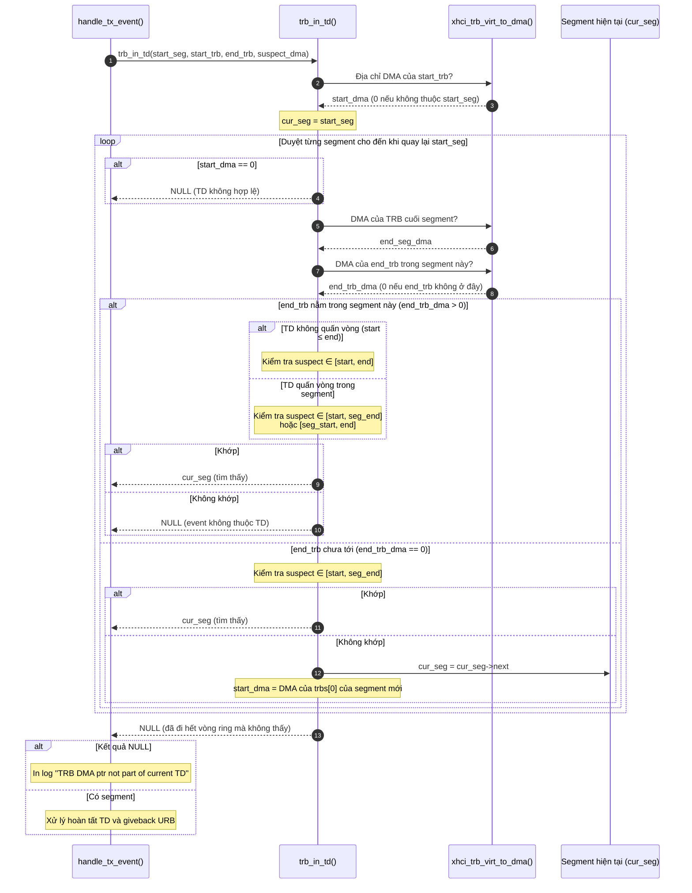

Hàm `trb_in_td()` trả về `NULL` khi **địa chỉ DMA trong biên nhận (`suspect_dma`) không nằm trong khoảng TRB của TD đang xét**. Cụ thể có 3 trường hợp.

## Hàm làm gì

Hàm nhận vào một TD, tức một lô phiếu đi từ `start_trb` (thuộc `start_seg`) đến `end_trb`, và một địa chỉ DMA mà phần cứng báo về (`suspect_dma`). Nó duyệt lần lượt các segment của ring, bắt đầu từ `start_seg`, để xem `suspect_dma` có nằm trong TD hay không. Nếu có, hàm trả về segment chứa địa chỉ đó. Nếu không, hàm trả về `NULL`.

Hàm `xhci_trb_virt_to_dma(seg, trb)` trả về **0 nếu `trb` không thuộc segment `seg`**. Hàm `trb_in_td()` dựa vào quy ước này để biết `end_trb` có nằm trong segment hiện tại hay không.

## Các trường hợp trả về NULL

### 1. `start_dma == 0`: điểm bắt đầu không hợp lệ

```c
if (start\_dma == 0)
    return NULL;
```

Ở vòng lặp đầu, điều kiện này xảy ra khi `start_trb` không thuộc `start_seg`. Nghĩa là thông tin TD bị sai: con trỏ hỏng, hoặc TD đã bị giải phóng hay sửa đổi. Hàm thoát ngay mà không so sánh gì.

### 2. `end_trb` nằm trong segment hiện tại nhưng `suspect_dma` nằm ngoài khoảng

Đây là trường hợp thường gặp nhất. Khi `end_trb_dma > 0`, TD kết thúc trong segment này, nên nếu `suspect_dma` thuộc TD thì nó bắt buộc phải nằm ở đây. Vì vậy hàm **kết luận ngay và không xét segment tiếp theo**. Có hai tình huống:

**a) TD không quấn vòng** (`start_dma <= end_trb_dma`):

```
segment: [ ... | start ===== end | ... ]
```

Hàm trả về `NULL` nếu `suspect_dma < start_dma` hoặc `suspect_dma > end_trb_dma`.

**b) TD quấn vòng trong cùng một segment** (`start_dma > end_trb_dma`). TD bắt đầu ở cuối segment, đi vòng qua ring rồi kết thúc ở đầu chính segment đó:

```c
segment: [ seg->dma ==== end | (khoảng trống) | start ==== end_seg ]
```

Hàm trả về `NULL` nếu `suspect_dma` **không** thuộc `[start_dma, end_seg_dma]` và cũng **không** thuộc `[cur_seg->dma, end_trb_dma]`, tức là nó rơi vào khoảng trống giữa hai đoạn.

### 3. Đi hết một vòng ring mà không tìm thấy

C

```c
} while (cur\_seg != start\_seg);
return NULL;
```

Trường hợp này xảy ra khi ở mọi segment đã duyệt:

* `end_trb` không nằm trong segment đó (`end_trb_dma == 0`), và
* `suspect_dma` cũng không nằm trong khoảng `[start_dma, end_seg_dma]` của segment đó.

Sau khi quay lại `start_seg` mà vẫn không thấy `end_trb`, hàm trả về `NULL`. Điều đó có nghĩa là `end_trb` không thuộc ring này, tức dữ liệu TD bị hỏng, và `suspect_dma` cũng không khớp với segment nào.

Từ segment thứ hai trở đi, `start_dma` được gán lại bằng địa chỉ TRB đầu tiên của segment (`trbs[0]`), vì phần TD trong các segment đó bắt đầu từ đầu segment.

## Tóm tắt


| Trường hợp | Điều kiện                                                   | Ý nghĩa                                           |
| ------------- | -------------------------------------------------------------- | --------------------------------------------------- |
| 1             | `start_trb`không thuộc`start_seg`                            | Thông tin TD sai hoặc đã bị giải phóng       |
| 2a            | TD nằm gọn trong segment,`suspect`nằm ngoài`[start, end]`  | Phần cứng báo về một TRB không thuộc TD này |
| 2b            | TD quấn vòng trong segment,`suspect`rơi vào khoảng trống | Như trên                                          |
| 3             | Duyệt hết vòng mà không thấy`end_trb`lẫn`suspect`       | Ring hoặc TD bị lệch nghiêm trọng              |

## Liên hệ với log của bạn

Trong `handle_tx_event()`, driver gọi hàm này với TD **đầu tiên** của `ep_ring->td_list` và địa chỉ TRB lấy từ transfer event. Khi hàm trả về `NULL`, driver in ra:

```
ERROR Transfer event TRB DMA ptr not part of current TD ep_index 1 comp_code 1
```

Gần như chắc chắn log của bạn rơi vào **trường hợp 2**, nghĩa là phần cứng báo hoàn tất (SUCCESS) cho một TRB nằm ngoài TD mà driver đang chờ. Một số khả năng thực tế:

* Phần cứng báo event cho một TD **cũ**, đã bị driver giveback hoặc hủy trước đó, nên event đến trễ.
* Phần cứng đã xử lý **vượt qua** TD hiện tại, tức nó báo cho TD kế tiếp, trong khi event của TD hiện tại bị mất.
* Con trỏ dequeue của driver và của phần cứng lệch nhau sau một lần Stop Endpoint hoặc Set TR Dequeue.

Một số phiên bản kernel gọi lại hàm này với `debug = true` ngay sau khi lỗi xảy ra. Nếu trong log có dòng `Looking for event-dma ... trb-start ... trb-end ... seg-start ... seg-end ...`, bạn có thể so sánh `event-dma` với `trb-start` và `trb-end` để biết event đến **trước** hay **sau** TD hiện tại. Đây là manh mối tốt để phân biệt event đến trễ với event bị mất.



