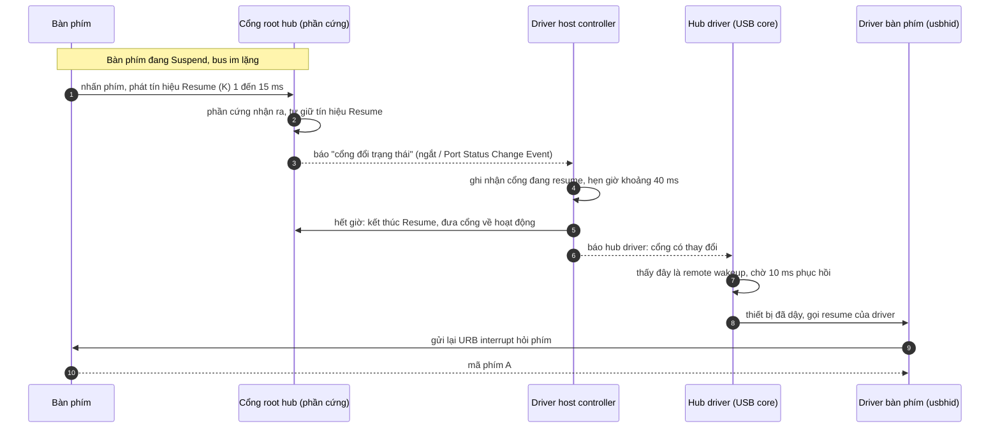

# Chương 1: Hiểu USB Suspend và Resume

> Khoá học USB Resume trên Linux Kernel. Baseline: **Linux 5.10.258** (`Kernel/Src` của repo `Source_MFP`), board Marvell Armada Quartz EMU 800. Thông số thời gian lấy theo đặc tả USB 2.0/3.x và đã đối chiếu với hằng số trong kernel. Chương này chưa đi vào code: mục tiêu là hiểu **chuyện gì xảy ra** trước khi hỏi **ai làm**.

## 1.0 Câu chuyện mở đầu: bàn phím ngủ và thức dậy

Bạn cắm một bàn phím USB vào máy tính rồi để đó 10 phút, không gõ phím nào. Máy tính quyết định cho bàn phím "ngủ" để tiết kiệm điện. Sau đó bạn gõ chữ **A**. Chữ A hiện ra trên màn hình, có thể chậm hơn bình thường một chút.

Trong khoảnh khắc đó có rất nhiều việc xảy ra. Ta sẽ kể lại ba lần, mỗi lần sâu hơn.

### Lần 1: kể như chuyện đời thường

```
 Bàn phím ngủ ──► bạn gõ phím ──► bàn phím "gọi" máy tính dậy ──► máy tính "trả lời"
      ──► hai bên chờ một chút cho ổn định ──► máy tính hỏi "có gì không?" ──► bàn phím gửi chữ A
```

Giống như bạn gọi điện cho một người đang ngủ:
- chuông reo (tín hiệu đánh thức);
- người đó nhấc máy và nói "alô" (máy tính xác nhận);
- vài giây để tỉnh hẳn (thời gian phục hồi);
- rồi mới nói chuyện được (truyền dữ liệu).

### Lần 2: kể bằng thuật ngữ USB

| Bước | Diễn biến | Thuật ngữ |
|---|---|---|
| 0 | Bàn phím đang ngủ: không có lưu lượng trên dây, nó chỉ tiêu thụ dòng rất nhỏ | **Suspend** (tạm ngừng) |
| 1 | Bạn nhấn phím. Mạch trong bàn phím phát hiện có hoạt động | sự kiện đánh thức |
| 2 | Bàn phím được phép đánh thức host, nên nó **tự phát tín hiệu "Resume"** lên dây USB | **Remote Wakeup** (đánh thức từ xa) |
| 3 | Cổng ở phía máy tính (hub hoặc root hub) nhận ra tín hiệu và **phát tiếp tín hiệu Resume** xuống bàn phím đủ lâu | Resume signaling |
| 4 | Tín hiệu kết thúc, bus trở lại trạng thái hoạt động. Host bắt đầu gửi lại gói SOF đều đặn | bus trở về **active** |
| 5 | Host chờ một khoảng **phục hồi** để thiết bị sẵn sàng | Resume recovery |
| 6 | Linux đánh dấu thiết bị đã hoạt động, gọi driver bàn phím "dậy đi", cho phép gửi yêu cầu | resume callback |
| 7 | Host hỏi bàn phím định kỳ qua endpoint interrupt. Bàn phím trả về mã phím A | truyền dữ liệu bình thường |

### Lần 3: kể có thời gian (USB 2.0, Full/Low-Speed như bàn phím thường gặp)

```
 thời gian ─────────────────────────────────────────────────────────────────────────────►
 bus idle ≥ 3 ms  │ Suspend ……………………………… │ nhấn phím │ thiết bị phát K   │ host phát K    │ kết thúc │ chờ     │ truyền
 (không có SOF)   │ (thiết bị ≤ 2.5 mA)      │           │ 1–15 ms           │ ≥ 20 ms        │ (EOP)    │ 10 ms   │ lại
                  │                          │           │ (TDRSMUP)         │ (TDRSMDN)      │          │ (TRSMRCY)│
 Linux:                                                   phát hiện ──► giữ Resume 40 ms ────────────────► chờ 10 ms ─► finish resume
                                                                      (USB_RESUME_TIMEOUT, rộng hơn 20 ms để an toàn)
```

- **K** là trạng thái điện của cặp dây D+/D− mang nghĩa "Resume" khi bus đang ngủ (giải thích kỹ ở Chương 4).
- Kernel dùng `USB_RESUME_TIMEOUT = 40` ms (`include/linux/usb.h:311`), dài hơn mức tối thiểu 20 ms của đặc tả cho chắc chắn.
- Sau khi tín hiệu kết thúc, kernel chờ thêm **10 ms** (`TRSMRCY`) rồi mới nói chuyện với thiết bị (`hub.c`: `/* TRSMRCY = 10 msec */ msleep(10)`).

Tổng cộng từ lúc nhấn phím đến lúc chữ A tới được host thường mất **vài chục ms**. Đây là lý do phím đầu tiên sau khi "ngủ" đôi khi có cảm giác trễ.

---

## 1.1 USB Suspend là gì

**Suspend (tạm ngừng)**: trạng thái tiết kiệm điện, trong đó **không có lưu lượng nào trên bus** tới thiết bị. Thiết bị chuyển phần lớn mạch vào chế độ ngủ và chỉ được tiêu thụ dòng rất nhỏ.

| Câu hỏi | Trả lời |
|---|---|
| Khi nào thiết bị USB 2.0 tự vào Suspend? | Khi thấy bus **im lặng liên tục ≥ 3 ms** (không có gói nào, kể cả SOF hay keep-alive) |
| Host làm thế nào để thiết bị vào Suspend? | Host (qua hub) **ngừng gửi gói** tới cổng đó. Thiết bị tự nhận ra sự im lặng |
| Thiết bị USB 3.x thì sao? | Không dựa vào im lặng. Host **ra lệnh** cho liên kết vào trạng thái **U3** (Chương 4) |
| Thiết bị còn được cấp điện không? | **Có.** VBUS vẫn có, nhưng thiết bị phải giới hạn dòng (USB 2.0: trung bình tối đa 2.5 mA) |

**Ví dụ:** chuột không dùng, bàn phím không gõ, ổ USB không đọc ghi một thời gian đều có thể được Linux đưa vào Suspend (cơ chế *autosuspend*, Chương 3).

## 1.2 USB Resume là gì

**Resume (tiếp tục)**: quá trình đưa thiết bị từ Suspend **trở lại hoạt động**, giữ nguyên địa chỉ và cấu hình. Thiết bị "tỉnh dậy" và tiếp tục như chưa từng ngủ.

| Ai khởi động Resume | Tên gọi | Ví dụ |
|---|---|---|
| **Host** (máy tính) | Host-initiated Resume | driver cần đọc dữ liệu từ ổ USB đang ngủ |
| **Thiết bị** | Device-initiated Resume, tức **Remote Wakeup** | bạn gõ phím, di chuột |

## 1.3 Vì sao USB cần Suspend, và vì sao cần Resume

| | Lý do |
|---|---|
| **Suspend** | Tiết kiệm điện (laptop, thiết bị chạy pin); giảm nhiệt; tắt bớt PHY, clock và bộ nhớ của controller; cho phép **cả hệ thống** ngủ |
| **Resume** | Đưa thiết bị trở lại mà **không phải làm lại từ đầu**: không cần enumerate lại, không mất cấu hình, không làm ứng dụng mất kết nối (ổ đĩa vẫn được mount, bàn phím vẫn là bàn phím đó) |

## 1.4 Suspend khác Disconnect thế nào

| | Suspend | Disconnect (ngắt kết nối) |
|---|---|---|
| Dây vẫn cắm? | có | có thể đã rút |
| Thiết bị còn trong hệ thống? | **còn** (`/sys/bus/usb/devices/…` vẫn tồn tại) | **bị gỡ** khỏi hệ thống |
| Địa chỉ USB | **giữ nguyên** | mất |
| Driver | vẫn gắn, chỉ được báo "ngủ đi" | bị gỡ (`disconnect`) |
| Quay lại | Resume (vài chục ms) | cắm lại và enumerate (hàng trăm ms trở lên) |
| Ứng dụng | không nhận ra | thấy thiết bị biến mất |

## 1.5 Resume khác Reset thế nào

| | Resume | Reset |
|---|---|---|
| Tín hiệu USB 2.0 | trạng thái **K** kéo dài | **SE0** kéo dài (≥ 10 ms) |
| Sau khi xong, thiết bị | giữ địa chỉ và cấu hình | về **địa chỉ 0**, mất cấu hình |
| Linux phải làm thêm | gần như không | gán lại địa chỉ, cấu hình lại (enumerate lại) |
| Khi nào dùng | đánh thức bình thường | thiết bị lỗi, hoặc **controller đã mất trạng thái** (nhánh *reset-resume*) |

**Reset-resume** là cách lai: Linux muốn "resume" nhưng không thể, vì controller hoặc thiết bị đã mất điện. Nó **reset** thiết bị rồi cố cấu hình lại y như cũ, để driver và ứng dụng không nhận ra. Trên **Quartz**, mỗi lần thoát *deep sleep* (Suspend-to-RAM), controller xHCI được khởi tạo lại, nên mọi thiết bị đều đi đường reset-resume. Log thật trên board có `usb usbN: root hub lost power or was reset` sau **mỗi** lần thoát deep sleep (1161 lần trong log OP_BTS-71095).

## 1.6 Suspend của thiết bị khác Suspend của host controller thế nào

```
 ┌──────────────────────── Máy tính ────────────────────────┐
 │  CPU, RAM                                                │
 │  ┌───────────────── Host Controller (xHCI) ────────────┐ │  ← "Host Controller Suspend":
 │  │  thanh ghi, ring, ngắt, clock                         │ │     controller ngừng chạy, lưu trạng thái,
 │  │  Root Hub: cổng 1  cổng 2  cổng 3                    │ │     có thể mất điện
 │  └──────────────┬───────────┬──────────────────────────┘ │
 └─────────────────┼───────────┼─────────────────────────────┘
                   │           │  ← "Port Suspend": cổng ngừng gửi gói / đưa link vào U3
              ┌────▼────┐ ┌────▼────┐
              │ Bàn phím│ │ Ổ USB   │  ← "Device Suspend": thiết bị ngủ, giữ địa chỉ và cấu hình
              └─────────┘ └─────────┘
```

| | Device Suspend | Host Controller Suspend |
|---|---|---|
| Ai ngủ | một thiết bị (qua cổng của nó) | toàn bộ controller và các root hub |
| Thiết bị khác có ảnh hưởng không | không | có: **mọi** thiết bị phía dưới phải ngủ trước |
| Thường xảy ra khi | thiết bị rảnh (runtime PM) | mọi thiết bị đều ngủ (runtime PM của controller) hoặc cả hệ thống ngủ |
| Resume | đánh thức một cổng | khởi động lại controller, có thể phải khởi tạo lại toàn bộ (Quartz) |

## 1.7 Truyền dữ liệu trong lúc Suspend

- **Không có giao dịch nào** tới thiết bị đang Suspend. Đó chính là định nghĩa của Suspend.
- Linux **không cho** driver gửi URB trực tiếp tới thiết bị đang ngủ: thiết bị phải được resume trước (*autoresume*, Chương 3 và 6).
- URB đang chạy dở khi bắt đầu suspend: driver phải hủy hoặc chờ chúng xong trước. Không được để TRB treo trên ring.

## 1.8 Thiết bị có mất điện, mất địa chỉ, mất cấu hình không?

| Câu hỏi | Suspend thông thường | Khi host controller/hệ thống mất điện trong lúc ngủ |
|---|---|---|
| Thiết bị mất điện? | **không**, chỉ giới hạn dòng | có thể (VBUS tắt) |
| Mất địa chỉ USB? | **không** | có, phải reset và gán lại |
| Mất cấu hình (configuration, alternate setting)? | **không** | có, Linux cấu hình lại (reset-resume) nếu cho phép *persist* |
| Mất dữ liệu đang xử lý trong thiết bị? | tùy thiết bị, đặc tả yêu cầu giữ trạng thái | thường mất |

---

## 1.9 Lại bàn phím, lần này nhìn từ bên trong Linux (xem trước)

Phần này chỉ để định hướng; chi tiết ở Chương 6.



---

## 1.10 Tóm tắt Chương 1

1. **Suspend** = không có lưu lượng, thiết bị ngủ nhưng **giữ địa chỉ và cấu hình**, vẫn có điện (dòng rất nhỏ).
2. **Resume** = đưa thiết bị trở lại mà không phải enumerate lại. Do **host** khởi động, hoặc do **thiết bị** khởi động (**Remote Wakeup**).
3. **Disconnect** là gỡ thiết bị khỏi hệ thống. **Reset** đưa thiết bị về địa chỉ 0. **Reset-resume** là reset rồi cấu hình lại cho giống cũ.
4. Suspend có nhiều tầng: **thiết bị**, **cổng**, **host controller**, **cả hệ thống**. Đừng gộp chúng làm một.
5. Thời gian USB 2.0: bus im lặng 3 ms → Suspend; Resume ≥ 20 ms (Linux giữ 40 ms); phục hồi 10 ms.
6. Trên Quartz, thoát deep sleep luôn là **reset-resume** vì xHCI được khởi tạo lại.

## Câu hỏi kiểm tra

1. Một thiết bị USB 2.0 tự biết mình phải vào Suspend bằng cách nào? Ai "ra lệnh"?
2. Trong lúc Suspend, thiết bị có còn địa chỉ USB không? Còn điện không?
3. Khác biệt lớn nhất giữa Resume và Reset là gì, nhìn từ phía driver?
4. Vì sao kernel giữ tín hiệu Resume 40 ms thay vì đúng 20 ms như đặc tả?
5. Khi bạn gõ phím lên bàn phím đang ngủ, ai phát tín hiệu trước: bàn phím hay máy tính? Ai giữ tín hiệu lâu hơn?
6. Vì sao trên Quartz, sau mỗi lần thoát deep sleep, thiết bị USB không được "resume" thuần mà phải "reset-resume"?
7. Phân biệt Device Suspend và Host Controller Suspend bằng một ví dụ cụ thể.
8. Một ứng dụng đang mở file trên ổ USB. Ổ USB vào Suspend rồi Resume. Ứng dụng có thấy gì không? Nếu thay bằng Disconnect thì sao?

---

**Chương tiếp theo:** Chương 2 vẽ kiến trúc quản lý nguồn USB: thiết bị, bus, cổng, root hub, hub ngoài, host controller, USB core, driver, PHY, CPU và khung Power Management, cùng trách nhiệm của từng phần.
