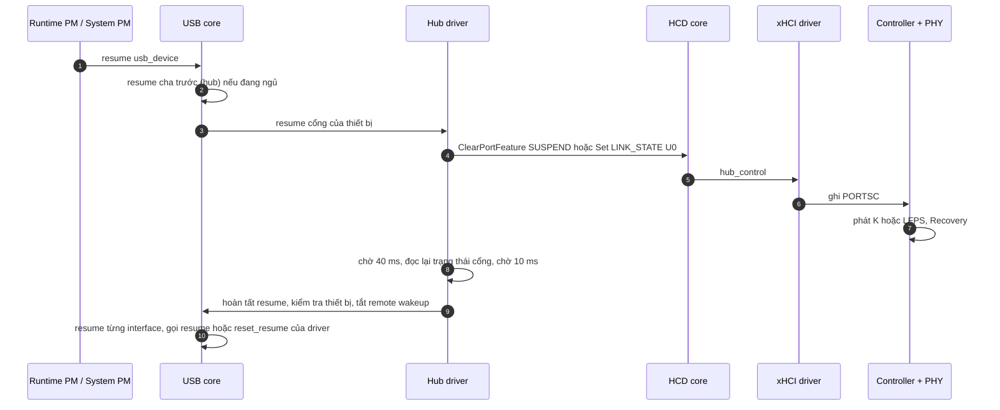

# Chương 5: Kiến trúc Resume trong Linux Kernel

> Khoá học USB Resume trên Linux Kernel. Baseline: **Linux 5.10.258**. Tên cấu trúc, trường và callback đã đối chiếu với source (`drivers/usb/core`, `drivers/usb/host`, `drivers/usb/phy`, `include/linux/usb*.h`, `include/linux/pm_runtime.h`).

## 5.0 Câu hỏi của chương

Khi một thiết bị USB cần dậy: **ai quyết định**, **ai ra lệnh**, **ai chạm phần cứng**? Và các khối phần mềm "nói chuyện" với nhau qua đâu?

---

## 5.1 Các khối phần mềm

| Khối | Vai trò trong Resume | Ví dụ hàm/callback (5.10.258) |
|---|---|---|
| **PM core** (System PM) | gọi suspend/resume cho **mọi thiết bị theo cây**, đúng thứ tự | `dev_pm_ops.suspend/.resume/.prepare/.complete` |
| **Runtime PM framework** | đếm usage, autosuspend, autoresume **từng thiết bị** | `pm_runtime_get_sync`, `pm_runtime_resume_and_get`, `pm_runtime_put`, `pm_runtime_mark_last_busy` |
| **USB core** (phần PM) | dịch yêu cầu PM thành thao tác USB: resume cổng trước, rồi interface/driver | `usb_resume`, `usb_resume_both`, `usb_resume_device`, `usb_runtime_resume`, `usb_autoresume_device` |
| **Hub driver** (trong USB core) | điều khiển **cổng**: suspend/resume/reset; xử lý **sự kiện cổng**, nhận ra remote wakeup | `usb_port_suspend`, `usb_port_resume`, `hub_event`, `port_event`, `hub_handle_remote_wakeup`, `usb_remote_wakeup` |
| **HCD core** (phần chung cho mọi controller) | đánh thức root hub, poll trạng thái root hub, gọi PHY roothub | `hcd_bus_resume`, `usb_hcd_resume_root_hub`, `usb_hcd_poll_rh_status` |
| **xHCI/EHCI driver** | thực thi lệnh cổng bằng thanh ghi; xử lý ngắt cổng; suspend/resume controller | `xhci_hub_control`, `xhci_bus_resume`, `handle_port_status`, `xhci_resume`; `ehci_hub_control`, `ehci_bus_resume`, `ehci_irq` |
| **PHY** | khối vật lý phải dậy trước controller | Quartz: driver **USB PHY kiểu cũ** (`drivers/usb/phy/phy-usb3-mv.c`, `phy-utm-mv.c`) qua `usb_phy_init`; framework PHY chung (`phy_power_on/off`, `phy_set_mode`) có trong kernel nhưng xHCI trên Quartz **không dùng** cho root hub |
| **Driver lớp trên** | ngừng và khởi động lại công việc của mình | `usb_driver.suspend/.resume/.reset_resume` |

---

## 5.2 Ai quyết định, ai ra lệnh, ai thực thi

```
 ┌───────────── QUYẾT ĐỊNH ─────────────┐   ┌──────── RA LỆNH ────────┐   ┌────── THỰC THI ──────┐
 │ Runtime PM: "usage>0 → phải dậy"     │   │ USB core: resume device │   │ HCD: ghi PORTSC      │
 │ System PM:  "cả máy dậy"              │──►│ Hub driver: resume CỔNG │──►│ controller+PHY phát  │
 │ Thiết bị:   remote wakeup (phần cứng) │   │ (Set/ClearPortFeature)  │   │ K / LFPS trên dây    │
 └──────────────────────────────────────┘   └─────────────────────────┘   └──────────────────────┘
                                ▲                                                  │
                                └──── sự kiện cổng (ngắt, Port Status Change) ◄─────┘
```

Lưu ý: **hub driver không biết thanh ghi**. Nó dùng **lệnh hub chuẩn** (GetPortStatus, SetPortFeature, ClearPortFeature):
- với hub ngoài, lệnh đi qua control transfer;
- với root hub, HCD **giả lập** lệnh bằng `hub_control`, tức là ghi PORTSC.

---

## 5.3 Các cấu trúc dữ liệu: chỉ các trường quan trọng cho Resume

### `struct usb_device`: một thiết bị USB

| Trường | Nghĩa với Resume |
|---|---|
| `state` | `USB_STATE_CONFIGURED`, `USB_STATE_ADDRESS`, **`USB_STATE_SUSPENDED`**… |
| `do_remote_wakeup` | lần suspend này có bật remote wakeup không |
| `reset_resume` | resume phải đi đường **reset-resume** (controller/hub đã mất điện) |
| `port_is_suspended` | cổng của thiết bị đang ở trạng thái suspend |
| `persist_enabled` | cho phép "giữ thiết bị" qua mất điện bằng reset-resume (`power/persist`) |
| `can_submit` | có được submit URB không |
| `dev.power` | trạng thái Runtime PM (usage count, runtime_status, autosuspend_delay) |

### `struct usb_interface`: một interface (nơi driver gắn vào)

| Trường | Nghĩa |
|---|---|
| `needs_remote_wakeup` | driver cần thiết bị đánh thức được host (bàn phím, chuột) |
| `pm_usage_cnt` / `dev.power` | bộ đếm Runtime PM của interface |

### `struct usb_driver`: driver lớp trên

| Trường | Nghĩa |
|---|---|
| `suspend(intf, msg)` | dừng công việc, hủy URB |
| `resume(intf)` | khởi động lại công việc |
| `reset_resume(intf)` | như resume, nhưng **thiết bị vừa bị reset**: phải khởi tạo lại trạng thái của thiết bị. Không có callback này thì USB core **gỡ driver rồi gắn lại** (debug: `no reset_resume for driver %s?`) |
| `supports_autosuspend` | driver chấp nhận autosuspend |

### `struct usb_hub`: trạng thái của hub driver cho một hub

| Trường | Nghĩa |
|---|---|
| `event_bits` | cổng có sự kiện cần `hub_event` xử lý |
| `change_bits` | cổng có thay đổi kết nối logic |
| **`wakeup_bits`** | cổng **vừa báo remote wakeup** |
| `removed_bits` | cổng có thiết bị bị gỡ logic |
| `child_usage_bits` | cổng đang được cấp nguồn vì có con cần |
| `quiescing` | hub đang dừng (suspend), bỏ qua sự kiện |

### `struct usb_hcd`: một host controller (một root hub)

| Trường / cờ | Nghĩa |
|---|---|
| `HCD_FLAG_HW_ACCESSIBLE` | phần cứng truy cập được (đã dậy) |
| `HCD_FLAG_WAKEUP_PENDING` | root hub đang được đánh thức |
| `HCD_FLAG_POLL_RH` | đang poll trạng thái root hub định kỳ |
| `HCD_FLAG_DEAD` | controller đã chết |
| `state` | `HC_STATE_RUNNING`, `HC_STATE_SUSPENDED`… |
| `rh_timer` | timer poll root hub (cũng dùng để chờ đủ 40 ms resume) |
| `wakeup_work` | work đánh thức root hub (`hcd_resume_work`) |

### `struct dev_pm_ops`: các callback PM của một thiết bị

| Nhóm | Callback | Gọi khi |
|---|---|---|
| System PM | `prepare`, `suspend`, `suspend_late`, `suspend_noirq` / `resume_noirq`, `resume_early`, `resume`, `complete` | cả hệ thống ngủ/dậy |
| Runtime PM | `runtime_suspend`, `runtime_resume`, `runtime_idle` | từng thiết bị rảnh/cần dùng |

USB device (`core/usb.c:584-594`): `.prepare = usb_dev_prepare`, `.complete = usb_dev_complete`, `.suspend = usb_dev_suspend`, `.resume = usb_dev_resume`, …, `.runtime_suspend = usb_runtime_suspend`, `.runtime_resume = usb_runtime_resume`.

xHCI platform (`xhci-plat.c`): System PM `xhci_plat_suspend`/`xhci_plat_resume`, Runtime PM `xhci_plat_runtime_suspend`/`xhci_plat_runtime_resume`. Bên trong cả hai đều gọi `xhci_suspend`/`xhci_resume`.

### Khả năng đánh thức (wakeup capability)

| Mức | Ở đâu | Nghĩa |
|---|---|---|
| Thiết bị USB hỗ trợ | bit Remote Wakeup trong configuration descriptor | thiết bị *có thể* đánh thức |
| Được phép | `power/wakeup` (`enabled`/`disabled`), `device_may_wakeup()` | người dùng/hệ thống *cho phép* |
| Cần | `intf->needs_remote_wakeup` | driver *cần* (nếu không có thì không cho autosuspend) |
| Controller đánh thức hệ thống | `device_may_wakeup(controller)` | khi cả máy ngủ, controller có được báo PMU dậy không (xHCI platform truyền giá trị này vào `xhci_suspend`) |

---

## 5.4 Sơ đồ quan hệ các khối trong một lần resume



---

## 5.5 Riêng Quartz: PHY và các cờ đồng bộ của KM

Quartz có thêm một lớp **đồng bộ resume** do KM viết. Các phần dưới đây đều đã đọc trong source:

| Thành phần | Làm gì khi suspend | Làm gì khi resume |
|---|---|---|
| `phy-usb3-mv.c` (`mv_usb3_phy_suspend/resume`) | **tắt đầu ra USB2** và **giữ reset `/RST_SLP2`** (reset các linh kiện ngoại vi, **gồm cả hub USB**) qua PMU I2C; đặt `phy_usb3_mv_resume_fin = false` | **trì hoãn 300 ms** (delayed work) → nhả `/RST_SLP2`, bật lại đầu ra USB2, chờ **100 ms** → khởi tạo lại PHY → `phy_usb3_mv_resume_fin = true` |
| `xhci.c` | cuối suspend: `xhci_resume_fin++` | cuối resume: `xhci_resume_fin--` |
| `core/driver.c` (resume thiết bị USB) | | **chờ** tới khi `phy_usb3_mv_resume_fin` đúng **và** `xhci_resume_fin` về 0, mỗi lần ngủ 100 ms; rồi resume thiết bị **theo đúng thứ tự** của một ngăn xếp (`usb_pm_stack`) |
| DT | `xhci_reset_on_resume` cho cả hai controller → luôn **khởi tạo lại** | |

**Hệ quả với deep sleep:** hub ngoài bị **reset** và đường USB2 bị **ngắt** trong lúc ngủ. Vì vậy dù controller có giữ trạng thái đi nữa, thiết bị cũng **không thể resume thuần**. Luồng thực tế luôn là: controller khởi tạo lại → root hub mất nguồn → **reset-resume**, hoặc ngắt kết nối rồi enumerate lại.

---

## 5.6 Tóm tắt Chương 5

1. **PM core / Runtime PM quyết định**, **USB core và hub driver ra lệnh**, **HCD và phần cứng thực thi**.
2. Hub driver dùng lệnh hub chuẩn. Với root hub, HCD giả lập các lệnh đó bằng thanh ghi PORTSC.
3. Các trường quan trọng: `usb_device.state`, `reset_resume`, `persist_enabled`, `do_remote_wakeup`; `usb_hub.wakeup_bits`; cờ `HCD_FLAG_*`; callback `reset_resume` của driver.
4. Driver không có `reset_resume` thì sẽ bị **gỡ và gắn lại** khi phải reset-resume.
5. Trên Quartz, PHY USB3 trì hoãn resume 300 ms + 100 ms và giữ hub ngoài ở reset trong lúc ngủ. USB core của KM **chờ** PHY và xHCI xong rồi mới resume thiết bị.

## Câu hỏi kiểm tra

1. Hub driver gửi `ClearPortFeature(PORT_SUSPEND)` cho cổng của root hub. Lệnh này đi tới đâu, và cuối cùng ghi vào thanh ghi nào?
2. `wakeup_bits` của `usb_hub` dùng để làm gì?
3. Một driver không cài `reset_resume`. Điều gì xảy ra với nó sau deep sleep trên Quartz?
4. Vì sao `persist_enabled` quan trọng cho ổ USB đang được mount?
5. Liệt kê các bước Quartz thực hiện ở PHY USB3 khi resume, và giải thích vì sao USB core phải chờ.
6. Phân biệt "thiết bị hỗ trợ remote wakeup", "được phép" và "driver cần" bằng ba trường/thuộc tính tương ứng.

---

**Chương tiếp theo:** Chương 6 trình bày đầy đủ bốn kịch bản: (A) host-initiated USB 2.0 resume, (B) remote wakeup, (C) Runtime PM autoresume, (D) system resume. Mỗi kịch bản có sơ đồ kiến trúc, sequence diagram, luồng phần mềm/phần cứng, chuyển trạng thái và log kỳ vọng.
