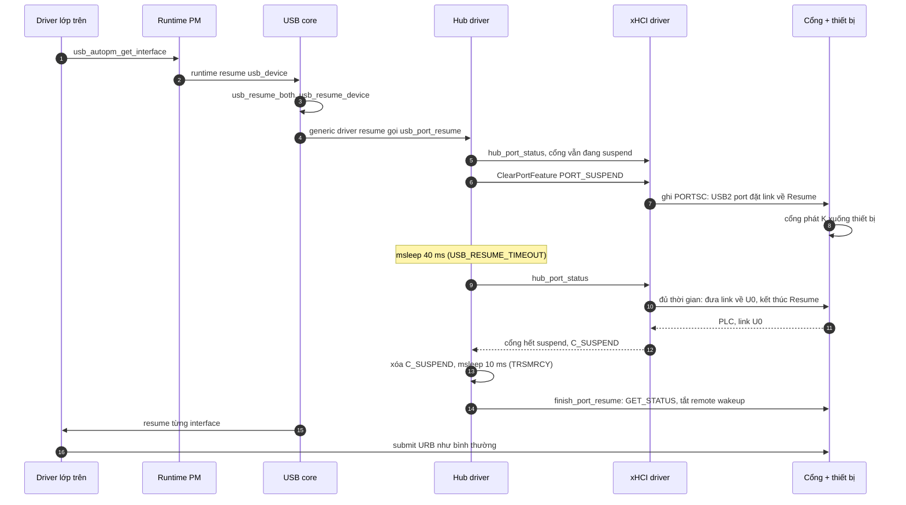
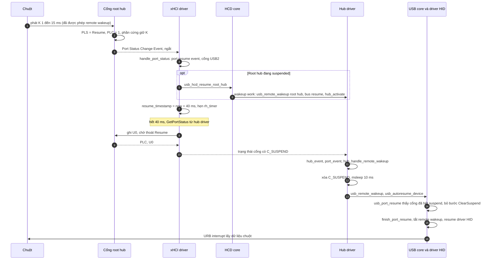
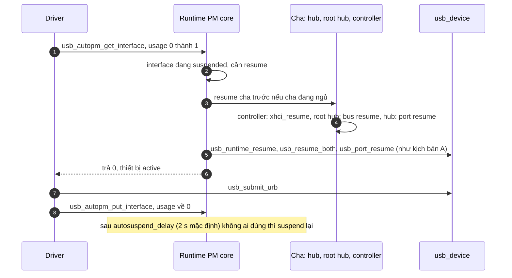
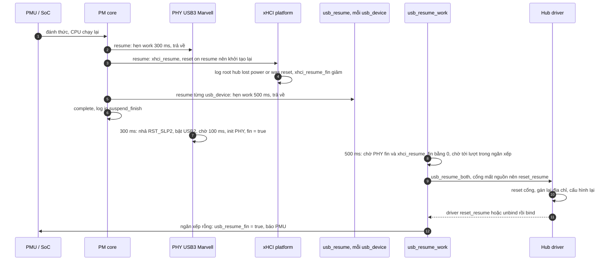

# Chương 6: Luồng thực thi Resume hoàn chỉnh

> Khoá học USB Resume trên Linux Kernel. Baseline: **Linux 5.10.258** (`drivers/usb/core/{driver,hub,hcd,generic}.c`, `drivers/usb/host/xhci-{hub,ring}.c`). Mỗi kịch bản trình bày **riêng**, kèm: sơ đồ kiến trúc, sequence diagram, luồng phần mềm, luồng phần cứng, chuyển trạng thái, log kỳ vọng.
>
> Quy ước log:
> - **[debug]** = `dev_dbg`/`xhci_dbg`, không in trên bản build Quartz hiện tại (`CONFIG_DYNAMIC_DEBUG` tắt).
> - **[info]** = có trong `dmesg`, nhưng console của Quartz chỉ hiện từ mức notice trở lên.
> - **[notice]** = thấy trên console.
> - **★** = đã thấy trong log thật của board.

## 6.0 Hai điều cần biết trước về Quartz

| Điều | Nguồn | Hệ quả |
|---|---|---|
| `usb_probe_device` gọi `usb_disable_autosuspend(udev)` cho **mọi** thiết bị USB (chú thích trong code: "Disable Runtime PM") | `core/driver.c:323-325` | Mặc định **không** có Runtime suspend/resume cho thiết bị và root hub. Kịch bản C chỉ xảy ra khi bật lại bằng `power/control = auto` |
| System resume của thiết bị USB (`usb_resume`) chỉ **hẹn một work sau 500 ms** rồi trả về ngay; work đó (`usb_resume_work`) mới resume thật, theo thứ tự ngăn xếp và sau khi chờ PHY + xHCI xong | `core/driver.c:1724-1840` | Hệ thống báo "đã resume" **trước khi** USB thực sự sẵn sàng. Ứng dụng dùng USB quá sớm sau deep sleep có thể gặp lỗi |

---

## Kịch bản A: Resume do host khởi động (USB 2.0)

**Ví dụ:** driver cần đọc ổ USB 2.0 đang ngủ. Hệ thống đang chạy và controller đang chạy.

### Kiến trúc

```
 Driver ──get──► Runtime PM ──► USB core (usb_device) ──► generic driver ──► hub driver (usb_port_resume)
                                                                               │ ClearPortFeature(SUSPEND)
                                                                               ▼
                                                    HCD hub_control ──► ghi PORTSC ──► cổng phát K ──► thiết bị
```

### Sequence



### Luồng phần mềm (thứ tự)

1. `usb_autopm_get_interface` → Runtime PM tăng usage → thiết bị đang `suspended` → `usb_runtime_resume`.
2. `usb_resume_both` → `usb_resume_device` → generic driver → **`usb_port_resume`**.
3. `usb_port_resume`:
   - nếu cổng đang tắt nguồn thì bật lại nguồn cổng (`pm_runtime_resume_and_get` của *port device*);
   - `hub_port_status`: cổng còn suspend → `usb_clear_port_feature(PORT_SUSPEND)`;
   - `msleep(40)` → đọc lại trạng thái → xóa `C_SUSPEND` → `msleep(10)`;
   - `check_port_resume_type` (cổng còn connect/enable không?) → `finish_port_resume`.
4. `finish_port_resume`: đặt lại `state` = `CONFIGURED`; `GET_STATUS`; nếu lỗi và có persist thì **chuyển sang reset-resume**; tắt remote wakeup.
5. Resume từng interface → `driver->resume()`.

### Luồng phần cứng (xHCI, cổng USB 2.0)

PORTSC.PLS = **U3** → phần mềm ghi **Resume** → cổng phát **K** → sau ≥ 20 ms phần mềm ghi **U0** → cổng kết thúc Resume → **PLS = U0**, PLC = 1 → (thiết bị hoạt động, host phát SOF).

### Chuyển trạng thái

| Đối tượng | Trước | Trong | Sau |
|---|---|---|---|
| `usb_device.state` | SUSPENDED | SUSPENDED | CONFIGURED |
| Runtime PM | suspended | resuming | active |
| Cổng (USB 2.0) | Suspended (PLS U3) | Resume (K) | Enabled (U0) |
| Thiết bị (phần cứng) | Suspend | đang dậy | hoạt động |

### Log kỳ vọng

| Log | Mức |
|---|---|
| `usb auto-resume` (`hub.c:3807`, định dạng `usb %sresume`) | [debug] |
| `finish resume` (`hub.c:3614`) | [debug] |
| `resume USB2 port %d-%d` (`xhci-hub.c:864`) | [debug] |
| Lỗi: `can't resume, status %d` / `can't resume usb port, status %d` | [debug] |
| Lỗi: `Port resume timed out, port %d-%d: 0x%x` (`xhci-hub.c:893`) | **warn** |

---

## Kịch bản B: Remote Wakeup do thiết bị khởi động

**Ví dụ:** chuột USB 2.0 đang ngủ, người dùng di chuột. Xét hai trường hợp: root hub đang chạy, và root hub đang ngủ.

### Kiến trúc

```
 Thiết bị ──K──► cổng root hub (phần cứng tự giữ Resume) ──► Port Status Change Event ──► xHCI IRQ
   └► handle_port_status: "cổng đang Resume" ──► hẹn giờ 40 ms; nếu root hub ngủ: usb_hcd_resume_root_hub
   └► hết giờ: GetPortStatus kết thúc Resume (U0), đặt C_SUSPEND ──► hub driver: hub_event ──► port_event
   └► hub_handle_remote_wakeup ──► usb_remote_wakeup ──► usb_autoresume_device ──► usb_port_resume (bỏ bước ClearSuspend)
```

### Sequence



### Điểm then chốt

- **Ai giữ K 20 ms?** Phần cứng cổng tự giữ khi thấy K từ thiết bị. Phần mềm chỉ **đếm 40 ms** rồi ra lệnh kết thúc.
- **Linux nhận ra remote wakeup bằng cách nào?**
  - USB 2.0: bit **`C_SUSPEND`** trên cổng mà thiết bị **không** do phần mềm resume.
  - USB 3.x: **link về U0/U1/U2 khi thiết bị đang `SUSPENDED`** (`hub_handle_remote_wakeup`).
- **`usb_port_resume`** trong trường hợp này thấy cổng **đã hết suspend**, nên bỏ qua bước Clear-Suspend (comment trong code: "Skip the initial Clear-Suspend step for a remote wakeup").
- **USB 3.x khác**: `handle_port_status` thấy `PLS = Resume` trên cổng SS → ghi **U0** ngay, chờ link về U0 → `usb_wakeup_notification` (Chương 8).
- **Điều kiện trước:** khi suspend, USB core đã bật `DEVICE_REMOTE_WAKEUP` (vì driver HID `needs_remote_wakeup` và `power/wakeup = enabled`).

### Chuyển trạng thái

| Đối tượng | Trình tự |
|---|---|
| Cổng (PLS) | U3 → **Resume** (thiết bị kích hoạt) → U0 (phần mềm kết thúc) |
| Root hub (nếu ngủ) | suspended → (wakeup work) → active |
| `hub->wakeup_bits` | đặt bit cổng → xử lý → xóa |
| `usb_device.state` | SUSPENDED → CONFIGURED |

### Log kỳ vọng

| Log | Nguồn | Mức |
|---|---|---|
| `Port change event, %d-%d, id %d, portsc: 0x%x` | `xhci-ring.c` | [debug] |
| `resume root hub` (khi root hub ngủ) | `xhci-ring.c` | [debug] |
| `port resume event for port %d` | `xhci-ring.c` | [debug] |
| `resume HS port %d` | `xhci-ring.c` | [debug] |
| `resume USB2 port %d-%d` | `xhci-hub.c:864` | [debug] |
| `usb wakeup-resume` (`usb %sresume`) | `hub.c:3865` | [debug] |
| `resume, status %d` (cổng) | `hub.c:3916` | [debug] |
| Lỗi: `xHC is not running.` | `xhci-ring.c:1851` | **warn** |

---

## Kịch bản C: Runtime PM autoresume khi submit URB

**Ví dụ:** driver submit URB trong khi thiết bị đang runtime-suspended. (Trên Quartz cần bật `power/control = auto` mới có trạng thái này.)

### Quy tắc

USB core **không tự đánh thức** thiết bị khi submit URB. Driver phải:
1. gọi `usb_autopm_get_interface()` (đồng bộ, có thể ngủ), hoặc `usb_autopm_get_interface_async()` (trong ngữ cảnh không được ngủ);
2. sau đó mới submit URB;
3. xong việc thì gọi `usb_autopm_put_interface()` (hoặc `pm_runtime_mark_last_busy` + `put_autosuspend`).



**Chuỗi cha:** Runtime PM luôn resume **cha trước con**. Nếu controller đang runtime-suspended, `xhci_plat_runtime_resume` → `xhci_resume` chạy **trước**, rồi root hub, rồi hub, rồi thiết bị.

**Lỗi hay gặp:**
- submit URB khi chưa `get` → URB thất bại hoặc thiết bị không trả lời;
- quên `put` → thiết bị không bao giờ ngủ;
- `put` thừa → bộ đếm lệch, thiết bị có thể ngủ trong khi vẫn đang được dùng. Kernel 5.10 không có cảnh báo riêng cho lỗi này. (Cảnh báo `Unbalanced %s!` ở `runtime.c:1468` là của `pm_runtime_enable` bị gọi lệch cặp.)
- callback runtime resume trả lỗi → `power.runtime_error` được đặt, và mọi thao tác Runtime PM sau đó đều thất bại cho tới khi lỗi được xóa.

### Log kỳ vọng

| Log | Mức |
|---|---|
| `usb auto-resume` | [debug] |
| `runtime PM trying to activate child device %s but parent (%s) is not active` (`runtime.c:1276`) | **err**: thứ tự cha/con sai |

---

## Kịch bản D: System Resume (Suspend-to-RAM)

**Ví dụ:** Quartz thoát deep sleep.

### Kiến trúc và thứ tự

```
 PMU/SoC đánh thức ──► CPU khởi động lại phần "resume" ──► PM core: resume_noirq → resume_early → resume → complete
   cha trước con:
   1. PHY USB3 (mv_usb3_phy_resume): hẹn work 300 ms → (sau đó) nhả /RST_SLP2, bật USB2, chờ 100 ms, init PHY, cờ fin = true
   2. xHCI platform (xhci_plat_resume → xhci_resume): quirk reset-on-resume → KHỞI TẠO LẠI controller
        → "root hub lost power or was reset" (×2 mỗi controller) → xhci_resume_fin--
   3. root hub, hub, thiết bị (usb_resume): mỗi cái chỉ HẸN work 500 ms rồi trả về
   4. PM core: complete → tiến trình được chạy lại → "in suspend_finish" (printk của KM)
 Sau 500 ms, lần lượt theo ngăn xếp (thứ tự ngược với lúc suspend: cha trước):
   usb_resume_work: chờ PHY fin && xhci_resume_fin == 0 → chờ tới lượt → usb_resume_both
        → reset_resume: hub_port_init → "reset high-speed USB device number N using xhci-hcd"
        → driver->reset_resume (không có thì unbind/bind)
   ngăn xếp rỗng → usb_resume_fin = true → báo PMU (pmuSetUsbResumeFin)
```

### Sequence



### Chuyển trạng thái

| Đối tượng | Suspend | Resume |
|---|---|---|
| xHCI | lưu trạng thái, halt, `xhci_resume_fin++` | **khởi tạo lại**, ring và context mới, `--` |
| Root hub | suspended | "lost power" → `reset_resume` = 1 |
| Hub ngoài (`3-1`) | bị giữ **reset** (`/RST_SLP2`), USB2 ngắt | reset-resume, hoặc enumerate lại |
| Thiết bị | suspended / mất nguồn | reset-resume: địa chỉ mới, cấu hình lại |
| Driver | `suspend` | `reset_resume`, hoặc unbind + bind |

### Log kỳ vọng

| Log | Nguồn | Mức |
|---|---|---|
| ★ `in pm_suspend`, `enter enter_state`, `in suspend_devices_and_enter`, `in suspend_enter`, `in suspend_finish` | printk KM trong `kernel/power/suspend.c` | console |
| ★ `Suspending console(s) (use no_console_suspend to debug)` | `kernel/printk` | info |
| ★ `PMU_resume:WAKE_UP detect` / `not detect` | `drivers/mfp/pmu/mdels800_pmu.c` | console |
| ★ `usb usbN: root hub lost power or was reset` | `hub.c:4062` | **notice** |
| `mv_usb3_phy_suspend: phy_usb3_mv_resume_fin[0]` / `mv_usb3_phy_resume_work: phy_usb3_mv_resume_fin[1]` | `phy-usb3-mv.c` | info (KM) |
| `xhci_suspend :xhci_resume_fin [%d]` / `xhci_resume :xhci_resume_fin [%d]` | `xhci.c` | info (KM) |
| `usb_resume CALL`, `usb_resume_work CALL`, `… usb_resume_fin[%d]`, `… first wait release`, `… usb_pm_stack.udev release` | `core/driver.c` | info (KM) |
| `reset high-speed USB device number %d using xhci-hcd` | `hub.c:4994` | info |
| `finish reset-resume` | `hub.c:3614` | [debug] |
| `no reset_resume for driver %s?` | `driver.c:1428` | [debug] |

**Đối chiếu với SLEEP1 (OP_BTS-71095):** SLEEP1 **không có** chuỗi log trên. Đó là bằng chứng SLEEP1 không phải System Suspend của Linux, và vì vậy lỗi lúc thoát SLEEP1 không nằm trong luồng D.

---

## 6.5 Bảng so sánh bốn kịch bản

| | A. Host-initiated | B. Remote wakeup | C. Runtime autoresume | D. System resume |
|---|---|---|---|---|
| Ai khởi động | phần mềm (driver/core) | **thiết bị** | driver cần thiết bị | PMU/người dùng |
| Tín hiệu đầu tiên | phần mềm ghi PORTSC | thiết bị phát K/LFPS | `pm_runtime_get` | nguồn đánh thức hệ thống |
| Phần mềm nhận ra qua | lời gọi trực tiếp | **Port Status Change Event** + `C_SUSPEND` | Runtime PM | PM core gọi callback |
| `usb_port_resume` có ClearSuspend? | có | **không** (đã hết suspend) | có | có (hoặc reset-resume) |
| Có reset không | không | không | không | trên Quartz: **có** (reset-resume) |
| Quartz mặc định | ít gặp | ít gặp (autosuspend tắt) | **không** (autosuspend tắt) | **mỗi deep sleep** |

## 6.6 Tóm tắt Chương 6

1. **A**: phần mềm ClearSuspend → chờ 40 ms → kết thúc → chờ 10 ms → `finish_port_resume`.
2. **B**: phần cứng giữ Resume; phần mềm đếm 40 ms rồi kết thúc; `C_SUSPEND` cho hub driver biết đây là remote wakeup; `usb_port_resume` bỏ bước ClearSuspend.
3. **C**: driver phải `get` trước khi submit URB; Runtime PM resume **cha trước con**.
4. **D trên Quartz**: PHY resume trễ 300 + 100 ms; xHCI khởi tạo lại; USB device resume chạy **bất đồng bộ sau 500 ms**, theo thứ tự ngăn xếp, và đều là **reset-resume**.
5. Trên Quartz, Runtime PM của thiết bị USB **bị tắt** mặc định.

## Câu hỏi kiểm tra

1. Trong kịch bản B, vì sao `usb_port_resume` không gửi `ClearPortFeature(PORT_SUSPEND)`?
2. Ai giữ tín hiệu K 20 ms trong kịch bản B với root hub xHCI: phần cứng hay phần mềm? Phần mềm làm gì trong 40 ms đó?
3. Trong kịch bản C, nếu controller cũng đang runtime-suspended, thứ tự resume là gì?
4. Vì sao trên Quartz một ứng dụng truy cập USB ngay sau `in suspend_finish` có thể thất bại?
5. Nêu hai log [notice]/★ chứng minh một lần thoát ngủ là System Resume thật trên Quartz.
6. `usb_resume_work` chờ những điều kiện gì trước khi gọi `usb_resume_both`?
7. Một driver không có `reset_resume`. Sau deep sleep trên Quartz, ứng dụng dùng driver đó sẽ thấy gì?
8. Vì sao mặc định Quartz không có kịch bản C? Muốn thử thì làm thế nào?

---

**Chương tiếp theo:** Chương 7 đi vào EHCI: thanh ghi USBCMD, USBSTS, USBINTR, PORTSC; ý nghĩa từng bit liên quan resume; luồng resume EHCI.
