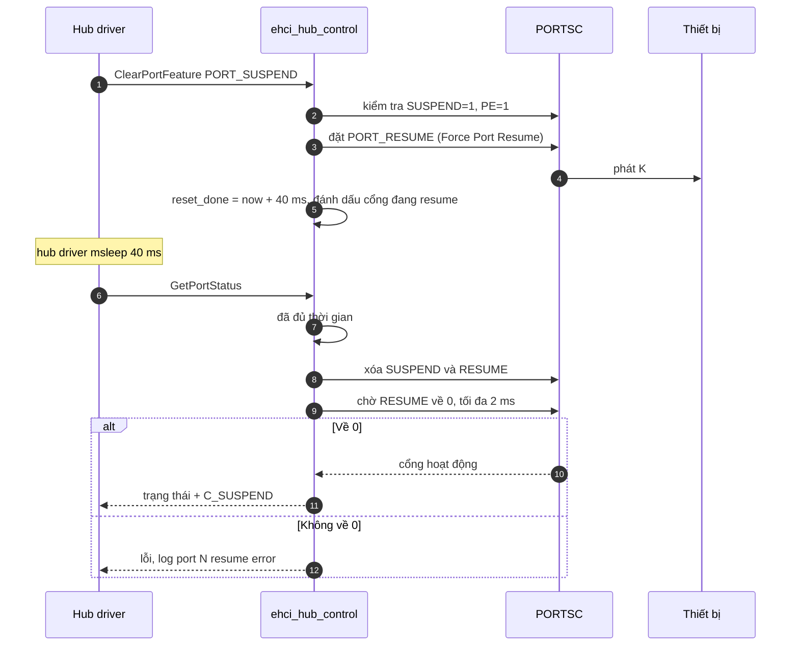

# Chương 7: Resume trong EHCI

> Khoá học USB Resume trên Linux Kernel. Baseline: **Linux 5.10.258** (`drivers/usb/host/ehci-hub.c`, `ehci-hcd.c`, `include/linux/usb/ehci_def.h`). Quartz không dùng EHCI cho phần host. Chương này để hiểu nền tảng và để so sánh với xHCI.

## 7.0 Bối cảnh

EHCI chỉ lo **USB 2.0 High-Speed**. Thiết bị Full/Low-Speed được chuyển cho controller đồng hành (bit **Port Owner**). Mọi thao tác Resume của EHCI là thao tác trên **thanh ghi cổng PORTSC** cộng với một số bit trong USBCMD/USBSTS/USBINTR.

---

## 7.1 Các thanh ghi tham gia

| Thanh ghi | Bit liên quan Resume | Ý nghĩa |
|---|---|---|
| **USBCMD** (USB Command) | `CMD_RUN` (bit 0) | controller chạy hay dừng. Bus suspend dừng controller, bus resume chạy lại |
| | ASE / PSE | bật Async / Periodic schedule |
| **USBSTS** (USB Status) | **`STS_PCD`** (bit 2, Port Change Detect) | **có cổng thay đổi**: nguồn ngắt của remote wakeup và cắm/rút |
| | `STS_HALT` (bit 12, HCHalted) | controller đã dừng hẳn |
| | `STS_FATAL` (Host System Error) | lỗi truy cập bộ nhớ |
| **USBINTR** (USB Interrupt Enable) | bit tương ứng PCD | cho phép ngắt khi có Port Change Detect. Driver bật nó trong `INTR_MASK` |
| **CONFIGFLAG** | CF | định tuyến cổng về EHCI (thay vì controller đồng hành) |
| **PORTSC[n]** | (bảng dưới) | trạng thái và điều khiển từng cổng |

---

## 7.2 Các bit PORTSC quan trọng

| Bit | Tên trong kernel | Nghĩa | Ai đổi | Khi nào | Vai trò trong Resume | Nếu không đổi như mong đợi |
|---|---|---|---|---|---|---|
| 0 | `PORT_CONNECT` (CCS) | có thiết bị nối | **phần cứng** | cắm/rút | sau resume phải còn 1 | = 0 sau resume: thiết bị rớt → ngắt kết nối logic |
| 1 | `PORT_CSC` | kết nối vừa đổi | phần cứng đặt, **phần mềm ghi 1 để xóa** | CCS đổi | nếu có trong lúc resume: thiết bị đã rút/cắm lại | mất CSC → hub driver không biết thiết bị đổi |
| 2 | `PORT_PE` | cổng enabled | phần cứng (sau reset); phần mềm chỉ được **tắt** | sau reset thành công; lỗi | phải = 1 để resume cổng | = 0: resume thất bại (`goto error` trong hub_control) |
| 3 | `PORT_PEC` | enable vừa đổi | phần cứng, phần mềm xóa | PE bị tắt do lỗi | lỗi trong lúc resume | |
| 4/5 | `PORT_OC` / OCC | quá dòng / vừa đổi | phần cứng | quá dòng | có thể là nguồn đánh thức (`PORT_WKOC_E`) | |
| **6** | **`PORT_RESUME`** (FPR, **Force Port Resume**) | cổng **đang phát Resume (K)** | **phần mềm** đặt (host-initiated); **phần cứng** tự đặt khi thấy K từ thiết bị (remote wakeup) | bắt đầu Resume | là "công tắc" của tín hiệu Resume | không về 0 trong 2 ms sau khi phần mềm xóa → `port %d resume error %d` |
| **7** | **`PORT_SUSPEND`** | cổng **đang suspend** | phần mềm đặt (suspend); phần cứng xóa khi Resume kết thúc | suspend/resume | = 1 suốt thời gian Resume; về 0 khi xong | còn = 1 sau resume: cổng kẹt suspend |
| 8 | `PORT_RESET` | đang reset | phần mềm | reset | reset-resume dùng bit này | |
| 10–11 | `PORT_LS_MASK` | trạng thái dây: SE0, J, K | phần cứng | liên tục | thấy **K** khi đang Resume | |
| 12 | `PORT_POWER` | cổng có nguồn | phần mềm (nếu có PPC) | bật/tắt nguồn cổng | mất nguồn → không resume được | |
| 13 | `PORT_OWNER` | cổng thuộc controller đồng hành | phần mềm | thiết bị FS/LS | EHCI bỏ qua cổng này khi xử lý wakeup | |
| 20 | `PORT_WKCONN_E` | đánh thức khi có kết nối | phần mềm | trước khi suspend | cho phép cắm thiết bị đánh thức | |
| 21 | `PORT_WKDISC_E` | đánh thức khi ngắt kết nối | phần mềm | | | |
| 22 | `PORT_WKOC_E` | đánh thức khi quá dòng | phần mềm | | | |

(`PORT_RWC_BITS` = CSC | PEC | OCC: các bit "ghi 1 để xóa". Mọi lần ghi PORTSC, driver phải **xóa chúng khỏi giá trị ghi**, để không vô tình xóa thay đổi chưa được xử lý.)

---

## 7.3 EHCI: resume cổng do host khởi động



## 7.4 EHCI: remote wakeup do thiết bị khởi động

```
 Thiết bị phát K ──► phần cứng EHCI: PORT_RESUME = 1 (tự đặt), USBSTS.PCD = 1 ──► ngắt
 ehci_irq (đã đối chiếu ehci-hcd.c:794-835):
   ├─ STS_PCD? ──► nếu root hub đang SUSPENDED ──► usb_hcd_resume_root_hub (đánh thức root hub)
   ├─ duyệt các cổng (dùng per-port change bits nếu có):
   │     bỏ cổng thuộc controller đồng hành (PORT_OWNER)
   │     cổng đang suspend + (RESUME=1 hoặc SUSPEND=0) + PE=1 + chưa có reset_done
   │       ──► reset_done = now + USB_RESUME_TIMEOUT, đánh dấu resuming
   │       ──► "port %d remote wakeup" [debug] ──► usb_hcd_start_port_resume ──► hẹn rh_timer
 Sau 40 ms: hub driver đọc trạng thái ──► ehci_hub_control GetPortStatus kết thúc Resume (như 7.3)
            ──► C_SUSPEND ──► hub_handle_remote_wakeup ──► usb_remote_wakeup
```

## 7.5 EHCI: bus suspend và bus resume (root hub)

| Bước | `ehci_bus_suspend` | `ehci_bus_resume` |
|---|---|---|
| 1 | nếu có cổng đang resume → hủy (`suspend failed because a port is resuming` [debug]) | `resume root hub` hoặc `resume root hub after power loss` [debug] |
| 2 | với mỗi cổng enabled: đặt **SUSPEND**, bật bit wake (CONN/DISC/OC) | ghi lại địa chỉ Periodic Frame List và Async list vào thanh ghi; bật **RUN** |
| 3 | dừng schedule, **xóa RUN**, chờ HCHalted | cổng nào PE=1 mà không SUSPEND/RESUME → `Port status(0x%x) is wrong` [debug], chờ 8 ms |
| 4 | bật ngắt cho phép đánh thức (PCD) nếu được phép wakeup | với cổng do bus suspend mà ngủ: đặt **RESUME** → chờ `USB_RESUME_TIMEOUT` → xóa RESUME |
| 5 | | bật lại schedule, ngắt |

## 7.6 Các trục trặc đặc trưng của EHCI

| Hiện tượng | Bit nào sai | Nguyên nhân hay gặp |
|---|---|---|
| Cổng không ra khỏi Resume | PORT_RESUME không về 0 trong 2 ms | PHY ở chế độ tiết kiệm điện chưa dậy (có `has_tdi_phy_lpm`), thiết bị kéo dây, lỗi PHY |
| Remote wakeup không được nhận | không có STS_PCD, hoặc USBINTR không bật PCD | ngắt bị tắt khi suspend; controller không có nguồn khi ngủ; wake bit chưa bật |
| Thiết bị rớt sau resume | CCS = 0 hoặc PE = 0 | thiết bị mất nguồn/reset khi ngủ, cáp, nguồn VBUS |
| Controller không chạy sau resume | HCHalted vẫn = 1 sau khi đặt RUN | controller mất trạng thái, cần khởi tạo lại |
| `fatal error` sau resume | STS_FATAL | địa chỉ frame list/async list ghi lại bị sai (bộ nhớ đã thay đổi) |

## 7.7 Log EHCI liên quan Resume (đã đối chiếu)

| Log | Nguồn | Mức |
|---|---|---|
| `port %d resume error %d` | `ehci-hub.c:1068` | **err** |
| `port %d reset error %d` | `ehci-hub.c:1088` | **err** |
| `resume root hub%s` (`… after power loss`) | `ehci-hub.c:404` | debug |
| `suspend root hub` | `ehci-hub.c:221` | debug |
| `suspend failed because a port is resuming` | `ehci-hub.c:241` | debug |
| `Port status(0x%x) is wrong` | `ehci-hub.c:432` | debug |
| `port %d remote wakeup` | `ehci-hcd.c` (`ehci_irq`) | debug |
| `Port %d phy low-power mode %s` / `Port%d phy low pwr mode %s` | `ehci-hub.c:325/1204` | debug |
| `fatal error` → `HC died; cleaning up` | `ehci-hcd.c:844`, `core/hcd.c:2396` | **fatal** |

## 7.8 Tóm tắt Chương 7

1. EHCI resume xoay quanh **PORTSC.RESUME (Force Port Resume)** và **PORTSC.SUSPEND**.
2. Host-initiated: phần mềm đặt RESUME → chờ 40 ms → xóa → phần cứng phải đưa RESUME về 0 trong 2 ms.
3. Remote wakeup: phần cứng **tự** đặt RESUME và **STS_PCD** → `ehci_irq` bắt đầu đếm 40 ms → GetPortStatus kết thúc.
4. Ghi PORTSC phải loại các bit "ghi 1 để xóa" ra khỏi giá trị ghi.
5. Bus resume phải **ghi lại địa chỉ schedule**, bật RUN, rồi resume các cổng do bus suspend mà ngủ.

## Câu hỏi kiểm tra

1. Bit nào trong PORTSC vừa có thể do phần mềm đặt, vừa có thể do phần cứng đặt? Mỗi trường hợp ứng với loại Resume nào?
2. Vì sao driver phải loại `PORT_RWC_BITS` khỏi giá trị trước khi ghi PORTSC?
3. Log `port 2 resume error -110` cho bạn biết gì về trạng thái PORTSC lúc đó?
4. Trong remote wakeup, ai bật `STS_PCD`, và hàm nào xử lý nó?
5. Vì sao `ehci_bus_resume` phải ghi lại thanh ghi frame list và async list?
6. Cổng thuộc controller đồng hành (`PORT_OWNER`) thì EHCI xử lý remote wakeup thế nào?

---

**Chương tiếp theo:** Chương 8 đi vào xHCI: PORTSC, Port Link State, cổng USB 2.0 và USB 3.x, Port Status Change Event, các chuyển trạng thái U0/U1/U2/U3/Recovery…
