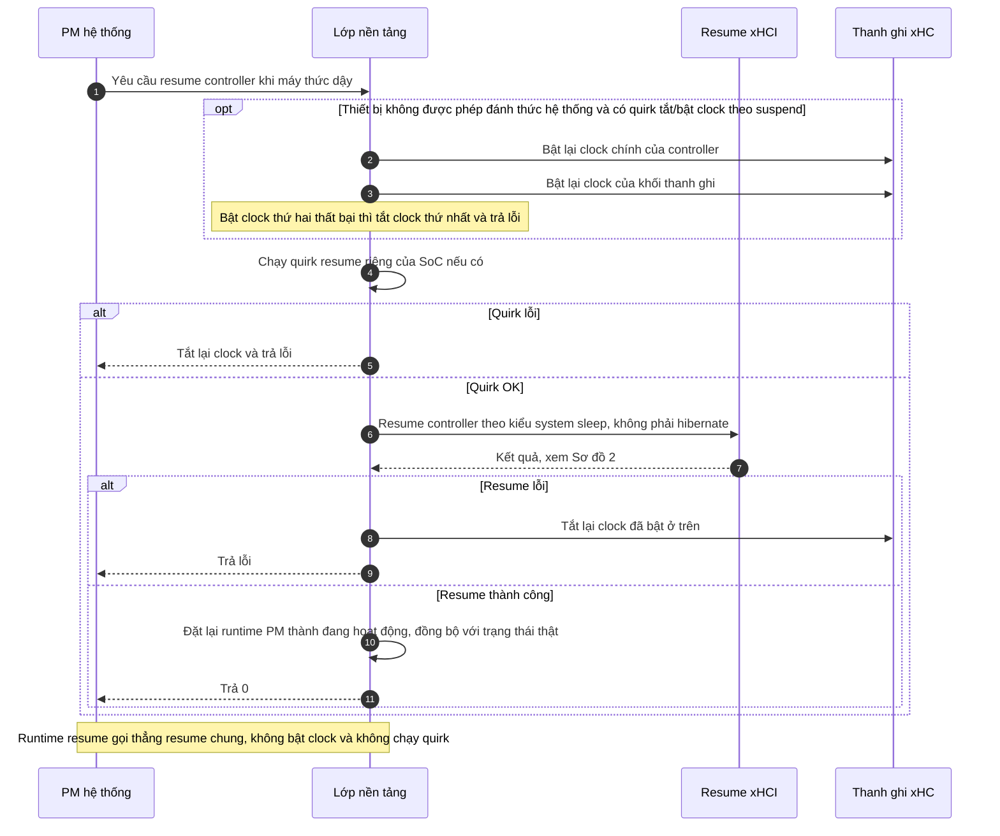
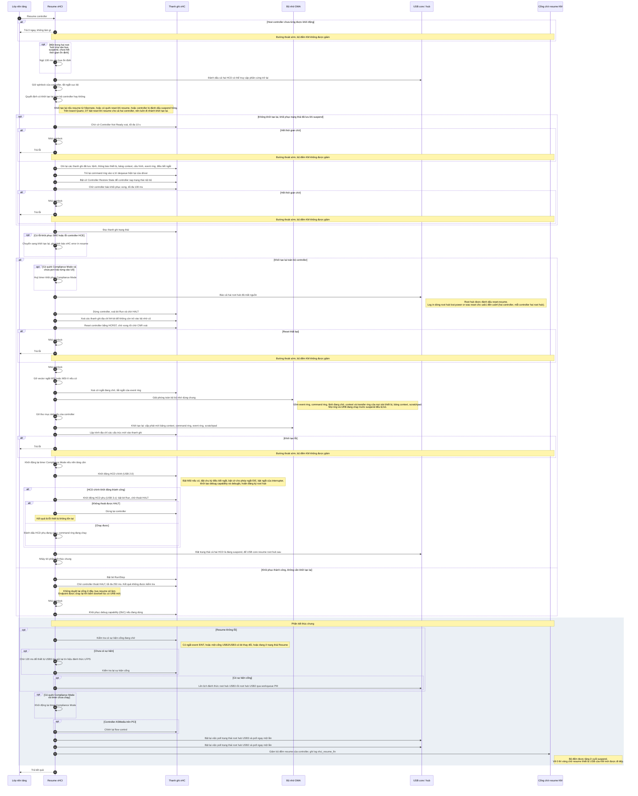
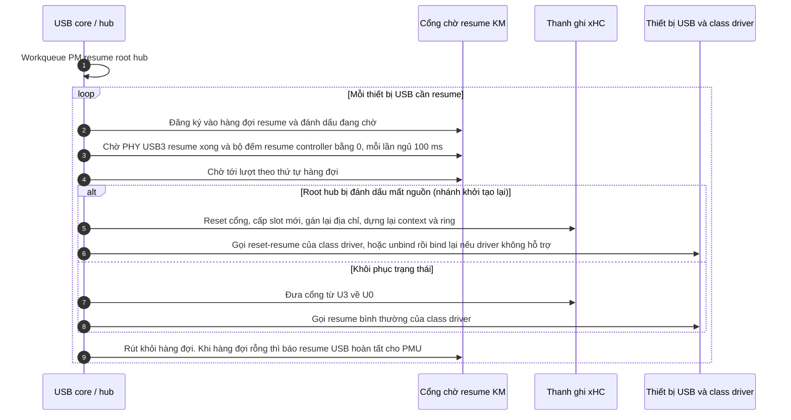

# Luồng resume của xHCI host controller

Nguồn: `Kernel/Src/drivers/usb/host/xhci.c:1115-1310` (resume chung), `xhci-plat.c:533-572` (lớp nền tảng gọi vào), cùng các hàm con trong `xhci.c`, `xhci-mem.c`, `core/hub.c`, `core/hcd.c`. Kernel 5.10.258, BSP Marvell Quartz có patch KM.

Sơ đồ chỉ mô tả **tác dụng và mục đích** của từng bước, không ghi tên hàm.

## Thành phần tham gia

| Tên trong sơ đồ | Vai trò |
|---|---|
| **PM hệ thống** | Khung quản lý nguồn của kernel. Gọi resume khi máy thức dậy (system sleep) hoặc khi controller hết runtime suspend |
| **Lớp nền tảng** | Phần glue của controller kiểu platform device: clock, quirk riêng của SoC, trạng thái runtime PM |
| **Resume xHCI** | Phần resume chung của driver xHCI, là phần chính của sơ đồ |
| **Thanh ghi xHC** | Thanh ghi operational, interrupter và port của controller (phần cứng) |
| **Bộ nhớ DMA** | Các cấu trúc dùng chung giữa driver và controller: bảng con trỏ context thiết bị, command ring, event ring, transfer ring, scratchpad |
| **USB core / hub** | Tầng USB core và hub driver, quản lý hai root hub (USB 2.0 và USB 3.x) cùng các thiết bị bên dưới |
| **Cổng chờ resume KM** | Bộ đếm và cờ do KM thêm vào (OP_BTS-33777). Thiết bị USB chỉ được resume khi controller và PHY đã resume xong |

---

## Sơ đồ 1: Lớp nền tảng gọi vào resume

---

## Sơ đồ 2: Resume chung của xHCI (đầy đủ nhánh)

---

## Sơ đồ 3: Sau khi hàm trả về (ngoài hàm, để thấy hệ quả)

---

## Cách đọc và các điểm đáng chú ý

1. **Hai nhánh chính.** Hàm hoặc *khôi phục* trạng thái controller đã lưu khi suspend, hoặc *khởi tạo lại* từ đầu. Trên board Quartz, DT bật `xhci_reset_on_resume` cho cả hai controller (`quartz-iris-sb-0.dtsi:62,94`), nên mỗi lần system resume đều đi nhánh khởi tạo lại. Nhánh này giải phóng mọi ring và context. Thiết bị chỉ dùng lại được sau bước reset-resume của hub driver ở Sơ đồ 3.
2. **Dấu hiệu trong log.** Nhánh khởi tạo lại in `root hub lost power or was reset` cho usb1 đến usb4. Trong log OP_BTS-71095, lần cuối dòng này xuất hiện trước sự cố là **07:02:45**. Lần thoát SLEEP1 lúc 07:05:51 **không có** dòng này, tức là SLEEP1 không đi qua hàm resume ở đây. Controller đang dùng tiếp trạng thái từ lần resume lúc 07:02:45.
3. **Đường thoát sớm không giảm bộ đếm KM.** Có năm chỗ: chưa từng khởi động, CNR timeout, restore timeout, reset lỗi, khởi tạo lỗi. Bộ đếm `xhci_resume_fin` được tăng ở cuối suspend nhưng chỉ được giảm ở cuối hàm resume. Nếu hàm thoát sớm vì lỗi, vòng chờ resume thiết bị USB của KM (`core/driver.c:1763`) có thể chờ mãi. Điểm này cần xác nhận thêm.
4. **Nhánh khôi phục chờ thoát HALT nhưng không kiểm tra kết quả.** Nếu controller không chạy lại được, lỗi sẽ chỉ lộ ra muộn hơn ở các bước sau.

---

# Giải thích chi tiết cho người mới

Hàm này phục vụ một việc: **khi máy thức dậy sau khi ngủ, đưa bộ điều khiển USB (xHCI) trở lại trạng thái làm việc được**. Phần này giải thích từ khái niệm nền, rồi đi lần lượt từng bước đúng theo thứ tự trong code. Đọc song song với Sơ đồ 1–3 ở trên.

## Phần 1: Khái niệm cần biết trước

### xHCI controller là gì?

Đây là con chip đứng giữa CPU và các thiết bị USB (bo FAX, Wi-Fi, ổ USB…). CPU không nói chuyện trực tiếp với thiết bị USB. CPU giao việc cho controller, controller làm rồi báo lại.

Có thể hình dung controller như **một bưu cục**: CPU là khách gửi hàng, thiết bị USB là người nhận.

### CPU và controller trao đổi qua đâu?

Qua hai thứ:

| Thứ | Hình dung | Ví dụ |
|---|---|---|
| **Thanh ghi** | Bảng điều khiển của bưu cục: các công tắc và ô số | Bit Run/Stop (chạy hay dừng), bit Reset, địa chỉ các sổ sách |
| **Bộ nhớ dùng chung (DMA)** | Các cuốn sổ đặt trong RAM, cả CPU và controller cùng đọc ghi | Các "ring" bên dưới |

Các cuốn sổ ("ring") là danh sách vòng tròn:
- **Command ring:** CPU ghi lệnh cho controller, ví dụ "cấp slot cho thiết bị mới".
- **Event ring:** controller ghi báo cáo cho CPU, ví dụ "đã gửi xong gói dữ liệu".
- **Transfer ring:** mỗi đường truyền (endpoint) của mỗi thiết bị có một cuốn riêng, ghi các việc truyền dữ liệu đang chờ.
- **Bảng context thiết bị:** mỗi thiết bị có một trang ghi địa chỉ, tốc độ, trạng thái các endpoint.

### Hai root hub

Một controller có hai "cổng gốc": một cho USB 2.0 và một cho USB 3.x. Linux coi đó là hai HCD (host controller driver):
- **HCD chính** là phía USB 2.0;
- **HCD phụ** là phía USB 3.x.

Trên board Quartz có hai controller nên có 4 root hub, là usb1 đến usb4 trong log.

### Suspend và resume

- **Suspend (đi ngủ):** driver chụp lại các giá trị trên bảng điều khiển và lưu vào RAM. Controller cũng tự lưu trạng thái nội bộ của nó. Sau đó nguồn hoặc clock của chip có thể bị cắt.
- **Resume (thức dậy):** có hai cách đưa mọi thứ trở lại.
  1. **Khôi phục:** chép lại các giá trị đã lưu lên bảng điều khiển, bảo controller nạp lại trạng thái nội bộ. Nhanh, và các thiết bị giữ nguyên kết nối.
  2. **Khởi tạo lại:** coi như controller mới bật nguồn. Xoá hết sổ sách, làm sổ mới, rồi báo cho tầng trên rằng mọi thiết bị phải "làm quen lại" từ đầu. Chậm hơn nhưng chắc chắn sạch.

**Board Quartz luôn dùng cách 2**, vì device tree bật `xhci_reset_on_resume` cho cả hai controller.

## Phần 2: Ai gọi hàm này (Sơ đồ 1)

Trước khi vào hàm, lớp nền tảng của SoC chuẩn bị (`xhci-plat.c:533`):

1. **Bật lại clock** cho controller, nếu lúc ngủ đã tắt. Không có clock thì chip như người bị ngắt nhịp tim, không đọc ghi được gì.
2. **Chạy bước chuẩn bị riêng của SoC**, nếu có.
3. **Gọi hàm resume** (phần chính bên dưới).
4. Nếu thành công, **báo cho hệ thống quản lý nguồn rằng controller đang hoạt động**. Nếu thất bại thì tắt lại clock và báo lỗi.

## Phần 3: Từng bước bên trong hàm (Sơ đồ 2)

### Bước 1: Kiểm tra có gì để resume không
Nếu controller chưa từng được khởi động (ví dụ driver chưa nạp xong), hàm thoát ngay. Không có gì để đánh thức.

### Bước 2: Chờ bus ổn định
Nếu một root hub vừa mới chuyển sang trạng thái ngủ, chuẩn USB yêu cầu chờ một khoảng thời gian. Hàm ngủ **100 ms** cho tín hiệu điện trên bus ổn định rồi mới động vào.

### Bước 3: Mở lại quyền truy cập phần cứng
Trong lúc ngủ, có một cờ báo "không được đụng vào thanh ghi" (vì chip có thể đang mất clock). Bước này bật lại cờ cho cả hai HCD, giống như **mở khoá cửa phòng máy**.

### Bước 4: Khoá lại để làm việc một mình
Hàm giữ spinlock và tắt ngắt trên CPU hiện tại. Mục đích là trong lúc đang khôi phục, không có trình xử lý ngắt hay CPU khác chen vào đọc ghi controller.

### Bước 5: Quyết định khôi phục hay khởi tạo lại
Hàm chọn **khởi tạo lại** nếu có một trong ba lý do:
- máy thức dậy từ hibernate (ngủ đông, RAM đã mất);
- nền tảng khai báo "luôn reset khi resume" (**trường hợp của Quartz**);
- controller đã được đánh dấu là suspend không đáng tin.

Nếu không có lý do nào, hàm thử **khôi phục**.

### Nhánh A: Khôi phục (Quartz không dùng, nhưng cần hiểu)

**A1. Chờ controller sẵn sàng.** Sau khi có điện lại, controller cần thời gian tự khởi động bên trong. Trong lúc đó cờ **CNR** (Controller Not Ready) đang bật. Hàm chờ tối đa **10 giây** cho cờ tắt. Quá hạn thì thả khoá và báo lỗi.

**A2. Chép lại bảng điều khiển.** Ghi lại các giá trị đã chụp lúc đi ngủ:
- cấu hình lệnh;
- loại thông báo thiết bị được phép gửi;
- **địa chỉ bảng context thiết bị**, tức sổ ở đâu trong RAM;
- số slot thiết bị được dùng;
- vị trí, kích thước và chỗ đang đọc dở của event ring;
- cài đặt ngắt.

**A3. Chỉ lại vị trí command ring.** Cho controller biết đọc lệnh tiếp từ chỗ nào.

**A4. Bảo controller nạp lại trí nhớ.** Bật cờ **CRS** (Controller Restore State). Controller nạp trạng thái nội bộ mà nó tự lưu lúc đi ngủ. Hàm chờ tối đa **100 ms**. Quá hạn thì báo lỗi.

### Bước 6: Kiểm tra sức khoẻ sau khôi phục
Hàm đọc thanh ghi trạng thái và xem hai cờ lỗi:
- **SRE:** khôi phục trạng thái thất bại;
- **HCE:** controller tự báo hỏng bên trong.

Nếu có một trong hai, hàm **chuyển sang khởi tạo lại** và ghi cảnh báo `xHC error in resume`. Đây là lưới an toàn khi cách khôi phục không thành.

### Nhánh B: Khởi tạo lại (Quartz luôn đi nhánh này)

**B1. Tắt timer xử lý "Compliance Mode".** Đây là timer vá lỗi của một số phần cứng, khi cổng USB3 bị kẹt ở chế độ kiểm thử. Timer này chỉ có trên nền tảng cần nó.

**B2. Báo cho tầng USB rằng root hub đã mất nguồn.** Đây là bước có hệ quả lớn nhất. Tầng USB đánh dấu hai root hub là `reset_resume`. Nghĩa là sau này, **mọi thiết bị bên dưới không được "đánh thức" đơn giản**. Chúng phải được reset và cấu hình lại từ đầu.

Dấu hiệu trong log: `usb usbN: root hub lost power or was reset`.

**B3. Dừng controller.** Tắt bit Run và chờ controller báo đã dừng (HALT).

**B4. Xoá các ô địa chỉ cũ.** Đặt về 0 các thanh ghi chứa địa chỉ 64-bit, để controller không còn trỏ vào vùng nhớ sắp bị giải phóng.

**B5. Reset controller.** Bật bit **HCRST**, tương đương "khôi phục cài đặt gốc" cho con chip. Hàm chờ reset xong và chờ CNR tắt. Thất bại thì báo lỗi.

**B6. Thả khoá.** Các bước sau phải cấp phát bộ nhớ và có thể ngủ, nên không được giữ spinlock nữa.

**B7. Gỡ đường ngắt.** Gỡ vector ngắt MSI/MSI-X nếu có. Xoá các ngắt đang treo và tắt ngắt của event ring, để không có ngắt lạc trong lúc dựng lại.

**B8. Vứt toàn bộ sổ cũ.** Giải phóng event ring, command ring, các lệnh đang chờ, context và transfer ring của **mọi thiết bị**, bảng context, scratchpad. Đồng thời gỡ thư mục debug.

> Hệ quả: mọi việc truyền dữ liệu đang dở trước khi ngủ đều mất. Driver nào còn giữ URB cũ sẽ không bao giờ nhận được kết quả của nó.

**B9. Làm sổ mới.** Cấp phát lại bảng context, command ring, event ring, scratchpad, rồi ghi địa chỉ các sổ mới vào thanh ghi để controller biết sổ nằm ở đâu.

**B10. Khởi động phía USB 2.0 (HCD chính):**
- bật MSI nếu có;
- đặt **chu kỳ điều tiết ngắt** (controller được ngắt CPU thường xuyên đến mức nào);
- bật cho phép ngắt ở cả mức controller (EIE) và mức event ring;
- chuẩn bị debug capability và thư mục debug.

**B11. Khởi động phía USB 3.x (HCD phụ).** Bật bit **Run** và chờ controller thoát trạng thái dừng. Nếu không chạy được thì dừng lại và báo lỗi. Nếu chạy được thì đánh dấu controller và command ring đang hoạt động.

**B12. Đặt cả hai HCD về trạng thái "đang ngủ".** Nghe ngược đời, nhưng có chủ ý: để tầng USB core tự chạy bước resume root hub theo quy trình chuẩn, và lúc đó nó sẽ thấy cờ `reset_resume` ở bước B2.

Sau đó nhảy tới **phần kết thúc chung**.

### Nhánh A (tiếp): Khi khôi phục thành công

**A5. Cho controller chạy lại.** Bật bit Run/Stop và chờ tối đa **250 ms** cho controller thoát trạng thái dừng. Lưu ý: kết quả chờ này **không được kiểm tra**.

Ở đây không cần duyệt lại từng cổng (bước resume bus sẽ làm). Các endpoint cũng không cần khởi động lại ngay; chúng tự chạy khi có việc mới và driver "bấm chuông cửa" (doorbell).

**A6. Thả khoá, khôi phục debug capability** nếu đang dùng.

### Phần kết thúc chung (cả hai nhánh đều đi qua)

**K1. Xem có ai gõ cửa không.** Nếu tới đây không có lỗi, hàm kiểm tra có sự kiện cổng nào đang chờ:
- controller có báo ngắt event không;
- có cổng USB2/USB3 nào vừa thay đổi (cắm, rút, lỗi) hoặc đang ở trạng thái "Resume" (thiết bị đang đòi thức dậy) không.

Nếu chưa thấy gì, hàm **chờ thêm 120 ms** rồi kiểm tra lại. Lý do: thiết bị USB3 đánh thức bằng tín hiệu LFPS, nếu lần đầu hụt thì gửi lại sau khoảng 100 ms.

Nếu có sự kiện, hàm **xếp lịch đánh thức hai root hub** trên workqueue. Việc này chạy sau, không chặn hàm.

**K2. Khởi động lại timer Compliance Mode** nếu nền tảng cần và timer chưa chạy.

**K3. Vá lỗi riêng cho chip ASMedia** trên PCI. Không áp dụng cho Quartz.

**K4. Bật lại việc theo dõi root hub.** Trong lúc ngủ, USB core ngừng hỏi thăm trạng thái root hub. Bước này bật lại việc đó cho cả hai root hub và hỏi thăm ngay một lần. Nhờ vậy, việc cắm hoặc rút thiết bị trong lúc ngủ sẽ được phát hiện.

**K5. (Phần KM thêm vào) Báo "controller đã resume xong".** Giảm bộ đếm `xhci_resume_fin`:
- bộ đếm này được tăng lúc đi ngủ;
- khi nó về 0, các thiết bị USB đang xếp hàng mới được phép resume (xem Phần 4).

**K6. Trả kết quả** về cho lớp nền tảng.

## Phần 4: Chuyện gì xảy ra sau khi hàm trả về (Sơ đồ 3)

1. USB core đánh thức root hub, rồi lần lượt từng thiết bị bên dưới.
2. **Cổng chờ của KM:** mỗi thiết bị phải chờ cho tới khi PHY USB3 đã thức dậy **và** bộ đếm của controller về 0. Sau đó các thiết bị resume lần lượt theo thứ tự hàng đợi.
3. Vì root hub đã bị đánh dấu `reset_resume` ở B2, mỗi thiết bị được:
   - **reset cổng**, cấp slot mới, gán lại địa chỉ, dựng lại context và transfer ring;
   - class driver được gọi hàm reset-resume. Nếu driver không hỗ trợ, nó bị **gỡ ra rồi gắn lại**.
4. Khi hàng đợi rỗng, KM báo cho PMU rằng USB đã resume xong.

> Liên hệ thực tế: vì trên Quartz mọi lần system resume đều xoá sạch ring, FaxP chủ động **unbind bo FAX (`3-1.2`) trước khi ngủ và bind lại sau khi thức**, thay vì trông vào cơ chế resume.

## Phần 5: Nhìn vào log để biết đã đi nhánh nào

| Thấy trong log | Ý nghĩa |
|---|---|
| `root hub lost power or was reset` cho usb1 đến usb4 | Đã đi **nhánh khởi tạo lại** |
| `xHC error in resume, USBSTS 0x…, Reinit` | Khôi phục thất bại (SRE/HCE), phải chuyển sang khởi tạo lại |
| `Controller not ready at resume` | Controller không sẵn sàng sau 10 s, resume thất bại |
| `xHC restore state timeout` | Controller không nạp lại được trạng thái trong 100 ms |
| `xhci_resume_fin [0]` | Phần KM: controller đã resume xong (chỉ thấy khi bật loglevel info) |

Ví dụ ở OP_BTS-71095: dòng `root hub lost power` xuất hiện lúc 07:02:45 nhưng **không** xuất hiện lúc thoát SLEEP1 07:05:51. Vậy SLEEP1 không đi qua hàm này, và controller vẫn chạy tiếp với bộ sổ được làm lúc 07:02:45.

## Phần 6: Tóm tắt một câu cho mỗi giai đoạn

1. **Chuẩn bị:** bật clock, chờ bus ổn định, mở quyền truy cập, khoá lại.
2. **Chọn đường:** khôi phục (nhanh, giữ kết nối) hay khởi tạo lại (sạch, thiết bị phải làm quen lại). Quartz luôn khởi tạo lại.
3. **Làm việc chính:** khôi phục thì chép lại thanh ghi và bảo chip nạp trí nhớ; khởi tạo lại thì reset chip, vứt sổ cũ, làm sổ mới, khởi động hai phía USB2 và USB3.
4. **Kết thúc:** kiểm tra ai đòi thức dậy, bật lại việc theo dõi root hub, báo cho KM là xong.
5. **Sau đó:** USB core reset và cấu hình lại từng thiết bị.
