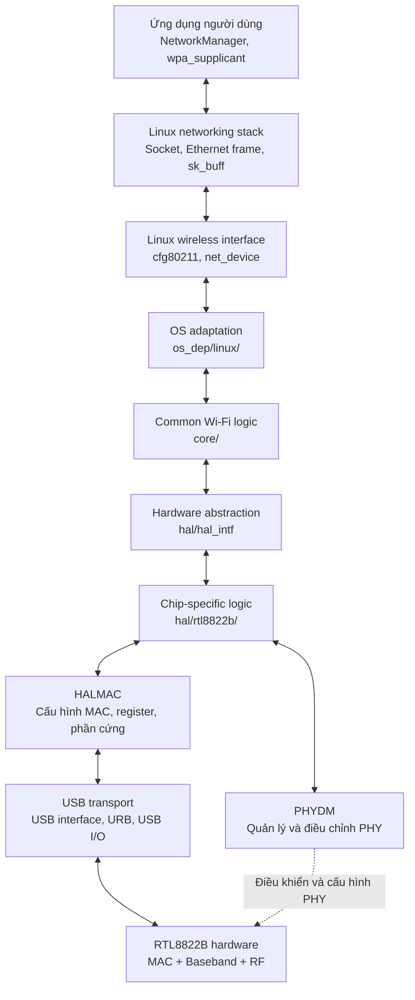
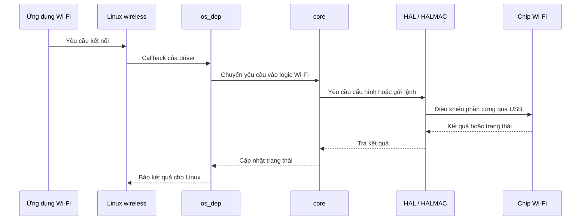
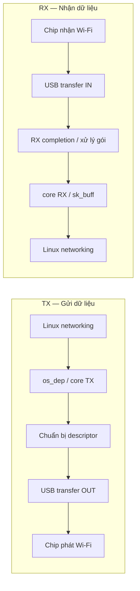

Với driver Realtek `RTL8812BU/RTL8822B` bạn đang nghiên cứu, cách dễ hiểu nhất là xem nó như một hệ thống gồm nhiều lớp, mỗi lớp chịu trách nhiệm một phần công việc. Các lớp phối hợp với nhau để biến yêu cầu từ Linux thành thao tác với chip Wi-Fi, rồi chuyển dữ liệu nhận được ngược trở lại Linux.

Source driver Realtek thường chia thành các thư mục như `core/`, `hal/`, `include/`, `os_dep/` và `platform/`. Makefile quyết định những phần nào thực sự được biên dịch dựa trên cấu hình chip và giao tiếp.

## 1. Mô hình kiến trúc tổng thể

Đây là mô hình khái niệm để định hướng đọc code, không phải call graph chính xác của mọi hàm. Trong source thực tế, các lớp có thể gọi chéo nhau qua function pointer và bảng API; đường USB cũng có thể được sử dụng bởi nhiều thành phần, không chỉ HALMAC.

Hãy hình dung driver như một công ty:
- `os_dep/`: bộ phận tiếp nhận yêu cầu từ Linux.
- `core/`: bộ phận xử lý nghiệp vụ Wi-Fi.
- `hal/`: bộ phận biết cách điều khiển phần cứng.
- USB HCI: đường vận chuyển lệnh và dữ liệu giữa máy tính với chip.
- `include/`: nơi khai báo các kiểu dữ liệu, cấu trúc và giao diện dùng chung.
## 2. Vai trò của từng phần trong source

**1. `os_dep/` — Kết nối với hệ điều hành

Đây là nơi tích hợp driver với Linux: đăng ký thiết bị mạng, kết nối các callback, xử lý USB, nhận/gửi dữ liệu và làm việc với các cơ chế của kernel.

Những file thường đáng xem ở nhánh Linux gồm `os_dep/linux/os_intfs.c`, `usb_intf.c`, `xmit_linux.c`, `recv_linux.c`, `ioctl_cfg80211.c`. Tên và sự phân chia chính xác có thể khác giữa các phiên bản.

**2. `core/` — Logic Wi-Fi dùng chung

Chứa phần lớn logic hoạt động của Wi-Fi, chẳng hạn quản lý kết nối, scan, xử lý lệnh, truyền/nhận dữ liệu và quản lý trạng thái nguồn.

Ví dụ thường gặp: `rtw_mlme.c`, `rtw_cmd.c`, `rtw_xmit.c`, `rtw_recv.c`, `rtw_pwrctrl.c`.

Câu hỏi cần đặt ra khi đọc: Vì sao driver cần thao tác này, khi nào nó chạy và trạng thái nào được thay đổi?

**3. `hal/` — Điều khiển phần cứng

HAL là lớp trừu tượng hóa phần cứng (Hardware Abstraction Layer). Nó giúp phần logic phía trên sử dụng các giao diện điều khiển chip mà không cần tự xử lý mọi chi tiết register.

Trong nhánh RTL8822B, bạn cần phân biệt phần dùng chung như `hal_intf` với phần riêng của chip như `rtl8822b`, USB-specific HAL và HALMAC.

**4. HALMAC và PHYDM — Hai nhóm nhiệm vụ ở tầng phần cứng

- HALMAC: xử lý các thao tác điều khiển phần MAC và cấu hình phần cứng, gồm nhiều thao tác đọc/ghi register.
    
- PHYDM: các cơ chế quản lý, đo đạc và điều chỉnh PHY, như những thuật toán thích nghi theo điều kiện vô tuyến.
    

Có thể nhớ nhanh: HALMAC thiên về thao tác cấu hình/điều khiển MAC; PHYDM thiên về quản lý và tối ưu hoạt động PHY. Chi tiết chức năng phải kiểm tra theo từng hàm trong phiên bản source của bạn.

**5. USB HCI — Giao tiếp với chip qua USB

HCI là giao diện kết nối host với thiết bị. Với cấu hình USB, driver dùng cơ chế USB của Linux, bao gồm URB (yêu cầu truyền USB), để truyền dữ liệu và thực hiện các thao tác I/O.

Đừng nhầm USB HCI với logic Wi-Fi: USB vận chuyển dữ liệu; `core/` quyết định xử lý Wi-Fi như thế nào.

**6. `include/`, `platform/` và Makefile

- `include/`: khai báo struct, enum, macro, function prototype và các giao diện chung.
- `platform/`: những phần hỗ trợ khác biệt giữa nền tảng hoặc hệ thống.
- `Makefile` và các file cấu hình: quyết định những file, chipset và giao diện nào được biên dịch.

Các thư mục này không phải lúc nào cũng là một tầng xử lý tuần tự; chúng hỗ trợ nhiều tầng cùng sử dụng.

## 3. Hai luồng hoạt động bạn phải phân biệt

Cấu trúc thư mục chỉ cho biết code được tổ chức thế nào. Muốn hiểu cách driver thực sự chạy, bạn cần nhìn thêm hai luồng: control path và data path.

### A. Control path — Điều khiển Wi-Fi

Ví dụ: người dùng yêu cầu kết nối vào một mạng Wi-Fi.

Đây là luồng khái quát. Một số bước có thể chạy bất đồng bộ: driver gửi lệnh trước, rồi nhận sự kiện firmware hoặc callback sau.

### B. Data path — Truyền và nhận gói tin

Khi bạn mở một trang web, driver phải vận chuyển dữ liệu thực tế, không chỉ điều khiển chip.

Các sơ đồ trên giúp bạn hình dung hướng xử lý. Đường gọi cụ thể phải được xác minh trong source vì có thể có queue, thread, workqueue và callback trung gian.

## 4. Đặt hàm bạn vừa nghiên cứu vào mô hình

Hàm `init_wmac_cfg_8822b()` thuộc nhóm khởi tạo/cấu hình phần cứng cho chip RTL8822B, không phải logic trực tiếp xử lý yêu cầu kết nối của người dùng.

Nhìn vào code bạn gửi, nó ghi các register phục vụ cấu hình RX, TX và WMAC, chọn giá trị theo `trx_mode`, sau đó gọi `api->halmac_init_low_pwr()`.

Do đó, khi đọc hàm này, bạn nên tự hỏi:
1. Ai gọi hàm khởi tạo WMAC?
2. API HALMAC được gán ở đâu?
3. Các macro register được định nghĩa ở file nào?
4. Các bước khởi tạo WMAC diễn ra trước hay sau những bước khởi tạo phần cứng nào?
Những câu hỏi này giúp nối một function đơn lẻ với bức tranh toàn bộ driver.

## 5. Nên học cấu trúc theo thứ tự nào?

Tôi khuyên bạn đi theo lộ trình sau:

1. Tổng quan source và build config: biết file nào thực sự được biên dịch với `CONFIG_RTL8822B=y`, `CONFIG_USB_HCI=y`.
2. Module load → USB probe → adapter initialization: hiểu driver xuất hiện với Linux như thế nào.
3. HAL và register I/O: hiểu phần mềm điều khiển chip ra sao.
4. Scan và connect: hiểu quy trình tạo kết nối Wi-Fi.
5. TX/RX: theo dấu một gói tin từ Linux xuống chip và trở lại.
6. Power management: sau khi đã hiểu trạng thái thiết bị và luồng khởi tạo, nghiên cứu LPS, IPS và USB autosuspend.
    

Điểm quan trọng nhất: đừng coi các thư mục là những phần hoàn toàn độc lập hoặc một chuỗi tuyến tính tuyệt đối. Cấu trúc thư mục là cách tổ chức source; còn call graph và sequence mới cho biết các phần thực sự phối hợp với nhau lúc chạy.