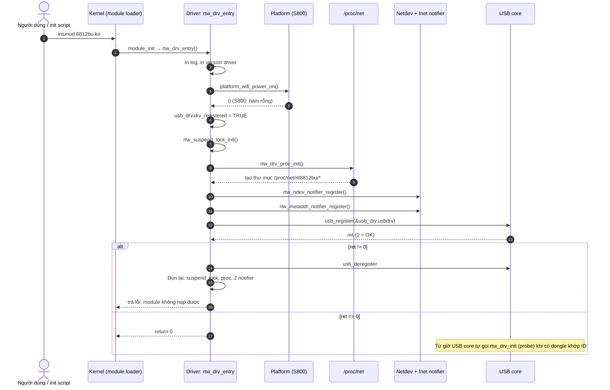
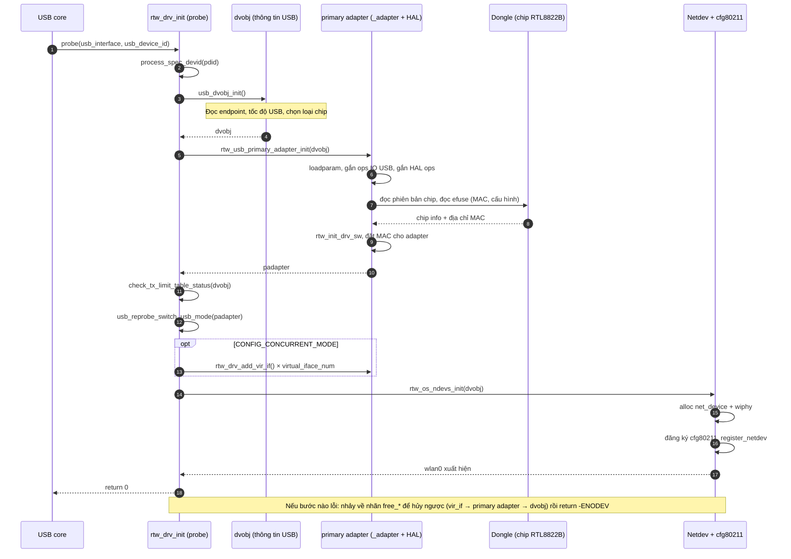
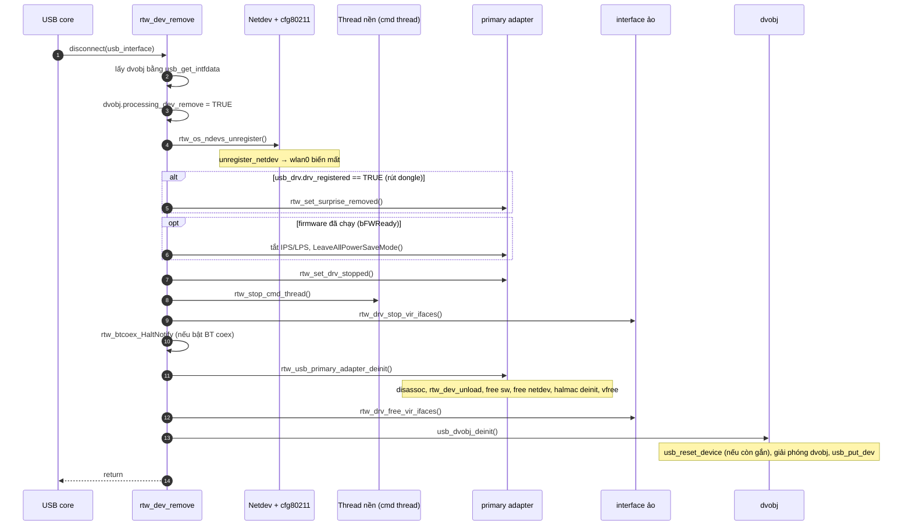

# Nên bắt đầu từ đâu

Đừng đọc theo thứ tự thư mục. Driver này có hơn 600 file nên sẽ bị ngợp. Hãy đọc theo **đường đi của một sự kiện**, bắt đầu từ chỗ kernel gọi vào driver, rồi đi xuống từng tầng.

## Bước 0: Nắm 3 khái niệm nền (khoảng 1 giờ, chưa cần đọc code)

1. **Module kernel**: `module_init` và `module_exit` làm gì.
2. **USB driver**: `usb_driver`, `probe`, `disconnect`, bảng `usb_device_id` (khớp VID/PID của thiết bị với driver).
3. **WiFi trong Linux**: `cfg80211` là giao diện chuẩn mà `wpa_supplicant` hay `iw` dùng để ra lệnh (scan, connect). Driver phải đăng ký một bảng hàm `cfg80211_ops`.

Nếu chưa vững 3 ý này, đọc code sẽ không hiểu vì sao hàm nằm ở đó.

## Bước 1: Điểm vào module (30 phút)

Mở [usb_intf.c](vscode-webview://1bvn9deljhs67bs6tdc4nttro6fasb6a3o9dsbsr0n55qjrijoej/os_dep/linux/usb_intf.c) và đọc đúng 4 chỗ:

| Dòng                                                                                                        | Nội dung                                            |
| ----------------------------------------------------------------------------------------------------------- | --------------------------------------------------- |
| [1704](vscode-webview://1bvn9deljhs67bs6tdc4nttro6fasb6a3o9dsbsr0n55qjrijoej/os_dep/linux/usb_intf.c#L1704) | `rtw_drv_entry`: hàm khởi tạo module                |
| [1731](vscode-webview://1bvn9deljhs67bs6tdc4nttro6fasb6a3o9dsbsr0n55qjrijoej/os_dep/linux/usb_intf.c#L1731) | `usb_register(...)`: đăng ký driver với USB core    |
| [1541](vscode-webview://1bvn9deljhs67bs6tdc4nttro6fasb6a3o9dsbsr0n55qjrijoej/os_dep/linux/usb_intf.c#L1541) | `rtw_drv_init`: **probe**, chạy khi cắm dongle WiFi |
| [1637](vscode-webview://1bvn9deljhs67bs6tdc4nttro6fasb6a3o9dsbsr0n55qjrijoej/os_dep/linux/usb_intf.c#L1637) | `rtw_dev_remove`: chạy khi rút dongle               |

Chỉ cần trả lời được câu hỏi: **"khi cắm USB vào, những bước lớn nào được gọi?"** Chưa cần hiểu chi tiết từng hàm.

## Function `rtw_drv_entry`



## Giải thích từng bước

**1. `insmod` → kernel gọi `rtw_drv_entry`.** Kernel nạp file `.ko` vào bộ nhớ rồi gọi hàm được đánh dấu `module_init`. Chữ `__init` nghĩa là hàm chỉ chạy một lần, xong thì kernel giải phóng vùng nhớ của nó.

**2. In log và version** (`RTW_PRINT`, `dump_drv_version`). Chỉ để debug: xem `dmesg` biết driver nào, bản nào được nạp. `BTCOEXVERSION` thì chỉ in nếu bật BT coex.

**3. `platform_wifi_power_on()`.** Mục đích là bật nguồn/reset chân GPIO của chip WiFi (mỗi board làm khác nhau). Trên cấu hình này, `CONFIG_PLATFORM_OPS` không được bật cho S800 (nó chỉ được bật ở nhánh SDIO của các nền tảng khác trong Makefile). Vì vậy kernel dùng bản **rỗng** ở [platform_ops.c:63](vscode-webview://1bvn9deljhs67bs6tdc4nttro6fasb6a3o9dsbsr0n55qjrijoej/platform/platform_ops.c#L63), chỉ `return 0`. Nghĩa là nguồn dongle USB do phần cứng/hệ điều hành lo, driver không làm gì ở đây. Đây là chỗ để thêm code nếu board cần bật nguồn bằng GPIO.

**4. Đặt cờ `drv_registered` và `tx_limit_table` = TRUE.** Là hai biến trạng thái trong `usb_drv`. `drv_registered` để các chỗ khác trong driver biết "module đang sống". `tx_limit_table` ban đầu TRUE, sau đó bị đọc lại ở bước 9. Tôi chưa tìm hiểu ai có thể đặt nó về FALSE, nên chi tiết đó cần trace thêm.

**5. `rtw_suspend_lock_init()`** ([osdep_service.c:1883](vscode-webview://1bvn9deljhs67bs6tdc4nttro6fasb6a3o9dsbsr0n55qjrijoej/os_dep/osdep_service.c#L1883)). Khởi tạo "khóa ngăn máy ngủ" (wakelock) để khi đang gửi dữ liệu, hệ thống không suspend giữa chừng. Nhưng code chỉ chạy khi `CONFIG_WAKELOCK` hoặc `CONFIG_ANDROID_POWER` được định nghĩa. Tôi không thấy hai macro này trong Makefile hay `autoconf.h`, nên trên build này hàm **rất có thể là rỗng**.

**6. `rtw_drv_proc_init()`** ([rtw_proc.c:444](vscode-webview://1bvn9deljhs67bs6tdc4nttro6fasb6a3o9dsbsr0n55qjrijoej/os_dep/linux/rtw_proc.c#L444)). Tạo thư mục trong `/proc/net/` rồi tạo nhiều file bên trong để đọc/ghi thông tin debug (Makefile bật `CONFIG_PROC_DEBUG = y`). Bạn có thể `cat` các file này trên board để xem trạng thái driver mà không cần công cụ nào khác.

**7. `rtw_ndev_notifier_register()`** ([os_intfs.c:1760](vscode-webview://1bvn9deljhs67bs6tdc4nttro6fasb6a3o9dsbsr0n55qjrijoej/os_dep/linux/os_intfs.c#L1760)). Đăng ký "tai nghe" với mạng của kernel: mỗi khi **bất kỳ** network device nào đổi trạng thái (đổi tên, up, down...), kernel gọi hàm `rtw_ndev_notifier_call`. Hàm đó lọc bằng `is_rtw_ndev` để chỉ xử lý interface của Realtek (ví dụ cập nhật lại tên trong /proc khi `wlan0` bị đổi tên).

**8. `rtw_inetaddr_notifier_register()`** ([os_intfs.c:3451](vscode-webview://1bvn9deljhs67bs6tdc4nttro6fasb6a3o9dsbsr0n55qjrijoej/os_dep/linux/os_intfs.c#L3451)). Tương tự, nhưng lắng nghe **thay đổi địa chỉ IP** (IPv4, và IPv6 nếu bật). Mục đích thực tế là để driver biết IP hiện tại và có thể báo cho firmware (ví dụ phục vụ Wake-on-WLAN).

**9. `usb_register(&usb_drv.usbdrv)`: bước quan trọng nhất.** Đưa cho USB core một cấu trúc `usb_driver` chứa:

- `name` = `"rtl8812bu"` ([autoconf.h:65](vscode-webview://1bvn9deljhs67bs6tdc4nttro6fasb6a3o9dsbsr0n55qjrijoej/include/autoconf.h#L65))
- `id_table` = danh sách VID/PID mà driver hỗ trợ, ví dụ `0BDA:B812`, `0BDA:B82C`, `0BDA:B81A` ([usb_intf.c:281](vscode-webview://1bvn9deljhs67bs6tdc4nttro6fasb6a3o9dsbsr0n55qjrijoej/os_dep/linux/usb_intf.c#L281))
- `probe` = `rtw_drv_init`, `disconnect` = `rtw_dev_remove`, cùng `suspend`/`resume`/`shutdown`

Sau lệnh này, USB core **ghép** driver với mọi thiết bị khớp bảng ID. Nếu dongle đã được cắm sẵn từ trước, `probe` có thể được gọi ngay trong lúc `usb_register` chạy. Nếu chưa cắm, nó sẽ được gọi khi cắm sau.

**10. Kiểm tra kết quả.** `ret = (tx_limit_table == FALSE) ? -EINVAL : ret`. Nghĩa là nếu trong lúc probe, một đoạn code nào đó đặt `tx_limit_table` về FALSE thì xem như thất bại dù `usb_register` trả OK. Đây là chỗ bạn cần chú ý khi đọc probe.

**11. Nhánh lỗi (`ret != 0`).** Dọn ngược lại theo thứ tự đã làm: `usb_deregister`, hủy suspend lock, hủy proc, hủy hai notifier. Rồi trả lỗi để `insmod` báo thất bại. Đây là mẫu chuẩn "đăng ký gì thì hủy cái đó".


## Hàm `rtw_drv_init`

Hàm này nằm ở [usb_intf.c:1541](vscode-webview://1bvn9deljhs67bs6tdc4nttro6fasb6a3o9dsbsr0n55qjrijoej/os_dep/linux/usb_intf.c#L1541). USB core gọi nó khi **một dongle có VID/PID nằm trong bảng ID** đã đăng ký ở `usb_register`. Tham số `pusb_intf` là "tờ khai" của thiết bị vừa cắm, `pdid` là dòng khớp trong bảng ID.

Nó trả về `0` nếu thành công, `-ENODEV` nếu thất bại.

## Ví dụ cho người mới

Quay lại ví dụ nhân viên ở tòa nhà USB. Giờ có khách thật (dongle) đến:

1. Hỏi khách: "Anh thuộc loại nào, có bao nhiêu cửa ra vào?" → `usb_dvobj_init`
2. Lập hồ sơ cho khách: đọc chip nào, bản mạch nào, địa chỉ MAC → `rtw_usb_primary_adapter_init`
3. Kiểm tra giấy tờ phụ (bảng giới hạn công suất, chế độ USB) → hai hàm check
4. Cấp biển số để khách ra đường chính → `rtw_os_ndevs_init` (tạo `wlan0`)

Giữa chừng có bước nào hỏng thì **thu dọn ngược lại** từ chỗ đã làm.


## Giải thích từng bước

**1. `process_spec_devid(pdid)`** ([usb_intf.c:900](vscode-webview://1bvn9deljhs67bs6tdc4nttro6fasb6a3o9dsbsr0n55qjrijoej/os_dep/linux/usb_intf.c#L900)) Duyệt bảng `specific_device_id_tbl` và áp dụng "ngoại lệ" riêng cho một số VID/PID. Ví dụ có thiết bị bị tắt HT (802.11n), hoặc đổi tên interface (nhánh `RTK_DMP_PLATFORM`). Với hầu hết dongle thường thì hàm này không làm gì.

**2. `usb_dvobj_init()`** ([usb_intf.c:529](vscode-webview://1bvn9deljhs67bs6tdc4nttro6fasb6a3o9dsbsr0n55qjrijoej/os_dep/linux/usb_intf.c#L529)) "dvobj" là **device object**: một khối dữ liệu mô tả **thiết bị USB về mặt vật lý**. Hàm này:

- cấp phát khối dữ liệu (`devobj_init`), rồi gắn vào `usb_intf` bằng `usb_set_intfdata` để sau này (ở `disconnect`) lấy lại được;
- duyệt từng **endpoint** (kênh truyền) của USB và phân loại: bulk-in (nhận), bulk-out (gửi), interrupt-in. Ghi lại số pipe vào `RtInPipe[]`/`RtOutPipe[]`;
- đọc **tốc độ USB** (1.1, 2.0 hay 3.0). Nếu không nhận ra thì thất bại;
- gọi `rtw_decide_chip_type_by_usb_info` để biết chip là dòng nào (lấy từ `driver_info` trong bảng ID, ví dụ `RTL8822B`);
- `usb_get_dev` tăng bộ đếm tham chiếu để thiết bị không bị giải phóng khi driver còn dùng.

Cắm nhầm chip khác thì driver biết ngay ở bước này. Chưa có lệnh nào được gửi tới chip.

**3. `rtw_usb_primary_adapter_init()`** ([usb_intf.c:1381](vscode-webview://1bvn9deljhs67bs6tdc4nttro6fasb6a3o9dsbsr0n55qjrijoej/os_dep/linux/usb_intf.c#L1381)) là bước nặng nhất. "adapter" (`_adapter`) là **một giao diện WiFi logic** (khác dvobj là phần cứng USB). Trong hàm này:

- cấp phát `_adapter`, `loadparam` nạp các tham số module (tên interface, v.v.);
- `rtw_init_io_priv(..., usb_set_intf_ops)` gắn **hàm đọc/ghi thanh ghi qua USB**;
- `rtw_set_hal_ops` cấp phát `HalData` và gắn hàm HAL của đúng chip. Với 8822B thì vào nhánh `rtl8822b…` (ở [usb_intf.c:775](vscode-webview://1bvn9deljhs67bs6tdc4nttro6fasb6a3o9dsbsr0n55qjrijoej/os_dep/linux/usb_intf.c#L775) trở đi chọn theo `rtw_get_chip_type`);
- `rtw_hal_read_chip_version`, `rtw_hal_chip_configure`: đọc phiên bản chip, ánh xạ endpoint sang queue TX;
- `rtw_hal_read_chip_info`: đọc **efuse** (bộ nhớ cấu hình cháy sẵn trong chip) để lấy địa chỉ MAC, cấu hình RF, v.v. Ở nhánh USB, code gọi `read_adapter_info` mà không gọi `rtw_hal_power_on` riêng (chỉ SDIO/GSPI mới có bước đó);
- `rtw_init_drv_sw`: khởi tạo phần mềm: hàng đợi TX/RX, MLME, timer...;
- `rtw_macaddr_cfg`: đặt địa chỉ MAC cho adapter từ efuse.

Kết quả: có một `_adapter` hoàn chỉnh về mặt phần mềm, nhưng **firmware chưa được nạp**. Việc nạp firmware, theo tôi quan sát được, nằm ở đường mở interface (`rtw_hal_init` được gọi trong [os_intfs.c](vscode-webview://1bvn9deljhs67bs6tdc4nttro6fasb6a3o9dsbsr0n55qjrijoej/os_dep/linux/os_intfs.c), ví dụ dòng 3649 trở đi). Tôi chưa trace chi tiết nên đây là **giả thuyết cần xác minh**.

**4. `check_tx_limit_table_status()`** ([usb_intf.c:760](vscode-webview://1bvn9deljhs67bs6tdc4nttro6fasb6a3o9dsbsr0n55qjrijoej/os_dep/linux/usb_intf.c#L760), chỉ khi bật `CONFIG_TXPWR_LIMIT`) Kiểm tra "bảng giới hạn công suất phát" (tùy quốc gia) đã nạp được chưa. `CONFIG_TXPWR_LIMIT_EN = y` trong Makefile nên bước này có hiệu lực. Nếu chưa nạp xong thì **đặt `usb_drv.tx_limit_table = _FALSE`** và probe thất bại. Đây chính là chỗ giải đáp thắc mắc ở `rtw_drv_entry` trước đó: biến này được đặt FALSE ở đây, và `rtw_drv_entry` kiểm tra lại sau `usb_register`.

**5. `usb_reprobe_switch_usb_mode()`** ([usb_intf.c:739](vscode-webview://1bvn9deljhs67bs6tdc4nttro6fasb6a3o9dsbsr0n55qjrijoej/os_dep/linux/usb_intf.c#L739)) Một số dongle có chế độ USB đặc biệt. Hàm chỉ thực hiện đổi nếu **cả efuse và tham số module** cho phép, và với cấu hình thông thường thì nó **trả `_FALSE`**, nghĩa là không làm gì. Nếu trả `_TRUE` thì probe dừng lại (bỏ để thiết bị tự enumerate lại).

**6. Tạo interface ảo (chỉ khi `CONFIG_CONCURRENT_MODE`).** Makefile bật `CONFIG_CONCURRENT_MODE = y`. Số interface ảo mặc định có vẻ lấy từ `rtw_virtual_iface_num` (xem [os_intfs.c:507](vscode-webview://1bvn9deljhs67bs6tdc4nttro6fasb6a3o9dsbsr0n55qjrijoej/os_dep/linux/os_intfs.c#L507)), bị giới hạn bởi `CONFIG_IFACE_NUMBER - 1`. Mỗi vòng gọi `rtw_drv_add_vir_if`, ví dụ để vừa là station vừa là AP. Tôi chưa kiểm tra giá trị cụ thể của `CONFIG_IFACE_NUMBER` trên build này, nên chưa chắc có mấy interface.

**7. `rtw_os_ndevs_init()`** ([os_intfs.c:3558](vscode-webview://1bvn9deljhs67bs6tdc4nttro6fasb6a3o9dsbsr0n55qjrijoej/os_dep/linux/os_intfs.c#L3558)): bước tạo `wlan0`. Gồm hai việc:

- `rtw_os_ndevs_alloc`: cấp phát `net_device` và các tài nguyên cfg80211 (wiphy...);
- `rtw_os_ndevs_register` ([os_intfs.c:3468](vscode-webview://1bvn9deljhs67bs6tdc4nttro6fasb6a3o9dsbsr0n55qjrijoej/os_dep/linux/os_intfs.c#L3468)): đăng ký cfg80211 (`rtw_cfg80211_dev_res_register`), rồi cho từng adapter gọi `rtw_os_ndev_register`: đặt tên (`wlan%d`), chép MAC vào `dev_addr`, **`register_netdev`**. Sau lệnh này `ip link` mới thấy `wlan0`.

Thứ tự này đúng chuẩn Linux: tạo thiết bị mạng sau cùng, khi mọi thứ bên dưới đã sẵn sàng, vì ngay khi `register_netdev` xong, hệ thống có thể bắt đầu gọi vào driver.

**8. Đặt `status = _SUCCESS` và return 0.** Các nhánh `#ifdef` còn lại (`HOSTAPD_MLME`, `RTD2880B`...) không phải chuyện của build này, trừ khi Makefile bật chúng.

## Cơ chế dọn lỗi (rất đáng học)

Các nhãn ở cuối hàm theo mẫu `goto` chuẩn của kernel, **hủy ngược thứ tự tạo**:

```
free_if_vir  → hủy interface ảo (stop + free)
free_if_prim → rtw_usb_primary_adapter_deinit
free_dvobj   → usb_dvobj_deinit
exit         → return -ENODEV
```

Mỗi nhãn chỉ chạy nếu `status != _SUCCESS`, và nếu thành công thì code đi xuyên qua mà không làm gì. Lưu ý một chi tiết nhỏ: nhãn `os_ndevs_deinit` bị `#if 0`, tức là nếu `rtw_os_ndevs_init` thất bại thì nó tự dọn bên trong chính hàm đó (`os_ndevs_free`).

## Điểm cần nhớ

- Probe **chưa gửi ảnh firmware**, chưa bật radio. Nó chỉ nhận dạng chip, đọc cấu hình, dựng cấu trúc phần mềm, rồi tạo `wlan0`.
- Có 2 tầng đối tượng: **dvobj** (phần cứng USB) → **adapter** (một interface WiFi). Dongle có nhiều interface thì 1 dvobj có nhiều adapter.
- `usb_set_intfdata` lưu dvobj để `disconnect` ([usb_intf.c:1637](vscode-webview://1bvn9deljhs67bs6tdc4nttro6fasb6a3o9dsbsr0n55qjrijoej/os_dep/linux/usb_intf.c#L1637)) lấy lại và dọn.

## Câu hỏi để bạn tự dự đoán (tôi chưa đưa đáp án)

- **Q3.** Nếu dongle có 2 interface (primary + 1 ảo), sau probe sẽ có bao nhiêu `dvobj` và bao nhiêu `_adapter`?
- **Q4.** Nếu `check_tx_limit_table_status` trả FALSE, những tài nguyên nào đã được cấp phát và phải hủy, theo đúng thứ tự?
- **Q5.** Vì sao tạo `net_device` ở bước **cuối cùng** chứ không phải ngay đầu probe?

Bước tiếp theo hợp lý: trace **`wlan0` được `ifconfig up`** (nơi firmware thực sự được nạp và radio bật), hoặc đi sâu vào `rtw_usb_primary_adapter_init` (đặc biệt `read_adapter_info` đọc efuse). Bạn chọn hướng nào?


## Hàm `rtw_dev_remove`

# `rtw_dev_remove`: hàm disconnect (rút dongle hoặc `rmmod`)

Hàm này nằm ở [usb_intf.c:1637](vscode-webview://1bvn9deljhs67bs6tdc4nttro6fasb6a3o9dsbsr0n55qjrijoej/os_dep/linux/usb_intf.c#L1637). Nó được gắn vào `usb_driver.disconnect` (xem [usb_intf.c:354](vscode-webview://1bvn9deljhs67bs6tdc4nttro6fasb6a3o9dsbsr0n55qjrijoej/os_dep/linux/usb_intf.c#L354)), nên USB core gọi nó trong **hai tình huống**:

1. **Rút dongle** ra khỏi cổng USB.
2. **`rmmod`**: `rtw_drv_halt` gọi `usb_deregister`, và kernel gọi `disconnect` cho mọi dongle đang cắm.

Hàm này là **bản đối xứng ngược** của `rtw_drv_init` (probe): cái gì dựng sau thì hủy trước.

## Ví dụ cho người mới

Quay lại ví dụ nhân viên ở tòa nhà USB. Khách (dongle) rời đi, nhân viên phải:

1. **Thu hồi biển số** để không ai gửi hàng cho khách nữa → hủy `wlan0`
2. **Báo "khách đã đi"** để các bộ phận ngừng làm việc cho khách → đặt cờ surprise-removed, dừng thread
3. **Dọn bàn làm việc** theo thứ tự ngược lại với lúc dựng → hủy adapter, rồi đến hồ sơ dvobj

Điểm khó: khách có thể **bỏ đi đột ngột** (rút USB), nên nhân viên không được giả định là còn nói chuyện được với chip nữa.

## Sequence diagram mức cao



## Giải thích từng bước

**1. Lấy lại `dvobj` bằng `usb_get_intfdata`.** Ở probe, driver đã gọi `usb_set_intfdata` để cất con trỏ dvobj vào `usb_interface`. Giờ lấy lại, giống như lấy hồ sơ khách ra từ ngăn tủ. Từ dvobj lấy tiếp `padapter` chính bằng `dvobj_get_primary_adapter`.

**2. Đặt `processing_dev_remove = TRUE`.** Một cờ báo cho **toàn bộ driver** biết "đang gỡ thiết bị". Các đoạn code khác (ví dụ trong lúc TX/RX hay xử lý lệnh) có thể kiểm tra cờ này để dừng sớm thay vì tiếp tục truy cập một thiết bị sắp biến mất.

**3. `rtw_os_ndevs_unregister()`: hủy `wlan0` trước tiên** ([os_intfs.c:2035](vscode-webview://1bvn9deljhs67bs6tdc4nttro6fasb6a3o9dsbsr0n55qjrijoej/os_dep/linux/os_intfs.c#L2035) cho từng adapter). Với mỗi adapter: hủy tài nguyên cfg80211, `unregister_netdev` (interface biến mất khỏi `ip link`), hủy wiphy, hủy NAPI nếu có. Làm bước này **đầu tiên** để chặn mọi tác động từ phía người dùng/mạng vào driver (`ifconfig`, `wpa_supplicant`, gói tin) trong lúc đang dọn dẹp. Ngược với probe: `register_netdev` là bước cuối ở probe, `unregister_netdev` là bước đầu ở remove.

**4. Phân biệt rút USB và `rmmod`.**

```c
if (usb_drv.drv_registered == _TRUE)
    rtw_set_surprise_removed(padapter);
```

Hãy nhớ lại `rtw_drv_halt`: nó đặt `drv_registered = FALSE` **trước** khi gọi `usb_deregister`. Do đó:

- **Rút dongle** → `drv_registered` vẫn TRUE → đánh dấu _surprise removed_ ("thiết bị đã biến mất đột ngột, đừng gửi lệnh tới chip nữa").
- **`rmmod`** → `drv_registered` đã FALSE → **không** đánh dấu, chip vẫn còn đó nên có thể tắt nó **một cách lịch sự** (`rtw_hal_deinit`) ở bước sau.

Đây là một thủ thuật khá hay: cùng một hàm `disconnect` nhưng hai kịch bản được phân biệt bằng một cờ do hàm khác đặt từ trước.

**5. Đưa chip ra khỏi chế độ tiết kiệm điện** (chỉ khi `bFWReady == TRUE`, tức firmware đã chạy). `rtw_pm_set_ips(IPS_NONE)`, `rtw_pm_set_lps(PS_MODE_ACTIVE)` và `LeaveAllPowerSaveMode` đánh thức chip nếu nó đang ngủ. Chip cần "thức" thì các lệnh tắt nguồn ở bước sau mới có hiệu lực. Nếu firmware chưa từng nạp (người dùng chưa `ifconfig up`) thì bỏ qua bước này.

**6. `rtw_set_drv_stopped()` + `rtw_stop_cmd_thread()`.** Đặt cờ "driver đã dừng", rồi dừng **thread xử lý lệnh nền** ([rtw_cmd.c:554](vscode-webview://1bvn9deljhs67bs6tdc4nttro6fasb6a3o9dsbsr0n55qjrijoej/core/rtw_cmd.c#L554)): nó đánh thức thread bằng semaphore và chờ thread kết thúc. Phải làm trước khi giải phóng bộ nhớ, nếu không thread vẫn chạy sẽ truy cập vào vùng nhớ đã bị free (use-after-free).

**7. `rtw_drv_stop_vir_ifaces()`** (chỉ khi `CONFIG_CONCURRENT_MODE`, Makefile đang bật). Dừng các interface ảo (từ `VIF_START_ID` trở đi), chưa free. Tách "stop" và "free" thành hai pha để mọi interface dừng hẳn trước khi bất kỳ cái nào bị giải phóng.

**8. `rtw_btcoex_HaltNotify()`** (chỉ khi `CONFIG_BT_COEXIST`). Báo cho module chung sống WiFi/Bluetooth biết WiFi sắp tắt. Makefile có `CONFIG_BT_COEXIST = n` nên bước này **không chạy** trên build này.

**9. `rtw_usb_primary_adapter_deinit()`**: dọn adapter chính ([usb_intf.c:1490](vscode-webview://1bvn9deljhs67bs6tdc4nttro6fasb6a3o9dsbsr0n55qjrijoej/os_dep/linux/usb_intf.c#L1490)). Theo thứ tự:

- nếu đang kết nối AP (`WIFI_ASOC_STATE`) → gửi lệnh ngắt kết nối (`rtw_disassoc_cmd`);
- nếu đang là AP → giải phóng thông tin AP;
- **`rtw_dev_unload`** ([os_intfs.c:4628](vscode-webview://1bvn9deljhs67bs6tdc4nttro6fasb6a3o9dsbsr0n55qjrijoej/os_dep/linux/os_intfs.c#L4628)): nếu `bup == TRUE` thì dừng RX/TX của giao diện USB (`rtw_intf_stop`), dừng các thread, và **chỉ khi chưa bị surprise removed** mới gọi `rtw_hal_deinit` để tắt chip đúng cách; cuối cùng hủy mọi timer. Đây chính là điểm mà bước 4 phát huy tác dụng;
- `rtw_free_drv_sw`: giải phóng hàng đợi TX/RX, MLME, v.v. (đối xứng với `rtw_init_drv_sw`);
- `rtw_os_ndev_free`: giải phóng `net_device`;
- `rtw_halmac_deinit_adapter`: giải phóng lớp HALMAC;
- `rtw_vmfree`: giải phóng chính `_adapter`.

**10. `rtw_drv_free_vir_ifaces()`**: giờ mới free các interface ảo. Chúng đã được dừng ở bước 7. Việc free chính-sau-ảo có vẻ ngược với probe (probe tạo chính trước, ảo sau), nhưng stop đã diễn ra ở bước 7 nên thứ tự free không còn quan trọng như thứ tự stop. Tôi chưa kiểm tra xem hai bên có dùng chung tài nguyên nào không, nên chỉ nêu đây là quan sát chứ chưa kết luận về tính đúng đắn.

**11. `usb_dvobj_deinit()`**: bước cuối ([usb_intf.c:711](vscode-webview://1bvn9deljhs67bs6tdc4nttro6fasb6a3o9dsbsr0n55qjrijoej/os_dep/linux/usb_intf.c#L711)).

- `usb_set_intfdata(NULL)`: xóa con trỏ đã cất;
- nếu thiết bị **vẫn còn gắn** (`state != USB_STATE_NOTATTACHED`, tức `rmmod` chứ không phải rút) → `usb_reset_device` reset cổng USB. Comment trong code giải thích lý do: nếu không reset, lần nạp module kế tiếp sẽ lỗi ở site survey lần đầu;
- giải phóng interface private và dvobj (`rtw_deinit_intf_priv`, `devobj_deinit`);
- `usb_put_dev`: giảm bộ đếm tham chiếu (đối xứng với `usb_get_dev` ở probe).

## Bảng đối xứng probe ↔ remove

|Probe (`rtw_drv_init`)|Remove (`rtw_dev_remove`)|
|---|---|
|`usb_dvobj_init`|`usb_dvobj_deinit` (làm sau cùng)|
|`rtw_usb_primary_adapter_init`|`rtw_usb_primary_adapter_deinit`|
|`rtw_drv_add_vir_if`|`rtw_drv_stop_vir_ifaces` rồi `free_vir_ifaces`|
|`rtw_os_ndevs_init` (tạo `wlan0`, làm sau cùng)|`rtw_os_ndevs_unregister` (làm đầu tiên)|

## Điểm cần nhớ

- Remove **hủy giao diện người dùng trước**, **hủy tài nguyên phần cứng sau cùng**.
- Cờ `surprise_removed` quyết định có được "nói chuyện" với chip khi dọn dẹp hay không. Rút USB đột ngột thì không thể.
- Tách "stop" ra khỏi "free" là mẫu thường gặp để tránh use-after-free.

## Câu hỏi để bạn tự dự đoán (tôi chưa đưa đáp án)

- **Q6.** Nếu rút dongle khi `wlan0` đang `up` và đang kết nối AP, `rtw_hal_deinit` có được gọi không? Hãy theo dõi `rtw_dev_unload` để trả lời.
- **Q7.** Điều gì xảy ra nếu bước 3 (`unregister_netdev`) bị đặt **sau** bước 9?
- **Q8.** Vì sao `rtw_drv_halt` phải đặt `drv_registered = FALSE` **trước** `usb_deregister`, mà không phải sau?

Tôi cũng ghi chú rằng ở lượt trước tôi đã hứa bạn chọn hướng tiếp theo. Gợi ý: trace **`ifconfig wlan0 up`** (nơi firmware thực sự được nạp qua `rtw_hal_init`) sẽ lấp đầy phần còn thiếu giữa probe và remove. Bạn muốn đi hướng đó không?

==============================================================
## Bước 2: Netdev và cfg80211 (1 buổi)

- [os_intfs.c:1793](vscode-webview://1bvn9deljhs67bs6tdc4nttro6fasb6a3o9dsbsr0n55qjrijoej/os_dep/linux/os_intfs.c#L1793): `rtw_netdev_ops` là cách `wlan0` xuất hiện và được `ifconfig up`.
- [ioctl_cfg80211.c:11487](vscode-webview://1bvn9deljhs67bs6tdc4nttro6fasb6a3o9dsbsr0n55qjrijoej/os_dep/linux/ioctl_cfg80211.c#L11487): `rtw_cfg80211_ops` là bảng hàm mà `wpa_supplicant` gọi vào (scan, connect, ...).

Ở bước này bạn sẽ thấy ranh giới giữa kernel và driver.

## Bước 3: Đi xuống HAL khi cần

Chỉ đọc khi bạn hỏi được câu như "firmware nạp ở đâu?" hoặc "gói tin gửi ra USB thế nào?":

- Nạp firmware: `hal/rtl8822b/hal8822b_fw.c` và `hal/rtl8822b/rtl8822b_halinit.c`
- TX/RX qua USB: `hal/rtl8822b/usb/rtl8822bu_xmit.c` và `rtl8822bu_recv.c`

## Những thứ nên bỏ qua lúc đầu

- `hal/phydm/` và `hal/halmac/`: rất lớn, thuộc chi tiết chip, chỉ cần khi debug hiệu năng hoặc RF.
- `core/rtw_nan*`, `mesh/`, `rtw_mp.c`, `btc/`: tính năng phụ.
- `include/Hal88xx*`: header của chip khác, không được build.

## Gợi ý cách học

Chọn **một tình huống cụ thể** và theo đến cùng, ví dụ _"cắm dongle vào → xuất hiện `wlan0`"_. Tôi có thể làm cùng bạn theo kiểu đã dùng cho các phần trước: trace luồng gọi hàm thật trong source, vẽ sơ đồ, và đặt vài câu hỏi dự đoán để bạn tự trả lời trước khi xem đáp án.

Bạn muốn tôi bắt đầu trace luồng **probe (cắm USB → wlan0)** ngay không? Đó là điểm khởi đầu hợp lý nhất. Tôi cũng có thể viết trước một bản tóm tắt Bước 0 (module, USB driver, cfg80211) bằng tiếng Việt nếu bạn muốn nền tảng trước.