Phạm vi và độ tin cậy:

- Tôi đã đọc phần lớn file, gồm tất cả hàm điều khiển luồng.
- Với nhóm suspend/resume WoW (`rtw_suspend_ap_wow`, `rtw_suspend_concurrent_wow`, `rtw_resume_process_ap_wow`, `rtw_resume_process_concurrent_wow`) tôi chỉ đọc lướt. Với nhóm ARP/route (`route_dump`, `arp_query`) tôi chỉ đọc phần nhận diện.
- Ghi chú `[CFG]` nghĩa là luồng phụ thuộc cấu hình biên dịch.
- Ghi chú **[hàm ngoài file]** nghĩa là hàm nằm ở file khác và tôi không đọc phần triển khai của nó trong lượt này.

## Cấu hình biên dịch ảnh hưởng đến toàn bộ phân tích

Các điểm này tôi đã xác minh từ source, và chúng quyết định nhánh `#ifdef` nào chạy thật:

|Cấu hình|Giá trị|Hệ quả|
|---|---|---|
|`CONFIG_CONCURRENT_MODE`|bật|Có interface ảo (`rtw_drv_add_vir_if`...)|
|`CONFIG_IFACE_NUMBER`|2 ([drv_conf.h:407-410](vscode-webview://1bvn9deljhs67bs6tdc4nttro6fasb6a3o9dsbsr0n55qjrijoej/include/drv_conf.h#L407))|1 primary + 1 ảo|
|`CONFIG_NEW_NETDEV_HDL`|**không bật** (chỉ bật khi `IFACE_NUMBER > 2`, [drv_conf.h:489](vscode-webview://1bvn9deljhs67bs6tdc4nttro6fasb6a3o9dsbsr0n55qjrijoej/include/drv_conf.h#L489))|Dùng bản `_netdev_open` thứ hai (dòng 3739). Không có `_pm_netdev_open` và `_mi_pm_netdev_open`. Interface ảo dùng `netdev_vir_if_open/close`|
|`RTW_HALMAC`|bật ([autoconf.h:112](vscode-webview://1bvn9deljhs67bs6tdc4nttro6fasb6a3o9dsbsr0n55qjrijoej/include/autoconf.h#L112))|Các đoạn `#ifndef RTW_HALMAC` trong `_netdev_open` bị bỏ qua. Việc start thread và `rtw_intf_start` diễn ra bên trong HAL|
|`CONFIG_WOWLAN`, `CONFIG_ARP_KEEP_ALIVE`|bật|Có nhánh suspend/resume WoW và truy vấn gateway|
|`CONFIG_RTW_NAPI`, `CONFIG_BR_EXT`, `CONFIG_IPS`, `CONFIG_LPS`|bật|Có NAPI, bridge NAT25, IPS|
|`CONFIG_BT_COEXIST`|tắt|Các đoạn btcoex không chạy|
|`CONFIG_PLATFORM_INTEL_BYT`|không áp dụng|`netdev_close` dùng nhánh `!INTEL_BYT`|

---

## 1. Chức năng tổng thể

`os_intfs.c` là **lớp "keo" giữa Linux và phần lõi driver Realtek**. Nó trả lời ba câu hỏi:

1. **Làm sao Linux thấy `wlan0`?** Cấp phát `net_device`, gắn bảng `net_device_ops`, đăng ký.
2. **Khi người dùng `ifconfig up/down` thì chip làm gì?** `netdev_open` và `netdev_close`.
3. **Khi hệ thống ngủ hoặc thức thì sao?** `rtw_suspend_common` và `rtw_resume_common`.

Ngoài ra file giữ vai trò "nhà kho khởi tạo": tham số module (`module_param`), `loadparam`, cấu trúc `dvobj_priv`, và toàn bộ phần mềm của một adapter (`rtw_init_drv_sw`).

```
 Linux net stack / cfg80211 / USB core
        │  (ndo_open, ndo_stop, ndo_start_xmit, notifier, suspend...)
 ┌──────▼────────────────────────────────────────────┐
 │ os_intfs.c                                        │
 │  A. Tham số module + loadparam                    │
 │  B. net_device ops + đăng ký ndev                 │
 │  C. dvobj / adapter: init & free phần mềm         │
 │  D. open / close / IPS                            │
 │  E. Interface ảo (concurrent)                     │
 │  F. Notifier (netdev, IP)                         │
 │  G. Suspend / Resume (+WoW)                       │
 │  H. API phụ (GPIO, vendor IE, gateway query)      │
 └──────┬────────────────────────────────────────────┘
        ▼
 core/ (mlme, cmd, xmit, recv)   hal/ (rtw_hal_init...)   ioctl_cfg80211.c
```

---

## 2. Các hàm quan trọng theo nhóm

### A. Tham số module

|Hàm|Làm gì / khi nào gọi|Gọi tiếp|Kết quả|
|---|---|---|---|
|`loadparam` (1084)|Sao chép hàng trăm biến `rtw_xxx` (module_param) sang `padapter->registrypriv`. Gọi lúc tạo adapter (`rtw_usb_primary_adapter_init`, `rtw_drv_add_vir_if`)|`rtw_regsty_*`|Cấu hình runtime cho adapter|
|`rtw_regsty_load_target_tx_power`, `rtw_regsty_load_excl_chs`, `rtw_regsty_init_rx_ampdu_sz_limit` (1013-1063)|Phân tích chuỗi tham số (công suất, kênh loại trừ, giới hạn AMPDU)||Điền `registry_priv`|

### B. net_device và đăng ký OS

|Hàm|Làm gì / khi nào|Kết quả|
|---|---|---|
|`rtw_hook_if_ops` (1843)|Gán `netdev_ops = &rtw_netdev_ops`|ndev có open/stop/xmit...|
|`rtw_init_netdev` (1862)|Cấp phát `net_device` (`rtw_alloc_etherdev`), gắn ops, đặt feature (SG, `watchdog_timeo=3s`, wext handlers)|ndev chưa đăng ký|
|`rtw_os_ndev_alloc` / `_free` (1925/1961)|`rtw_init_netdev`, `SET_NETDEV_DEV`, `rtw_cfg80211_ndev_res_alloc`; free tương ứng||
|`rtw_os_ndev_register` / `_unregister` (1979/2035)|`rtw_cfg80211_ndev_res_register`, `rtw_init_netdev_name`, chép MAC, `register_netdev` (hoặc `register_netdevice`); unregister làm ngược|`wlan0` xuất hiện/biến mất|
|`rtw_os_ndev_init` / `_deinit` (2087/2110)|alloc+register / unregister+free cho **một** adapter||
|`rtw_os_ndevs_alloc/free/register/unregister/init/deinit` (2116, 2169, 3469, 3532, 3558, 3581)|Bản "cho cả dvobj" của các hàm trên (lặp qua `iface_nums`, thêm `rtw_cfg80211_dev_res_*`)||
|`rtw_init_netdev_name` (1808)|`dev_alloc_name`, `rtw_netif_carrier_off`||
|`rtw_ndev_init` / `rtw_ndev_uninit` (1770/1783)|**Callback** `ndo_init/ndo_uninit`: tạo/hủy /proc cho interface||
|`rtw_ndev_destructor` (4304)|Giải phóng `wireless_dev` rồi `free_netdev`||
|`rtw_net_set_mac_address` (1490)|**Callback** `ndo_set_mac_address`. Chỉ cho đổi khi interface down, không đang kết nối/scan, MAC hợp lệ||
|`rtw_net_get_stats` (1599)|**Callback** `ndo_get_stats`||
|`rtw_select_queue`, `rtw_classify8021d`, `rtw_recv_select_queue` (1651, 1627, 1675)|Ánh xạ DSCP/802.1d sang hàng đợi AC (VO/VI/BE/BK)||
|`is_rtw_ndev` (1705)|Kiểm tra ndev có phải của driver này (so `ndo_do_ioctl == rtw_ioctl`)|Dùng để lọc notifier|

### C. dvobj/adapter: khởi tạo và giải phóng phần mềm

|Hàm|Làm gì / khi nào|Kết quả|
|---|---|---|
|`devobj_init` / `devobj_deinit` (2432/2513)|Cấp phát `dvobj_priv`, khởi tạo mutex/spinlock/timer (`dynamic_chk_timer`...). Gọi từ `usb_dvobj_init` [ngoài file]|Đối tượng thiết bị USB|
|`rtw_init_drv_sw` (2650)|**Hàm khởi tạo phần mềm lớn nhất** của 1 adapter: `rtw_init_default_value`, `rtw_init_cmd_priv`, `rtw_init_evt_priv`, `rtw_init_mlme_priv`, `init_mlme_ext_priv`, `_rtw_init_xmit_priv`, `_rtw_init_recv_priv`, `_rtw_init_sta_priv`, `rtw_init_pwrctrl_priv`, `rtw_hal_dm_init`... Nếu bước nào FAIL → `goto exit` trả `_FAIL`|Adapter dùng được|
|`rtw_free_drv_sw` (2898)|Ngược lại: `free_mlme_ext_priv`, `rtw_free_cmd_priv`, `rtw_free_mlme_priv`, `_rtw_free_xmit_priv`, `_rtw_free_recv_priv`, `rtw_free_pwrctrl_priv`, `rtw_hal_free_data`||
|`rtw_reset_drv_sw` (2602)|Đặt lại bộ đếm/trạng thái (không giải phóng). Dùng khi power-up lại hoặc resume||
|`rtw_cancel_all_timer` (2839)|Hủy mọi timer (assoc, scan, dynamic check, pwr state...)||
|`rtw_start_drv_threads` / `rtw_stop_drv_threads` (2195/2260)|Tạo/dừng `RTW_CMD_THREAD` (luôn có), và thread xmit/recv/event nếu bật `[CFG]`||
|`rtw_intf_start` / `rtw_intf_stop` (2966/2971)|Gọi con trỏ `adapter->intf_start/stop` (gán ở `rtw_usb_primary_adapter_init` thành `usb_intf_start/stop`)|Bắt đầu/dừng URB RX/TX|
|`rtw_rtnl_lock_needed`, `rtw_set_rtnl_lock_holder` (2568, 2591)|Xác định có phải tự lấy `rtnl_lock` khi register/unregister ndev||

### D. Open / Close / IPS

|Hàm|Làm gì / khi nào|Gọi tiếp|
|---|---|---|
|`netdev_open` (3898)|**Callback** `ndo_open` (primary). Lấy `hw_init_mutex`, rẽ nhánh theo loại adapter|`_netdev_open` hoặc `_netdev_vir_if_open`|
|`_netdev_open` (3739)|Mở interface primary (xem Sequence 2)|`rtw_hal_init`, `rtw_cfg80211_init_wiphy`...|
|`netdev_close` (4169)|**Callback** `ndo_stop` (primary). Ngắt kết nối, hủy scan|`rtw_disassoc_cmd`, `rtw_scan_abort`|
|`ips_netdrv_open`, `rtw_ips_pwr_up`, `rtw_ips_pwr_down`, `rtw_ips_dev_unload` (3941-4040)|Bật/tắt chip trong chế độ IPS (Inactive Power Save). Được gọi từ `rtw_pwrctrl.c` [ngoài file]|`rtw_hal_init` / `rtw_hal_deinit`|
|`pm_netdev_open` / `pm_netdev_close` (4144/4295)|Mở/đóng lại sau suspend. `bnormal=TRUE` → `_netdev_open`; FALSE → `ips_netdrv_open`||
|`rtw_dev_unload` (4628)|Dừng chip hoàn toàn: `rtw_intf_stop`, `rtw_stop_drv_threads`, `rtw_hal_deinit` (nếu chưa bị rút), hủy timer. Gọi từ remove và suspend||

### E. Interface ảo `[CFG: CONCURRENT_MODE]`

|Hàm|Làm gì|
|---|---|
|`rtw_drv_add_vir_if` (3168)|Tạo adapter ảo: copy từ primary, `rtw_init_io_priv`, `rtw_init_drv_sw`, tạo MAC (`mac[0]|
|`netdev_vir_if_open` / `_netdev_vir_if_open` (3073/2979)|Mở interface ảo (xem Sequence 5)|
|`netdev_vir_if_close` (3100)|Đóng: scan abort, p2p disable (**không** unload chip)|
|`rtw_hook_vir_if_ops` (3150)|Gắn `rtw_netdev_vir_if_ops`|
|`rtw_drv_stop_vir_if(ifaces)` / `rtw_drv_free_vir_if(ifaces)` (3263, 3320, 3305, 3328)|Dừng rồi giải phóng|

### F. Notifier và API phụ

|Hàm|Làm gì|
|---|---|
|`rtw_ndev_notifier_register/unregister`, `rtw_ndev_notifier_call` (1760, 1765, 1717)|Lắng nghe sự kiện netdev của mọi interface. Chỉ xử lý `NETDEV_CHANGENAME` (`rtw_adapter_proc_replace`)|
|`rtw_inetaddr_notifier_register/unregister`, `_call` (3451, 3460, 3340), `rtw_inet6addr_notifier_call` (3385)|Lưu/xóa IP vào `pmlmeinfo->ip_addr` khi `NETDEV_UP/DOWN`|
|`netdev_br_init` (3588)|Khởi tạo bridge NAT25 `[CFG: BR_EXT]`|
|`rtw_gw_addr_query` (4603) + `get_defaultgw`, `route_dump`, `arp_query`, `parse_routes`|Tìm MAC gateway để dùng cho ARP keep-alive khi WoW `[CFG: ARP_KEEP_ALIVE]`. Gọi từ `rtw_mlme_ext.c` [ngoài file]|
|`rtw_get_gpio`, `rtw_set_gpio_output_value`, `rtw_config_gpio`, `rtw_(register/disable)_gpio_interrupt` (5867-5896)|API GPIO `EXPORT_SYMBOL` `[CFG: GPIO_API]`, chưa xác minh bật|
|`rtw_vendor_ie_get_api` / `_set_api` (5907, 5917)|API vendor IE `[CFG: APPEND_VENDOR_IE_ENABLE]`, chưa xác minh bật|

### G. Suspend / Resume

|Hàm|Làm gì|
|---|---|
|`rtw_suspend_common` (5135)|Điểm vào suspend. Chọn WoW hay normal|
|`rtw_suspend_normal` (5086)|Tắt hẳn chip|
|`rtw_suspend_wow` (4762), `rtw_suspend_ap_wow` (4899), `rtw_suspend_concurrent_wow` (4997)|Giữ chip thức ở chế độ Wake-on-WLAN|
|`rtw_suspend_free_assoc_resource` (4698)|Ngắt kết nối và giải phóng tài nguyên|
|`rtw_resume_common` (5810)|Điểm vào resume|
|`rtw_resume_process_normal` (5736), `rtw_mi_resume_process_normal` (5707)|Dựng lại chip, roam/khôi phục AP|
|`rtw_resume_process_wow` (5239), `_ap_wow` (5421), `_concurrent_wow` (5546)|Thoát WoW|

---

## 3. Các sequence xuyên suốt

### Sequence 1: Tạo `wlan0` (từ probe)

Điểm vào thực tế: `rtw_drv_init` [hàm ngoài file, usb_intf.c] → `rtw_os_ndevs_init` (gọi trực tiếp).

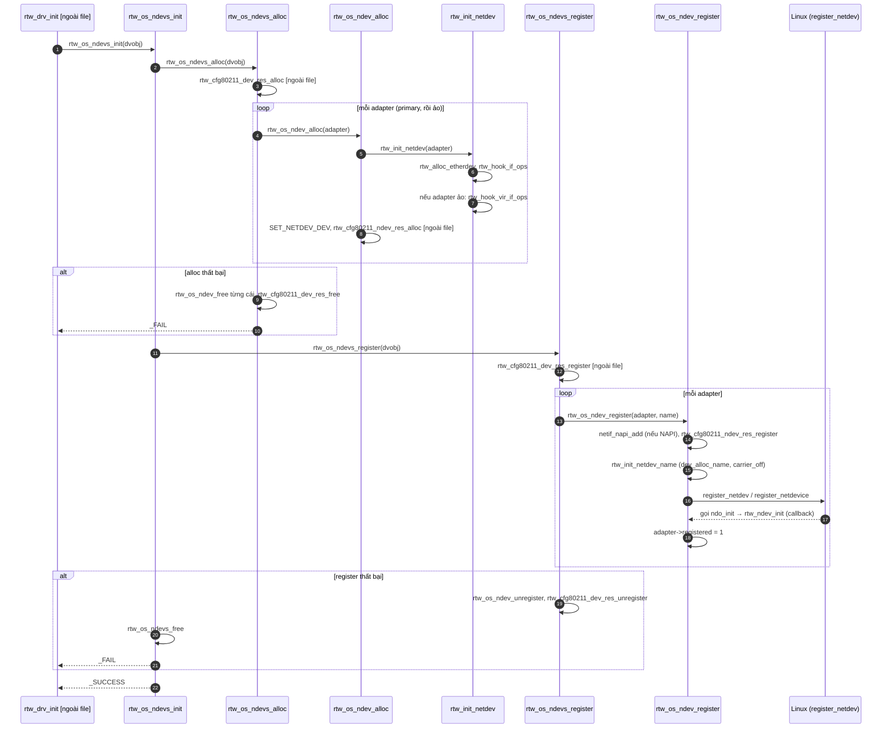

**Giải thích:** hai pha rõ ràng: `alloc` (tạo cấu trúc) rồi `register` (báo Linux). Nếu `register` lỗi thì quay lại free. `rtw_ndev_init` không được gọi trực tiếp: Linux gọi nó (callback `ndo_init`) khi `register_netdev` chạy. Nhánh `RTW_SINGLE_WIPHY` và `CONFIG_RTW_DYNAMIC_NDEV` thay đổi chi tiết, chưa xác minh bật.

### Sequence 2: Mở interface (`ifconfig wlan0 up`)

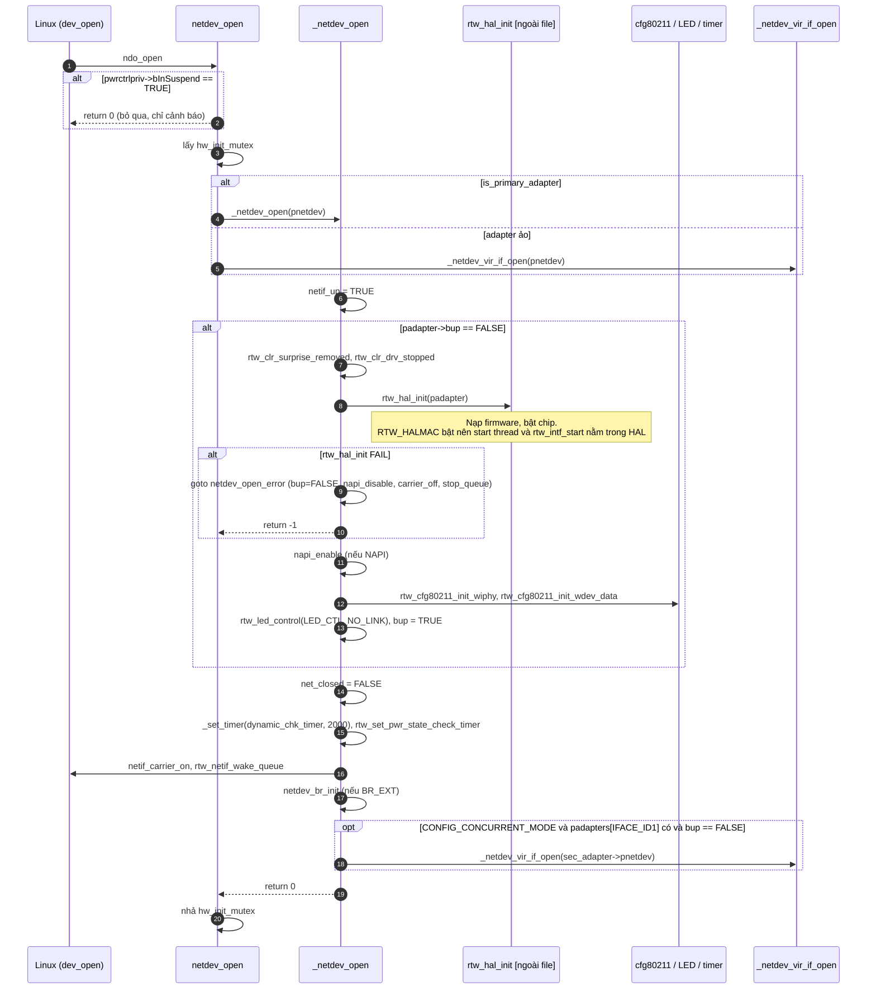

**Giải thích:** đây là chỗ chip **thực sự được bật và nạp firmware** (qua `rtw_hal_init`). Đây cũng trả lời điều tôi đã nêu là giả thuyết ở phần probe trước. Với 8822B, `RTW_HALMAC` bật nên các lệnh start thread/intf_start trong file này bị `#ifndef` loại bỏ. Tôi có thấy `rtw_start_drv_threads` và `rtw_intf_start` được gọi ở [hal_halmac.c:3528-3536](vscode-webview://1bvn9deljhs67bs6tdc4nttro6fasb6a3o9dsbsr0n55qjrijoej/hal/hal_halmac.c#L3528), nhưng chưa đọc xem hàm bao quanh là hàm nào, nên chưa khẳng định nó chính là bước trong `rtw_hal_init`. Mở primary sẽ **tự mở luôn interface ảo** nếu `CONFIG_RTW_DYNAMIC_NDEV` không bật.

### Sequence 3: Mở interface ảo

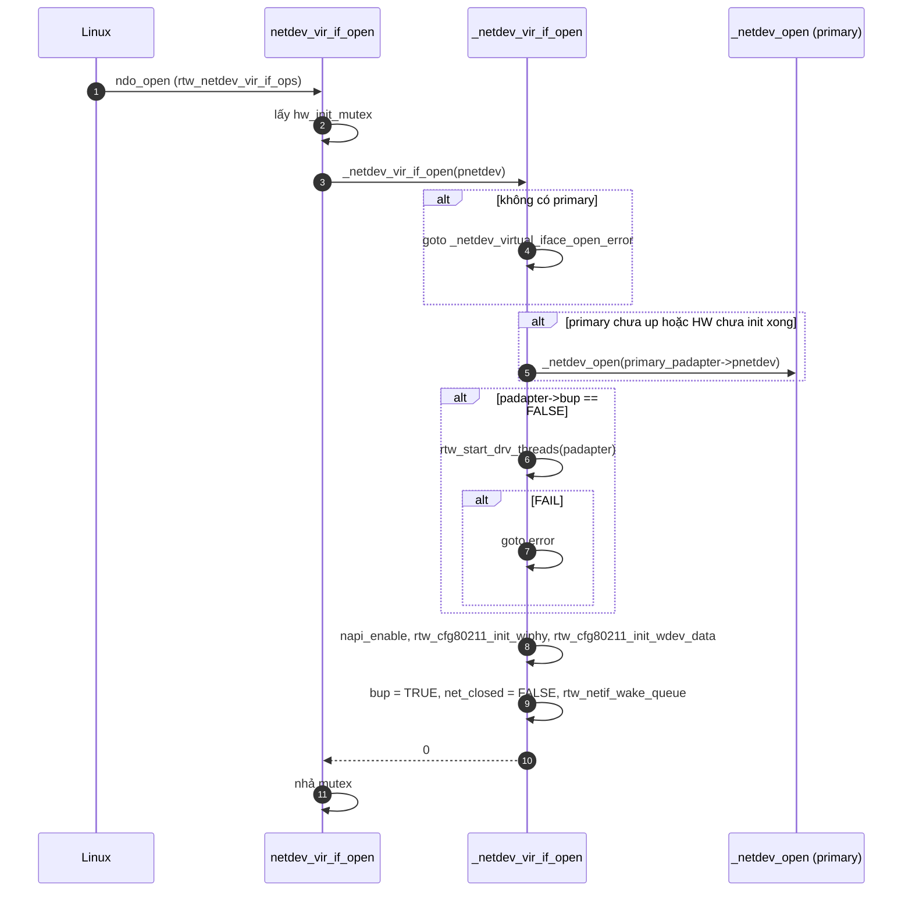

**Giải thích:** interface ảo **dựa vào primary**. Nếu primary chưa chạy thì ép primary mở trước. Bản `netdev_vir_if_open` này chỉ dùng khi **không** bật `NEW_NETDEV_HDL`, đúng với build này.

### Sequence 4: Đóng interface (`ifconfig wlan0 down`)

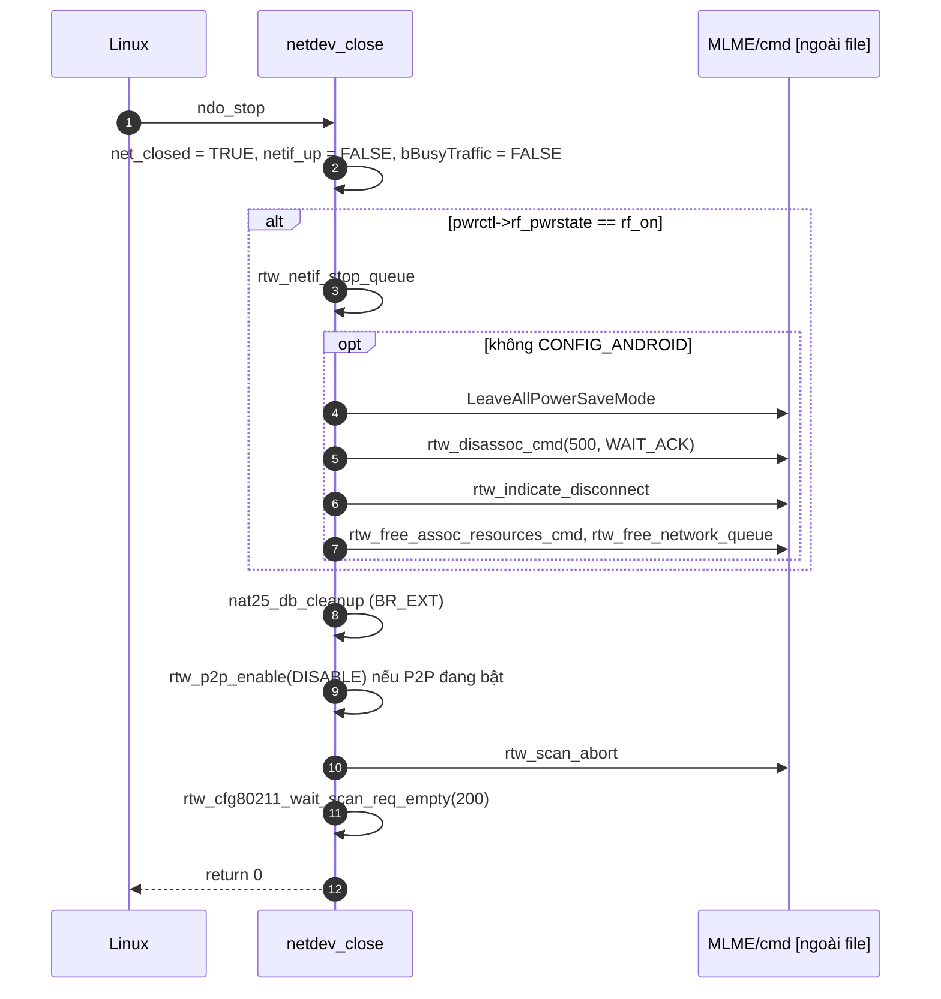

**Giải thích (quan sát quan trọng):** `netdev_close` trên build này **không gọi `rtw_dev_unload`**. Đoạn gọi nó nằm trong nhánh `CONFIG_PLATFORM_INTEL_BYT` (không áp dụng). Tức là close chỉ ngắt kết nối và dừng scan, còn việc tắt chip diễn ra ở **IPS** (Sequence 5) hoặc khi **remove**. Interface ảo dùng `netdev_vir_if_close` còn đơn giản hơn (chỉ scan abort và p2p disable).

### Sequence 5: Bật/tắt chip trong IPS

IPS (Inactive Power Save) tắt chip khi rảnh. Hàm vào là `rtw_ips_pwr_down` / `rtw_ips_pwr_up`, được gọi từ [rtw_pwrctrl.c:143,175](vscode-webview://1bvn9deljhs67bs6tdc4nttro6fasb6a3o9dsbsr0n55qjrijoej/core/rtw_pwrctrl.c#L143) **[hàm ngoài file]**.

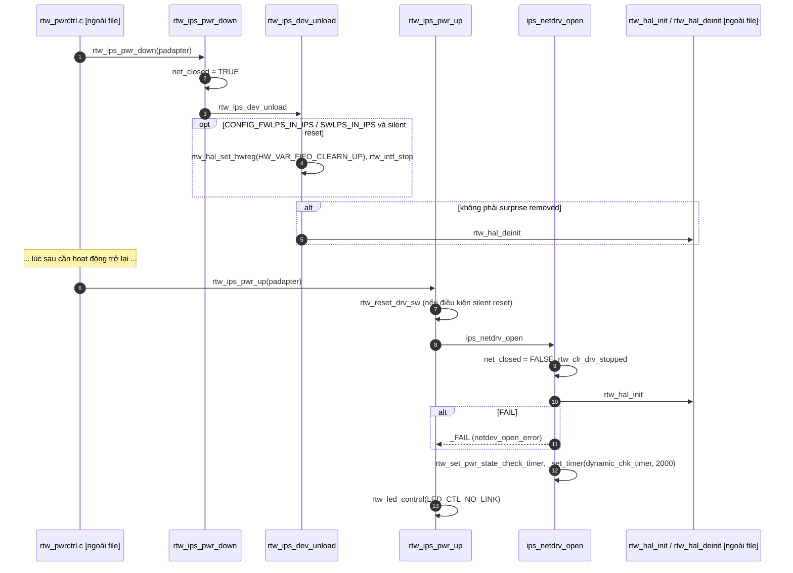

**Giải thích:** IPS chỉ tắt/bật chip, không đụng đến `net_device`. Đây là lý do `wlan0` vẫn "up" trong khi chip đang ngủ.

### Sequence 6: Tạo / dừng / giải phóng interface ảo

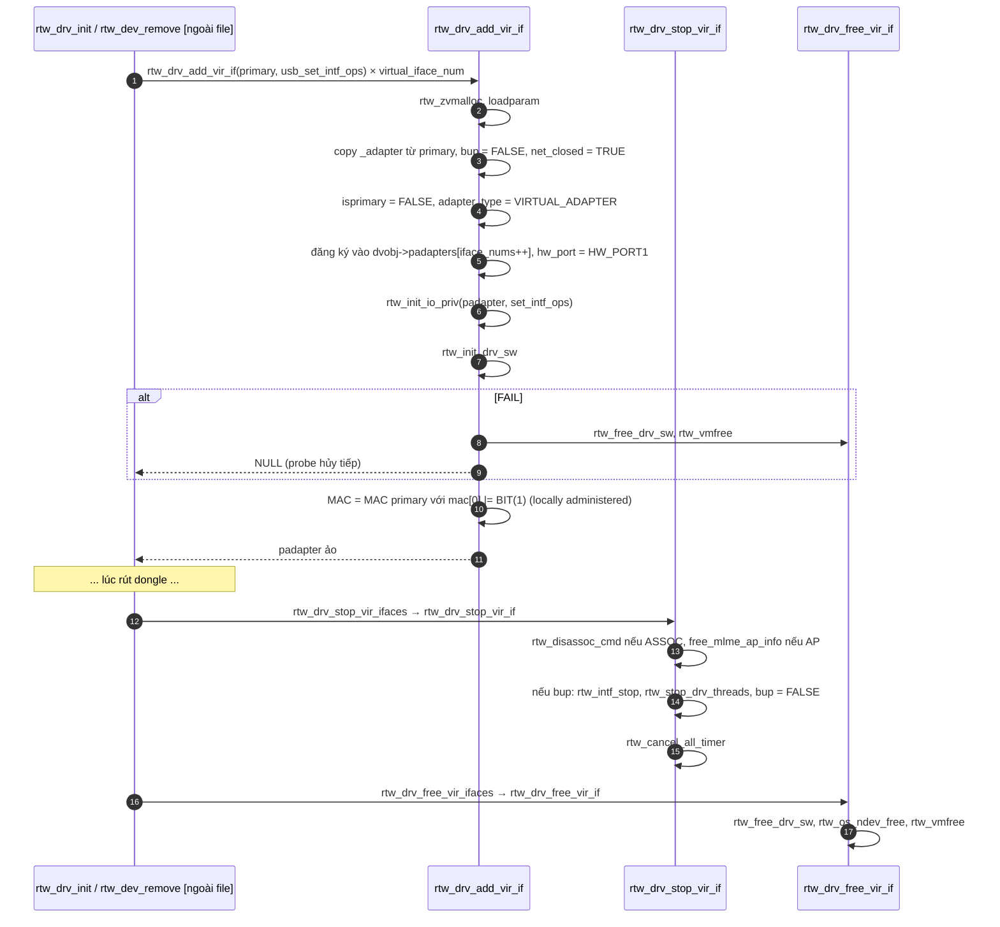

**Giải thích:** adapter ảo là bản sao của primary với `adapter_type = VIRTUAL_ADAPTER`, dùng chung `dvobj` và chung phần cứng nhưng riêng MAC, MLME... Số lượng giới hạn bởi `CONFIG_IFACE_NUMBER - 1 = 1`.

### Sequence 7: Khởi tạo / giải phóng phần mềm adapter (`rtw_init_drv_sw` / `rtw_free_drv_sw`)

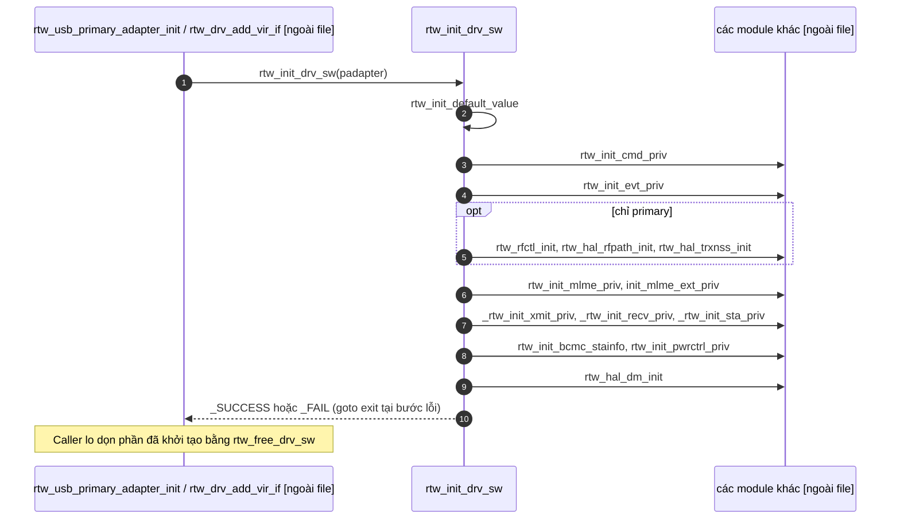

**Giải thích:** hàm chỉ "dựng cấu trúc", không đụng phần cứng. Mỗi `init_xxx` trả `_FAIL` thì `rtw_init_drv_sw` dừng ngay. Việc dọn lại được **caller** làm bằng `rtw_free_drv_sw` (gọi `free_mlme_ext_priv`, `rtw_free_cmd_priv`, `_rtw_free_xmit_priv`, `_rtw_free_recv_priv`, `rtw_free_pwrctrl_priv`, `rtw_hal_free_data`...).

### Sequence 8: Gỡ thiết bị (liên quan `rtw_dev_unload`)

Điểm vào: `rtw_dev_remove` [ngoài file]. Chi tiết đã trình bày ở câu trả lời trước. Các hàm của file này tham gia: `rtw_os_ndevs_unregister` → `rtw_os_ndev_unregister` (từng adapter), `rtw_drv_stop_vir_ifaces`, rồi `rtw_dev_unload`, `rtw_free_drv_sw`, `rtw_os_ndev_free` (trong `rtw_usb_primary_adapter_deinit` [ngoài file]), `rtw_drv_free_vir_ifaces`.

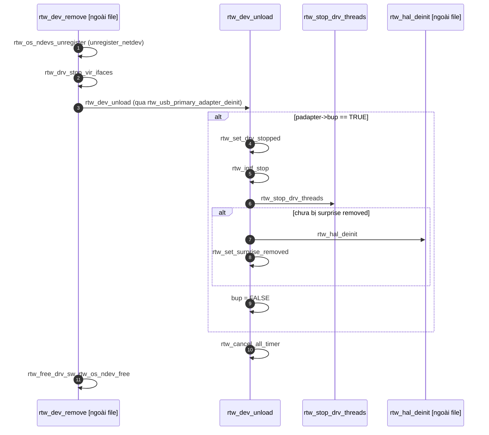

### Sequence 9: Suspend / Resume

Điểm vào thực tế: `rtw_suspend` / `rtw_resume` là callback USB trong `usb_intf.c` [ngoài file], chúng gọi `rtw_suspend_common` và `rtw_resume_common` (xác nhận ở [usb_intf.c:1084,1153](vscode-webview://1bvn9deljhs67bs6tdc4nttro6fasb6a3o9dsbsr0n55qjrijoej/os_dep/linux/usb_intf.c#L1084)). Ngoài ra còn hai điểm gọi trong `ioctl_linux.c` [hàm ngoài file].

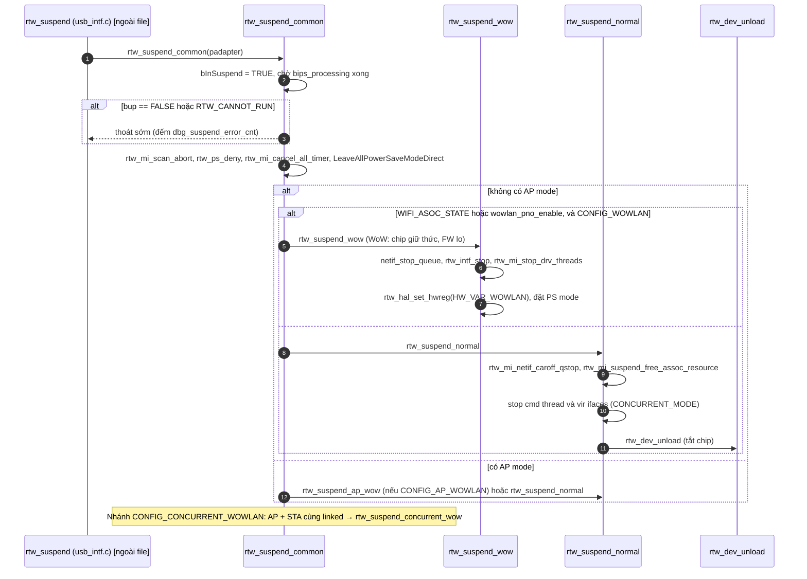

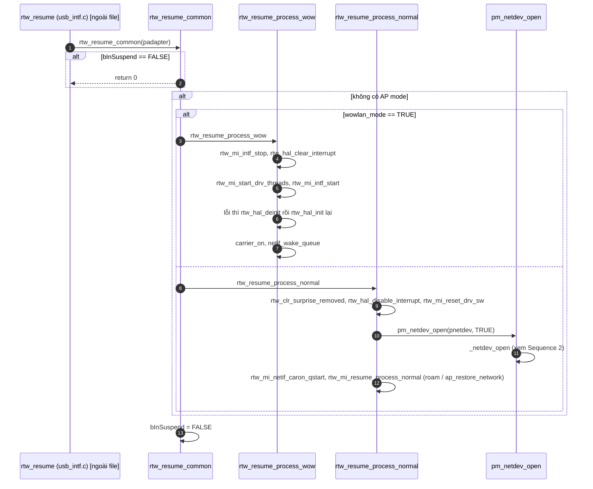

**Giải thích:** có hai kiểu ngủ. **Normal** tắt hẳn chip rồi lúc dậy làm lại như `ifconfig up`. **WoW** giữ chip ngủ nhẹ để firmware nhận gói đánh thức. Chọn kiểu nào tùy trạng thái kết nối lúc suspend. Chi tiết `_ap_wow` và `_concurrent_wow` chưa được tôi đọc kỹ.

### Sequence 10: Callback từ Linux vào các hàm trong file (đăng ký, không gọi trực tiếp)

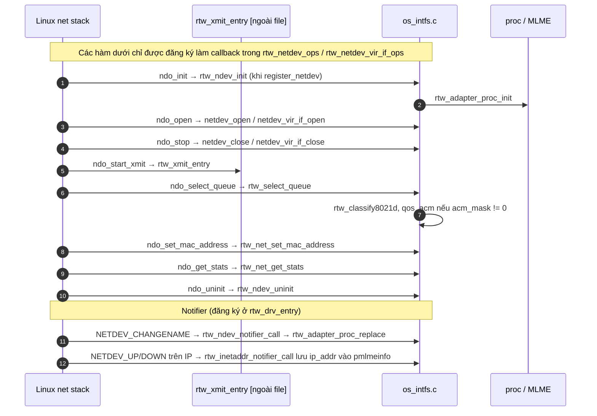

**Giải thích:** đây là luồng "callback". Kernel gọi vào, driver không tự gọi. Notifier phải lọc bằng `is_rtw_ndev` vì kernel gửi sự kiện của **mọi** interface.

---

## 4. Tổng kết

**Vai trò:** `os_intfs.c` là tầng OS của driver. Nó tạo và hủy `net_device`, nhận lệnh `up/down/xmit` từ Linux và chuyển xuống lõi (`core`, `hal`), đồng thời điều phối vòng đời nguồn (open, close, IPS, suspend, resume) và giữ cấu trúc `dvobj`/`adapter`.

**Nhóm hàm quan trọng và quan hệ:**

- **B (ndev)**: dựng bề ngoài để Linux nhìn thấy.
- **C (dvobj/adapter sw)**: dựng nội tạng phần mềm. Probe gọi B+C.
- **D (open/close/IPS)**: bật tắt chip. Gọi HAL.
- **E (vir_if)**: bản sao của B+C+D cho interface thứ hai.
- **G (suspend/resume)**: dùng lại D (qua `pm_netdev_open`) và `rtw_dev_unload`.
- **F, H**: phụ trợ.

**Nên đọc trước:** (1) `rtw_netdev_ops` (1793), (2) `rtw_os_ndevs_init` (3558), (3) `_netdev_open` (3739), (4) `netdev_close` (4169), (5) `rtw_dev_unload` (4628), (6) `rtw_suspend_common` (5135).

**Sơ đồ tổng quan:**

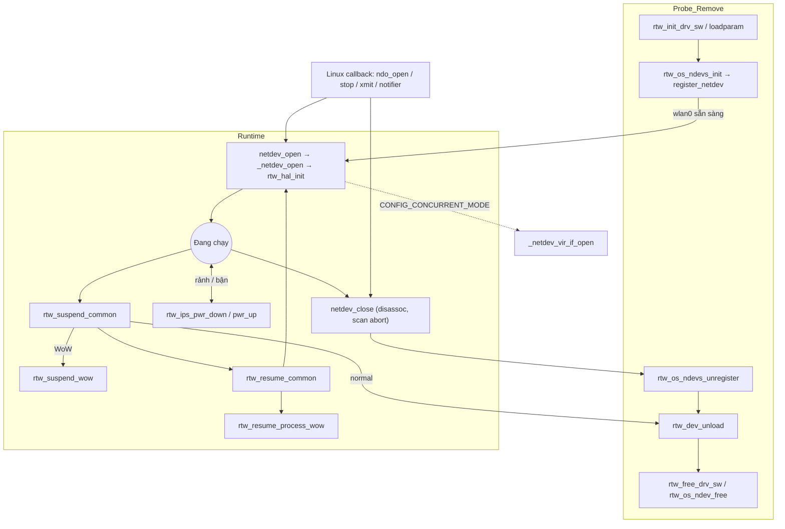

**Đối chiếu danh sách hàm với các sequence:**

- Đã có sequence: `ndev alloc/register`, `open/close`, `vir_if`, `IPS`, `init/free sw`, `unload`, `suspend/resume`, `callback`.
- Chưa vẽ riêng vì không phải luồng độc lập: `rtw_gw_addr_query` (chỉ được `rtw_mlme_ext.c` gọi), `netdev_br_init`, nhóm GPIO/vendor IE (`EXPORT_SYMBOL` cho module khác), `rtw_regsty_*` (nhánh con của `loadparam`), `rtw_set_rtnl_lock_holder`.
- Điểm tôi **chưa xác minh**: `CONFIG_GPIO_API` và `CONFIG_APPEND_VENDOR_IE_ENABLE` có bật không; chi tiết `_ap_wow`/`_concurrent_wow`; hàm nào trong HAL thực sự start thread khi `RTW_HALMAC` bật.

Nếu bạn muốn, bước tiếp theo hợp lý là đi vào **`rtw_hal_init`** (nạp firmware, HALMAC) hoặc lưu bản phân tích này vào `docs/` như các chủ đề trước. Bạn chọn hướng nào?