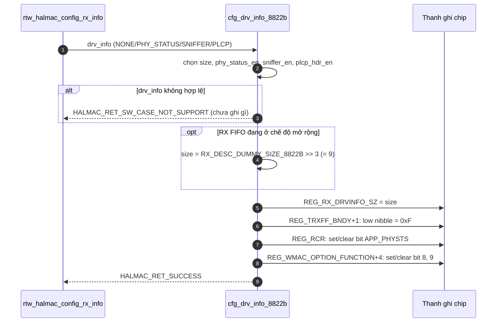

# Phân tích `cfg_drv_info_8822b`

## A. Mục đích

Mỗi gói Wi-Fi chip nhận được sẽ được chuyển cho driver kèm một **rx descriptor** (phần mô tả gói: độ dài, tốc độ...). Chip còn có thể gắn thêm **driver info** ngay sau descriptor, ví dụ **PHY status** (thông tin tầng vật lý: cường độ tín hiệu, chất lượng...). Enum trong [halmac_type.h:1010-1020](vscode-webview://1v7kr62lml590cb3gndmegc6ml88sjdjv7262pvi3l6t2rv5t7fr/Kernel/K-S800/Src/drivers/net/wireless/realtek/rtl8812BU_v1930.24/hal/halmac/halmac_type.h#L1010-L1020) xác nhận bốn chế độ:

|Chế độ|Nội dung gắn thêm sau rx_desc|
|---|---|
|`NONE`|Không gắn gì|
|`PHY_STATUS`|PHY status|
|`PHY_SNIFFER`|PHY status + sniffer info|
|`PHY_PLCP`|PHY status + PLCP header|

Hàm chọn chế độ, rồi báo cho phần cứng biết gắn bao nhiêu. Driver phải biết trước để tính đúng chỗ bắt đầu của dữ liệu thật.

Ví dụ: bưu tá giao thư kèm một phiếu ghi chú phía trước. Nếu hôm nay đổi sang "phiếu dài hơn", người nhận phải biết để bóc đúng chỗ. Nếu lệch, mọi bức thư đều bị đọc sai.

## B. Vị trí trong luồng

- Định nghĩa: [halmac_cfg_wmac_8822b.c:72-146](vscode-webview://1v7kr62lml590cb3gndmegc6ml88sjdjv7262pvi3l6t2rv5t7fr/Kernel/K-S800/Src/drivers/net/wireless/realtek/rtl8812BU_v1930.24/hal/halmac/halmac_88xx/halmac_8822b/halmac_cfg_wmac_8822b.c#L72-L146).
- Được gọi gián tiếp qua con trỏ `api->halmac_cfg_drv_info`, từ `rtw_halmac_config_rx_info` ([hal_halmac.c:2066](vscode-webview://1v7kr62lml590cb3gndmegc6ml88sjdjv7262pvi3l6t2rv5t7fr/Kernel/K-S800/Src/drivers/net/wireless/realtek/rtl8812BU_v1930.24/hal/hal_halmac.c#L2066)). Các điểm gọi `rtw_halmac_config_rx_info` đã kiểm tra:
    - **Khởi tạo chip**: [hal_halmac.c:3611](vscode-webview://1v7kr62lml590cb3gndmegc6ml88sjdjv7262pvi3l6t2rv5t7fr/Kernel/K-S800/Src/drivers/net/wireless/realtek/rtl8812BU_v1930.24/hal/hal_halmac.c#L3611), với `PHY_STATUS`, sau `rtw_hal_init_mac_register` và trước khi khởi tạo BB/RF.
    - **Bật/tắt `APP_PHYSTS` lúc chạy**: `rtl8822b_rcr_config` ([rtl8822b_mac.c:79,85](vscode-webview://1v7kr62lml590cb3gndmegc6ml88sjdjv7262pvi3l6t2rv5t7fr/Kernel/K-S800/Src/drivers/net/wireless/realtek/rtl8812BU_v1930.24/hal/rtl8822b/rtl8822b_mac.c#L79)).
    - **Chế độ monitor**: vào dùng `PHY_SNIFFER`, ra khôi phục `PHY_STATUS` hoặc `NONE` ([rtl8822b_ops.c:1033](vscode-webview://1v7kr62lml590cb3gndmegc6ml88sjdjv7262pvi3l6t2rv5t7fr/Kernel/K-S800/Src/drivers/net/wireless/realtek/rtl8812BU_v1930.24/hal/rtl8822b/rtl8822b_ops.c#L1033), [dòng 1328](vscode-webview://1v7kr62lml590cb3gndmegc6ml88sjdjv7262pvi3l6t2rv5t7fr/Kernel/K-S800/Src/drivers/net/wireless/realtek/rtl8812BU_v1930.24/hal/rtl8822b/rtl8822b_ops.c#L1328)).
- Ngay sau hàm, `rtw_halmac_config_rx_info` đọc lại RCR để đồng bộ cache `ReceiveConfig`, vì hàm này đã sửa RCR.

## C. Luồng chính

1. **Chọn thông số theo `drv_info`** (dòng 86-113). Một `switch` gán `size`, `phy_status_en`, `sniffer_en`, `plcp_hdr_en`. Với chế độ lạ thì **thoát ngay**, chưa động tới thanh ghi nào.
    
    |Chế độ|`size`|PHY|Sniffer|PLCP|
    |---|---|---|---|---|
    |NONE|0|0|0|0|
    |PHY_STATUS|4|1|0|0|
    |PHY_SNIFFER|5|1|1|0|
    |PHY_PLCP|6|1|0|1|
    
2. **Ghi đè size khi RX FIFO mở rộng** (dòng 115-117). Nếu `rx_fifo_exp_mode` khác `DISABLE`, size thành `72 >> 3 = 9` ([halmac_8822b_cfg.h:70](vscode-webview://1v7kr62lml590cb3gndmegc6ml88sjdjv7262pvi3l6t2rv5t7fr/Kernel/K-S800/Src/drivers/net/wireless/realtek/rtl8812BU_v1930.24/hal/halmac/halmac_88xx/halmac_8822b/halmac_8822b_cfg.h#L70), có comment `8 * 9 Bytes`). Điều này gợi ý đơn vị của `size` là **8 byte**. Với các giá trị 4, 5, 6 ở trên thì comment trong code lại ghi "4 byte", "5 byte"... nên đơn vị thực tế **tôi chưa xác nhận được**.
    
3. **Ghi `REG_RX_DRVINFO_SZ` (0x060F)** bằng size, và lưu vào `adapter->drv_info_size`. Đây là con số mà chip dùng để chèn đúng lượng info, đồng thời phần mềm dùng để bỏ qua đúng lượng khi đọc gói.
    
4. **Ghi `REG_TRXFF_BNDY + 1`**: giữ nguyên 4 bit cao, đặt 4 bit thấp thành `0xF` (dòng 121-125). Theo header, 4 bit thấp này là trường `RXFFOVFL_RSV_V2` (bit 8-11 của thanh ghi). Comment trong code chỉ ghi "For rxdesc len = 0 issue". Ý nghĩa thật của trường tôi chưa xác minh. Hàm luôn đặt giá trị này, bất kể `drv_info`.
    
5. **Sửa RCR**: xóa bit `APP_PHYSTS` (bit 28), rồi bật lại nếu `phy_status_en`. Đây là cờ nói với chip "gắn PHY status vào gói".
    
6. **Sửa `REG_WMAC_OPTION_FUNCTION + 4`**: xóa bit 8, 9 của word 32 bit tại `+4`, rồi bật bit 9 nếu `sniffer_en`, bit 8 nếu `plcp_hdr_en`. Theo định nghĩa trong header, đây là bit 41 (`PHYSTS_SNIF`) và bit 40 (`PHYSTS_PLCP`) của thanh ghi 64 bit. Tên bit khớp với ý định của code.
    

Điểm đáng chú ý ở bước 5-6: hàm theo kiểu **đọc, xóa, bật lại, ghi**, nên các bit khác trong cùng thanh ghi không bị đụng tới. Việc này an toàn khi nhiều chỗ cùng sửa RCR.

## D. Thành phần quan trọng

|Thành phần|Ý nghĩa|Thao tác|
|---|---|---|
|`REG_RX_DRVINFO_SZ` (0x060F)|Kích thước driver info|Ghi 8 bit|
|`REG_RCR` bit 28 `APP_PHYSTS`|Cờ gắn PHY status vào gói|Đọc 32 bit, clear rồi set, ghi lại|
|`REG_WMAC_OPTION_FUNCTION+4` bit 8, 9|Gắn PLCP header / sniffer info|Đọc 32 bit, clear rồi set, ghi lại|
|`REG_TRXFF_BNDY+1` bit 0-3|Trường `RXFFOVFL_RSV_V2`|Đọc 8 bit, ghi `0xF` vào nibble thấp|
|`adapter->drv_info_size`|Bản sao size trong HALMAC|Ghi|
|`rx_fifo_exp_mode`|Chế độ mở rộng RX FIFO|Chỉ đọc|

## E. Lỗi và trường hợp đặc biệt

- **Thoát sớm:** chỉ khi `drv_info` ngoài bốn giá trị hợp lệ, trả `HALMAC_RET_SW_CASE_NOT_SUPPORT`. Lúc đó **chưa thanh ghi nào bị ghi**.
- **Giá trị trả về:** còn lại luôn là `HALMAC_RET_SUCCESS`. Hàm không kiểm tra kết quả từng lần ghi thanh ghi.
- **Không có retry/rollback.** Hậu quả: nếu ghi dở chừng, RCR và `RX_DRVINFO_SZ` có thể lệch nhau. Trường hợp này đã được `rtl8822b_rcr_config` xử lý ở tầng trên bằng cách hoàn tác bit `APP_PHYSTS` khi gọi hàm này thất bại.
- **Không có khóa trong hàm.** Chuỗi đọc-sửa-ghi trên RCR không nguyên tử, tôi chưa kiểm tra caller có tuần tự hóa hay không.
- Hàm sửa RCR mà không cập nhật `ReceiveConfig`, nên `rtw_halmac_config_rx_info` phải đọc lại RCR sau đó.

## F. Tóm tắt

**1. Hiểu trong 3 câu:** Hàm quyết định mỗi gói nhận được có gắn thêm thông tin PHY (và tùy chọn sniffer/PLCP) hay không. Nó ghi kích thước phần gắn thêm vào chip và bật các cờ tương ứng trong RCR và `WMAC_OPTION_FUNCTION`. Driver và chip phải thống nhất con số này, nếu không sẽ đọc lệch byte.

**2. Luồng cần nhớ:** `Chọn chế độ → (RX FIFO mở rộng: ghi đè size) → Ghi RX_DRVINFO_SZ → Ghi TRXFF_BNDY → Set/clear APP_PHYSTS trong RCR → Set/clear bit sniffer/PLCP → Thành công`

**3. Điều quan trọng nhất:** `REG_RX_DRVINFO_SZ` và các cờ bật/tắt phải **luôn đi cùng nhau**. Đó là lý do việc bật `APP_PHYSTS` tại runtime phải gọi hàm này, thay vì chỉ ghi RCR.

## Chưa xác minh

- Đơn vị của `size` khi bằng 4, 5, 6 (byte hay 8 byte).
- Ý nghĩa phần cứng của trường `RXFFOVFL_RSV_V2`.
- Việc các lệnh `HALMAC_REG_W*` có báo lỗi lên hay không.