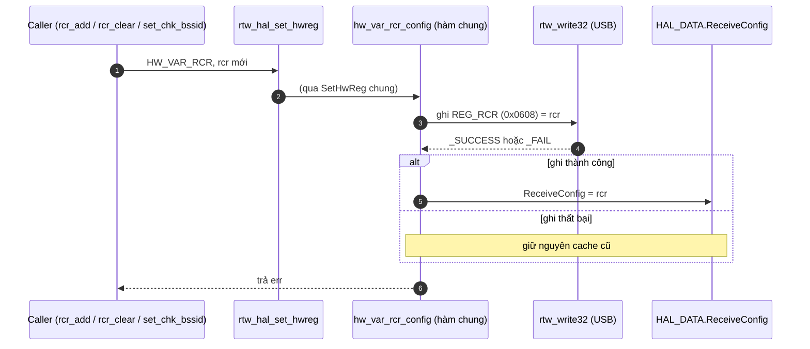

# Phân tích `hw_var_rcr_config`

## Phát hiện quan trọng nhất: hàm này không chạy trên chip 8822B

Hàm nằm ở [hal_com.c:3748-3756](vscode-webview://1v7kr62lml590cb3gndmegc6ml88sjdjv7262pvi3l6t2rv5t7fr/Kernel/K-S800/Src/drivers/net/wireless/realtek/rtl8812BU_v1930.24/hal/hal_com.c#L3748-L3756) và chỉ là hàm **chung** cho nhiều dòng chip. Với RTL8822B qua USB, lệnh `HW_VAR_RCR` được xử lý ở chỗ khác trước khi tới hàm này:

- `rtw_hal_set_hwreg` ([hal_intf.c:624](vscode-webview://1v7kr62lml590cb3gndmegc6ml88sjdjv7262pvi3l6t2rv5t7fr/Kernel/K-S800/Src/drivers/net/wireless/realtek/rtl8812BU_v1930.24/hal/hal_intf.c#L624)) gọi `hal_func.set_hw_reg_handler`.
- Với USB 8822B, handler này là `sethwreg` ([rtl8822bu_ops.c:358](vscode-webview://1v7kr62lml590cb3gndmegc6ml88sjdjv7262pvi3l6t2rv5t7fr/Kernel/K-S800/Src/drivers/net/wireless/realtek/rtl8812BU_v1930.24/hal/rtl8822b/usb/rtl8822bu_ops.c#L358)). Nhánh `default` của nó gọi `rtl8822b_sethwreg` ([dòng 161](vscode-webview://1v7kr62lml590cb3gndmegc6ml88sjdjv7262pvi3l6t2rv5t7fr/Kernel/K-S800/Src/drivers/net/wireless/realtek/rtl8812BU_v1930.24/hal/rtl8822b/usb/rtl8822bu_ops.c#L161)).
- `rtl8822b_sethwreg` có `case HW_VAR_RCR` riêng, gọi `rtl8822b_rcr_config` ([rtl8822b_ops.c:2067-2068](vscode-webview://1v7kr62lml590cb3gndmegc6ml88sjdjv7262pvi3l6t2rv5t7fr/Kernel/K-S800/Src/drivers/net/wireless/realtek/rtl8812BU_v1930.24/hal/rtl8822b/rtl8822b_ops.c#L2067-L2068)).
- Chỉ các `HW_VAR_*` mà 8822B **không** tự xử lý mới rơi xuống `SetHwReg` chung ([dòng 2462-2463](vscode-webview://1v7kr62lml590cb3gndmegc6ml88sjdjv7262pvi3l6t2rv5t7fr/Kernel/K-S800/Src/drivers/net/wireless/realtek/rtl8812BU_v1930.24/hal/rtl8822b/rtl8822b_ops.c#L2462-L2463)), rồi mới tới `hw_var_rcr_config`.

Vì `HW_VAR_RCR` nằm trong nhóm 8822B tự xử lý, **`hw_var_rcr_config` không được gọi cho SET RCR trên board của bạn**. Tôi đã đọc các `case` này nhưng chưa chạy thật để xác nhận bằng log. Mô tả ở các câu trả lời trước coi `hw_var_rcr_config` là bước ghi RCR là **chưa chính xác** cho chip này, và tôi xin sửa lại ở đây.

Phần còn lại giải thích hàm chung theo yêu cầu, rồi nói hàm thật sự chạy trên 8822B.

## A. Mục đích

RCR là thanh ghi 32 bit trong chip quyết định chip nhận loại gói nào (xem giải thích RCR ở các câu trước). Driver giữ thêm **một bản sao** của giá trị này trong RAM, gọi là `ReceiveConfig`. `hw_var_rcr_config` làm hai việc: ghi giá trị xuống chip, và cập nhật bản sao nếu ghi thành công.

Ví dụ đời thường: bạn treo bảng nội quy ở cổng (thanh ghi thật) và giữ một bản photo trong ngăn kéo (cache). Mỗi lần đổi bảng, bạn đổi cả bản photo, nhưng **chỉ khi việc treo bảng thành công**. Nhờ vậy khi cần xem nội quy, bạn mở ngăn kéo cho nhanh, khỏi phải ra cổng đọc.

## B. Vị trí trong luồng

- `hw_var_rcr_config` là `static inline`, chỉ dùng trong `hal_com.c`. Nó được gọi duy nhất từ `SetHwReg`, nhánh `case HW_VAR_RCR` ([hal_com.c:14837-14839](vscode-webview://1v7kr62lml590cb3gndmegc6ml88sjdjv7262pvi3l6t2rv5t7fr/Kernel/K-S800/Src/drivers/net/wireless/realtek/rtl8812BU_v1930.24/hal/hal_com.c#L14837-L14839)).
- Callers cấp trên của `HW_VAR_RCR` (đã kiểm tra): `rtw_hal_rcr_add`, `rtw_hal_rcr_clear` và `rtw_hal_rcr_set_chk_bssid` ([hal_com.c:3784-3925](vscode-webview://1v7kr62lml590cb3gndmegc6ml88sjdjv7262pvi3l6t2rv5t7fr/Kernel/K-S800/Src/drivers/net/wireless/realtek/rtl8812BU_v1930.24/hal/hal_com.c#L3784-L3925)), cùng một số đường monitor mode trong `rtl8822b_ops.c`.

## C. Luồng chính

Hàm rất ngắn, chỉ hai bước.

1. **Ghi xuống chip:** `rtw_write32(adapter, REG_RCR, rcr)`. Hàm này khóa `halmac_reg_mutex` rồi ghi qua USB ([rtw_io.c:193-210](vscode-webview://1v7kr62lml590cb3gndmegc6ml88sjdjv7262pvi3l6t2rv5t7fr/Kernel/K-S800/Src/drivers/net/wireless/realtek/rtl8812BU_v1930.24/core/rtw_io.c#L193-L210)). Việc ghi đi qua USB nên có thể thất bại, ví dụ khi dongle bị rút.
2. **Cập nhật cache:** chỉ khi bước 1 trả `_SUCCESS` thì mới gán `ReceiveConfig = rcr`. Mục đích: cache luôn phản ánh đúng thứ chip đang giữ. Nếu ghi hỏng mà vẫn cập nhật cache, driver sẽ tưởng bit đã bật trong khi chip chưa nhận.

## D. Biến và register quan trọng

|Thành phần|Là gì|Hàm làm gì với nó|
|---|---|---|
|`REG_RCR`|Thanh ghi 0x0608, 32 bit ([hal_com_reg.h:452](vscode-webview://1v7kr62lml590cb3gndmegc6ml88sjdjv7262pvi3l6t2rv5t7fr/Kernel/K-S800/Src/drivers/net/wireless/realtek/rtl8812BU_v1930.24/include/hal_com_reg.h#L452))|**Ghi cả 32 bit** (không set/clear từng bit)|
|`ReceiveConfig`|Trường `u32` trong `HAL_DATA_TYPE` ([hal_data.h:416](vscode-webview://1v7kr62lml590cb3gndmegc6ml88sjdjv7262pvi3l6t2rv5t7fr/Kernel/K-S800/Src/drivers/net/wireless/realtek/rtl8812BU_v1930.24/include/hal_data.h#L416))|Ghi, sau khi ghi chip thành công|

Vì hàm ghi **toàn bộ giá trị**, caller có trách nhiệm tự tính ra `rcr` đầy đủ. Các caller (`rtw_hal_rcr_add/clear`) làm điều này bằng cách đọc RCR hiện tại, sửa bit rồi ghi lại.

Bản sao `ReceiveConfig` được dùng bởi `rtw_hal_rcr_check` ([dòng 3770-3782](vscode-webview://1v7kr62lml590cb3gndmegc6ml88sjdjv7262pvi3l6t2rv5t7fr/Kernel/K-S800/Src/drivers/net/wireless/realtek/rtl8812BU_v1930.24/hal/hal_com.c#L3770-L3782)) để kiểm tra bit **mà không phải đọc USB**. Comment trong source ghi rõ: "only check SW RCR variable".

## E. Điều kiện lỗi và đặc biệt

- **Không có nhánh `if` nào ngoài kiểm tra kết quả ghi.** Không retry, không rollback.
- **Giá trị trả về:** `err` của `rtw_write32`, ép sang `u8`. Dù `err` khai báo kiểu `int`, hàm trả `u8`. Tôi không kiểm tra giá trị cụ thể của `_SUCCESS`/`_FAIL` nên không khẳng định chúng nhỏ hơn 256 (thông lệ Realtek là 1 và 0, chưa xác minh ở bản này).
- **Hậu quả khi ghi lỗi:** cache không đổi, lỗi trả lên caller. `rtw_hal_rcr_add` và `rtw_hal_rcr_clear` trả lại giá trị `ret` này.

## Hàm thật sự chạy trên 8822B: `rtl8822b_rcr_config`

Hàm này ở [rtl8822b_mac.c:65-99](vscode-webview://1v7kr62lml590cb3gndmegc6ml88sjdjv7262pvi3l6t2rv5t7fr/Kernel/K-S800/Src/drivers/net/wireless/realtek/rtl8812BU_v1930.24/hal/rtl8822b/rtl8822b_mac.c#L65-L99). Nó giống `hw_var_rcr_config` ở bước ghi và cập nhật cache, nhưng **thêm một bước xử lý riêng cho bit `APP_PHYSTS`**:

1. XOR `ReceiveConfig` với `rcr` mới rồi mask bit `APP_PHYSTS` (bit 28), để xem bit này **có đổi không**.
2. Nếu đổi, ghi log "runtime ENABLE/DISABLE rx phy status" rồi gọi `rtw_halmac_config_rx_info` với `HALMAC_DRV_INFO_PHY_STATUS` (bật) hoặc `HALMAC_DRV_INFO_NONE` (tắt). Hàm này chỉnh kích thước "driver info" gắn vào mỗi gói (xem `cfg_drv_info_8822b` ở câu trước).
3. Nếu bước 2 thất bại, **hoàn tác bit đó trong `rcr`** (bật thì xóa, tắt thì đặt lại) để RCR không lệch với cấu hình driver info.
4. Ghi `REG_RCR_8822B`. Thất bại thì trả `_FALSE`. Thành công thì cập nhật `ReceiveConfig` rồi trả `_TRUE`.

**Vì sao 8822B cần bước riêng?** Bit `APP_PHYSTS` bắt buộc phải đi cùng cấu hình `REG_RX_DRVINFO_SZ`. Nếu bật bit mà không báo cho phần cứng biết "mỗi gói có thêm 4 byte info", driver đọc gói sẽ lệch byte. Đây là suy luận từ cấu trúc code, source không có comment nêu lý do.

**Chênh lệch giá trị trả về:** hàm chung trả `_SUCCESS`/`_FAIL` (từ `rtw_write32`), còn `rtl8822b_rcr_config` trả `_TRUE`/`_FALSE`. Tôi chưa kiểm tra xem các caller có xử lý hai quy ước này nhất quán không.

## F. Tóm tắt để ghi nhớ

**1. Hiểu trong 3 câu:** `hw_var_rcr_config` ghi nguyên giá trị RCR xuống chip, rồi cập nhật bản sao trong RAM nếu ghi thành công. Nó là hàm chung, nhưng trên RTL8822B qua USB thì lệnh `HW_VAR_RCR` được `rtl8822b_rcr_config` xử lý trước, nên hàm chung này không chạy. Hàm 8822B làm giống vậy và thêm bước đồng bộ cấu hình driver info khi bit `APP_PHYSTS` đổi.

**2. Luồng cần nhớ:** `Caller → rtw_hal_set_hwreg → rtl8822b_sethwreg → rtl8822b_rcr_config → (đồng bộ driver info nếu APP_PHYSTS đổi) → ghi REG_RCR → cập nhật ReceiveConfig`

**3. Điều quan trọng nhất:** Khi đọc code Realtek, luôn kiểm tra xem chip cụ thể có **ghi đè** hàm chung trong `hal_com.c` hay không. Ở đây phải lần theo `hal_func.set_hw_reg_handler` thì mới biết hàm nào thật sự chạy.

## Chưa xác minh

- Chưa chạy trên board để xác nhận bằng log `runtime ENABLE rx phy status` rằng nhánh 8822B chạy.
- Chưa kiểm tra giá trị số của `_SUCCESS`/`_FAIL` và `_TRUE`/`_FALSE` ở bản này.