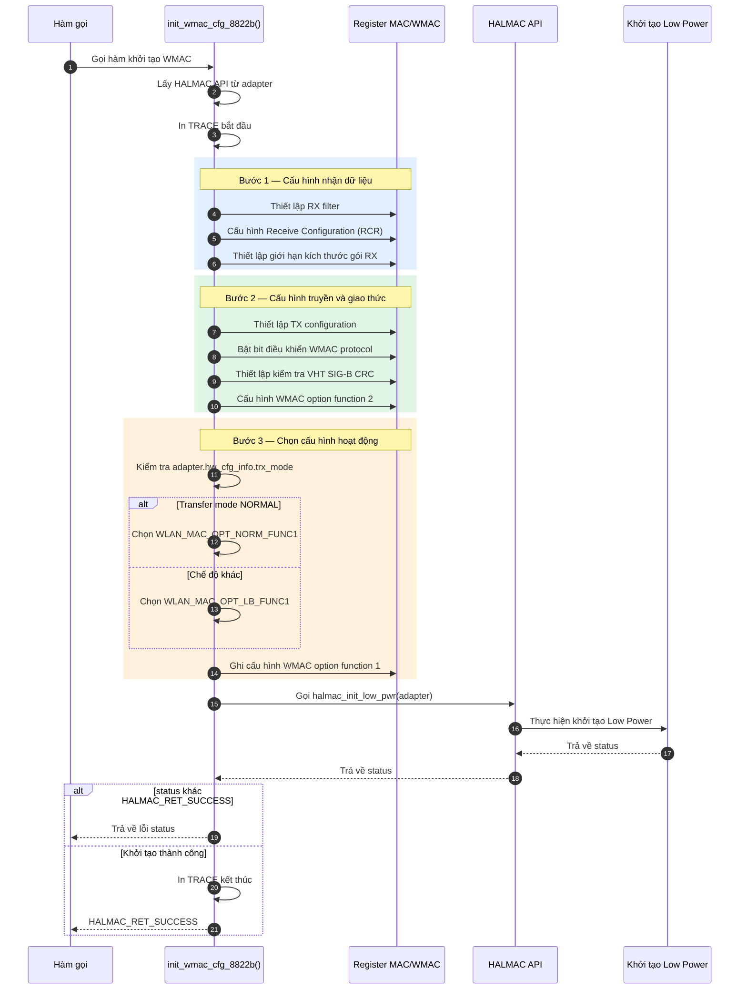

# Vì sao `init_wmac_cfg_8822b` phải làm những việc này
Hàm này ở [halmac_init_8822b.c:939-978](vscode-webview://1v7kr62lml590cb3gndmegc6ml88sjdjv7262pvi3l6t2rv5t7fr/Kernel/K-S800/Src/drivers/net/wireless/realtek/rtl8812BU_v1930.24/hal/halmac/halmac_88xx/halmac_8822b/halmac_init_8822b.c#L939-L978). Tôi đã đọc hàm, các hằng số `WLAN_*` và tên bit trong header HALMAC.

**Giới hạn của bản giải thích này:** source chỉ cho tên thanh ghi và tên bit, không có comment giải thích lý do. Phần "tại sao" dưới đây dựa trên tên và ngữ cảnh. Tôi ghi rõ chỗ nào là suy luận. Muốn chắc chắn, cần datasheet RTL8822B, mà tôi chưa có.

## Bức tranh chung: tại sao cần hàm này

Khi chip vừa được cấp nguồn (hoặc thoát IPS), mọi thanh ghi đều ở giá trị mặc định lúc reset. Giá trị đó chưa phù hợp để chạy Wi-Fi thật. Giống như mua máy giặt về: cắm điện được, nhưng phải chọn chương trình, mức nước, tốc độ vắt rồi mới giặt.

`init_wmac_cfg_8822b` đặt cấu hình cho **WMAC** (Wireless MAC), khối xử lý khung Wi-Fi của chip. Hàm làm ba nhóm việc: **cấu hình bộ nhận (RX), cấu hình bộ gửi (TX), và các tùy chọn chung**.

## Nhóm 1: Cấu hình bộ nhận (RX)

### Việc 1-2: `REG_RXFLTMAP0 = 0x0FFFFFFF` và `REG_RXFLTMAP2 = 0xFFFF`

| Thanh ghi   | Địa chỉ | Giá trị      | Ý nghĩa                                                      |
| ----------- | ------- | ------------ | ------------------------------------------------------------ |
| `RXFLTMAP0` | 0x06A0  | `0x0FFFFFFF` | Cho qua **mọi** loại frame quản lý (16 subtype, 16 bit thấp) |
| `RXFLTMAP2` | 0x06A4  | `0xFFFF`     | Cho qua **mọi** loại frame dữ liệu (16 subtype)              |

**Frame Wi-Fi có ba họ:** quản lý (beacon, probe, auth, assoc), điều khiển (ACK, RTS/CTS), dữ liệu. Mỗi họ có tối đa 16 loại con (subtype). `RXFLTMAP` là bảng "loại nào được chuyển lên". Bit = 1 nghĩa là cho qua.

**Vì sao mở hết?** Lọc chi tiết là việc của phần mềm cao hơn (mac80211, MLME). Phần cứng mà tự bỏ frame quản lý lạ thì không scan được, không auth được. Nên cách an toàn là để phần cứng nhận tất cả, phần mềm tự chọn.

**Chưa xác minh:** 16 bit cao của `0x0FFFFFFF` (bit 16-27) rơi vào `RXFLTMAP1` ở offset 0x06A2. Theo tên và quy ước Realtek thì đây là bộ lọc frame **điều khiển**, nhưng header HALMAC tôi đọc chỉ liệt kê bit cho MAP0 và MAP2, nên chưa xác nhận.

### Việc 3: `REG_RCR = 0xE400220E`

Phần này đã giải thích ở các câu trả lời trước. Tóm lại: đây là **cổng lọc chính**, quyết định nhận gói gửi cho ai và có giữ đuôi FCS/ICV/MIC không.

**Vì sao ghi sau `RXFLTMAP`?** Đây là suy luận của tôi: phải cấu hình bộ lọc loại frame **trước**, rồi mới mở RCR. Khi RCR bắt đầu cho gói vào thì bảng lọc đã đúng, không để lọt gói không mong muốn trong khoảng giữa. Source không ghi lý do thứ tự này.

**Vì sao lúc này chưa bật check BSSID?** Vì chưa kết nối AP nào. Sau này `rtw_hal_rcr_set_chk_bssid` mới bật khi connect.

### Việc 4: `REG_RX_PKT_LIMIT = WLAN_RXPKT_MAX_SZ_512`

- `WLAN_RXPKT_MAX_SZ = 12288` byte, rồi `>> 9` (chia 512) ra **24**.
- Ghi 24 vào thanh ghi 6 bit (mask `0x3f`, [halmac_bit_8822b.h](vscode-webview://1v7kr62lml590cb3gndmegc6ml88sjdjv7262pvi3l6t2rv5t7fr/Kernel/K-S800/Src/drivers/net/wireless/realtek/rtl8812BU_v1930.24/hal/halmac/halmac_bit_8822b.h)).
- **Ý nghĩa:** giới hạn độ dài tối đa của một gói nhận được là 12 KB, tính theo đơn vị 512 byte. Đơn vị 512 byte tôi suy từ hậu tố `_512` trong tên macro.
- **Vì sao cần:** gói A-MPDU (gom nhiều frame) của 11n/11ac có thể rất dài. Phải khai báo giới hạn để chip biết cấp bộ đệm, và để chặn gói bất thường dài quá mức làm tràn bộ nhớ nhận.

## Nhóm 2: Cấu hình bộ gửi (TX)

### Việc 5-6: `REG_TCR+2 = 0x30` và `REG_TCR+1 = 0x30`

`REG_TCR` (Transmission Configuration Register) tại 0x0604. Ghi từng byte:

- `TCR+1` là bit 8-15. Giá trị `0x30` bật bit 12 và 13, tên là `WMAC_TCR_ERRSTEN_0` và `ERRSTEN_1`.
- `TCR+2` là bit 16-23. Giá trị `0x30` bật bit 20 và 21. Bit 20 là `FETCH_MPDU_AFTER_WSEC_RDY` (chỉ lấy MPDU sau khi khóa mã hóa sẵn sàng). Bit 21 tôi không thấy tên trong header.

Tôi chưa biết `ERRSTEN` chính xác là gì. Theo tên thì liên quan đến báo lỗi/trạng thái TX. Phần này cần datasheet.

**Điểm đáng chú ý:** bit 20 nghe có lý do rõ ràng. Nếu gói cần mã hóa thì phải chờ phần cứng mã hóa nạp khóa xong rồi mới lấy gói gửi đi, tránh gửi gói chưa mã hóa đúng.

## Nhóm 3: Các tùy chọn giao thức chung

### Việc 7: `REG_WMAC_TRXPTCL_CTL+4` bật bit 1

Thanh ghi điều khiển giao thức TX/RX của WMAC. Header không đặt tên cho bit này ở vị trí `+4`, nên **tôi không biết bit này làm gì**.

### Việc 8: `REG_SND_PTCL_CTRL` bật `BIT_R_DISABLE_CHECK_VHTSIGB_CRC`

- Bit 6, đã xác nhận tên ở [halmac_bit2.h:52237](vscode-webview://1v7kr62lml590cb3gndmegc6ml88sjdjv7262pvi3l6t2rv5t7fr/Kernel/K-S800/Src/drivers/net/wireless/realtek/rtl8812BU_v1930.24/hal/halmac/halmac_bit2.h#L52237).
- **Dịch:** "tắt việc kiểm tra CRC của trường VHT-SIG-B".
- **Bối cảnh:** VHT-SIG-B là phần tiêu đề tín hiệu trong khung 802.11ac. Nó có CRC riêng để chip kiểm tra. Tắt việc kiểm tra này nghĩa là chip **không** bỏ gói chỉ vì CRC của SIG-B sai. Lý do thiết kế (tương thích với thiết bị phát không chuẩn, hay tránh nhận sai) thì source không nói, tôi không đoán.

### Việc 9-10: `REG_WMAC_OPTION_FUNCTION`

- Offset +8 ghi `0x30810041` (32 bit).
- Offset +4 ghi `0x98` nếu chế độ truyền bình thường, `0x80` nếu chế độ **loopback** (chạy thử, tự gửi tự nhận).
- Header chỉ đặt tên được cho một số field của thanh ghi này (`R_WMAC_RX_FIL_LEN`, `R_WMAC_RXFIFO_FULL_TH`), còn các giá trị ghi ở đây tôi **chưa giải mã được từng bit**.
- **Điều chắc chắn:** có nhánh `if` phân biệt `HALMAC_TRNSFER_NORMAL` với chế độ khác. Chế độ loopback dùng giá trị `0x80` (thiếu `0x18` so với `0x98`). Đây là cấu hình để test phần cứng/sản xuất.

### Việc 11: `halmac_init_low_pwr`

Gọi `init_low_pwr_8822b` ([halmac_cfg_wmac_8822b.c:155-159](vscode-webview://1v7kr62lml590cb3gndmegc6ml88sjdjv7262pvi3l6t2rv5t7fr/Kernel/K-S800/Src/drivers/net/wireless/realtek/rtl8812BU_v1930.24/hal/halmac/halmac_88xx/halmac_8822b/halmac_cfg_wmac_8822b.c#L155-L159)). Với chip 8822B, hàm này **rỗng**, chỉ `return HALMAC_RET_SUCCESS`.

Điều này có nghĩa: hàm chung `init_wmac_cfg` được thiết kế dùng cho nhiều dòng chip (8821C, 8822C...). Mỗi chip tự quyết định có cần cấu hình tiết kiệm điện ở bước này không. Với 8822B thì không cần.

## Tóm tắt: ai làm gì, vì sao

| Việc                  | Mục đích                                                               | Mức chắc chắn                         |
| --------------------- | ---------------------------------------------------------------------- | ------------------------------------- |
| `RXFLTMAP0/2`         | Cho qua mọi frame quản lý và dữ liệu, để phần mềm tự lọc               | Cao (tên bit rõ)                      |
| `RCR`                 | Cổng lọc chính: nhận broadcast/multicast/unicast, giữ đuôi FCS/ICV/MIC | Cao                                   |
| `RX_PKT_LIMIT`        | Giới hạn độ dài gói nhận 12 KB                                         | Cao, đơn vị 512 byte suy từ tên macro |
| `TCR+1, +2`           | Cấu hình TX, có chờ khóa mã hóa trước khi lấy MPDU                     | Trung bình, chỉ biết một bit          |
| `TRXPTCL_CTL+4 bit 1` | Không rõ                                                               | Thấp                                  |
| `SND_PTCL_CTRL`       | Không kiểm tra CRC của VHT-SIG-B                                       | Cao về nghĩa, không rõ về lý do       |
| `OPTION_FUNCTION`     | Tùy chọn WMAC, khác nhau giữa chế độ thường và loopback                | Thấp                                  |
| `init_low_pwr`        | Stub rỗng ở 8822B                                                      | Cao (đã đọc)                          |