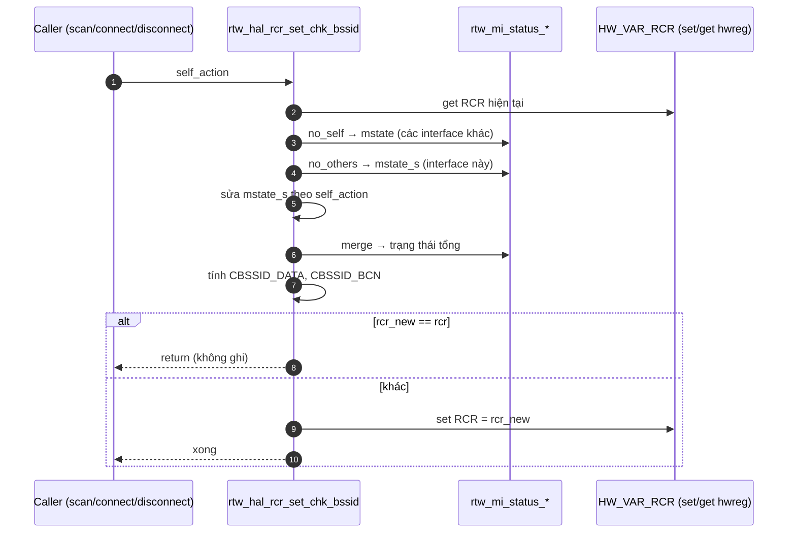

# Phân tích `rtw_hal_rcr_set_chk_bssid`

## A. Mục đích

Hàm này quyết định **hai bit trong RCR** có bật hay không: `CBSSID_DATA` (bit 6, lọc gói dữ liệu theo BSSID) và `CBSSID_BCN` (bit 7, lọc beacon/probe response theo BSSID). **BSSID** là địa chỉ MAC của AP mà bạn đang kết nối. Khi bit lọc bật, chip chỉ nhận gói mang đúng BSSID đó ([hal_com_reg.h:1173-1174](vscode-webview://1v7kr62lml590cb3gndmegc6ml88sjdjv7262pvi3l6t2rv5t7fr/Kernel/K-S800/Src/drivers/net/wireless/realtek/rtl8812BU_v1930.24/include/hal_com_reg.h#L1173-L1174)).

Ví dụ: bạn là lễ tân công ty. Khi đang đón khách lạ (scan), bạn phải mở cửa cho mọi người. Khi đã làm việc với đối tác cụ thể (kết nối AP), bạn chỉ tiếp người của đối tác đó.

Hàm không nhận giá trị đích. Nó nhận một **hành động vừa xảy ra** (`self_action`), tự suy ra trạng thái tổng của mọi interface rồi tính bit.

## B. Vị trí trong luồng

- Định nghĩa: [hal_com.c:3816-3931](vscode-webview://1v7kr62lml590cb3gndmegc6ml88sjdjv7262pvi3l6t2rv5t7fr/Kernel/K-S800/Src/drivers/net/wireless/realtek/rtl8812BU_v1930.24/hal/hal_com.c#L3816-L3931), kiểu `void`.
- Các caller đã kiểm tra, theo hành động truyền vào:

|Caller|`self_action`|
|---|---|
|[hal_com.c:14063](vscode-webview://1v7kr62lml590cb3gndmegc6ml88sjdjv7262pvi3l6t2rv5t7fr/Kernel/K-S800/Src/drivers/net/wireless/realtek/rtl8812BU_v1930.24/hal/hal_com.c#L14063)|`MLME_SCAN_ENTER`|
|[hal_com.c:14093](vscode-webview://1v7kr62lml590cb3gndmegc6ml88sjdjv7262pvi3l6t2rv5t7fr/Kernel/K-S800/Src/drivers/net/wireless/realtek/rtl8812BU_v1930.24/hal/hal_com.c#L14093)|`MLME_SCAN_DONE`|
|[rtw_mlme_ext.c:13946](vscode-webview://1v7kr62lml590cb3gndmegc6ml88sjdjv7262pvi3l6t2rv5t7fr/Kernel/K-S800/Src/drivers/net/wireless/realtek/rtl8812BU_v1930.24/core/rtw_mlme_ext.c#L13946)|`MLME_STA_CONNECTING`|
|[rtw_mlme_ext.c:12672](vscode-webview://1v7kr62lml590cb3gndmegc6ml88sjdjv7262pvi3l6t2rv5t7fr/Kernel/K-S800/Src/drivers/net/wireless/realtek/rtl8812BU_v1930.24/core/rtw_mlme_ext.c#L12672)|`MLME_STA_CONNECTED`|
|[rtw_mlme_ext.c:12599](vscode-webview://1v7kr62lml590cb3gndmegc6ml88sjdjv7262pvi3l6t2rv5t7fr/Kernel/K-S800/Src/drivers/net/wireless/realtek/rtl8812BU_v1930.24/core/rtw_mlme_ext.c#L12599)|`MLME_STA_DISCONNECTED`|

- Sau khi hàm kết thúc, luồng quay về caller (MLME/scan), không có bước tiếp theo riêng.

## C. Luồng chính

1. **Đọc RCR hiện tại** qua `HW_VAR_RCR`. Cần giá trị gốc để chỉ đổi hai bit cần đổi.
2. **Lấy trạng thái các interface.** `rtw_mi_status_no_self` cho trạng thái của các interface _khác_, `rtw_mi_status_no_others` cho riêng interface này. Đây là suy luận từ tên và cách dùng, tôi chưa đọc thân hai hàm. Dongle có nhiều interface (station, AP...), nên quyết định không thể chỉ dựa vào một interface.
3. **Giả lập trạng thái sau hành động** (`switch` ở [dòng 3833-3885](vscode-webview://1v7kr62lml590cb3gndmegc6ml88sjdjv7262pvi3l6t2rv5t7fr/Kernel/K-S800/Src/drivers/net/wireless/realtek/rtl8812BU_v1930.24/hal/hal_com.c#L3833-L3885)). Hành động vừa xảy ra có thể chưa được ghi vào trạng thái chung, nên hàm tự cộng thêm. Ví dụ `SCAN_ENTER` đặt `scan_enter_num = 1`; `STA_CONNECTING` đặt `lg_sta_num = 1`; `STA_CONNECTED` đặt `lg_sta_num = 0`, `ld_sta_num = 1`. Tên `lg`/`ld` suy ra là _linking_/_linked_ từ chính các case này.
4. **Gộp** hai trạng thái bằng `rtw_mi_status_merge`.
5. **Tính hai bit** theo quy tắc ở bảng dưới.
6. **Ghi nếu có thay đổi.** Bằng nhau thì thoát sớm.

### Quy tắc tính bit (dòng 3889-3910)

|Bit|Tắt khi|Bật khi|
|---|---|---|
|`CBSSID_DATA`|có AP, mesh, TDLS đã link, đang scan (`SCAN_ENTER_NUM`), hoặc `in_cta_test`|các trường hợp còn lại|
|`CBSSID_BCN`|đang scan hoặc `in_cta_test`; hoặc AP khi `wifi_spec`; hoặc mesh|station đang _linking_, hoặc đang trong cửa sổ `periodic_tsf_update_etime`; và mọi trường hợp còn lại|

Thứ tự ưu tiên của `CBSSID_BCN` là: scan thắng trước, rồi tới "đang linking", rồi mới tới AP/mesh. Nhánh cuối là `else` nên mặc định **bật**.

**Tại sao scan phải tắt cả hai?** Scan cần nghe beacon của mọi AP quanh đó. Khi lọc theo BSSID thì chỉ nghe được AP đang kết nối.

## D. Thành phần quan trọng

|Thành phần|Ý nghĩa|Hàm làm gì|
|---|---|---|
|`REG_RCR` (0x0608)|Thanh ghi lọc nhận gói|Đọc, sửa 2 bit, ghi lại (qua `HW_VAR_RCR`)|
|`self_action`|Hành động vừa xảy ra|Đọc, điều chỉnh `mstate_s`|
|`struct mi_state`|Bộ đếm số interface theo trạng thái (scan, AP, linking, linked...)|Đọc, ghi trong bản sao cục bộ|
|`hal_spec->rx_tsf_filter`|Phần cứng có tự lọc TSF khi nhận beacon hay không|Đọc|
|`periodic_tsf_update_etime`|Mốc thời gian kết thúc cửa sổ cập nhật TSF định kỳ|Đọc|
|`hal_data->in_cta_test`|Cờ chế độ kiểm tra chứng nhận|Đọc|

**TSF** là bộ đếm thời gian đồng bộ với AP, lấy từ beacon.

## E. Điều kiện đặc biệt và cấu hình build

- **Thoát sớm:** `rcr == rcr_new` thì `return`, không ghi USB ([dòng 3918-3919](vscode-webview://1v7kr62lml590cb3gndmegc6ml88sjdjv7262pvi3l6t2rv5t7fr/Kernel/K-S800/Src/drivers/net/wireless/realtek/rtl8812BU_v1930.24/hal/hal_com.c#L3918-L3919)).
- **Giá trị lỗi bị bỏ qua:** kết quả `rtw_hal_set_hwreg` ở [dòng 3925](vscode-webview://1v7kr62lml590cb3gndmegc6ml88sjdjv7262pvi3l6t2rv5t7fr/Kernel/K-S800/Src/drivers/net/wireless/realtek/rtl8812BU_v1930.24/hal/hal_com.c#L3925) không được kiểm tra. Nếu ghi USB lỗi, hàm vẫn kết thúc bình thường.
- **Nhánh build:** hàm có nhánh `#if defined(CONFIG_MI_WITH_MBSSID_CAM) && !defined(CONFIG_CLIENT_PORT_CFG)` chỉ xóa hai bit rồi bỏ qua mọi quy tắc. Theo [drv_conf.h:456-489](vscode-webview://1v7kr62lml590cb3gndmegc6ml88sjdjv7262pvi3l6t2rv5t7fr/Kernel/K-S800/Src/drivers/net/wireless/realtek/rtl8812BU_v1930.24/include/drv_conf.h#L456-L489), với 8822B (`CONFIG_HWMPCAP_GEN2`) mà `CONFIG_IFACE_NUMBER > 2` thì cả hai macro cùng được định nghĩa, nên nhánh đó **không** biên dịch. Còn với `IFACE_NUMBER <= 2` thì `MBSSID_CAM` không định nghĩa, nên cũng không. Cả hai trường hợp đều chạy logic chính. Makefile đặt `IFACE_NUMBER=3` ([dòng 1991, 2147](vscode-webview://1v7kr62lml590cb3gndmegc6ml88sjdjv7262pvi3l6t2rv5t7fr/Kernel/K-S800/Src/drivers/net/wireless/realtek/rtl8812BU_v1930.24/Makefile#L1991)), nhưng tôi chưa xác định điều kiện bao quanh hai dòng đó, và chưa xác nhận `HWMPCAP_GEN2` thực sự được định nghĩa cho 8822B.
- **Trong cấu hình này:** `CONFIG_TDLS = n` nên `MSTATE_TDLS_LD_NUM` luôn bằng 0. `CONFIG_AP_MODE` và `CONFIG_FIND_BEST_CHANNEL` được bật, nên scan cũng tắt `CBSSID_DATA`. Nếu `CLIENT_PORT_CFG` bật và số client vượt `MAX_CLIENT_PORT_NUM` thì `CBSSID_BCN` bị xóa.
- **Nhánh TSF bị bỏ qua:** với 8822B, `rx_tsf_filter = 1` ([rtl8822b_halinit.c:95](vscode-webview://1v7kr62lml590cb3gndmegc6ml88sjdjv7262pvi3l6t2rv5t7fr/Kernel/K-S800/Src/drivers/net/wireless/realtek/rtl8812BU_v1930.24/hal/rtl8822b/rtl8822b_halinit.c#L95)). Hai khối `rtw_hal_tsf_update_pause/restore` ở dòng 3921-3930 có điều kiện `!rx_tsf_filter` nên **không chạy**. Chúng chỉ phục vụ chip không tự lọc TSF.
- **Đồng bộ:** tôi không thấy khóa nào trong hàm. Chuỗi "đọc RCR, sửa, ghi" không nguyên tử. Tôi chưa kiểm tra caller có tự tuần tự hóa hay không.

## F. Tóm tắt

**1. Hiểu trong 3 câu:** Hàm này chọn bật hay tắt việc lọc gói theo BSSID của AP. Nó gom trạng thái của mọi interface, cộng thêm hành động vừa xảy ra, rồi tính hai bit `CBSSID_DATA`/`CBSSID_BCN`. Chỉ khi giá trị đổi thì mới ghi lại RCR.

**2. Luồng cần nhớ:** `Đọc RCR → Gom trạng thái interface + self_action → Tính 2 bit → (đổi thì) ghi RCR`

**3. Điều quan trọng nhất:** Mặc định hai bit lọc **bật**. Chúng chỉ tắt khi _đang scan_ (cần nghe mọi AP) hoặc khi có AP/mesh/TDLS cần nhận gói từ nhiều nguồn.

**Đính chính câu trả lời trước:** tôi từng viết "`CBSSID_BCN` bật khi đã có station kết nối". Chính xác hơn là bit này **bật theo mặc định**, và chỉ tắt trong các trường hợp liệt kê ở bảng trên.