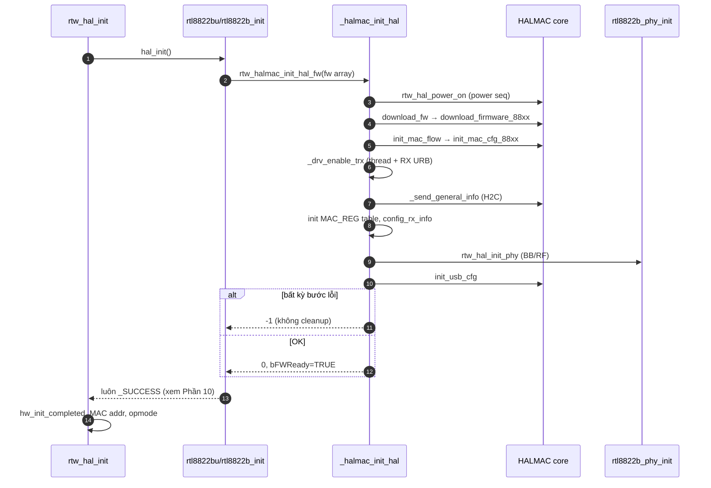
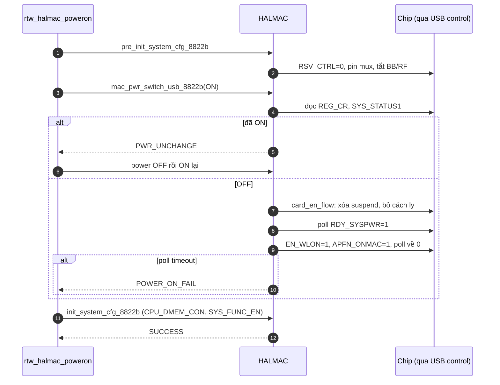
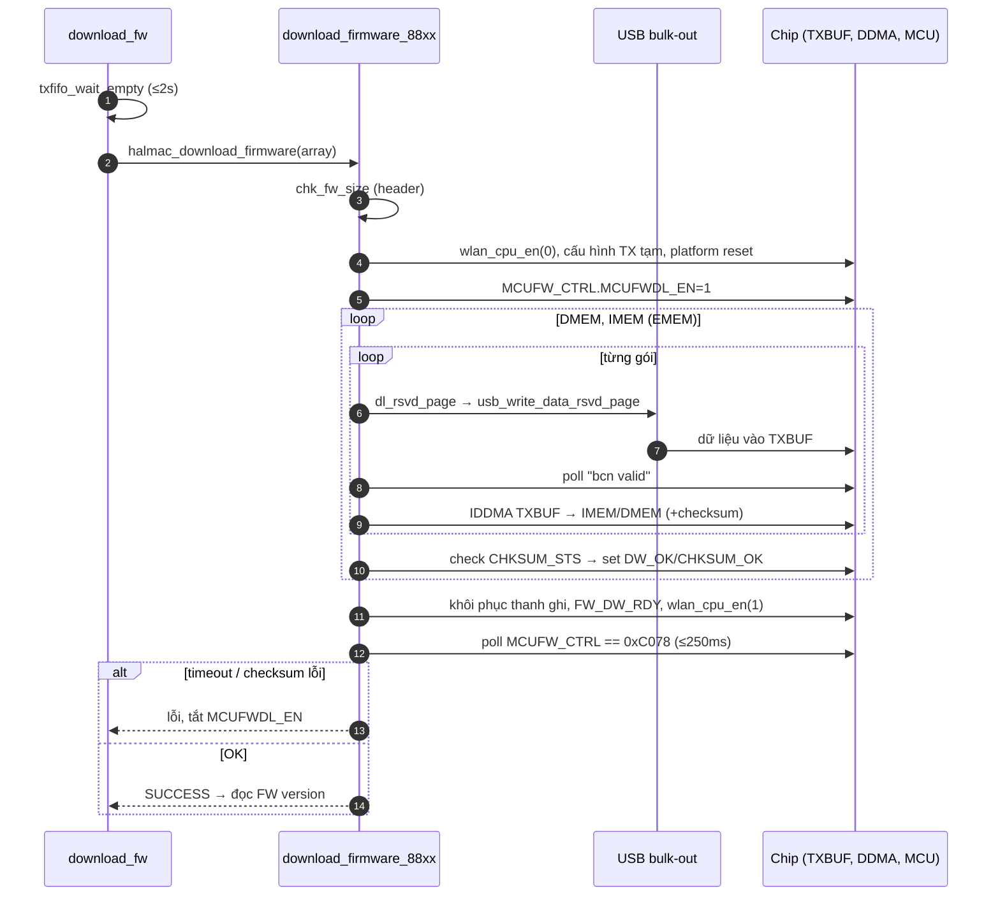
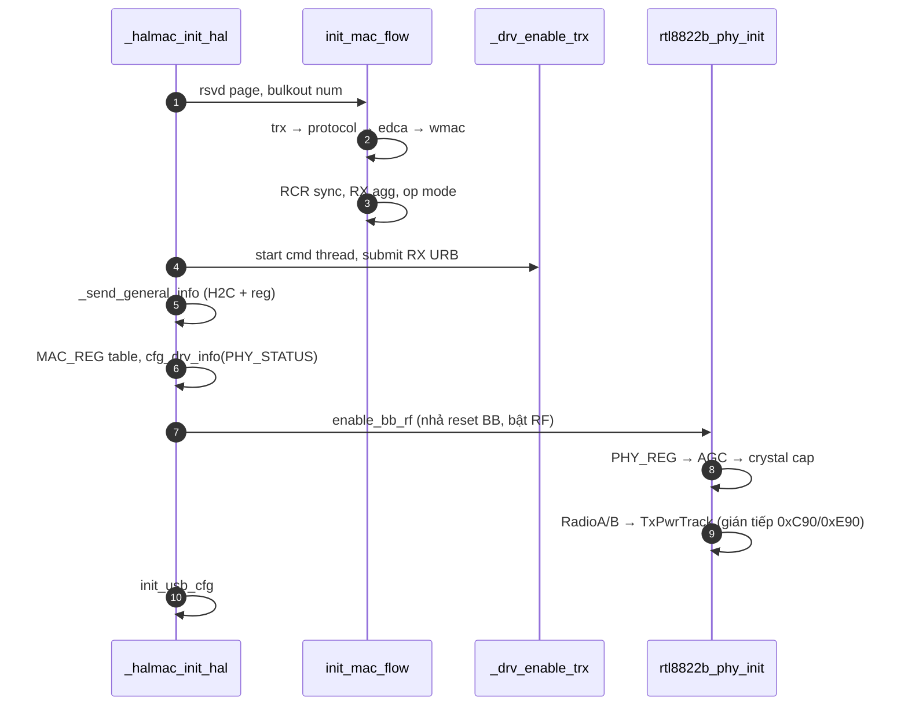

## 0. Cấu hình đã xác minh và hai lưu ý

- [Makefile](vscode-webview://1v7kr62lml590cb3gndmegc6ml88sjdjv7262pvi3l6t2rv5t7fr/Kernel/K-S800/Src/drivers/net/wireless/realtek/rtl8812BU_v1930.24/Makefile#L33-L51): `CONFIG_RTL8822B=y`, `CONFIG_USB_HCI=y`; 8812A, PCI và SDIO đều `=n`.
- `RTW_HALMAC` được định nghĩa ở [autoconf.h:112](vscode-webview://1v7kr62lml590cb3gndmegc6ml88sjdjv7262pvi3l6t2rv5t7fr/Kernel/K-S800/Src/drivers/net/wireless/realtek/rtl8812BU_v1930.24/include/autoconf.h#L112). `HAL_BB_ENABLE = 1` vì `DISABLE_BB_RF` không bật ([hal_phy.h:61-74](vscode-webview://1v7kr62lml590cb3gndmegc6ml88sjdjv7262pvi3l6t2rv5t7fr/Kernel/K-S800/Src/drivers/net/wireless/realtek/rtl8812BU_v1930.24/include/hal_phy.h#L61-L74)).
- `CONFIG_FILE_FWIMG` bị comment ([autoconf.h:117](vscode-webview://1v7kr62lml590cb3gndmegc6ml88sjdjv7262pvi3l6t2rv5t7fr/Kernel/K-S800/Src/drivers/net/wireless/realtek/rtl8812BU_v1930.24/include/autoconf.h#L117)), nên firmware **luôn** lấy từ mảng nhúng trong source.
- `CONFIG_LOAD_PHY_PARA_FROM_FILE=y` (Makefile:66) và `REALTEK_CONFIG_PATH="/lib/firmware/"` (Makefile:1114), nên bảng MAC/BB/RF có thể được nạp từ file.

**Lưu ý 1:** Trong lúc truy vết, tôi từng nghi `probe` cũng bật nguồn chip và nạp firmware qua `hal_read_mac_hidden_rpt`. Đã kiểm tra lại: với 8822B, `CONFIG_RTW_MAC_HIDDEN_RPT` không được định nghĩa, nên hàm đó chỉ là macro trả `_SUCCESS` ([hal_com_c2h.h:146](vscode-webview://1v7kr62lml590cb3gndmegc6ml88sjdjv7262pvi3l6t2rv5t7fr/Kernel/K-S800/Src/drivers/net/wireless/realtek/rtl8812BU_v1930.24/hal/hal_com_c2h.h#L146)). Kết luận ở câu trả lời trước vẫn đúng: lần bật nguồn đầu tiên xảy ra trong `ndo_open`.

**Lưu ý 2:** Cách các macro `HALMAC_REG_R8/W8` truy cập thanh ghi: tôi đã xác minh `rtw_write8` → `usb_write8` → `usbctrl_vendorreq` → `usb_control_msg` ([hal_usb.c:453](vscode-webview://1v7kr62lml590cb3gndmegc6ml88sjdjv7262pvi3l6t2rv5t7fr/Kernel/K-S800/Src/drivers/net/wireless/realtek/rtl8812BU_v1930.24/hal/hal_hci/hal_usb.c#L453), [usb_ops_linux.c:71,154](vscode-webview://1v7kr62lml590cb3gndmegc6ml88sjdjv7262pvi3l6t2rv5t7fr/Kernel/K-S800/Src/drivers/net/wireless/realtek/rtl8812BU_v1930.24/os_dep/linux/usb_ops_linux.c#L71)). Như vậy **mỗi lần đọc/ghi thanh ghi là một USB control transfer**. Tôi chưa dò hết từng macro trung gian từ HALMAC sang `rtw_write8`.

## Phần 1. Bức tranh tổng thể

Khi `ndo_open` gọi `rtw_hal_init`, driver đi xuống qua ba lớp: HAL chung, HAL riêng của 8822B, rồi HALMAC (thư viện điều khiển MAC của Realtek). Hàm điều phối chính là `_halmac_init_hal`. Hàm này lần lượt:

1. **Bật nguồn**: chạy một "kịch bản" ghi/đọc thanh ghi (power sequence) để đưa chip từ trạng thái tắt sang hoạt động.
2. **Nạp firmware**: chia firmware thành từng gói, gửi qua USB bulk vào bộ đệm TX của chip, rồi dùng DMA nội bộ chép sang bộ nhớ của MCU. Sau đó bật MCU và chờ firmware báo sẵn sàng.
3. **Cấu hình MAC**: TX/RX, protocol, EDCA, WMAC.
4. **Bật đường USB RX và thread**.
5. **Nạp bảng MAC, BB, RF**.

Trong toàn bộ quá trình, driver chỉ "nói chuyện" với chip theo hai cách: USB control transfer (đọc/ghi thanh ghi) và USB bulk-out (đẩy dữ liệu lớn như firmware).

## Phần 2. Call chain thực tế

```
rtw_hal_init                               hal_intf.c:544   (nhánh !NEW_NETDEV_HDL)
 └ hal_func.hal_init = rtl8822bu_init      rtl8822bu_halinit.c:235
    └ rtl8822b_init                        rtl8822b_halinit.c:320
       ├ rtl8822b_hal_init                 rtl8822b_halinit.c:168
       │  └ rtw_halmac_init_hal_fw(array_mp_8822b_fw_nic)
       │     └ _halmac_init_hal            hal_halmac.c:3548
       │        ├ rtw_hal_power_on → rtl8822b_power_on → rtw_halmac_poweron  (hal_halmac.c:2680)
       │        │   ├ pre_init_system_cfg_8822b
       │        │   ├ mac_pwr_switch_usb_8822b → pwr_seq_parser(card_en_flow_8822b)
       │        │   └ init_system_cfg_8822b
       │        ├ download_fw              hal_halmac.c:3324
       │        │   └ download_firmware_88xx   halmac_fw_88xx.c:157
       │        ├ init_mac_flow            hal_halmac.c:3427 → init_mac_cfg_88xx
       │        ├ _drv_enable_trx          hal_halmac.c:3517 (thread + USB RX URB)
       │        ├ _send_general_info       hal_halmac.c:3057
       │        ├ rtw_hal_init_mac_register → rtl8822b_phy_init_mac_register
       │        ├ rtw_halmac_config_rx_info(PHY_STATUS)
       │        ├ rtw_hal_init_phy → rtl8822b_phy_init   (BB/RF)
       │        └ halmac_init_interface_cfg = init_usb_cfg_88xx
       ├ rtl8822b_phy_init_haldm, btcoex_wifionly_hw_config, rtl8822b_init_misc
 └ (quay lại rtw_hal_init) hw_init_completed=TRUE, MAC addr, HW port, WEP, LED, mlme_ext, opmode
```

Các con trỏ hàm đã kiểm tra: `hal_init` ([rtl8822bu_ops.c:338](vscode-webview://1v7kr62lml590cb3gndmegc6ml88sjdjv7262pvi3l6t2rv5t7fr/Kernel/K-S800/Src/drivers/net/wireless/realtek/rtl8812BU_v1930.24/hal/rtl8822b/usb/rtl8822bu_ops.c#L338)), `hal_power_on` (rtl8822b_ops.c:3926), `init_mac_register`/`init_phy` (rtl8822b_ops.c:4055-4056). Trong HALMAC: `halmac_mac_power_switch = mac_pwr_switch_usb_8822b` ([halmac_init_8822b.c:429](vscode-webview://1v7kr62lml590cb3gndmegc6ml88sjdjv7262pvi3l6t2rv5t7fr/Kernel/K-S800/Src/drivers/net/wireless/realtek/rtl8812BU_v1930.24/hal/halmac/halmac_88xx/halmac_8822b/halmac_init_8822b.c#L429)), `halmac_download_firmware = download_firmware_88xx`, `halmac_init_mac_cfg = init_mac_cfg_88xx`, `halmac_init_interface_cfg = init_usb_cfg_88xx` ([halmac_init_88xx.c:244,259,392](vscode-webview://1v7kr62lml590cb3gndmegc6ml88sjdjv7262pvi3l6t2rv5t7fr/Kernel/K-S800/Src/drivers/net/wireless/realtek/rtl8812BU_v1930.24/hal/halmac/halmac_88xx/halmac_init_88xx.c#L244)).

Ghi chú: `card_en_flow_8822b` không phải hàm mà là **mảng bảng lệnh**, được bộ phân tích `pwr_seq_parser_88xx` thực thi.

## Phần 3. Power-on

**Bước 0: kiểm tra cờ phần mềm.** `rtl8822b_power_on` ([rtl8822b_halinit.c:109](vscode-webview://1v7kr62lml590cb3gndmegc6ml88sjdjv7262pvi3l6t2rv5t7fr/Kernel/K-S800/Src/drivers/net/wireless/realtek/rtl8812BU_v1930.24/hal/rtl8822b/rtl8822b_halinit.c#L109)) đọc `HW_VAR_APFM_ON_MAC`. Nếu cờ báo đã bật thì bỏ qua. Lưu ý đây là cờ trong RAM, không phải đọc chip.

**Bước 1: chuẩn bị** (`pre_init_system_cfg_8822b`, [halmac_init_8822b.c:988](vscode-webview://1v7kr62lml590cb3gndmegc6ml88sjdjv7262pvi3l6t2rv5t7fr/Kernel/K-S800/Src/drivers/net/wireless/realtek/rtl8812BU_v1930.24/hal/halmac/halmac_88xx/halmac_8822b/halmac_init_8822b.c#L988)). Ghi `REG_RSV_CTRL = 0`. Với USB, nếu `SYS_CFG2+3 == 0x20` thì bật bit 4 ở `0xFE5B` (chưa xác minh ý nghĩa). Cấu hình pin mux (`PAD_CTRL1`, `LED_CFG`, `GPIO_MUXCFG`). **Tắt BB/RF**. Nếu `SYS_CFG1+2` bit 4 bật thì báo "test mode" và dừng.

**Bước 2: xác định trạng thái hiện tại** (`mac_pwr_switch_usb_8822b`, [halmac_usb_8822b.c:74](vscode-webview://1v7kr62lml590cb3gndmegc6ml88sjdjv7262pvi3l6t2rv5t7fr/Kernel/K-S800/Src/drivers/net/wireless/realtek/rtl8812BU_v1930.24/hal/halmac/halmac_88xx/halmac_8822b/halmac_usb_8822b.c#L74)). Đây là chỗ driver **đọc chip** trước khi ghi:

- Nếu `REG_MCUFW_CTRL == 0xC078` (firmware cũ vẫn chạy) thì đảo bit 7 của `0xFE58` để "Leave 32K" (theo comment trong code).
- `REG_CR == 0xEA` được coi là tắt. Nếu không, xem bit 0 của `REG_SYS_STATUS1+1`.
- Nếu yêu cầu bật mà chip đã bật thì trả `PWR_UNCHANGE`. `rtw_halmac_poweron` xử lý trường hợp này bằng cách **tắt rồi bật lại**, comment ghi là để xử lý warm reboot.

**Bước 3: chạy `card_en_flow_8822b`** ([halmac_pwr_seq_8822b.c:439](vscode-webview://1v7kr62lml590cb3gndmegc6ml88sjdjv7262pvi3l6t2rv5t7fr/Kernel/K-S800/Src/drivers/net/wireless/realtek/rtl8812BU_v1930.24/hal/halmac/halmac_88xx/halmac_8822b/halmac_pwr_seq_8822b.c#L439)), gồm hai giai đoạn: _CARDDIS → CARDEMU_ và _CARDEMU → ACT_. Mỗi dòng của bảng là `{địa chỉ, cut, interface, lệnh, mask, giá trị}`, với lệnh là WRITE (đọc-sửa-ghi theo mask), POLLING hoặc DELAY. Các dòng chỉ dành cho PCI/SDIO bị bỏ qua. Các bước chính với USB (tên bit tra ở `halmac_bit_8822b.h`; thanh ghi `0x0004` là `REG_SYS_PW_CTRL`, nên byte `0x0005` là bit 8-15 và `0x0006` là bit 16-23):

|Thứ tự|Thao tác|Tên bit (nếu tra được)|
|---|---|---|
|1|`0x0005` xóa bit 3,4,7|`AFSM_WLSUS_EN`, `AFSM_PCIE_SUS_EN`, `APDM_HPDN`|
|2|`0x0012` bit1←0, bit0←1; `0x0020` bit0←1; **delay 1 ms**|thuộc `SYS_SWR_CTRL1`, `AFE_LDO_CTRL` (bit chưa xác minh)|
|3|`0x0000` xóa bit 5|`ISO_IP2MAC_WA2PP` (một bit cách ly)|
|4|**Poll** `0x0006` bit1 == 1|`RDY_SYSPWR`: chờ nguồn hệ thống sẵn sàng|
|5|`0x0006` bit0←1|`EN_WLON`|
|6|`0x0005` bit0←1, rồi **poll** bit0 == 0|`APFN_ONMAC`|
|7|`0x0020` bit3, `0x0029=0xF9`, `0x0024` bit2←0, `0x00AF` bit5|nhóm AFE (chưa xác minh)|

Bước 6 là điểm then chốt: ghi 1 vào `APFN_ONMAC` rồi chờ nó về 0. Cách hiểu hợp lý là phần cứng tự xóa bit khi hoàn tất bật MAC, nhưng đây là suy luận từ tên bit và mẫu "ghi 1, chờ 0". Mỗi lệnh poll đọc tối đa 20000 lần ([halmac_pwr_seq_cmd.h:63](vscode-webview://1v7kr62lml590cb3gndmegc6ml88sjdjv7262pvi3l6t2rv5t7fr/Kernel/K-S800/Src/drivers/net/wireless/realtek/rtl8812BU_v1930.24/hal/halmac/halmac_pwr_seq_cmd.h#L63)), mỗi lần lỗi chờ 50 µs (`pwr_cmd_polling_88xx`, [halmac_common_88xx.c:3243](vscode-webview://1v7kr62lml590cb3gndmegc6ml88sjdjv7262pvi3l6t2rv5t7fr/Kernel/K-S800/Src/drivers/net/wireless/realtek/rtl8812BU_v1930.24/hal/halmac/halmac_88xx/halmac_common_88xx.c#L3243)). Hết lượt thì trả `PWRSEQ_POLLING_FAIL`.

**Bước 4: sau sequence.** Xóa bit 0 của `REG_SYS_STATUS1+1`, đặt `mac_pwr = ON`. Rồi `init_system_cfg_8822b` ([halmac_init_8822b.c:758](vscode-webview://1v7kr62lml590cb3gndmegc6ml88sjdjv7262pvi3l6t2rv5t7fr/Kernel/K-S800/Src/drivers/net/wireless/realtek/rtl8812BU_v1930.24/hal/halmac/halmac_88xx/halmac_8822b/halmac_init_8822b.c#L758)) bật `BIT_WL_PLATFORM_RST` (bit 16) trong `REG_CPU_DMEM_CON`, OR `0xDC` vào `SYS_FUNC_EN+1` (tức bit 10,11,12,14,15: `FEN_CPUEN`, `FEN_DCORE`, `FEN_ELDR`, `FEN_HWPDN`, `FEN_MREGEN`), và tắt boot-from-flash nếu đang bật, để driver tự nạp firmware.

**Lỗi:** bất kỳ bước nào thất bại thì `rtw_halmac_poweron` trả `-1` (hoặc `-2` khi không đổi được trạng thái), `rtl8822b_power_on` trả `_FAIL`, `_halmac_init_hal` nhảy `out` và trả `-1`.

## Phần 4. Firmware

### Nguồn firmware

- Mảng `array_mp_8822b_fw_nic[]`, dài **146864 byte**, nằm ở [hal8822b_fw.c:13074](vscode-webview://1v7kr62lml590cb3gndmegc6ml88sjdjv7262pvi3l6t2rv5t7fr/Kernel/K-S800/Src/drivers/net/wireless/realtek/rtl8812BU_v1930.24/hal/rtl8822b/hal8822b_fw.c#L13074) (độ dài ở dòng 31435).
- `rtl8822b_hal_init` truyền con trỏ và độ dài này vào `rtw_halmac_init_hal_fw` ([rtl8822b_halinit.c:198](vscode-webview://1v7kr62lml590cb3gndmegc6ml88sjdjv7262pvi3l6t2rv5t7fr/Kernel/K-S800/Src/drivers/net/wireless/realtek/rtl8812BU_v1930.24/hal/rtl8822b/rtl8822b_halinit.c#L198)). Nhánh đọc từ file không được biên dịch.

### Đường nạp

`download_fw` (driver) chờ TX FIFO rỗng tối đa 2 giây, rồi gọi `download_firmware_88xx` ([halmac_fw_88xx.c:157](vscode-webview://1v7kr62lml590cb3gndmegc6ml88sjdjv7262pvi3l6t2rv5t7fr/Kernel/K-S800/Src/drivers/net/wireless/realtek/rtl8812BU_v1930.24/hal/halmac/halmac_88xx/halmac_fw_88xx.c#L157)):

1. **Kiểm tra đầu vào.** Chip phải đang bật. `chk_fw_size_88xx` đọc header 64 byte để lấy kích thước DMEM, IMEM, EMEM (+checksum), và tổng phải khớp đúng kích thước mảng.
2. **Dừng MCU.** `wlan_cpu_en_88xx(0)` xóa `SYS_FUNC_EN+1` bit 2 (tức `FEN_CPUEN`) và `RSV_CTRL+1` bit 0.
3. **Chuẩn bị đường TX tạm.** Sao lưu rồi ghi: ánh xạ HIQ lên priority cao, `REG_CR = HCI_TXDMA_EN | TXDMA_EN`, cấu hình page FIFO, tắt beacon (`BCN_CTRL` bit 3/4). Sau đó `pltfm_reset_88xx` bật/tắt bit 0 của `CPU_DMEM_CON+2` (tức `WL_PLATFORM_RST`).
4. **Bật chế độ nạp.** Bật bit 0 `MCUFWDL_EN` trong `REG_MCUFW_CTRL` ([dòng 306-308](vscode-webview://1v7kr62lml590cb3gndmegc6ml88sjdjv7262pvi3l6t2rv5t7fr/Kernel/K-S800/Src/drivers/net/wireless/realtek/rtl8812BU_v1930.24/hal/halmac/halmac_88xx/halmac_fw_88xx.c#L306-L308)).
5. **Nạp từng vùng: DMEM, rồi IMEM, rồi EMEM (nếu có)** bằng `dlfw_to_mem_88xx` ([dòng 609](vscode-webview://1v7kr62lml590cb3gndmegc6ml88sjdjv7262pvi3l6t2rv5t7fr/Kernel/K-S800/Src/drivers/net/wireless/realtek/rtl8812BU_v1930.24/hal/halmac/halmac_88xx/halmac_fw_88xx.c#L609)). Mỗi vùng được cắt thành gói `dlfw_pkt_size`, và mỗi gói đi qua hai chặng:
    - **Chặng 1, USB bulk-out vào bộ đệm TX của chip**: `send_fwpkt_88xx` → `dl_rsvd_page_88xx` ([halmac_common_88xx.c:360](vscode-webview://1v7kr62lml590cb3gndmegc6ml88sjdjv7262pvi3l6t2rv5t7fr/Kernel/K-S800/Src/drivers/net/wireless/realtek/rtl8812BU_v1930.24/hal/halmac/halmac_88xx/halmac_common_88xx.c#L360)) → `PLTFM_SEND_RSVD_PAGE` = `usb_write_data_rsvd_page` ([rtl8822bu_halmac.c:323](vscode-webview://1v7kr62lml590cb3gndmegc6ml88sjdjv7262pvi3l6t2rv5t7fr/Kernel/K-S800/Src/drivers/net/wireless/realtek/rtl8812BU_v1930.24/hal/rtl8822b/usb/rtl8822bu_halmac.c#L323)). Với lúc khởi tạo bình thường (`not_xmitframe_fw_dl = 0`), driver đóng gói vào một cmd xmitframe có TX descriptor `qsel = BEACON` rồi gọi `dump_mgntframe`. Sau đó HALMAC poll `FIFOPAGE_CTRL_2+1` bit 7 (log lỗi gọi là "bcn valid") tối đa 1000 × 10 µs. Nếu kích thước gói cộng descriptor chia hết cho 512, HALMAC thêm 1 byte; theo tôi là để tránh gói USB đúng bội số 512, nhưng source không giải thích.
    - **Chặng 2, DMA nội bộ chip**: `iddma_dlfw_88xx` ghi nguồn (`0x18780000` + kích thước TX desc, là vùng TX buffer), đích (địa chỉ DMEM/IMEM trong header), độ dài vào kênh DDMA0 với checksum bật, rồi poll bit `OWN`.
    - Hết vùng: `check_fw_chksum_88xx` xem `DDMACH0_CHKSUM_STS`. Nếu lỗi checksum thì trả `FW_CHECKSUM_FAIL`. Nếu tốt thì bật `xMEM_DW_OK` + `xMEM_CHKSUM_OK` trong `MCUFW_CTRL`.
6. **Khôi phục các thanh ghi đã sao lưu.**
7. **Khởi động firmware** (`dlfw_end_flow_88xx`, [dòng 690](vscode-webview://1v7kr62lml590cb3gndmegc6ml88sjdjv7262pvi3l6t2rv5t7fr/Kernel/K-S800/Src/drivers/net/wireless/realtek/rtl8812BU_v1930.24/hal/halmac/halmac_88xx/halmac_fw_88xx.c#L690)): yêu cầu `MCUFW_CTRL & 0x50 == 0x50` (bit 4 `IMEM_CHKSUM_OK`, bit 6 `DMEM_CHKSUM_OK`); ghi `FW_DW_RDY` và xóa `MCUFWDL_EN`; **bật MCU** (`wlan_cpu_en(1)`); poll `MCUFW_CTRL == 0xC078` tối đa 5000 × 50 µs (≈ 250 ms). `0xC078` bao gồm `FW_INIT_RDY` (bit 15), `FW_DW_RDY` (bit 14) và 4 bit DW/CHKSUM OK. `FW_INIT_RDY` là dấu hiệu firmware đã chạy.
8. Sau khi thành công, `download_fw` reset `LastHMEBoxNum` (bộ đếm hộp thư H2C) và đọc phiên bản firmware.

### Ba trạng thái cần phân biệt

|Trạng thái|Bằng chứng trong code|
|---|---|
|Firmware có trong RAM host|Mảng `array_mp_8822b_fw_nic`|
|Đã chép vào chip đúng|Bit `IMEM/DMEM_CHKSUM_OK`|
|Firmware đã chạy|`MCUFW_CTRL == 0xC078` (`FW_INIT_RDY`)|

Thêm một trạng thái phía driver: `hal->bFWReady = TRUE` chỉ được đặt **sau khi toàn bộ `_halmac_init_hal` xong** (gồm cả MAC/BB/RF) ([rtl8822b_halinit.c:213](vscode-webview://1v7kr62lml590cb3gndmegc6ml88sjdjv7262pvi3l6t2rv5t7fr/Kernel/K-S800/Src/drivers/net/wireless/realtek/rtl8812BU_v1930.24/hal/rtl8822b/rtl8822b_halinit.c#L213)).

**Lỗi nạp firmware:** xóa `MCUFWDL_EN`, bật lại CPU (`SYS_FUNC_EN+1` bit 2), khôi phục LTE coex, rồi trả lỗi. Không có retry.

## Phần 5. MAC initialization

`init_mac_flow` ([hal_halmac.c:3427](vscode-webview://1v7kr62lml590cb3gndmegc6ml88sjdjv7262pvi3l6t2rv5t7fr/Kernel/K-S800/Src/drivers/net/wireless/realtek/rtl8812BU_v1930.24/hal/hal_halmac.c#L3427)) chạy **sau** firmware:

1. Cấu hình số page dành riêng cho driver, và số bulk-out pipe USB (`set_bulkout_num` với `RtNumOutPipes` lấy từ `probe`).
2. `init_mac_cfg_88xx` ([halmac_init_88xx.c:556](vscode-webview://1v7kr62lml590cb3gndmegc6ml88sjdjv7262pvi3l6t2rv5t7fr/Kernel/K-S800/Src/drivers/net/wireless/realtek/rtl8812BU_v1930.24/hal/halmac/halmac_88xx/halmac_init_88xx.c#L556)) gọi 4 khối theo thứ tự, mỗi khối lỗi đều trả về ngay: `init_trx_cfg_8822b` (queue/page TX-RX), `init_protocol_cfg_8822b` (AMPDU, RTS, BAR, fast EDCA), `init_edca_cfg_8822b`, `init_wmac_cfg_8822b` (RX filter, RCR `0xE400220E`, TCR, WMAC option, đã phân tích trước đây).
3. Đọc lại RCR vào cache; đặt RTS full BW; `_init_trx_cfg_drv`; bật RX aggregation; chọn chế độ (AC/N/G/B theo `wireless_mode`); đặt multicast address.

Phần **qua firmware** chỉ xuất hiện ở `_send_general_info` (chỉ khi firmware đã nạp): gửi `rfe_type`, `rf_type`, anten TX/RX qua H2C, rồi gửi bản sao qua thanh ghi. Phần còn lại là ghi thanh ghi trực tiếp.

Sau `_drv_enable_trx` và general info, còn hai bước MAC nữa: `rtl8822b_phy_init_mac_register` ([rtl8822b_phy.c:107](vscode-webview://1v7kr62lml590cb3gndmegc6ml88sjdjv7262pvi3l6t2rv5t7fr/Kernel/K-S800/Src/drivers/net/wireless/realtek/rtl8812BU_v1930.24/hal/rtl8822b/rtl8822b_phy.c#L107)) nạp bảng `MAC_REG.txt` (nếu có file), không có thì dùng bảng nhúng; và `rtw_halmac_config_rx_info(PHY_STATUS)` (đã phân tích).

## Phần 6. BB/RF initialization

`rtl8822b_phy_init` ([rtl8822b_phy.c:319](vscode-webview://1v7kr62lml590cb3gndmegc6ml88sjdjv7262pvi3l6t2rv5t7fr/Kernel/K-S800/Src/drivers/net/wireless/realtek/rtl8812BU_v1930.24/hal/rtl8822b/rtl8822b_phy.c#L319)) chạy theo đúng thứ tự:

1. `bb_rf_register_definition`: khởi tạo cấu trúc trong RAM.
2. **Cấp điện BB/RF**: `rtw_halmac_phy_power_switch(TRUE)` → `enable_bb_rf_88xx` ([halmac_cfg_wmac_88xx.c:679](vscode-webview://1v7kr62lml590cb3gndmegc6ml88sjdjv7262pvi3l6t2rv5t7fr/Kernel/K-S800/Src/drivers/net/wireless/realtek/rtl8812BU_v1930.24/hal/halmac/halmac_88xx/halmac_cfg_wmac_88xx.c#L679)): tinh chỉnh RF theo eFuse (`board_rf_fine_tune`), bật `SYS_FUNC_EN` bit 0, 1 (`FEN_BBRSTB`, `FEN_BB_GLB_RSTN`, tức nhả reset BB), `REG_RF_CTRL` bit 0-2, `REG_WLRF1` bit 24-26. Đây là chỗ mở lại khối BB/RF đã bị tắt ở pre-init.
3. `config_phydm_parameter_init_8822b(PRE_SETTING)`.
4. **BB**: bảng `PHY_REG.txt`, rồi `AGC_TAB` (file hoặc bảng nhúng), rồi crystal cap theo eFuse.
5. **RF**: với từng path A/B, nạp `RadioA.txt` / `RadioB.txt` (hoặc bảng nhúng), rồi bảng Tx power tracking.
6. `config_phydm_parameter_init_8822b(POST_SETTING)`.

**Cơ chế truy cập khác nhau:**

- BB register nằm trong không gian địa chỉ chung (ví dụ `0x8xx`) và được ghi như thanh ghi MAC. Tôi chưa dò `odm_set_bb_reg` tới tận `rtw_write32`.
- RF register là **gián tiếp**. Ghi: đóng gói `addr[27:20] | data[19:0]` vào `0xC90` (path A) hoặc `0xE90` (path B). Đọc: qua cửa sổ `0x2800`/`0x2C00 + (addr << 2)` ([phydm_hal_api8822b.c:995-1060](vscode-webview://1v7kr62lml590cb3gndmegc6ml88sjdjv7262pvi3l6t2rv5t7fr/Kernel/K-S800/Src/drivers/net/wireless/realtek/rtl8812BU_v1930.24/hal/phydm/rtl8822b/phydm_hal_api8822b.c#L995)). Trước khi ghi với mask, driver đọc lại; nếu RF đang tắt thì hàm từ chối ghi.

Board dùng file hay bảng nhúng phụ thuộc vào việc `/lib/firmware/` có các file đó hay không. Tôi chưa kiểm tra rootfs.

Cuối cùng, `halmac_init_interface_cfg` = `init_usb_cfg_88xx` (chưa đọc thân hàm). Comment trong code đánh dấu trạng thái là "StateRxIdle".

## Phần 7. Enable TX/RX và kết thúc

**Thứ tự đáng chú ý:** `_drv_enable_trx` ([hal_halmac.c:3517](vscode-webview://1v7kr62lml590cb3gndmegc6ml88sjdjv7262pvi3l6t2rv5t7fr/Kernel/K-S800/Src/drivers/net/wireless/realtek/rtl8812BU_v1930.24/hal/hal_halmac.c#L3517)) chạy **ngay sau MAC flow, trước khi nạp bảng MAC/BB/RF**:

- Nếu `bup == FALSE` thì `rtw_start_drv_threads`, trong đó có `RTW_CMD_THREAD`. Hàm chờ semaphore đến khi thread đã chạy.
- `rtw_intf_start` → `usb_intf_start` → `rtl8822bu_inirp_init`: nộp `NR_RECVBUFF` **URB** bulk-in. URB là một "phiếu yêu cầu" gửi cho USB core: "khi chip có dữ liệu thì đổ vào buffer này rồi báo tôi". Nộp sẵn nhiều phiếu thì chip có chỗ đẩy dữ liệu (gói tin, báo cáo C2H) ngay khi có.

Sau khi `_halmac_init_hal` trả về: `rtl8822b_hal_init` đọc lại RCR và đặt `bFWReady = TRUE`. `rtl8822b_init` chạy `phy_init_haldm`, cấu hình btcoex wifi-only, `init_misc`. Cuối cùng `rtw_hal_init` ([hal_intf.c:544](vscode-webview://1v7kr62lml590cb3gndmegc6ml88sjdjv7262pvi3l6t2rv5t7fr/Kernel/K-S800/Src/drivers/net/wireless/realtek/rtl8812BU_v1930.24/hal/hal_intf.c#L544)) đặt `hw_init_completed = TRUE`, **ghi MAC address cho mọi iface**, khôi phục cấu hình HW port, khôi phục WEP key, LED, `init_hw_mlme_ext`, `rtw_hal_init_opmode`, một số thiết lập PHYDM.

**Chưa xảy ra:** scan, associate, carrier thật, TX dữ liệu.

## Phần 8. Bảng register quan trọng

|Giai đoạn|Register|Thao tác|Mục đích|Nguồn|
|---|---|---|---|---|
|Kiểm tra trạng thái|`REG_CR` (0x100), `SYS_STATUS1+1`|Đọc|Chip đang tắt hay bật|halmac_usb_8822b.c|
|Power seq|`SYS_PW_CTRL` 0x0006 b1 (`RDY_SYSPWR`)|Poll =1|Chờ nguồn hệ thống|pwr_seq_8822b.c|
|Power seq|`SYS_PW_CTRL` 0x0005 b0 (`APFN_ONMAC`)|Ghi 1, poll 0|Bật MAC|pwr_seq_8822b.c|
|System cfg|`SYS_FUNC_EN+1` \|= 0xDC|Set bit|Bật CPU, DCORE...|init_8822b.c:758|
|FW|`MCUFW_CTRL` b0 `MCUFWDL_EN`|Set rồi clear|Mở/đóng chế độ nạp|fw_88xx.c|
|FW|`DDMA_CH0SA/DA/CTRL`|Ghi + poll `OWN`|DMA TXBUF → IMEM/DMEM|fw_88xx.c:826|
|FW ready|`MCUFW_CTRL` == 0xC078|Poll|Firmware đã khởi chạy|fw_88xx.c:690|
|BB/RF|`SYS_FUNC_EN` b0,b1; `RF_CTRL` b0-2|Set bit|Nhả reset BB, bật RF|cfg_wmac_88xx.c:679|
|RF|`0xC90`/`0xE90`|Ghi gián tiếp|Ghi RF register|phydm_hal_api8822b.c|

## Phần 9. Sequence diagrams

**Diagram 1: Tổng quan**



**Diagram 2: Power-on**



**Diagram 3: Firmware**



**Diagram 4: MAC / TRX / BB / RF (đúng thứ tự xen kẽ)**



## Phần 10. Lỗi, cleanup và tóm tắt

**Lỗi và cleanup (theo code):**

- Mọi lỗi trong `_halmac_init_hal` đều `goto out` và trả `-1`, **không có rollback**. Chip có thể đã bật nguồn, thread và URB có thể đã chạy.
- `rtl8822b_hal_init` in "Download Firmware ... failed" cho **mọi** lỗi của `_halmac_init_hal`, kể cả lỗi MAC hay BB/RF. Log này dễ gây hiểu nhầm.
- **Quan trọng:** `rtl8822bu_init` gọi `rtl8822b_init(padapter);` mà **bỏ qua giá trị trả về** và luôn trả `_SUCCESS` ([rtl8822bu_halinit.c:245-253](vscode-webview://1v7kr62lml590cb3gndmegc6ml88sjdjv7262pvi3l6t2rv5t7fr/Kernel/K-S800/Src/drivers/net/wireless/realtek/rtl8812BU_v1930.24/hal/rtl8822b/usb/rtl8822bu_halinit.c#L245-L253)). Hệ quả đọc từ code: dù firmware hay BB/RF lỗi, `rtw_hal_init` vẫn đặt `hw_init_completed = TRUE` và `ndo_open` vẫn coi là thành công. Chỉ `bFWReady = FALSE` phản ánh lỗi. Đây là chỗ trạng thái phần mềm có thể lệch phần cứng.

**Luồng cần nhớ:**

- Bật nguồn = chạy bảng `card_en_flow` qua USB control: bỏ suspend/cách ly → chờ `RDY_SYSPWR` → `APFN_ONMAC`.
- Firmware = USB bulk vào TXBUF → DMA nội bộ sang IMEM/DMEM → checksum → bật MCU → chờ `0xC078`.
- MAC (4 khối HALMAC) → bật thread + URB RX → general info H2C → bảng MAC → BB → RF.
- Bảng MAC/BB/RF ưu tiên file trong `/lib/firmware/`, không có thì dùng bảng nhúng; firmware thì luôn dùng mảng nhúng.
- Lỗi phần cứng không truyền lên `rtw_hal_init` vì `rtl8822bu_init` nuốt lỗi.

**Ba trạng thái:** _đã tải_ (bit `CHKSUM_OK`), _đã ready_ (`FW_INIT_RDY` / `0xC078`), _adapter khởi tạo xong_ (`hw_init_completed` trong `rtw_hal_init`; với lỗi đã nêu, cờ này không chứng minh được firmware đã ready).

**Câu hỏi tự kiểm tra:**

1. Vì sao firmware phải đi qua hai chặng (USB bulk rồi IDDMA) thay vì ghi thẳng vào IMEM?
2. `MCUFW_CTRL == 0xC078` gồm những bit nào, và bit nào chứng minh firmware đã chạy?
3. Vì sao `pre_init` tắt BB/RF, và chúng được bật lại ở đâu?
4. RF register được ghi khác BB register thế nào?
5. Nếu `download_firmware_88xx` lỗi, `ndo_open` trả gì? Vì sao?

**Chưa xác minh:** ý nghĩa nhiều bit AFE/USB trong power sequence (`0xFF0A`, `0x10C3`, `0x0020`...); thân `init_usb_cfg_88xx`, `init_trx_cfg_8822b`, `init_edca_cfg_8822b`; đường `dump_mgntframe` tới URB bulk-out; board có các file PHY trong `/lib/firmware/` hay không; chưa có log chạy thật.