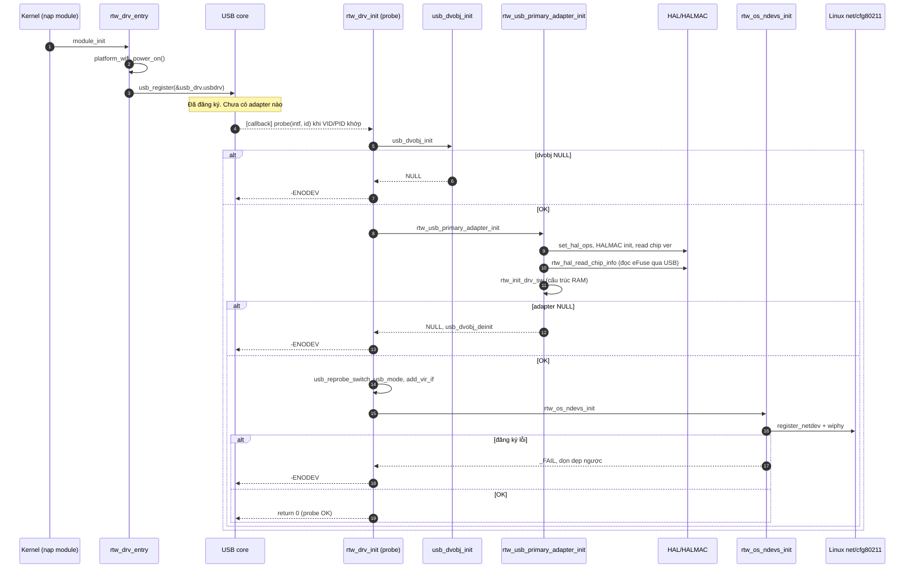

**Cấu hình đã xác minh** ([Makefile:41,49](vscode-webview://1v7kr62lml590cb3gndmegc6ml88sjdjv7262pvi3l6t2rv5t7fr/Kernel/K-S800/Src/drivers/net/wireless/realtek/rtl8812BU_v1930.24/Makefile#L41)): `CONFIG_RTL8822B = y`, `CONFIG_USB_HCI = y`, `CONFIG_PLATFORM_ARM_S800 = y`. Các chip khác (8812A, 8821C, 8822C...) và PCI/SDIO đều `= n`, nên tôi bỏ qua. `CONFIG_CONCURRENT_MODE = y` và `CONFIG_IOCTL_CFG80211` được bật. Thư mục cha có Kconfig `RTL8822BU` trỏ vào driver này ([../Makefile:13](vscode-webview://1v7kr62lml590cb3gndmegc6ml88sjdjv7262pvi3l6t2rv5t7fr/Kernel/K-S800/Src/drivers/net/wireless/realtek/Makefile#L13)).

## 1. Bức tranh tổng thể

Có ba sự kiện khác nhau, thường bị nhầm là một:

1. **Nạp module**: kernel chạy hàm entry. Driver chỉ _đăng ký_ với USB subsystem rồi chờ.
2. **Ghép thiết bị**: khi có USB device khớp bảng ID, USB core gọi `probe()` của driver.
3. **Khởi tạo adapter**: bên trong `probe()`, driver dựng các đối tượng, đọc eFuse, rồi đăng ký giao diện mạng với Linux.

Ví dụ: mở một quầy tiếp nhận (nạp module, đăng ký). Khách đến đúng loại hồ sơ (cắm đúng VID/PID) thì nhân viên mới được gọi ra làm thủ tục (`probe`).

## 2. Khái niệm cần biết

|Thuật ngữ|Nghĩa|
|---|---|
|Kernel module|Mã nạp thêm vào kernel lúc chạy. Có entry (`module_init`) và exit.|
|`usb_driver`|Struct mô tả driver với USB core: tên, `probe`, `disconnect`, `id_table`.|
|`usb_device_id`|Một dòng "tôi hỗ trợ thiết bị này" (VID, PID, class).|
|`probe()`|Callback **do kernel gọi** khi có thiết bị khớp. Driver chỉ cung cấp hàm.|
|`dvobj_priv`|Struct riêng của driver, đại diện cho _thiết bị USB_ (pipe, tốc độ, danh sách adapter).|
|`_adapter`|Struct đại diện cho _một interface Wi-Fi_ (mlme, xmit, recv...).|
|`net_device`|Đối tượng giao diện mạng của Linux (`wlan0`).|
|URB|Gói yêu cầu truyền USB. Không xuất hiện trong chuỗi `probe` tôi đã đọc.|

## 3. Call chain thực tế (đã đọc trong source)

```
module_init(rtw_drv_entry)                    usb_intf.c:1774
 └ rtw_drv_entry                              :1704
    ├ platform_wifi_power_on()                :1714
    └ usb_register(&usb_drv.usbdrv)           :1731
        … USB core ghép thiết bị theo rtw_usb_id_tbl …
        └ [kernel gọi] .probe = rtw_drv_init  :1541
           ├ process_spec_devid
           ├ usb_dvobj_init                   :529   → dvobj_priv
           ├ rtw_usb_primary_adapter_init     :1381  → _adapter
           │   ├ rtw_set_hal_ops → rtl8822bu_set_hal_ops → HALMAC init
           │   ├ rtw_hal_read_chip_version / chip_configure
           │   ├ rtw_hal_read_chip_info → rtl8822b_read_efuse
           │   └ rtw_init_drv_sw (os_intfs.c:2650)
           ├ usb_reprobe_switch_usb_mode      :739
           ├ rtw_drv_add_vir_if × N           (CONCURRENT_MODE)
           └ rtw_os_ndevs_init (os_intfs.c:3558)
               ├ rtw_os_ndevs_alloc  → rtw_os_ndev_alloc
               └ rtw_os_ndevs_register → register_netdev
```

## 4. Giải thích từng bước

**Bước 1: Entry.** `rtw_drv_entry` ([usb_intf.c:1704](vscode-webview://1v7kr62lml590cb3gndmegc6ml88sjdjv7262pvi3l6t2rv5t7fr/Kernel/K-S800/Src/drivers/net/wireless/realtek/rtl8812BU_v1930.24/os_dep/linux/usb_intf.c#L1704)) trước tiên gọi `platform_wifi_power_on()`, hàm cấp nguồn cho dongle theo từng board. Rồi khởi tạo proc và notifier, sau đó `usb_register`. Chưa có adapter nào lúc này.

**Bước 2: Khai báo driver.** Struct `usb_drv` ([dòng 353-372](vscode-webview://1v7kr62lml590cb3gndmegc6ml88sjdjv7262pvi3l6t2rv5t7fr/Kernel/K-S800/Src/drivers/net/wireless/realtek/rtl8812BU_v1930.24/os_dep/linux/usb_intf.c#L353-L372)) gán `.probe = rtw_drv_init`, `.disconnect = rtw_dev_remove`, `.id_table = rtw_usb_id_tbl`, cùng suspend/resume.

**Bước 3: Bảng ID.** Với 8822B, bảng ID ([dòng 279-285](vscode-webview://1v7kr62lml590cb3gndmegc6ml88sjdjv7262pvi3l6t2rv5t7fr/Kernel/K-S800/Src/drivers/net/wireless/realtek/rtl8812BU_v1930.24/os_dep/linux/usb_intf.c#L279-L285)) có: VID `0x0BDA` + PID `0xB82C`, `0xB812`, `0xB81A`, và `0x13B1:0x0043`. Mỗi dòng yêu cầu class/subclass/protocol `0xff` (vendor-specific) và gắn `.driver_info = RTL8822B`. VID/PID không khớp thì USB core **không gọi** `probe`. Đây là hành vi chuẩn của Linux USB core, không nằm trong repo.

**Bước 4: Vào `probe`.** `rtw_drv_init` nhận `usb_interface` và dòng ID đã khớp ([dòng 1541](vscode-webview://1v7kr62lml590cb3gndmegc6ml88sjdjv7262pvi3l6t2rv5t7fr/Kernel/K-S800/Src/drivers/net/wireless/realtek/rtl8812BU_v1930.24/os_dep/linux/usb_intf.c#L1541)).

**Bước 5: Dựng đối tượng thiết bị USB.** `usb_dvobj_init` ([dòng 529-709](vscode-webview://1v7kr62lml590cb3gndmegc6ml88sjdjv7262pvi3l6t2rv5t7fr/Kernel/K-S800/Src/drivers/net/wireless/realtek/rtl8812BU_v1930.24/os_dep/linux/usb_intf.c#L529-L709)): cấp `dvobj_priv`, lưu con trỏ interface vào `usb_set_intfdata`, duyệt endpoint để đếm pipe IN/OUT (bulk, interrupt), xác định tốc độ USB (từ chối nếu không rõ), gọi `rtw_decide_chip_type_by_usb_info` để suy ra loại chip từ `driver_info`. Mọi việc ở đây chỉ **đọc descriptor USB và dựng cấu trúc RAM**.

**Bước 6: Dựng adapter.** `rtw_usb_primary_adapter_init` ([dòng 1381-1488](vscode-webview://1v7kr62lml590cb3gndmegc6ml88sjdjv7262pvi3l6t2rv5t7fr/Kernel/K-S800/Src/drivers/net/wireless/realtek/rtl8812BU_v1930.24/os_dep/linux/usb_intf.c#L1381-L1488)) theo đúng thứ tự:

- Cấp `_adapter`, nạp tham số (`loadparam`), đặt cờ "driver stopped", đăng ký vào `dvobj->padapters[0]`.
- `rtw_init_io_priv(padapter, usb_set_intf_ops)`: gắn hàm đọc/ghi USB.
- `rtw_set_hal_ops`: cấp `HalData`, rồi `rtl8822bu_set_hal_ops` gọi `rtl8822bu_halmac_init_adapter` → `rtw_halmac_init_adapter` → `halmac_init_adapter` ([hal_halmac.c:1313](vscode-webview://1v7kr62lml590cb3gndmegc6ml88sjdjv7262pvi3l6t2rv5t7fr/Kernel/K-S800/Src/drivers/net/wireless/realtek/rtl8812BU_v1930.24/hal/hal_halmac.c#L1313)). Sau đó gán bảng hàm `hal_func` (`hal_init = rtl8822bu_init`, `set_hw_reg_handler = sethwreg`...). Đây chính là chỗ function pointer được thiết lập, khớp với phần phân tích RCR trước đó.
- `rtw_hal_read_chip_version`, rồi `rtw_hal_chip_configure` → `rtl8822bu_interface_configure`: chọn kích thước bulk theo tốc độ USB và ánh xạ queue với pipe (chỉ cấu hình phần mềm).
- `rtw_hal_read_chip_info` → `rtl8822b_read_efuse`: **đây là bước đầu tiên chạm phần cứng**. Nó đọc `REG_SYS_EEPROM_CTRL` qua USB, rồi `EFUSE_ShadowMapUpdate` gọi HALMAC dump eFuse ([hal_halmac.c:4337](vscode-webview://1v7kr62lml590cb3gndmegc6ml88sjdjv7262pvi3l6t2rv5t7fr/Kernel/K-S800/Src/drivers/net/wireless/realtek/rtl8812BU_v1930.24/hal/hal_halmac.c#L4337)), và phân tích ID, phiên bản, **địa chỉ MAC**, tx power, board type, channel plan, xtal.
- `rtw_init_drv_sw` ([os_intfs.c:2650](vscode-webview://1v7kr62lml590cb3gndmegc6ml88sjdjv7262pvi3l6t2rv5t7fr/Kernel/K-S800/Src/drivers/net/wireless/realtek/rtl8812BU_v1930.24/os_dep/linux/os_intfs.c#L2650)): khởi tạo cmd/evt, mlme, xmit, recv, sta, pwrctrl, DM, v.v. Chủ yếu là cấu trúc RAM, lock, timer, queue.
- Cuối cùng `rtw_macaddr_cfg` chốt MAC từ eFuse.

**Bước 7: Kiểm tra đổi chế độ USB.** `usb_reprobe_switch_usb_mode` ([dòng 739](vscode-webview://1v7kr62lml590cb3gndmegc6ml88sjdjv7262pvi3l6t2rv5t7fr/Kernel/K-S800/Src/drivers/net/wireless/realtek/rtl8812BU_v1930.24/os_dep/linux/usb_intf.c#L739)) chỉ hành động khi eFuse _và_ registry đều cho phép. Nếu đổi chế độ thì hàm trả "true", `probe` thoát theo `free_if_prim` và trả `-ENODEV`. Ý đồ "để thiết bị nhận diện lại" là suy luận từ tên hàm.

**Bước 8: Interface ảo.** Vì `CONFIG_CONCURRENT_MODE = y`, `rtw_drv_add_vir_if` được gọi `virtual_iface_num` lần (giới hạn bởi `CONFIG_IFACE_NUMBER - 1`).

**Bước 9: Đăng ký với Linux.** `rtw_os_ndevs_init` ([os_intfs.c:3558](vscode-webview://1v7kr62lml590cb3gndmegc6ml88sjdjv7262pvi3l6t2rv5t7fr/Kernel/K-S800/Src/drivers/net/wireless/realtek/rtl8812BU_v1930.24/os_dep/linux/os_intfs.c#L3558)):

- _Cấp phát_: `rtw_os_ndev_alloc` ([dòng 1925](vscode-webview://1v7kr62lml590cb3gndmegc6ml88sjdjv7262pvi3l6t2rv5t7fr/Kernel/K-S800/Src/drivers/net/wireless/realtek/rtl8812BU_v1930.24/os_dep/linux/os_intfs.c#L1925)) gọi `rtw_init_netdev` (cấp `net_device`, gắn `rtw_netdev_ops` với `.ndo_open = netdev_open`) và `SET_NETDEV_DEV`, rồi cấp tài nguyên cfg80211.
- _Đăng ký_: `rtw_os_ndevs_register` ([dòng 3469](vscode-webview://1v7kr62lml590cb3gndmegc6ml88sjdjv7262pvi3l6t2rv5t7fr/Kernel/K-S800/Src/drivers/net/wireless/realtek/rtl8812BU_v1930.24/os_dep/linux/os_intfs.c#L3469)) đăng ký wiphy, sao MAC vào `dev_addr`, rồi `register_netdev`, đặt `adapter->registered = 1` ([dòng 1979-2015](vscode-webview://1v7kr62lml590cb3gndmegc6ml88sjdjv7262pvi3l6t2rv5t7fr/Kernel/K-S800/Src/drivers/net/wireless/realtek/rtl8812BU_v1930.24/os_dep/linux/os_intfs.c#L1979-L2015)).
- Tôi chưa đọc thân `rtw_os_ndevs_alloc` (dòng 2116); việc nó lặp cấp cho từng adapter là suy luận từ tên.

**Bước 10: Hoàn tất.** `status = _SUCCESS`, `probe` trả `0`.

## 5. Sequence diagram



**Hai thứ tự cắm/nạp:**

```mermaid
sequenceDiagram
    participant U as USB core
    participant M as Module driver
    participant P as probe()
    rect rgb(235,245,255)
    Note over U,P: Trường hợp 1: nạp driver trước, cắm thiết bị sau
    M->>U: usb_register (id_table)
    U->>U: thiết bị mới được cắm vào, enumerate
    U->>P: khớp id_table, gọi probe
    end
    rect rgb(255,245,235)
    Note over U,P: Trường hợp 2: cắm thiết bị trước, nạp driver sau
    U->>U: thiết bị đã enumerate, chưa có driver
    M->>U: usb_register
    U->>P: duyệt thiết bị chưa có driver, khớp, gọi probe
    end
```



Cả hai đều dẫn tới `probe()` vì USB core thử ghép _mỗi khi có thiết bị mới hoặc có driver mới đăng ký_. Chi tiết này thuộc kernel, không đọc được từ repo. Có một hệ quả thấy được trong code: ở trường hợp 2, `probe` có thể chạy **ngay bên trong** `usb_register` ([dòng 1731](vscode-webview://1v7kr62lml590cb3gndmegc6ml88sjdjv7262pvi3l6t2rv5t7fr/Kernel/K-S800/Src/drivers/net/wireless/realtek/rtl8812BU_v1930.24/os_dep/linux/usb_intf.c#L1731)). Vì thế dòng 1733 mới kiểm tra `usb_drv.tx_limit_table` ngay sau đó.

## 6. Lỗi và cleanup

|Nơi lỗi|Xử lý|Kết quả|
|---|---|---|
|`platform_wifi_power_on`|`goto exit`|Module init trả `-1`, chưa `usb_register`|
|`usb_register` lỗi, hoặc `tx_limit_table == FALSE`|deregister, hủy proc/notifier|Module init lỗi|
|`usb_dvobj_init` NULL|`goto exit`|`-ENODEV`|
|`rtw_usb_primary_adapter_init` NULL|`free_dvobj` → `usb_dvobj_deinit`|`-ENODEV`|
|Bên trong adapter init (HAL data, đọc eFuse, `rtw_init_drv_sw`)|`free_hal_data` → `rtw_hal_free_data`, `free_adapter` → `rtw_halmac_deinit_adapter` + `vmfree`|trả NULL|
|TX power limit / đổi chế độ USB|`free_if_prim`|`-ENODEV`|
|Tạo iface ảo lỗi|`free_if_vir` (dừng, giải phóng iface ảo)|`-ENODEV`|
|`rtw_os_ndevs_init` lỗi|`free_if_vir` → `free_if_prim` → `free_dvobj`|`-ENODEV`|

Mọi đường lỗi của `probe` đều trả `-ENODEV`. Đáng chú ý: `rtl8822bu_set_hal_ops` trả `void`, và khi HALMAC init lỗi chỉ in log rồi `return`, không báo lỗi lên trên ([rtl8822bu_ops.c:328-332](vscode-webview://1v7kr62lml590cb3gndmegc6ml88sjdjv7262pvi3l6t2rv5t7fr/Kernel/K-S800/Src/drivers/net/wireless/realtek/rtl8812BU_v1930.24/hal/rtl8822b/usb/rtl8822bu_ops.c#L328-L332)). Tôi chưa theo dõi tiếp hệ quả ở `rtw_set_hal_ops`.

## 7. Trạng thái sau khi `probe` thành công

Theo các hàm đã đọc:

- **Đã có**: `dvobj_priv`, `_adapter` (cộng iface ảo), HALMAC, MAC lấy từ eFuse, `net_device` đã `register_netdev`, wiphy cfg80211.
- **Chưa có**: `netdev_open` chưa chạy. Chính `ndo_open` mới gọi `rtw_hal_init` ([os_intfs.c:3777](vscode-webview://1v7kr62lml590cb3gndmegc6ml88sjdjv7262pvi3l6t2rv5t7fr/Kernel/K-S800/Src/drivers/net/wireless/realtek/rtl8812BU_v1930.24/os_dep/linux/os_intfs.c#L3777)), nơi dựng phần cứng chạy thật. Trong chuỗi `probe` tôi không thấy lời gọi `rtw_hal_init` hay `rtw_hal_power_on`. Tôi không thấy firmware được nạp trong `probe`.
- **Cờ trạng thái**: `rtw_set_drv_stopped` được gọi lúc khởi tạo; probe còn log `bup` và `hw_init_completed` để thể hiện chưa lên.
- **Chưa xảy ra**: scan, connect, TX/RX, và cả việc mở interface.
- Tôi chưa kiểm chứng bằng chạy thực tế, cũng chưa đọc `process_spec_devid`, `rtw_os_ndevs_alloc`.

## 8. Tóm tắt

- `module_init` chỉ đăng ký `usb_driver`; `probe` mới là lúc thiết bị được khởi tạo.
- `probe` là callback do USB core gọi khi VID/PID/class khớp `rtw_usb_id_tbl`.
- Ba lớp đối tượng: `dvobj_priv` (thiết bị USB) → `_adapter` (Wi-Fi) → `net_device` (Linux).
- Trong `probe`, phần cứng chỉ được chạm để đọc chip version và eFuse; MAC power-on, nạp firmware nằm ở `netdev_open`.
- `probe` thành công nghĩa là `wlan0` đã tồn tại, chứ chưa phải Wi-Fi hoạt động.

## 9. Tự kiểm tra

1. Khác biệt giữa `module_init(rtw_drv_entry)` và `.probe = rtw_drv_init` là gì?
2. Vì sao cắm thiết bị trước hay nạp driver trước đều gọi được `probe`?
3. `dvobj_priv`, `_adapter`, `net_device` khác nhau thế nào, và cái nào được tạo trước?
4. Trong `probe`, bước nào đầu tiên truy cập phần cứng, và đọc gì?
5. Vì sao `probe` thành công mà vẫn chưa gửi nhận được gói tin?