# Phân tích `os_dep/linux/ioctl_cfg80211.c` (11965 dòng)

**Phạm vi.** Đã đọc bảng `rtw_cfg80211_ops`, phần khởi tạo/hủy `wiphy`/`wdev`, scan, connect/disconnect, nhánh SME-offload, key, AP, interface ảo, P2P/mgmt_tx và các hàm báo sự kiện. Các nhóm sau chỉ đọc lướt hoặc chưa đọc, và được ghi rõ ở từng chỗ: mesh, TDLS, PNO/sched-scan, chi tiết `rtw_cfg80211_set_encryption`/`rtw_cfg80211_ap_set_encryption`, `add/del/change_station`, `get_key`, `set_mac_acl`, ACS survey.

## 0. Cấu hình build quyết định cái gì chạy thật

Kernel là **5.10.241**, nên các nhánh `LINUX_VERSION_CODE` cũ bị bỏ qua. Cấu hình lấy từ Makefile, `autoconf.h` và `drv_conf.h`:

| Cấu hình | Trạng thái | Hệ quả |
|---|---|---|
| `CONFIG_CFG80211_SME_OFFLOAD` | **bật** ([Makefile:103](Makefile#L103)) | Có thêm `.auth/.assoc/.deauth/.disassoc`. Driver tự lo auth/assoc ở mức frame |
| `CONFIG_AP_MODE` | bật | Có AP, `add/del_virtual_intf`, station ops |
| `CONFIG_P2P` | bật | Có remain-on-channel, P2P trong scan và mgmt_tx |
| `CONFIG_CFG80211_REGISTER_MGMT` | bật | Cho phép đăng ký nhận mgmt frame |
| `RTW_USE_CFG80211_STA_EVENT` | bật (khối S800) | Báo station AP bằng `cfg80211_new_sta/del_sta` |
| `CONFIG_IEEE80211W` | bật | Có `set_default_mgmt_key` |
| `RTW_SINGLE_WIPHY` | **không** | Mỗi adapter có **một wiphy riêng** |
| `RTW_DEDICATED_P2P_DEVICE`, `CONFIG_RTW_DYNAMIC_NDEV` | không | Không có interface P2P_DEVICE riêng |
| `CONFIG_RTW_MESH`, `CONFIG_TDLS`, `CONFIG_PNO_SUPPORT` | **không** | Các hàm mesh/TDLS/sched-scan có trong file nhưng không được biên dịch |
| `CONFIG_WIFI_MONITOR` | không (Makefile `=n`) | `wiphy` không công bố chế độ Monitor |

---

## 1. Chức năng tổng thể

**Ví dụ dễ hình dung.** Linux giống "tổng đài". Người dùng (qua `wpa_supplicant`, `iw`, `hostapd`) gọi tổng đài và nói "quét Wi-Fi đi", "kết nối vào mạng này". Tổng đài (**cfg80211**) không biết cách điều khiển chip Realtek. Vì vậy driver đưa cho tổng đài một **danh bạ** là `rtw_cfg80211_ops` ([ioctl_cfg80211.c:11487](os_dep/linux/ioctl_cfg80211.c#L11487)), ghi rõ "yêu cầu loại X thì gọi hàm Y của tôi".

Ba vai trò của file:
1. **Đăng ký và mô tả thiết bị** với Linux: `wiphy` (băng tần, kênh, tốc độ, cipher, chế độ hỗ trợ) và `wireless_dev`.
2. **Tiếp nhận yêu cầu** từ Linux (callback `cfg80211_rtw_*`) rồi chuyển xuống lõi driver (`rtw_sitesurvey_cmd`, `rtw_joinbss_cmd`...) [hàm ngoài file].
3. **Báo ngược sự kiện** từ driver lên Linux (`rtw_cfg80211_indicate_*`, `rtw_cfg80211_inform_bss`) khi chip có kết quả.

```
 wpa_supplicant / hostapd / iw
        │ nl80211
        ▼
   cfg80211 (Linux)  ──── rtw_cfg80211_ops (callback) ───▶  ioctl_cfg80211.c
        ▲                                                       │ gọi xuống
        │ cfg80211_scan_done, cfg80211_connect_result, ...      ▼
        └──────────── rtw_cfg80211_indicate_* ◀──── core/ (mlme, cmd) → hal/ → USB
```

---

## 2. Các nhóm hàm chính

| Nhóm | Hàm tiêu biểu | Nhiệm vụ |
|---|---|---|
| **A. wiphy / wdev** | `rtw_wiphy_alloc`, `rtw_cfg80211_preinit_wiphy`, `rtw_wiphy_register`, `rtw_wdev_alloc`, `rtw_cfg80211_ndev_res_*`, `rtw_cfg80211_dev_res_*`, `rtw_cfg80211_init_wiphy` | Tạo và đăng ký "hồ sơ thiết bị" với Linux |
| **B. Băng tần, kênh, tốc độ** | `rtw_spt_band_alloc`, `rtw_2g/5g_channels_init`, `rtw_2g/5g_rates_init`, `rtw_cfg80211_init_ht_capab`, `rtw_cfg80211_init_vht_capab` | Khai báo 2.4G/5G, HT/VHT |
| **C. Quét** | `cfg80211_rtw_scan`, `rtw_cfg80211_surveydone_event_callback`, `rtw_cfg80211_inform_bss`, `rtw_cfg80211_indicate_scan_done`, `rtw_cfg80211_scan_via_buddy` | Nhận lệnh quét, đẩy kết quả, báo xong |
| **D. Kết nối (đường connect)** | `cfg80211_rtw_connect`, `rtw_cfg80211_set_wpa_version/auth_type/cipher/key_mgt/wpa_ie`, `_rtw_disconnect`, `cfg80211_rtw_disconnect` | Chuẩn bị bảo mật rồi gọi lõi join |
| **E. Kết nối (SME offload)** | `cfg80211_rtw_auth`, `cfg80211_rtw_send_auth`, `cfg80211_rtw_assoc`, `cfg80211_rtw_pre_assoc`, `cfg80211_rtw_send_assoc_req`, `cfg80211_rtw_deauth`, `cfg80211_rtw_disassoc` | Driver tự gửi/ nhận frame auth, assoc |
| **F. Báo sự kiện STA** | `rtw_cfg80211_indicate_connect`, `rtw_cfg80211_indicate_disconnect`, `rtw_cfg80211_ibss_indicate_connect`, `rtw_cfg80211_check_bss`, `rtw_cfg80211_unlink_bss` | Báo Linux đã nối/ mất kết nối |
| **G. Khóa bảo mật** | `cfg80211_rtw_add_key`, `del_key`, `get_key`, `set_default_key`, `set_default_mgmt_key`, `set_rekey_data`, `rtw_cfg80211_set_encryption`, `rtw_cfg80211_ap_set_encryption`, `set_pmksa/del_pmksa/flush_pmksa` | Cài khóa vào driver |
| **H. Chế độ / interface** | `cfg80211_rtw_change_iface`, `rtw_cfg80211_sync_iftype`, `cfg80211_rtw_add_virtual_intf`, `cfg80211_rtw_del_virtual_intf`, `rtw_cfg80211_add_monitor_if` | Đổi và tạo/xóa interface |
| **I. AP** | `cfg80211_rtw_start_ap`, `change_beacon`, `stop_ap`, `rtw_add_beacon`, `add/del/change/dump_station`, `change_bss`, `rtw_cfg80211_indicate_sta_assoc/disassoc` | Chạy AP và quản lý client |
| **J. Cấu hình** | `cfg80211_rtw_set_txpower`, `get_txpower`, `set_power_mgmt`, `set_wiphy_params`, `get_station`, `set_monitor_channel`, `get_channel`, `rtw_cfg80211_ch_switch_notify` | Công suất, nguồn, kênh, thống kê |
| **K. Mgmt frame / P2P** | `cfg80211_rtw_mgmt_tx`, `cfg80211_rtw_update_mgmt_frame_register`, `rtw_cfg80211_rx_mframe`, `rtw_cfg80211_rx_probe_request`, `cfg80211_rtw_remain_on_channel`, `cancel_remain_on_channel`, `rtw_cfg80211_set_mgnt_wpsp2pie` | Gửi/nhận frame quản lý, P2P |
| **L. Không biên dịch** (build này) | mesh (`join_mesh`...), TDLS, `sched_scan_*`, `rtw_hostapd_acs_dump_survey`, `rfkill_poll` | Chỉ có source |

Chi tiết hàm trọng yếu được giải thích trong từng sequence bên dưới.

---

## 3. Các sequence

### Sequence 1: Khởi tạo và đăng ký tài nguyên cfg80211

**A. Mục đích.** Khi driver tạo `wlan0`, cho Linux biết thiết bị này tồn tại và làm được gì.

**B. Các bước**
1. **Probe tạo interface.** `rtw_os_ndev_alloc` / `rtw_os_ndev_register` ([os_intfs.c]) là hàm gọi vào file này. Đây là nơi lớp OS giao việc cho cfg80211.
2. **`rtw_cfg80211_ndev_res_alloc` (file này).** Vì không bật `RTW_SINGLE_WIPHY`, mỗi adapter có wiphy riêng. Hàm gọi `rtw_wiphy_alloc` rồi `rtw_wdev_alloc`.
3. **`rtw_wiphy_alloc`.** Tạo `wiphy` bằng `wiphy_new(&rtw_cfg80211_ops, ...)`. Chính ở đây driver "nộp danh bạ callback". Sau đó `set_wiphy_dev` gắn với thiết bị USB và gọi `rtw_cfg80211_preinit_wiphy`.
4. **`rtw_cfg80211_preinit_wiphy`.** Điền hồ sơ: số SSID quét tối đa, danh sách **chế độ hỗ trợ** (Station, Ad-hoc, AP, P2P client/GO), danh sách **cipher** (thêm GCMP/CCMP-256 nếu phần cứng/phần mềm hỗ trợ), cấp băng tần 2.4G/5G qua `rtw_spt_band_alloc`, cờ như `WIPHY_FLAG_OFFCHAN_TX`, `NL80211_FEATURE_SAE` (do SME offload).
5. **`rtw_wdev_alloc`.** Tạo `wireless_dev` đại diện cho interface (`iftype = STATION`), gắn `pnetdev->ieee80211_ptr = wdev`, khởi tạo khóa cho `scan_request` và `connect_req`.
6. **Đăng ký: `rtw_cfg80211_ndev_res_register`** gọi `rtw_wiphy_register`. Hàm này gọi `rtw_cfgvendor_attach` [hàm ngoài file], `rtw_regd_init` [hàm ngoài file] rồi `wiphy_register`. Từ đây Linux mới nhìn thấy `phy`.
7. **Cập nhật khả năng khi mở interface.** `rtw_cfg80211_init_wiphy` (được `_netdev_open` gọi) điền năng lực HT/VHT theo số antenna thật của chip và chép MAC vào `wiphy->perm_addr`.
8. **Lỗi.** Nếu `rtw_wdev_alloc` thất bại thì `rtw_wiphy_free` rồi trả `_FAIL`. Nếu `rtw_wiphy_register` thất bại thì `rtw_cfg80211_ndev_res_register` trả `_FAIL`.

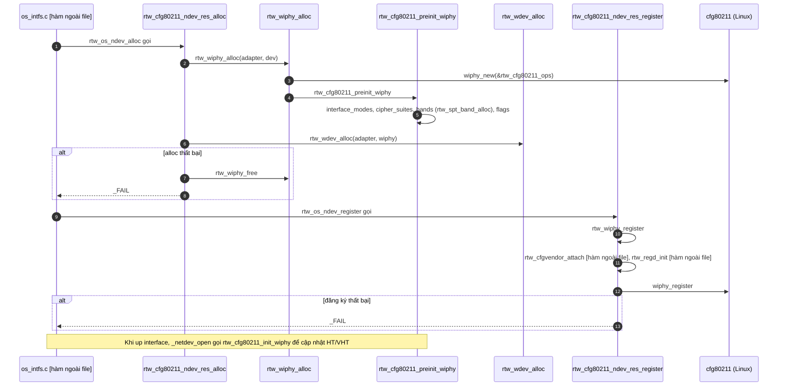

Đây là bản vẽ lại ở mức chức năng, bỏ hết tên hàm/code, chỉ giữ lại "ai làm gì, để làm gì":

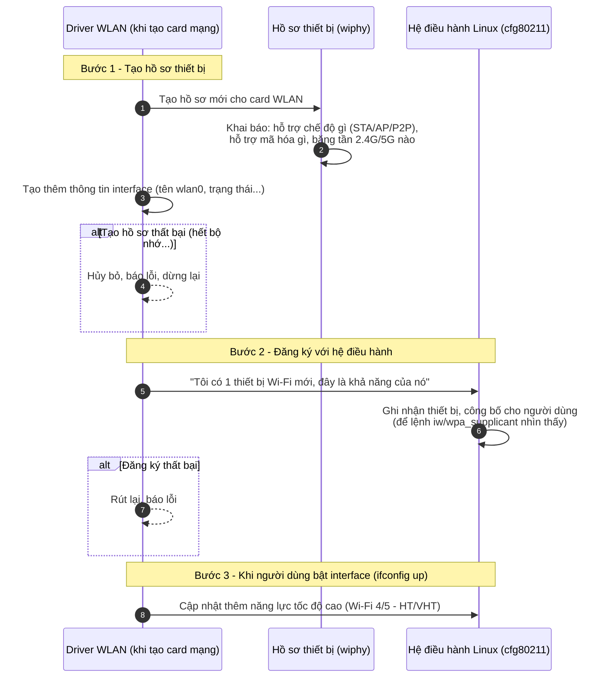

**Tóm tắt bằng lời cho người mới:**

1. **Tạo hồ sơ thiết bị**: Khi driver khởi động card Wi-Fi, nó phải "khai báo" với Linux card này làm được gì — chạy chế độ Client hay Access Point, hỗ trợ mã hóa WPA2/WPA3 nào, dùng băng tần 2.4GHz hay 5GHz.
2. **Đăng ký với hệ điều hành**: Sau khi khai báo xong, driver "nộp hồ sơ" cho Linux để hệ thống công nhận sự tồn tại của thiết bị — từ lúc này các lệnh như `iw`, `wpa_supplicant` mới "nhìn thấy" được Wi-Fi này.
3. **Cập nhật khi bật interface**: Khi người dùng thực sự bật card (`ifconfig wlan0 up`), driver bổ sung thêm thông tin về tốc độ cao (Wi-Fi 4/5) vì lúc này mới biết chính xác phần cứng hỗ trợ bao nhiêu anten.

Nếu bước nào thất bại (hết bộ nhớ, đăng ký lỗi...) thì driver sẽ dọn dẹp những gì đã tạo và báo lỗi ra ngoài, không để sót tài nguyên.


---

### Sequence 2: Quét Wi-Fi (scan)

**A. Mục đích.** Người dùng muốn danh sách mạng xung quanh (`iw dev wlan0 scan`).

**B. Các bước**
1. **Linux gọi callback** `cfg80211_rtw_scan` kèm danh sách SSID và kênh cần quét (`cfg80211_scan_request`).
2. **Xác định adapter.** Hàm suy ra `padapter` từ `request->wdev`.
3. **Kiểm tra có được quét không.** `rtw_sitesurvey_condition_check` [hàm ngoài file] trả một mã. Có hai nhóm kết quả:
   - **Từ chối bằng lỗi:** MP mode, đang bận, đang linking... → trả `-EPERM` hoặc `-EBUSY`, Linux nhận lỗi.
   - **Chấp nhận:** `SS_ALLOW`.
4. **Trường hợp "giả vờ quét xong".** Với vài mã (ví dụ đang quét sẵn ở interface kia mà không dùng lại được) hàm đặt `need_indicate_scan_done`, rồi nhảy tới `check_need_indicate_scan_done`: gọi `_rtw_cfg80211_surveydone_event_callback` đẩy kết quả cũ lên Linux và `cfg80211_scan_done(aborted = 0)`.
5. **Mượn quét của interface bạn.** Với `SS_DENY_BUDDY_UNDER_SURVEY`, `rtw_cfg80211_scan_via_buddy` cho interface này "đi nhờ" cuộc quét đang chạy của interface kia (`CONFIG_CONCURRENT_MODE`).
6. **Chuẩn bị quét.** `rtw_ps_deny(PS_DENY_SCAN)` cấm chip ngủ, `rtw_pwr_wakeup` đánh thức. Nếu `request->ie` có dữ liệu thì `rtw_cfg80211_set_probe_req_wpsp2pie` lưu IE WPS/P2P để chèn vào probe request. Nếu SSID bắt đầu bằng `DIRECT-` và có P2P IE thì chuyển P2P sang trạng thái LISTEN.
7. **Đóng gói tham số.** `rtw_init_sitesurvey_parm` rồi chép danh sách SSID và kênh vào `struct sitesurvey_parm`. Nếu chỉ 1 kênh thì lặp 6 lần, nếu ≤ 4 kênh thì mỗi kênh lặp 3 lần.
8. **Bắt đầu quét thật.** `rtw_sitesurvey_cmd(padapter, &parm)` [hàm ngoài file] đưa lệnh vào hàng đợi cmd thread. Nếu thành công, lưu `pwdev_priv->scan_request = request`. Hàm cfg80211 trả 0 ngay, việc quét tiếp tục **bất đồng bộ**.
9. **Có kết quả.** Ở lõi, khi quét xong, `rtw_mlme.c` gọi `rtw_cfg80211_surveydone_event_callback` (file này, [rtw_mlme.c:1494,3060]). Hàm duyệt `scanned_queue`, lọc kênh/băng/SSID hợp lệ rồi gọi `rtw_cfg80211_inform_bss` cho từng mạng (nó gọi `cfg80211_inform_bss_frame`) để Linux lưu BSS.
10. **Báo xong.** Lõi gọi `rtw_indicate_scan_done` → `rtw_os_indicate_scan_done` ([mlme_linux.c:134]) → `rtw_cfg80211_indicate_scan_done(adapter, aborted)`. Hàm này lấy `scan_request` trong khóa rồi gọi `cfg80211_scan_done`. Sau đó Linux cho `iw`/`wpa_supplicant` đọc danh sách.
11. **Hủy.** `aborted = TRUE` khi lõi gọi `rtw_scan_abort` (ví dụ lúc `netdev_close`, `connect`) hoặc `rtw_wdev_unregister` dọn dẹp. `rtw_cfg80211_wait_scan_req_empty` chờ `scan_request` về NULL (tối đa theo timeout).

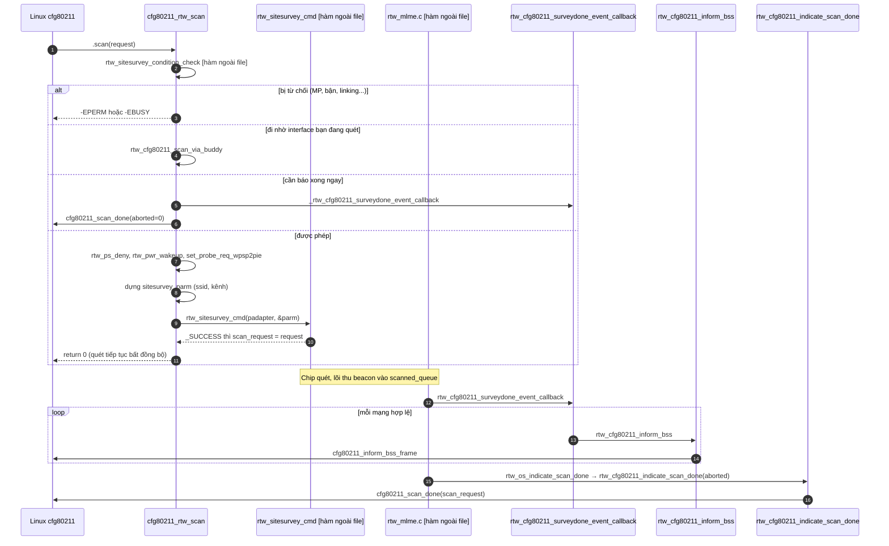

Bản vẽ lại ở mức chức năng cho luồng "Quét Wi-Fi":

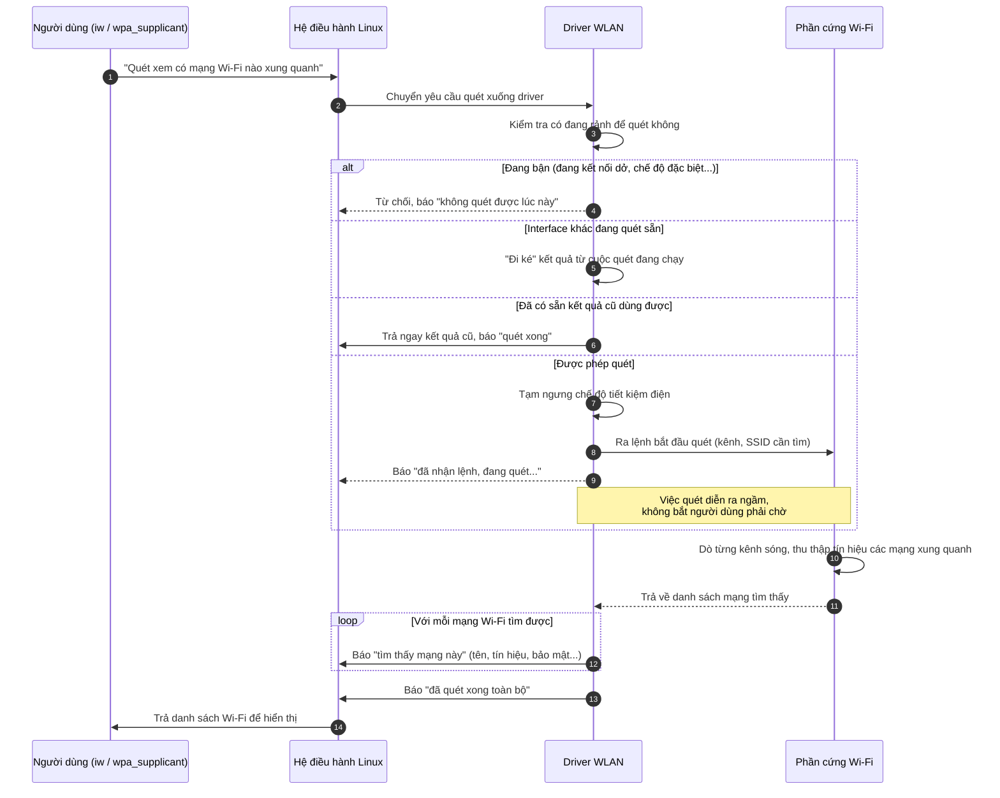

**Tóm tắt bằng lời cho người mới:**

1. **Người dùng yêu cầu quét** (bấm "tìm Wi-Fi" hoặc chạy lệnh `iw scan`).
2. **Driver kiểm tra điều kiện** trước khi quét — nếu đang bận việc khác (đang kết nối, đang ở chế độ đặc biệt) thì từ chối luôn; nếu đã có người khác quét sẵn thì "đi ké" kết quả thay vì quét lại; nếu có kết quả cũ dùng tạm được thì trả ngay không cần quét mới.
3. **Nếu được phép**, driver tạm tắt chế độ tiết kiệm điện (để sóng wifi hoạt động ổn định hơn khi quét), rồi ra lệnh cho con chip Wi-Fi thực sự "dò sóng" — nhưng **không bắt người dùng đợi**, driver trả lời ngay "đã nhận lệnh" rồi làm việc quét ngầm phía sau.
4. **Khi chip dò xong** từng mạng Wi-Fi tìm thấy sẽ được báo dần lên Linux (giống như cập nhật kết quả từng dòng một).
5. **Khi quét xong toàn bộ**, driver báo "hoàn tất" để Linux tổng hợp danh sách trả về cho người dùng xem.

---

### Sequence 3: Kết nối Wi-Fi

Source có **hai đường**, vì `rtw_cfg80211_ops` đăng ký cả `.connect` và `.auth/.assoc`. Đường nào được dùng **phụ thuộc cách `wpa_supplicant` chọn, không xác minh được từ file này**.

#### 3a. Đường `.connect` (driver làm hết, Linux chỉ nhận kết quả)

**A. Mục đích.** Linux đưa SSID và thông tin bảo mật, driver tự kết nối.

**B. Các bước**
1. **Linux gọi** `cfg80211_rtw_connect(wiphy, ndev, sme)`.
2. **Dọn tình trạng cũ.** Nếu đang `WIFI_ASOC_STATE` hoặc `WIFI_UNDER_LINKING` thì gọi `_rtw_disconnect` trước. Kiểm tra SSID hợp lệ, độ dài ≤ `IW_ESSID_MAX_SIZE`.
3. **Chuẩn bị.** `rtw_ps_deny(PS_DENY_JOIN)`, `rtw_pwr_wakeup`, `rtw_mi_scan_abort` (hủy quét), `rtw_join_abort_timeout`.
4. **Đổi thông tin bảo mật của Linux sang dạng của driver:** `rtw_cfg80211_set_wpa_version`, `rtw_cfg80211_set_auth_type`, `rtw_cfg80211_set_wpa_ie` (đọc IE RSN/WPA), `rtw_cfg80211_set_cipher` (pairwise rồi group), `rtw_cfg80211_set_key_mgt`. Nếu có khóa WEP thì gọi `rtw_set_802_11_add_wep`.
5. **Ra lệnh join.** `rtw_set_802_11_authentication_mode`, sau đó `rtw_set_802_11_connect(padapter, bssid, &ndis_ssid)` [hàm ngoài file]. Hàm này bắt đầu tìm trong danh sách đã quét và gửi lệnh join cho cmd thread.
6. **Lưu yêu cầu.** Copy `sme` vào `pwdev_priv->connect_req` (trong khóa `connect_req_lock`) để sau này biết có đang chờ kết quả kết nối không. Trả 0.
7. **Chip xong việc (bất đồng bộ).** Lõi gọi `rtw_os_indicate_connect` ([mlme_linux.c:106-108]) → `rtw_cfg80211_indicate_connect` (xem Sequence 4).
8. **Lỗi.** Bước nào thất bại thì `goto cancel_ps_deny` để nhả `PS_DENY_JOIN` rồi trả lỗi. Nhánh `cipher_group` lỗi trả `ret` **không** qua `cancel_ps_deny`, nên `PS_DENY_JOIN` có thể không được nhả. Đây là quan sát từ source, chưa kiểm chứng ảnh hưởng.

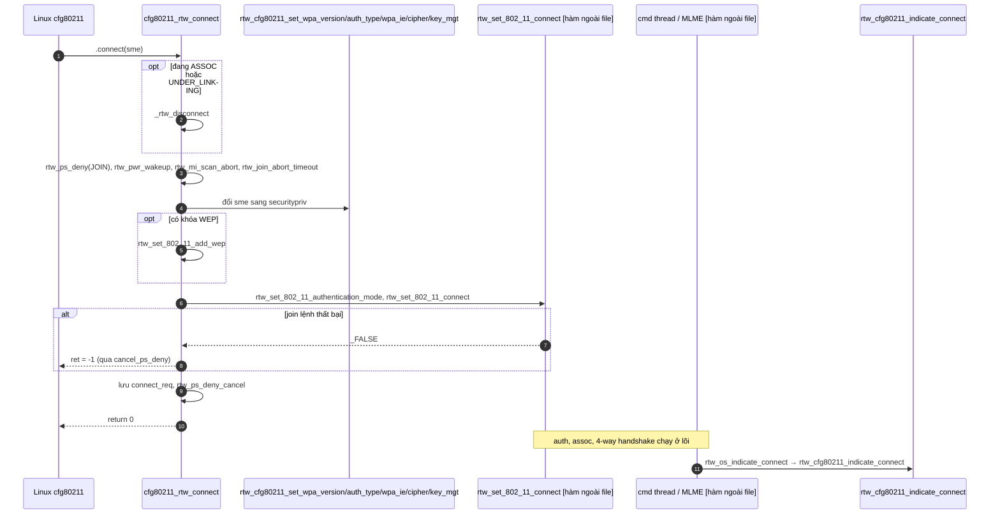

Bản vẽ lại ở mức chức năng cho luồng "Kết nối Wi-Fi":

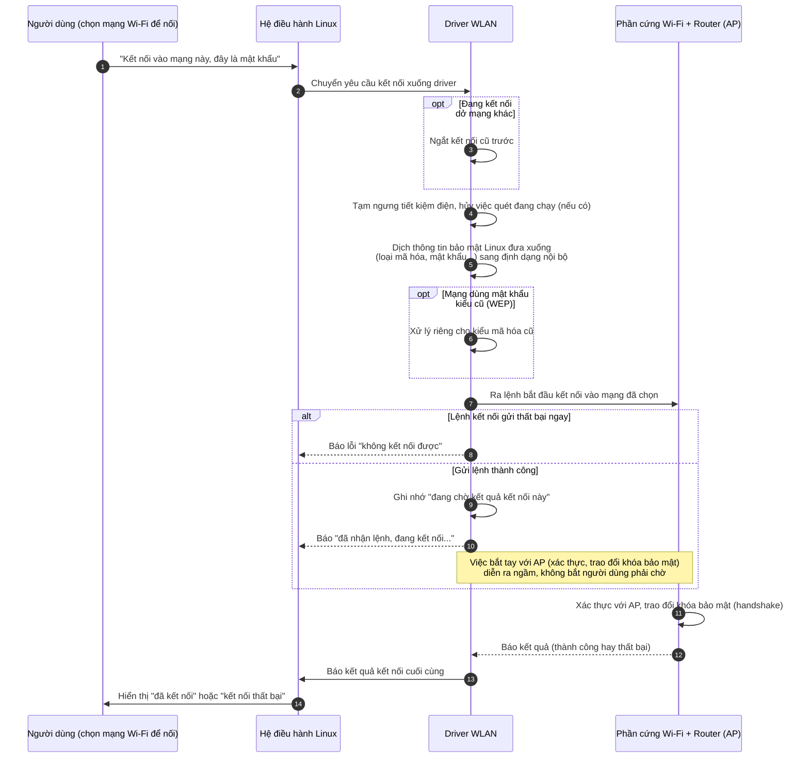

**Tóm tắt bằng lời cho người mới:**

1. **Người dùng chọn mạng Wi-Fi** và nhập mật khẩu (qua giao diện chọn Wi-Fi hoặc `wpa_supplicant`).
2. **Nếu đang kết nối dở một mạng khác**, driver sẽ ngắt kết nối cũ trước khi làm việc mới — tránh chồng chéo.
3. **Driver chuẩn bị:** tạm ngưng tiết kiệm điện (để kết nối ổn định hơn), hủy việc quét đang chạy nếu có, rồi "dịch" thông tin bảo mật (loại mã hóa WPA2/WPA3, mật khẩu...) từ định dạng chuẩn của Linux sang định dạng mà chip hiểu được.
4. **Driver ra lệnh cho chip** bắt đầu kết nối — nhưng **không bắt người dùng đợi lâu**: nếu gửi lệnh thành công, driver trả lời ngay "đã nhận lệnh, đang xử lý" và ghi nhớ lại để biết sau này cần báo kết quả cho ai.
5. **Việc "bắt tay" thực sự với router** (xác thực danh tính, trao đổi khóa mã hóa 4 bước) diễn ra ngầm phía sau, không liên quan trực tiếp tới bước gọi lệnh ban đầu.
6. **Khi có kết quả cuối cùng** (nối được hay thất bại), driver mới báo ngược lại cho Linux, và Linux hiển thị cho người dùng biết.

#### 3b. Đường SME offload (`.auth` rồi `.assoc`)

**A. Mục đích.** Linux (wpa_supplicant) tự điều phối từng bước auth/assoc, driver chỉ gửi và nhận frame. Cần cho WPA3-SAE (source ghi chú `NL80211_FEATURE_SAE`).

**B. Các bước**
1. **`cfg80211_rtw_auth(req)`.** Tạo dữ liệu auth bằng `cfg80211_rtw_alloc_auth_data` (SSID/kênh/thuật toán, gồm SAE). Cấm ngủ chip. Đặt `mlme_priv->cfg80211_offload_sta_sme = 1` (đây là cờ phân biệt hai đường). Bật timer `cfg80211_auth_timer`.
2. **Gửi frame auth.** Vòng lặp tối đa 3 lần: `rtw_mi_set_scan_deny`, `rtw_mi_scan_abort`, rồi `cfg80211_rtw_send_auth`. Hàm này gọi `cfg80211_build_auth_frame` và `issue_tx_param` [hàm ngoài file].
3. **Nhận trả lời auth.** Lõi nhận frame auth từ AP: `cfg80211_rtw_send_auth_challenge` / `cfg80211_rx_mlme_mgmt` ([rtw_mlme_ext.c:2602-2629]) [hàm ngoài file], đẩy lên Linux để supplicant xử lý SAE/WPA.
4. **Quá hạn.** `rtw_cfg80211_auth_timeout_handler` [hàm ngoài file, rtw_mlme.c] gọi `cfg80211_auth_timeout`.
5. **`cfg80211_rtw_assoc(req)`.** Gọi `cfg80211_rtw_pre_assoc` trước.
6. **`cfg80211_rtw_pre_assoc`.** Lấy SSID từ IE của BSS, dựng `cfg80211_connect_params`, rồi **gọi lại `cfg80211_rtw_connect`**. Tiếp đó gọi `rtw_joinbss_cmd(padapter, assoc_cand)` và chờ `rtw_sctx_wait(&join_cmd_sctx)`. Đặt các cờ trạng thái `WIFI_FW_AUTH_SUCCESS | WIFI_FW_ASSOC_STATE`. Chú ý lời nhắc của source: không gọi `rtw_joinbss_cmd` trực tiếp trong ngữ cảnh atomic nên đi qua `connect`.
7. **Gửi assoc request.** Lưu `cfg80211_assoc_bss`, bật `cfg80211_assoc_timer`, vòng lặp ≤ 3 lần `cfg80211_rtw_send_assoc_req`.
8. **Nhận assoc response.** Lõi gọi `cfg80211_rx_assoc_resp` ([rtw_mlme_ext.c:3307-3313]) [hàm ngoài file]. Nếu không thấy trả lời thì `rtw_cfg80211_assoc_timeout_handler` [hàm ngoài file] gọi `cfg80211_assoc_timeout`.
9. **Báo kết nối.** `rtw_cfg80211_indicate_connect` **không** gọi `connect_result` khi `cfg80211_offload_sta_sme` đang bật ([ioctl_cfg80211.c:1237]), vì Linux đã biết kết quả từ `cfg80211_rx_assoc_resp`.

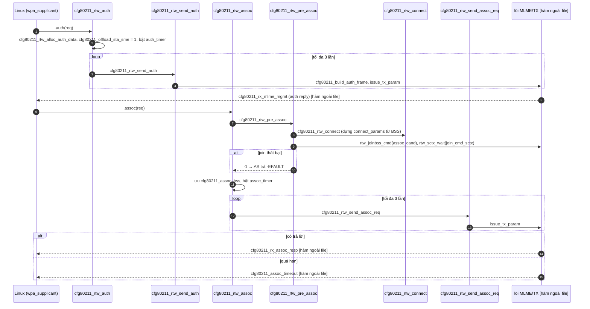

Bản vẽ lại ở mức chức năng cho luồng "Kết nối Wi-Fi kiểu nâng cao (WPA3)":

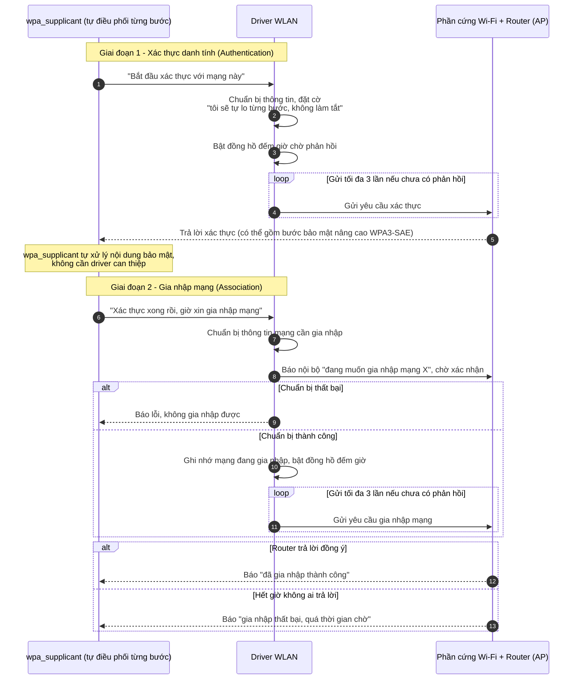

**Tóm tắt bằng lời cho người mới:**

Đây là kiểu kết nối Wi-Fi "nâng cao hơn" so với luồng kết nối thông thường đã giải thích trước đó — thường dùng cho các mạng bảo mật mới (WPA3) cần nhiều bước bắt tay phức tạp hơn. Điểm khác biệt chính: **`wpa_supplicant` (phần mềm quản lý Wi-Fi) tự cầm trịch từng bước**, chứ không giao hết cho driver như trước.

1. **Bước 1 - Xác thực (Authentication):** `wpa_supplicant` yêu cầu driver "nói chuyện" với router trước để xác thực danh tính. Driver chỉ đóng vai trò đưa thư đi — gửi yêu cầu, nhận thư trả lời rồi chuyển nguyên văn cho `wpa_supplicant` xử lý (vì có thể cần tính toán bảo mật phức tạp mà driver không rành).
2. **Bước 2 - Gia nhập mạng (Association):** Sau khi xác thực xong, `wpa_supplicant` yêu cầu driver tiếp tục "xin phép" gia nhập chính thức vào mạng đó. Driver chuẩn bị thông tin cần thiết, báo nội bộ hệ thống biết mình đang làm gì, rồi mới thật sự gửi yêu cầu lên router.
3. **Chờ phản hồi có giới hạn thời gian:** Cả hai bước đều có "đồng hồ đếm giờ" — nếu gửi 3 lần mà router không phản hồi thì coi như thất bại, báo lỗi "quá thời gian chờ" thay vì chờ mãi.
4. **Kết quả cuối cùng** được báo thẳng cho `wpa_supplicant` (không qua driver báo "đã kết nối" như luồng cũ), vì `wpa_supplicant` đã tự theo dõi toàn bộ quá trình từ đầu.

---

### Sequence 4: Báo kết nối thành công, mất kết nối và ngắt kết nối

**A. Mục đích.** Báo cho Linux trạng thái liên kết, và ngắt kết nối theo yêu cầu.

**B. Các bước**

*Kết nối thành công:*
1. Lõi gọi `rtw_os_indicate_connect(adapter)` ([mlme_linux.c:106-108]) → chọn `rtw_cfg80211_ibss_indicate_connect` (Ad-hoc) hoặc `rtw_cfg80211_indicate_connect`.
2. **`rtw_cfg80211_indicate_connect`.** Chỉ chạy cho STATION/P2P_CLIENT. Nếu chưa có BSS trong cache cfg80211 thì gọi `rtw_cfg80211_inform_bss(scanned)`, rồi `rtw_cfg80211_check_bss`.
3. **Roaming hay kết nối mới?** Nếu `rtw_to_roam(padapter) > 0` thì gọi `cfg80211_roamed` (kèm assoc req/resp IE). Ngược lại gọi `rtw_cfg80211_connect_result(... WLAN_STATUS_SUCCESS)`, trừ khi đã offload SME (bước 9 ở 3b).
4. Cuối cùng `rtw_wdev_free_connect_req` xóa yêu cầu đã lưu.

*Mất kết nối do driver phát hiện, hoặc do người dùng yêu cầu:*
5. **Người dùng yêu cầu:** Linux gọi `cfg80211_rtw_disconnect(reason)`. Hàm gọi `rtw_set_to_roam(0)` rồi `_rtw_disconnect`.
6. **`_rtw_disconnect`.** `rtw_scan_abort` → `rtw_join_abort_timeout(300)` → `LeaveAllPowerSaveMode` → `rtw_disassoc_cmd(500, WAIT_ACK)` → `rtw_free_assoc_resources_cmd` → `rtw_indicate_disconnect` → `rtw_pwr_wakeup`.
7. **Báo ngược:** `rtw_indicate_disconnect` → `rtw_os_indicate_disconnect` ([mlme_linux.c:207]) → `rtw_cfg80211_indicate_disconnect(reason, locally_generated)`.
8. **`rtw_cfg80211_indicate_disconnect`** chọn cách báo:
   - **Có offload SME và `deauth_from_wpas == 0`** (mạng tự rớt): dựng frame deauth giả rồi `cfg80211_tx_mlme_mgmt`.
   - **Có offload SME và `deauth_from_wpas == 1`** (do supplicant yêu cầu): `rtw_cfg80211_disconnected`.
   - **Không offload:** nếu `connect_req` còn thì `rtw_cfg80211_connect_result(thất bại)`, ngược lại `rtw_cfg80211_disconnected`. Bị chặn nếu `rtw_wdev_not_indic_disco` đang bật hoặc interface đang bị hủy.
9. **Đường SME-offload ngắt kết nối:** `cfg80211_rtw_deauth` đặt `deauth_from_wpas = 1`, gọi `cfg80211_rtw_disconnect`, rồi (nếu không phải `local_state_change`) dựng và gửi frame deauth bằng `build_deauth` + `issue_tx_param`. `cfg80211_rtw_disassoc` làm tương tự với `build_disassoc`.

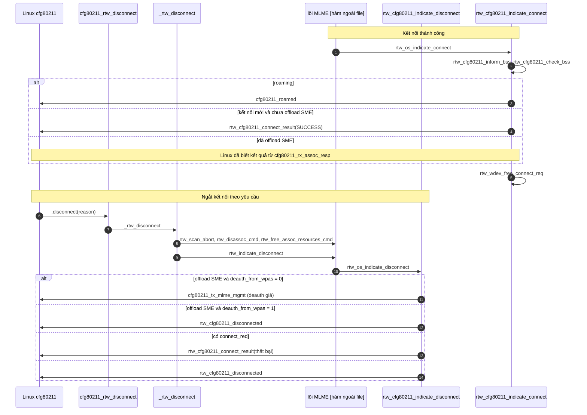

---

### Sequence 5: Thiết lập khóa bảo mật

**A. Mục đích.** Sau 4-way handshake, supplicant cài PTK/GTK/IGTK vào driver để mã hóa dữ liệu.

**B. Các bước**
1. **Linux gọi** `cfg80211_rtw_add_key(key_index, pairwise, mac_addr, params)`.
2. **Đồng bộ chế độ.** `rtw_cfg80211_sync_iftype`: nếu `wdev->iftype` lệch trạng thái MLME thì tự đổi chế độ qua `rtw_set_802_11_infrastructure_mode` và `rtw_setopmode_cmd`.
3. **Chuyển sang định dạng nội bộ.** Tạo `struct ieee_param`, đổi `cipher` sang tên thuật toán (`WEP`, `TKIP`, `CCMP`, `GCMP`, `BIP`...). Đặt `set_tx = 1` cho khóa unicast (pairwise), `set_tx = 0` cho khóa nhóm.
4. **Rẽ theo chế độ hiện tại.**
   - **STATION hoặc Ad-hoc:** `rtw_cfg80211_set_encryption`.
   - **AP:** `rtw_cfg80211_ap_set_encryption`.
   - Trạng thái khác: log lỗi `error! fw_state=...` và không cài khóa.
5. **Bên trong `rtw_cfg80211_set_encryption`** (chỉ đọc phần đầu): WEP thì lưu vào `dot11DefKey` rồi `rtw_set_key`. Với 802.1X, hàm xử lý theo station/bcmc; phần còn lại chưa đọc nên chưa mô tả.
6. `cfg80211_rtw_set_default_key` chỉ đặt cờ WEP default key. `cfg80211_rtw_del_key` **chỉ xóa cờ `bWepDefaultKeyIdxSet`**, không thấy gọi xuống xóa khóa phần cứng ở hàm này. `set_pmksa`/`del_pmksa`/`flush_pmksa` quản lý danh sách PMKID trong `securitypriv->PMKIDList` (để kết nối lại nhanh).

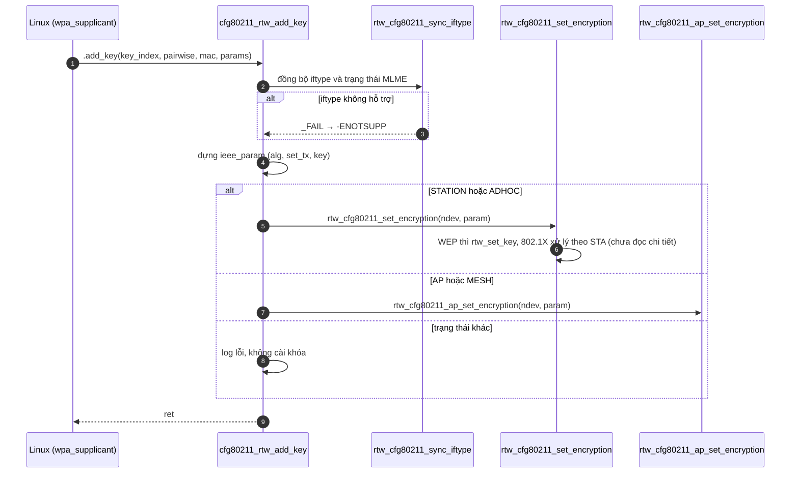

---

### Sequence 6: Chạy AP

**A. Mục đích.** Biến interface thành AP (`hostapd`) và quản lý client.

**B. Các bước**
1. **Đổi chế độ.** `hostapd` yêu cầu `change_virtual_intf` → `cfg80211_rtw_change_iface(type = AP)`: kiểm tra `processing_dev_remove`, gọi `netdev_open` [hàm ngoài file], `rtw_pwr_wakeup`, đổi `networkType = Ndis802_11APMode`, `rtw_wdev->iftype = type`, rồi `rtw_set_802_11_infrastructure_mode` và `rtw_setopmode_cmd`. (Cùng hàm này xử lý STATION, Ad-hoc, P2P client/GO.)
2. **Khởi động.** Linux gọi `cfg80211_rtw_start_ap(settings)` (kernel ≥ 3.4 dùng nhóm hàm này). Hàm `rtw_cfg80211_sync_iftype`, `rtw_mi_scan_abort`, `rtw_mi_buddy_set_scan_deny(300)`, rồi `rtw_add_beacon`.
3. **`rtw_add_beacon`.** Yêu cầu `WIFI_AP_STATE`, ghép `head + tail` thành beacon, tìm WPS IE/P2P IE (và bật vai trò GO nếu có P2P IE), rồi gọi `rtw_check_beacon_data` [hàm ngoài file] để lõi bắt đầu phát beacon. Sau đó `start_ap` đặt `hidden_ssid_mode` và SSID.
4. **Cập nhật.** `cfg80211_rtw_change_beacon` gọi lại `rtw_add_beacon` khi beacon đổi.
5. **Client nối vào.** Vì `SME_OFFLOAD` bật, **AP SME do userspace lo**: `hostapd` nhận frame auth/assoc qua mgmt frame (`rtw_cfg80211_rx_mgmt`) và trả lời bằng `cfg80211_rtw_mgmt_tx`. Khi lõi chấp nhận station, `rtw_mlme.c` gọi `rtw_cfg80211_indicate_sta_assoc` → `cfg80211_new_sta` (nhánh `RTW_USE_CFG80211_STA_EVENT`).
6. **Client rời đi.** Lõi (`rtw_ap.c`, `rtw_mlme.c`) gọi `rtw_cfg80211_indicate_sta_disassoc` → `cfg80211_del_sta`.
7. **Dừng.** `cfg80211_rtw_stop_ap` → `rtw_stop_ap_cmd(RTW_CMDF_WAIT_ACK)` [hàm ngoài file].
8. **Cấu hình khác** (chỉ ghi nhận có tồn tại): `add_station`/`del_station`/`change_station`/`dump_station`/`change_bss`/`set_txq_params`, `set_mac_acl` (chỉ biên dịch nếu `CONFIG_RTW_MACADDR_ACL`, và `max_acl_mac_addrs` bị đặt về 0 khi SME offload).

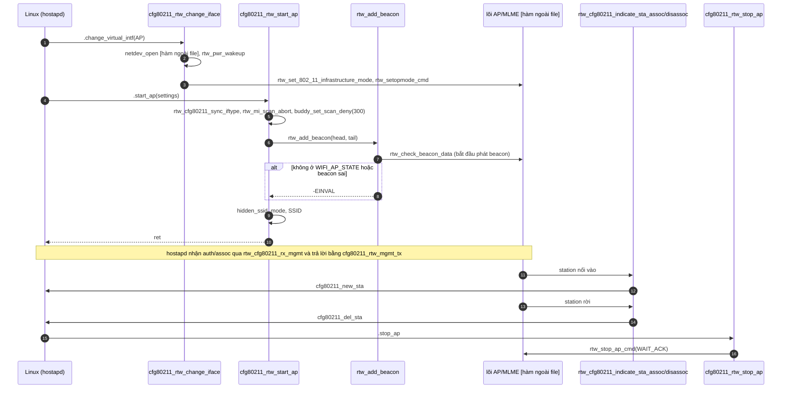

---

### Sequence 7: Đổi chế độ, tạo và xóa interface ảo

**A. Mục đích.** Đổi loại interface (STA↔AP↔P2P↔Ad-hoc) hoặc tạo/xóa interface mới (`iw dev wlan0 interface add`).

**B. Các bước**
1. **Đổi chế độ:** xem bước 1 ở Sequence 6. Với **Monitor** thì thêm `rtw_ps_deny(PS_DENY_MONITOR_MODE)` và `LeaveAllPowerSaveMode`; rời Monitor thì nhả lại.
2. **Tạo mới:** Linux gọi `cfg80211_rtw_add_virtual_intf(name, type)`. Hàm đặt `rtw_set_rtnl_lock_holder(dvobj, current)` để các hàm bên dưới biết `rtnl` đã được giữ.
3. **Phân loại `type`:**
   - **MONITOR:** `rtw_cfg80211_add_monitor_if` cấp `net_device` riêng (loại `ARPHRD_IEEE80211_RADIOTAP`) và lưu vào `pwdev_priv->pmon_ndev`. Mỗi adapter chỉ có một monitor (đã có thì `-EBUSY`). Lưu ý: vì wiphy **không công bố** Monitor trong `interface_modes` nên theo suy luận từ source, cfg80211 có thể từ chối yêu cầu này trước khi tới hàm, chưa kiểm chứng.
   - **STATION / AP / P2P client / P2P GO:** `dvobj_get_unregisterd_adapter` [hàm ngoài file] lấy một adapter chưa đăng ký, rồi `rtw_os_ndev_init(padapter, name)` [hàm ngoài file] để tạo `net_device`. Nếu là P2P thì `rtw_p2p_enable(P2P_ROLE_DEVICE)`. Với `CONFIG_IFACE_NUMBER = 2` và cả hai adapter đã đăng ký lúc probe, khả năng cao hàm này trả `-ENODEV` ("adapter pool empty"). Đây là suy luận từ cấu trúc code, chưa chạy thử.
   - Loại khác (Ad-hoc, WDS, AP_VLAN): `-ENODEV`. `P2P_DEVICE` không có vì `RTW_DEDICATED_P2P_DEVICE` tắt.
4. **Xóa:** `cfg80211_rtw_del_virtual_intf`: nếu là monitor thì `unregister_netdevice` và xóa `pmon_ndev`, ngược lại `rtw_os_ndev_unregister(adapter)`.

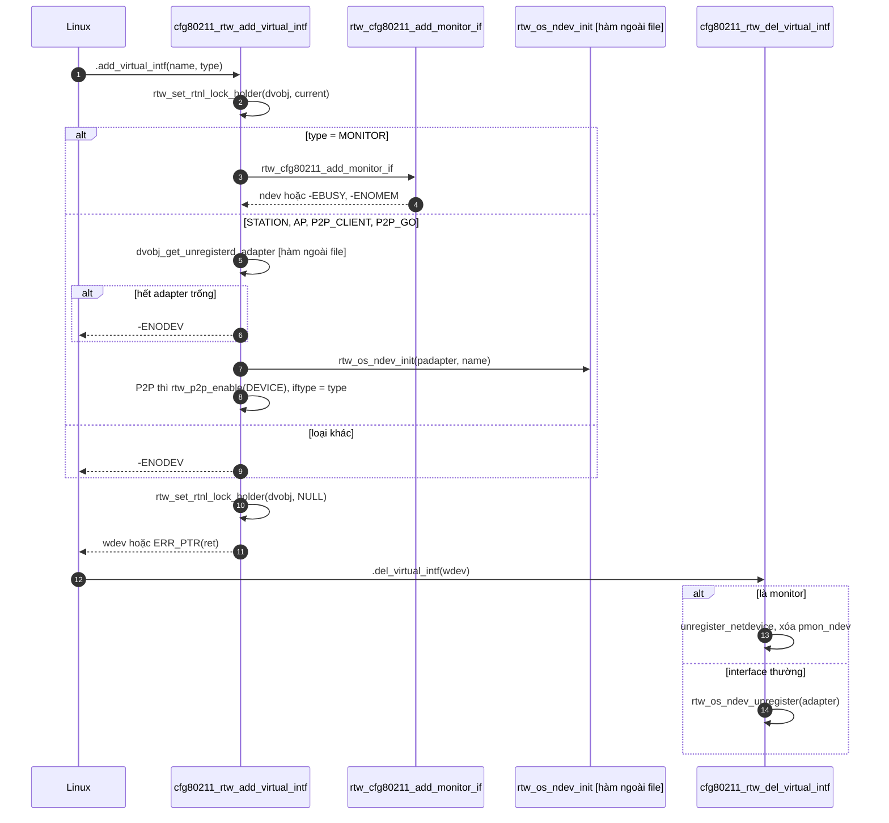

---

### Sequence 8: P2P và gửi/nhận mgmt frame

**A. Mục đích.** Gửi action frame (P2P, SAE, DPP, ...) và "đậu" tại một kênh để lắng nghe.

**B. Các bước**
1. **`cfg80211_rtw_remain_on_channel`.** Linux yêu cầu ở lại kênh X trong Y ms. Hàm sinh `cookie`, kiểm tra kênh hợp lệ (`rtw_chset_search_ch`), chặn nếu MP mode, `rtw_pwr_wakeup`, `rtw_scan_abort`, đặt trạng thái P2P (`P2P_STATE_LISTEN`), lưu thông tin vào `cfg80211_wdinfo`, gửi lệnh `p2p_roch_cmd` [hàm ngoài file], rồi báo ngay `rtw_cfg80211_ready_on_channel`.
2. **Khi hết thời gian.** Lõi `rtw_p2p.c` [hàm ngoài file] gọi `rtw_cfg80211_remain_on_channel_expired`. Hoặc Linux hủy sớm bằng `cfg80211_rtw_cancel_remain_on_channel`.
3. **Gửi frame:** `cfg80211_rtw_mgmt_tx` (Linux đưa buffer frame). Hàm phân loại frame (SAE/DPP/P2P/action thường), cấm ngủ, `rtw_pwr_wakeup`, rồi lặp gửi `rtw_mgnt_tx_cmd(... wait_ack ...)` tối đa vài lần với thời gian chờ. Có nhánh riêng cho DPP (báo ngay) và P2P (đặt scan-deny). Kết thúc bằng `rtw_cfg80211_mgmt_tx_status(cookie, ack)` để Linux biết gửi có được ACK không.
4. **Đăng ký nhận loại frame nào.** Linux gọi `cfg80211_rtw_update_mgmt_frame_register` (kernel ≥ 5.8). Hàm lưu mặt nạ stype vào `pwdev_priv->mgmt_regs` (ví dụ AUTH, ASSOC_REQ, PROBE_REQ, ACTION...), để lõi biết cần chuyển loại frame nào lên.
5. **Nhận frame.** Lõi gọi các hàm `rtw_cfg80211_rx_*` (`rx_mframe`, `rx_probe_request`, `rx_action`, `rx_action_p2p`, `rx_rrm_action`...). Chúng tính tần số từ kênh rồi gọi `rtw_cfg80211_rx_mgmt` (đẩy frame lên Linux).

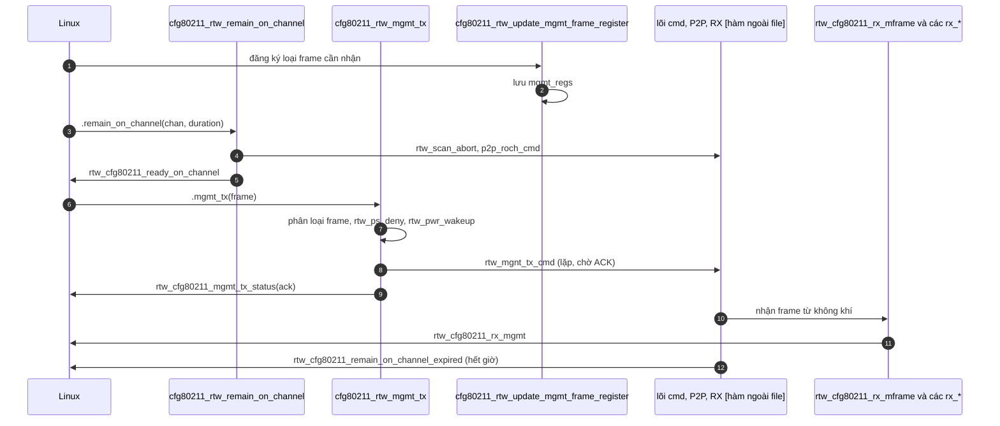

---

### Sequence 9: Cấu hình khác và thông báo bổ sung

- **Công suất phát:** `cfg80211_rtw_set_txpower` chỉ log rồi `return 0`, **không đổi gì**. `cfg80211_rtw_get_txpower` trả cứng `12` dBm.
- **`cfg80211_rtw_set_wiphy_params`** (RTS/fragment...): chỉ log rồi trả 0.
- **Tiết kiệm điện:** `cfg80211_rtw_set_power_mgmt` lưu `power_mgmt`, và nếu tắt thì gọi `rtw_lps_ctrl_wk_cmd(LPS_CTRL_LEAVE_CFG80211_PWRMGMT)` (chỉ khi `CONFIG_LPS`). `rtw_cfg80211_pwr_mgmt` cho lõi đọc lại giá trị này.
- **Thống kê station:** `cfg80211_rtw_get_station` điền RSSI, bitrate, inactive time, số gói tx/rx cho `iw station dump`.
- **Kênh:** `cfg80211_rtw_set_monitor_channel` gọi `rtw_set_chbw_cmd`, `cfg80211_rtw_get_channel` trả kênh hiện tại, `rtw_cfg80211_ch_switch_notify` (được gọi từ `rtw_ap.c`, `rtw_mlme_ext.c`) báo Linux đã đổi kênh (`cfg80211_ch_switch_notify`).
- **Ad-hoc:** `cfg80211_rtw_join_ibss` đặt auth Open, kênh, rồi `rtw_set_802_11_ssid`. `cfg80211_rtw_leave_ibss` đưa về STATION (`rtw_set_802_11_infrastructure_mode`, `rtw_setopmode_cmd`). Kết quả báo bằng `rtw_cfg80211_ibss_indicate_connect` → `cfg80211_ibss_joined`.

---

### Sequence 10: Giải phóng tài nguyên

**A. Mục đích.** Hủy đăng ký và dọn dẹp lúc gỡ interface.

**B. Các bước**
1. **Lớp OS gọi** `rtw_os_ndev_unregister` ([os_intfs.c]) rồi các hàm hủy của file này.
2. **`rtw_cfg80211_ndev_res_unregister`** → `rtw_wdev_unregister(wdev)`: gọi `rtw_cfg80211_indicate_scan_done(adapter, TRUE)` để hủy scan còn treo, nếu `wdev->current_bss` còn thì `rtw_cfg80211_indicate_disconnect(adapter, 0, 1)` (xóa `current_bss`), và hủy monitor ndev nếu có.
3. **Hủy `wiphy`.** Lớp OS gọi tiếp `rtw_wiphy_unregister` [hàm trong file này]: `rtw_cfgvendor_detach` [hàm ngoài file], rồi `wiphy_unregister`.
4. **Giải phóng bộ nhớ.** `rtw_cfg80211_ndev_res_free` → `rtw_wdev_free` (hủy khóa, `rtw_wdev_free_connect_req`, free `wdev`) và `rtw_wiphy_free` (free các `band`, `wiphy_free`).
5. **Lỗi lúc đăng ký.** `rtw_os_ndev_register` ([os_intfs.c]) gọi `rtw_cfg80211_ndev_res_unregister` và `rtw_wiphy_unregister` để rút lại phần đã đăng ký.

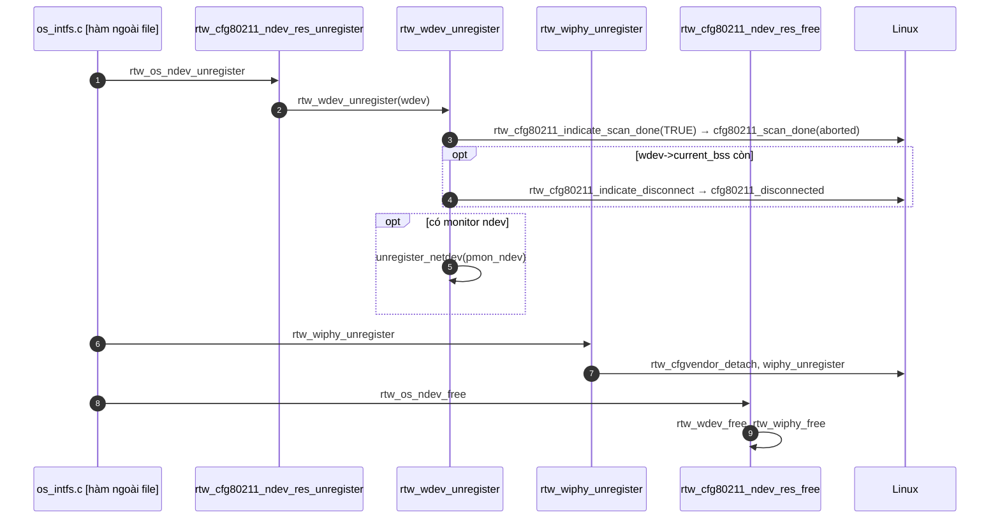

---

## 4. Tổng kết

**Bộ phận nào trong driver?** Đây là **"quầy lễ tân giao tiếp với hệ điều hành"** của phần Wi-Fi. Nó dịch ngôn ngữ chuẩn của Linux (cfg80211) sang ngôn ngữ nội bộ của Realtek, nhờ phòng làm việc phía sau (`core/`, `hal/`) thực hiện, và đưa kết quả trở lại cho Linux.

**Sơ đồ tổng quan**

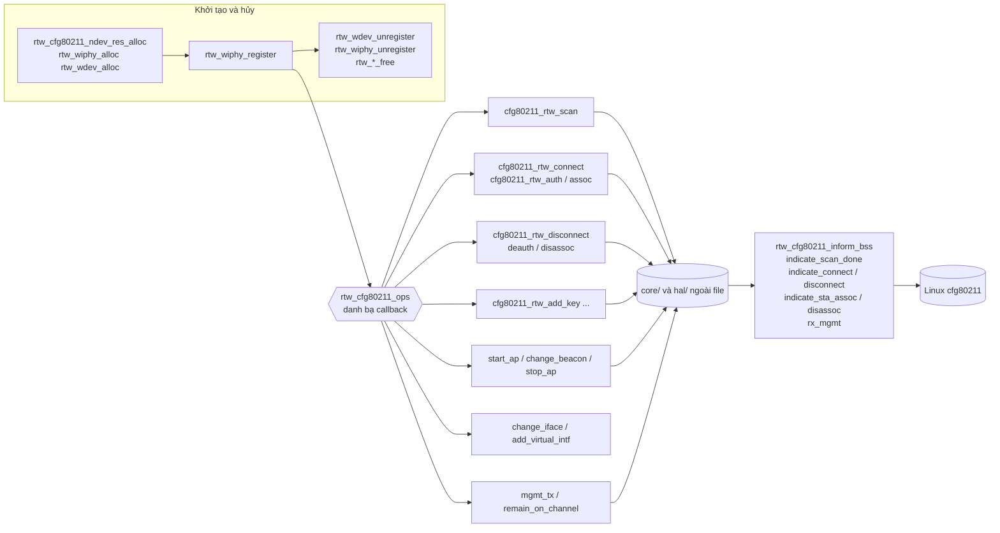

**Thứ tự nên đọc (dễ → khó)**
1. `rtw_cfg80211_ops` ([dòng 11487](os_dep/linux/ioctl_cfg80211.c#L11487)) để thấy toàn bộ cửa vào.
2. `rtw_wiphy_alloc` → `rtw_cfg80211_preinit_wiphy` → `rtw_wdev_alloc`.
3. `cfg80211_rtw_scan` rồi `rtw_cfg80211_surveydone_event_callback` và `rtw_cfg80211_indicate_scan_done`.
4. `cfg80211_rtw_connect` → `rtw_cfg80211_indicate_connect` / `rtw_cfg80211_indicate_disconnect`.
5. `cfg80211_rtw_add_key`.
6. `cfg80211_rtw_change_iface` → `cfg80211_rtw_start_ap` → `rtw_add_beacon`.
7. Nhánh SME-offload: `cfg80211_rtw_auth` → `cfg80211_rtw_assoc` → `cfg80211_rtw_pre_assoc`.
8. `cfg80211_rtw_mgmt_tx`, `cfg80211_rtw_remain_on_channel` (khó nhất vì P2P/DPP).

**Cần xem file khác để hiểu trọn vẹn**
- **`core/rtw_mlme.c`, `rtw_mlme_ext.c`**: ai gọi các hàm `rtw_cfg80211_indicate_*`, nhận auth/assoc frame, timer timeout.
- **`os_dep/linux/mlme_linux.c`**: cầu nối `rtw_os_indicate_*` → `rtw_cfg80211_indicate_*`.
- **`core/rtw_cmd.c`**: `rtw_sitesurvey_cmd`, `rtw_joinbss_cmd`, `rtw_disassoc_cmd`.
- **`core/rtw_p2p.c`, `rtw_ap.c`**: hết hạn remain-on-channel, sự kiện station.
- **`os_dep/linux/os_intfs.c`**: nơi gọi `rtw_cfg80211_ndev_res_*`, `rtw_cfg80211_init_wiphy`.
- **`rtw_cfg80211_set_encryption`/`ap_set_encryption`** bên trong chính file này để biết khóa được cài xuống chip thế nào.

**Đối chiếu danh sách hàm với các sequence.** Mọi hàm trong `rtw_cfg80211_ops` đang biên dịch đều xuất hiện: scan (S2), connect/auth/assoc/deauth/disassoc/disconnect (S3, S4), key/pmksa (S5), AP/station (S6), iface (S7), P2P/mgmt (S8), txpower/power/wiphy_params/get_station/channel/ibss (S9). Những chỗ **chưa phân tích sâu**, vì thế không được vẽ chi tiết: `add_station`/`del_station`/`change_station`/`dump_station`/`change_bss`/`set_txq_params`, `get_key`, `set_mac_acl`, `probe_client`, `set_rekey_data`, `update_ft_ies` (802.11r), và các hàm `rtw_cfg80211_set_*_wpsp2pie` (xử lý IE WPS/P2P trong beacon/probe/assoc). Nhóm mesh, TDLS, sched-scan, rfkill và ACS survey không biên dịch ở cấu hình này.
