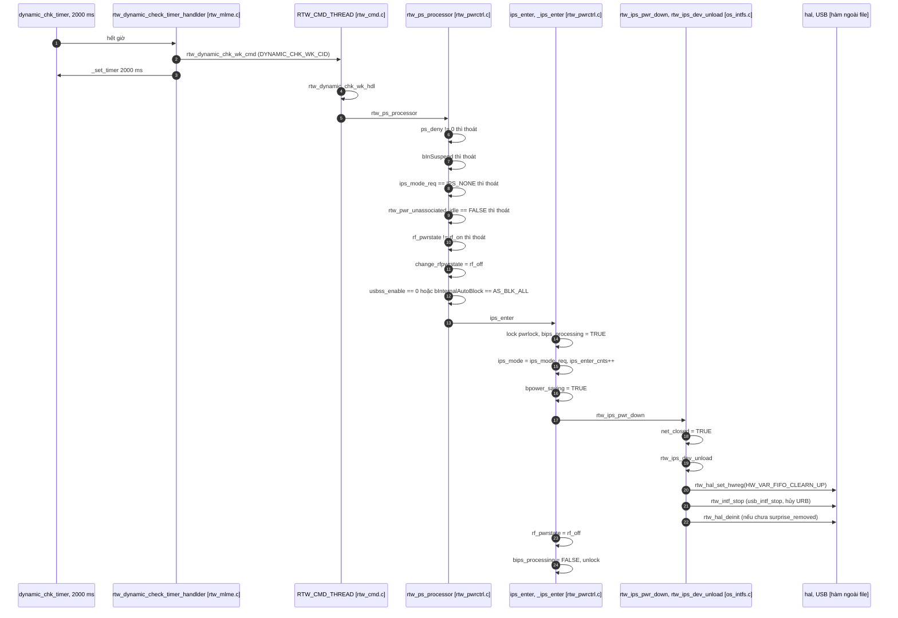
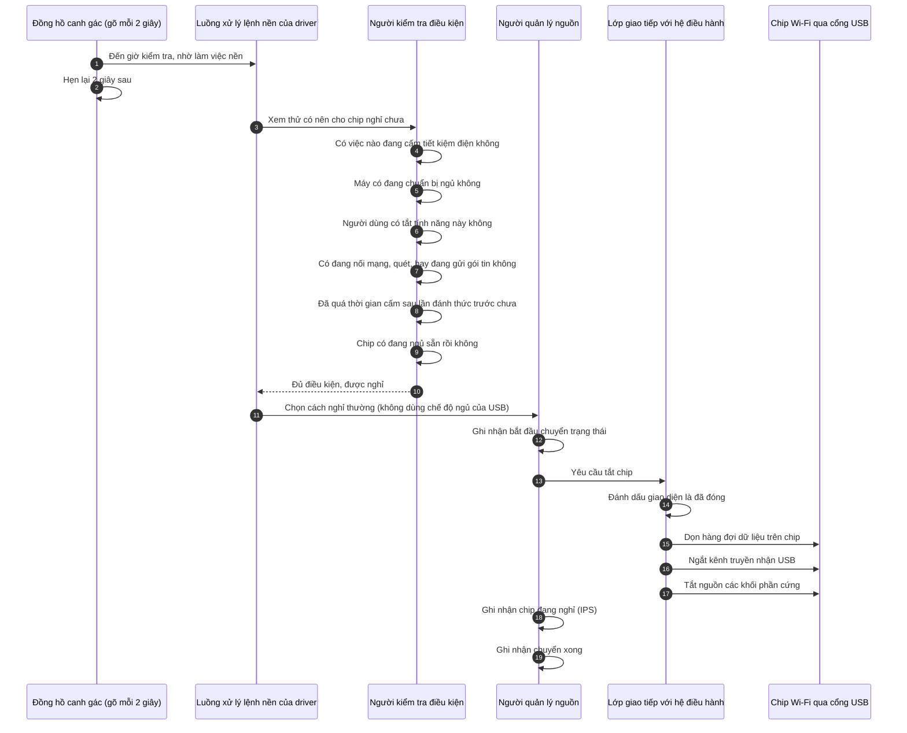
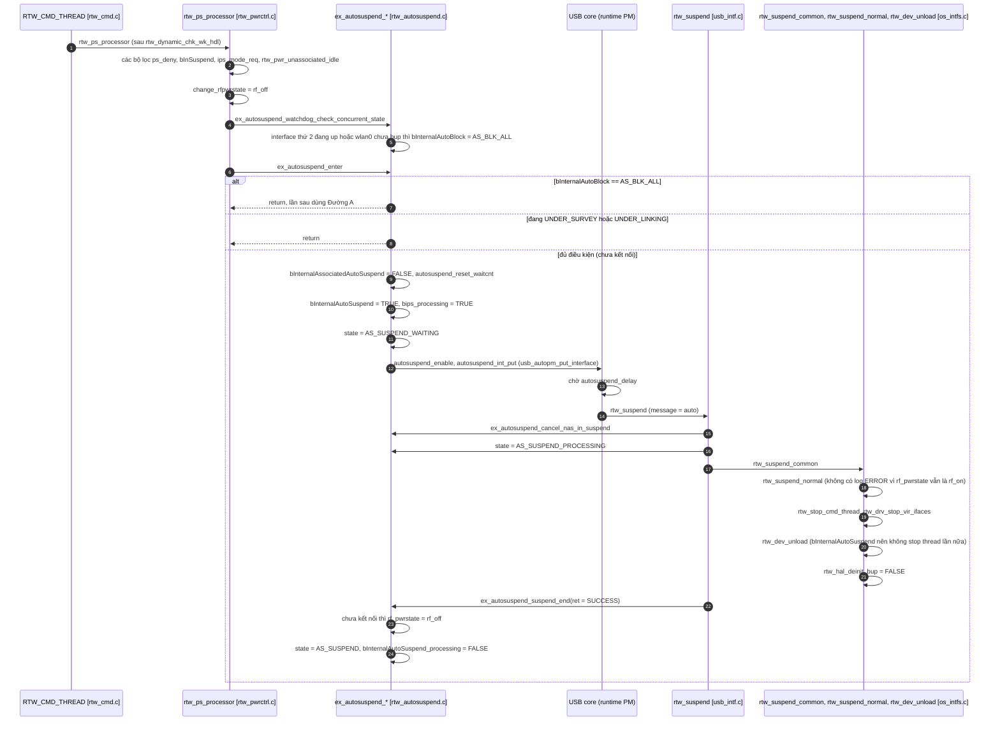
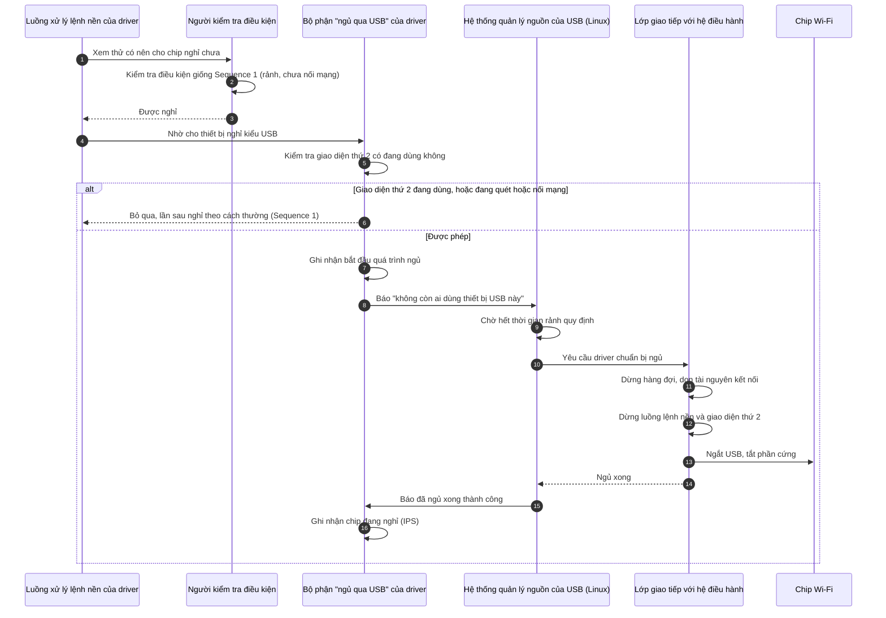

# Các sequence đưa thiết bị vào trạng thái IPS

Đã kiểm tra mọi nơi gán `rf_pwrstate = rf_off` và mọi nơi gọi `ips_enter`, `_ips_enter`, `rtw_ips_pwr_down`, `rtw_ips_dev_unload`, `ex_autosuspend_enter` trong cây `rtl8812BU_v1930.24`.

**Kết luận: trong cấu hình build này có đúng 2 sequence thật sự chạy được** (Đường A và Đường B). Cả hai bắt đầu từ cùng một điểm là `rtw_ps_processor`. Sáu đường khác có trong source nhưng không được biên dịch, liệt kê ở mục 4.

---

## 1. Sequence 1 (Đường A): IPS thuần

### 1a. Bản có tên hàm

### 1b. Bản mô tả chức năng (không tên hàm)

**Giải thích ngắn.**
- Cứ 2 giây, một bộ hẹn giờ nhờ luồng nền hỏi: "chip có nên nghỉ không?".
- Chip chỉ được nghỉ khi **hoàn toàn rảnh và chưa nối mạng nào**. Khi đó driver ngắt USB, tắt phần cứng, và ghi lại "đang IPS".
- `wlan0` vẫn còn đó với Linux, và luồng nền vẫn chạy để còn đánh thức chip sau này.
- Vào IPS mất đúng 1 tick đủ điều kiện, vì biến đếm `pwr_state_check_cnts` luôn là 0 trong build này (mục 4.5).

---

## 2. Sequence 2 (Đường B): IPS qua USB autosuspend

Chỉ xảy ra khi `usbss_enable = 1` (mặc định) **và** `bInternalAutoBlock != AS_BLK_ALL`. Khi interface thứ 2 đang up thì thường bị block, và hệ thống chuyển sang Đường A.

### 2a. Bản có tên hàm

### 2b. Bản mô tả chức năng (không tên hàm)

**Giải thích ngắn.**
- Thay vì tự tắt chip, driver nhờ **hệ thống quản lý nguồn của Linux dành cho USB** làm. Nó báo "thiết bị rảnh", Linux chờ một lúc rồi gọi hàm suspend của driver.
- Khác Đường A ở hai điểm lớn: **luồng lệnh nền cũng bị dừng** (nên khi cần dậy phải đi qua hệ thống USB), và **cờ "đang nghỉ" chỉ được ghi sau khi Linux báo ngủ xong**.
- Thoát khỏi trạng thái này cũng đi ngược qua USB core (`usb_autopm_get_interface[_async]`, rồi `rtw_resume`).

---

## 3. Các điểm kích hoạt (cách "đánh thức" bộ lọc)

Cả hai sequence đều chạy qua `rtw_ps_processor`, được gọi từ **cmd thread** sau `rtw_dynamic_chk_wk_hdl`. Có 2 cách bộ lọc được chạy trong build này:

| Trigger | Cách hoạt động | Nơi |
|---|---|---|
| **T1. Tick định kỳ** | `dynamic_chk_timer` tự lặp mỗi 2000 ms. Timer được bật lại ở `_netdev_open`, `ips_netdrv_open` và `rtw_resume_process_*` | `rtw_mlme.c:3420` |
| **T2. Kích nhanh sau scan** | Khi quét xong mà chưa kết nối, `rtw_indicate_scan_done` đặt `ips_deny_time` về 0 và hẹn timer 1 ms | `rtw_mlme.c:1893-1911` |

T2 không phải sequence riêng, nó chỉ rút ngắn thời gian chờ cho Sequence 1 hoặc 2.

---

## 4. Các đường khác có trong source nhưng KHÔNG chạy ở build này

| # | Đường | Hàm | Cần bật macro nào | Trạng thái |
|---|---|---|---|---|
| 4.1 | **Silent reset** (tự phục hồi khi lỗi): `_ips_enter` rồi `_ips_leave` liên tiếp để reset chip | `sreset_reset` (`rtw_sreset.c:338`) | `DBG_CONFIG_ERROR_RESET` | Đang bị comment trong `autoconf.h` |
| 4.2 | **Tắt RF bằng phần cứng** (pin detect): `rtw_hw_suspend` gọi `rtw_ips_dev_unload`, rồi đặt `rf_off` | `rtw_hw_suspend` (`usb_intf.c:934`, gọi từ `rtw_pwrctrl.c:378`) | `SUPPORT_HW_RFOFF_DETECTED` và `bHWPwrPindetect` | Tắt (`autoconf.h:138`) |
| 4.3 | **Timer riêng** `pwr_state_check_timer` gọi `rtw_ps_cmd` rồi `power_saving_wk_hdl` rồi `rtw_ps_processor` | `pwr_state_check_handler` | không định nghĩa `CONFIG_IPS_CHECK_IN_WD` | Timer đã khởi tạo nhưng **không bao giờ được hẹn giờ** ở build này |
| 4.4 | **Firmware tự ngủ trong IPS** (`rtw_set_fw_in_ips_mode` khi vào WoWLAN + PNO) | `rtw_suspend_wow` | `CONFIG_FWLPS_IN_IPS` và `CONFIG_PNO_SUPPORT` | Tắt cả hai |
| 4.5 | **Đếm 4 tick** trước khi vào IPS (điều kiện `% 4 == 0`) | `rtw_ps_processor` | chỉ có ý nghĩa khi `SUPPORT_HW_RFOFF_DETECTED` bật | Ở build này điều kiện luôn đúng nên không tạo thêm đường nào |
| 4.6 | **Biến thể `NEW_NETDEV_HDL`** của `ips_netdrv_open` | `ips_netdrv_open` | `CONFIG_NEW_NETDEV_HDL` (chỉ khi `IFACE_NUMBER > 2`) | Tắt. Chỉ ảnh hưởng đường thoát IPS |

### Trông giống IPS nhưng KHÔNG phải IPS

| Trường hợp | Vì sao không tính |
|---|---|
| **Autosuspend khi đã kết nối** (`ex_autosuspend_connected_entry`, gọi từ `rtw_pwrctrl.c:1247` trong nhánh LPS) | `ex_autosuspend_suspend_end` chỉ đặt `rf_off` khi `!bInternalAssociatedAutoSuspend`. Nên đây là ngủ kiểu WoW-AS, `rf_pwrstate` vẫn là `rf_on` |
| **System suspend** (`rtw_suspend_common` rồi `rtw_suspend_normal` hoặc `rtw_suspend_wow`) | Tắt chip để ngủ cả hệ thống. Không đổi `rf_pwrstate` sang `rf_off` |
| **`netdev_close` (ifconfig down)** | Không tắt chip. `rf_pwrstate` giữ nguyên |
| **`rtw_dev_unload`** khi remove module | Tắt chip nhưng nhằm gỡ driver |
| **`rtw_pm_set_ips(IPS_NORMAL)`** | Chỉ ghi `ips_mode_req`. Việc vào IPS vẫn do Sequence 1 hoặc 2 quyết định |

---

## 5. Tóm tắt

| Câu hỏi | Trả lời |
|---|---|
| Có bao nhiêu sequence đưa chip vào IPS chạy thật ở build này? | **2**: Đường A (`ips_enter`) và Đường B (`ex_autosuspend_enter`) |
| Hai đường khác nhau ở đâu? | Đường A: driver tự tắt chip, cmd thread vẫn sống. Đường B: nhờ USB runtime PM, cmd thread bị dừng, `rf_off` ghi sau khi suspend xong |
| Đường nào hay xảy ra? | Thường là **Đường A**. Vì `_netdev_open` của wlan0 tự mở interface thứ 2 nên Đường B bị block (suy luận từ code, cần log để xác nhận) |
| Điểm chung | Cả hai đi qua `rtw_ps_processor`, nên cùng chịu bộ lọc: `ps_deny`, `bInSuspend`, `ips_mode_req`, `rtw_pwr_unassociated_idle` |
| Đường nào hiện không chạy? | Silent reset, pin-detect RF off, `pwr_state_check_timer`, FWLPS-in-IPS |

**Chưa xác minh:** log runtime để biết đường nào thật sự chạy (`nolinked power save enter` là Đường A, `autosuspend_enter (normal)` là Đường B), và phần bên trong `rtw_hal_deinit` của chip 8822B.
