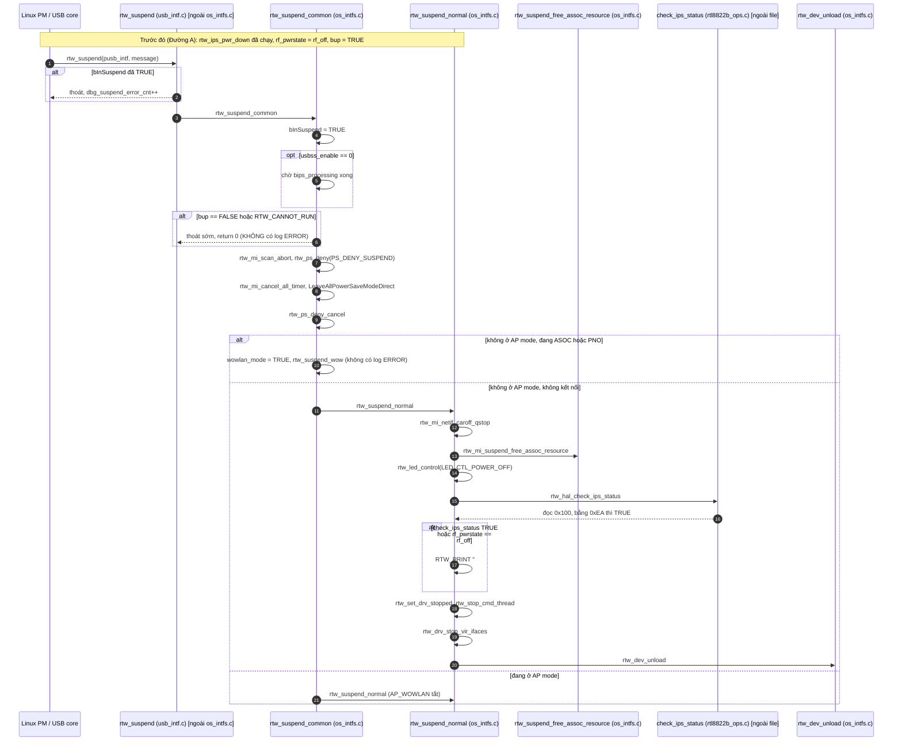

# Log `### ERROR #### driver in IPS ####ERROR###!!!`

## 1. Log này nằm ở đâu

Chuỗi này in trong **`rtw_suspend_normal`** (`os_intfs.c:5101-5103`):

```c
if ((rtw_hal_check_ips_status(padapter) == _TRUE)
    || (adapter_to_pwrctl(padapter)->rf_pwrstate == rf_off))
    RTW_PRINT("%s: ### ERROR #### driver in IPS ####ERROR###!!!\n", __FUNCTION__);
```

Log thật in ra có thêm tên hàm ở đầu: `rtw_suspend_normal: ### ERROR #### driver in IPS ####ERROR###!!!`.

Ý nghĩa: **hệ thống đang đi vào suspend, nhưng driver phát hiện chip đã bị đưa vào IPS trước đó**. Tác giả coi đây là bất thường vì lúc suspend, phần cứng lẽ ra phải đang bật. Nhưng đây **chỉ là cảnh báo**, nó không chặn suspend và hàm vẫn chạy tiếp.

Log này chỉ xuất hiện trên đường `rtw_suspend_normal`, tức suspend **không dùng WoWLAN**. Suspend kiểu WoWLAN (`rtw_suspend_wow`) không có đoạn kiểm tra này.

## 2. Hai điều kiện kích hoạt (`||`)

| Điều kiện | Kiểm tra gì | Nguồn |
|---|---|---|
| `rtw_hal_check_ips_status() == TRUE` | **Phần cứng**: đọc thanh ghi `0x100`, bằng `0xEA` nghĩa là firmware báo đang ở trạng thái IPS | `hal/rtl8822b/rtl8822b_ops.c:757` |
| `rf_pwrstate == rf_off` | **Phần mềm**: cờ driver đã đánh dấu vào IPS | `rtw_pwrctrl.c:144` |

Điểm đáng chú ý:
- Vế đầu luôn được **thực thi**, vì nó đứng trước `||`. Nó gọi `rtw_read8(0x100)` và `rtw_read8(0x86)` qua USB, và in dòng log `check_ips_status: Read 0x100=0x?? 0x86=0x??` ngay trước dòng ERROR.
- Trong build này `CONFIG_FWLPS_IN_IPS` tắt, IPS tắt chip bằng `rtw_hal_deinit`. Không rõ thanh ghi `0x100` đọc ra giá trị gì khi chip đã tắt hẳn. Nhiều khả năng log xuất hiện nhờ vế thứ hai, `rf_off`, nhưng cần dòng `Read 0x100=...` trong log thực tế để xác nhận.

## 3. Sequence: từ lúc hệ thống suspend đến dòng log

Kịch bản điển hình là **Đường A** của phần IPS: máy rảnh, chưa kết nối, driver đã vào IPS thuần (`rf_off`), rồi hệ thống suspend.



## 4. Giải thích từng bước

1. **Linux gọi `rtw_suspend`** (`usb_intf.c`) qua `usb_driver.suspend`. Hàm này lấy `padapter` chính và chuyển cho `rtw_suspend_common`. Nếu `bInSuspend` đã TRUE (suspend lặp) thì thoát.
2. **`rtw_suspend_common`** đánh dấu `bInSuspend = TRUE`. Chỉ khi `usbss_enable == 0` nó mới chờ `bips_processing` về FALSE. Với `usbss_enable = 1` (mặc định ở build này) nó **không chờ**.
3. **Cửa chặn sớm:** nếu `!padapter->bup` hoặc `RTW_CANNOT_RUN` (tức `drv_stopped` hoặc `surprise_removed`) thì thoát ngay, **không** in log. Trong Đường A, `rtw_ips_pwr_down` chỉ đặt `net_closed = TRUE`, không đụng `bup`, và `rtw_ips_dev_unload` không đặt `drv_stopped` hay `surprise_removed`. Vì vậy suspend vẫn đi tiếp, dẫn tới log.
4. **Chuẩn bị:** hủy scan (`rtw_mi_scan_abort`), cấm power save (`PS_DENY_SUSPEND`), hủy mọi timer (`rtw_mi_cancel_all_timer`, gồm cả `dynamic_chk_timer`), gọi `LeaveAllPowerSaveModeDirect`. Vì chưa kết nối nên hàm này không phải thoát LPS. Nhánh gọi `ips_leave` bên trong nó chỉ được biên dịch khi bật `FWLPS_IN_IPS` hoặc `SWLPS_IN_IPS`, mà build này tắt.
5. **Chọn kiểu suspend:** WoWLAN chỉ khi đang kết nối (`WIFI_ASOC_STATE`) hoặc có PNO. IPS xảy ra khi **chưa kết nối**, nên luôn rơi vào `rtw_suspend_normal`. Đó là lý do hai chuyện này gặp nhau.
6. **`rtw_suspend_normal`:** dừng queue và carrier, giải phóng tài nguyên kết nối bằng `rtw_suspend_free_assoc_resource`, tắt LED. Sau đó mới kiểm tra IPS và in log.
7. **Sau log, suspend vẫn tiếp tục:** `rtw_set_drv_stopped`, `rtw_stop_cmd_thread`, `rtw_drv_stop_vir_ifaces` (có `CONFIG_CONCURRENT_MODE`), rồi `rtw_dev_unload`.

## 5. Điều gì xảy ra sau log

Trong `rtw_dev_unload` (`os_intfs.c:4628`), vì `bup == TRUE`:
- In `rtw_dev_unload: driver in IPS-FWLPS` và tăng `dbg_dev_unload_inIPS_cnt`. Đây là lần thứ hai driver nhận ra IPS.
- Vì `!rtw_is_surprise_removed` vẫn đúng, nó **gọi `rtw_hal_deinit` lần nữa**, dù chip đã `deinit` bởi IPS. Chưa đọc phần `hal_deinit` của 8822B nên không biết gọi hai lần có an toàn không.
- Đặt `surprise_removed`, `bup = FALSE`.

**Lúc resume** (`rtw_resume_process_normal`) driver bật lại hoàn toàn: `rtw_clr_surprise_removed`, `rtw_mi_reset_drv_sw`, `pm_netdev_open(TRUE)`, `_netdev_open`, `rtw_hal_init`.

**Điểm cần cảnh giác** (suy luận từ code, chưa kiểm chứng trên board): `rf_pwrstate` chỉ được đặt lại `rf_on` ở hai nơi là `_ips_leave` (`rtw_pwrctrl.c:177`) và `autoresume_entry` (`rtw_autosuspend.c:247`). Đường resume thường ở trên **không** đụng tới nó. Nên sau suspend/resume lúc đang IPS, chip đã init lại nhưng cờ `rf_pwrstate` có thể vẫn là `rf_off`. Hệ quả có thể là:
- `rtw_ps_processor` không vào IPS lại (vì nó yêu cầu `rf_on`).
- Lần `rtw_pwr_wakeup` kế tiếp gọi `ips_leave` → `rtw_ips_pwr_up` → `rtw_hal_init` thêm một lần trên chip vốn đang chạy.

Để biết có xảy ra thật không, tìm các dòng `nolinked power save leave` hoặc `==>ips_leave cnts` ngay sau resume.

## 6. Khi nào log này thật sự đáng lo

| Trường hợp | Đánh giá |
|---|---|
| Máy rảnh, chưa kết nối, rồi suspend hệ thống | **Bình thường, lặp lại được**. Đây là thiết kế "không đánh thức chip khi suspend" |
| Log xuất hiện dù đang kết nối | Bất thường. Cần xem vì sao `rf_pwrstate` là `rf_off` khi `WIFI_ASOC_STATE` |
| Kèm lỗi USB sau đó (urb fail, timeout) | Có thể do `rtw_hal_deinit` chạy hai lần |
| Sau resume, scan/connect treo hoặc chậm | Có thể do cờ `rf_pwrstate` lệch (mục 5) |

Về nguyên nhân gốc, `rtw_suspend_common` **không gọi `rtw_pwr_wakeup`** trước khi suspend (khác với `rtw_dev_remove`, nó gọi `rtw_pm_set_ips(IPS_NONE)` để thoát IPS trước khi gỡ). Nên log này nhắc rằng thiết kế suspend của driver đã không xử lý trường hợp IPS, thay vì đánh thức trước.

## 7. Cách xác nhận trên board

Tìm trình tự log sau trong `dmesg`:
```
suspend start
==> rtw_suspend_common (...)
==> wlan0 entry....                          # rtw_suspend_normal
rtw_suspend_free_assoc_resource ...
... check_ips_status: Read 0x100=0x?? 0x86=0x??
rtw_suspend_normal: ### ERROR #### driver in IPS ####ERROR###!!!
rtw_dev_unload: driver in IPS-FWLPS
```
- Trước đó nên có `nolinked power save enter`, tức IPS Đường A đã vào.
- Nếu trước đó có `autosuspend_enter (normal)` thì chip đang ở Đường B, trường hợp khác (xem tài liệu luồng IPS).

Chưa sửa gì trong code. Hướng sửa có thể cân nhắc: đánh thức chip bằng `rtw_pwr_wakeup` trước `rtw_suspend_common`, hoặc đặt lại `rf_pwrstate` ở resume.
