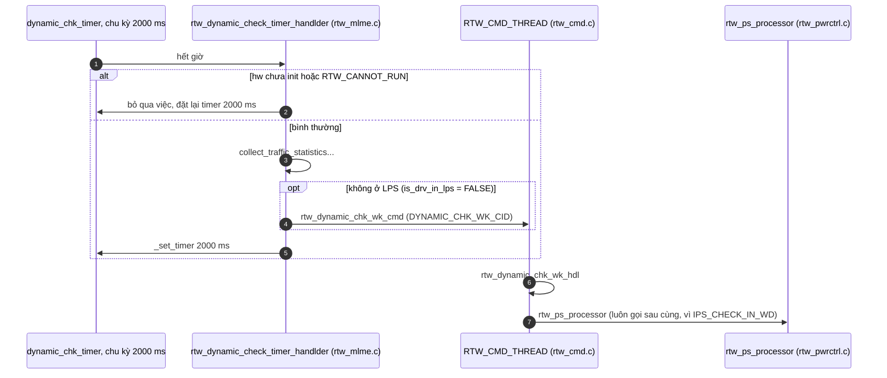
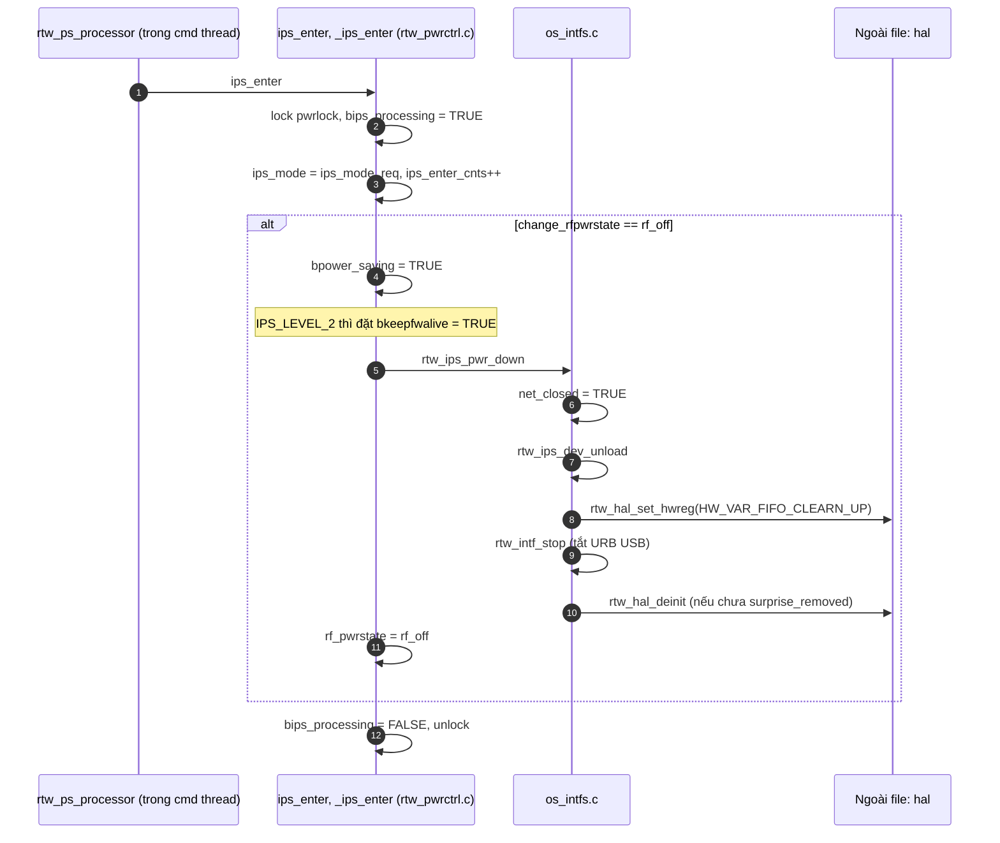
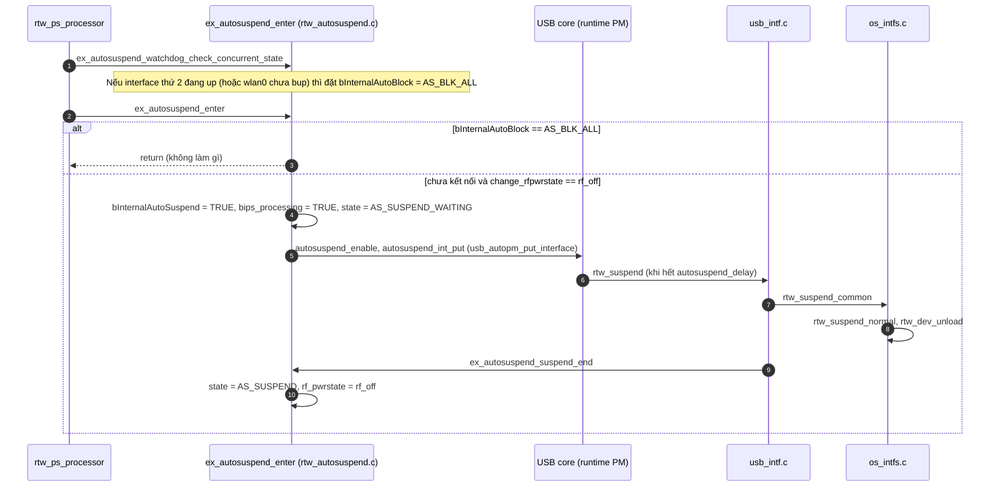
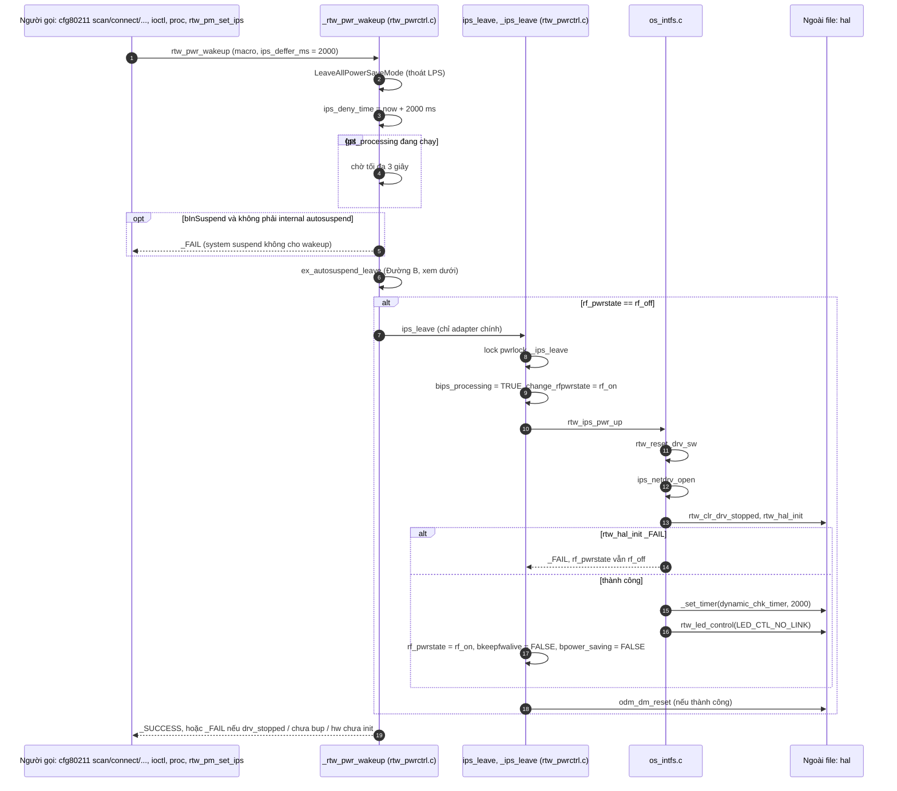
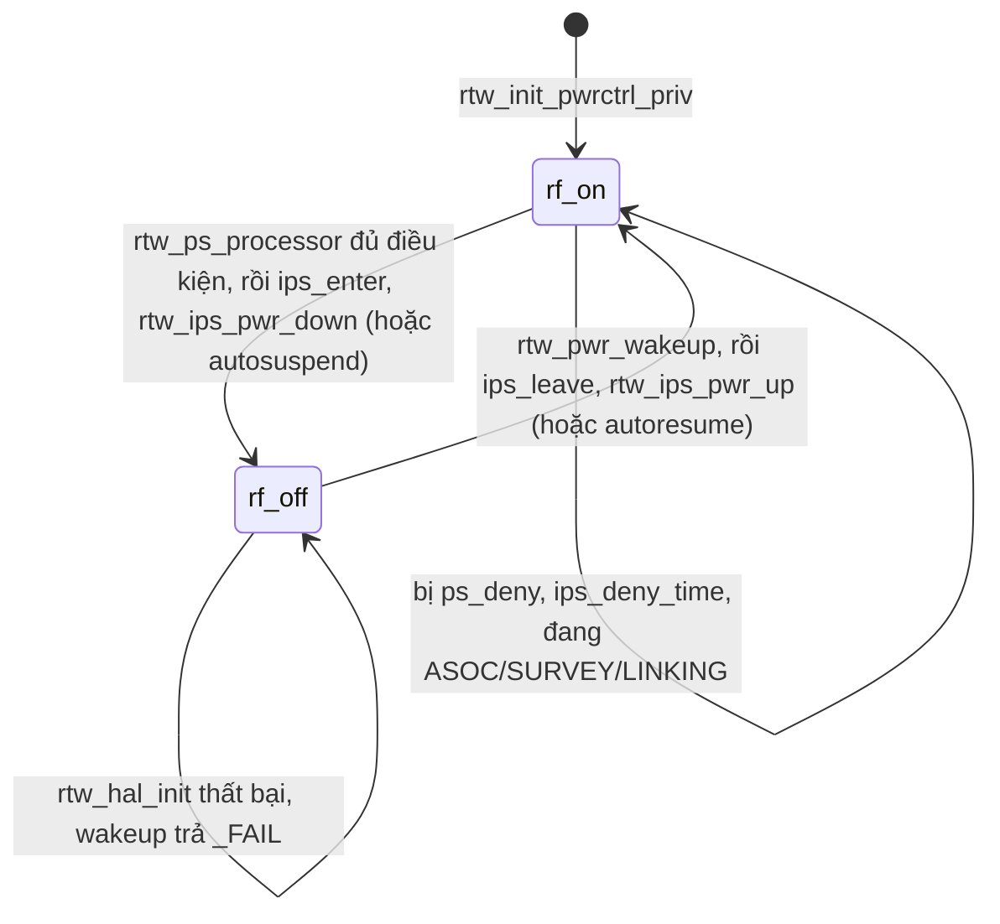

# Luồng IPS (Inactive Power Save) của driver RTL8812BU

Đã đọc `os_intfs.c`, `core/rtw_pwrctrl.c`, `core/rtw_cmd.c`, `core/rtw_mlme.c`, `core/rtw_autosuspend.c` và `os_dep/linux/usb_intf.c`. Hai hàm trong `os_intfs.c` (`rtw_ips_pwr_down`, `rtw_ips_pwr_up`) chỉ là nửa dưới của IPS. Phần quyết định vào hay ra IPS nằm ở `rtw_pwrctrl.c`.

Kết luận quan trọng nhất: **với cấu hình build này, "vào IPS" có hai đường khác nhau** (mục 4). Điều này được suy ra từ code, chưa chạy thử trên board.

## 1. IPS là gì

- **IPS** tắt gần hết phần cứng Wi-Fi khi **chưa kết nối mạng nào** và không có việc gì để làm. Nó dùng `rtw_hal_deinit`, khác với LPS (ngủ nhẹ khi đang kết nối).
- Netdev `wlan0` vẫn tồn tại và vẫn UP với Linux. Chỉ có chip bị "rút điện".
- Khi cần dùng lại (scan, connect, ioctl...), driver gọi `rtw_pwr_wakeup` để bật chip lên rồi mới làm việc.

**Biến trạng thái** (trong `pwrctrl_priv`, `rtw_pwrctrl.h`):

| Biến | Ý nghĩa |
|---|---|
| `rf_pwrstate` | `rf_on` hoặc `rf_off`. `rf_off` nghĩa là đang trong IPS |
| `ips_mode_req` | Chế độ được yêu cầu: `IPS_NONE` (0), `IPS_NORMAL` (1), `IPS_LEVEL_2` (2) |
| `ips_mode` | Chế độ đang áp dụng. Được đồng bộ từ `ips_mode_req` mỗi lần vào IPS |
| `change_rfpwrstate` | "Ý định" đổi trạng thái. `ps_processor` đặt `rf_off` ngay trước khi vào IPS |
| `bips_processing` | Cờ đang chuyển đổi, để các luồng khác chờ |
| `ips_deny_time` | Chưa tới mốc thời gian này thì cấm vào IPS |
| `ps_deny` | Mặt nạ bit các lý do cấm power save (`PS_DENY_SCAN`, `JOIN`, `SUSPEND`, `IOCTL`...) |

## 2. Cấu hình hiệu lực trong build

| Mục | Giá trị | Nguồn |
|---|---|---|
| `CONFIG_IPS` | bật (do `CONFIG_POWER_SAVING=y`) | `autoconf.h:132` |
| Chế độ mặc định | `RTW_IPS_MODE = 1`, tức **`IPS_NORMAL`** | `drv_conf.h:573`, Makefile `CONFIG_IPS_MODE = default` |
| `CONFIG_IPS_CHECK_IN_WD` | bật: kiểm tra IPS nằm trong watchdog 2 giây, không có timer riêng | `autoconf.h:135` |
| `CONFIG_FWLPS_IN_IPS`, `CONFIG_SWLPS_IN_IPS` | tắt | `autoconf.h:136` |
| `SUPPORT_HW_RFOFF_DETECTED` | tắt | `autoconf.h` |
| `CONFIG_AUTOSUSPEND` + `usbss_enable` (module param `rtw_enusbss`) | bật, mặc định **1** | `os_intfs.c:429`, Makefile `CONFIG_USB_AUTOSUSPEND=y` |
| `CONFIG_NEW_NETDEV_HDL` | tắt | `drv_conf.h:489` (chỉ bật khi `IFACE_NUMBER > 2`) |
| `DBG_CONFIG_ERROR_RESET` | tắt (nên `sreset_reset` không gọi IPS) | `autoconf.h:401` |

Hệ quả của việc `FWLPS_IN_IPS` và `SWLPS_IN_IPS` đều tắt:
- Trong `rtw_ips_pwr_up`, `rtw_reset_drv_sw` luôn được gọi.
- Trong `rtw_ips_dev_unload`, khối "FIFO clean + `rtw_intf_stop`" luôn chạy.
- `LeaveAllPowerSaveMode` **không** gọi `ips_leave`. Thoát IPS chỉ đi qua `rtw_pwr_wakeup`.

## 3. Bước 1: Ai quyết định vào IPS



Mỗi 2 giây, timer của `dvobj` chạy `rtw_dynamic_check_timer_handlder`. Hàm này đưa một lệnh "dynamic check" vào hàng đợi của cmd thread. Cmd thread chạy `rtw_dynamic_chk_wk_hdl`, và việc cuối cùng của nó là `rtw_ps_processor`. Khi IPS đang bật, `rtw_is_hw_init_completed` là FALSE nên timer vẫn tick nhưng không làm gì.

**`rtw_ps_processor` là bộ lọc điều kiện** (`rtw_pwrctrl.c:312`). Nó dừng ngay nếu một trong các điều kiện sau đúng:

1. `ps_deny != 0` (đang scan, join, suspend, ioctl, mgnt tx...). Nó log "skip power save".
2. `bInSuspend`.
3. `ips_mode_req == IPS_NONE`.
4. `rtw_pwr_unassociated_idle()` trả FALSE (chi tiết bên dưới).
5. `rf_pwrstate != rf_on`, tức đã ở IPS rồi.

Điều kiện `pwr_state_check_cnts % 4 == 0` luôn đúng trong build này. Biến đếm chỉ tăng khi `SUPPORT_HW_RFOFF_DETECTED` bật, mà macro đó tắt. Nên IPS vào ngay ở tick đủ điều kiện đầu tiên, không phải chờ 4 tick.

**`rtw_pwr_unassociated_idle`** (`rtw_pwrctrl.c:239`) trả TRUE chỉ khi toàn bộ điều kiện sau thỏa:
- `bpower_saving` đang FALSE (chưa ở IPS).
- Đã qua `ips_deny_time`.
- **Mọi** interface đang up đều **không**: `WIFI_ASOC_STATE`, `UNDER_SURVEY`, `UNDER_LINKING`, `UNDER_WPS`, chế độ AP/Mesh/Ad-hoc.
- Không đang remain-on-channel (hoặc vừa kết thúc roch chưa quá 3000 ms).
- Không ở MP mode.
- Mọi xmit buffer đều rảnh (`free_xmitbuf_cnt == NR_XMITBUFF`).

## 4. Bước 2: Vào IPS

Sau khi qua bộ lọc, `rtw_ps_processor` đặt `change_rfpwrstate = rf_off`, rồi rẽ nhánh (`rtw_pwrctrl.c:402`):

```
nếu usbss_enable == 1 và bInternalAutoBlock != AS_BLK_ALL   → ĐƯỜNG B: USB autosuspend
ngược lại (usbss tắt, hoặc đang bị block)                    → ĐƯỜNG A: ips_enter (IPS thuần)
```

### Đường A: IPS thuần (`ips_enter`)



Điểm cần nhớ:
- `rtw_ips_dev_unload` tắt URB USB và tắt phần cứng, nhưng **không dừng cmd thread**. Cmd thread phải sống để còn chạy watchdog và xử lý yêu cầu thức dậy.
- `rtw_ips_pwr_down` đặt `net_closed = TRUE` nhưng không đụng `bup` hay netdev.
- Việc này diễn ra trong **ngữ cảnh cmd thread**.

### Đường B: IPS qua USB autosuspend (`ex_autosuspend_enter`)

Đây là phần mở rộng riêng của build này (`core/rtw_autosuspend.c`).



Hai điểm đáng chú ý:
- Đường B không gọi `ips_enter`. Nó hạ `pm usage count` của USB, rồi để kernel gọi `rtw_suspend`. Bên trong nó đi qua `rtw_suspend_common`, `rtw_suspend_normal`, `rtw_dev_unload`, nên **cmd thread bị dừng** (`rtw_stop_cmd_thread`).
- Khi interface thứ hai (wlan1) đã up (`net_closed == FALSE`) thì `ex_autosuspend_watchdog_check_concurrent_state` đặt `AS_BLK_ALL`. Từ tick sau, `rtw_ps_processor` rẽ sang Đường A.

Trong build này, `_netdev_open` của wlan0 tự mở luôn interface ảo (`_netdev_vir_if_open`). Vì vậy **khả năng cao hệ thống chạy Đường A** sau tick đầu tiên. Nên kiểm chứng bằng log khi chạy: Đường A in `nolinked power save enter`, Đường B in `autosuspend_enter (normal)`.

## 5. Bước 3: Thoát IPS (đánh thức)

Chip chỉ được bật lại khi có ai đó gọi `rtw_pwr_wakeup` (hoặc `rtw_pm_set_ips(IPS_NONE)`, vốn gọi `rtw_pwr_wakeup`).



Giải thích:
- `ips_deffer_ms = 2000` ngăn driver **vừa thức dậy đã bị đưa ngủ lại** (đặt `ips_deny_time` cả lúc vào lẫn lúc ra hàm).
- `ips_netdrv_open` ngược với `rtw_ips_dev_unload`. Nó gọi `rtw_hal_init`. Trong `RTW_HALMAC`, `rtw_hal_init` kéo theo `rtw_intf_start`, nên URB USB hoạt động lại. Nó **không** tạo lại thread vì `bup` vẫn là TRUE nên điều kiện trong `_drv_enable_trx` không thỏa.
- Nếu `ips_leave` thất bại, `rtw_pwr_wakeup` trả `_FAIL`. Các hàm gọi như `cfg80211_rtw_scan`, `cfg80211_rtw_connect` thường báo lỗi ra Linux (xem các callback có `if (_FAIL == rtw_pwr_wakeup(...))`).
- **Đường B:** `ex_autosuspend_leave` gọi `autoresume_entry` (đặt `AS_RESUME_PROCESSING`, `usb_autopm_get_interface[_async]`). USB core gọi `rtw_resume`, rồi `rtw_resume_process`, `rtw_resume_common`, `rtw_resume_process_normal`, `pm_netdev_open(TRUE)`, `_netdev_open`, `rtw_hal_init`. Nhánh `rf_off` phía dưới không còn chạy vì `ex_autosuspend_leave` đã trả TRUE (`goto exit`).

## 6. Những thứ chặn hoặc hoãn IPS

| Cơ chế | Đặt ở đâu | Tác dụng |
|---|---|---|
| `ips_deny_time += 2000 ms` | `_rtw_pwr_wakeup` | Sau mỗi lần thức dậy, 2 giây không vào IPS |
| `rtw_set_ips_deny(3000)` | `rtw_mlme.c:1865`, khi mất kết nối | Chờ 3 giây để LPS thoát xong rồi mới IPS |
| `rtw_set_ips_deny(0)` rồi kick `dynamic_chk_timer` 1 ms | `rtw_mlme.c:1905`, khi scan xong mà chưa kết nối | Cho phép vào IPS ngay nếu rảnh |
| `rtw_ps_deny(PS_DENY_*)` | scan, join, ioctl, suspend, beamforming... (khoảng 40 chỗ) | Chặn mọi power save trong lúc làm việc |
| `bInSuspend` | `rtw_suspend_common` | Không xử lý PS khi đang suspend |
| `ips_mode_req == IPS_NONE` | `rtw_pm_set_ips(IPS_NONE)` | Tắt hẳn IPS. `rtw_dev_remove` và chế độ MP cũng dùng |

Có thể chỉnh chế độ IPS bằng module param `rtw_ips_mode`, ioctl (`ioctl_linux.c`) hoặc `/proc` (`rtw_debug.c`).

## 7. Máy trạng thái



Khi `rf_pwrstate = rf_off`:
- `netdev_close` bỏ qua phần ngắt kết nối (nó chỉ làm khi `rf_on`).
- `rtw_dev_unload` ghi log "driver in IPS" và vẫn chạy `rtw_hal_deinit`.
- Trong `rtw_suspend_normal`, nếu đang ở IPS thì in cảnh báo ERROR, vì lẽ ra IPS phải thoát trước.
- `rtw_dev_remove` gọi `rtw_pm_set_ips(IPS_NONE)` để thoát IPS trước khi gỡ.

## 8. Tóm tắt một dòng cho từng hàm

| Hàm | File | Vai trò |
|---|---|---|
| `rtw_ps_processor` | `rtw_pwrctrl.c` | Quyết định vào IPS (chạy trong watchdog) |
| `rtw_pwr_unassociated_idle` | `rtw_pwrctrl.c` | Điều kiện "rảnh và chưa kết nối" |
| `ips_enter` / `_ips_enter` | `rtw_pwrctrl.c` | Đóng gói vào IPS, đổi `rf_pwrstate` |
| `rtw_ips_pwr_down` | `os_intfs.c` | Gọi `rtw_ips_dev_unload`: dừng URB, `rtw_hal_deinit` |
| `rtw_ips_dev_unload` | `os_intfs.c` | Cũng được `usb_intf.c:rtw_hw_suspend` gọi (build này không bật) |
| `_rtw_pwr_wakeup` | `rtw_pwrctrl.c` | Cửa chung để thức dậy, gọi `ips_leave` |
| `ips_leave` / `_ips_leave` | `rtw_pwrctrl.c` | Đóng gói thoát IPS |
| `rtw_ips_pwr_up` | `os_intfs.c` | `rtw_reset_drv_sw` rồi `ips_netdrv_open` |
| `ips_netdrv_open` | `os_intfs.c` | `rtw_hal_init`, bật timer, trả `_SUCCESS` hoặc `_FAIL` |
| `rtw_pm_set_ips` | `rtw_pwrctrl.c` | Đổi chế độ IPS (`IPS_NONE` thì gọi thức dậy luôn) |
| `ex_autosuspend_*` | `rtw_autosuspend.c` | Đường B: IPS qua USB runtime PM |

## 9. Những điểm chưa xác minh

- **Đường nào chạy thật** (A hay B) phụ thuộc trạng thái interface thứ hai lúc chạy. Đây là suy luận từ `_netdev_open` và `ex_autosuspend_watchdog_check_concurrent_state`. Cần log trên board để chắc.
- `rtw_hal_deinit`, `rtw_hal_init` bên trong HALMAC, ý nghĩa chính xác của `bkeepfwalive` ở `IPS_LEVEL_2` và `odm_dm_reset` nằm ngoài các file đã đọc.
- Một số file `.c` trong repo dùng encoding Shift-JIS/CP932 (có comment tiếng Nhật), nên được đọc qua `iconv`. Trình soạn thảo UTF-8 có thể hiện ký tự lỗi ở các comment đó. Code không bị ảnh hưởng.
