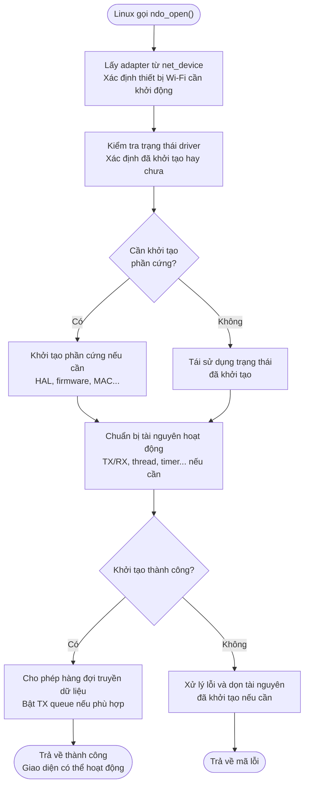
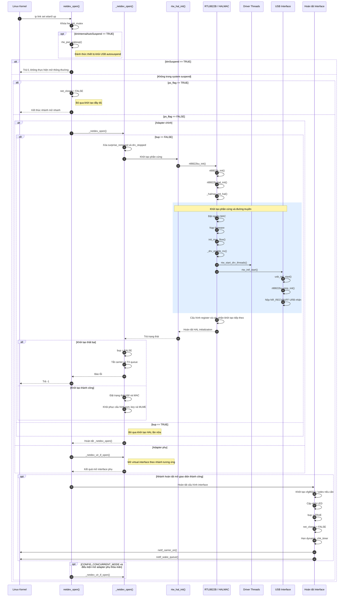
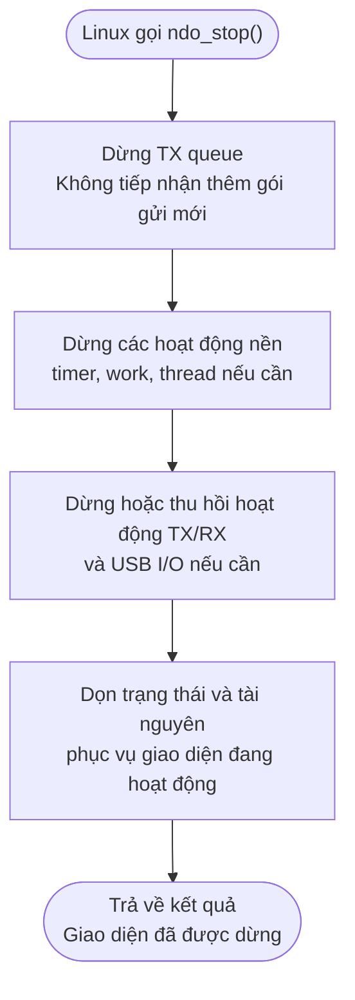
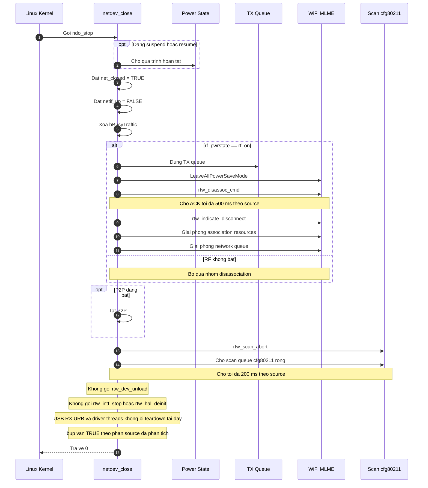
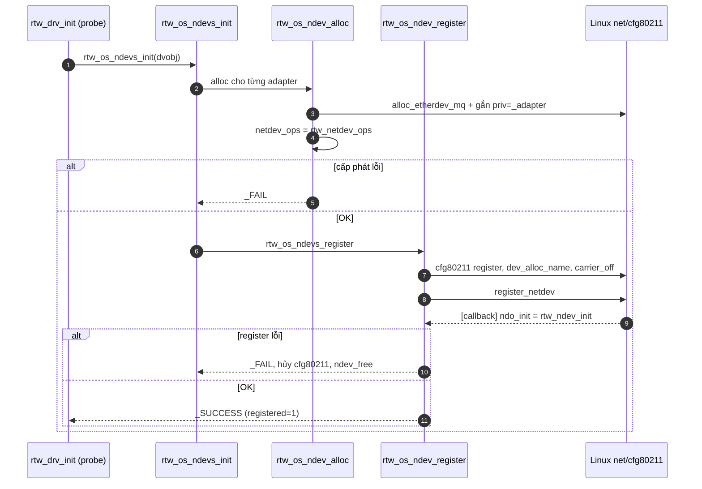
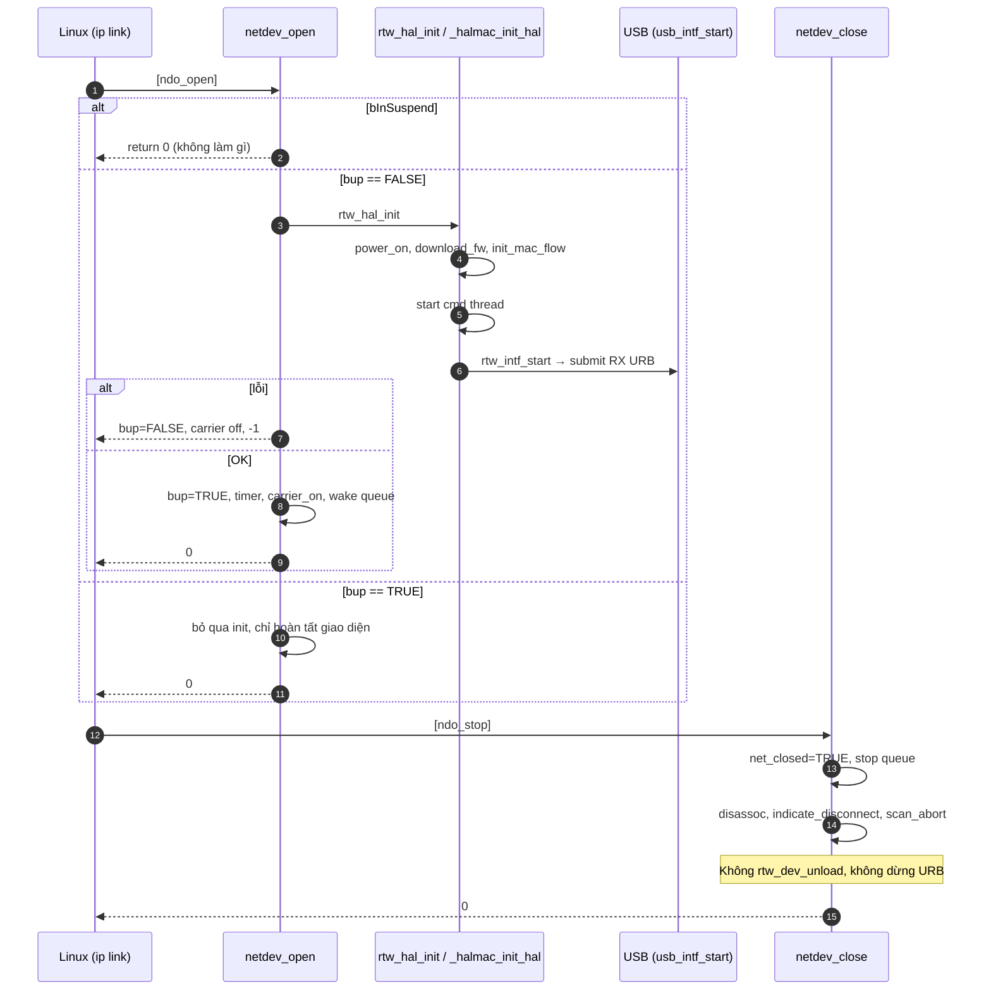

## 0. Đính chính trước

Ở các câu trả lời trước, tôi nói Makefile đặt `CONFIG_IFACE_NUMBER=3` ([Makefile:1991,2147](vscode-webview://1v7kr62lml590cb3gndmegc6ml88sjdjv7262pvi3l6t2rv5t7fr/Kernel/K-S800/Src/drivers/net/wireless/realtek/rtl8812BU_v1930.24/Makefile#L1991)). Hai dòng đó nằm trong khối của nền tảng khác (`RTD299X_LG`, `RTK119X_AM`), không phải `ARM_S800`. Khối S800 ([Makefile:1381](vscode-webview://1v7kr62lml590cb3gndmegc6ml88sjdjv7262pvi3l6t2rv5t7fr/Kernel/K-S800/Src/drivers/net/wireless/realtek/rtl8812BU_v1930.24/Makefile#L1381)) chỉ đặt `CONFIG_CONCURRENT_MODE` và `CONFIG_IOCTL_CFG80211`. Theo [drv_conf.h:404-412](vscode-webview://1v7kr62lml590cb3gndmegc6ml88sjdjv7262pvi3l6t2rv5t7fr/Kernel/K-S800/Src/drivers/net/wireless/realtek/rtl8812BU_v1930.24/include/drv_conf.h#L404-L412), khi đó `IFACE_NUMBER = 2`. Hệ quả: `CONFIG_NEW_NETDEV_HDL` (chỉ bật khi `IFACE_NUMBER > 2`, [drv_conf.h:487-490](vscode-webview://1v7kr62lml590cb3gndmegc6ml88sjdjv7262pvi3l6t2rv5t7fr/Kernel/K-S800/Src/drivers/net/wireless/realtek/rtl8812BU_v1930.24/include/drv_conf.h#L487-L490)) **không được định nghĩa**. Do đó nhánh `_netdev_open` được biên dịch là nhánh `#else` ([os_intfs.c:3739](vscode-webview://1v7kr62lml590cb3gndmegc6ml88sjdjv7262pvi3l6t2rv5t7fr/Kernel/K-S800/Src/drivers/net/wireless/realtek/rtl8812BU_v1930.24/os_dep/linux/os_intfs.c#L3739)). Kết luận về RCR/BSSID trước đó vẫn đúng vì cả hai trường hợp đều chọn cùng nhánh. Giả định: kernel build không thêm cờ `-D` từ bên ngoài.

## 1. Tóm tắt kiến trúc

Trong `probe`, driver cấp `net_device`, gắn bảng `rtw_netdev_ops`, rồi `register_netdev`. Từ lúc đó `wlan0` tồn tại nhưng **chưa bật**. Khi người dùng chạy `ip link set wlan0 up`, kernel gọi `.ndo_open = netdev_open`, và ở lần mở đầu tiên hàm này mới bật nguồn chip, nạp firmware, bật USB RX và khởi động thread. `.ndo_stop = netdev_close` thì **không** tắt chip: nó chỉ ngắt kết nối và dừng queue.

## 2. Khái niệm

|Thuật ngữ|Nghĩa|
|---|---|
|`net_device`|Đối tượng Linux dùng để đại diện `wlan0`.|
|`_adapter`|Struct của driver, quản lý trạng thái Wi-Fi.|
|`net_device_ops`|Bảng callback Linux dùng để ra lệnh cho giao diện (open, stop, xmit...).|
|`ndo_open` / `ndo_stop`|Callback khi giao diện được bật / tắt.|
|`register_netdev`|Báo cho Linux biết giao diện tồn tại.|

Ví dụ: `register_netdev` giống việc lắp ổ điện vào tường (Linux biết có ổ). `ndo_open` giống việc bật công tắc (cấp điện thật). Cắm thiết bị vào ổ và kết nối được vào mạng là chuyện khác nữa.

## 3. Call chain đăng ký `net_device`

```
rtw_drv_init (probe)                                usb_intf.c:1541
 └ rtw_os_ndevs_init                                os_intfs.c:3558
    ├ rtw_os_ndevs_alloc → rtw_os_ndev_alloc        os_intfs.c:1925
    │   ├ rtw_init_netdev                           :1862
    │   │   ├ rtw_alloc_etherdev_with_old_priv      osdep_service.c:2452
    │   │   └ rtw_hook_if_ops: netdev_ops = &rtw_netdev_ops
    │   ├ SET_NETDEV_DEV
    │   └ rtw_cfg80211_ndev_res_alloc
    └ rtw_os_ndevs_register → rtw_os_ndev_register  os_intfs.c:1979
        ├ rtw_cfg80211_ndev_res_register
        ├ rtw_init_netdev_name (dev_alloc_name, carrier_off)
        └ register_netdev(ndev) → adapter->registered = 1
```

- **Liên kết `net_device` ↔ `_adapter`**: `alloc_etherdev_mq` chỉ cấp một struct nhỏ `rtw_netdev_priv_indicator`. `rtw_alloc_etherdev_with_old_priv` gán `pnpi->priv = old_priv`, tức trỏ tới `_adapter` đã được cấp từ `probe` ([osdep_service.c:2465-2467](vscode-webview://1v7kr62lml590cb3gndmegc6ml88sjdjv7262pvi3l6t2rv5t7fr/Kernel/K-S800/Src/drivers/net/wireless/realtek/rtl8812BU_v1930.24/os_dep/osdep_service.c#L2465-L2467)). `rtw_netdev_priv(ndev)` đi ngược lại ([osdep_service_linux.h:569](vscode-webview://1v7kr62lml590cb3gndmegc6ml88sjdjv7262pvi3l6t2rv5t7fr/Kernel/K-S800/Src/drivers/net/wireless/realtek/rtl8812BU_v1930.24/include/osdep_service_linux.h#L569)), còn `padapter->pnetdev = pnetdev` đi xuôi.
- **Bảng ops** ([os_intfs.c:1793-1805](vscode-webview://1v7kr62lml590cb3gndmegc6ml88sjdjv7262pvi3l6t2rv5t7fr/Kernel/K-S800/Src/drivers/net/wireless/realtek/rtl8812BU_v1930.24/os_dep/linux/os_intfs.c#L1793-L1805)): `.ndo_init = rtw_ndev_init`, `.ndo_uninit`, `.ndo_open = netdev_open`, `.ndo_stop = netdev_close`, `.ndo_start_xmit = rtw_xmit_entry`...
- **`ndo_init` chạy trong `register_netdev`** (kernel gọi): `rtw_ndev_init` log MAC, lưu tên cũ, khởi tạo proc.
- **Sau đăng ký**: Linux đã biết `wlan0`, nhưng chưa gọi `ndo_open`; carrier đã `off` từ `rtw_init_netdev_name`.
- **Lỗi đăng ký**: `rtw_os_ndev_register` hủy tài nguyên cfg80211 và wiphy; `rtw_os_ndevs_register` hủy các ndev đã đăng ký; `rtw_os_ndevs_init` gọi `rtw_os_ndevs_free`.

## 4. Luồng `ndo_open()`

Luồng `ndo_open()` — Bật giao diện mạng

Khi người dùng chạy `ip link set wlan0 up`, Linux gọi callback `ndo_open` để yêu cầu driver đưa giao diện mạng vào trạng thái hoạt động.




Ý nghĩa từng bước:

| Bước                | Chức năng                                                                                |
| ------------------- | ---------------------------------------------------------------------------------------- |
| Lấy adapter         | Tìm cấu trúc dữ liệu driver gắn với giao diện `wlan0`.                                   |
| Kiểm tra trạng thái | Tránh khởi tạo lại không cần thiết hoặc sử dụng trạng thái không hợp lệ.                 |
| Khởi tạo phần cứng  | Chuẩn bị chip và firmware nếu luồng thực tế yêu cầu ở giai đoạn này.                     |
| Chuẩn bị tài nguyên | Khởi động những thành phần phục vụ hoạt động của giao diện, chẳng hạn TX/RX hoặc thread. |
| Bật TX queue        | Cho phép Linux chuyển gói tin xuống đường truyền của driver khi đã sẵn sàng.             |
| Trả kết quả         | Báo cho Linux biết việc mở giao diện thành công hay thất bại.                            |



Callback `netdev_open` ([os_intfs.c:3898](vscode-webview://1v7kr62lml590cb3gndmegc6ml88sjdjv7262pvi3l6t2rv5t7fr/Kernel/K-S800/Src/drivers/net/wireless/realtek/rtl8812BU_v1930.24/os_dep/linux/os_intfs.c#L3898)), kernel gọi khi `ip link set wlan0 up`. Nó giữ `hw_init_mutex`, rồi: adapter chính gọi `_netdev_open`; adapter phụ gọi `_netdev_vir_if_open`.

1. **Điều kiện đầu.** Nếu `bInInternalAutoSuspend` thì `rtw_pwr_wakeup` đánh thức chip; nếu `bInSuspend == TRUE` thì **trả 0 mà không làm gì**.
2. **Đường tắt autosuspend.** Nếu `ps_flag == TRUE` thì chỉ đặt `net_closed = FALSE` và nhảy tới phần kết, bỏ qua khởi tạo.
3. **Khởi tạo đầy đủ khi `bup == FALSE`** ([dòng 3764](vscode-webview://1v7kr62lml590cb3gndmegc6ml88sjdjv7262pvi3l6t2rv5t7fr/Kernel/K-S800/Src/drivers/net/wireless/realtek/rtl8812BU_v1930.24/os_dep/linux/os_intfs.c#L3764)): xóa cờ `surprise_removed` và `drv_stopped`, rồi gọi **`rtw_hal_init`**. Đây là bước tiêu tốn thời gian và chạm phần cứng. Nó gọi `hal_init = rtl8822bu_init` → `rtl8822b_init` → `rtl8822b_hal_init`, tải firmware từ mảng `array_mp_8822b_fw_nic` ([rtl8822b_halinit.c:198](vscode-webview://1v7kr62lml590cb3gndmegc6ml88sjdjv7262pvi3l6t2rv5t7fr/Kernel/K-S800/Src/drivers/net/wireless/realtek/rtl8812BU_v1930.24/hal/rtl8822b/rtl8822b_halinit.c#L198)), trừ khi `CONFIG_FILE_FWIMG` bật và có file (tôi chưa kiểm tra). Phần chính ở `_halmac_init_hal` ([hal_halmac.c:3548](vscode-webview://1v7kr62lml590cb3gndmegc6ml88sjdjv7262pvi3l6t2rv5t7fr/Kernel/K-S800/Src/drivers/net/wireless/realtek/rtl8812BU_v1930.24/hal/hal_halmac.c#L3548)):
    - Bật nguồn MAC (`rtw_hal_power_on`).
    - Nạp firmware (`download_fw`).
    - Khởi tạo luồng MAC (`init_mac_flow`).
    - **`_drv_enable_trx`**: nếu `bup == FALSE` thì `rtw_start_drv_threads` (có thread `RTW_CMD_THREAD`, và xmit/recv thread tùy cấu hình), rồi `rtw_intf_start` → `usb_intf_start` → `rtl8822bu_inirp_init`, **gửi `NR_RECVBUFF` URB nhận** qua bulk-in ([rtl8822bu_halinit.c:330-338](vscode-webview://1v7kr62lml590cb3gndmegc6ml88sjdjv7262pvi3l6t2rv5t7fr/Kernel/K-S800/Src/drivers/net/wireless/realtek/rtl8812BU_v1930.24/hal/rtl8822b/usb/rtl8822bu_halinit.c#L330-L338)).
    - Gửi general info cho firmware, init MAC register, `rtw_halmac_config_rx_info(PHY_STATUS)`. Các bước BB/RF phía sau tôi chưa đọc.
    - Quay lại `rtw_hal_init`: đặt `hw_init_completed`, đặt MAC, khôi phục cấu hình HW port, WEP key, LED, `init_hw_mlme_ext`, `rtw_hal_init_opmode`.
4. **`RTW_HALMAC` được định nghĩa** ([autoconf.h:112](vscode-webview://1v7kr62lml590cb3gndmegc6ml88sjdjv7262pvi3l6t2rv5t7fr/Kernel/K-S800/Src/drivers/net/wireless/realtek/rtl8812BU_v1930.24/include/autoconf.h#L112)), nên `rtw_intf_start` và `rtw_start_drv_threads` trực tiếp trong `_netdev_open` bị bỏ qua (`#ifndef RTW_HALMAC`). Chúng đã chạy bên trong bước 3. Nếu chỉ đọc `_netdev_open` mà không đi sâu thì sẽ tưởng driver không bật USB RX.
5. **Hoàn tất giao diện**: cfg80211 `init_wiphy`/`init_wdev_data`, LED, `bup = TRUE`, `net_closed = FALSE`, hẹn `dynamic_chk_timer` (2 giây), `netif_carrier_on`, `netif_wake_queue`. Chú ý `netif_carrier_on` được gọi ngay lúc mở, kèm comment ghi chú của nhà cung cấp rằng làm vậy để tránh trễ khi nhận EAPOL; carrier ở đây **không** có nghĩa đã vào AP.
6. **Interface phụ.** Với `CONFIG_CONCURRENT_MODE`, nếu `padapters[IFACE_ID1]` tồn tại và `bup == FALSE` thì mở luôn (`_netdev_vir_if_open`), vì `CONFIG_RTW_DYNAMIC_NDEV` không được định nghĩa.
7. **Lỗi.** `rtw_hal_init` thất bại thì `bup = FALSE`, tắt carrier, dừng queue, trả `-1`.

Mở lần thứ hai khi `bup == TRUE`: bước 3 bị bỏ qua, chỉ chạy phần hoàn tất (bước 5). Hậu quả nếu chip đã bị IPS tắt trong lúc giao diện đóng: tôi chưa xác minh nhánh này có đánh thức lại chip hay không (`netdev_open` chỉ gọi `rtw_pwr_wakeup` trong trường hợp autosuspend).

### Ý nghĩa các giai đoạn

|Giai đoạn|Chức năng|
|---|---|
|Kiểm tra suspend|Xác định có cần đánh thức thiết bị hay phải thoát sớm do hệ thống đang suspend.|
|Kiểm tra `ps_flag`|Cho phép đi đường mở nhanh, tránh chạy lại toàn bộ khởi tạo.|
|`rtw_hal_init()`|Khởi tạo phần cứng nếu `bup == FALSE`, bao gồm luồng HAL và HALMAC.|
|`_drv_enable_trx()`|Khởi động các thành phần truyền nhận; trong nhánh này, thread và USB RX được khởi động từ bên trong luồng HAL.|
|Hoàn tất interface|Cập nhật trạng thái driver, timer, carrier và TX queue.|

Điểm quan trọng: `netdev_open()` không trực tiếp gọi `rtw_start_drv_threads()` hay `rtw_intf_start()` trong nhánh `RTW_HALMAC` bạn mô tả. Các thao tác đó nằm sâu bên trong quá trình khởi tạo HAL.

## 5. Luồng `ndo_stop()`
Khi người dùng chạy `ip link set wlan0 down`, Linux gọi callback `ndo_stop` để driver dừng hoạt động của giao diện mạng.



Ý nghĩa từng bước:

| Bước                  | Chức năng                                                                                |
| --------------------- | ---------------------------------------------------------------------------------------- |
| Dừng TX queue         | Ngăn Linux tiếp tục đưa gói tin mới vào đường truyền.                                    |
| Dừng hoạt động nền    | Ngăn những tác vụ định kỳ hoặc bất đồng bộ tiếp tục hoạt động khi không còn phù hợp.     |
| Dừng TX/RX và USB I/O | Xử lý các hoạt động truyền nhận đang diễn ra theo cơ chế đồng bộ của driver.             |
| Dọn trạng thái        | Đưa các tài nguyên liên quan về trạng thái phù hợp để có thể đóng hoặc mở lại giao diện. |
| Trả kết quả           | Báo cho Linux biết callback dừng giao diện đã hoàn tất.                                  |



`netdev_close` ([os_intfs.c:4169](vscode-webview://1v7kr62lml590cb3gndmegc6ml88sjdjv7262pvi3l6t2rv5t7fr/Kernel/K-S800/Src/drivers/net/wireless/realtek/rtl8812BU_v1930.24/os_dep/linux/os_intfs.c#L4169)). Nhánh biên dịch là nhánh `#ifndef CONFIG_PLATFORM_INTEL_BYT` (S800 không đặt cờ này) và `CONFIG_ANDROID` không bật.

1. (Autosuspend) chờ nếu đang suspend/resume.
2. Đặt `net_closed = TRUE`, `netif_up = FALSE`, xóa `bBusyTraffic`.
3. Nếu `rf_pwrstate == rf_on`: dừng queue TX, `LeaveAllPowerSaveMode`, `rtw_disassoc_cmd` (chờ ACK 500 ms), `rtw_indicate_disconnect`, giải phóng tài nguyên association, giải phóng network queue.
4. Tắt P2P nếu đang bật; `rtw_scan_abort`; chờ hàng đợi scan cfg80211 rỗng (200 ms).
5. Trả `0`.

**Điều quan trọng:** trong nhánh này, `netdev_close` **không** gọi `rtw_dev_unload`. Mã gọi nó nằm trong nhánh `#else` của `INTEL_BYT` và không được biên dịch. Do đó không có `rtw_intf_stop` (URB RX vẫn đang nộp), không dừng thread, không `rtw_hal_deinit`, và `bup` vẫn `TRUE`. Chip không bị tắt nguồn ở bước này. Việc hạ nguồn khi giao diện đóng, nếu có, đến từ IPS (`rtw_ps_processor`, chủ đề đầu tiên của chúng ta); mối liên hệ cụ thể (`net_closed` ảnh hưởng điều kiện IPS) tôi chưa đối chiếu hết. `rtw_dev_unload` ([dòng 4628](vscode-webview://1v7kr62lml590cb3gndmegc6ml88sjdjv7262pvi3l6t2rv5t7fr/Kernel/K-S800/Src/drivers/net/wireless/realtek/rtl8812BU_v1930.24/os_dep/linux/os_intfs.c#L4628)) thực sự dừng USB và deinit HAL, nhưng nó được gọi ở đường khác như `rtw_usb_primary_adapter_deinit` khi gỡ thiết bị.

|Khái niệm|Trong code này|
|---|---|
|Tắt giao diện mạng|`netdev_close`: queue dừng, `net_closed = TRUE`|
|Ngắt kết nối Wi-Fi|`rtw_disassoc_cmd` + `rtw_indicate_disconnect`|
|Dừng USB I/O|**Không** xảy ra trong `netdev_close` (cần `rtw_intf_stop`)|
|Tắt nguồn chip|**Không** xảy ra ở đây|

## 6. Sequence diagrams

**Diagram 1: Đăng ký**



**Diagram 2: Bật và tắt**



## 7. Lỗi và cleanup

|Nơi|Xử lý|
|---|---|
|Alloc/register `net_device`|Hủy cfg80211, wiphy, napi (nếu có); `ndevs_free`|
|`rtw_hal_init` lỗi trong `_netdev_open`|`bup=FALSE`, `carrier_off`, `stop_queue`, trả `-1`|
|`_drv_enable_trx` lỗi (thread)|`_halmac_init_hal` thoát với `-1`|
|`bInSuspend`|Trả 0, không mở giao diện|

## 8. Tóm tắt

- Đăng ký (`register_netdev`) ≠ bật (`ndo_open`) ≠ kết nối AP.
- `ndo_open` lần đầu là nơi chip được bật nguồn, nạp firmware, bật USB RX và thread (qua `rtw_hal_init`).
- `RTW_HALMAC` đẩy thread và `rtw_intf_start` vào bên trong HALMAC init.
- `netdev_close` trong build này chỉ ngắt kết nối và dừng queue; không dừng USB, không tắt chip.
- Mở lại khi `bup == TRUE` rẻ hơn rất nhiều so với lần đầu.

## 9. Tự kiểm tra

1. `register_netdev` đã làm chip hoạt động chưa? Vì sao?
2. `_netdev_open` không gọi `rtw_intf_start` trực tiếp, vậy USB RX được bật ở đâu?
3. `netdev_close` có gọi `rtw_dev_unload` không? Hệ quả với URB nhận và nguồn chip?
4. Vì sao carrier bật ngay lúc `ip link up` mà chưa vào AP?
5. Lần `up` thứ hai (sau `down`) khác lần đầu ở điểm nào?

## Chưa xác minh

- Các bước BB/RF sau `rtw_halmac_config_rx_info` trong `_halmac_init_hal`.
- Việc `CONFIG_FILE_FWIMG` có bật hay không.
- Hành vi mở lại sau khi IPS đã tắt chip.
- Chưa chạy thực tế để xác nhận bằng log.