# Phân tích `os_intfs.c` - driver Realtek RTL8812BU/8822BU

File được phân tích:
`Kernel/Src/drivers/net/wireless/realtek/rtl8812BU_v1930.24/os_dep/linux/os_intfs.c` (5923 dòng).

Repo có 5 file `os_intfs.c`. Đây là bản đang được build: `realtek/Makefile` có `obj-$(CONFIG_RTL8822BU) += rtl8812BU_v1930.24/`, còn các bản khác bị comment hoặc nằm trong `staging`.

## Cấu hình biên dịch thực tế

Đối chiếu từ `Makefile`, `include/autoconf.h`, `include/drv_conf.h` để biết nhánh `#ifdef` nào đang chạy:

| Bật | Tắt / không định nghĩa |
|---|---|
| RTL8822B, USB_HCI, `RTW_HALMAC` | **`CONFIG_NEW_NETDEV_HDL`** (chỉ bật khi `IFACE_NUMBER > 2`) |
| `CONFIG_CONCURRENT_MODE` (`CONFIG_IFACE_NUMBER = 2`: 1 chính + 1 ảo) | `RTW_SINGLE_WIPHY`, `CONFIG_RTW_DYNAMIC_NDEV` |
| `CONFIG_IOCTL_CFG80211`, `CONFIG_AP_MODE`, `CONFIG_P2P` | `CONFIG_AP_WOWLAN`, `CONFIG_CONCURRENT_WOWLAN` |
| `CONFIG_IPS` + `IPS_CHECK_IN_WD`, `CONFIG_LPS`, `CONFIG_AUTOSUSPEND` | `CONFIG_RESUME_IN_WORKQUEUE`, `PLATFORM_INTEL_BYT` |
| `CONFIG_WOWLAN`, `CONFIG_ARP_KEEP_ALIVE`, `CONFIG_RTW_NAPI`/`GRO`, `CONFIG_BR_EXT`, `CONFIG_MCC_MODE` | `CONFIG_APPEND_VENDOR_IE_ENABLE`, `CONFIG_GPIO_API` |

**Quy ước trong các diagram:** cột/participant **"Ngoài file"** là hàm nằm ngoài `os_intfs.c` (**[hàm ngoài file]**), không đoán phần triển khai. Mũi tên `->>` là gọi trực tiếp; chỗ nào chỉ là đăng ký callback thì có ghi chú bằng chữ.

---

## 1. Chức năng tổng thể

`os_intfs.c` là **lớp OS-interface (Linux) của driver**. Nó nối ba phía:

- **Linux Kernel:** `net_device_ops`, notifier của netdevice/inetaddr, suspend/resume, tham số module.
- **Lớp bus USB:** `usb_intf.c` gọi vào file này lúc probe, remove, suspend, resume.
- **Lõi driver:** `core/` (mlme, cmd, xmit/recv, pwrctrl), `hal/` (phần cứng) và `ioctl_cfg80211.c`.

File này không chứa thuật toán Wi-Fi. Nó tạo và hủy đối tượng, dựng `net_device`, đưa driver lên hoặc xuống, và quản lý nguồn.

| Nhóm | Nhiệm vụ |
|---|---|
| A. Tham số | Module param (`module_param`, đầu file) rồi `loadparam` chép vào `registry_priv` |
| B. Đối tượng thiết bị | `devobj_init/deinit` tạo/hủy `dvobj_priv` (mutex, timer, macid, cam dùng chung cho mọi interface) |
| C. Phần mềm của adapter | `rtw_init_drv_sw` / `rtw_free_drv_sw` / `rtw_reset_drv_sw` |
| D. `net_device` | Cấp phát, đặt tên, đăng ký/hủy đăng ký (`rtw_os_ndev*`, `rtw_os_ndevs*`) |
| E. Callback `net_device_ops` | open/close, MAC address, stats, select_queue, init/uninit |
| F. Notifier | Theo dõi đổi tên netdev và đổi địa chỉ IP |
| G. Interface ảo | `rtw_drv_add_vir_if` và các hàm stop/free (concurrent mode) |
| H. Thread / interface bus | `rtw_start/stop_drv_threads`, `rtw_intf_start/stop` |
| I. Nguồn | IPS (`rtw_ips_*`), `rtw_dev_unload`, suspend/resume (có WoWLAN) |
| J. Phụ trợ | Truy vấn gateway cho ARP keep-alive (`rtw_gw_addr_query` và các hàm route/arp) |

---

## 2. Danh sách hàm và nhóm chức năng

Chỉ liệt kê hàm **có được biên dịch** trong cấu hình hiện tại. Ghi chú về hàm không chạy nằm ở cuối mục.

### A. Tham số
- **`loadparam(padapter)`**
  - Gọi khi tạo mỗi adapter: `rtw_usb_primary_adapter_init` và `rtw_drv_add_vir_if`.
  - Chép toàn bộ `rtw_xxx` (module param) sang `padapter->registrypriv`.
  - Gọi `rtw_regsty_load_target_tx_power`, `rtw_regsty_load_excl_chs`, `rtw_regsty_init_rx_ampdu_sz_limit`.
  - Kết quả: registry sẵn sàng cho các bước init sau.

### B. `dvobj_priv`
- **`devobj_init()`**: gọi lúc probe (qua `usb_dvobj_init`). Cấp phát `dvobj_priv`, khởi tạo mutex/spinlock, `rtw_macid_ctl_init`, hai timer (`dynamic_chk_timer`, `periodic_tsf_update_end_timer`), dữ liệu MCC.
- **`devobj_deinit()`**: gọi lúc remove hoặc probe lỗi (qua `usb_dvobj_deinit`). Gọi `rtw_cfg80211_dev_res_free`, hủy mutex/spinlock, giải phóng `dvobj`.
- **`rtw_rtnl_lock_needed`, `rtw_set_rtnl_lock_holder`**: cho biết thread hiện tại đã giữ `rtnl_lock` chưa (khi cfg80211 gọi vào) để chọn giữa `register_netdev` và `register_netdevice`.

### C. Phần mềm của adapter
- **`rtw_init_drv_sw`**
  - Gọi từ `rtw_usb_primary_adapter_init` và `rtw_drv_add_vir_if`.
  - Gọi `rtw_init_default_value`, rồi chuỗi init: `rtw_init_cmd_priv`, `rtw_init_evt_priv`, `rtw_init_mlme_priv`, `init_mlme_ext_priv`, `_rtw_init_xmit_priv`, `_rtw_init_recv_priv`, `_rtw_init_sta_priv`, `rtw_init_pwrctrl_priv`, `init_mp_priv`, `rtw_hal_dm_init`...
  - Bước nào `_FAIL` thì nhảy `exit` và trả `_FAIL`.
  - Với adapter chính còn gọi `rtw_rfctl_init`, `rtw_hal_rfpath_init`, `rtw_hal_trxnss_init`.
- **`rtw_init_default_value`**: đặt giá trị mặc định cho xmit/security/registry/debug; gọi `rtw_hal_def_value_init`, `rtw_hal_mcc_parameter_init`, `rtw_acs_start/stop`.
- **`rtw_reset_drv_sw`**: gọi khi bật lại driver sau IPS hoặc resume (và từ `rtw_cmd.c`). Đặt lại cờ và bộ đếm, không cấp phát lại.
- **`rtw_free_drv_sw`**: giải phóng ngược `rtw_init_drv_sw` (`free_mlme_ext_priv`, `rtw_free_cmd_priv`, `_rtw_free_xmit_priv`, `rtw_hal_free_data`...).
- **`rtw_cancel_all_timer`**: hủy mọi timer của adapter (assoc, scan, dynamic_chk, pwr_state_check, LED, cfg80211 auth/assoc...) và gọi `rtw_hal_dm_deinit`.

### D. Cấp phát và đăng ký `net_device`
- **`rtw_init_netdev`**: gọi `rtw_alloc_etherdev`, rồi `rtw_hook_if_ops` (hoặc `rtw_hook_vir_if_ops` cho interface ảo) để gắn bảng `net_device_ops`. Đặt feature SG, watchdog 3 giây, `wireless_handlers`.
- **`rtw_os_ndev_alloc`**: `rtw_init_netdev`, `SET_NETDEV_DEV`, `rtw_cfg80211_ndev_res_alloc`.
- **`rtw_os_ndev_register`**: `netif_napi_add`, `rtw_cfg80211_ndev_res_register`, `rtw_init_netdev_name`, `register_netdev`/`register_netdevice`. Lỗi thì tự rollback.
- **`rtw_os_ndev_unregister`**: ngược lại: `unregister_netdev`/`unregister_netdevice`, `rtw_wiphy_unregister`, `napi_disable`, `netif_napi_del`.
- **`rtw_os_ndev_free`**: `rtw_cfg80211_ndev_res_free`, `rtw_free_netdev`.
- **`rtw_os_ndev_init` / `rtw_os_ndev_deinit`**: gói alloc + register (hoặc unregister + free) cho **một** adapter.
- **`rtw_os_ndevs_alloc/free/register/unregister/init/deinit`**: bản **cho mọi adapter** trong `dvobj`, kèm tài nguyên cfg80211 mức thiết bị (`rtw_cfg80211_dev_res_*`).
- **`rtw_init_netdev_name`**: `dev_alloc_name`, `rtw_netif_carrier_off`.
- **`rtw_ndev_destructor`**: không gắn cho netdev chính. Chỉ `ioctl_cfg80211.c` gán nó làm destructor cho netdev **monitor**.

### E. Callback `net_device_ops`
Bảng `rtw_netdev_ops` (interface chính) và `rtw_netdev_vir_if_ops` (interface ảo):

| Callback | Hàm trong file | Ghi chú |
|---|---|---|
| `ndo_init` | `rtw_ndev_init` | Gọi `rtw_adapter_proc_init` |
| `ndo_uninit` | `rtw_ndev_uninit` | Gọi `rtw_adapter_proc_deinit` |
| `ndo_open` | `netdev_open` (chính), `netdev_vir_if_open` (ảo) | |
| `ndo_stop` | `netdev_close` (chính), `netdev_vir_if_close` (ảo) | |
| `ndo_set_mac_address` | `rtw_net_set_mac_address` | |
| `ndo_get_stats` | `rtw_net_get_stats` | |
| `ndo_select_queue` | `rtw_select_queue` (+ `rtw_classify8021d`) | |
| `ndo_start_xmit` | `rtw_xmit_entry` | **[hàm ngoài file]** |
| `ndo_do_ioctl` | `rtw_ioctl` | **[hàm ngoài file]** |

Ngoài ra `rtw_recv_select_queue` được `recv_linux.c:509` gọi để chọn queue cho gói nhận.

### F. Notifier
- **`rtw_ndev_notifier_register/unregister`**: gọi trong `rtw_drv_entry`/`rtw_drv_halt`. Callback `rtw_ndev_notifier_call` chỉ xử lý netdev của chính driver (`is_rtw_ndev`).
- **`rtw_inetaddr_notifier_register/unregister`**: callback `rtw_inetaddr_notifier_call`, và `rtw_inet6addr_notifier_call` nếu kernel có IPv6.

### G. Interface ảo
`rtw_drv_add_vir_if`, `rtw_drv_stop_vir_if`, `rtw_drv_free_vir_if`, `rtw_drv_stop_vir_ifaces`, `rtw_drv_free_vir_ifaces`, `_netdev_vir_if_open`, `netdev_vir_if_open`, `netdev_vir_if_close`.

### H. Thread và interface bus
- **`rtw_start_drv_threads`**: với adapter chính tạo `RTW_CMD_THREAD` và chờ `start_cmdthread_sema`; gọi `rtw_hal_start_thread`. Các thread XMIT/RECV/EVENT không được bật trong cấu hình này.
- **`rtw_stop_drv_threads`**: ngược lại (`rtw_stop_cmd_thread`, `rtw_hal_stop_thread`).
- **`rtw_intf_start/stop`**: gọi con trỏ `adapter->intf_start/intf_stop`. `usb_intf.c` gán thành `usb_intf_start`/`usb_intf_stop` (bật/tắt URB USB).

### I. Mở/đóng, IPS, nguồn
- **Mở/đóng:** `_netdev_open`, `netdev_open`, `pm_netdev_open`, `netdev_close`, `pm_netdev_close`, `netdev_br_init`
- **IPS:** `ips_netdrv_open`, `rtw_ips_pwr_up`, `rtw_ips_pwr_down`, `rtw_ips_dev_unload`
- **Tắt phần cứng:** `rtw_dev_unload`
- **Suspend:** `rtw_suspend_common`, `rtw_suspend_wow`, `rtw_suspend_normal`, `rtw_suspend_free_assoc_resource`
- **Resume:** `rtw_resume_common`, `rtw_resume_process_wow`, `rtw_resume_process_normal`, `rtw_mi_resume_process_normal`

### J. Gateway cho ARP keep-alive
`parse_routes`, `route_dump`, `arp_query`, `get_defaultgw`, `rtw_gw_addr_query`.
- Chỉ `rtw_gw_addr_query` được gọi từ ngoài (`rtw_mlme_ext.c:13055`).
- Nó lấy IP và MAC của default gateway rồi lưu vào `pmlmepriv->gw_ip` và `gw_mac_addr`.

### Hàm có trong file nhưng không chạy trong cấu hình này
- **Bị `#ifdef` loại:**
  - `_pm_netdev_open`, `_mi_pm_netdev_open` (cần `NEW_NETDEV_HDL`)
  - `rtw_suspend_ap_wow`, `rtw_resume_process_ap_wow`
  - `rtw_suspend_concurrent_wow`, `rtw_resume_process_concurrent_wow`
  - Nhóm GPIO API
  - `rtw_vendor_ie_get_api`, `rtw_vendor_ie_set_api`
- **Không có nơi gọi:** `rtw_cancel_dynamic_chk_timer` (WOWLAN) chỉ có khai báo trong header, không thấy nơi gọi.

---

## 3. Các sequence xuyên suốt

### Seq 1. Nạp module và probe thiết bị USB

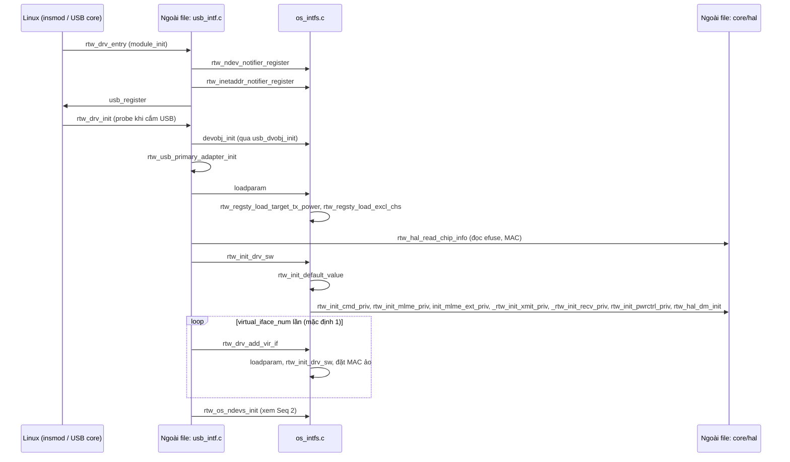

Khi USB được cắm, `rtw_drv_init` tạo `dvobj_priv` bằng `devobj_init`, rồi tạo adapter chính. `loadparam` nạp tham số, `rtw_init_drv_sw` khởi tạo cmd/mlme/xmit/recv/pwr... (hàm nào `_FAIL` thì adapter bị bỏ). Sau đó, vì `CONCURRENT_MODE` bật, `rtw_drv_add_vir_if` tạo thêm adapter ảo bằng cách **copy** adapter chính (`_rtw_memcpy`), rồi tự init lại phần mềm riêng và lấy MAC từ MAC chính với bit locally-administered (`mac[0] |= BIT(1)`). Notifier được đăng ký từ `rtw_drv_entry`, trước cả probe. Lúc này chưa có phần cứng nào được bật: `rtw_hal_init` chỉ chạy khi mở interface.

### Seq 2. Tạo và đăng ký `net_device` (`rtw_os_ndevs_init`)

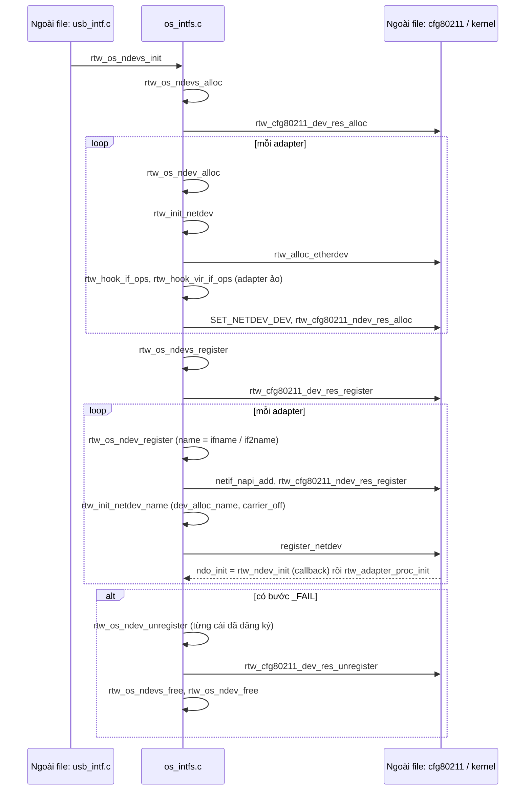

Có 2 pha: **alloc** (tạo `net_device` kèm tài nguyên cfg80211, chưa ai thấy) rồi **register** (đặt tên `ifname`, `if2name` hoặc `wlan%d`, đưa vào kernel). Khi `register_netdev` thành công, kernel **tự gọi callback** `ndo_init = rtw_ndev_init` (không phải gọi trực tiếp). Hàm này ghi tên cũ và tạo mục `/proc`. Nếu đăng ký lỗi thì `rtw_os_ndev_register` tự hoàn tác phần của nó (hủy cfg80211, `netif_napi_del`). `rtw_os_ndevs_register` hủy các interface đã đăng ký, rồi `rtw_os_ndevs_init` gọi `rtw_os_ndevs_free`.

### Seq 3. Mở giao diện (`ifconfig wlan0 up`)

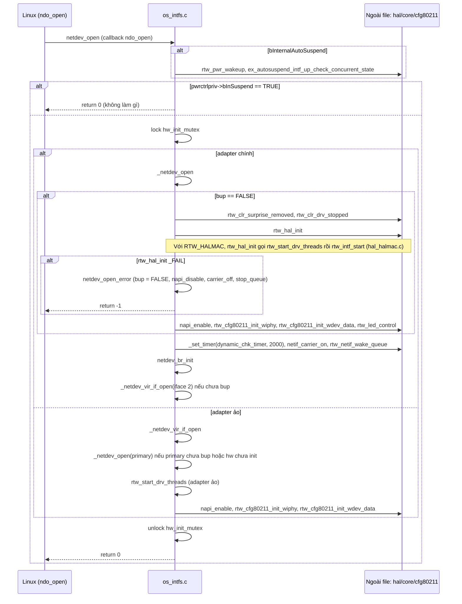

Linux gọi `netdev_open` để bật interface. Nếu hệ thống đang suspend (`bInSuspend`) thì hàm trả 0 ngay. Với interface **chính**, `_netdev_open` bật phần cứng bằng `rtw_hal_init`. Vì `RTW_HALMAC` bật, việc tạo thread và `rtw_intf_start` nằm trong hàm HAL (`hal_halmac.c:3528/3536`), nên các khối `#ifndef RTW_HALMAC` trong file không chạy. Sau đó driver bật NAPI, khởi tạo wiphy/wdev của cfg80211, bật timer kiểm tra định kỳ (2 giây), `netif_carrier_on` và đánh thức TX queue. Cuối cùng nó mở luôn interface ảo thứ 2 (`_netdev_vir_if_open`). Interface **ảo** mở ngược lại: nếu interface chính chưa chạy thì nó gọi `_netdev_open` của interface chính trước.

Ghi chú: nếu `CONFIG_NEW_NETDEV_HDL` bật, `_netdev_open` có phiên bản khác và `ndo_open` của interface ảo cũng là `netdev_open`. Cấu hình hiện tại không dùng nhánh đó.

### Seq 4. Đóng giao diện (`ifconfig wlan0 down`)

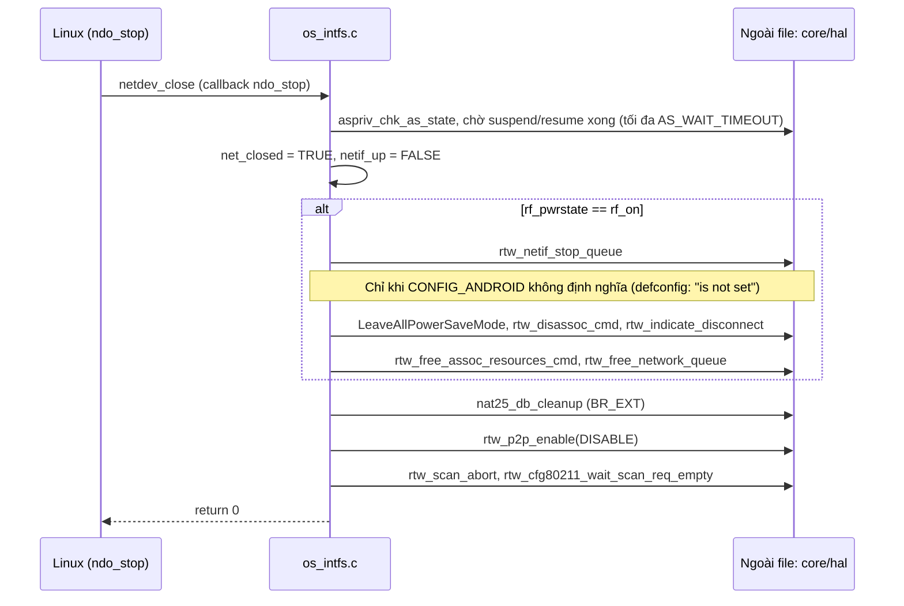

`netdev_close` **không tắt phần cứng**: nó không gọi `rtw_dev_unload`, chỉ ngắt kết nối, hủy scan, dừng P2P và giải phóng tài nguyên liên quan. Việc tắt phần cứng nằm ở IPS (Seq 5), remove (Seq 6) hoặc suspend (Seq 8). Interface ảo dùng `netdev_vir_if_close` (rút gọn): dừng queue, tắt P2P, hủy scan. Hàm `pm_netdev_close` chỉ gọi lại `netdev_close`.

### Seq 5. IPS (tiết kiệm điện khi chưa kết nối): tắt/bật phần cứng

IPS là **callback từ `rtw_pwrctrl.c`** (`_ips_enter`/`_ips_leave`), không phải từ Linux.

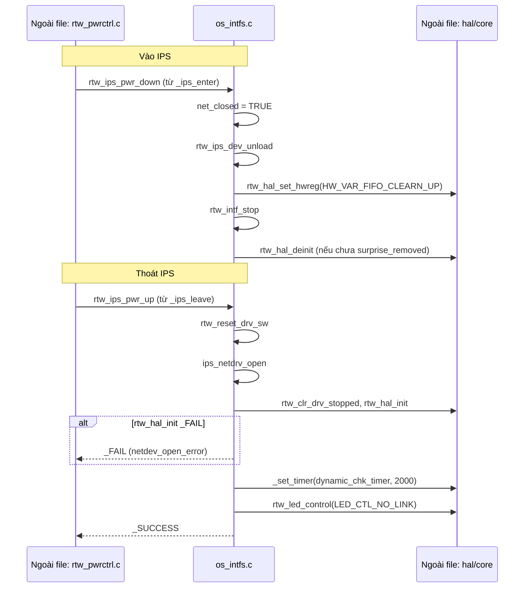

Khi không kết nối, `rtw_pwrctrl.c` cho chip ngủ qua `rtw_ips_pwr_down`: tắt interface bus và `rtw_hal_deinit` nhưng **không** hủy adapter hay `net_device`. Khi cần dùng lại, `rtw_ips_pwr_up` đưa phần mềm về trạng thái ban đầu rồi `ips_netdrv_open` gọi lại `rtw_hal_init`. `pm_netdev_open(pnetdev, _FALSE)` đi cùng đường này (`ips_netdrv_open`); nó được `usb_intf.c:rtw_hw_resume` gọi lúc resume phần cứng sau auto-suspend.

### Seq 6. Gỡ thiết bị (rút USB / `rmmod`) và dọn tài nguyên

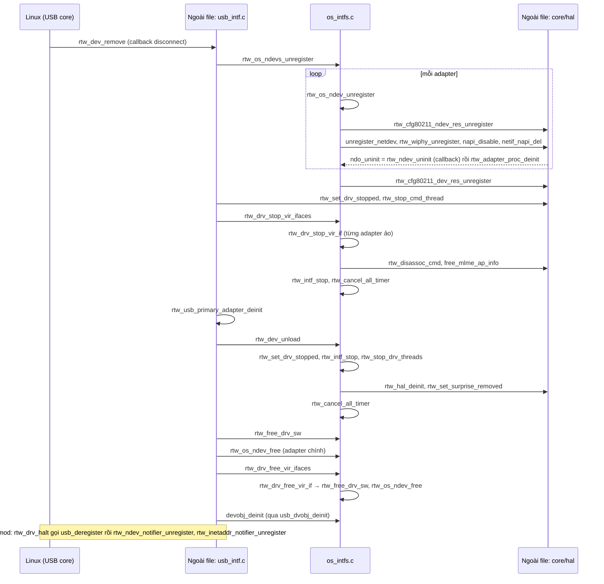

Thứ tự là **ngắt khỏi kernel trước** (hủy đăng ký `net_device`), **dừng thread và phần cứng** (`rtw_dev_unload`), **giải phóng phần mềm** (`rtw_free_drv_sw`, `rtw_os_ndev_free`), rồi mới **hủy `dvobj`**. Trong `rtw_dev_unload`, nếu `bInternalAutoSuspend` thì không dừng thread. Sau `rtw_hal_deinit` nó gọi `rtw_set_surprise_removed`, nên lần bật sau phải xóa cờ này (`_netdev_open` và `rtw_resume_process_normal` đều có `rtw_clr_surprise_removed`).

### Seq 7. Lỗi khi khởi tạo và rollback

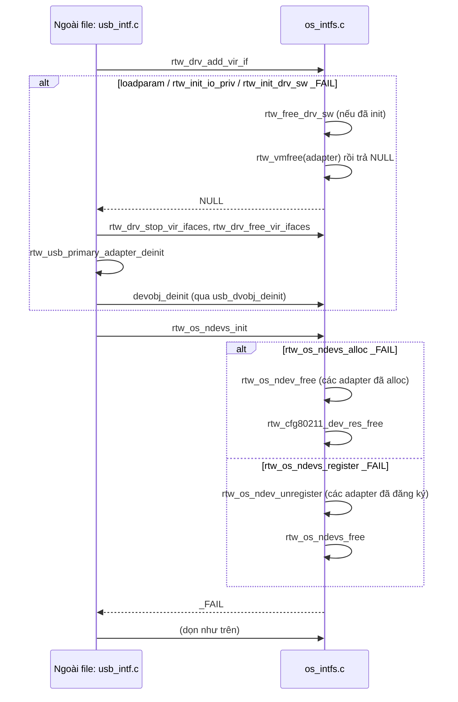

Mọi bước tạo đều có hướng ngược lại: `rtw_drv_add_vir_if` dùng `goto free_drv_sw`/`free_adapter`, `rtw_os_ndev_init` gọi `rtw_os_ndev_free` khi lỗi, `rtw_os_ndevs_init` gọi `rtw_os_ndevs_free`. Nếu `rtw_os_ndevs_init` trả `_FAIL`, `rtw_drv_init` chạy tiếp các nhãn `free_if_vir`, `free_if_prim`, `free_dvobj`. `rtw_os_ndev_register` tự rollback (`rtw_cfg80211_ndev_res_unregister`, `rtw_wiphy_unregister`, `netif_napi_del`). Khi `rtw_hal_init` lỗi lúc mở interface thì `bup = FALSE`, tắt NAPI và carrier (đã nêu ở Seq 3).

### Seq 8. Suspend

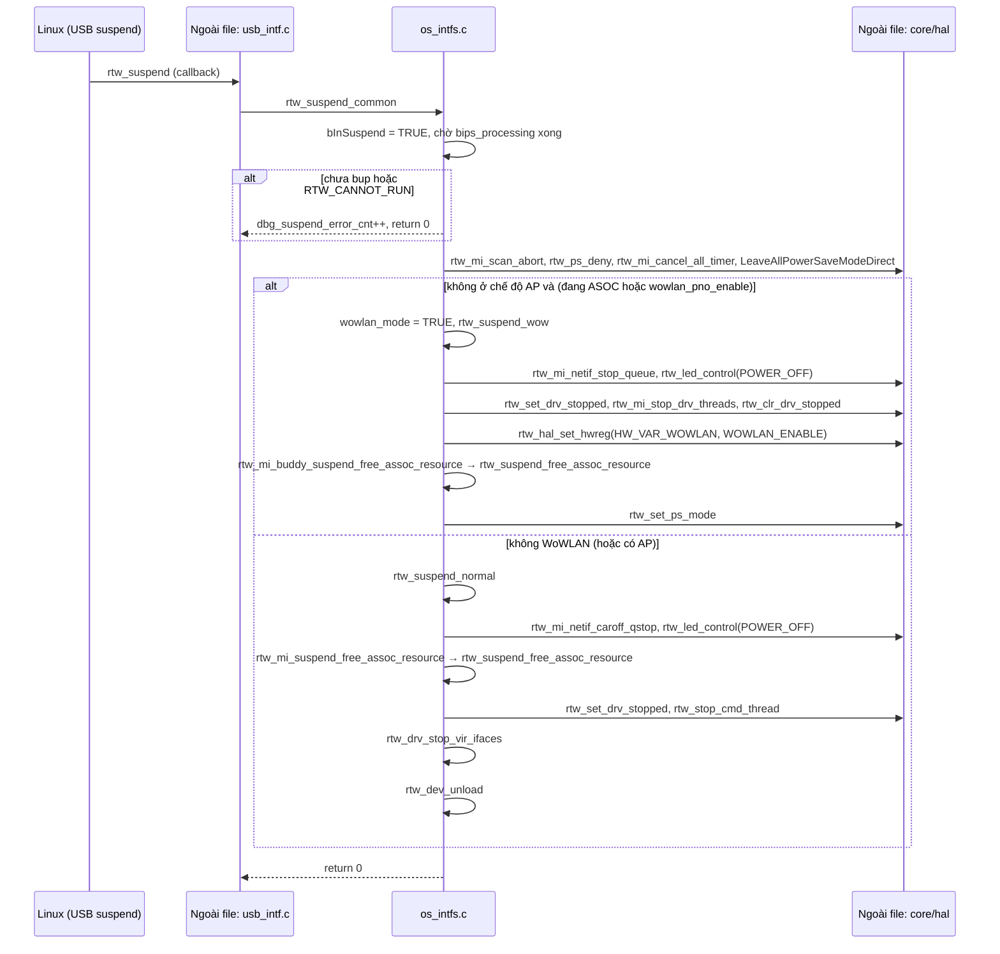

`rtw_suspend_common` quyết định kiểu ngủ: đang kết nối thì dùng **WoWLAN** (`rtw_suspend_wow`, giữ firmware thức, `HW_VAR_WOWLAN` báo firmware bật Wake-on-WLAN), còn lại thì **tắt hẳn** (`rtw_suspend_normal`). Chế độ AP luôn đi `rtw_suspend_normal` vì `AP_WOWLAN` không bật. `rtw_suspend_free_assoc_resource` ngắt kết nối STA (`rtw_disassoc_cmd`, `rtw_indicate_disconnect`), xả danh sách station nếu là AP, giải phóng tài nguyên, và có thể đặt cờ roaming nếu `RTW_ROAM_ON_RESUME` bật.

### Seq 9. Resume

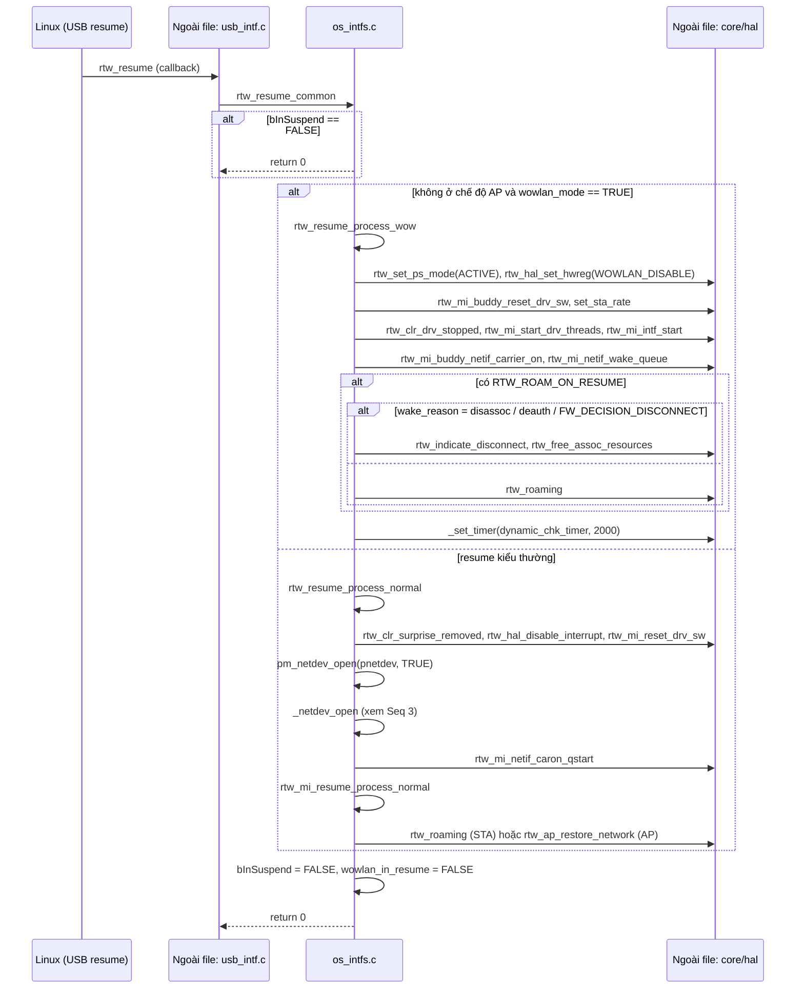

Resume đảo ngược suspend. **WoWLAN:** firmware vẫn chạy nên chỉ cần tắt WoWLAN, bật lại thread/URB và TX queue, rồi quyết định roaming hay báo ngắt kết nối theo lý do thức dậy. **Thường:** coi như bật lại từ đầu, thực chất là `_netdev_open` đầy đủ. Resume-thường đi qua `pm_netdev_open(_TRUE)`, nhánh này giữ `hw_init_mutex` và gọi `_netdev_open` của interface chính.

### Seq 10. Các callback từ kernel/mạng đi vào file

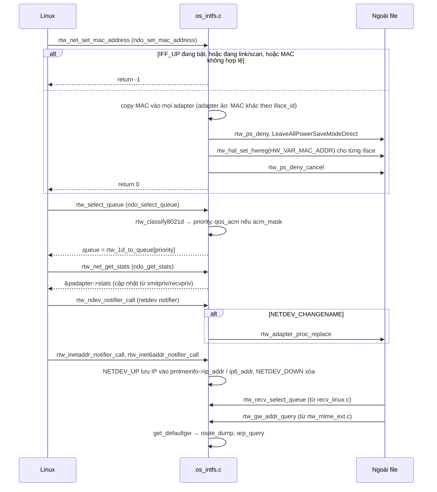

Các hàm này không cùng một luồng mà là **điểm vào độc lập**. Notifier chỉ xử lý netdev của chính driver (`is_rtw_ndev` kiểm tra `ndo_do_ioctl == rtw_ioctl`). Với IPv6, `NETDEV_UP` còn bật `wowlan_ns_offload_en` khi `CONFIG_WOWLAN`. `rtw_gw_addr_query` do `rtw_mlme_ext.c` gọi, rồi tự dùng `get_defaultgw` để tra gateway.

### Seq 11. Tạo/đổi interface Wi-Fi động qua cfg80211 và đổi tên netdev

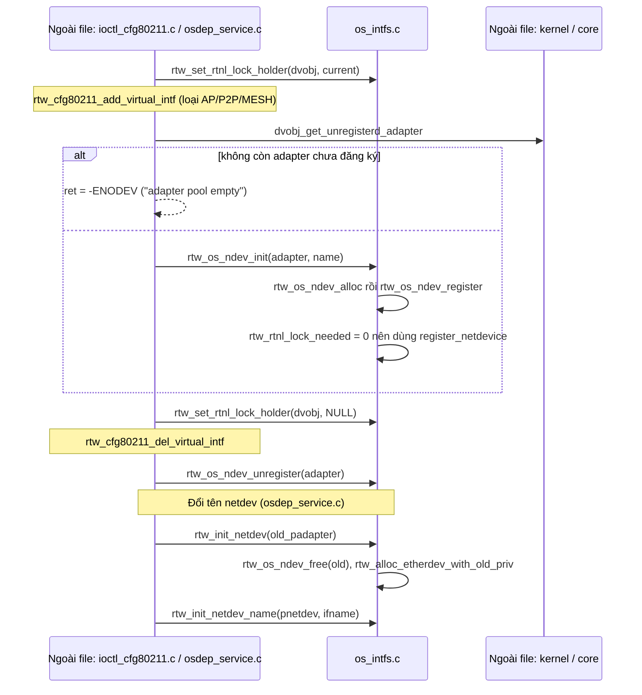

Đây là luồng **tạo/hủy interface lúc đang chạy**. `rtw_set_rtnl_lock_holder` ghi lại rằng thread hiện tại đã giữ `rtnl_lock`, để `rtw_rtnl_lock_needed` chọn đúng `register_netdevice` (không lock lần nữa). Trong cấu hình này cả 2 netdev đã được đăng ký ngay lúc probe (`CONFIG_RTW_DYNAMIC_NDEV` tắt), nên `add_virtual_intf` dễ trả `-ENODEV` (suy ra từ cấu hình, chưa chạy thử). `rtw_init_netdev(old_padapter)` dùng khi đổi tên interface (gọi từ `osdep_service.c`), tái sử dụng private data của netdev cũ.

---

## 4. Tổng kết

**Vai trò của file.** `os_intfs.c` nằm giữa kernel và lõi driver (core/HAL). Nó biến "thiết bị USB đã cắm" thành một hoặc hai `net_device` mà Linux dùng được, và quản lý vòng đời bật/tắt phần cứng (open, IPS, suspend/resume, remove).

**Các nhóm hàm và quan hệ:**

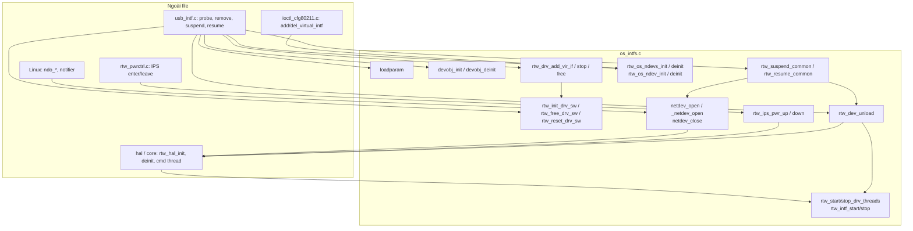

**Thứ tự nên đọc:**
1. `rtw_init_drv_sw`, `rtw_free_drv_sw`: thế nào là một adapter, nó chứa những gì.
2. `rtw_os_ndevs_init`, `rtw_os_ndev_register`: cách `net_device` ra đời.
3. `netdev_open` và `_netdev_open`, `netdev_close`: Linux điều khiển driver thế nào.
4. `rtw_dev_unload`, `rtw_ips_pwr_up/down`: hai kiểu tắt phần cứng (hẳn so với tạm).
5. `rtw_suspend_common`, `rtw_resume_common`: quản lý nguồn hệ thống.
6. `rtw_drv_add_vir_if`: vì sao có interface thứ 2.

**Đối chiếu danh sách hàm với các sequence:**

| Hàm | Nằm trong |
|---|---|
| `devobj_init`/`deinit`, `loadparam`, `rtw_init_*`, `rtw_free_drv_sw`, `rtw_drv_add_vir_if` | Seq 1, 6, 7 |
| `rtw_os_ndev*`, `rtw_os_ndevs*`, `rtw_init_netdev*`, `rtw_hook_*if_ops`, `rtw_ndev_init/uninit` | Seq 2, 6, 7, 11 |
| `netdev_open`, `_netdev_open`, `_netdev_vir_if_open`, `netdev_vir_if_open/close`, `netdev_close`, `pm_netdev_open/close`, `netdev_br_init` | Seq 3, 4, 9 |
| `rtw_ips_*`, `ips_netdrv_open`, `rtw_dev_unload`, `rtw_reset_drv_sw`, `rtw_cancel_all_timer` | Seq 5, 6, 8 |
| `rtw_suspend_*`, `rtw_resume_*`, `rtw_mi_resume_process_normal` | Seq 8, 9 |
| `rtw_start/stop_drv_threads`, `rtw_intf_start/stop` | Seq 3, 5, 6, 8, 9 |
| `rtw_net_set_mac_address`, `rtw_select_queue`, `rtw_classify8021d`, `rtw_recv_select_queue`, `rtw_net_get_stats`, notifier, `rtw_gw_addr_query` và các hàm route/arp | Seq 10 |
| `rtw_rtnl_lock_needed`, `rtw_set_rtnl_lock_holder` | Seq 2, 11 |
| `rtw_regsty_*` | Seq 1 (bên trong `loadparam`) |
| `rtw_ndev_destructor` | Chỉ gắn cho netdev monitor ở `ioctl_cfg80211.c`, nên không nằm trong sequence nào |

Không thấy luồng quan trọng nào bị bỏ sót. Các nhánh WoWLAN cho AP/concurrent, `NEW_NETDEV_HDL`, GPIO API và vendor IE không được biên dịch nên không vẽ. Nếu đổi cấu hình `Makefile` (ví dụ `CONFIG_IFACE_NUMBER=3` hoặc `CONFIG_AP_WOWLAN=y`), các luồng mở/đóng và suspend sẽ khác và cần phân tích lại.
