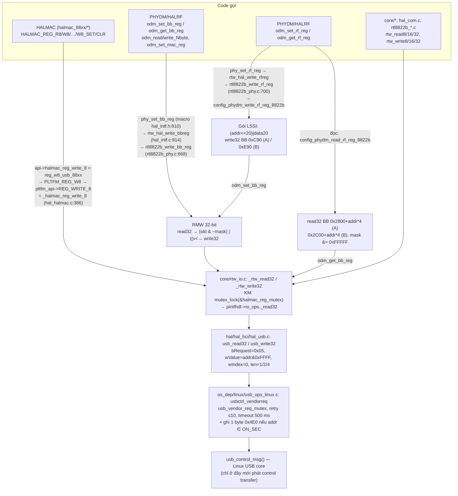
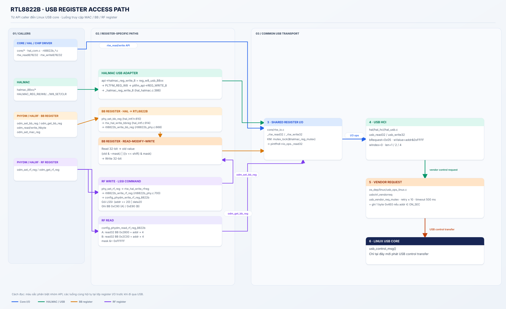

# 03 — Kiến trúc truy cập thanh ghi (Phần 3 và Phần 7)

> Mọi dòng dưới đây đã đọc trực tiếp trong source (nhánh active theo `work/mask.json`) trừ khi gắn [INFERENCE]. Đường dẫn tính từ `$D`.

## 3.1 Bức tranh tổng thể — 4 "cửa vào", 1 "cửa ra"




<div align="center">
  
</div>


Kết luận chính [SOURCE]:

1. **MAC, BB và RF đều kết thúc ở cùng một hàm** `usbctrl_vendorreq()` → `usb_control_msg()`. Không có kênh phần cứng riêng cho BB hay RF.
2. BB khác MAC ở **hàm bọc**: BB luôn truy cập 32-bit và làm read-modify-write khi có mask; MAC có thể truy cập 8/16/32-bit trực tiếp.
3. RF là **không gian gián tiếp**: địa chỉ RF (8-bit) và dữ liệu (20-bit) được "đóng gói" vào một thanh ghi BB.
4. Không có lời gọi nào từ code cấp cao phát trực tiếp USB control transfer — luôn qua ít nhất 3 lớp (`_rtw_*` → `io_ops` → `usb_*` → `usbctrl_vendorreq`).

## 3.2 Lớp 1 — `rtw_read*/rtw_write*` (`include/rtw_io.h`, `core/rtw_io.c`)

| Hạng mục | Chi tiết | Nguồn |
|---|---|---|
| Macro | `#define rtw_read8(adapter, addr) _rtw_read8((adapter), (addr))` (nhánh `DBG_IO` tắt) | `rtw_io.h:459` |
| Input | `_adapter *adapter`, `u32 addr` (chỉ 16 bit thấp có nghĩa, xem lớp 3) | `rtw_io.c:107` |
| Output đọc | `u8/u16/u32` — 16/32-bit được `le16/32_to_cpu` | `rtw_io.c:138,155` |
| Output ghi | `RTW_STATUS_CODE(ret)`: `ret ≥ 0` → `_SUCCESS`, âm → `_FAIL` | `rtw_io.c:173`, `os_dep/osdep_service.c:78-89` |
| Khoá | KM: `mutex_lock(&halmac_reg_mutex)` toàn cục (`DEFINE_MUTEX`, `rtw_io.c:93`) | `rtw_io.c:117-224` |
| Gián tiếp | `pintfhdl->io_ops._read8` — con trỏ hàm do `rtw_init_io_priv(padapter, usb_set_intf_ops)` gán lúc probe | `rtw_io.c:511-526`, `os_dep/linux/usb_intf.c:1412` |

**Ngữ cảnh gọi:** vì có `mutex_lock` (và tầng dưới `usb_control_msg` cũng ngủ), mọi `rtw_read*/write*` **chỉ hợp lệ trong ngữ cảnh được phép ngủ** (process context: workqueue, thread, ioctl…). Gọi từ timer/tasklet/khi giữ spinlock sẽ gây "BUG: scheduling while atomic". [SOURCE cho mutex; hệ quả là kiến thức kernel chung]

## 3.3 Lớp 2 — `io_ops` cho USB (`hal/hal_hci/hal_usb.c`)

`usb_set_intf_ops()` (`hal_usb.c:576-600`) gán `_read8/16/32 = usb_read8/16/32`, `_write8/16/32 = usb_write8/16/32`, `_writeN = usb_writeN`, `_read_port/_write_port` (bulk dữ liệu), các bản async **không** được gán (`CONFIG_USB_SUPPORT_ASYNC_VDN_REQ` tắt). `hal/rtl8822b/usb/rtl8822bu_io.c:61` có hàm `rtl8822bu_set_intf_ops()` với nội dung gán y hệt nhưng **không được gọi ở đâu** [SOURCE].

`usb_read32()` (`hal_usb.c:423-451`):

```c
request = 0x05;                  /* REALTEK_USB_VENQT_CMD_REQ */
requesttype = 0x01;              /* read_in */
index = 0;
wvalue = (u16)(addr & 0x0000ffff);
len = 4;
usbctrl_vendorreq(pintfhdl, request, wvalue, index, &data, len, requesttype);
return data;                     /* trả về data, KHÔNG kiểm tra lỗi */
```

- Địa chỉ bị **cắt còn 16 bit** — vì vậy các macro `REG_SDIO_*` (0x1025xxxx) vô nghĩa với USB.
- Đoạn `wvalue |= 0x8000` chỉ cho `CONFIG_RTL8710B` → không active.
- **Đọc lỗi trả về 0** (biến `data` khởi tạo 0) — không phân biệt được với giá trị thật 0. Lớp trên không biết đã lỗi. [SOURCE]

## 3.4 Lớp 3 — `usbctrl_vendorreq()` (`os_dep/linux/usb_ops_linux.c:71-243`)

```mermaid
sequenceDiagram
    participant C as usb_read32()
    participant V as usbctrl_vendorreq
    participant K as usb_control_msg (kernel)
    participant D as RTL8822BU
    C->>V: request=0x05, value=addr, len=4, type=read
    V->>V: RTW_CANNOT_IO? → -EPERM (thoát)
    V->>V: len > 254? → -EINVAL
    V->>V: lock usb_vendor_req_mutex; buf = dvobj->usb_vendor_req_buf
    loop tối đa 10 lần (MAX_USBCTRL_VENDORREQ_TIMES)
        V->>K: pipe=rcvctrl(ep0), bmRequestType=0xC0, bRequest=0x05, wValue=addr, wIndex=0, timeout 500 ms
        K->>D: SETUP + DATA IN
        D-->>K: 4 byte
        K-->>V: status
        alt status == len
            V->>V: reset continual_io_error; memcpy → pdata
        else lỗi
            V->>V: log "reg 0x%x, usb read 4 fail"; -ESHUTDOWN/-ENODEV → surprise_removed
            V->>V: ++continual_io_error > 4 → surprise_removed, break
        end
        V->>V: value ≥ 0x1000 hoặc thành công → break (không retry)
    end
    opt value ∈ [0x00,0xFF] ∪ [0x1000,0x10FF]
        V->>K: write 1 byte → 0x4E0 (REG_NULL_PKT_STATUS_V1)
    end
    V->>V: unlock
```

| Hằng số | Giá trị | Nguồn |
|---|---|---|
| `REALTEK_USB_VENQT_READ / WRITE` | `0xC0 / 0x40` (vendor, device, IN/OUT) | `include/usb_ops.h:61-62` |
| `MAX_VENDOR_REQ_CMD_SIZE` | 254 byte | `usb_ops.h:72` |
| `MAX_USBCTRL_VENDORREQ_TIMES` | 10 | `include/usb_ops_linux.h:73` |
| `RTW_USB_CONTROL_MSG_TIMEOUT` | 500 ms | `usb_ops_linux.h:64` |
| `FW_START_ADDRESS` | `0x1000` | `usb_ops_linux.h:61` |
| `MAX_CONTINUAL_IO_ERR` | 4 | `include/rtw_io.h:308` |
| Buffer | `CONFIG_USB_VENDOR_REQ_BUFFER_PREALLOC` + `…_MUTEX` (bật) | `include/autoconf.h:295-297` |

**Hai hệ quả ít người để ý** [SOURCE]:

1. Điều kiện "không retry" là `value >= FW_START_ADDRESS` (comment: *firmware download is checksumed*). Nhưng điều kiện chỉ xét **địa chỉ**, nên **mọi** truy cập thanh ghi từ `0x1000` trở lên — MAC mở rộng 0x1000–0x17FF, BB 0x1800–0x1FFF, cửa sổ đọc RF 0x2800–0x2FFF, USB-local 0xFE00+ — chỉ được thử **1 lần**, trong khi 0x0000–0x0FFF được thử tới 10 lần.
2. Khi `continual_io_error > 4` → `rtw_set_surprise_removed()` → từ đó `RTW_CANNOT_IO` đúng → mọi I/O trả `-EPERM` ngay, mọi đọc trả 0. Driver coi như thiết bị đã bị rút. Log nhận biết: `"[dvobj:%p][ERROR] continual_io_error:%d > %d"` (`rtw_io.c:540`) và `"reg 0x%x, usb %s %u fail, status:%d …"` (`usb_ops_linux.c:163`).

## 3.5 Đường HALMAC (`hal/halmac/…`)

```
HALMAC_REG_W8(REG_SYS_FUNC_EN, v)                       halmac_type.h:259  (HALMAC_DBG_MONITOR_IO = 0)
 └─ api->halmac_reg_write_8(adapter, off, v)             = reg_w8_usb_88xx   (gán trong halmac_init_88xx.c, khối USB quanh dòng 399)
     └─ PLTFM_REG_W8(off, v)                             halmac_type.h:145
         └─ adapter->pltfm_api->REG_WRITE_8(drv_adapter, off, v)  = _halmac_reg_write_8 (hal_halmac.c:870)
             └─ rtw_write8(dvobj_get_primary_adapter(d), off, v)   hal_halmac.c:386-399
                 (lỗi → RTW_ERR("%s: I/O FAIL!"))
```

- HALMAC luôn dùng **adapter chính** (`dvobj_get_primary_adapter`) dù đang phục vụ interface ảo (concurrent mode).
- `HALMAC_REG_W8_SET/CLR` (`halmac_type.h:268-296`) = `W8(off, R8(off) | mask)` / `& ~mask` → **2 lần vendor request**, không nguyên tử.
- Không có đường HALMAC nào bypass `rtw_write*` cho thanh ghi. (Firmware/ reserved page thì đi bulk-out, không phải thanh ghi.)

## 3.6 Đường BB (`odm_set_bb_reg` → `rtl8822b_write_bb_reg`)

```c
/* hal/rtl8822b/rtl8822b_phy.c:668 */
void rtl8822b_write_bb_reg(PADAPTER adapter, u32 addr, u32 mask, u32 val)
{
	if (mask != 0xFFFFFFFF) {                       /* ghi một field */
		val_org = rtw_read32(adapter, addr);         /* 1. đọc cả 32 bit */
		shift = phy_calculatebitshift(mask);         /* 2. vị trí bit thấp nhất của mask */
		val = ((val_org & (~mask)) | ((val << shift) & mask));  /* 3. giữ bit ngoài mask */
	}
	rtw_write32(adapter, addr, val);                 /* 4. ghi cả 32 bit */
}
```

Ví dụ tính tay — `odm_set_bb_reg(dm, R_0x1988, BIT(22), 0x1)` (`phydm_hal_api8822b.c:969`), giả sử thanh ghi đang là `0x0012_3456`:

| Bước | Giá trị |
|---|---|
| mask | `0x0040_0000` → shift = 22 |
| `val_org & ~mask` | `0x0012_3456 & 0xFFBF_FFFF = 0x0012_3456` |
| `(1 << 22) & mask` | `0x0040_0000` |
| ghi | `0x0052_3456` — chỉ bit 22 đổi, 31 bit còn lại giữ nguyên **theo giá trị vừa đọc** |

Những điều cần chú ý [SOURCE + INFERENCE]:

- `phy_calculatebitshift()` duyệt bit 0→31, mask = 0 → shift = 32 (dịch 32 bit là hành vi không xác định trong C) — chỉ là rủi ro nếu ai đó gọi với mask 0.
- `odm_set_mac_reg()` cũng gọi `phy_set_bb_reg()` (`phydm_interface.c:252`) → field 8-bit của thanh ghi MAC cũng bị ghi lại cả 32 bit. Nếu các byte khác chứa bit "ghi 1 để xoá" hoặc bit tự xoá, việc ghi lại giá trị vừa đọc **có thể** gây tác dụng phụ — chưa xác định vì thiếu datasheet.
- Có `if (DISABLE_BB_RF == 1) return` ở đầu cả hai hàm (`:657`, `:673`) — `DISABLE_BB_RF` = 0 trong build.

## 3.7 Đường RF (`config_phydm_*_rf_reg_8822b`, `hal/phydm/rtl8822b/phydm_hal_api8822b.c:995-1074`)

**Đọc** RF path *p*, địa chỉ *a* (8-bit), mask *m*:

```
direct_addr = {0x2800, 0x2C00}[p] + ((a & 0xFF) << 2)
m          &= 0xFFFFF                       /* RF chỉ có 20 bit */
return odm_get_bb_reg(dm, direct_addr, m)   /* = read32 rồi (v & m) >> shift */
```

Ví dụ: RF-A 0x18 → BB `0x2800 + 0x60 = 0x2860`; RF-B 0x18 → `0x2C60`. Vì `0x2860 ≥ 0x1000` → **không retry** khi USB lỗi (3.4).

**Ghi** RF path *p*, địa chỉ *a*, mask *m*, dữ liệu *d*:

```
if m != 0xFFFFF:
    orig = read RF (như trên, mask 0xFFFFF)
    if orig == 0xFFFFFFFF (INVALID_RF_DATA): return false   /* "RF is disable" */
    d = phydm_check_bit_mask(m, orig, d)     /* (orig & ~m) | (d << shift)  — KHÔNG & m */
word = ((a << 20) | (d & 0xFFFFF)) & 0x0FFFFFFF
odm_set_bb_reg(dm, {0xC90, 0xE90}[p], MASKDWORD, word)   /* rA/rB_LSSIWrite_Jaguar, rtl8822b_hal.h:175,193 */
```

Ví dụ: ghi RF-A 0x18 = 0x1_2C03 (mask đầy) → word = `(0x18<<20)|0x12C03 = 0x0181_2C03` ghi vào BB 0xC90.

Điểm cần chú ý:

- `phydm_check_bit_mask()` (`phydm_hal_api8822b.c:243-256`) **không** che `data << bit_shift` bằng mask — khác với đường BB. Nếu caller truyền giá trị rộng hơn field, bit thừa sẽ ghi đè các bit lân cận (trong phạm vi 20 bit). Ví dụ: mask `BIT(19)`, d = 0x3 → `(0x3 << 19) = 0x18_0000` → sau `& 0xFFFFF` còn `0x8_0000`, chỉ bit 19 — tràn ra ngoài 20 bit bị cắt; nhưng mask `BIT(10)`, d = 0x3 → bit 10 **và bit 11** cùng bị đặt. [SOURCE + tính tay]
- Path > B → trả lỗi/`INVALID_RF_DATA` (8822B chỉ có 2 path).
- Không có delay sau khi ghi LSSI trên USB (delay 13 µs chỉ cho PCIe, `:1066-1071`).
- `rtl8822b_read_rf_reg` in log `"read RF reg path=%d addr=0x%x mask=0x%x FAIL!"` khi đọc về 0xFFFFFFFF (`rtl8822b_phy.c:693-695`) — dấu hiệu RF bị tắt hoặc USB lỗi (đọc USB lỗi trả 0 chứ không phải 0xFFFFFFFF, nên log này **không** bắt được lỗi USB).

## 3.8 So sánh nhanh MAC / BB / RF

| | MAC | BB | RF |
|---|---|---|---|
| Hàm chuẩn | `rtw_read/write8/16/32`, `HALMAC_REG_*` | `phy_set/query_bb_reg`, `odm_set/get_bb_reg` | `phy_set/query_rf_reg`, `odm_set/get_rf_reg` |
| Độ rộng ở bus | 8/16/32 | luôn 32 | 32 (gói LSSI) |
| Mask | tự làm thủ công (`v |= BIT(n)`) | tham số `bitmask` → RMW tự động | tham số `bitmask` (≤20 bit) → RMW |
| Số vendor request / 1 lần ghi field | 1 (ghi thẳng) hoặc 2 (R+W); địa chỉ 0x00–0xFF/0x1000–0x10FF: **+1** ghi 0x4E0 mỗi lần | 2 (read32 + write32) | 2 (read32 cửa sổ 0x2800/0x2C00 + write32 LSSI 0xC90/0xE90); mask đầy 0xFFFFF: 1 |
| Địa chỉ | bus 16-bit | bus 16-bit | 8-bit / path |
| Retry USB khi lỗi | 10 lần nếu < 0x1000 | 10 lần nếu < 0x1000 (0x800–0xFFF), 1 lần ở 0x1800+ | đọc: 1 lần (0x2800+); ghi: 10 lần (0xC90/0xE90) |

## 3.9 Các đường truy cập khác đã kiểm tra

| Đường | Trạng thái trong build | Nguồn |
|---|---|---|
| `phydm_set_reg_by_fw()` — ghi bảng MAC/BB/RF qua lệnh H2C cho firmware | **Không dùng**: cần `PHYDM_PHY_PARAM_OFFLOAD`, chỉ được bật bởi `rtw_hal_update_param_init_fw_offload_cap()` nằm trong `CONFIG_FW_OFFLOAD_PARAM_INIT` (tắt) | `hal_dm.c:198-210`, `phydm_regconfig8822b.c:65,144,195,233` |
| IQK bởi firmware (`odm_iq_calibrate_by_fw`) | **Dùng mặc định** (`rtw_iqk_fw_offload = 1`) — thanh ghi do FW trong chip ghi, host không thấy | `halrf_iqk_8822b.c:1841-1861` |
| USB async vendor request | Không biên dịch (`CONFIG_USB_SUPPORT_ASYNC_VDN_REQ` tắt) | `hal_usb.c:302-360` |
| `rtw_writeN` / `usb_writeN` (≤254 byte) | Có — dùng cho ghi khối liên tiếp | `rtw_io.c:212`, `hal_usb.c:551` |
| USB3 PHY gián tiếp | `usbphy_write_88xx`: ghi data `0xFF0D/0xFF0E`, addr `0xFF0C`, sau đó `0xFE41/0xFE40/0xFE42` | `halmac_usb_88xx.c:519-525` |
| Bulk in/out (`usb_read_port/usb_write_port`) | Dữ liệu frame, firmware, reserved page — **không** phải thanh ghi | `hal_usb.c:584,597` |
