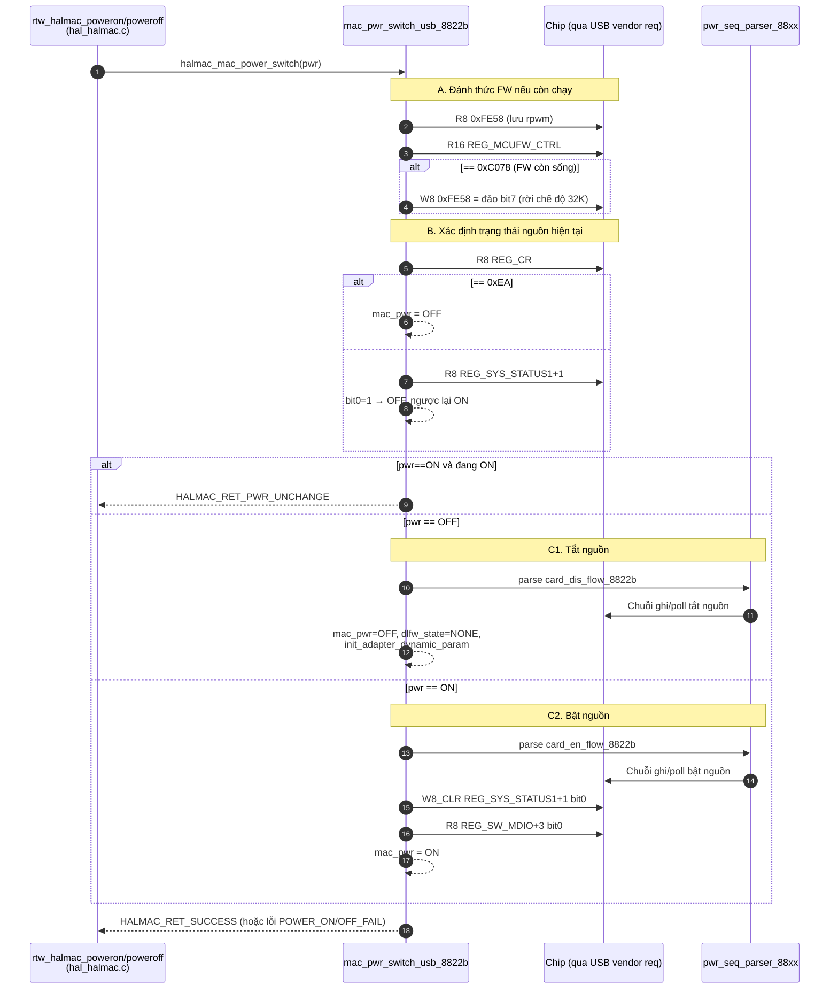

# 05.01 — System configuration, nguồn, clock, reset, nhận dạng chip (MAC 0x0000–0x00FF)

> Phạm vi: các thanh ghi "page 0" của MAC dùng để cấp nguồn, cách ly, bật khối chức năng, clock, AFE/LDO/XTAL và đọc ID chip. Các thanh ghi cùng dải nhưng thuộc nhóm khác được tách sang: eFuse (`0x0A`, `0x30–0x37`, `0xCF`) → [12_efuse.md](12_efuse.md); GPIO/LED/pinmux (`0x40–0x7F`) → [11_gpio_led.md](11_gpio_led.md); MCU/firmware (`0x80–0x8F`) → [08_firmware.md](08_firmware.md); USB/PAD (`0xC4–0xC5`, `0xFC–0xFF`) → [09_usb.md](09_usb.md).
>
> Nhãn: [SOURCE] đọc trực tiếp; [SOURCE-SEQ] suy ra từ cách code dùng (ví dụ "ghi 1 rồi chờ về 0"); [INFERENCE]; [KIỂM TRA TRÊN BOARD]. Tên bit lấy từ `hal/halmac/halmac_bit_8822b.h` (section `/* 2 REG_xxx_8822B */`) — **tên bit là bằng chứng của header, không phải datasheet**; ý nghĩa diễn giải từ tên luôn gắn [INFERENCE].
>
> Ký hiệu field: `[hi:lo]`. "B1" = byte 1 của thanh ghi (địa chỉ base+1).

## 1. Vì sao nhóm này quan trọng

Khi USB vừa enumerate, chip đang ở trạng thái **CARDDIS** (card disabled): MAC tắt nguồn, chỉ khối USB và một phần "always-on" sống. Trước khi driver đọc/ghi bất kỳ thanh ghi MAC/BB/RF nào khác, nó phải chạy **power sequence** (`card_en_flow_8822b`) để đưa chip qua CARDEMU → ACT. Mọi thanh ghi trong nhóm này đều phục vụ chuyện đó hoặc phục vụ việc đọc "danh tính" chip. Nếu nhóm này sai, triệu chứng là: đọc toàn `0xEA`/`0x00`, firmware không tải được, BB/RF không phản hồi.

`mac_pwr_switch_usb_8822b()` (`hal/halmac/halmac_88xx/halmac_8822b/halmac_usb_8822b.c:74-140`) quyết định chip đang tắt hay bật bằng 2 phép thử [SOURCE]:

```c
value8 = HALMAC_REG_R8(REG_CR);            /* 0x100 */
if (value8 == 0xEA)                         /* MAC chưa cấp nguồn → bus trả 0xEA */
        mac_pwr = HALMAC_MAC_POWER_OFF;
else if (BIT(0) == (HALMAC_REG_R8(REG_SYS_STATUS1 + 1) & BIT(0)))   /* 0xF5 bit0 = AUTO_WLPON[8] */
        mac_pwr = HALMAC_MAC_POWER_OFF;
else
        mac_pwr = HALMAC_MAC_POWER_ON;
```

→ Giá trị `0xEA` khi đọc `REG_CR` là "dấu hiệu MAC chưa có nguồn" theo quy ước của chính driver [SOURCE]. Nếu đọc log debug thấy hàng loạt thanh ghi = `0xEA`, nghĩa là truy cập xảy ra khi MAC đang off.

Hàm mac_pwr_switch_usb_8822b được gọi qua con trỏ api->halmac_mac_power_switch, gán ở halmac_init_8822b.c:429 khi interface là USB. Mọi chuỗi gọi đều đi qua _power_switch (hal_halmac.c:2642).

# Phân tích hàm `mac_pwr_switch_usb_8822b`

## 1. Tổng quan

Hàm `mac_pwr_switch_usb_8822b` được gọi thông qua con trỏ hàm `api->halmac_mac_power_switch`, được gán tại `halmac_init_8822b.c:429` khi interface là USB.

Mọi chuỗi gọi đều đi qua hàm `_power_switch` trong `hal_halmac.c:2642`.

## 2. Ai gọi hàm này?

| Tình huống | Chuỗi gọi | Tham số `pwr` |
|---|---|---|
| Bật chip khi mở interface (`ifup`) hoặc thoát IPS | `rtw_hal_init` → `rtl8822bu_init` → `rtl8822b_hal_init` → `_halmac_init_hal` → `rtw_hal_power_on` → `rtl8822b_power_on` → `rtw_halmac_poweron` → `_power_switch` | `POWER_ON` |
| Tắt chip khi gỡ driver hoặc vào IPS | `rtw_hal_deinit` → `rtl8822bu_deinit` → `rtl8822b_deinit` → `rtw_halmac_deinit_hal` → `rtw_hal_power_off` → `rtl8822b_power_off` → `rtw_halmac_poweroff` → `_power_switch` | `POWER_OFF` |

## 3. Sequence diagram



## 4. Chức năng từng bước và nơi hàm được sử dụng

| Bước | Chức năng | Hàm gọi tới (ngữ cảnh) |
|---|---|---|
| A | Nếu firmware vẫn chạy thì đảo bit 7 của `0xFE58` (RPWM), để firmware rời chế độ 32K trước khi tắt hoặc bật nguồn (tham chiếu `05.10 §2`). | Chủ yếu có ý nghĩa khi gọi từ đường **tắt nguồn/IPS**, lúc firmware vẫn còn chạy trong chip. |
| B | Đọc trạng thái thực tế của phần cứng. `REG_CR == 0xEA` nghĩa là MAC đã tắt; nếu không, kiểm tra `REG_SYS_STATUS1+1`, bit 0. | Cả hai đường. Cùng quy ước `0xEA` với `check_ips_status`. |
| C1 | Chạy power sequence tắt nguồn (18 bước), sau đó đặt lại `dlfw_state = NONE`, nên lần bật sau phải tải lại firmware. | `rtw_halmac_poweroff`, khi gỡ driver hoặc vào IPS. |
| C2 | Chạy power sequence bật nguồn (25 bước), sau đó xóa bit 0 của `REG_SYS_STATUS1+1` và đọc `REG_SW_MDIO+3` (log “shall R reg twice”). | `rtw_halmac_poweron`, tại bước 3.2.1 của chuỗi `ifup` trong `07_sequences.md`. |

## 5. Ghi chú và điểm cần xác minh

- **Nhánh `HALMAC_RET_PWR_UNCHANGE`:** Chỉ xảy ra khi `pwr == ON` nhưng chip đã bật. `rtw_halmac_poweron` xử lý mã này như trường hợp bình thường, không coi là lỗi. Cần kiểm tra lại đoạn xử lý này nếu muốn dựa vào kết luận.
- **Power sequence:** Bảng thanh ghi và các bước chi tiết của hai power sequence nằm trong `05_groups/01_system_power_clock.md`, mục 4–5.
- **Nguồn tham chiếu:** `halmac_init_8822b.c:429`, `hal_halmac.c:2642`, `05_groups/01_system_power_clock.md` và `07_sequences.md`.


## 2. Bảng thanh ghi của nhóm

| Địa chỉ            | Tên (alias)                                                 | W quan sát            | St  | Vai trò trong source                                         | Hàm chính                                                                                     |
| ------------------ | ----------------------------------------------------------- | --------------------- | :-: | ------------------------------------------------------------ | --------------------------------------------------------------------------------------------- |
| `0x0000`           | `REG_SYS_ISO_CTRL_8822B` (`REG_SYS_ISO_CTRL`, `R_0x0`)      | 8 (pwr-seq), 32 (IQK) |  A  | Cách ly (isolation) giữa miền nguồn                          | pwr-seq; `_iqk_bb_reset_8822b`                                                                |
| `0x0002`           | `REG_SYS_FUNC_EN_8822B` (`REG_SYS_FUNC_EN`, `ODM_BB_RESET`) | 8                     |  A  | Bật/reset khối chức năng: BB, CPU, USB…                      | `enable_bb_rf_88xx`, `rtw_hal_gate_bb`, `init_system_cfg_8822b`, `wlan_cpu_en_88xx`           |
| `0x0003`           | (B1 của SYS_FUNC_EN)                                        | 8                     |  A  |                                                              |                                                                                               |
| `0x0004–0x0007`    | `REG_SYS_PW_CTRL_8822B`                                     | 8/16                  |  A  | Máy trạng thái nguồn: ON-MAC, OFF-MAC, LPS…                  | pwr-seq; `set_usb_mode_88xx`                                                                  |
| `0x0008–0x0009`    | `REG_SYS_CLK_CTRL_8822B`                                    | 8                     |  A  | Bật clock (CPU, MAC, HCI…)                                   | `pltfm_reset_88xx`; `rtl8822b_gethwreg`                                                       |
| `0x0010–0x0012`    | `REG_SYS_SWR_CTRL1_8822B` (`R_0x10`)                        | 8/32                  |  A  | Bộ nguồn switching regulator                                 | pwr-seq; `phydm_cfo_tracking_init`                                                            |
| `0x0014`, `0x0018` | `REG_SYS_SWR_CTRL2/3_8822B`                                 | —                     |  D  | (không dùng)                                                 | —                                                                                             |
| `0x001C–0x001D`    | `REG_RSV_CTRL_8822B` (`R_0x1c`)                             | 8                     |  A  | Khoá ghi (write-lock) + `WLMCUIOIF`                          | `pre_init_system_cfg_8822b`, `wlan_cpu_en_88xx`, `rtw_hal_wow_enable`                         |
| `0x001F`           | `REG_RF_CTRL_8822B`                                         | 8                     |  A  | Bật/reset khối RF                                            | `enable_bb_rf_88xx`; pwr-seq                                                                  |
| `0x0020`           | `REG_AFE_LDO_CTRL_8822B`                                    | 8                     |  A  | LDO của AFE/PLL                                              | pwr-seq                                                                                       |
| `0x0024–0x0025`    | `REG_AFE_CTRL1_8822B` (`REG_AFE_XTAL_CTRL`, `R_0x24`)       | 8/32                  |  A  | XTAL: cap XI, chọn clock MAC                                 | `cfg_mac_clk_88xx`, `phydm_set_crystal_cap_reg`, `board_rf_fine_tune_88xx`, `chk_txdesc_88xx` |
| `0x0028–0x0029`    | `REG_AFE_CTRL2_8822B` (`REG_AFE_PLL_CTRL`, `R_0x28`)        | 8/32                  |  A  | XTAL cap XO, PLL                                             | `phydm_set_crystal_cap_reg`; pwr-seq; MAC_REG                                                 |
| `0x0038`           | `REG_PWR_OPTION_CTRL_8822B` (`R_0x38`)                      | 32                    |  G  | Chọn debug port                                              | `phydm_la_set_mac_iq_dump`                                                                    |
| `0x0090`, `0x0093` | `REG_WLLPS_CTRL_8822B`                                      | 8                     |  A  | Tuỳ chọn nguồn khi LPS / card-disable                        | pwr-seq                                                                                       |
| `0x00AF`           | (B3 của `REG_AFE_CTRL7_8822B` 0xAC)                         | 8                     |  A  | `SEL_LDO_PC[29]`                                             | pwr-seq                                                                                       |
| `0x00B0`, `0x00B8` | `REG_HIMR0/1_8822B`                                         | 32                    |  X  | (mask ngắt PCIe/host — không dùng với USB, xem 03_interrupt) | `rtl8822bu_update_interrupt_mask` (không có nơi gọi)                                          |
| `0x00EC`, `0x00EF` | `REG_WLRF1_8822B` (`R_0xec`)                                | 8/32                  |  A  | `WLRF1_CTRL[31:24]`                                          | `enable_bb_rf_88xx`; pwr-seq                                                                  |
| `0x00F0–0x00F2`    | `REG_SYS_CFG1_8822B` (`R_0xf0`)                             | 8/32                  |  A  | **ID chip**: cut, vendor, RF type, test mode                 | `read_chip_version`, `pre_init_system_cfg_8822b`                                              |
| `0x00F4–0x00F5`    | `REG_SYS_STATUS1_8822B` (`R_0xf4`)                          | 8/32                  |  A  | ROM version; cờ `AUTO_WLPON`                                 | `read_chip_version`, `mac_pwr_switch_usb_8822b`                                               |
| `0x10A8–0x10AA`    | `REG_NFCPAD_CTRL_8822B`                                     | 8                     | A*  | chỉ ghi khi chip **C-cut** (pwr-seq `cut=C_MSK`)             | pwr-seq                                                                                       |
| `0x10C3`           | (B3 của `REG_SW_MDIO_8822B` 0x10C0)                         | 8                     |  A  | `DIS_TIMEOUT_IO[24]`                                         | pwr-seq; `mac_pwr_switch_usb_8822b`                                                           |

(St lấy từ `04a_catalog_mac.md`; A* = có điều kiện cut [KIỂM TRA TRÊN BOARD].)

## 3. Bộ máy power sequence — cách 1 dòng bảng biến thành truy cập USB

Mỗi phần tử `struct halmac_wlan_pwr_cfg {offset, cut_msk, interface_msk, base, cmd, msk, value}` (`halmac_pwr_seq_8822b.c:62…`) được `pwr_sub_seq_parser_88xx()` (`halmac_common_88xx.c:3195-3240`) xử lý **chỉ khi** `interface_msk & USB_MSK` và `cut_msk & cut_hiện_tại` [SOURCE]:

| `cmd` | Hành vi | Số vendor request |
|---|---|---|
| `WRITE` | `v = R8(off); v = (v & ~msk) \| (value & msk); W8(off, v)` — read-modify-write **8-bit** | 2; nếu off ∈ ON_SEC (0x00–0xFF, 0x1000–0x10FF) thì **4** vì mỗi R/W kèm 1 lần ghi 0x4E0 (03 §3.4) |
| `POLLING` | lặp tối đa `HALMAC_PWR_POLLING_CNT = 20000` lần: `R8(off) & msk == value & msk`? nếu chưa, `delay 50 µs`; hết lượt → `HALMAC_RET_PWRSEQ_POLLING_FAIL` + log `"[ERR]polling to!!"`, `"[ERR]cmd offset:%X"`… | ≤ 20 000 |
| `DELAY` | `offset` là **số đơn vị chờ** (µs hoặc ms theo `value`) — không phải địa chỉ | 0 |
| `END` | kết thúc mảng | 0 |

Cut hiện tại lấy từ `adapter->chip_ver` (`pwr_seq_parser_88xx`, `:3133-3158`) — giá trị này đến từ `CHIP_VER[15:12]` của `REG_SYS_CFG1` (§6).

**Mô phỏng một bước WRITE** — bước 6 của power-on: `{0x0012, ALL, ALL, MAC, WRITE, BIT(0), BIT(0)}` (`halmac_pwr_seq_8822b.c:118`). Giả sử byte 0x12 đang là `0b1010_0010` (ví dụ minh hoạ, không phải giá trị đo):

```
v      = 1010 0010
~msk   = 1111 1110   → v & ~msk = 1010 0010   (bit 0 bị xoá trước, các bit khác giữ)
value&msk = 0000 0001
kết quả = 1010 0011   → ghi lại 0x12
```

Chỉ bit 0 đổi; 7 bit còn lại được ghi lại đúng giá trị vừa đọc. Theo `halmac_bit_8822b.h`, bit 16–17 của `REG_SYS_SWR_CTRL1` (= bit 0–1 của byte 0x12) nằm trong field `OCP_L1[17:15]` — tên là của header; source không giải thích vì sao pwr-seq thao tác riêng từng bit của field này → **chưa xác định**.

**Thời gian xấu nhất của một POLLING** [INFERENCE từ số học]: 20 000 × (50 µs + thời gian 1 control transfer). Với USB 2.0, một control-IN mất cỡ vài trăm µs (phụ thuộc host) → có thể lên tới **nhiều giây** trước khi báo lỗi. Đây là lý do "probe chậm" khi chip không lên nguồn.

## 4. Chuỗi bật nguồn USB (`card_en_flow_8822b` = CARDDIS→CARDEMU + CARDEMU→ACT)

Đã lọc theo `interface_msk` có USB; sinh bằng `tools/tables.py` [TOOL], tên bit giải bằng `tools/bitname.py` [TOOL].

| # | Dòng | Địa chỉ | Lệnh | Mask → Giá trị | Bit (header) | Ý nghĩa đọc từ trình tự |
|---:|---|---|---|---|---|---|
| 1 | :74 | `0x004A` | W | b0 → 0 | `REG_GPIO_INTM.EXTWOL_EN[16]` | tắt wake-on-LAN ngoài (chỉ USB) |
| 2 | :79 | `0x0005` | W | b3,b4,b7 → 0 | `SYS_PW_CTRL.AFSM_WLSUS_EN[11]`, `AFSM_PCIE_SUS_EN[12]`, `APDM_HPDN[15]` | xoá các chế độ suspend/power-down tự động |
| 3 | :103 | `0xFF0A` | W | 0xFF → 0 | (USB-local, không tên) | — chưa xác định |
| 4 | :108 | `0xFF0B` | W | 0xFF → 0 | (USB-local) | — chưa xác định |
| 5 | :113 | `0x0012` | W | b1 → 0 | `SWR_CTRL1` bit 17 (trong `OCP_L1`) | — |
| 6 | :118 | `0x0012` | W | b0 → 1 | `SWR_CTRL1` bit 16 (trong `OCP_L1`) | — |
| 7 | :123 | `0x0020` | W | b0 → 1 | `AFE_LDO_CTRL.POW_PLL_LDO[0]` | bật LDO của PLL [INFERENCE theo tên] |
| 8 | :128 | — | DELAY | 1 ms | | chờ LDO ổn định |
| 9 | :133 | `0x0000` | W | b5 → 0 | `SYS_ISO_CTRL.ISO_IP2MAC_WA2PP[5]` | **gỡ cách ly** IP↔MAC |
| 10 | :138 | `0x0005` | W | b2,b3,b4 → 0 | `APFM_SWLPS[10]`, `AFSM_WLSUS_EN[11]`, `AFSM_PCIE_SUS_EN[12]` | |
| 11 | :148 | `0x0006` | **POLL** | b1 == 1 | `SYS_PW_CTRL.RDY_SYSPWR[17]` | **chờ nguồn hệ thống sẵn sàng** — bit trạng thái do phần cứng đặt [SOURCE-SEQ] |
| 12 | :158 | `0xFF1A` | W | 0xFF → 0 | (USB-local) | — |
| 13 | :163 | `0x0006` | W | b0 → 1 | `SYS_PW_CTRL.EN_WLON[16]` | bật miền WL-ON |
| 14 | :168 | `0x0005` | W | b7 → 0 | `APDM_HPDN[15]` | |
| 15 | :173 | `0x0005` | W | b3,b4 → 0 | `AFSM_WLSUS_EN`, `AFSM_PCIE_SUS_EN` | |
| 16 | :178 | `0x10C3` | W | b0 → 1 | `SW_MDIO.DIS_TIMEOUT_IO[24]` | |
| 17 | :183 | `0x0005` | W | b0 → 1 | `SYS_PW_CTRL.APFN_ONMAC[8]` | **ra lệnh "bật MAC"** |
| 18 | :188 | `0x0005` | **POLL** | b0 == 0 | `APFN_ONMAC[8]` | chờ bit **tự xoá** → MAC đã lên nguồn [SOURCE-SEQ: ghi 1 ở bước 17 rồi chờ 0] |
| 19 | :193 | `0x0020` | W | b3 → 1 | `AFE_LDO_CTRL.EX_XTAL_DRV_RF1[3]` | |
| 20–22 | :198–208 | `0x10A8–0x10AA` | W | 0xFF → 0x00 / 0xEF / 0x0C | `REG_NFCPAD_CTRL` | **chỉ C-cut** |
| 23 | :218 | `0x0029` | W | 0xFF → 0xF9 | `AFE_CTRL2` B1: `AGPIO_DRV[8:7]`, `AGPIO_GPO[9]`, `REG_KVCO_V2[10]`, `REG_LDO_SEL[13:12]`, `MCCO[15:14]` | cùng giá trị với mục đầu tiên của `array_mp_8822b_mac_reg` (`halhwimg8822b_mac.c:145`: `0x029, 0xF9`) |
| 24 | :223 | `0x0024` | W | b2 → 0 | `AFE_CTRL1.XTAL_GMP_V2[2:1]` | |
| 25 | :233 | `0x00AF` | W | b5 → 1 | `AFE_CTRL7.SEL_LDO_PC[29]` | |

Sau khi bảng chạy xong, `mac_pwr_switch_usb_8822b` còn [SOURCE `halmac_usb_8822b.c:129-132`]:

- `HALMAC_REG_W8_CLR(REG_SYS_STATUS1 + 1, BIT(0))` — xoá `AUTO_WLPON[8]` (cờ mà chính hàm này dùng để phát hiện "đang tắt" ở lần sau).
- đọc `REG_SW_MDIO + 3` (0x10C3) bit 0; nếu = 1 in `"[ALWAYS]shall R reg twice!!"` — nghĩa là khi `DIS_TIMEOUT_IO` = 1, driver được cảnh báo phải đọc thanh ghi 2 lần [SOURCE cho thông điệp; lý do phần cứng chưa xác định].

Trước đó (dòng 86-93): đọc `0xFE58` (`REG_USB_HRPWM`) lưu vào `adapter->rpwm`; nếu `REG_MCUFW_CTRL` (16-bit) == `0xC078` (firmware đang chạy) thì đảo bit 7 của rpwm và ghi lại `0xFE58` — đây là **bắt tay nguồn host→FW** (xem 09_usb / 10_power_mgmt).

## 5. Chuỗi tắt nguồn USB (`card_dis_flow_8822b` = ACT→CARDEMU + CARDEMU→CARDDIS)

| # | Dòng | Địa chỉ | Lệnh | Mask → Giá trị | Bit (header) | Ghi chú |
|---:|---|---|---|---|---|---|
| 1 | :252 | `0x0093` | W | 0xFF → 0xC4 | `WLLPS_CTRL[31:24]`: `WLLPSOP_EABM[31]`, `WLLPSOP_ACKF[30]`, `WLLPSOP_EECK[26]` = 1, còn lại 0 | 0xC4 = 1100_0100 |
| 2 | :257 | `0x001F` | W | 0xFF → 0 | `RF_CTRL`: `RF_EN[0]`, `RF_RSTB[1]`, `RF_SDMRSTB[2]` = 0 | **tắt RF** |
| 3 | :262 | `0x00EF` | W | 0xFF → 0 | `WLRF1_CTRL[31:24]` = 0 | |
| 4 | :267 | `0xFF1A` | W | 0xFF → 0x30 | (USB-local) | |
| 5 | :272 | `0x0049` | W | b1 → 0 | `GPIO_INTM.GPIO9_INT_MD[9]` | |
| 6 | :277 | `0x0006` | W | b0 → 1 | `EN_WLON[16]` | |
| 7 | :282 | `0x0002` | W | b1 → 0 | `SYS_FUNC_EN.FEN_BB_GLB_RSTN[1]` | **reset BB** |
| 8 | :287 | `0x10C3` | W | b0 → 0 | `DIS_TIMEOUT_IO[24]` | |
| 9 | :292 | `0x0005` | W | b1 → 1 | `SYS_PW_CTRL.APFM_OFFMAC[9]` | **ra lệnh "tắt MAC"** |
| 10 | :297 | `0x0005` | **POLL** | b1 == 0 | `APFM_OFFMAC[9]` | chờ bit tự xoá [SOURCE-SEQ] |
| 11 | :302 | `0x0020` | W | b3 → 0 | `EX_XTAL_DRV_RF1[3]` | |
| 12 | :307 | `0x0000` | W | b5 → 1 | `ISO_IP2MAC_WA2PP[5]` | **bật lại cách ly** |
| 13 | :326 | `0x0007` | W | 0xFF → 0x20 | `SYS_PW_CTRL[31:24]`: chỉ `SOP_ERCK[29]` = 1 | |
| 14 | :331 | `0x0067` | W | b5 → 0 | `PAD_CTRL1.PAPE_WLBT_SEL[29]` | |
| 15 | :341 | `0x004A` | W | b0 → 0 | `EXTWOL_EN[16]` | |
| 16 | :386 | `0x0081` | W | b6,b7 → 0 | `MCUFW_CTRL.FW_DW_RDY[14]`, `FW_INIT_RDY[15]` | xoá cờ "firmware sẵn sàng" |
| 17 | :391 | `0x0005` | W | b3,b4 → b3 | `AFSM_WLSUS_EN[11]` = 1, `AFSM_PCIE_SUS_EN[12]` = 0 | |
| 18 | :406 | `0x0090` | W | b1 → 0 | `WLLPS_CTRL.REGU_32K_CLK_EN[1]` | |

## 6. Phân tích chi tiết từng thanh ghi

### 6.1 `REG_SYS_ISO_CTRL_8822B` — `0x0000`

**A. Nhận diện.** MAC, khối System/Power. Alias: `REG_SYS_ISO_CTRL` (`halmac_reg2.h:69`), `R_0x0`/`R_0x00` (`phydm_regtable.h:1-2`). Định nghĩa `halmac_reg_8822b.h:61`. 16 bit tên trong section (`halmac_bit_8822b.h:65-81`): `ISO_*` (cách ly) và `PWC_*/PA*/UA*` (nguồn).

**B. Chức năng.** [INFERENCE theo tên + trình tự] "Isolation" là các cổng logic kẹp tín hiệu giữa miền nguồn đang tắt và miền đang bật, tránh tín hiệu trôi khi một miền chưa có nguồn. Power-on gỡ cách ly `ISO_IP2MAC_WA2PP[5]` **sau** khi LDO đã bật và chờ 1 ms (bước 7→9); power-off đặt lại bit này **sau cùng** (bước 12). Nếu gỡ cách ly quá sớm/không gỡ: MAC có thể nhận tín hiệu rác hoặc không bao giờ thấy tín hiệu từ IP → polling `RDY_SYSPWR` timeout.

**C. Bit có bằng chứng sử dụng.**

| Bit | Mask | Tên (header) | Ai đụng tới | Giá trị | Bằng chứng |
|---|---|---|---|---|---|
| 5 | `0x0020` | `ISO_IP2MAC_WA2PP` | pwr-seq | 0 khi bật, 1 khi tắt | `halmac_pwr_seq_8822b.c:133,307` |
| 16 | `0x0001_0000` | (không có tên — ngoài 16 bit của section) | `_iqk_bb_reset_8822b` | 0 rồi 1 | `halrf_iqk_8822b.c:277-278` |

Ca bit 16 là điểm lạ: section chỉ định nghĩa bit 0–15 nhưng IQK dùng `odm_set_bb_reg(dm, R_0x0, BIT(16), …)` — tức RMW 32-bit lên `0x0000–0x0003`, chạm bit 0 của byte `0x0002` = `FEN_BBRSTB` của `REG_SYS_FUNC_EN`. Nói cách khác **IQK reset BB bằng cách truy cập 32-bit từ địa chỉ 0x0000** [SOURCE + tính offset]. Và vì đây là RMW 32-bit, nó ghi lại cả `SYS_ISO_CTRL` và byte 1 của `SYS_FUNC_EN` (FEN_CPUEN…) bằng giá trị vừa đọc (xem 03 §3.6).

**D. Ngữ nghĩa R/W.** Chưa xác định từ source hiện có; cần datasheet. Không có polling trên thanh ghi này.

**E. Code sử dụng.** Chỉ pwr-seq (khởi động/tắt) và IQK (lúc calibrate, mà mặc định IQK chạy trên firmware — xem 01 §1.3 — nên đường IQK của driver ít khi chạy).

### 6.2 `REG_SYS_FUNC_EN_8822B` — `0x0002` (16-bit: `0x0002–0x0003`)

**A.** MAC/System. Alias `REG_SYS_FUNC_EN` (`halmac_reg2.h:87`), `ODM_BB_RESET` (`phydm_reg.h:75`), `ODM_REG_BB_RST_11N` (11N, chết). Section `halmac_bit_8822b.h:83-99`, 16 bit `FEN_*` ("function enable").

**B.** Công tắc bật/reset từng khối: BB, CPU 8051 của firmware, USB/PCIe PHY, core logic. Driver đụng vào 3 nhóm bit:

| Bit | Tên | Ai ghi | Trường hợp | Nguồn |
|---|---|---|---|---|
| 0 | `FEN_BBRSTB` | `enable_bb_rf_88xx(1)` đặt 1; `enable_bb_rf_88xx(0)` xoá | bật/tắt BB khi init | `halmac_cfg_wmac_88xx.c:688-702` |
| 0 | `FEN_BBRSTB` | `rtw_hal_gate_bb(adapter, TRUE)` xoá → "BB gated"; `FALSE` đặt lại | **WoWLAN**: gate BB khi vào chế độ ngủ chờ đánh thức | `hal_com.c:11405-11422` |
| 1 | `FEN_BB_GLB_RSTN` | `enable_bb_rf_88xx` cùng bit 0; pwr-seq tắt nguồn xoá | | `:689`, pwr-seq `:282` |
| 10 | `FEN_CPUEN` | `wlan_cpu_en_88xx(1/0)` qua byte `0x0003` bit 2 | bật/tắt CPU firmware khi download FW | `halmac_fw_88xx.c:409-417` |
| 10,11,12,14,15 | `FEN_CPUEN`, `FEN_DCORE`, `FEN_ELDR`, `FEN_HWPDN`, `FEN_MREGEN` | `init_system_cfg_8822b`: `B1 \|= SYS_FUNC_EN` với `SYS_FUNC_EN = 0xDC` | init MAC | `halmac_init_8822b.c:78,770-771` |

Phép tính `0xDC` [tính tay]: `0xDC = 1101 1100₂` → bit 2,3,4,6,7 của byte 1 → bit 10,11,12,14,15 của thanh ghi 16-bit → đúng 5 tên ở dòng cuối bảng (giải bằng `tools/bitname.py`).

**C. Mô phỏng `rtw_hal_gate_bb(TRUE)`** (`hal_com.c:11405-11413`) — đây là ví dụ đọc-sửa-ghi kinh điển:

```c
pwrpriv->wowlan_txpause_status = rtw_read8(adapter, REG_TXPAUSE);   /* 1. lưu TXPAUSE (0x522) */
rtw_write8(adapter, REG_TXPAUSE, 0xff);                              /* 2. dừng mọi hàng đợi TX */
val8 = rtw_read8(adapter, REG_SYS_FUNC_EN);                          /* 3. đọc byte 0x0002 */
val8 &= ~BIT(0);                                                     /* 4. xoá FEN_BBRSTB, giữ 7 bit khác */
rtw_write8(adapter, REG_SYS_FUNC_EN, val8);                          /* 5. ghi lại */
RTW_INFO("%s: BB gated: 0x%02x, store TXPAUSE: %02x\n", …);          /* 6. đọc lại để log */
```

Thứ tự quan trọng: dừng TX **trước** khi gate BB — nếu gate BB khi MAC còn đẩy frame ra PHY, frame có thể kẹt [INFERENCE]. Khi nhả (`FALSE`): đặt lại bit 0 rồi **khôi phục TXPAUSE đã lưu** (`:11415-11422`). Hàm này có 6 lần truy cập (4 cái là đọc để log).

Đường chết: `odm_inband_noise_monitor_ac()` (`phydm_noisemonitor.c:354-357`) cũng toggle bit 0 nhưng 8822B đã `return` sớm ở `:298-300` [TOOL + SOURCE].

**D.** Chưa xác định quyền R/W, giá trị reset; cần datasheet. Không có polling.

**Lỗi có thể gặp:** BB/RF không phản hồi (đọc RF qua 0x2800 trả rác) nếu bit 0/1 = 0; firmware không chạy nếu `FEN_CPUEN` = 0 → `dlfw_end_flow_88xx` chờ `REG_MCUFW_CTRL == 0xC078` mãi (xem 08).

### 6.3 `REG_SYS_PW_CTRL_8822B` — `0x0004` (32-bit: `0x0004–0x0007`)

**A.** MAC/Power. Alias `REG_SYS_PW_CTRL`. Section `halmac_bit_8822b.h:101-127`, 26 bit.

**B.** Bộ điều khiển trạng thái nguồn của chip. Theo bảng §4/§5, hai bit là **lệnh tự xoá** [SOURCE-SEQ]:

| Bit | Tên | Kiểu suy ra từ trình tự | Dùng ở |
|---|---|---|---|
| 8 | `APFN_ONMAC` | ghi 1 = yêu cầu bật MAC; HW xoá về 0 khi xong | power-on #17/#18 |
| 9 | `APFM_OFFMAC` | ghi 1 = yêu cầu tắt MAC; HW xoá về 0 khi xong | power-off #9/#10; **và** `set_usb_mode_88xx` (`halmac_usb_88xx.c:506`): `HALMAC_REG_W16_SET(REG_SYS_PW_CTRL, BIT_APFM_OFFMAC)` khi đổi chế độ USB2/USB3 |
| 17 | `RDY_SYSPWR` | bit trạng thái chỉ đọc (driver chỉ poll) | power-on #11 |
| 16 | `EN_WLON` | ghi 1 | power-on #13, power-off #6 |
| 10,11,12,15 | `APFM_SWLPS`, `AFSM_WLSUS_EN`, `AFSM_PCIE_SUS_EN`, `APDM_HPDN` | cấu hình | pwr-seq |
| 24–31 | `SOP_*` | byte 3 ghi `0x20` khi card-disable (chỉ `SOP_ERCK[29]` = 1) | power-off #13 |
| 3 | `PFM_WOWL` | toggle 1→0 trong `pwr_cmd_polling_88xx` **chỉ cho PCIe** khi polling timeout lần đầu | `halmac_common_88xx.c:3274-3287` — chết với USB [TOOL] |

**Ví dụ RMW 16-bit** `HALMAC_REG_W16_SET(REG_SYS_PW_CTRL, BIT_APFM_OFFMAC)` với `BIT_APFM_OFFMAC = BIT(9)` (`halmac_bit2.h:1474`): `W16(0x04, R16(0x04) | 0x0200)` → 2 vendor request; byte 0x04 và 0x05 cùng được ghi lại.

**Lỗi:** polling `APFN_ONMAC` không về 0 → `"[ERR]polling to!!"`, `"[ERR]cmd offset:5"` → `HALMAC_RET_POWER_ON_FAIL` → probe thất bại.

### 6.4 `REG_SYS_CLK_CTRL_8822B` — `0x0008`

**A.** MAC/Clock. Section `halmac_bit_8822b.h:129-…` (`CPU_CLK_EN[14]`, `MAC_CLK_EN[11]`, `HCI_CLK_EN[12]`…).

**B/E.** Hai nơi dùng [SOURCE]:
- `pltfm_reset_88xx()` (`halmac_fw_88xx.c:427-450`) — reset nền tảng CPU: xoá `CPU_DMEM_CON+2 bit0` → xoá `CPU_CLK_EN[14]` (byte `0x0009` bit 6) → đặt lại `CPU_DMEM_CON+2 bit0` → đặt lại `CPU_CLK_EN`. Thao tác clock chỉ cho `chip_id == 8821C || 8822B` (guard đúng với chip này).
- `rtl8822b_gethwreg()` (`rtl8822b_ops.c:2774`) chỉ đọc cả byte 0x0008 trả về cho caller (HW_VAR).

### 6.5 `REG_SYS_SWR_CTRL1_8822B` — `0x0010`

pwr-seq #5/#6 (byte 0x12). `phydm_cfo_tracking_init()` (`phydm_cfotracking.c:407`) với guard `support_ic_type & (8822B|8821C)` = đúng: `odm_set_mac_reg(dm, R_0x10, 0x40, 0x1)` → RMW 32-bit đặt **bit 6** — header **không có tên** cho bit 6 [TOOL]. Ý nghĩa chưa xác định; việc nó nằm trong khởi tạo CFO tracking gợi ý liên quan clock/XTAL [INFERENCE yếu].

### 6.6 `REG_RSV_CTRL_8822B` — `0x001C`

**B.** Byte 0 là các bit **khoá ghi** (`WLOCK_ALL[0]`, `WLOCK_00[1]`, `WLOCK_04[2]`, `WLOCK_08[3]`, `WLOCK_40[4]`, `WLOCK_1C_B6[5]`, `R_DIS_PRST[6]`, `LOCK_ALL_EN[7]`). Theo tên [INFERENCE], các bit này chặn ghi vào các thanh ghi 0x00/0x04/0x08/0x40… — điều đó giải thích vì sao **việc đầu tiên** của `pre_init_system_cfg_8822b()` là `HALMAC_REG_W8(REG_RSV_CTRL, 0)` (`halmac_init_8822b.c:996`): mở khoá trước khi cấu hình.

| Nơi ghi | Giá trị | Bit = 1 | Ngữ cảnh |
|---|---|---|---|
| `pre_init_system_cfg_8822b` `:996` | `0x00` | — | init |
| `rtw_hal_wow_enable` `hal_com.c:12310` | `0x20` | `WLOCK_1C_B6[5]` | vào WoWLAN |
| `rtw_hal_wow_enable` `hal_com.c:12313` | `0x60` | `WLOCK_1C_B6[5]`, `R_DIS_PRST[6]` | vào WoWLAN, nhánh `!IS_8188F && !IS_8188GTV` (công cụ chưa đánh giá được biểu thức này → "unknown"; đọc tay: đúng với 8822B) |
| `wlan_cpu_en_88xx` `halmac_fw_88xx.c:404-422` | byte `0x001D` bit 0 | `WLMCUIOIF[8]` | bật trước `FEN_CPUEN`, tắt sau — thứ tự đối xứng [SOURCE] |

### 6.7 `REG_RF_CTRL_8822B` — `0x001F` và `REG_WLRF1_8822B` — `0x00EC`

`enable_bb_rf_88xx(1)` (`halmac_cfg_wmac_88xx.c:686-698`) [SOURCE]:

```
SYS_FUNC_EN |= BIT0|BIT1            → FEN_BBRSTB, FEN_BB_GLB_RSTN
RF_CTRL     |= BIT0|BIT1|BIT2       → RF_EN, RF_RSTB, RF_SDMRSTB
WLRF1       |= BIT24|BIT25|BIT26    → 3 bit thấp của WLRF1_CTRL[31:24]
```

`enable_bb_rf_88xx(0)` xoá đúng các bit đó theo cùng thứ tự. Pwr-seq tắt nguồn ghi thẳng `RF_CTRL = 0` và byte `0x00EF = 0`. Trước khi bật, `board_rf_fine_tune_88xx()` (`:717-750`) — chỉ với `chip_id == 8822B` — phân tích eFuse map; **nếu byte `EFUSE_PCB_INFO_OFFSET` == `0x0C`** thì `HALMAC_REG_W8_SET(REG_AFE_CTRL1 + 1, BIT(1))` (= bit 9, thuộc field `XTAL_LDO_VREF[9:7]`). Nếu eFuse map chưa hợp lệ, hàm trả `HALMAC_RET_EFUSE_R_FAIL`; `enable_bb_rf_88xx` **vẫn tiếp tục bật BB/RF** nhưng trả mã lỗi đó cho caller [SOURCE `:686-713`]. `pre_init_system_cfg_8822b` gọi `set_hw_value_88xx(HALMAC_HW_EN_BB_RF, 0)` (`:1031-1032`) → BB/RF **tắt** trong giai đoạn pre-init, được bật lại sau khi tải firmware [INFERENCE về thời điểm — xem 07_sequences].

Lỗi: nếu `RF_EN` = 0, đọc RF qua cửa sổ 0x2800 sẽ không có nghĩa; `rtl8822b_read_rf_reg` chỉ log lỗi khi đọc về `0xFFFFFFFF` (03 §3.7).

### 6.8 `REG_AFE_CTRL1_8822B` — `0x0024` và `REG_AFE_CTRL2_8822B` — `0x0028` (XTAL)

**Field có bằng chứng:**

| Thanh ghi | Field | Mask | Ghi bởi | Nguồn |
|---|---|---|---|---|
| `0x0024` | `XTAL_CAP_XI[30:25]` | `0x7E000000` | `phydm_set_crystal_cap_reg()` | `phydm_cfotracking.c:289` |
| `0x0028` | `XTAL_CAP_XO[6:1]` | `0x0000007E` | cùng hàm, **cùng giá trị** `crystal_cap` | `:290` |
| `0x0024` | `MAC_CLK_SEL[21:20]` | `0x00300000` | `cfg_mac_clk_88xx()` xoá cả 2 bit (= chọn giá trị 0) | `halmac_cfg_wmac_88xx.c:759-761` |
| `0x0024` | `MAC_CLK_SEL` | đọc | `chk_txdesc_88xx()` `switch (BIT_GET_MAC_CLK_SEL(R32(REG_AFE_CTRL1)))` | `halmac_common_88xx.c:2706` |
| `0x0024` | `XTAL_GMP_V2[2:1]` (bit 2) | | pwr-seq #24 | |
| `0x0025` bit 1 (= bit 9) | thuộc `XTAL_LDO_VREF[9:7]` | | `board_rf_fine_tune_88xx`, chỉ khi eFuse PCB info = 0x0C | `halmac_cfg_wmac_88xx.c:744-745` |

**B. Chức năng** [INFERENCE theo tên + hàm gọi]: điều chỉnh tụ (capacitor) của thạch anh 40 MHz để kéo tần số dao động — đây là cơ chế **CFO tracking** (bù sai lệch tần số sóng mang). Ghi cùng giá trị vào XI và XO giữ đối xứng hai chân thạch anh. Giá trị ban đầu từ eFuse (`crystal_cap`), được phydm điều chỉnh liên tục theo CFO đo được. Sai giá trị → sai tần số → throughput thấp, mất kết nối với AP nhạy CFO.

### 6.9 `REG_SYS_CFG1_8822B` — `0x00F0` và `REG_SYS_STATUS1_8822B` — `0x00F4` (nhận dạng chip)

`read_chip_version()` (`rtl8822b_ops.c:215-256`) đọc **một lần** khi khởi tạo HAL [SOURCE]:

| Field | Mask (header) | Diễn giải của driver | Lưu vào |
|---|---|---|---|
| `RTL_ID[23]` | `BIT(23)` | 1 → `TEST_CHIP`, 0 → `NORMAL_CHIP` | `version_id.ChipType` |
| `CHIP_VER[15:12]` | `BIT_GET_CHIP_VER_8822B` | số cut (`A_CUT_VERSION = 0`, `B = 1`, `C = 2`… — `include/HalVerDef.h:96-98`) | `version_id.CUTVersion` → quyết định cut-mask của pwr-seq và điều kiện bảng PHY |
| `VENDOR_ID[19:16]` | `BIT_GET_VENDOR_ID_8822B(v) >> 2` | 0 TSMC, 1 SMIC, 2 UMC | `VendorType` |
| `RF_TYPE_ID[27]` | | 1 → 2T2R, 0 → 1T1R | `RFType` |
| `SPSLDO_SEL[24]` | | 1 → LDO, 0 → switching regulator | `RegulatorMode` |
| `TESTMODE[20]` (byte `0x00F2` bit 4) | | `pre_init_system_cfg_8822b`: nếu = 1 → `"[ERR]test mode!!"`, `HALMAC_RET_WLAN_MODE_FAIL` | `halmac_init_8822b.c:1034-1037` |
| `REG_SYS_STATUS1.RF_RL_ID` | `BIT_GET_RF_RL_ID_8822B` | | `ROMVer` |
| `REG_WL_BT_PWR_CTRL` (0x68): `WL_FUNC_EN`, `BT_FUNC_EN`, `WL_HWPDN_SL` | | MultiFunc (WiFi/BT), PolarityCtl | `:250-253` |

Phép tính VendorType [tính tay]: `BIT_GET_VENDOR_ID_8822B(v) = (v >> 16) & 0xF`; driver dịch thêm `>> 2` → chỉ lấy 2 bit cao của field (bit 19:18). [SOURCE cho phép toán; ý nghĩa của 2 bit thấp chưa xác định].

`REG_SYS_STATUS1 + 1` bit 0 (`AUTO_WLPON[8]`) — xem §1 và §4 (bị xoá sau power-on).

Lỗi: đọc `REG_SYS_CFG1` lúc MAC chưa lên nguồn → cut/ID sai → chọn sai nhánh power-seq (cut-mask) và sai bảng PHY. Driver in thông tin bằng `dump_chip_info()` — đó là dòng log nên kiểm tra đầu tiên khi bring-up [KIỂM TRA TRÊN BOARD].

### 6.10 Các thanh ghi chỉ xuất hiện trong pwr-seq

`0x0020 REG_AFE_LDO_CTRL` (bit 0 `POW_PLL_LDO`, bit 3 `EX_XTAL_DRV_RF1`), `0x0090/0x0093 REG_WLLPS_CTRL`, `0x00AF` (`REG_AFE_CTRL7.SEL_LDO_PC[29]`), `0x10A8–0x10AA REG_NFCPAD_CTRL` (C-cut), `0x10C3` (`REG_SW_MDIO.DIS_TIMEOUT_IO[24]`): driver không đụng tới ngoài bảng. Mọi ý nghĩa ngoài tên bit → **chưa xác định; cần reference manual**.

## 7. Điểm cần chú ý / cách kiểm tra từ source

| # | Vấn đề | Kiểm tra |
|---|---|---|
| 1 | Toàn bộ nhóm nằm trong `0x00–0xFF` = REG_ON_SEC → **mỗi** truy cập kéo theo 1 lần ghi `0x4E0` (03 §3.4). Một bước WRITE của pwr-seq = 4 control transfer (R8, ghi 0x4E0, W8, ghi 0x4E0). | Bật log USB (usbmon) [KIỂM TRA TRÊN BOARD] |
| 2 | Pwr-seq dùng RMW 8-bit không khoá: nếu firmware cùng lúc đổi thanh ghi đó, có thể mất cập nhật. Trong card_en, FW chưa chạy nên an toàn; trong card_dis FW có thể đang chạy. [INFERENCE] | |
| 3 | `0xEA` là giá trị đọc khi MAC off (theo `mac_pwr_switch_usb_8822b`). Đọc USB lỗi trả **0** (03 §3.3) — hai trường hợp phân biệt được. | log `reg 0x%x, usb read … fail` |
| 4 | `rtw_hal_gate_bb` có thể bị gọi lặp (enable WoW nhiều lần) — trạng thái TXPAUSE lưu đè. [INFERENCE] | `hal_com.c:11405` |
| 5 | `REG_SYS_ISO_CTRL` bị RMW 32-bit bởi IQK (bit 16 = FEN_BBRSTB của 0x0002) — cùng thời điểm ghi lại byte 0x0003 (`FEN_CPUEN`…). | `halrf_iqk_8822b.c:277` |
