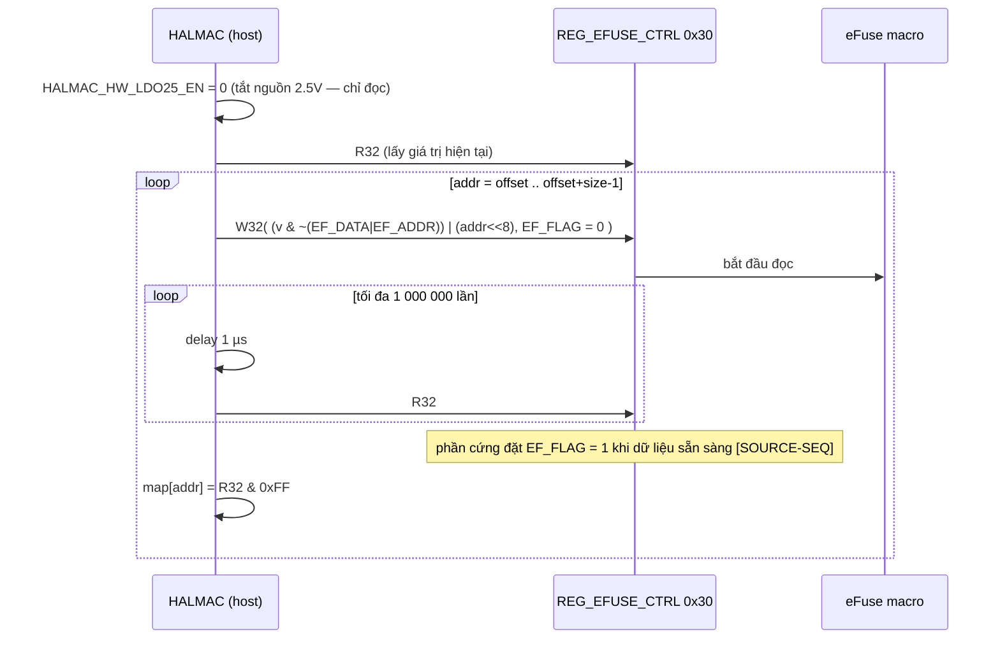

# 05.12 — eFuse / EEPROM và cơ chế truy cập dữ liệu cấu hình

> Nhãn như 05.01. eFuse là **bộ nhớ OTP** (ghi một lần) trong chip, chứa MAC address, công suất phát theo kênh, crystal cap, RFE type, thông tin PCB… Nó **không** phải thanh ghi; host đọc nó **gián tiếp** qua một nhóm nhỏ thanh ghi MAC. Phần này phân tích các thanh ghi đó và giao thức truy cập.

## 1. Thanh ghi tham gia

| Địa chỉ | Tên | St | Vai trò | Hàm |
|---|---|:-:|---|---|
| `0x000A` | `REG_SYS_EEPROM_CTRL_8822B` | A | `EERPOMSEL` (dùng EEPROM ngoài hay eFuse), `AUTOLOAD_SUS` (chip đã tự nạp eFuse lúc bật nguồn thành công?) | `rtl8822b_read_efuse` |
| `0x0030–0x0033` | `REG_EFUSE_CTRL_8822B` | A | **Cửa sổ truy cập**: `EF_FLAG[31]`, `EF_ADDR[17:8]` (10 bit), `EF_DATA[7:0]` | `read_hw_efuse_88xx`, `write_hw_efuse_88xx` |
| `0x0034–0x0037` | `REG_LDO_EFUSE_CTRL_8822B` | A | `EF_CELL_SEL[9:8]` = chọn bank; `LDOE25_EN[31]` = nguồn 2.5 V để **ghi** eFuse | `switch_efuse_bank_88xx`, `cfg_ldo25_8822b`, `hal_EfuseSwitchToBank` |
| `0x00CF` | B3 của `REG_PMC_DBG_CTRL2_8822B` (0xCC) | A | `EFUSE_BURN_GNT[31:24]` — mã mở khoá ghi `0x69` | `write_hw_efuse_88xx` |
| `0x00A0`, `0x00A3` | `REG_SYSON_FSM_MON_8822B` / B3 | M | đọc "BTStatus", ghi `0x05` — chỉ trong ioctl MP efuse, comment "For 8723AB, 8821S ?" | `rtw_mp_efuse_get/set` (`ioctl_linux.c:9032-9754`) |

Kích thước (`halmac_8822b_cfg.h:97-100`) [SOURCE]: eFuse vật lý `EFUSE_SIZE_8822B = 1024` byte; map logic `EEPROM_SIZE_8822B = 768`; BT 128; vùng bảo vệ `PRTCT_EFUSE_SIZE_8822B = 96`.

## 2. Giao thức đọc một byte (`read_hw_efuse_88xx`, `halmac_efuse_88xx.c:1004-1044`)



| Bước | Biểu thức | Giải thích bitwise |
|---|---|---|
| xoá field | `value32 &= ~(BIT_MASK_EF_DATA \| BITS_EF_ADDR)` | `BIT_MASK_EF_DATA = 0xFF` (bit 7:0), `BITS_EF_ADDR = 0x3FF << 8 = 0x0003_FF00` → xoá bit 17:0, giữ bit 31:18 |
| đặt địa chỉ | `value32 \|= (addr & 0x3FF) << 8` | địa chỉ 10 bit → tối đa 1024 byte, khớp `EFUSE_SIZE_8822B` |
| kích hoạt đọc | `W32(…, value32 & ~BIT_EF_FLAG)` | `BIT_EF_FLAG = BIT(31)` = 0 → "lệnh đọc" |
| chờ | `while ((R32 & BIT_EF_FLAG) == 0)` | cờ lên 1 = xong |
| lấy dữ liệu | `(u8)(tmp32 & 0xFF)` | |

Ví dụ tính tay — đọc byte `0x0CA` (`EFUSE_PCB_INFO_OFFSET`, `halmac_cfg_wmac_88xx.c:65`), giả sử thanh ghi đang `0x0012_3456`:

```
v & ~0x0003_FFFF        = 0x0010_0000
| (0x0CA << 8)          = 0x0010_CA00
& ~0x8000_0000 (EF_FLAG=0) → ghi 0x0010_CA00
… chờ R32 = 0x8010_CAxx → byte = xx
```

**Ghi** (`write_hw_efuse_88xx`, `:1046-1095`) ngược cực tính cờ [SOURCE]:

1. `efuse_map_valid = 0` (huỷ cache).
2. `W8(REG_PMC_DBG_CTRL2 + 3, 0x69)` — **unlock code** (`const u8 unlock_code = 0x69`).
3. `HALMAC_HW_LDO25_EN = 1` → `cfg_ldo25_8822b(1)`: `REG_LDO_EFUSE_CTRL + 3 |= BIT(7)` (= `LDOE25_EN[31]`).
4. `W32(REG_EFUSE_CTRL, (v & ~(DATA|ADDR)) | addr<<8 | data | EF_FLAG)` — cờ = 1 → "lệnh ghi".
5. chờ cờ **về 0** (≤ 1 000 000 lần, 1 µs).
6. `W8(REG_PMC_DBG_CTRL2 + 3, 0x00)` khoá lại; LDO25 = 0.
7. Chỉ khi `adapter->efuse_auto_check_en == 1` (`:1099-1107`): đọc lại byte bằng `read_hw_efuse_88xx`, khác giá trị → `"[ERR]efuse compare"`, `HALMAC_RET_EFUSE_W_FAIL`.

Thứ tự "bật 2.5 V chỉ khi ghi" là đặc trưng của OTP: điện áp cao dùng để "đốt" cầu chì; đọc với LDO tắt để tránh ghi nhầm [INFERENCE theo tên `LDOE25` + trình tự].

## 3. Chọn bank

Hai cài đặt độc lập trong cùng build [SOURCE]:

| Đường | Thanh ghi | Cách ghi | Dùng ở |
|---|---|---|---|
| HALMAC `switch_efuse_bank_88xx` (`halmac_efuse_88xx.c:912-935`) | byte `0x0035` bit 1:0 | RMW 8-bit; **đọc lại để xác minh**, sai → `HALMAC_RET_SWITCH_EFUSE_BANK_FAIL` | đường chuẩn |
| Legacy `hal_EfuseSwitchToBank` (`core/efuse/rtw_efuse.c:685-731`) | `rtw_read32/rtw_write32(0x34)` với `EFUSE_SEL(x) = ((x)&3)<<8` (`hal_com_reg.h:1281`) | RMW 32-bit, **không** xác minh | chỉ từ `rtw_efuse_analyze()` (ioctl debug `ioctl_linux.c:10000`) và `hal_EfuseGetCurrentSize_BT` |

Hai đường trỏ vào **cùng 2 bit** (`EF_CELL_SEL[9:8]` của `REG_LDO_EFUSE_CTRL`) — `0x34` literal trong legacy code chính là `REG_LDO_EFUSE_CTRL_8822B` [SOURCE + đối chiếu địa chỉ]. Bank 0 = WiFi, 1–3 = BT (`EFUSE_WIFI_SEL_0 = 0`, `EFUSE_BT_SEL_0 = 1`…, `hal_com_reg.h:1283-1284`).

## 4. Luồng thật lúc khởi động

```
rtl8822b_read_efuse()                         hal/rtl8822b/rtl8822b_ops.c:660…
 ├─ R8(REG_SYS_EEPROM_CTRL_8822B)             :673
 │    EepromOrEfuse       = EERPOMSEL ? EEPROM : eFuse
 │    bautoload_fail_flag = !AUTOLOAD_SUS
 ├─ EFUSE_ShadowMapUpdate(EFUSE_WIFI)         core/efuse/rtw_efuse.c:3141
 │    └─ nếu autoload OK: rtw_halmac_read_logical_efuse_map()     :3170
 │         └─ api->halmac_dump_logical_efuse_map(mac, HALMAC_EFUSE_R_DRV)   hal_halmac.c:4354
 │              └─ dump_log_efuse_map_88xx → dump_efuse_drv_88xx           halmac_efuse_88xx.c:1375
 │                   └─ read_hw_efuse_88xx(0, 1024, map)   ← 1024 lần giao thức §2
 │              → chuyển map vật lý → map logic 768 byte (eeprom_parser)
 └─ CONFIG_EFUSE_CONFIG_FILE: nếu thông tin công suất trong eFuse không hợp lệ
      → Hal_readPGDataFromConfigFile()  (/system/etc/wifi/wifi_efuse_8812bu.map)   :685-690
```

**Chi phí USB** [INFERENCE từ số học + 03 §3.4]: mỗi byte cần ≥ 1 `W32` + ≥ 1 `R32`; `0x30` thuộc REG_ON_SEC nên mỗi truy cập kèm 1 lần ghi `0x4E0` → ≥ 4 control transfer/byte → **≥ 4096 control transfer** chỉ để đọc eFuse một lần. Kết quả được cache (`efuse_map_valid = 1`) nên các lần sau không đọc lại.

Chú ý: nếu `AUTOLOAD_SUS = 0` (autoload fail) driver **không đọc eFuse** mà dùng map toàn `0xFF` → giá trị mặc định của driver (log: `"invalid phy efuse and read from file fail, will use driver default!!"` nếu cũng không có file) [SOURCE `:685-690`, `:3156-3173`].

## 5. Lỗi có thể gặp và dấu hiệu trong log

| Triệu chứng | Nguyên nhân theo source | Log |
|---|---|---|
| Đọc eFuse treo lâu | `EF_FLAG` không lên — timeout sau 10⁶ vòng × (1 µs + USB) → có thể **phút** [INFERENCE] | `"[ERR]read\n"` (`:1035`) |
| Ghi eFuse fail | cờ không về 0 | `"[ERR]write!!\n"` |
| MAC address/công suất mặc định | `bautoload_fail_flag`; hoặc `"<ERROR> fail to get efuse map!"` | `rtw_efuse.c:3172` |
| Dump eFuse lúc MAC tắt | `"[ERR]Dump efuse in suspend"` (`halmac_efuse_88xx.c:530`) | |
| Đổi bank thất bại | đọc lại `0x35` không khớp | `HALMAC_RET_SWITCH_EFUSE_BANK_FAIL` |
