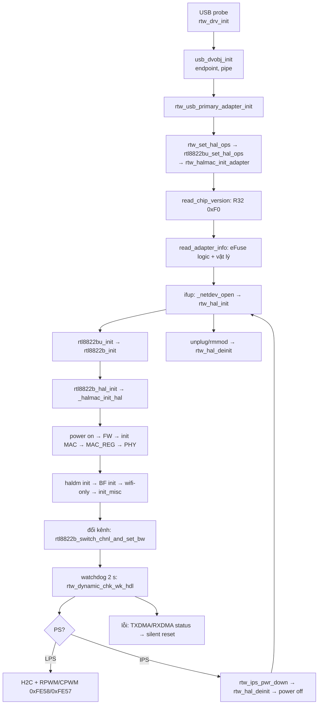

# 07 — Trình tự thao tác thanh ghi theo chuỗi gọi thật (Phần 6/7 của yêu cầu)

> Mỗi bước có hàm và `file:dòng` đã đọc trong source, cùng nhóm tài liệu chứa chi tiết thanh ghi (05.xx). Chỉ ghi nhánh **active** trong build (01). Đường dẫn rút gọn: `usb_intf` = `os_dep/linux/usb_intf.c`, `os_intfs` = `os_dep/linux/os_intfs.c`, `hal_halmac` = `hal/hal_halmac.c`, `8822b_phy` = `hal/rtl8822b/rtl8822b_phy.c`, `8822b_halinit` = `hal/rtl8822b/rtl8822b_halinit.c`, `8822b_ops` = `hal/rtl8822b/rtl8822b_ops.c`.
> Nhãn như 05.01. Số transfer USB tính theo 03 §3.4: RMW = 2, và địa chỉ `0x00–0xFF` / `0x1000–0x10FF` kèm thêm 1 lần ghi `0x4E0`.

## 1. Tổng quan vòng đời



## 2. Probe (cắm USB / `insmod`)

| # | Hàm (nguồn) | Thanh ghi | Nhóm |
|---|---|---|---|
| 1 | `rtw_drv_init` (`usb_intf:1541`) → `usb_dvobj_init` (`:529-…`) | không chạm thanh ghi: đọc descriptor, gán pipe bulk-in/out, int-in (int-in không dùng — 05.03) | 05.09 |
| 2 | `rtw_usb_primary_adapter_init` (`:1381-…`) → `loadparam` → `rtw_init_io_priv(usb_set_intf_ops)` | gán `_read8/…` = `usb_read*` (03) | 03 |
| 3 | `rtw_set_hal_ops` → `rtl8822bu_set_hal_ops` → `rtl8822bu_halmac_init_adapter` → `rtw_halmac_init_adapter` (`hal_halmac:1281-1370`) → `halmac_init_adapter` | HALMAC đọc chip ID `R8(0xFC)` và chip version `R8(0xF1) >> 4` (`halmac_api.c:560-562`); `halmac_interface_integration_tuning`; `halmac_phy_cfg(ALL)` → tham số USB2/USB3-PHY (USB3-PHY `0x01 = 0xA841`, cut D — gián tiếp `0xFF0C–0xFF0E`) | 05.09 |
| 4 | `rtw_hal_read_chip_version` → `read_chip_version` (`8822b_ops:215-240`) | `R32(0x00F0 REG_SYS_CFG1)`: `RTL_ID`, `CHIP_VER[15:12]` → cut, `VENDOR_ID` | 14 §2.2 |
| 5 | `rtw_hal_chip_configure` → `rtl8822bu_interface_configure` | (cấu hình phần mềm USB) | 05.09 |
| 6 | `rtw_btcoex_wifionly_initialize` | phần mềm | 05.17 |
| 7 | `rtw_hal_read_chip_info` → `read_adapter_info` → `rtl8822b_read_efuse` (`8822b_ops:661-745`) | `R8(0x000A REG_SYS_EEPROM_CTRL)` → `EERPOMSEL`, `AUTOLOAD_SUS`; `EFUSE_ShadowMapUpdate` (eFuse logic qua HALMAC — 05.12); parse: MAC, TX power, xtal `0xB9`, thermal, RFE `0xCA`, … ; `rtw_phydm_read_efuse` → trim **vật lý** `0x3D5–0x3EF` | 05.12, 15 §5 |
| 8 | `rtw_init_drv_sw`, `rtw_macaddr_cfg`, `rtw_os_ndevs_init` | phần mềm | — |

Với USB, `rtw_hal_read_chip_info` **không** bật nguồn chip trước khi đọc eFuse (`hal/hal_intf.c:103-111`: chỉ làm việc đó cho SDIO/GSPI).

## 3. Mở interface — chuỗi khởi tạo phần cứng

`netdev_open` → `_netdev_open` (`os_intfs:3739-…`, nhánh `#else` của `CONFIG_NEW_NETDEV_HDL`) → `rtw_hal_init` (`hal/hal_intf.c:544-…`) → `hal_init` = `rtl8822bu_init` (`hal/rtl8822b/usb/rtl8822bu_halinit.c:235-249`) → `rtl8822b_init` (`8822b_halinit:311-352`):

| # | Hàm (nguồn) | Thanh ghi / hành động | Nhóm |
|---|---|---|---|
| 3.1 | `rtl8822b_hal_init` (`8822b_halinit:168-217`) | `CONFIG_FILE_FWIMG` bị comment (`include/autoconf.h:117`), nên FW lấy từ mảng `array_mp_8822b_fw_nic` | 05.08 |
| 3.2 | → `rtw_halmac_init_hal_fw` → `_halmac_init_hal` (`hal_halmac:3548-3655`) | | |
| 3.2.1 | `rtw_hal_power_on` → `rtl8822b_power_on` (`8822b_halinit:109-137`) → `rtw_halmac_poweron` | `HW_VAR_APFM_ON_MAC`; power sequence card-emu→act (25 bước), kiểm `0x100 == 0xEA` | 05.01 §4 |
| 3.2.2 | `download_fw` | backup LTE-coex `0x38`; reserved page → DDMA → checksum → `0x80 == 0xC078`; restore | 05.08 |
| 3.2.3 | `init_mac_flow` (`hal_halmac`) | `halmac_cfg_rxff_expand_mode`, `cfg_la_mode(DISABLE)`, `_cfg_drv_rsvd_pg_num`, `set_bulkout_num`, **`halmac_init_mac_cfg(trx_mode)`** → `init_trx_cfg` → `init_protocol_cfg` → `init_edca_cfg` → `init_wmac_cfg` (`halmac_init_88xx.c init_mac_cfg_88xx`); `HW_VAR_RCR` get; RTS full BW; `_init_trx_cfg_drv`; `rtw_halmac_rx_agg_switch(TRUE)`; `cfg_operation_mode(AC)` | 05.04 (FIFO 2048 page, PQ_MAP), 05.17 §5 (protocol), 05.06 (EDCA), 05.02 (RCR `0xE400220E`, RXFLTMAP) |
| 3.2.4 | `_drv_enable_trx` | khởi động thread, `rtw_intf_start` (URB bulk-in) | 05.09 |
| 3.2.5 | `_send_general_info` (nếu FW OK) | H2C general info: RFE type, RF type, cut (`hal_halmac:3020-3045`) | 05.08 |
| 3.2.6 | `rtw_hal_init_mac_register` → MAC_REG | 125 lần `W8` theo bảng (`LOAD_MAC_PARA_FILE` bật: `/lib/firmware/…/MAC_REG.txt` nếu có thì ghi đè) | A11 |
| 3.2.7 | `rtw_halmac_config_rx_info(PHY_STATUS)` | `0x60F` RX_DRVINFO_SZ, RCR `APP_PHYSTS` | 05.02 |
| 3.2.8 | `rtw_hal_init_phy` → `rtl8822b_phy_init` (`8822b_phy:319-355`) | (a) `rtw_halmac_phy_power_switch(TRUE)` → `enable_bb_rf_88xx`: `board_rf_fine_tune`, `0x02 \|= FEN_BBRSTB \| FEN_BB_GLB_RSTN`, `0x1F \|= RF_EN \| RF_RSTB \| RF_SDMRSTB`, `0xEC[26:24]` = 7; (b) `config_phydm_parameter_init_8822b(PRE)`: `0x808[29:28] = 0`; (c) `init_bb_reg`: PHY_REG 1492 + AGC 521, crystal cap `0x24/0x28`; (d) `init_rf_reg`: RadioA 412 + RadioB 357 (~400 ms delay); (e) `config_phydm_parameter_init_8822b(POST)`: `0x808[29:28] = 3` | 05.01 §6, 13 §2, 14 §2, 15 §6 |
| 3.2.9 | `halmac_init_interface_cfg` | USB: RX agg `0x280`, burst `0x290`… | 05.09 |
| 3.3 | `rtl8822b_phy_init_haldm` → khởi tạo phydm (DIG `0xC50`, CCX, …) | | 13 |
| 3.4 | `rtl8822b_phy_bf_init` (`8822b_halinit:333`) | `0x14C0`, `0x167C`, `0x1680`, `0x42F`, `0x45F`, `0x6DF`, BB `0x1C94` | 05.17 §1.1 |
| 3.5 | `rtw_btcoex_wifionly_hw_config` (`:350`) | `0x4C`, `0xCB4`, `0x974`, `0x1990`, `0xCBC`, `0x70`, LTE-coex `0x38` (qua `0x1704/0x1700`), `0x6C0/0x6C4` | 05.17 §2 |
| 3.6 | `rtl8822b_init_misc` (`8822b_halinit:237-305`) | `invalidate_cam_all` (CAM — 05.07); RCR xoá `ACRC32 \| AICV`; `RXFLTMAP1 = 0`; `REG_CR \|= MAC_SEC_EN`; `FWHW_TXQ_CTRL` (XMIT_ACK); … | 05.07, 05.02 |
| 3.7 | `hal_init_misc` (USB) | LED (05.11) | 05.11 |
| 3.8 | quay về `rtw_hal_init`: `rtw_mi_set_mac_addr` (`0x610`…), `rtw_restore_hw_port_cfg`, `init_hw_mlme_ext` (→ đổi kênh lần đầu, §4), `rtw_hal_init_opmode`, `rtw_bb_rf_gain_offset` (kfree/`REG_RF_TX_GAIN_OFFSET`), … | | 05.02, 15 |
| 3.9 | `_netdev_open`: `HW_VAR_MAC_ADDR`, khởi động thread, `rtw_intf_start`, **`_set_timer(dynamic_chk_timer, 2000)`** (`os_intfs` ≈ `:3824`) | bắt đầu watchdog §5 | |

Ước lượng chi phí riêng PHY+RF ở bước 3.2.8: ≈ 2768 control transfer (2013 BB + 755 RF) và ≈ 400 ms delay trong bảng RF [tính tay từ 13/14].

## 4. Đổi kênh / băng thông

`rtw_hal_set_chnl_bw` → `rtl8822b_switch_chnl_and_set_bw` (`8822b_phy:1031-1136`). `RTW_CHANNEL_SWITCH_OFFLOAD` không bật, nên luôn đi `switch_chnl_and_set_bw_by_drv` (`:961-1012`):

```
1. nếu đổi băng: config_phydm_switch_band_8822b      → 0x808[28], 0x454[7], 0xA80[18], 0x814, RF18, SoML (13 §3.3)
2. nếu đổi kênh: config_phydm_switch_channel_8822b    → RF18, 0x958, 0x860, 0xA24/0xA28, RF 0xBE/0xDF/0xB8, IGI toggle, RFE (13 §3.1, §7)
3. nếu đổi BW:   mac_switch_bandwidth(pri_ch_idx)       → MAC 0x668 (cfg_bw_88xx), 0x483 DATA_SC (cfg_pri_ch_idx_88xx)
                 config_phydm_switch_bandwidth_8822b    → 0x8AC, 0x8C4[30], RF18[11:10], 0xA00[4] (13 §3.2)
4. đổi băng → rtw_btcoex_wifionly_switchband_notify     → 0xCBC[9:8] (05.17 §2)
5. (MP) phy_set_rf_path_switch_8822b
6. phydm_config_kfree                                    → RF 0xDE/0x65/0x55 (15 §5)
7. odm_clear_txpowertracking_state; rtw_hal_set_tx_power_level → TXAGC 0x1D00/0x1D80, 24 W32 (15 §2)
8. nếu bNeedIQK hoặc MP: rtw_phydm_iqk_trigger          → IQK FW, poll RF 0x08 = 0xABCDE, _iqk_fail_count (15 §4)
```

Mô phỏng thanh ghi: `tools/chbw_sim.py <ch> <bw>` và `tools/txagc_sim.py`.

## 5. Watchdog (mỗi 2 giây)

`dynamic_chk_timer` → `rtw_dynamic_chk_wk_cmd` → `rtw_dynamic_chk_wk_hdl` (`core/rtw_cmd.c:2881-…`) → `rtw_hal_dm_watchdog` (`:2901`) → `rtl8822b_phy_haldm_watchdog` (`8822b_phy:558-…`; bỏ qua nếu MP với `mp_dm = 0` hoặc chưa init xong) → `phydm_watchdog` (`hal/phydm/phydm.c`). Thứ tự trong `phydm_watchdog`:

| Thứ tự | Hàm | Thanh ghi | Nhóm |
|---|---|---|---|
| 1 | `phydm_common_info_self_update`, `phy_info_update`, `rssi_monitor_check` | (phần mềm / H2C RSSI) | |
| 2 | `phydm_hw_setting` | `phydm_dynamic_parameters_ota` … | 05.17 §4 |
| 3 | `phydm_false_alarm_counter_statistics` → `phydm_noisy_detection` → **`phydm_dig`** → `phydm_cck_pd_th` | đọc `0xF48`, `0xA5C`, `0xF04–0xF14`, `0xFBC–0xFD0`; reset `0x9A4/0xA2C/0xB58`; IGI `0xC50/0xE50`; `0xA0A` | 13 §4–5 |
| 4 | `phydm_adaptivity`, `phydm_ra_info_watchdog`, `phydm_cfo_tracking` (→ crystal cap `0x24/0x28`), `phydm_dynamic_tx_power`, `phydm_adaptive_soml`, `phydm_beamforming_watchdog` | `0x8A4`…, `0xD0C–0xD54` | 05.17 §4, 15 §6 |
| 5 | **`halrf_watchdog`** | power tracking: kích/đọc RF `0x42`, ghi `0xC94/0xC1C` (+ `0xE94/0xE1C`); IQK lại nếu `delta_iqk ≥ 8`; **không có LCK** | 14 §5, 15 §3 |
| 6 | `phydm_primary_cca`, `odm_dtc`, **`phydm_env_mntr_watchdog`** (NHM/CLM/FAHM), `phydm_lna_sat_chk_watchdog`, `phydm_mcc_switch`, … | `0x990–0x9A0`, `0xFA4–0xFB4`, `0x1C38…` | 13 §8 |

Các phần khác trong cùng chu kỳ: LED, kiểm TX/RX treo và silent reset (`TXDMA_STATUS`/`RXDMA_STATUS` — 05.04), `check_rx_count` (`0x1118`), LPS check.

## 6. Đường dữ liệu TX/RX

- **TX:** `rtl8822bu_hal_xmit` / `rtl8822bu_mgnt_xmit` → TX descriptor + bulk-out theo PQ_MAP. Đường này **không có truy cập thanh ghi theo gói**. Hàng đợi được ánh xạ sang endpoint lúc init (05.04).
- **RX:** URB bulk-in → RX descriptor + driver-info (`0x60F` × 8 byte, PHY status). Phân tích hoàn toàn trong bộ nhớ host, cũng không đọc thanh ghi theo gói.
- **Ngắt:** USB không có ngắt host. Pipe INT-IN và `CONFIG_SUPPORT_USB_INT` đều tắt (05.03). Sự kiện từ FW (C2H) đến qua gói RX.

## 7. Tiết kiệm năng lượng

| Cơ chế | Chuỗi gọi | Thanh ghi | Nhóm |
|---|---|---|---|
| LPS vào/ra | `LPS_Enter/Leave` → `rtw_set_ps_mode` → H2C SetPwrMode; `rtw_set_rpwm` → `HW_VAR_SET_RPWM` | `0xFE58` (`& 0xC1`, toggle bit 7), poll `0xFE57` ≤ 3 × 10 ms | 05.10 §2 |
| IPS vào | `ips_enter` → `_ips_enter` (`core/rtw_pwrctrl.c:120-…`) → `rtw_ips_pwr_down` (`os_intfs:4016`) → `rtw_ips_dev_unload` → `rtw_hal_deinit` → `rtl8822bu_deinit` → `rtl8822b_deinit` → `rtw_halmac_deinit_hal` (`halmac_deinit_interface_cfg`, `rtw_hal_power_off`) | power-off sequence 18 bước | 05.01 §5 |
| IPS ra | `ips_leave` → `rtw_ips_pwr_up` → `ips_netdrv_open` → `rtw_hal_init` | lặp lại toàn bộ §3 (gồm tải FW, PHY_REG, RF) | §3 |
| WoWLAN | `rtw_suspend_common` → `rtw_hal_wow_enable` | `TXPAUSE`, gate BB, FW WoW, CAM mẫu `0x698/0x69C`, `0x1C7`, `RSV_CTRL` | 05.10 §4 |
| Suspend/autosuspend | `rtw_suspend`/`autosuspend_enter` | power-off | 05.10 |

## 8. Xử lý lỗi

| Lỗi | Phát hiện | Hành động | Nhóm |
|---|---|---|---|
| Vendor request lỗi | `usbctrl_vendorreq`: `-ESHUTDOWN/-ENODEV` → surprise removed; lỗi khác → `USB_VEN_REQ_CMD_FAIL`; `continual_io_error > 4` → surprise removed | đọc trả 0 (09 mục 13) | 03 §3.4 |
| TX/RX DMA treo | watchdog đọc `TXDMA_STATUS`/`RXDMA_STATUS` | silent reset | 05.04 |
| FW tải lỗi | `0x80 != 0xC078`, checksum, `ILLEGAL_KEY` | bật lại CPU với FW cũ, khôi phục LTE-coex | 05.08 §7 |
| CPWM không đổi | 3 × 10 ms | `_FAIL` | 05.10 §2 |
| CAM poll quá 200 ms | `SECCAM_POLLING` vẫn là 1 | vẫn đọc và log | 05.07 §2 |
| eFuse `0xCA = 0xFF` (hoặc map không hợp lệ) và không có `rtw_RFE_type` | `Hal_ReadRFEType` trả `_FAIL` | `rfe_type = 0` + log; `rtl8822b_read_efuse` → `goto exit` (`ret = _FAIL`) → `rtw_hal_read_chip_info == _FAIL` → `goto free_hal_data` (`usb_intf:1434-1435`) → **probe thất bại, không có interface** [SOURCE] | 13 §2.3 |

## 9. Gỡ thiết bị / đóng

`rtw_dev_remove` → `rtw_usb_primary_adapter_deinit` (`usb_intf`) → (nếu đang kết nối) `rtw_disassoc_cmd` → … → `rtw_hal_deinit` → `rtl8822b_deinit` → `rtw_halmac_deinit_hal` → power off (05.01 §5) → `rtw_halmac_deinit_adapter`.
