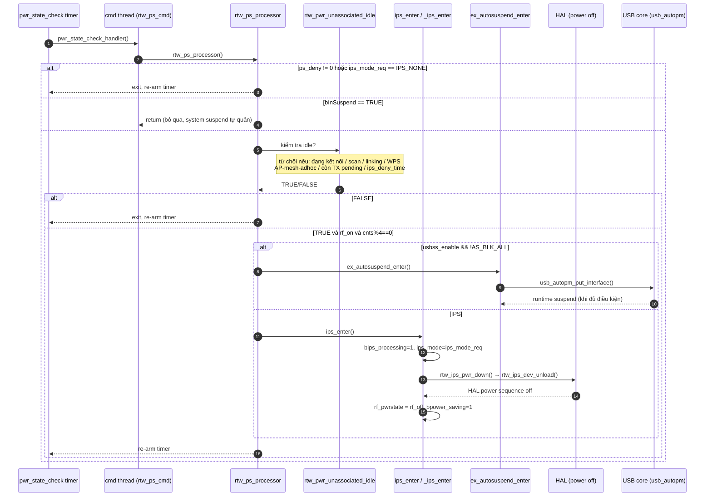
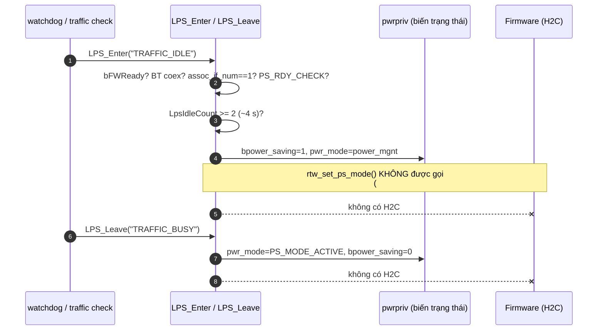
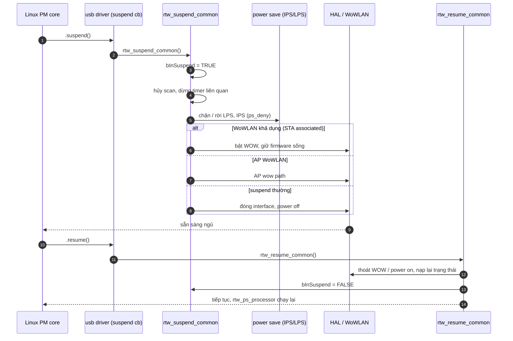

Điểm quan trọng là driver có nhiều cơ chế tiết kiệm nguồn khác nhau. Không nên gọi tất cả là suspend:
- LPS (Leisure Power Save): giảm mức hoạt động khi Wi-Fi đang kết nối nhưng ít hoạt động.
- IPS (Inactive Power Save): tắt RF hoặc đưa phần cứng vào trạng thái nguồn thấp khi không có kết nối/không cần hoạt động.
- USB autosuspend: cho phép cơ chế quản lý nguồn USB đưa thiết bị vào trạng thái suspend khi đủ điều kiện.
- System suspend: hệ điều hành yêu cầu driver chuẩn bị cho máy ngủ; có thể giữ Wi-Fi hoạt động để Wake-on-Wireless-LAN (WoWLAN).

**LPS trong bản này gần như bị vô hiệu hóa ở mức firmware.** Ghi chú của bạn nói LPS "giảm hoạt động khi kết nối", nhưng ở [rtw_pwrctrl.c:1266-1271](vscode-webview://1v7kr62lml590cb3gndmegc6ml88sjdjv7262pvi3l6t2rv5t7fr/Kernel/K-S800/Src/drivers/net/wireless/realtek/rtl8812BU_v1930.24/core/rtw_pwrctrl.c#L1266-L1271) (`LPS_Enter`) và [rtw_pwrctrl.c:1313-1318](vscode-webview://1v7kr62lml590cb3gndmegc6ml88sjdjv7262pvi3l6t2rv5t7fr/Kernel/K-S800/Src/drivers/net/wireless/realtek/rtl8812BU_v1930.24/core/rtw_pwrctrl.c#L1313-L1318) (`LPS_Leave`) có `#if 1 // 2021/10/14 ... OP_BTS-35861`. Đây là patch của khách hàng. Nhánh `#if 1` chỉ log `"skip ..."` và gán biến `pwr_mode`. Lời gọi `rtw_set_ps_mode()` nằm trong `#else`, nên không bao giờ chạy. Vì vậy driver **không gửi H2C** để đưa firmware vào LPS. Chip không thực sự ngủ theo kiểu LPS, dù biến `bpower_saving` và `pwr_mode` vẫn đổi.

Ngoài ra, mọi nhánh trong `rtw_ps_processor` chỉ chạy khi `ips_mode_req != IPS_NONE`. Điều kiện `% 4` ở [dòng 396](vscode-webview://1v7kr62lml590cb3gndmegc6ml88sjdjv7262pvi3l6t2rv5t7fr/Kernel/K-S800/Src/drivers/net/wireless/realtek/rtl8812BU_v1930.24/core/rtw_pwrctrl.c#L396) dùng `pwr_state_check_cnts`. Biến này chỉ tăng trong nhánh `bHWPwrPindetect` (dòng 386), nên nếu nhánh đó không bật thì `cnts` luôn bằng 0 và điều kiện luôn đúng.

## 1. IPS và USB autosuspend (đường tự động, chung điểm vào `rtw_ps_processor`)


**Thoát IPS** (`_ips_leave`, [dòng 164](vscode-webview://1v7kr62lml590cb3gndmegc6ml88sjdjv7262pvi3l6t2rv5t7fr/Kernel/K-S800/Src/drivers/net/wireless/realtek/rtl8812BU_v1930.24/core/rtw_pwrctrl.c#L164)) chạy khi có hoạt động mới như scan, connect hoặc mở interface: `ips_leave()` → `rtw_ips_pwr_up()` → `rf_pwrstate = rf_on`.

### 1.1.Bối cảnh: bài toán driver đang giải

Chip Wi-Fi RTL8822BU cắm qua USB. Khi bạn không dùng Wi-Fi (chưa kết nối AP, không scan), chip vẫn tốn điện. Driver giải bằng cách **tự kiểm tra định kỳ**: "Có ai đang cần chip không? Nếu không thì tắt bớt đi."

Ví dụ đời thường: bạn là bảo vệ tòa nhà. Cứ 2 phút đi một vòng. Nếu thấy không ai trong phòng thì tắt đèn. Diagram chính là quy trình đi vòng đó.

Các nhân vật trong diagram:

|Nhân vật|Là gì|
|---|---|
|`pwr_state_check timer`|Đồng hồ báo thức, kêu mỗi **2000 ms** ([rtw_pwrctrl.h:841](vscode-webview://1v7kr62lml590cb3gndmegc6ml88sjdjv7262pvi3l6t2rv5t7fr/Kernel/K-S800/Src/drivers/net/wireless/realtek/rtl8812BU_v1930.24/include/rtw_pwrctrl.h#L841))|
|`cmd thread`|Luồng nền của driver, thực thi các lệnh được xếp hàng|
|`rtw_ps_processor`|"Bảo vệ": hàm quyết định có tắt chip không|
|`rtw_pwr_unassociated_idle`|Hàm trả lời câu hỏi "chip có đang rảnh thật không?"|
|`ips_enter`|Đường 1: tắt RF và chip do **driver** làm|
|`ex_autosuspend_enter`|Đường 2: nhờ **USB core** của Linux ngủ thiết bị|

### 1.2.Timer kêu và đẩy việc sang cmd thread (bước 1-2)

```
T->>C: pwr_state_check_handler()
C->>P: rtw_ps_processor()
```

- Timer hết hạn thì gọi `pwr_state_check_handler()` ([rtw_pwrctrl.c:441](vscode-webview://1v7kr62lml590cb3gndmegc6ml88sjdjv7262pvi3l6t2rv5t7fr/Kernel/K-S800/Src/drivers/net/wireless/realtek/rtl8812BU_v1930.24/core/rtw_pwrctrl.c#L441)). Hàm này chỉ gọi `rtw_ps_cmd()`.
- **Vì sao không chạy luôn trong timer?** Callback của timer chạy trong ngữ cảnh ngắt mềm (softirq), nơi **không được phép ngủ** hay làm việc nặng. Việc tắt chip cần đọc/ghi USB, vốn có thể block. Vì vậy `rtw_ps_cmd()` xếp một lệnh vào hàng đợi cho cmd thread, và cmd thread (ngữ cảnh process, được phép ngủ) mới gọi `rtw_ps_processor()`.

###  1.3 Hàm `rtw_ps_processor` kiểm tra lần lượt các "cửa" (bước 3-5)

Mô hình dễ nhớ: như qua các cổng kiểm tra ở sân bay. Trượt cổng nào thì dừng ở đó và **hẹn lần sau**.

#### Cổng 1: `ps_deny != 0` ([dòng 324-332](vscode-webview://1v7kr62lml590cb3gndmegc6ml88sjdjv7262pvi3l6t2rv5t7fr/Kernel/K-S800/Src/drivers/net/wireless/realtek/rtl8812BU_v1930.24/core/rtw_pwrctrl.c#L324-L332))

Có phần nào của driver đã đặt cờ "cấm tiết kiệm điện" (ví dụ đang làm việc quan trọng). Nếu có thì `goto exit`.

#### Cổng 2: `bInSuspend == TRUE` ([dòng 334-338](vscode-webview://1v7kr62lml590cb3gndmegc6ml88sjdjv7262pvi3l6t2rv5t7fr/Kernel/K-S800/Src/drivers/net/wireless/realtek/rtl8812BU_v1930.24/core/rtw_pwrctrl.c#L334-L338))

Hệ thống đang đi ngủ (system suspend) hoặc đang autosuspend. Hàm `return` **thẳng**, không re-arm timer. Luồng suspend có đường riêng và không muốn bị IPS chen vào.

#### Cổng 3: `ips_mode_req == IPS_NONE` ([dòng 390](vscode-webview://1v7kr62lml590cb3gndmegc6ml88sjdjv7262pvi3l6t2rv5t7fr/Kernel/K-S800/Src/drivers/net/wireless/realtek/rtl8812BU_v1930.24/core/rtw_pwrctrl.c#L390))

Người dùng hoặc cấu hình đã tắt tính năng IPS (`rtw_ips_mode` bằng 0). Khi đó không bao giờ đi tiếp.

> Lưu ý: diagram gộp cổng 1 và cổng 3 vào một nhánh `alt` cho gọn. Trong code, giữa hai cổng còn có cổng 2, và một khối `SUPPORT_HW_RFOFF_DETECTED` dùng cho nút gạt RF phần cứng. Khối này chỉ chạy nếu `bHWPwrPindetect` bật, nên bỏ qua ở mức high-level.

#### Cổng 4: `rtw_pwr_unassociated_idle()` ([dòng 239-305](vscode-webview://1v7kr62lml590cb3gndmegc6ml88sjdjv7262pvi3l6t2rv5t7fr/Kernel/K-S800/Src/drivers/net/wireless/realtek/rtl8812BU_v1930.24/core/rtw_pwrctrl.c#L239-L305))

Đây là hàm hỏi "chip có thật sự rảnh không?". Nó trả `FALSE` (không được tắt) nếu gặp bất kỳ điều gì sau:

1. `bpower_saving == TRUE`: đã đang tiết kiệm điện rồi, khỏi làm lại.
2. `ips_deny_time` chưa qua: có ai vừa "cấm tạm" IPS trong một khoảng thời gian.
3. Một interface đang **up** và đang ở một trong các trạng thái: đã kết nối AP (`WIFI_ASOC_STATE`), đang scan (`UNDER_SURVEY`), đang kết nối (`UNDER_LINKING`), đang WPS, chạy AP, mesh, ad-hoc, hoặc P2P đang giữ kênh.
4. Chế độ MP (test sản xuất) đang bật.
5. Còn gói tin chờ gửi: số buffer TX rảnh `free_xmitbuf_cnt` khác tổng `NR_XMITBUFF`. Nghĩa là có buffer đang được dùng, tức còn gói chưa phát xong.

Chỉ khi **không vướng điều nào** thì hàm mới trả `TRUE`.

> Chú ý với người mới: tên hàm là "unassociated idle", tức rảnh khi **chưa associate** (chưa kết nối AP). Vì thế khi đã kết nối Wi-Fi thì IPS **không bao giờ** kích hoạt. Trường hợp đã kết nối thuộc về LPS hoặc một nhánh riêng của autosuspend (xem mục 4).

#### Cổng 5: `rf_pwrstate == rf_on` và `cnts % 4 == 0` ([dòng 396](vscode-webview://1v7kr62lml590cb3gndmegc6ml88sjdjv7262pvi3l6t2rv5t7fr/Kernel/K-S800/Src/drivers/net/wireless/realtek/rtl8812BU_v1930.24/core/rtw_pwrctrl.c#L396))

- `rf_on`: RF đang bật, nếu đã `rf_off` thì không cần tắt nữa.
- `pwr_state_check_cnts % 4 == 0`: ý định là "cứ 4 lần kiểm tra mới ra tay một lần" (4 × 2 s = 8 s) để tránh tắt/bật liên tục. Tuy nhiên, `cnts` chỉ tăng ở [dòng 386](vscode-webview://1v7kr62lml590cb3gndmegc6ml88sjdjv7262pvi3l6t2rv5t7fr/Kernel/K-S800/Src/drivers/net/wireless/realtek/rtl8812BU_v1930.24/core/rtw_pwrctrl.c#L386), bên trong khối `bHWPwrPindetect`. Nếu `bHWPwrPindetect` không bật, `cnts` luôn bằng 0 và điều kiện luôn đúng, nên **không có độ trễ 8 s**. Tôi chưa kiểm chứng giá trị của `bHWPwrPindetect` trên board.

### 1.4. Rẽ nhánh: autosuspend hay IPS? (bước 6)

Khi qua hết các cổng, code ở [dòng 402-431](vscode-webview://1v7kr62lml590cb3gndmegc6ml88sjdjv7262pvi3l6t2rv5t7fr/Kernel/K-S800/Src/drivers/net/wireless/realtek/rtl8812BU_v1930.24/core/rtw_pwrctrl.c#L402-L431) chọn một trong hai:

```c
if (usbss_enable && bInternalAutoBlock != AS_BLK_ALL)  -> ex_autosuspend_enter()
else                                                    -> ips_enter()
```

Chúng **loại trừ nhau**. Nếu `usbss_enable` bật và autosuspend không bị chặn hoàn toàn thì chọn nhánh USB, ngược lại chọn IPS.

#### Nhánh A: IPS (driver tự tắt) (bước 10-13)

`ips_enter()` ([dòng 150](vscode-webview://1v7kr62lml590cb3gndmegc6ml88sjdjv7262pvi3l6t2rv5t7fr/Kernel/K-S800/Src/drivers/net/wireless/realtek/rtl8812BU_v1930.24/core/rtw_pwrctrl.c#L150)) khóa `pwrctrl lock` rồi gọi `_ips_enter()` ([dòng 120](vscode-webview://1v7kr62lml590cb3gndmegc6ml88sjdjv7262pvi3l6t2rv5t7fr/Kernel/K-S800/Src/drivers/net/wireless/realtek/rtl8812BU_v1930.24/core/rtw_pwrctrl.c#L120)):

1. `bips_processing = TRUE`: dựng cờ "tôi đang bận chuyển trạng thái, đừng chen vào".
2. `ips_mode = ips_mode_req`: chốt mức IPS được yêu cầu.
3. Nếu `change_rfpwrstate == rf_off` thì đặt `bpower_saving = TRUE`, rồi gọi `rtw_ips_pwr_down()`.
4. `rtw_ips_pwr_down()` ([os_intfs.c:4016](vscode-webview://1v7kr62lml590cb3gndmegc6ml88sjdjv7262pvi3l6t2rv5t7fr/Kernel/K-S800/Src/drivers/net/wireless/realtek/rtl8812BU_v1930.24/os_dep/linux/os_intfs.c#L4016)) đặt `net_closed = TRUE` rồi gọi `rtw_ips_dev_unload()`.
5. `rtw_ips_dev_unload()` ([os_intfs.c:4027](vscode-webview://1v7kr62lml590cb3gndmegc6ml88sjdjv7262pvi3l6t2rv5t7fr/Kernel/K-S800/Src/drivers/net/wireless/realtek/rtl8812BU_v1930.24/os_dep/linux/os_intfs.c#L4027)) làm 2 việc: dừng đường truyền USB (`rtw_intf_stop`, nếu cấu hình LPS-in-IPS cho phép) và gọi `rtw_hal_deinit()`. Hàm HAL này chạy chuỗi **power sequence** ghi thanh ghi để tắt nguồn các khối trong chip.
6. Quay về, `rf_pwrstate = rf_off`, `bips_processing = FALSE`.

Kết quả: chip nằm ở trạng thái nguồn thấp nhưng **vẫn cắm USB**, hệ điều hành vẫn thấy thiết bị. Mức tắt sâu hay nông còn tùy `ips_mode` (với `IPS_LEVEL_2` thì giữ firmware sống, dòng 136-137).

Khi có người cần dùng lại (bật scan, connect), `_ips_leave()` ([dòng 164](vscode-webview://1v7kr62lml590cb3gndmegc6ml88sjdjv7262pvi3l6t2rv5t7fr/Kernel/K-S800/Src/drivers/net/wireless/realtek/rtl8812BU_v1930.24/core/rtw_pwrctrl.c#L164)) gọi `rtw_ips_pwr_up()` ([os_intfs.c:3988](vscode-webview://1v7kr62lml590cb3gndmegc6ml88sjdjv7262pvi3l6t2rv5t7fr/Kernel/K-S800/Src/drivers/net/wireless/realtek/rtl8812BU_v1930.24/os_dep/linux/os_intfs.c#L3988)). Hàm này mở lại netdev, nạp lại firmware, đặt `rf_on`. Việc này mất thời gian (driver tự log "in %dms"), nên có độ trễ khi thoát IPS.

#### Nhánh B: USB autosuspend (nhờ Linux USB ngủ thiết bị) (bước 7-9)

`ex_autosuspend_enter()` ([rtw_autosuspend.c:296](vscode-webview://1v7kr62lml590cb3gndmegc6ml88sjdjv7262pvi3l6t2rv5t7fr/Kernel/K-S800/Src/drivers/net/wireless/realtek/rtl8812BU_v1930.24/core/rtw_autosuspend.c#L296)):

1. Kiểm tra `bInternalAutoBlock == AS_BLK_ALL` thì thoát, vì bị chặn hoàn toàn.
2. Phân loại tình huống:
    - Đã associate: đánh dấu `bInternalAssociatedAutoSuspend = TRUE`, tức autosuspend khi **đang kết nối**, kiểu "wow", để thiết bị còn đánh thức khi có gói đến.
    - Chưa associate, không scan/linking: phải có `change_rfpwrstate == rf_off`, rồi đặt lại bộ đếm chờ (`autosuspend_reset_waitcnt`). Giá trị chờ lấy từ `autosuspend_delay / 2000`.
    - Đang scan/linking: thoát, chưa ngủ.
3. Đặt các cờ `bInternalAutoSuspend`, `bips_processing`.
4. Gọi `autosuspend_enable()` rồi `autosuspend_int_put()`. Hàm sau là chỗ **trả lại tham chiếu PM** cho USB core (kiểu `usb_autopm_put_interface`). Tôi chưa đọc thân hàm này, nên tên chính xác API là suy từ tên hàm.
5. Đặt trạng thái `AS_SUSPEND_WAITING`.

Điểm mấu chốt cho người mới: driver **không trực tiếp suspend** USB. Nó chỉ nói "tôi không cần thiết bị nữa" bằng cách trả tham chiếu. Khi bộ đếm tham chiếu về 0 và hết `autosuspend_delay`, **USB core mới thực sự suspend** (đây là bước 9 trong diagram: `USB-->>A: runtime suspend (khi đủ điều kiện)`, và là bất đồng bộ). Muốn dậy thì driver gọi `usb_autopm_get_interface` (get), hoặc có gói tin tới.

### 1.5. Kết thúc: re-arm timer (bước 14)

Ở nhãn `exit:` ([dòng 433-438](vscode-webview://1v7kr62lml590cb3gndmegc6ml88sjdjv7262pvi3l6t2rv5t7fr/Kernel/K-S800/Src/drivers/net/wireless/realtek/rtl8812BU_v1930.24/core/rtw_pwrctrl.c#L433-L438)):

```c
rtw_set_pwr_state_check_timer(pwrpriv);   // hẹn 2000 ms nữa
pwrpriv->ps_processing = _FALSE;
```

Timer một lần (one-shot) nên mỗi vòng phải tự hẹn lại. Đây là lý do mọi nhánh dẫn về `exit` đều "re-arm". Riêng nhánh `bInSuspend` thì `return` sớm, không re-arm; timer được hẹn lại khi resume (xem các lời gọi ở [os_intfs.c:5385](vscode-webview://1v7kr62lml590cb3gndmegc6ml88sjdjv7262pvi3l6t2rv5t7fr/Kernel/K-S800/Src/drivers/net/wireless/realtek/rtl8812BU_v1930.24/os_dep/linux/os_intfs.c#L5385), [os_intfs.c:5522](vscode-webview://1v7kr62lml590cb3gndmegc6ml88sjdjv7262pvi3l6t2rv5t7fr/Kernel/K-S800/Src/drivers/net/wireless/realtek/rtl8812BU_v1930.24/os_dep/linux/os_intfs.c#L5522), [os_intfs.c:5670](vscode-webview://1v7kr62lml590cb3gndmegc6ml88sjdjv7262pvi3l6t2rv5t7fr/Kernel/K-S800/Src/drivers/net/wireless/realtek/rtl8812BU_v1930.24/os_dep/linux/os_intfs.c#L5670)).

### 1.6. Tóm tắt một kịch bản cụ thể

> Bạn cắm dongle, `wlan0` đã up, chưa kết nối AP, không ai scan.

1. 2 giây sau timer kêu, `rtw_ps_processor` chạy.
2. Qua cổng 1-3. `rtw_pwr_unassociated_idle` trả `TRUE` vì không có gì đang làm.
3. `rf_on` và `cnts % 4 == 0` đúng.
4. Nếu `usbss_enable` tắt, vào `ips_enter`. Log hiện `==>ips_enter cnts:1` rồi `nolinked power save enter`. RF tắt, `rf_pwrstate = rf_off`.
5. Bạn chạy `iw dev wlan0 scan` thì driver gọi `ips_leave`, log hiện `nolinked power save leave`, chip bật lại, rồi mới scan.

### Hai điều chưa xác minh

- `ips_mode_req` mặc định là gì, và `usbss_enable` mặc định bật hay tắt trên board này. Hai giá trị này quyết định chip đi nhánh A hay nhánh B, hay không đi nhánh nào.
- Nội dung thật của `autosuspend_int_put()`.
## 2. LPS (đã khảo sát, nhánh firmware đang bị skip)



Nếu bỏ patch (đổi `#if 1` thành `#if 0`), luồng gốc sẽ là `rtw_set_ps_mode()` rồi H2C `SET_PWR_MODE` xuống firmware.

## 3. System suspend / resume (do OS khởi phát)



## Tóm tắt phân biệt

|Cơ chế|Kích hoạt bởi|Hàm cuối cùng|Trạng thái thực tế trong bản này|
|---|---|---|---|
|IPS|timer, `rtw_ps_processor`|`rtw_ips_pwr_down`|Hoạt động nếu `ips_mode_req != IPS_NONE`|
|USB autosuspend|timer, cùng điểm vào|`ex_autosuspend_enter`|Cần `usbss_enable`|
|LPS|watchdog / traffic|`LPS_Enter`|**Chỉ đổi biến, không gửi H2C**|
|System suspend|OS PM|`rtw_suspend_common`|Độc lập, chặn `rtw_ps_processor`|

Có hai điều tôi chưa xác minh. Một là giá trị mặc định của `ips_mode_req`. Hai là `usbss_enable` có bật mặc định hay không. Hai giá trị này quyết định đường nào chạy trên board. Nếu bạn muốn, tôi sẽ truy vết hai giá trị đó trong `os_intfs.c` và `rtw_pwrctrl.c`.