# Phân tích HW_interim.h / HW_interim.cpp — Luồng Controller → Kernel cho Panel

Tóm gọn: **mọi lệnh điều khiển panel từ Controller đều đi qua một hàm duy nhất là `sysBspIoctlPanelSio()`**. Hàm này đổi mã lệnh phía Controller (`EXDB_PanelKind`) sang mã ioctl của kernel (`ENM_IOCTL_CMD_*`), rồi gọi `ioctl()` lên `/dev/outpanelcom`. Phần còn lại của 2 file chủ yếu là lớp tương thích VxWorks, các hàm stub và các tiện ích không liên quan đến panel.

Quy ước nhãn:

- **FACT**: thấy trực tiếp trong 2 file này.
- **INFERENCE**: suy luận, cần đọc thêm source khác để xác nhận.
- **DEAD/STUB**: code không chạy, hoặc chỉ trả về giá trị cố định.

---

## Mục lục

1. [Tổng quan](#1-tổng-quan)
2. [Phân loại nội dung](#2-phân-loại-nội-dung)
3. [EXDB và ENM: vì sao phải dịch](#3-exdb-và-enm-vì-sao-phải-dịch)
4. [Sequence diagrams và giải thích](#4-sequence-diagrams-và-giải-thích)
5. [Chi tiết 5 hàm panel](#5-chi-tiết-5-hàm-panel)
6. [Phân tích các điểm quan trọng](#6-phân-tích-các-điểm-quan-trọng)
7. [Bản đồ file](#7-bản-đồ-file)
8. [Call graph high-level](#8-call-graph-high-level)
9. [Mười ý quan trọng nhất](#9-mười-ý-quan-trọng-nhất)
10. [Dependency cần đọc tiếp](#10-dependency-cần-đọc-tiếp)

---

## 1. Tổng quan

### 1.1 Vai trò từng file

| File | Nội dung | Vai trò |
|---|---|---|
| `HW_interim.h` | Typedef và define “mượn” từ VxWorks/Tornado 2.2 (`BLK_DEV`, `WIND_TCB`, `SEMAPHORE`, `CBIO_DEV`…), các mã image CF/Flash/Tar, **enum `EXDB_PanelKind`** (52 giá trị), `PCGE_PanelType`, `ANDROD_PANELINFO`, prototype của các hàm panel, Android, BootUpScreen, platform | **Hợp đồng (contract)** giữa code ứng dụng cũ và nền tảng Linux mới |
| `HW_interim.cpp` | Hiện thực các hàm panel (`sysBspOpenPanelSio`, `sysBspIoctlPaneldata`, `sysBspIoctlPanelSio`, Write/Read), BootUpScreen, `MotionENGetSignal`, khởi tạo platform/RAM, Rinne log, line mode, wrapper Android, kèm **rất nhiều stub** | **Lớp keo (glue/HAL tạm thời)** để code VxWorks build và chạy được trên Linux |

**Vì sao 2 file này tồn tại:** code ứng dụng MFP được viết từ thời VxWorks/Tornado (comment “JD.KIM HW対応”, “Tateishi 2007”). Khi chuyển sang Linux, thay vì sửa hàng nghìn chỗ gọi API cũ, người ta tạo một lớp “interim” (tạm thời). Lớp này giữ nguyên tên hàm và kiểu dữ liệu cũ, còn bên trong thì gọi API Linux hoặc trả về giá trị giả.

### 1.2 Bức tranh toàn cảnh luồng panel

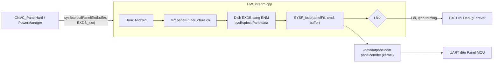

Hình dung đơn giản:

- **Controller** là người gọi món, chỉ biết tên món theo thực đơn của mình (EXDB).
- **`HW_interim.cpp`** là người phục vụ, dịch tên món sang mã mà nhà bếp hiểu (ENM) rồi chuyển phiếu vào bếp (`ioctl`).
- **`panelcomdrv`** là nhà bếp, trực tiếp nấu, tức là nói chuyện với panel MCU qua UART.
- Nếu bếp từ chối phiếu, người phục vụ báo động toàn quán (D401). Riêng vài món đặc biệt thì chỉ báo lại cho khách.

---

## 2. Phân loại nội dung

| Nhóm | Thành phần chính | Trạng thái | Điều kiện build |
|---|---|---|---|
| Tương thích VxWorks/Linux | Typedef Tornado, `printErr`, `SYSF_fsync`, `intContext()` (gọi `SYSF_intContext`), `sysUsDelay()` (gọi `wait_10us`), `copy()`, `BSP_STRONG_ORDERING` (`dmb sy`) | FACT, đang dùng | Tất cả. `BSP_STRONG_ORDERING` rỗng khi `FUM_LINUX` |
| **Panel driver** | `panelFd`, `sysBspOpenPanelSio`, `sysBspIoctlPaneldata`, `sysBspIoctlPanelSio`, `sysBspWritePanelSio`, `sysBspReadPanelSio`, `debug_Android*` | FACT, **trọng tâm** | `DEF_PANELDRV` (thực máy). Riêng Write/Read **không bị guard** trong `.cpp` |
| Android/tablet | `sysBspSetAndroidPowerSaveStat`, `reqVoicePlay`, `reqMusicPlay`, IME, `setDualDisplay`, `sendScanToAndroidJobData`… | FACT, chỉ là wrapper mỏng gọi `THRC_AndroidControlIf` | Tất cả |
| BootUpScreen / file system | `verifyBUS`, `checkEraseBUS`, `syncBUS`, `writeBSBackupIMG`, `EraseBSBackupArea`, `setBootupScreen`, `getBootupScreen` | FACT. Riêng `creBSSymLink` và `getBSBackupStatus` là **DEAD** (`#if 0`) | `BUS_FOR_MBF` đang bật |
| Platform / memory | `platformInitialize`, `setPlatformSDRAMSize`, `getSimPlatformSDRAMSize`, `MotionENGetSignal` (ioctl lên PMU) | FACT | Thực máy đọc dung lượng 4 memory bank. SIM đọc biến môi trường `SIM_MEMORYSIZE` |
| Chế độ khởi động | `checkLineModeInTar`, `isLineMode`, `checkBootSelfCheckMode`, `checkSpeedVariableMode`, `initRinneLog`, `GetSysRomVersion` | FACT | Rẽ nhánh theo `uc_BootMode` (7 = line card, 9 = self-check, 10 = speed variable) |
| **Stub chỉ để build** | `dcacheDevCreate`, `dpart*`, `dosFs*`, `pci*`, `ftp*`, `symFindByName`, `chkdsk`, `cbio*`, `sysBspIntDisable`, `mvCntmr*`, `timer_connect`, MIO/SSL, browser, `setMidAuthApplication`… | **STUB**: trả về `NULL`, `OK`, `TRUE` hoặc `0` | MIO/SSL chỉ có khi `!INCLUDE_MIO && !FUM_LINUX`. FAX log chỉ có khi `!TORNADO` |
| Code bị vô hiệu hóa | `usrFdiskPart*`, `dosFsDateTimeInstall`, `creBSSymLink`, `getBSBackupStatus`, `CbStub_*`, một số khai báo trùng trong header | **DEAD** (`#if 0`) | – |

Phân nhánh build của panel:

| Macro | Ý nghĩa |
|---|---|
| `DEF_PANELDRV` | Có panel driver trong kernel, thiết bị là `/dev/outpanelcom`. **Thực máy dùng nhánh này** |
| `!DEF_PANELDRV` | UART legacy: tự mở `/dev/tts/1` với cấu hình 19200 baud, 8 bit, even parity, 1 stop bit |
| `FUM_LINUX` | Simulator. Sau khi ioctl thật thành công, gọi thêm ioctl giả cho `SIMC_SoundObserverIf` |

---

## 3. EXDB và ENM: vì sao phải dịch

- **`EXDB_PanelKind`** (khai báo trong `HW_interim.h`) là **mã nghiệp vụ phía Controller**. Ví dụ “bật LED”, “bật LED hàng loạt”, “đặt âm lượng buzzer”. Enum này có 52 giá trị (0–51).
- **`ENM_IOCTL_CMD_*`** (khai báo trong `panelcomdrv_info.h`, file này chưa được đọc) là **mã ioctl mà kernel hiểu**.

**Lý do phải dịch (FACT):**

1. **Số thứ tự hai bên khác nhau.** Ví dụ `EXDB_PanelKindSetLed = 3`, còn `LEDONOFF_SET` nằm ở vị trí khác. Nếu truyền thẳng giá trị EXDB làm mã ioctl thì sẽ gọi nhầm lệnh.
2. **Ánh xạ nhiều-một.** Một lệnh kernel phục vụ nhiều mã nghiệp vụ.
3. **Phân tách tầng.** Controller không cần include header của kernel driver. Chỉ `HW_interim.cpp` include `panelcomdrv_info.h`.
4. **`EXDB_PanelKindErr` không phải là lệnh.** Hàm dịch trả về `-1` cho giá trị này và cho mọi giá trị không có trong switch.

### 3.1 Bảng ánh xạ đầy đủ (toàn bộ switch trong `sysBspIoctlPaneldata`)

Chú thích các cột:

- **Buffer:** hướng truyền dữ liệu (IN = Controller gửi xuống, OUT = kernel trả về). Hướng này *suy ra từ tên lệnh*. Cấu trúc dữ liệu cụ thể nằm trong `panelcomdrv_info.h`.
- **Khi lỗi:** `D401` nghĩa là hệ thống dừng bằng `DebugForever`. `Trả lên` nghĩa là giá trị lỗi được trả thẳng cho tầng trên.

| # | EXDB_PanelKind | ENM_IOCTL_CMD_ | Chức năng | Buffer | Loại | Khi lỗi |
|---:|---|---|---|---|---|---|
| 0 | `GetLed` | `LEDOUTSTATE_GET` | Lấy trạng thái LED | OUT | GET | D401 |
| 1 | `GetLCDVersion` | `KM_SOFTINFO_GET` | Lấy version LCD (thông tin phần mềm KM) | OUT | GET | D401 |
| 2 | `setLEDBrightness` | `LEDBRIGHTNESS_SET` | Đặt độ sáng LED | IN | SET | D401 |
| 3 | `SetLed` | **`LEDONOFF_SET`** | Bật/tắt LED | IN | SET | D401 |
| 4 | `SetLedBlink` | **`LEDBLINK_SET`** | Cho LED nhấp nháy | IN | SET | D401 |
| 5 | `SetBackLight` | `BACKLIGHTONOFF_SET` | Bật/tắt đèn nền | IN | SET | D401 |
| 6 | `SetBuzzer` | **`BUZZER_SET`** | Phát buzzer | IN | SET | D401 |
| 7 | `SetBuzzerVal` | **`BUZZER_SET`** | Đặt âm lượng buzzer | IN | SET | D401 |
| 8 | `GetLockKey` | `LOCKKEYSTATE_GET` | Trạng thái phím khóa | OUT | GET | D401 |
| 9 | `PanelDataGet` | `OUTSTATE_GET` | Trạng thái output của panel | OUT | GET | D401 |
| 10 | `KindErr` | – (return -1) | Không phải lệnh | – | – | Trả -1, **không** D401 |
| 11 | `CommunicaitonSuspend` | `COMMUNICATION_SUSPEND` | Dừng/tiếp tục giao tiếp panel (tiết kiệm điện) | IN | CONTROL | D401 |
| 12 | `SetBackLightBrightness` | `BACKLIGHTBRIGHTNESS_SET` | Đặt độ sáng đèn nền | IN | SET | D401 |
| 13 | `GetBackLightInfo` | `BACKLIGHTINFO_GET` | Thông tin đèn nền | OUT | GET | D401 |
| 14 | `PanelType_Get` | `PANELTYPE_GET` | Loại panel | OUT | GET | D401 |
| 15 | `PanelCalibration` | `CALIBRATION` | Chạy calibration | IN | CONTROL | D401 |
| 16 | `Panelinit` | `PANEL_INIT` | Khởi tạo panel driver | IN | CONTROL | D401 |
| 17 | `Panelsleep` | `PANEL_SLEEP` | Đưa panel driver vào sleep | IN | CONTROL | D401 |
| 18 | `PanelGetPanelInfo` | `PANEL_GETPANELINFO` | Lấy thông tin debug panel | OUT | GET | D401 |
| 19 | `PanelDebug` | `PANEL_DEBUG` | Đánh giá độ phản hồi | IN/OUT | CONTROL | D401 |
| 20 | `PanelSetSensitivity` | `PANEL_SETSENSITIVITY` | Độ nhạy touch điện dung | IN | SET | D401 |
| 21 | `Ele_PanelLog` | `PANEL_LOG` | Log touch điện dung | IN/OUT | CONTROL | D401 |
| 22 | `GetPanelTypeStruct` | `PANELTYPESTRUCT_GET` | Loại panel dạng struct (slideless) | OUT | GET | D401 |
| 23 | `PanelOffset` | `PANEL_OFFSET_GET` | Offset vùng touch không nhạy | OUT | GET | D401 |
| 24 | `PanelSoundPlay` | `PANEL_SOUND_PLAY` | Phát âm thanh (Sound IC) | IN | SET | D401 |
| 25 | `PanelSoundStop` | `PANEL_SOUND_STOP` | Dừng âm thanh | IN | SET | D401 |
| 26 | `PanelSoundVolume` | `PANEL_SOUND_VOLUME` | Âm lượng | IN | SET | D401 |
| 27 | `PanelSoundStatus` | `PANEL_SOUND_STATUS` | Trạng thái Sound IC | OUT | GET | D401 |
| 28 | `PanelSoundDownload` | `PANEL_SOUND_DOWNLOAD` | Tải dữ liệu âm thanh | IN | CONTROL | **Trả lên** |
| 29 | `PanelEEPROMWrite` | `PANEL_EEPROM_WRITE` | Ghi EEPROM panel | IN | SET | D401 |
| 30 | `PanelEEPROMRead` | `PANEL_EEPROM_READ` | Đọc EEPROM panel | IN/OUT | GET | D401 |
| 31 | `PanelSoundVersion` | `PANEL_SOUND_VERSION` | Version dữ liệu âm thanh | OUT | GET | **Trả lên** |
| 32 | `PanelSoundCheckSum` | `PANEL_SOUND_CHECKSUM` | Checksum dữ liệu âm thanh | OUT | GET | **Trả lên** |
| 33 | `SetSensitivitySlidelessGDP` | `PANEL_SETSENSITIVITY_SLIDELESSGDP` | Ngưỡng GDP (panel slideless) | IN | SET | **Trả lên** |
| 34 | `PanelSetAndroidStatus` | `PANEL_SETANDROIDSTATUS` | Trạng thái Android | IN | SET | D401 |
| 35 | `PanelAndroidEvent` | `PANEL_ANDROIDEVENT` | Tiêm sự kiện touch từ tablet | IN | CONTROL | D401 |
| 36 | `PanelAndroidEvent2` | `PANEL_ANDROIDEVENT2` | Tiêm sự kiện tablet loại 2 | IN | CONTROL | D401 |
| 37 | `PanelAndroidEvent2_OFF` | `PANEL_ANDROIDEVENT2_OFF` | Tắt sự kiện tablet loại 2 | IN | CONTROL | D401 |
| 38 | `SetLedAll` | **`LEDONOFF_SET`** | Bật/tắt toàn bộ LED | IN | SET | D401 |
| 39 | `SetLedBlinkMulti` | **`LEDBLINK_SET`** | Nhấp nháy nhiều LED | IN | SET | D401 |
| 40 | `PanelLockPanelTablet` | `PANEL_LOCKPANELTABLET` | Khóa/mở panel và tablet | IN | CONTROL | D401 |
| 41 | `PanelFWDownload` | `PANEL_FW_DOWNLOAD` | Tải firmware panel MCU | IN | CONTROL | **Trả lên** |
| 42 | `SetLedExtend` | `PANEL_EXTENDLED_SET` | LED mở rộng (cap1166) | IN | SET | D401 |
| 43 | `SetCTSC` | `PANEL_CTSC_SET` | Cảm biến phát hiện người | IN | SET | D401 |
| 44 | `PointTouchPanelCalibration` | `PANEL_POINT_TOUCH_CALIBRATION` | Lấy dữ liệu calibration (panel điện trở) | OUT | GET | D401 |
| 45 | `NFCPairingDataTrans` | `PANEL_NFC_PAIRING_DATA_TRANS` | Truyền dữ liệu NFC pairing | IN | CONTROL | **Trả lên** |
| 46 | `PossibleNFCPairing` | `PANEL_POSSIBLE_NFC_PAIRING` | Cho phép/cấm pairing | IN | SET | D401 |
| 47 | `NFCAuthDataTrans` | `PANEL_NFC_AUTH_DATA_TRANS` | Dữ liệu xác thực NFC | IN/OUT | CONTROL | D401 |
| 48 | `GetSoftInfo` | `SOFTINFO_GET` | Thông tin phần mềm panel | OUT | GET | D401 |
| 49 | `NFCBLEFunctionCount` | `PANEL_NFCBLE_FUNCTION_COUNT` | Bộ đếm số lần dùng NFC/BLE | OUT | GET | D401 |
| 50 | `Pcie0LinkUpCheck` | `PCIE0LINKUPCHECK` | Kiểm tra PCIe0 link-up | IN/OUT | CONTROL | D401 |
| 51 | `PanelSetVibrator` | `PANEL_SET_VIBRATOR` | Điều khiển rung | IN | SET | D401 |

**Các cặp ánh xạ nhiều-một (FACT):**

- `SetLed` (3) và `SetLedAll` (38) cùng dùng `LEDONOFF_SET`.
- `SetLedBlink` (4) và `SetLedBlinkMulti` (39) cùng dùng `LEDBLINK_SET`.
- `SetBuzzer` (6) và `SetBuzzerVal` (7) cùng dùng `BUZZER_SET`.

Hệ quả (INFERENCE): kernel **không biết** Controller muốn “1 LED” hay “tất cả LED”, “loại âm” hay “âm lượng”. Thông tin phân biệt phải nằm **bên trong nội dung buffer** (struct). Cần đọc `panelcomdrv_info.h` để xác nhận.

**Điểm đáng chú ý:** `Pcie0LinkUpCheck` (CQ.524101) được gửi qua **panel driver**, dù PCIe không liên quan đến panel. Đây là FACT về việc ánh xạ. Lý do thiết kế như vậy thì chưa rõ.

---

## 4. Sequence diagrams và giải thích

### A. Mở panel device lần đầu

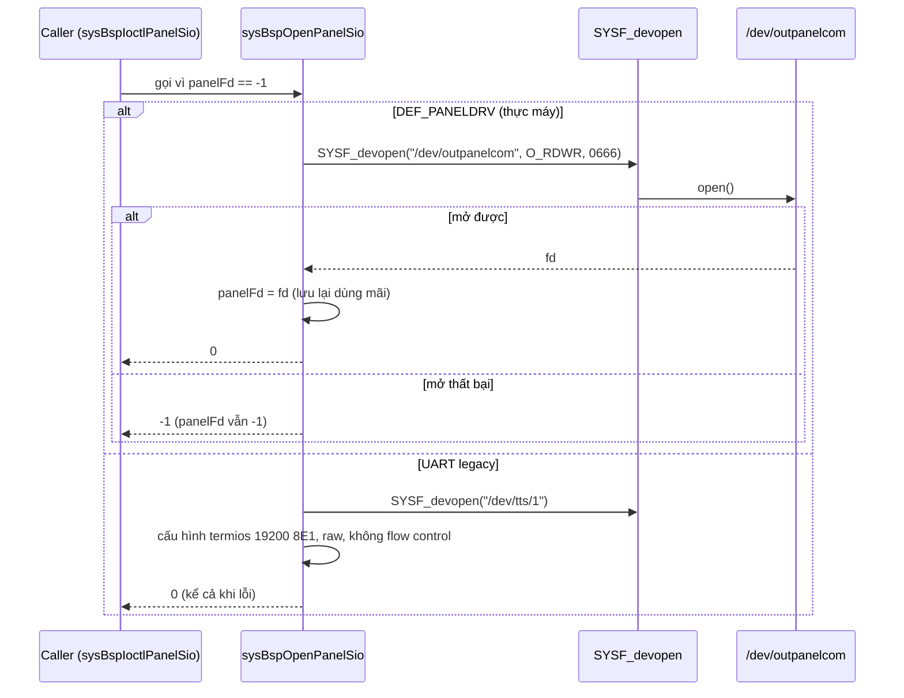

| Bước | Ai làm gì | Tại sao | Vào → Ra | Nếu lỗi |
|---|---|---|---|---|
| 1 | Caller thấy `panelFd == -1` | Chưa có “đường ống” tới driver | – | – |
| 2 | Mở `/dev/outpanelcom` | Chỉ có fd mới gọi được `ioctl` | đường dẫn → fd | Trả `-1`. Caller trả `-1` lên trên, **không báo D401** |
| 3 | Lưu fd vào biến `static panelFd` | Mở 1 lần rồi dùng lại, không mở lại mỗi lệnh | fd → biến toàn cục | – |
| 3' (legacy) | Cấu hình UART raw 19200 8E1 | Panel cũ nói chuyện trực tiếp qua UART | – | **Luôn trả 0** dù open hay `tcsetattr` lỗi |

**Ví dụ:** khi máy khởi động, lệnh panel đầu tiên (thường là `PanelType_Get` hoặc LED) sẽ kích hoạt việc mở device. Mọi lệnh sau đó dùng lại fd này. (FACT)

### B. Gửi lệnh SET (ví dụ: bật đèn nền)

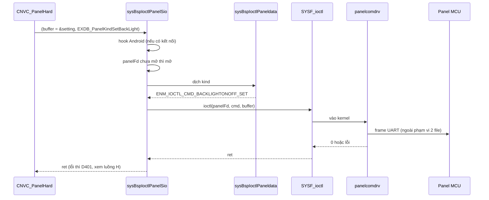

| Bước | Ý nghĩa dễ hiểu |
|---|---|
| `CNVC_PanelHard` gọi | Tầng trên chỉ nói: “bật đèn nền, dữ liệu nằm ở địa chỉ này” |
| Hook Android | Nếu tablet đang mirror panel thì báo cho tablet trước (luồng G) |
| Mở fd | Đảm bảo có đường ống tới driver |
| Dịch mã | Chuyển “ngôn ngữ Controller” sang “ngôn ngữ kernel” |
| `SYSF_ioctl` | Đưa **địa chỉ** của buffer cho kernel (FACT: ép kiểu `(intptr_t)buffer`) |
| Kernel → MCU | Kernel tự dựng frame và gửi qua UART. Theo tài liệu phân tích `panelcomdrv`, backlight còn điều phối LCD/LVDS và chờ ACK tối đa 1 s. Phần này nằm ngoài 2 file |

**Nếu lỗi:** lệnh SET thông thường đều không nằm trong danh sách ngoại lệ, nên sẽ dẫn tới D401 và dừng máy.

### C. Gửi lệnh GET (ví dụ: lấy loại panel)

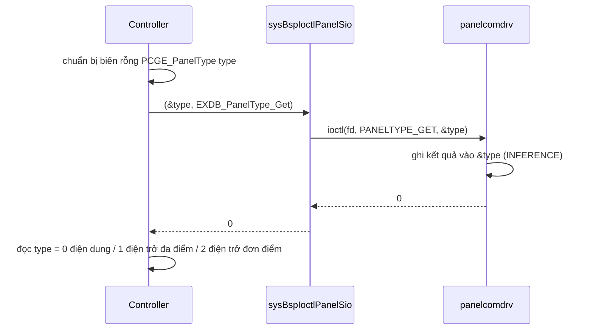

- **Cùng một hàm** `sysBspIoctlPanelSio` dùng cho cả SET và GET. Khác biệt duy nhất là chiều dữ liệu trong buffer.
- Với GET, Controller cấp một **vùng nhớ trống**, kernel điền dữ liệu vào. Cơ chế cụ thể (thường là `copy_to_user`) là INFERENCE.
- `PCGE_PanelType` gồm 3 giá trị 0/1/2 (FACT).
- **Nếu lỗi:** D401. Nghĩa là nếu kernel không trả được loại panel thì máy dừng.

### D. Điều khiển LED (2 mã Controller cùng một lệnh kernel)

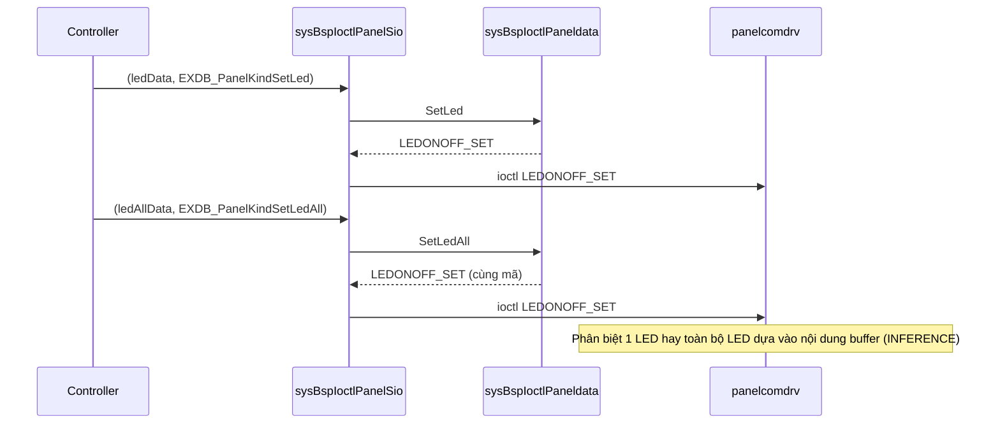

- `SetLedAll` được thêm năm 2012 (CQ362599) **mà không tạo lệnh ioctl mới**. Đây là FACT theo comment trong code.
- **Ví dụ:** khi máy vào chế độ tiết kiệm điện, tắt toàn bộ LED bằng một lệnh `SetLedAll` thay vì gửi N lệnh `SetLed`.
- **Lưu ý:** hook Android nhận được `kind` gốc (SetLed hay SetLedAll), nên vẫn phân biệt được. Kernel thì chỉ thấy `LEDONOFF_SET`.

### E. Điều khiển buzzer

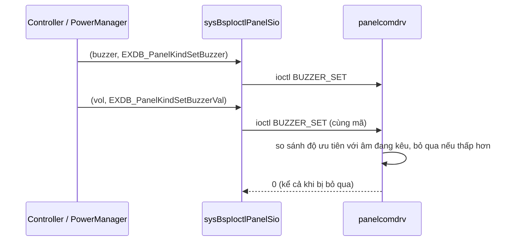

- “Đặt âm” và “đặt âm lượng” dùng **chung một ioctl** (FACT).
- Kernel có logic ưu tiên: âm ưu tiên thấp hơn bị bỏ qua nhưng vẫn trả về OK. Đây là thông tin từ tài liệu phân tích `panelcomdrv`, không nằm trong 2 file này.
- Từ phân tích `CNVC_PanelHard` trước đó: buzzer phần cứng đi qua PowerManager (`sendSetPanelBuzzer`). Việc PowerManager cuối cùng có gọi `sysBspIoctlPanelSio` hay không là INFERENCE.

### F. Suspend/Resume giao tiếp panel

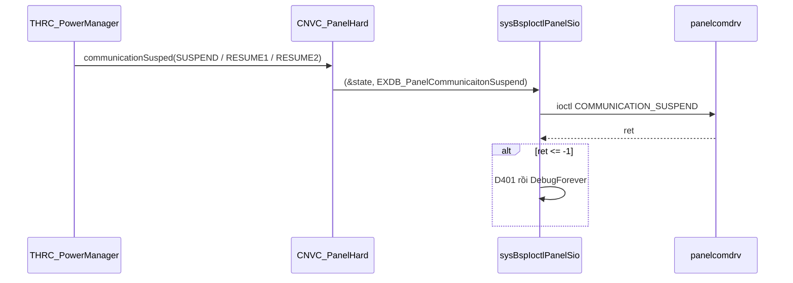

- `CNVC_PanelHard::communicationSusped` dùng mã này (FACT từ phân tích trước). Phía kernel xử lý bằng state machine SUSPEND/RESUME1/RESUME2.
- **Điểm quan trọng (FACT):** `COMMUNICATION_SUSPEND` **không nằm trong danh sách ngoại lệ**. Vì vậy nếu ioctl suspend/resume lỗi giữa chuỗi Deep Sleep, máy sẽ vào `DebugForever(0xD401)`. Đây là điểm cần lưu ý khi phân tích bug liên quan Deep Sleep.
- Theo tài liệu `panelcomdrv`, các bước chờ ACK phía kernel thường chỉ ghi log khi timeout. Nếu đúng vậy, ioctl có thể vẫn trả về 0 dù panel không phản hồi (INFERENCE).

### G. Khi Android/tablet đang kết nối

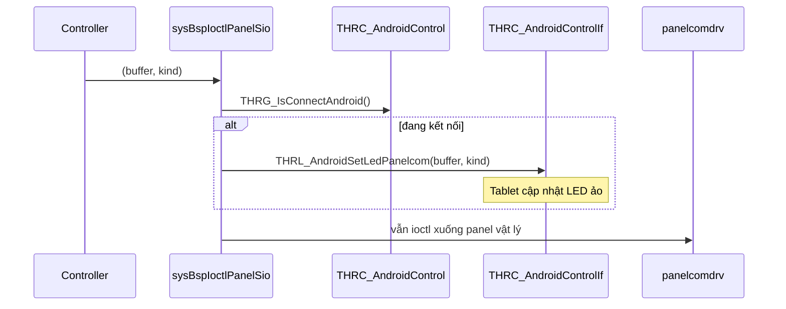

- Hook Android **được gọi cho mọi `kind`** (FACT), không chỉ LED. Việc chỉ xử lý các lệnh LED là việc của `THRL_AndroidSetLedPanelcom` (INFERENCE dựa vào tên hàm).
- Hook chạy **trước** khi mở fd và trước khi dịch mã. Vì vậy ngay cả khi panel vật lý lỗi hoặc `kind = KindErr`, tablet vẫn đã nhận lệnh, và hai bên có thể **lệch trạng thái**.
- Comment lịch sử ghi lại nhiều bug liên quan: CQ359300, CQ358620, CQ361928, CQ366909.
- **Ví dụ:** khi phím Start trên panel đổi màu LED, tablet bizhub Remote Access cũng đổi theo.

### H. Luồng lỗi ioctl

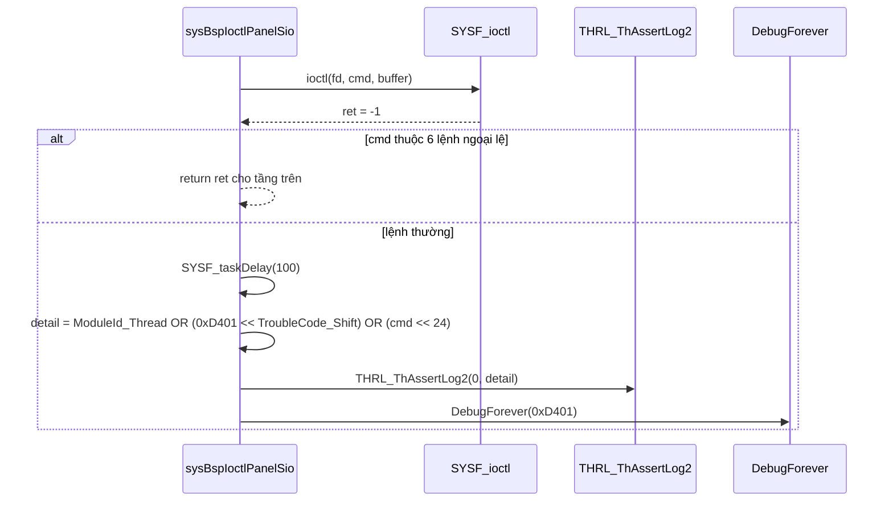

| Bước | Lý do (theo comment trong code) |
|---|---|
| Delay 100 tick | Lỗi ioctl có thể do **tràn buffer** của panel driver. Nếu không chờ thì buzzer báo lỗi không kịp kêu |
| Gói `0xD401` và `cmd` vào detail code | Kỹ sư biết **lệnh nào** gây lỗi (thêm theo ZeusSZX0, “新詳細コード”) |
| `THRL_ThAssertLog2` | Ghi log trouble |
| `DebugForever(0xD401)` | Dừng hệ thống ở trạng thái lỗi D401. Hành vi cụ thể của hàm này là INFERENCE, cần đọc source |

Hai trường hợp **không** dẫn tới D401:

- Mở fd thất bại.
- `kind` không hợp lệ.

Cả hai chỉ âm thầm trả `-1`.

### I. Nhánh Simulator (`FUM_LINUX`)

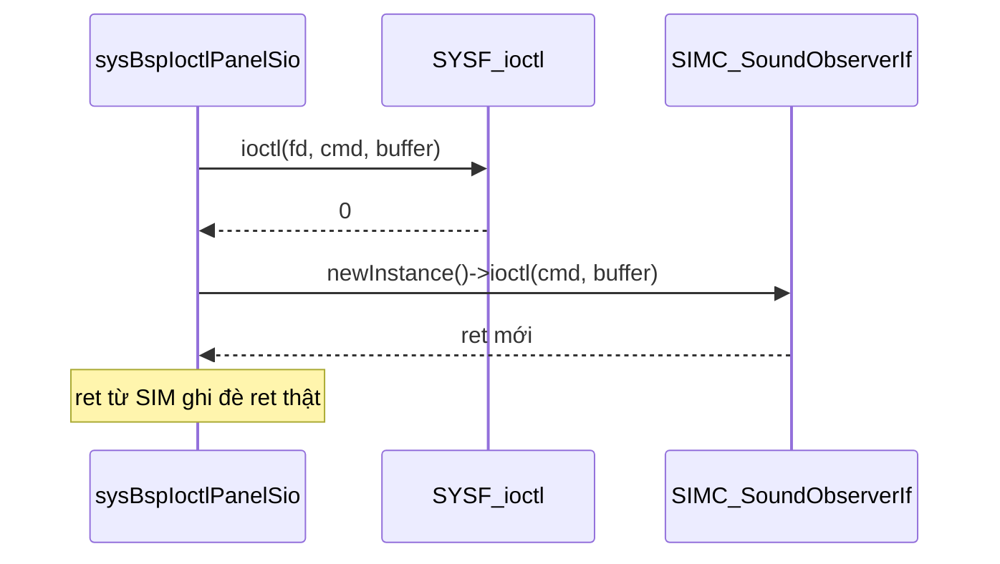

- Chỉ khi ioctl thật thành công thì mới gọi thêm “ioctl giả” để simulator phát âm thanh hoặc hiển thị (FACT).
- Kết quả của SIM **ghi đè** kết quả thật. Nếu SIM trả lỗi thì vẫn có thể dẫn tới D401 trên simulator.
- `SYSF_ioctl` trên SIM dẫn tới đâu (driver giả hay wrapper) thì cần xem `SYSC_OSWrapper` (INFERENCE).

---

## 5. Chi tiết 5 hàm panel

### 5.1 `sysBspOpenPanelSio()`

- **Ai gọi:** `sysBspIoctlPanelSio`, `sysBspWritePanelSio`, `sysBspReadPanelSio`. Hàm còn được khai báo `extern` trong header nên module khác cũng có thể gọi trực tiếp.
- **Input:** không có. **Output:** `0` hoặc `-1`.
- **Nhánh `DEF_PANELDRV`:** nếu chưa mở thì `SYSF_devopen("/dev/outpanelcom")`. Thất bại trả `-1` (có `perror` khi build debug). Thành công hoặc đã mở từ trước thì trả `0`.
- **Nhánh legacy:**
  - Mở `/dev/tts/1`, `memset` termios, đặt chế độ non-canonical, không echo, không đổi CR/NL, không flow control, 8 bit, even parity, 1 stop bit, `VMIN = VTIME = 0`, 19200 baud, rồi `tcflush` và `tcsetattr`.
  - **Mọi lỗi đều trả 0.**
  - Biến `tios_old` lấy về nhưng không dùng.
  - Nếu fd đã mở, hàm vẫn cấu hình lại termios.

### 5.2 `sysBspIoctlPaneldata(EXDB_PanelKind kind)`

- **Ai gọi:** chỉ `sysBspIoctlPanelSio`.
- **Input:** `kind`. **Output:** mã `ENM_IOCTL_CMD_*`, hoặc `-1`.
- **Xử lý:** một `switch` thuần, không có side effect (bảng ở mục 3.1).
- ⚠ **Prototype trong header không khớp** với định nghĩa:
  - `.h` khai báo `int sysBspIoctlPaneldata(FUNCPTR buffer, EXDB_PanelKind *kind)` với `extern "C"`.
  - `.cpp` định nghĩa `int sysBspIoctlPaneldata(EXDB_PanelKind kind)` theo linkage C++.

  Kết quả là bản khai báo 2 tham số **không bao giờ được định nghĩa**. Nếu module C nào gọi theo prototype trong header thì sẽ gặp lỗi link (FACT về mặt code).

### 5.3 `sysBspIoctlPanelSio(FUNCPTR buffer, EXDB_PanelKind kind)` — hàm trung tâm

- **Ai gọi:** `CNVC_PanelHard` và các hàm `debug_Android*` trong file.
- **Input:** con trỏ dữ liệu và mã lệnh. **Output:** giá trị trả về của ioctl, hoặc `-1`.
- **Các bước:**
  1. Hook Android.
  2. Lazy open.
  3. Dịch mã.
  4. `SYSF_ioctl`.
  5. (SIM) gọi ioctl giả.
  6. Với 6 lệnh ngoại lệ thì `return` ngay.
  7. Nếu `ret <= -1` thì D401.
- **Lỗi:** fd hoặc `kind` sai trả `-1` không ghi log. ioctl lỗi thì D401, trừ 6 lệnh ngoại lệ.
- **Khác biệt theo build:**
  - `FUM_LINUX`: thêm bước SIM.
  - Không có `DEF_PANELDRV`: **hàm này không được build**, vì nằm trong khối `#ifdef DEF_PANELDRV`.

### 5.4 `sysBspWritePanelSio(buffer, size)` và 5.5 `sysBspReadPanelSio(buffer, size)`

- **Mục đích:** API của UART legacy, ghi/đọc byte thô.
- **Write:** lazy open rồi `SYSF_write(panelFd, ...)`.
- **Read:** lazy open, `ioctl(FIONREAD)` để biết số byte đang chờ, nếu khác 0 thì `SYSF_read`.
- **Khai báo và định nghĩa không đồng nhất (FACT):** header chỉ khai báo 2 hàm này khi `!DEF_PANELDRV`, nhưng `.cpp` **luôn định nghĩa** chúng. Vì vậy trên thực máy, code C++ thông thường không thấy prototype, và nhiều khả năng 2 hàm này không được dùng (INFERENCE).
- **Không tương thích với driver mới:** theo tài liệu `panelcomdrv`, `/dev/outpanelcom` chỉ hỗ trợ `open` và `ioctl`. Gọi Write/Read trên fd đó gần như chắc chắn thất bại.
- **Lỗi logic:** cả hai kiểm tra `if (ret == -1) return 0`. Nhưng ở nhánh legacy, `sysBspOpenPanelSio` không bao giờ trả `-1`, nên điều kiện này không bắt được lỗi, và hàm sẽ tiếp tục ghi/đọc trên fd bằng `-1`. Ngoài ra, Read **bỏ qua giá trị trả về** của `FIONREAD`.

---

## 6. Phân tích các điểm quan trọng

### 6.1 Cache `panelFd`

- Biến `static int panelFd = -1` ở phạm vi file, dùng chung cho Ioctl, Write và Read.
- Mở lười (lazy), **không bao giờ `close`**, và nếu open thất bại thì lần gọi sau sẽ thử lại.
- Mẫu này giống `setKernelDeviceStatusDirect` đã phân tích trước đó.

### 6.2 Vì sao EXDB và ENM không dùng thay nhau được

Khác số thứ tự, có ánh xạ nhiều-một, và có giá trị `KindErr` không phải lệnh (xem mục 3).

### 6.3 Buffer kiểu `FUNCPTR`

- Tham số có kiểu `FUNCPTR` (tên gợi ý con trỏ hàm), nhưng trong thực tế luôn là **con trỏ dữ liệu**. Ví dụ `debug_AndroidStat` truyền `(void*)&mode`, còn `debug_AndroidSetInfo` truyền `&ANDROD_PANELINFO`.
- Con trỏ này được ép sang `intptr_t` để truyền làm tham số thứ ba của `ioctl`.
- Việc `void*` truyền được vào tham số `FUNCPTR` cho thấy `FUNCPTR` trong build này đã được định nghĩa tương thích với con trỏ dữ liệu. Cần kiểm tra `typs.h` / `SYSC_OSWrapper` (INFERENCE).
- Hệ quả: **không có type-safety**. Truyền sai struct cho một lệnh sẽ không bị compiler phát hiện.

### 6.4 Vì sao 6 lệnh được trả lỗi thẳng lên

- 6 lệnh gồm: tải sound, version sound, checksum sound, GDP, tải firmware, NFC pairing.
- Comment trong code: tầng trên tự xử lý lỗi (2012, Horii), và **pairing thất bại thì không báo trouble** (CQ.507043).
- Điểm chung: đây là thao tác **tùy chọn, có thể thử lại hoặc kéo dài**, nên lỗi không nên làm dừng cả máy.
- Các lệnh còn lại là điều khiển cơ bản, nên lỗi được coi là bất thường nghiêm trọng.

### 6.5 Thread-safety

- Không có mutex quanh `panelFd`. Hai thread gọi lần đầu cùng lúc có thể cùng `open`, gây rò rỉ 1 fd. Rủi ro thấp nhưng có thật.
- Bản thân việc gọi ioctl đồng thời phụ thuộc vào cơ chế lock của kernel. Theo tài liệu, `panelcomdrv` có các spinlock `TxComSpinLock` và `PnlComSpinLock`, nhưng cũng có race condition đã ghi nhận ở OP_BTS-68900.
- Hook Android chạy ngoài mọi lock.
- Biến `sc_MotionENStatus` cũng là cache không có lock, nhưng không gây hại vì chỉ ghi giá trị giống nhau.

### 6.6 Rủi ro thiết kế và lỗi tiềm ẩn (FACT trong code)

| # | Vị trí | Vấn đề |
|---|---|---|
| 1 | `sysBspIoctlPaneldata` (.h và .cpp) | Prototype không khớp (2 tham số, C linkage, so với 1 tham số, C++ linkage) |
| 2 | Write/Read | Header chỉ khai báo khi `!DEF_PANELDRV` nhưng `.cpp` luôn định nghĩa. Logic kiểm tra lỗi open không bao giờ kích hoạt |
| 3 | Legacy open | Mọi lỗi đều trả `0` |
| 4 | Hook Android | Chạy trước khi kiểm tra fd và kind, nên tablet và panel vật lý có thể lệch trạng thái |
| 5 | `writeBSBackupIMG` | Điều kiện `ret == -1 && ret != size` lẽ ra phải là `\|\|`, nên không phát hiện được ghi thiếu |
| 6 | `verifyBUS` | `malloc(size)` nhưng `read()` đọc `st_size` byte. Nếu file lớn hơn `size` thì **tràn heap** |
| 7 | `getBootupScreen` | Đọc `st_size` byte vào `pt_ALLOC_BootupScreen` mà không so với `BOOTUP_SCREEN_MAX_SIZE` |
| 8 | `HW_interim.h` | `SIM_MEMORYSIZE_2GB`/`3GB` bị tràn `int` trước khi ép kiểu (thiếu hậu tố `L`). Hiện không dùng tới |
| 9 | `HW_interim.h` | `e_ImgeType_STP 09` là hằng octal không hợp lệ (comment gợi ý giá trị đúng là 20). Sẽ gây lỗi compile nếu macro được dùng |
| 10 | `checkSpeedVariableMode` | `eMachineNo == ..._1 \|` dùng `\|` thay vì `\|\|`. Không sai kết quả vì toán hạng là bool, nhưng là lỗi gõ |
| 11 | Comment | “/dev/paneloutcom” trong comment, trong khi code dùng `/dev/outpanelcom` |
| 12 | Comment | Comment SIM ghi giá trị mặc định là 4GB, code đặt 6GB. `#endif // SIMULATOR` thực tế đóng khối `FUM_LINUX` |
| 13 | Comment | Comment của `checkSpeedVariableMode` copy nhầm từ chức năng line card |
| 14 | Identifier | `Communicaiton`, `setLEDBrightness` (s thường), `Ele_PanelLog`, `ANDROD_PANELINFO`, `ENG_MORTION`, `EB_CfImgeType`. Khi grep nhớ tìm cả tên viết sai |
| 15 | `HW_interim.h` | `EB_CfImgeType_*` được định nghĩa 2 lần, giống hệt nhau |
| 16 | Rinne log | Dùng `uchar` cho số thứ tự file, nên bị cắt khi số file vượt 255 |

---

## 7. Bản đồ file

### `HW_interim.h`

1. Typedef Tornado: symbol, DOS FS, BLK_DEV, ATA, vxWorks macros.
2. Mã image CF `EB_CfImgeType_*` (lặp 2 lần), PCI, ioctl FIO*.
3. Task/kernel object của VxWorks: `WIND_TCB`, `SEMAPHORE`, `Q_*`, `EXC_INFO`, `ESFPPC`.
4. Prototype stub: `dcache`, `dpart`, `dosFs`, `pci`, `ftp`, `chkdsk`…
5. **`#ifdef DEF_PANELDRV`**: `EXDB_PanelKind`, `PCGE_PanelType`, `ANDROD_PANELINFO`, `sysBspIoctlPanelSio`/`Paneldata`, `sysBspSetAndroidPowerSaveStat`.
6. `BSP_STRONG_ORDERING`, `printErr`, `sysUsDelay`, `sysBspOpenPanelSio`, Write/Read (`!DEF_PANELDRV`).
7. Mã image Tar `e_ImgeType_*`, `SIO_CHAN`, Media, Flash.
8. Prototype Android, `SYSD_BspIoctlPanelSio_LedMsgIndex = 64`, SIM memory size, `BOOTUP_SCREEN_FILEPATH`.

### `HW_interim.cpp`

1. Include, `DEVICENAME = "/dev/outpanelcom"`.
2. Biến toàn cục và stub ROM_DIV (phần lớn đã comment out).
3. `SYSF_fsync`, `printErr`, stub CBIO/DOS/PCI/FTP, `copy()`, stub `mvCntmr`, FAX log, `sysUsDelay`.
4. **Panel:** `panelFd`, Open, Paneldata, IoctlPanelSio, AndroidPowerSave, `debug_Android*`, Write, Read.
5. `sysMemTop`, `timer_connect`, stub MIO/SSL.
6. BootUpScreen.
7. `MotionENGetSignal` (ioctl lên PMU với `THRD_PMU_IOCSSFROMINPUT`).
8. Stub browser/UAC/Media.
9. SDRAM simulator, `platformInitialize`, `setPlatformSDRAMSize`.
10. Rinne log, line mode, ROM version, self-check mode.
11. Wrapper Android, speed variable mode.

---

## 8. Call graph high-level

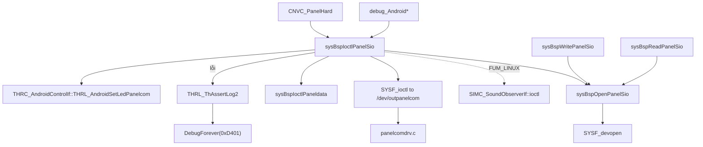

---

## 9. Mười ý quan trọng nhất

1. `sysBspIoctlPanelSio()` là **cổng duy nhất** để Controller điều khiển panel trên thực máy.
2. Controller dùng `EXDB_PanelKind` (52 giá trị). Kernel dùng `ENM_IOCTL_CMD_*`. `sysBspIoctlPaneldata()` là bảng dịch giữa hai bên.
3. Có 3 cặp ánh xạ nhiều-một (LED, LED blink, buzzer). Kernel phân biệt bằng nội dung buffer.
4. `panelFd` được mở lười một lần, dùng chung, không đóng và không có lock.
5. Buffer kiểu `FUNCPTR` thực chất là con trỏ dữ liệu, truyền qua `(intptr_t)`, không có kiểm tra kiểu.
6. ioctl lỗi sẽ dẫn tới **D401 và `DebugForever`**, trừ 6 lệnh tùy chọn (sound download/version/checksum, GDP, FW download, NFC pairing).
7. Lỗi mở device hoặc `kind` sai chỉ trả `-1` âm thầm, không log.
8. Hook Android chạy trước mọi kiểm tra và áp dụng cho mọi lệnh.
9. Suspend/Resume panel (dùng trong Deep Sleep) **thuộc nhóm gây D401 khi lỗi**.
10. Phần lớn 2 file là lớp tương thích và stub. Write/Read UART legacy và prototype `sysBspIoctlPaneldata` trong header là phần “sót lại”, không khớp với thực tế.

---

## 10. Dependency cần đọc tiếp

| File / module | Cần xác nhận |
|---|---|
| `panelcomdrv_info.h` | Giá trị số của `ENM_IOCTL_CMD_*` và struct buffer của từng lệnh (đặc biệt LED/LedAll, Buzzer/BuzzerVal) |
| `panelcomdrv.c` | Handler cho từng ioctl, khi nào trả lỗi, `COMMUNICATION_SUSPEND`, `PCIE0LINKUPCHECK` |
| `SYSC_OSWrapper` / `typs.h` | Định nghĩa `FUNCPTR`, `SYSF_devopen`, `SYSF_ioctl` (cả trên SIM), `SYSF_taskDelay` |
| `CNVC_PanelHard` (`THRC_PanelHardSoC.cpp`) | Mỗi API gọi `kind` nào và truyền struct gì |
| `THRC_PowerManager` | Thứ tự gọi suspend/resume panel, đường đi của buzzer |
| `THRC_AndroidControlIf` | `THRL_AndroidSetLedPanelcom` lọc những `kind` nào |
| `DebugForever` / `THRL_ThAssertLog2` | Hành vi thực tế khi D401 xảy ra, giá trị `THRD_NewDetail_TroubleCode_Shift` |
