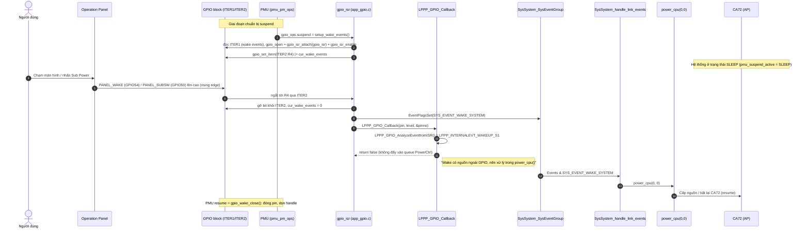
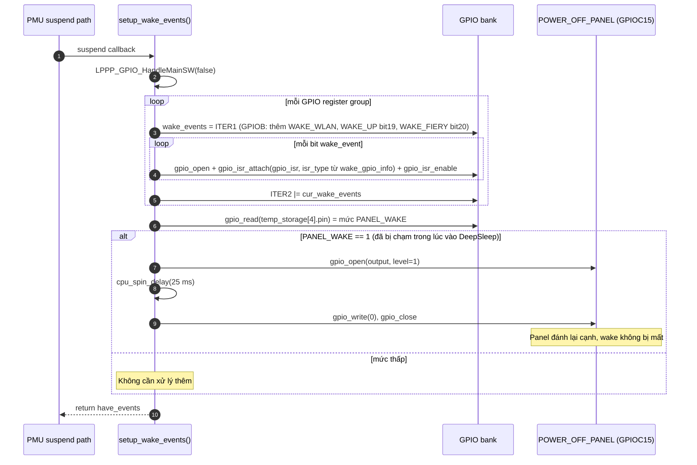
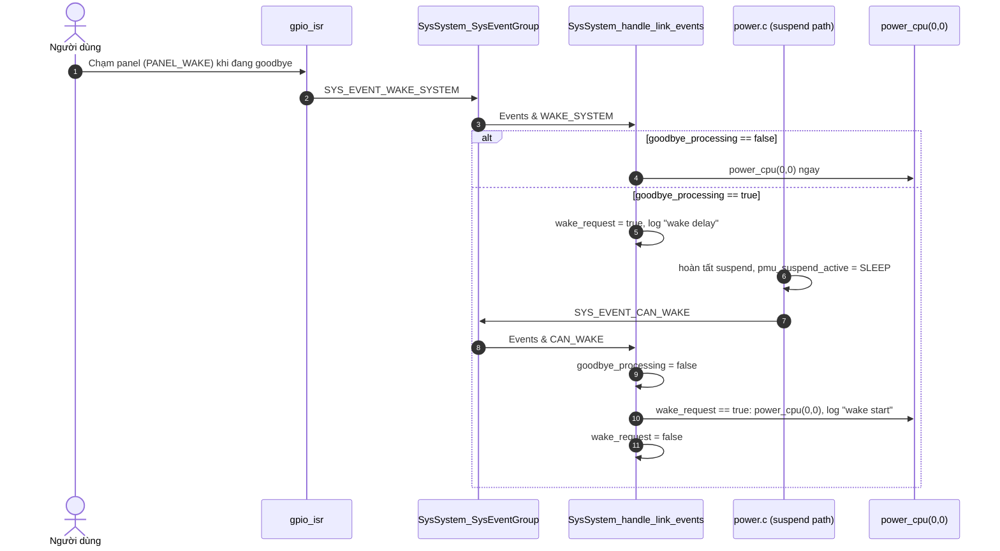
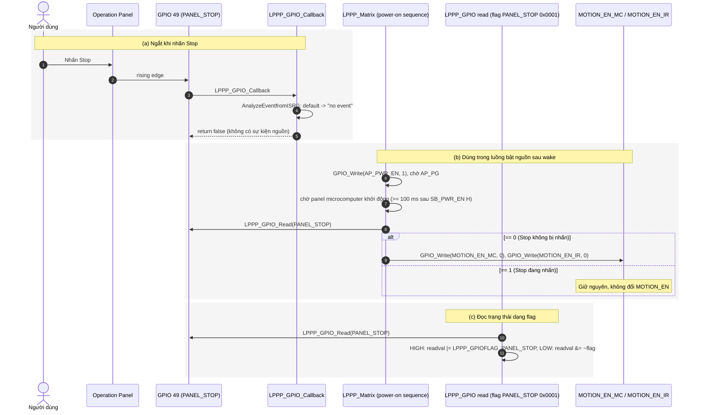
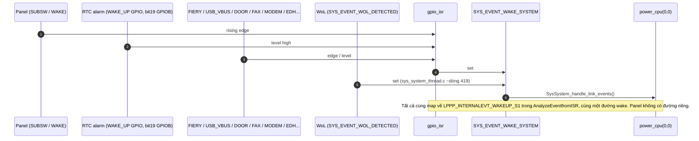

# Panel wake – Sequence diagrams (LPPP / R4)

Các sơ đồ dưới đây bám theo source trong `lppp_s800/`. Mermaid: mở bằng VS Code (Markdown Preview Mermaid), GitHub, hoặc mermaid.live.

| Pin | GPIO | Bảng cấu hình | ISR type | Vai trò |
|---|---|---|---|---|
| `LPPP_GPIOPIN_PANEL_STOP` | 49 | `gpio_info[]` | RISING_EDGE | Phím Stop. **Không** sinh sự kiện nguồn, chỉ được đọc (poll) |
| `LPPP_GPIOPIN_PANEL_SUBSW` | 50 | `wake_gpio_info[]` | RISING_EDGE | Sub power (comment code: 副電源OFF割り込み) |
| `LPPP_GPIOPIN_PANEL_WAKE` | 54 | `wake_gpio_info[]` | RISING_EDGE | Chạm touch panel (comment code: タッチパネル割り込み) |

Nguồn: `ApplicationKM/LPPP_Gpio.c` (bảng pin và `LPPP_GPIO_AnalyzeEventfromISR`), `ApplicationKM/LPPP_Gpio.h`.

---

## 1. Tổng quan: wake từ PANEL_SUBSW / PANEL_WAKE (đường chính)

Hai pin này nằm trong `wake_gpio_info[]`. Khi hệ thống suspend, `setup_wake_events()` được PMU gọi để arm lại ISR. Khi có cạnh lên, ISR đặt event `SYS_EVENT_WAKE_SYSTEM`. Event này được `SysSystem_handle_link_events()` xử lý bằng `power_cpu(0, 0)`.

Điểm cần lưu ý (so với bản phân tích trước):
- Callback `LPPP_GPIO_Callback` **có** chạy trên đường wake, nhưng chỉ để map ra `WAKEUP_S1` rồi `return false`. Việc wake thực sự do `SYS_EVENT_WAKE_SYSTEM` -> `power_cpu(0,0)`.
- `LPPP_GPIO_CallbackDummy` chỉ dùng ở lúc khởi tạo (`gpio_isr_attach` ở `LPPP_Gpio.c` ~dòng 603) để cấu hình phần cứng. ISR thật lúc suspend là `gpio_isr`.

---

## 2. Chi tiết giai đoạn arm wake khi suspend + workaround panel (OP_BTS-37711)

Nếu `PANEL_WAKE` đang ở mức cao ngay lúc chuẩn bị suspend (người dùng chạm panel giữa chừng khi chuyển DeepSleep), cạnh lên đã xảy ra trước khi ISR được arm nên sẽ bị mất. Code xử lý bằng cách pulse `POWER_OFF_PANEL` (GPIOC15) để panel tạo lại cạnh.

Ghi chú: code lấy `temp_storage[4]` làm pin panel wake, tức là dựa vào **thứ tự** bit được thêm vào chứ không tra theo tên pin. Nếu thứ tự đổi (thêm/bớt wake pin) thì đọc nhầm pin. Đây là điểm dễ vỡ, nên kiểm lại nếu sửa `wake_gpio_info[]`.

---

## 3. Wake bị trì hoãn khi đang `goodbye_processing`

`SysSystem_handle_link_events()` không gọi `power_cpu` ngay nếu hệ thống đang trong quá trình goodbye (vào sleep). Wake được giữ lại (`wake_request`) và thực hiện khi có `SYS_EVENT_CAN_WAKE` (phát ra ở cuối đường suspend trong `power.c`).

Nguồn: `Sys/system/sys_system_thread.c` (~dòng 307-327), `Hal/quartz/asic/build/power.c` (~dòng 1599).

---

## 4. PANEL_STOP: không phải nguồn wake, dùng để quyết định MOTION_EN sau khi bật nguồn

`PANEL_STOP` nằm trong `gpio_info[]` (cấu hình ngắt thường), không nằm trong `wake_gpio_info[]`. `LPPP_GPIO_AnalyzeEventfromISR()` không có `case` cho pin này, nên ngắt rơi vào `default` ("no event", `intr_event = INVALID`, callback `return false`). Pin được đọc trực tiếp ở các chỗ cần dùng.

Ghi chú: các comment tiếng Nhật trong `LPPP_Matrix.c` bị lỗi mã hoá khi đọc (file không phải UTF-8), nên nhánh `else` ở (b) và logic mức tích cực của `MOTION_EN_*` chỉ suy ra từ mã. Cần xác nhận lại với comment gốc nếu dùng làm tài liệu chính thức.

---

## 5. Tổng hợp các nguồn wake và phân biệt với WAKEUP (RTC) của PS-CPU

`WAKEUP` của PS-CPU (RTC alarm gửi tới AP) được code LPPP thấy ở pin `LPPP_GPIOPIN_WAKE_UP` (level high) và đi chung đường trên. Nó không phải tín hiệu chạm panel.

---

## Cách đọc

- Sơ đồ 1 là luồng chính từ lúc chạm panel đến lúc CA72 chạy lại. Đọc trước.
- Sơ đồ 2 và 3 là hai chỗ có xử lý đặc biệt (mất cạnh khi đang vào DeepSleep, và wake bị hoãn khi đang goodbye).
- Sơ đồ 4 giải thích vì sao `PANEL_STOP` không xuất hiện trong luồng wake.
- Sơ đồ 5 cho thấy mọi nguồn wake dùng chung một đường nên không cần vẽ riêng cho từng loại.
