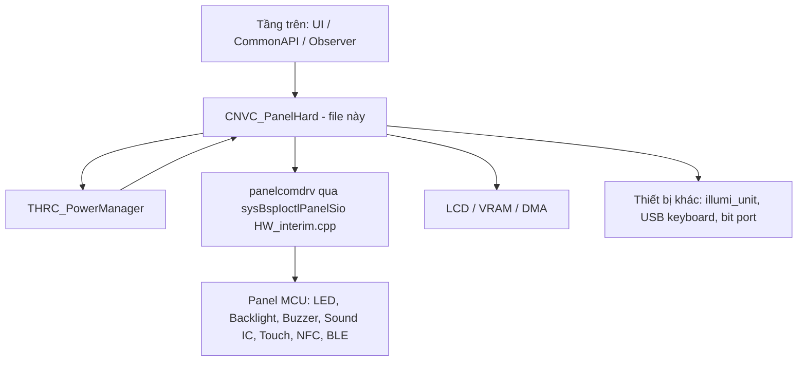
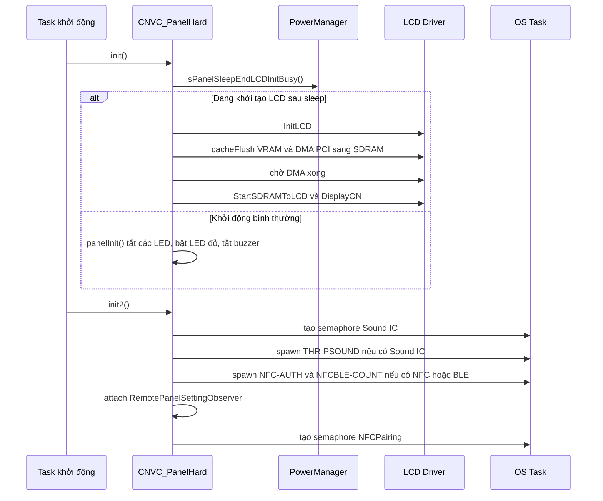
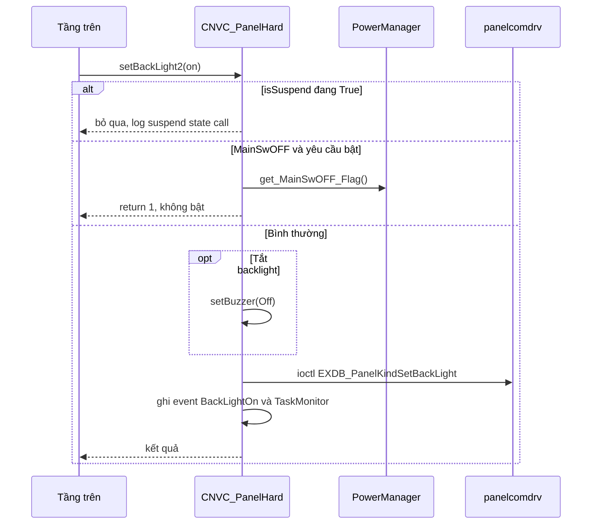
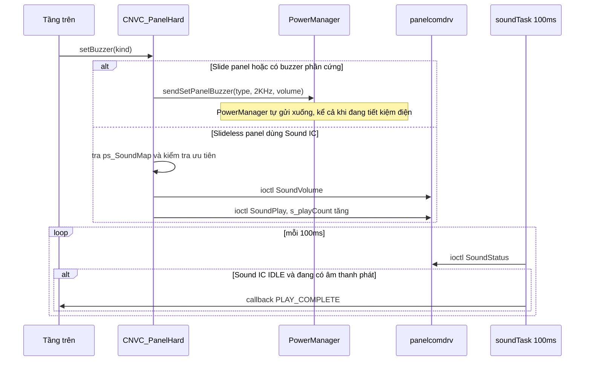
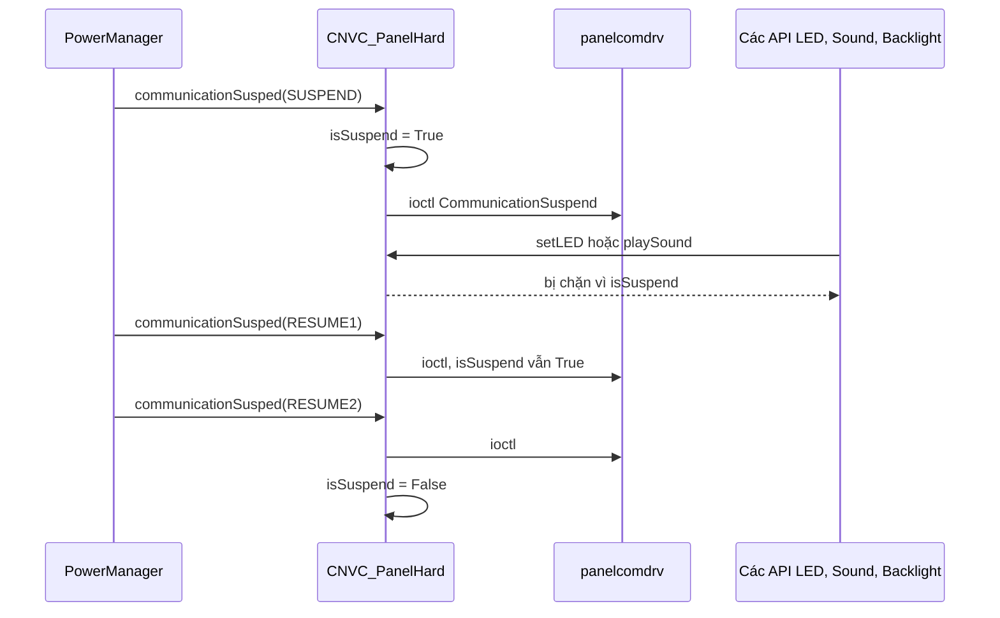
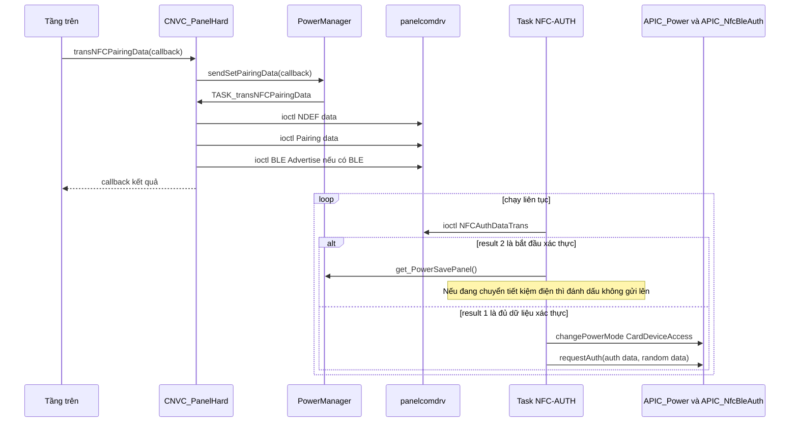
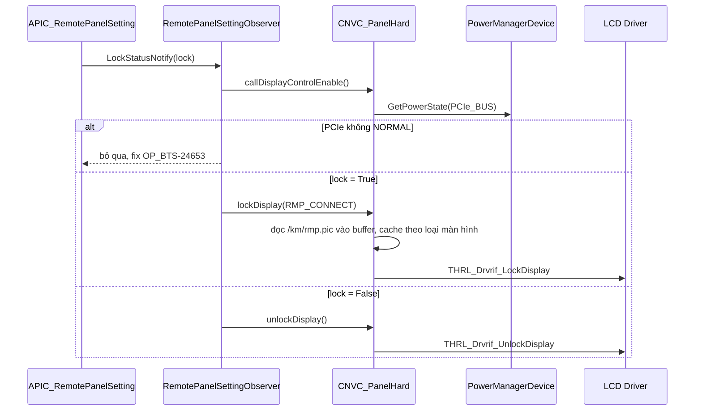
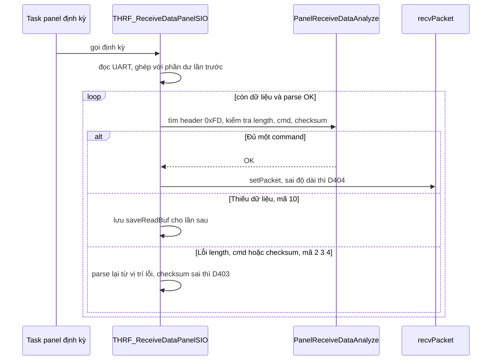
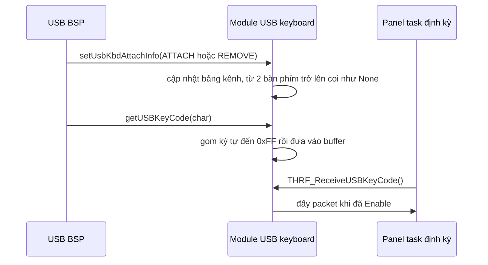

# Phân tích file THRC_PanelHardSoC.cpp

## 1. File này làm gì?

File hiện thực class **`CNVC_PanelHard`**, là **lớp trừu tượng phần cứng (HAL) của operation panel**. Tầng trên (UI, PowerManager, CommonAPI) gọi các API như `setLED`, `setBuzzer`, `lockDisplay`. File này chuyển các lệnh đó thành **`sysBspIoctlPanelSio(..., EXDB_xxx)`** để gửi xuống driver `panelcomdrv`, rồi driver giao tiếp với panel MCU.

Nói ngắn gọn: **tầng trên chỉ biết “bật LED, kêu bíp”. File này biết cách nói chuyện với driver panel.**

## 2. Kiến trúc tổng thể



## 3. Bản đồ file từ đầu đến cuối


| #  | Khối                         | Nội dung chính                                                                                                                           |
| -- | ----------------------------- | ------------------------------------------------------------------------------------------------------------------------------------------ |
| 1  | Header, macro, biến static   | `ptr_PanelLcdIF`, hằng số resend, **`static Bool isSuspend`**, bảng `ps_SoundMap` (buzzer sang sound IC), bảng ảnh lock `/km/rmp.pic` |
| 2  | Constructor/Destructor        | Lấy độ phân giải, cấp phát VRAM tùy theo build, khởi tạo key data, callback, semaphore = NULL                                    |
| 3  | `init()` / `init2()`          | Khởi tạo LCD/DMA hoặc`panelInit()`. `init2` tạo task, semaphore, gắn Observer                                                         |
| 4  | `keyScan()`                   | Gửi dữ liệu LED/buzzer qua socket, chỉ dùng cho SIM hoặc legacy                                                                      |
| 5  | LED                           | `getLED`, `setLED`, `setLEDBrightness`, `setLEDBlink`, `getLEDKindDrv`, `setIllumiLED`                                                     |
| 6  | Backlight                     | `setBackLight` (bỏ, không dùng), **`setBackLight2`**, set/get brightness                                                                |
| 7  | Buzzer/Sound                  | `setBuzzer`, `setBuzzerVol`, `playSound`, `stopSound`, `setSoundVol`, `soundTask`, download sound/panel FW                                 |
| 8  | Sensor/Touch                  | `setCTSensor`, calibration, GDP sensitivity, lệnh debug EEPROM                                                                            |
| 9  | Thông tin panel              | `getPanelType` (cache), size/resolution, slide/option NFC/BLE, version/checksum, LockKey                                                   |
| 10 | Power                         | **`communicationSusped`**, `isDisplayControlEnable` (kiểm tra PCIe bus)                                                                   |
| 11 | LCD transfer                  | `transLCDData`, `isBusyTransLCDData`, cờ net/SIM                                                                                          |
| 12 | Service SW                    | `getTroubleReset`, `getInitial`, `getMemoryClear`, `getTotalClear` qua bit port                                                            |
| 13 | Lock display                  | `lockDisplay`, `unlockDisplay`, `getFixDisplayImageAddr`, `RemotePanelSettingObserver`, `lockPanelTablet`                                  |
| 14 | NFC/BLE                       | Pairing, auth task, model info, counter task, bitmask cho phép/cấm                                                                       |
| 15 | UART legacy (`!DEF_PANELDRV`) | Checksum, send/receive, parse packet`0xFE`/`0xFD`, lỗi D403/D404                                                                          |
| 16 | Giả lập UART (SIM)          | Ring buffer`simBufCLCD`, tự trả ACK                                                                                                      |
| 17 | USB keyboard                  | Callback attach/char, LED bàn phím, enable/disable                                                                                       |
| 18 | Log gửi/nhận                | Ring buffer 2KB log panel ↔ MCU                                                                                                           |
| 19 | SIM resolution                | Đọc`/root/sim_ini.env`                                                                                                                   |
| 20 | Vibrator                      | `setVibrator`, `dbg_setVibrator`                                                                                                           |

### 3.1. `ENM_IOCTL_CMD`: lệnh ioctl phía Kernel (`panelcomdrv`)


| #  | Lệnh                                   | Loại | Chức năng                               | Ghi chú                            |
| -- | --------------------------------------- | ----- | ----------------------------------------- | ----------------------------------- |
| 0  | `ENM_IOCTL_CMD_OUTSTATE_GET`            | GET   | Lấy trạng thái output của panel       |                                     |
| 1  | `ENM_IOCTL_CMD_SOFTINFO_GET`            | GET   | Lấy thông tin phần mềm của panel     |                                     |
| 2  | `ENM_IOCTL_CMD_KM_SOFTINFO_GET`         | GET   | Lấy thông tin quản lý phần mềm KM   |                                     |
| 3  | `ENM_IOCTL_CMD_LOCKKEYSTATE_GET`        | GET   | Lấy trạng thái phím khóa             |                                     |
| 4  | `ENM_IOCTL_CMD_LEDOUTSTATE_GET`         | GET   | Lấy trạng thái output LED              |                                     |
| 5  | `ENM_IOCTL_CMD_LEDONOFF_SET`            | SET   | Bật/tắt LED                             |                                     |
| 6  | `ENM_IOCTL_CMD_LEDBLINK_SET`            | SET   | Bật/tắt chế độ nhấp nháy LED       |                                     |
| 7  | `ENM_IOCTL_CMD_LEDBRIGHTNESS_SET`       | SET   | Thiết lập độ sáng LED                |                                     |
| 8  | `ENM_IOCTL_CMD_BUZZER_SET`              | SET   | Điều khiển buzzer                      | Có xét độ ưu tiên             |
| 9  | `ENM_IOCTL_CMD_BACKLIGHTONOFF_SET`      | SET   | Bật/tắt đèn nền                      |                                     |
| 10 | `ENM_IOCTL_CMD_INTERRUPT_SET`           | CTRL  | Cấm/cho phép ngắt truyền thông panel | 2010/03/12, 2010/07/23 (GaiaPF8536) |
| 11 | `ENM_IOCTL_CMD_BACKLIGHTBRIGHTNESS_SET` | SET   | Thiết lập độ sáng đèn nền         | 10/11/12                            |
| 12 | `ENM_IOCTL_CMD_BACKLIGHTINFO_GET`       | GET   | Lấy thông tin đèn nền                | 10/11/16                            |
| 13 | `ENM_IOCTL_CMD_PANELTYPE_GET`           | GET   | Lấy loại panel                          | Hỗ trợ touch panel                |
| 14 | `ENM_IOCTL_CMD_CALIBRATION`             | CTRL  | Thực hiện calibration                   | Hỗ trợ touch panel                |
| 15 | `ENM_IOCTL_CMD_MAX`                     | –    | Số lượng lệnh                         | Sentinel, không phải lệnh        |

### 3.2. `EXDB_PanelKind`: mã lệnh phía Controller


| #  | Lệnh                                  | Loại | Chức năng                           | Ghi chú                       |
| -- | -------------------------------------- | ----- | ------------------------------------- | ------------------------------ |
| 0  | `EXDB_PanelKindGetLed`                 | GET   | Lấy trạng thái LED                 |                                |
| 1  | `EXDB_PanelKindGetLCDVersion`          | GET   | Lấy phiên bản LCD                  |                                |
| 2  | `EXDB_PanelKindsetLEDBrightness`       | SET   | Thiết lập độ sáng LED            | Chữ`s`viết thường          |
| 3  | `EXDB_PanelKindSetLed`                 | SET   | Thiết lập LED                       |                                |
| 4  | `EXDB_PanelKindSetLedBlink`            | SET   | Thiết lập LED nhấp nháy           |                                |
| 5  | `EXDB_PanelKindSetBackLight`           | SET   | Thiết lập đèn nền                |                                |
| 6  | `EXDB_PanelKindSetBuzzer`              | SET   | Thiết lập buzzer                    |                                |
| 7  | `EXDB_PanelKindSetBuzzerVal`           | SET   | Thiết lập âm lượng buzzer        |                                |
| 8  | `EXDB_PanelKindGetLockKey`             | GET   | Lấy trạng thái phím khóa         |                                |
| 9  | `EXDB_PanelDataGet`                    | GET   | Lấy dữ liệu panel                  |                                |
| 10 | `EXDB_PanelKindErr`                    | –    | Lỗi khác                            | Không phải lệnh             |
| 11 | `EXDB_PanelCommunicaitonSuspend`       | CTRL  | Dừng/tiếp tục truyền thông panel | Sai chính tả`Communicaiton`  |
| 12 | `EXDB_PanelKindSetBackLightBrightness` | SET   | Thiết lập độ sáng đèn nền     | 10/11/12                       |
| 13 | `EXDB_PanelKindGetBackLightInfo`       | GET   | Lấy thông tin đèn nền            | 10/11/16                       |
| 14 | `EXDB_PanelType_Get`                   | GET   | Lấy loại panel                      | Hỗ trợ touch panel           |
| 15 | `EXDB_Panelalibration`                 | CTRL  | Thực hiện calibration               | Sai chính tả, thiếu chữ`C` |

### 3.3. Mapping trước khi gửi cho phần cứng `sysBspIoctlPaneldata` - Đối chiếu EXDB (Controller) ↔ ENM (Kernel)

```c
File: \KM3\KM\application\mfp\Linux\Platform\HW_interim.cpp

int sysBspIoctlPaneldata(EXDB_PanelKind kind){
	int ret;
	switch(kind){
	case EXDB_PanelKindsetLEDBrightness:	// LED輝度設定 
		ret = ENM_IOCTL_CMD_LEDBRIGHTNESS_SET;
		break;
	case EXDB_PanelKindSetLed:				// LED設定 
	case EXDB_PanelKindSetLedAll:			// 全LED点灯/消灯設定	2012/03/05 井柳(SKY) CQ362599 LED一括設定対応.
		ret = ENM_IOCTL_CMD_LEDONOFF_SET;
		break;
```


| EXDB\_PanelKind                       | ENM\_IOCTL\_CMD trả về                             | Ghi chú                                                                    |
| ------------------------------------- | ---------------------------------------------------- | --------------------------------------------------------------------------- |
| EXDB\_PanelKindsetLEDBrightness       | ENM\_IOCTL\_CMD\_LEDBRIGHTNESS\_SET                  | Thiết lập độ sáng LED                                                  |
| EXDB\_PanelKindSetLed                 | ENM\_IOCTL\_CMD\_LEDONOFF\_SET                       | Thiết lập LED                                                             |
| EXDB\_PanelKindSetLedAll              | ENM\_IOCTL\_CMD\_LEDONOFF\_SET                       | Thiết lập bật/tắt tất cả LED                                          |
| EXDB\_PanelKindSetLedBlink            | ENM\_IOCTL\_CMD\_LEDBLINK\_SET                       | Thiết lập LED nhấp nháy                                                 |
| EXDB\_PanelKindSetLedBlinkMulti       | ENM\_IOCTL\_CMD\_LEDBLINK\_SET                       | Thiết lập nhấp nháy đồng loạt cho LED                                |
| EXDB\_PanelKindSetBackLight           | ENM\_IOCTL\_CMD\_BACKLIGHTONOFF\_SET                 | Thiết lập đèn nền                                                      |
| EXDB\_PanelKindSetBuzzer              | ENM\_IOCTL\_CMD\_BUZZER\_SET                         | Thiết lập buzzer                                                          |
| EXDB\_PanelKindSetBuzzerVal           | ENM\_IOCTL\_CMD\_BUZZER\_SET                         | Thiết lập buzzer (âm lượng)                                            |
| EXDB\_PanelKindGetLed                 | ENM\_IOCTL\_CMD\_LEDOUTSTATE\_GET                    | Lấy LED                                                                    |
| EXDB\_PanelKindGetLCDVersion          | ENM\_IOCTL\_CMD\_KM\_SOFTINFO\_GET                   | Lấy phiên bản LCD                                                        |
| EXDB\_PanelKindGetLockKey             | ENM\_IOCTL\_CMD\_LOCKKEYSTATE\_GET                   | Lấy phím khóa                                                            |
| EXDB\_PanelDataGet                    | ENM\_IOCTL\_CMD\_OUTSTATE\_GET                       | Yêu cầu lấy dữ liệu panel                                              |
| EXDB\_PanelCommunicaitonSuspend       | ENM\_IOCTL\_CMD\_COMMUNICATION\_SUSPEND              | Dừng/tiếp tục truyền thông, dùng cho điều khiển tiết kiệm điện |
| EXDB\_PanelKindSetBackLightBrightness | ENM\_IOCTL\_CMD\_BACKLIGHTBRIGHTNESS\_SET            | Yêu cầu thiết lập độ sáng đèn nền                                 |
| EXDB\_PanelKindGetBackLightInfo       | ENM\_IOCTL\_CMD\_BACKLIGHTINFO\_GET                  | Yêu cầu lấy thông tin đèn nền                                        |
| EXDB\_PanelType\_Get                  | ENM\_IOCTL\_CMD\_PANELTYPE\_GET                      | Lấy loại touch panel                                                      |
| EXDB\_PanelCalibration                | ENM\_IOCTL\_CMD\_CALIBRATION                         | Calibration                                                                 |
| EXDB\_Panelinit                       | ENM\_IOCTL\_CMD\_PANEL\_INIT                         | Khởi tạo panel                                                            |
| EXDB\_Panelsleep                      | ENM\_IOCTL\_CMD\_PANEL\_SLEEP                        | Đưa panel vào chế độ Sleep                                            |
| EXDB\_PanelGetPanelInfo               | ENM\_IOCTL\_CMD\_PANEL\_GETPANELINFO                 | Lấy thông tin panel                                                       |
| EXDB\_PanelDebug                      | ENM\_IOCTL\_CMD\_PANEL\_DEBUG                        | Dùng để đánh giá khả năng phản hồi của panel                     |
| EXDB\_PanelSetSensitivity             | ENM\_IOCTL\_CMD\_PANEL\_SETSENSITIVITY               | Thiết lập độ nhạy cảm ứng                                            |
| EXDB\_Ele\_PanelLog                   | ENM\_IOCTL\_CMD\_PANEL\_LOG                          | Thiết lập chức năng ghi log panel                                       |
| EXDB\_PanelKindGetPanelTypeStruct     | ENM\_IOCTL\_CMD\_PANELTYPESTRUCT\_GET                | Lấy cấu trúc loại panel                                                 |
| EXDB\_PanelOffset                     | ENM\_IOCTL\_CMD\_PANEL\_OFFSET\_GET                  | Lấy offset vùng không nhạy của TP điện dung                          |
| EXDB\_PanelSoundPlay                  | ENM\_IOCTL\_CMD\_PANEL\_SOUND\_PLAY                  | Phát âm thanh                                                             |
| EXDB\_PanelSoundStop                  | ENM\_IOCTL\_CMD\_PANEL\_SOUND\_STOP                  | Dừng âm thanh                                                             |
| EXDB\_PanelSoundVolume                | ENM\_IOCTL\_CMD\_PANEL\_SOUND\_VOLUME                | Thiết lập âm lượng                                                     |
| EXDB\_PanelSoundStatus                | ENM\_IOCTL\_CMD\_PANEL\_SOUND\_STATUS                | Lấy trạng thái âm thanh                                                 |
| EXDB\_PanelSoundDownload              | ENM\_IOCTL\_CMD\_PANEL\_SOUND\_DOWNLOAD              | Download vào IC âm thanh                                                  |
| EXDB\_PanelEEPROMWrite                | ENM\_IOCTL\_CMD\_PANEL\_EEPROM\_WRITE                | Ghi EEPROM (độ nhạy phát hiện người)                                 |
| EXDB\_PanelEEPROMRead                 | ENM\_IOCTL\_CMD\_PANEL\_EEPROM\_READ                 | Đọc EEPROM (độ nhạy phát hiện người)                               |
| EXDB\_PanelSoundVersion               | ENM\_IOCTL\_CMD\_PANEL\_SOUND\_VERSION               | Thông báo phiên bản âm thanh                                           |
| EXDB\_PanelSoundCheckSum              | ENM\_IOCTL\_CMD\_PANEL\_SOUND\_CHECKSUM              | Checksum âm thanh                                                          |
| EXDB\_PanelSetSensitivitySlidelessGDP | ENM\_IOCTL\_CMD\_PANEL\_SETSENSITIVITY\_SLIDELESSGDP | Điều chỉnh ngưỡng GDP không vuốt                                     |
| EXDB\_PanelSetAndroidStatus           | ENM\_IOCTL\_CMD\_PANEL\_SETANDROIDSTATUS             | Thiết lập trạng thái Android                                            |
| EXDB\_PanelAndroidEvent               | ENM\_IOCTL\_CMD\_PANEL\_ANDROIDEVENT                 | Sự kiện Android                                                           |
| EXDB\_PanelAndroidEvent2              | ENM\_IOCTL\_CMD\_PANEL\_ANDROIDEVENT2                | Sự kiện Android 2                                                         |
| EXDB\_PanelAndroidEvent2\_OFF         | ENM\_IOCTL\_CMD\_PANEL\_ANDROIDEVENT2\_OFF           | Tắt sự kiện Android 2                                                    |
| EXDB\_PanelLockPanelTablet            | ENM\_IOCTL\_CMD\_PANEL\_LOCKPANELTABLET              | Yêu cầu khóa/mở khóa panel/thiết bị đầu cuối                      |
| EXDB\_PanelFWDownload                 | ENM\_IOCTL\_CMD\_PANEL\_FW\_DOWNLOAD                 | Download FW cho vi điều khiển của panel                                 |
| EXDB\_PanelKindSetLedExtend           | ENM\_IOCTL\_CMD\_PANEL\_EXTENDLED\_SET               | Thiết lập LED mở rộng của panel thế hệ tiếp theo                    |
| EXDB\_PanelKindSetCTSC                | ENM\_IOCTL\_CMD\_PANEL\_CTSC\_SET                    | Thiết lập CTSC của panel thế hệ tiếp theo                             |
| EXDB\_PointTouchPanelCalibration      | ENM\_IOCTL\_CMD\_PANEL\_POINT\_TOUCH\_CALIBRATION    | Lấy thông tin calibration của màn hình cảm ứng điện trở           |
| EXDB\_PanelKindNFCPairingDataTrans    | ENM\_IOCTL\_CMD\_PANEL\_NFC\_PAIRING\_DATA\_TRANS    | Truyền dữ liệu pairing NFC                                               |
| EXDB\_PanelKindPossibleNFCPairing     | ENM\_IOCTL\_CMD\_PANEL\_POSSIBLE\_NFC\_PAIRING       | Thiết lập khả năng thực hiện pairing NFC                              |
| EXDB\_PanelKindNFCAuthDataTrans       | ENM\_IOCTL\_CMD\_PANEL\_NFC\_AUTH\_DATA\_TRANS       | Truyền dữ liệu xác thực NFC                                            |
| EXDB\_PanelKindGetSoftInfo            | ENM\_IOCTL\_CMD\_SOFTINFO\_GET                       | Lấy thông tin FW của vi điều khiển panel                              |
| EXDB\_PanelKindNFCBLEFunctionCount    | ENM\_IOCTL\_CMD\_PANEL\_NFCBLE\_FUNCTION\_COUNT      | Đếm chức năng NFCBLE                                                    |
| EXDB\_Pcie0LinkUpCheck                | ENM\_IOCTL\_CMD\_PCIE0LINKUPCHECK                    | Kiểm tra PCIe0 LinkUp                                                      |
| EXDB\_PanelSetVibrator                | ENM\_IOCTL\_CMD\_PANEL\_SET\_VIBRATOR                | Thiết lập panel rung                                                      |
| EXDB\_PanelKindErr / default          | -1                                                   | Lỗi khác (chưa định nghĩa)                                            |

## 4. Điều kiện build


| Macro          | Ý nghĩa thực tế                                                                                                             |
| -------------- | ------------------------------------------------------------------------------------------------------------------------------- |
| `DEF_PANELDRV` | **Có panel driver**, mọi thứ đi qua `sysBspIoctlPanelSio`. Không có thì đi nhánh cũ `ptr_PanelLcdIF` + UART tự parse |
| `TORNADO`      | Thực máy, có`init2`, `getPanelType`, tạo task                                                                               |
| `FUM_LINUX`    | Giả lập Linux, nhiều hàm return ngay                                                                                        |
| `SIMULATOR`    | SimWin: VRAM 3 byte/pixel, resolution đọc từ file, service SW luôn`False`                                                   |
| `LINUX`        | Một số đoạn Qt / USB keyboard bị bỏ qua                                                                                   |

Trên thực máy IT6/KM3, nhánh thường dùng là **`DEF_PANELDRV` + `TORNADO` + `!FUM_LINUX`**.

## 5. Sequence diagrams

### 5.1 Khởi động: `init()` và `init2()`



**Ý chính:** `init()` lo hiển thị; `init2()` dựng **task nền** tùy option phần cứng mà panel báo về qua `getSlidePanelOptionInfo()`.

### 5.2 Mẫu chung của API điều khiển (LED, Backlight)

Khuôn chung: **kiểm tra guard → dựng struct → gọi ioctl**.



`setLED` cùng mẫu; **`LED_Data` bị từ chối** vì do `theLEDStatusTask` quản lý. `setBackLight()` cũ chỉ in “Do not use” vì backlight phải đồng bộ LCDC receiver, chỉ BSP dùng `setBackLight2`.

### 5.3 Buzzer và Sound IC



**Ý chính:** hai đường âm thanh — buzzer đi qua PowerManager, Sound IC gọi trực tiếp + task poll. Callback vẫn được gọi khi suspend/mute/lỗi để tầng trên không chờ mãi.

### 5.4 Suspend / Resume giao tiếp panel (liên quan Deep Sleep)



**Cần nhớ:** `isSuspend` set **trước** ioctl SUSPEND, chỉ clear **sau RESUME2**. Giữa RESUME1 và RESUME2 mọi API điều khiển panel vẫn bị chặn.

### 5.5 NFC/BLE: Pairing và Authentication



`setNFCPairingEnable`, `setNFCAuthEnable`, `setBLEPairingEnable`, `setBLEAuthEnable` đều qua `setPairingAuthDeviceSetting()`: cập nhật bitmask `uc_PairingAuthEnable` (**bit = 1 là cấm**) rồi ioctl dưới semaphore. Task `NFCBLE-COUNT` poll 500ms để đếm số lần dùng chức năng.

### 5.6 Remote panel: khóa màn hình



**Ý chính:** khi tiết kiệm điện, PCIe/ASIC không truy cập được; khóa màn hình lúc đó gây assert/FA14 → phải kiểm tra PCIe bus trước (CQ516041, OP_BTS-24653).

### 5.7 UART legacy (chỉ khi không có `DEF_PANELDRV`)



Trên thực máy có driver, phần này đã chuyển xuống `panelcomdrv`; khối legacy chủ yếu để hiểu lịch sử và dùng cho SIM.

### 5.8 USB keyboard



## 6. Mười ý quan trọng nhất

1. File là **HAL của panel**; gần như mọi thao tác cuối cùng là **`sysBspIoctlPanelSio(EXDB_xxx)`**.
2. **`isSuspend`** là cổng chặn chung: khi suspend, LED/sound/backlight/version đều bị bỏ qua.
3. **`setBackLight2`** là API backlight thực: chặn bật khi **MainSwOFF** (AR1019633), thêm cờ MAINSWOFF khi tắt (AR.1068362, SuperWarp).
4. Buzzer phần cứng đi **qua PowerManager**; Sound IC điều khiển **trực tiếp** + task poll 100ms.
5. Pairing NFC/BLE luôn đi **qua PowerManager** (OP-BTS_20435), bất kể panel đang sleep hay không.
6. `getPanelType()` chỉ ioctl **một lần** rồi cache; option được cập nhật lại bằng `getPanelTypeOption()` (AR.1003698).
7. Lock display bắt buộc kiểm tra **PCIe bus NORMAL**.
8. Task nền trong `init2`: `THR-PSOUND`, `NFC-AUTH`, `NFCBLE-COUNT`. Task theo yêu cầu: `DOWNLOAD-SOUND`, `DL_PANELFW`, `BLE-MFPMODEL`, `SetSensitivity`.
9. Lệnh debug console `extern "C"`: `panelLogPrint`, `PanelSize`, `testPanelType`, `TouchPanelCalibreation`, `panel_eepromread/write`, `PanelFWDownload`, `dbg_setVibrator`.
10. Nhánh `!DEF_PANELDRV` (UART tự parse) và SIM chiếm nhiều dòng nhưng **không chạy trên thực máy hiện tại** — nên bỏ qua khi đọc lần đầu.

## 7. Điểm nghi vấn trong code (cần kiểm chứng)

- `downloadSoundData`: điều kiện `getSlidePanelOptionInfo() && THRD_PanelOP_SoundIC` dùng `&&` thay vì `&` → kiểm tra Sound IC gần như luôn đúng.
- `TASK_downloadSoundData`: luôn in “sysBspIoctlPanelSio Err!” sau ioctl mà không kiểm tra `ret`.
- `ReadFileSimResolution`: kiểm tra `RESOLUTION_X` hai lần, Y không được kiểm tra (chỉ ảnh hưởng SIM).
- `THRF_PanelSendRecLogOut`: `case 0xFC` thiếu `break`, rơi xuống `case 0x00`.

## 8. Gợi ý đọc tiếp

Đọc kỹ các luồng gắn với Deep Sleep: `communicationSusped`, `setBackLight2`, nhánh `isPanelSleepEndLCDInitBusy` trong `init()`, rồi đối chiếu với `PowerChangeSequence_Panel`.
