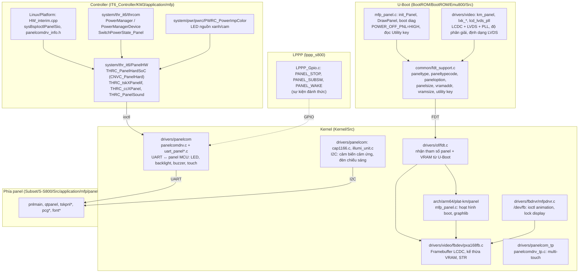

# Bản đồ source liên quan đến Panel (IT6 / S800)

Tài liệu tham chiếu (2 file bạn cung cấp):

| File | Mã tài liệu | Phiên bản |
|---|---|---|
| `FPT-KMI-BSP-SRS-126._Panel_control_u-boot.xlsx` | FPT-KMI-BSP-SRS-07-01 Panel control (u-boot) | 0.02 (2024-02-14) |
| `FPT-KMI-BSP-SRS-127._Panel_control_kernel.xlsx` | FPT-KMI-BSP-SRS-07-02 Panel control (kernel) | 0.01 (2024-01-22) |

Phương pháp: đọc hai tài liệu, đối chiếu từng file được liệt kê với cây source trong repo, rồi tìm thêm các file chưa được tài liệu nhắc tới (theo tên file và theo nội dung). Phần "Chưa xác minh" ở cuối nêu những gì tôi chưa đọc.

---

## 1. Kiến trúc tổng thể

---

## 2. U-Boot (`BootROM/BootROM/Emu800/Src`)

| File | Vai trò | Trong tài liệu | Hàm / điểm chính |
|---|---|---|---|
| `board/mvebu/armada8k/km/mfp_panel.c` (1237 dòng) | Điều khiển panel ở U-Boot: bật nguồn panel, giao tiếp UART với panel MCU, vẽ boot animation, hiển thị chẩn đoán boot | có | `init_Panel`, `init_Panel_Uart`, `init_LCD`, `DrawPanel`, `DrawPanel_lzo`, `setup_LcdDisplay`, `init_PanelMicrocomputer`, `init_LCDBackLight`, `getPanelConnect`, `hwcDispBootDeviceDiag`, `set_Panel_BootDiag*`, lệnh `do_drawpanel` |
| `board/mvebu/armada8k/km/mfp_panel.h`, `graphlib.c/.h`, `picture.h` | Khai báo, vẽ ảnh (`g_press`, `g_press_lzo`), ảnh nhúng | có (mfp_panel, graphlib, picture) | `g_press`, `g_press_lzo`, `g_set_panel_res` |
| `board/mvebu/armada8k/km/machine_setup.c/.h` | Điểm gọi: `init_Panel()` (dòng 696, 702), `hwcDispBootDeviceDiag()` (711), `set_Panel_BootDiagErr/Result` | **không** | gọi từ luồng khởi tạo board |
| `arch/arm/lib/board.c`, `common/board_r.c` | Gọi `init_Panel_Uart()` (dòng 601 và 450) | **không** | |
| `drivers/video/km_panel.c` | Lớp panel KM: probe, loại panel, backlight, đặt độ phân giải / định dạng LVDS | có | `km_panel_probe`, `lcd_set_resolution`, `lcd_set_lvds_format`, `lcd_setting_debug` |
| `drivers/video/lxk_panel.c`, `lxk_panel_common.h` | Lớp chung LXK panel | có | `lxk_panel_init`, `lxk_panel_get_type` |
| `drivers/video/lxk_vga_armada.c` | Điều khiển LCDC Armada, vá FDT (gamma, backlight, nút LCD) | có | `lcd_ctrl_init`, `ft_lcd_setup`, `lcd_image_blit*` |
| `drivers/video/lxk_armada_dumb.c` | Khởi tạo panel "dumb" (gamma, timing) | có | `lxk_armada_dumb_panel_init` |
| `drivers/video/lcd_lvds_pll.c` | PLL và LVDS | có | `lcd_lvds_init`, `lcd_pll_init`, `board_get_core_freq_hz` (1600 MHz SYS_PLL cho S800) |
| `common/lcd.c` | Tầng LCD chung, console trên LCD, lệnh test | có | `lcd_test`, `lcd_init_test` (lệnh debug được tài liệu liệt kê) |
| `common/stdio.c` | Đăng ký thiết bị stdio (LCD stdout) | có | |
| `common/fdt_support.c` | Truyền tham số panel sang kernel qua FDT, trong hàm `fdt_fixup_memory_banks()` | có | `paneltype`, `paneltypecode`, `paneloption`, `panelsize`, `vramaddr`, `vramsize`, `uc_TempUtilityKey` (khoảng dòng 422–560) |
| `include/km_panel.h`, `include/fdtdec.h`, `include/configs/mvebu-common.h` | Cấu hình: `CONFIG_KM_PANEL_MAX_*` (1280×768, 16 BPP), `AP_LCD2_BASE=0xC057E000`, `CONFIG_LXK_PANEL`, `CONFIG_LCD_STDOUT` | có | |
| `arch/arm/dts/quartz-sb.dtsi`, `arch/arm/include/asm/arch-mvebu/gpio.h` | DTS và GPIO (`POWER_OFF_PNL`) | một phần | |
| `common/cmd_warp.c`, `cmd_nvme.c`, `bootm.c`, `main.c`, `drivers/mmc/mmc.c` | Có tham chiếu tới panel (hiển thị tiến trình / lỗi trong lúc boot) | **không** | chưa đọc kỹ |

Luồng U-Boot (theo tài liệu và code): `init_km()` trong `common/board_r.c:447` gọi `init_Panel_Uart()` → `misc_init_r()` trong `machine_setup.c:674` gọi `init_Panel()` (đặt `POWER_OFF_PNL` = HIGH để tắt chế độ tiết kiệm, khởi tạo panel MCU, đọc phím Utility GPIOB17) → `init_LCD` (LCDC/LVDS/PLL, độ phân giải theo `lcd_set_resolution` / `lcd_set_lvds_format`) → đọc 68 KB hoạt hình từ SPI-Flash offset `0x280000` → vẽ lên VRAM → `fdt_fixup_memory_banks()` trong `common/fdt_support.c` ghi tham số panel và VRAM vào FDT.

---

## 3. Kernel (`Kernel/Src`)

> **Lưu ý cấu trúc:** nhiều thư mục driver có hai bản giống hệt nhau: `drivers/<x>` và `drivers/mfp/<x>` (tôi đã kiểm tra `panelcom`, `panelcom_tp`, `fbdrvr`: `diff -rq` không có khác biệt). Khi sửa phải sửa cả hai, hoặc xác nhận bản nào được build.

### 3.1 Hoạt hình boot và vẽ (`arch/arm64/plat-km/panel/`)

| File | Vai trò | Trong tài liệu |
|---|---|---|
| `mfp_panel.c` (938 dòng) | Đọc hoạt hình từ SPI-Flash qua MTD (`BOOT_ANIMATION_OFFSET=0x280000`, `SIZE=68 KB`), chạy animation theo kthread/timer, tính chỉ số kích thước và độ phân giải panel | có |
| `mfp_panel.h`, `graphlib.c/.h`, `picture.h` | Vẽ ảnh, ảnh nhúng | có |
| `picture.c`, `pngfilter.c/.h`, `pic_StartAPP1Ready.h`, `pic_bootFailed.h` | Giải nén PNG, ảnh "StartAPP1Ready", "bootFailed" | **không** |
| `Makefile`, `../Kconfig` | Biên dịch | một phần (Kconfig) |

Hàm đáng chú ý: `DrawInit`, `DrawPanel`, `start_Animation`, `end_Animation`, `setup_ianime` / `start_ianime` / `stop_ianime` (hoạt hình ngắt), `GetPanelSizeIndex`, `GetPanelResolutionIndex` (các bảng `gs_PanelSizeEntry[]`, `gs_PanelResolutionEntry[]`).

### 3.2 Framebuffer / LCD

| File | Vai trò | Trong tài liệu |
|---|---|---|
| `drivers/video/fbdev/pxa168fb.c`, `include/video/pxa168fb.h` | Driver LCDC (probe, DMA, LVDS PHY save/restore, cờ `uc_init_probe`, kế thừa VRAM `ul_VramAddr`). Hỗ trợ suspend/resume cho STR. `km_register_sleep1_ops(&sleep1_ops)` đang **bị comment** (không đăng ký) từ 2018/10/11 (AR.1063217) | có |
| `drivers/video/fbdev/core/fbmem.c` | Lõi FB; có nhánh `CONFIG_KM_NEW_PANEL` (khoảng dòng 1006) | có |
| `drivers/fbdrvr/mfpdrvr.c` (868 dòng) | Driver `mfpfb`: ioctl animation (`FBDRVR_ENDANIMATION` = 10020), khoá/mở khoá hiển thị, `mfpfb_lcdSuspend` | có |
| `drivers/fbdrvr/SN65DSI83.c` | Cầu nối MIPI-DSI sang LVDS. Tài liệu nói "xoá vì không cần" | có (đã đánh dấu xoá) |
| `drivers/of/fdt.c` | Nhận `us_PanelType`, `ui_PanelTypeCode`, `us_PanelOption`, `uc_PanelSize`, `ul_VramAddr`, `ui_VramSize`, `uc_TempUtilityKey` từ FDT (dòng 999–1004, 1098+) | có |
| `arch/arm64/boot/dts/marvell/quartz-sb.dtsi` | Nút `lcd0` (`marvell,pxa168-fb`, id "Mrvl LCD"), UART panel (`dw_uart0`, `snps,panel-uart`, địa chỉ `0x8e8002800`) | có |

### 3.3 Giao tiếp với panel MCU và cảm ứng (`drivers/panelcom/`)

| File | Vai trò | Trong tài liệu |
|---|---|---|
| `panelcomdrv.c` (9201 dòng) | Driver chính. Bật nguồn panel (`PanelPowerOn`, `POWER_OFF_PNL`=79), tạo lệnh UART (LED, backlight, buzzer, EEPROM, `SetPanelSuspend`, cảm ứng…), phân tích gói nhận (`AnalyzeControlTask` → `AnalyzeReceiveData` → `AnalyzeSerialCommand` → `AnalyzeTouchCommand`), thiết bị `/dev/keypanelcom`, `/dev/outpanelcom`, `/dev/keypanelcom_logp`, `PanelComTouch` | có |
| `panelcomdrv.h`, `panelcomdrv_info.h` | Khai báo, hằng số LED / buzzer / backlight (bản sao ở Controller) | có |
| `panelcomdrv_common.h` | API dùng chung (ví dụ `PanelComDrv_getLockPanelTabletStatus`, dùng bởi PMU) | **không** |
| `uart_panel.c`, `uart_panel_pl011.c`, `uart_panel.h` | Lớp UART cấp thấp cho panel (8250/DW và PL011): `sysBspPanelUartTxChar`, `...RxChar`, IRQ, suspend/resume | **không** |
| `cap1166.c` (1747 dòng) | Driver I2C cảm biến cảm ứng CAP1166 (`/dev/km_cap`), độ nhạy theo loại panel | **không** |
| `illumi_unit.c` | Driver I2C đèn chiếu sáng của panel (`/dev/illumi_unit`) | **không** |
| `drivers/panelcom_tp/panelcomdrv_tp.c` + header | Phiên bản multi-touch (cảm ứng nhiều điểm), cùng cơ chế parse | **không** |

### 3.4 Các file khác trong kernel có tham chiếu panel

| File | Tham chiếu |
|---|---|
| `drivers/pmu/mdels800_pmu.c` (và bản `mfp/`) | Dùng `PanelCom_GetAndroidStatus`, `PanelComDrv_getLockPanelTabletStatus`, gửi sự kiện chạm panel (`TabletMainPanelTouchNotice`) |
| `drivers/regulator/quartz-regulator.c` | Bảng `power_lcd[]` (`pmu_LCD` D0↔D2) và `change_power_lcd`; dòng `pmu_LCD` trong `power_sleep1[]` đã bị comment (AR.1063217) |
| `drivers/thr_commondrvr/thr_commondrvr.c/.h` | Mã lệnh `THRD_COM_SYS_BOOTPANELSTOP`, `THRD_COM_DBG_PRINT_PANEL_REG` |
| `drivers/thr_sbst0A800drvr`, `thr_sbst02014drvr`, `thr_sbst0S800drvr`, `thr_mdul001drvr`, `thr_cmemdrvr`, `thr_Androiddrvr` | Hằng số / cấu trúc liên quan panel, bộ nhớ khung hình (`THRCMEM_FB_VRAM_SIZE`), Android panel |
| `arch/arm64/plat-km/Kconfig`, `drivers/mfp/Kconfig`, `Makefile*` | Cấu hình `CONFIG_KM_BIZHUB`, `CONFIG_KM_NEW_PANEL` |

---

## 4. Controller (`IT6_Controller/KM3/application/mfp`)

> `system/thr` và `system/thr_it6` **giống hệt nhau** (`diff -rq` không có khác biệt); `system/thr_ZeusS` là bản cho dòng khác. Makefile của `thr_it6/PanelHW` chỉ build `THRC_PanelHardSoC.cpp`, `THRC_ccXPanel.cpp`, `THRC_tskXPanelif.cpp`, `THRC_PanelSound.cpp`. Các file `Donau`, `Zeus`, `Thames`, `PPanelHard*` là mã cũ không được build cho IT6.

### 4.1 Giao tiếp với kernel

| File | Vai trò |
|---|---|
| `Linux/Platform/HW_interim.cpp/.h` | `sysBspIoctlPanelSio(buffer, EXDB_PanelKind)` (dòng 995): cửa ngõ duy nhất tới `panelcom` qua ioctl. Chuyển lệnh sang Android nếu có kết nối |
| `Linux/Platform/panelcomdrv_info.h` | Bản sao hằng số LED / buzzer / backlight |
| `Linux/main_BSP.cpp` | `FBDRVR_ENDANIMATION` (dòng 2917) để tắt logo sau khi khởi động |

### 4.2 Lớp phần cứng panel (`system/thr_it6/PanelHW/`)

| File | Vai trò |
|---|---|
| `THRC_PanelHardSoC.cpp/.h` (233 KB) | Lớp `CNVC_PanelHard`: `setLED`, `setLEDBlink`, `setBackLight2`, `setCTSensor`, `communicationSusped`, `getPanelType`, `playSound`, `runTouchPanelCalibration`, NFC. Cờ `isSuspend` làm các hàm bị bỏ qua khi panel đang suspend. Mở `/dev/illumi_unit` |
| `THRC_tskXPanelif.cpp/.h` (365 KB) | Tác vụ phụ "giao diện panel ngoài" |
| `THRC_ccXPanel.cpp/.h` | Lớp điều khiển Panel (cc) |
| `THRC_PanelSound.cpp/.h` | Âm thanh panel (`THRD_SOUND_DEVICE_FILE`) |
| `threshold/*.pix` | 10 file tham số độ nhạy cảm ứng (`panel_sensitivity_*`) |
| `rmp.pic`, `rmp_WSVGA.pic` | Ảnh |

### 4.3 Quản lý nguồn, trạng thái liên quan panel

| File | Vai trò |
|---|---|
| `system/thr_it6/thrcom/THRC_PowerManagerDevice.cpp` | `SwitchPowerState_Panel`: LCDC_LVDS (đèn nền, đèn Start), PANEL_POWER (ngưng giao tiếp panel), PANEL_COMMUNICATION |
| `system/thr_it6/thrcom/THRC_PowerManager.cpp` | `PowerChangeSequence_Panel` (dòng 7603) |
| `system/thr_it6/thrcom/THRC_BSPif.cpp`, `THRC_Port.cpp`, `THRC_Vxworks.cpp` | Gọi `CNVC_PanelHard` |
| `system/pwr/pwrc/PWRC_PowerImpColor.cpp/.h` | LED nguồn xanh/cam (`procLEDStatus`) |
| `system/sys/sysg/SYSC_SystemInit.cpp`, `sys/SystemInfo/*` | Khởi tạo, thông tin hệ thống |

### 4.4 Android / panel từ xa / thiết lập

| Nhóm | File |
|---|---|
| Android | `thr_it6/AndroidCtrl/THRC_PanelCapture.cpp/.h`, `THRC_AndroidControl*.cpp`; `sys/AndroidPanel/SYSC_AndroidPanel.*`, `sys/APIC_AndroidPanel.*` |
| Panel từ xa | `exc/APIC_RemotePanel.*`, `exc/excg/EXCC_RemotePanelImp.*`, `exc/excc/EXCC_RemotePanelImpColor.*`, `dbg/dbgg/mdl/DBGC_netifRemotePanel.cpp` |
| Thiết lập / dữ liệu | `nvd/APIC_*PanelSetting.*`, `nvd/nvdg/NVDC_*PanelSetting.*`, `nvd/APIC_AdminMyPanelDef.h` |
| My Panel (IGC) | `igc/igcg/**/IGC*MyPanel*`, `OBJ_MyPanelImpl.*`, `MGRC_MyPanelimpl.cpp` |
| Khác | `uac/uacg/UACC_PanelLoginStatus.*`, `fax/APIC_FaxProcessPanelObserver.*`, `ntfx/ntfxg/NFTC_ProcPanelObserver.h` |
| Nơi gọi `CNVC_PanelHard` | `prt/prtc/prtcImp/ENGC_*`, `prt/prtg/PRCC_PrintProcessTask.cpp`, `scn/**`, `nvd/nvdg/NVDC_FactoryReset.cpp`, `NVDC_Setting.cpp`, `sys/Music/SYSC_Music.*`, `cnv/CNVC_CnvIf.*`, `lst/lstc/LSTC_ListRasterizer*` |

---

## 5. Phía panel (`Subset/S-S800/Src/application/mfp/panel/`)

45 file nguồn của ứng dụng chạy trên phía panel: `pnlmain.cpp`, `qtpanel.cpp`, `tskpnlcpuc.cpp`, `tskpnldraw.cpp`, `panelIF_CLCD.cpp` ("xử lý lệnh cho panel IF"), `pcg*`, `pdd*`, `ppcg*_CLCD.cpp` (các bộ phận UI), `font*.cpp`, `graphlib.cpp`, chuỗi `txt/`. Kèm `Linux/Platform/panelcomdrv_info.h` (bản sao). Tôi chưa đọc nội dung các file này (xem mục "Chưa xác minh").

---

## 6. LPPP, PS-CPU, ATF

| Thành phần | Liên quan panel |
|---|---|
| `lppp_s800/ApplicationKM/LPPP_Gpio.h/.c` | `LPPP_GPIOPIN_PANEL_STOP` (49), `PANEL_SUBSW` (50), `PANEL_WAKE` (54). `SUBSW` và `WAKE` đưa sự kiện `WAKEUP_S1` vào máy trạng thái nguồn |
| `lppp_s800/ApplicationKM/LPPP_Matrix.c` | `LPPP_TR0_OFFToNormal` (dòng 74–99): chờ 100 ms cho panel MCU khởi động; nếu phím Stop (`PANEL_STOP`) không bị nhấn thì bật `MOTION_EN` của MC và IR. Ghi sự kiện `PressPanelPowerKeyDeepSleep` (56) vào PS-CPU qua I2C (dòng 367) |
| `lppp_s800/Hal/quartz/src/pad_config.c` | Gán chân: `UART15_RXD/TXD` = `PANEL_TXD/RXD` (chân 18, 19), GPIOB17 = `PANEL_STOP`, GPIOB18 = `PANEL_SUBKEY`, GPIOB22 = `PANEL_WAKE` |
| `lppp_s800/Hal/quartz/*/LCD2_regheaders.h` | Thanh ghi LCD2 |
| `PS-CPU/pscpu_s800` | Không có mã tham chiếu panel (tìm không thấy). Chỉ ghi nhận sự kiện qua I2C |
| `atf/` | Không có mã panel (các `panel` tìm được chỉ là DTS FVP) |

---

## 7. Các luồng chính

1. **Khởi động:** U-Boot bật panel và vẽ hoạt hình → FDT mang tham số → kernel `fdt.c` đọc → `pxa168fb` kế thừa VRAM của U-Boot (tránh nhấp nháy) → `mfp_panel.c` tiếp tục hoạt hình bằng kthread → Controller `main()` gọi `ioctl(fb_fd, FBDRVR_ENDANIMATION)` để tắt logo.
2. **Chạm màn hình:** panel MCU → UART → `uart_panel*.c` → `PanelComDrv_Install` → `AnalyzeControlTask` → `AnalyzeReceiveData` → `AnalyzeSerialCommand` → `AnalyzeTouchCommand` → Controller (read/poll `/dev/keypanelcom`).
3. **Điều khiển LED / đèn nền / buzzer:** `CNVC_PanelHard::setLED/setBackLight2/playSound` → `sysBspIoctlPanelSio` → `PanelComDrv_Ioctl` → lệnh `CreateCmd_*` → UART → panel MCU.
4. **Chuyển sleep:** `PowerChangeSequence_Panel` → `SwitchPowerState_Panel` (tắt đèn nền, ngưng giao tiếp) → kernel `CreateCmd_SetPanelSuspend`; đánh thức qua `PANEL_SUBSW` / `PANEL_WAKE` vào LPPP.

---

## 8. Điểm cần lưu ý

1. **Tài liệu kernel ghi sai vị trí `PowerChangeSequence_Panel`**: ghi `drivers/video/fbdev/core/fbmem.c`, nhưng hàm này nằm ở Controller `THRC_PowerManager.cpp:7603` (không có trong `fbmem.c`).
2. **`BOOT_ANIMATION_CS` mâu thuẫn trong chính tài liệu kernel**: bảng hằng số ghi `0`, đoạn code ngay dưới ghi `1`. Code kernel thật (`mfp_panel.c:128`) là `1` (và dùng làm chỉ số MTD: `get_mtd_device(NULL, 1)`). Tài liệu U-Boot nói flash ở CS#0, offset `0x280000`.
3. **Nhiều file quan trọng không có trong 2 tài liệu**: `cap1166.c`, `illumi_unit.c`, `uart_panel*.c`, `panelcomdrv_common.h`, toàn bộ `panelcom_tp`, `pngfilter.c`, `picture.c`, `pic_*.h`, `machine_setup.c`, và phần Controller.
4. **Bản sao trùng lặp**: `drivers/<x>` và `drivers/mfp/<x>` (kernel); `system/thr` và `system/thr_it6` (Controller). Cần xác nhận bản nào được build.
5. **Mã panel cũ vẫn nằm trong cây** (`Donau`, `Zeus`, `Thames`, `PPanelHard*`, `thr_ZeusS`) nhưng không được build cho IT6.
6. Dòng `km_register_sleep1_ops(&sleep1_ops)` trong `pxa168fb.c` và `pmu_LCD` trong `power_sleep1[]` **đều bị comment** (AR.1063217: lỗi đèn panel / phím Start sau khi hồi phục từ tiết kiệm điện). Vì thế đèn nền tắt khi Sleep1 do Controller (`setBackLight2(False)`), không do kernel.

---

## 9. Chưa xác minh

- Nội dung chi tiết các file Subset (`pnlmain`, `qtpanel`, `tskpnl*`, `pcg*`…): chỉ liệt kê tên, chưa đọc.
- `THRC_tskXPanelif.cpp` (365 KB), `THRC_ccXPanel.cpp`: chỉ đọc phần đầu.
- Các lệnh UART cụ thể giữa kernel và panel MCU (giao thức gói): chưa lập bảng.
- Thực tế bản nào của `drivers/<x>` vs `drivers/mfp/<x>` được build: chưa kiểm tra Makefile.
- Hai tài liệu có nhiều hình (sơ đồ khối, call flow) nhúng trong Excel; tôi chỉ đọc phần chữ.
