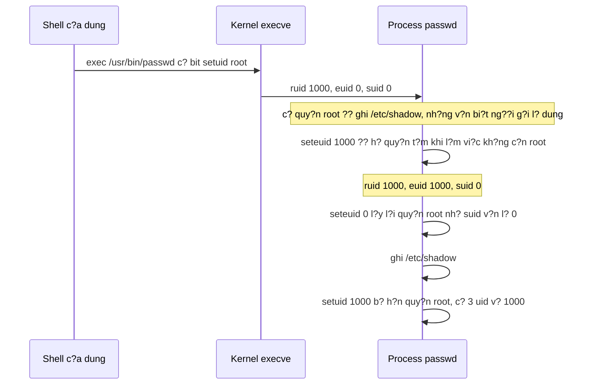
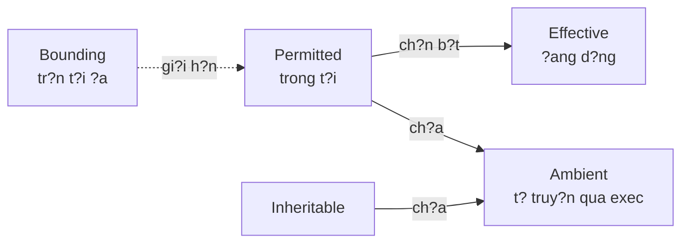
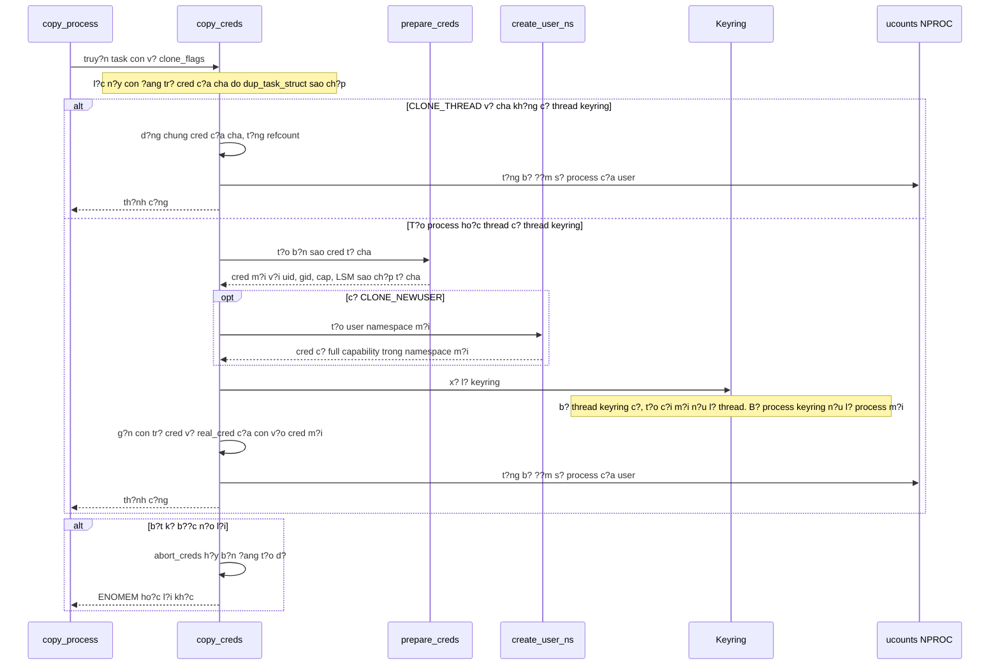

`copy_creds()` g?n b? **credentials** (danh t?nh v? quy?n h?n) cho task con trong l?c `copy_process()` ch?y. H?m l?m m?t trong hai vi?c:

* **D?ng chung** credentials c?a cha, khi t?o thread.
* **T?o b?n sao ri?ng**, khi t?o process. N?u c? y?u c?u user namespace m?i th? t?o namespace lu?n trong b??c n?y.

*M? t? d??i ??y d?a tr?n ki?n th?c chung v? `kernel/cred.c`. Chi ti?t c? th? kh?c gi?a c?c phi?n b?n kernel, ??c bi?t ph?n ??m s? process qua ucounts. B?n n?n ??i chi?u v?i source kernel ?ang d?ng.*

## 1. Credentials l? g?

M?i task c? m?t b? `struct cred`. N?i dung ch?nh:

| Nh?m      | N?i dung                                                                  |
| ---------- | -------------------------------------------------------------------------- |
| Danh t?nh | uid/gid (real, effective, saved, fs), danh s?ch group ph?                |
| Quy?n     | C?c t?p capability: permitted, effective, inheritable, bounding, ambient |
| Ph?m vi   | User namespace m? c?c uid/capability n?y c? hi?u l?c                 |
| B?o m?t  | D? li?u c?a LSM (SELinux, AppArmorÅc), keyring                          |
| Th?ng k? | ??i t??ng user v? ucounts, d?ng ?? ??m s? process theo user     |

Hai ?i?m c?n n?m tr??c khi ??c lu?ng:

* **cred l? b?t bi?n.** Mu?n ??i th? ph?i t?o b?n m?i r?i thay v?o. Kh?ng ???c s?a tr?c ti?p l?n b?n ?ang d?ng. V? v?y c? th? d?ng chung m?t cred gi?a nhi?u task, ch? c?n t?ng b? ??m tham chi?u.
* **M?i task c? 2 con tr? cred:**

  * `real_cred`: danh t?nh *kh?ch quan*, l? th? ng??i kh?c th?y khi t?c ??ng l?n task n?y (v? d? khi g?i signal t?i n?).
  * `cred`: danh t?nh *ch? quan*, l? th? task d?ng khi ch?nh n? truy c?p t?i nguy?n.

  Th?ng th??ng hai con tr? tr? c?ng m?t ch?. Ch?ng ch? t?m kh?c nhau khi kernel Ågm??n quy?nÅh (override\_creds).
  **?n d?:** cred gi?ng m?t th? nh?n vi?n ?? ?p plastic. Kh?ng ai s?a tr?c ti?p tr?n th?. Mu?n ??i quy?n th? l?m th? m?i. Nhi?u ng??i c? th? c?ng c?m b?n sao c?a m?t th?.

Hai nh?m n?y l? ph?n l?i c?a `struct cred`. **uid/gid** tr? l?i c?u h?i Åg*b?n l? ai*Åh. **Capability** tr? l?i c?u h?i Åg*b?n ???c l?m nh?ng ??c quy?n g?*Åh, t?c l? quy?n root ???c chia th?nh t?ng ph?n nh?.

---

### 1. uid/gid: b?n lo?i danh t?nh

**?n d?:** b?n l? nh?n vi?n A (danh t?nh th?t). S?p cho b?n m??n th? c?a tr??ng ph?ng ?? v?o kho (danh t?nh ?ang d?ng). B?n c?t th? tr??ng ph?ng v?o t?i ?? l?t n?a d?ng l?i (danh t?nh d? ph?ng).

| Lo?i                      | ? ngh?a                                                          | D?ng ?? l?m g?                                                                                                                                                           |
| -------------------------- | ------------------------------------------------------------------ | ----------------------------------------------------------------------------------------------------------------------------------------------------------------------------- |
| **Real UID (ruid)**        | Ng??i**th?c s?**ch?y process, th??ng l? ng??i ?? login | X?c ??nh process thu?c v? ai: ai ???c g?i signal t?i n?, t?nh v?o RLIMIT\_NPROC c?a ai                                                                          |
| **Effective UID (euid)**   | Danh t?nh**?ang d?ng ?? ki?m tra quy?n**                    | Kernel d?ng euid ?? quy?t ??nh ???c ph?p hay b? t? ch?i khi truy c?p file, IPCÅc euid = 0 ngh?a l? ?ang c? quy?n root                                      |
| **Saved set-UID (suid)**   | Danh t?nh**c?t t?m**                                            | Cho ph?p process h? quy?n t?m th?i r?i l?y l?i sau ??                                                                                                               |
| **Filesystem UID (fsuid)** | Danh t?nh**ch? d?ng khi truy c?p file**                        | Th??ng lu?n b?ng euid. C? t? th?i NFS server c?n truy c?p file thay m?t user m? kh?ng ??i euid (v? ??i euid th? user ?? c? th? g?i signal t?i server) |

GID c? 4 lo?i t??ng ?ng: rgid, egid, sgid, fsgid.

### V? d?: l?nh `passwd`

File `/usr/bin/passwd` thu?c s? h?u c?a root v? c? bit **setuid**. Khi user `dung` (uid 1000) ch?y l?nh n?y:

T?ng lo?i uid ??ng vai tr? g? trong v? d?:

* **ruid** cho bi?t *ai* ?ang ??i m?t kh?u. Nh? ?? `passwd` ch? cho `dung` ??i m?t kh?u c?a ch?nh m?nh.
* **euid** cho bi?t *quy?n ?ang d?ng*.
* **suid** gi?p process b? quy?n t?m th?i m? v?n l?y l?i ???c.

### Danh s?ch group ph? (supplementary groups)

* M?t user c? **1 group ch?nh** (egid) v? c? th? thu?c th?m **nhi?u group kh?c**. V? d? `dung` thu?c c?c group `dialout`, `docker`, `sudo`.
* Khi ki?m tra quy?n truy c?p file, kernel so group c?a file v?i egid **v?** v?i to?n b? danh s?ch group ph?.
* Danh s?ch n?y ???c n?p l?c login (qua `initgroups`, ??c t? `/etc/group`) v? ???c th?a k? qua fork v? exec.
* **H? qu? th?c t?:** th?m user v?o group `dialout` ?? d?ng `/dev/ttyUSB0` th? ph?i login l?i m?i c? t?c d?ng. L? do l? danh s?ch group c?a c?c process ?ang ch?y kh?ng t? c?p nh?t.

L?nh xem nhanh: `id`, ho?c c?c d?ng `Uid:`, `Gid:`, `Groups:` trong `/proc/self/status` (m?i d?ng Uid v? Gid hi?n th? theo th? t? real, effective, saved, fs).

---

### 1.2. Capability: chia nh? quy?n root

**V?n ??:** tr??c ??y quy?n ch? c? hai m?c, root l?m ???c m?i th?, user th??ng th? b? gi?i h?n. M?t ch??ng tr?nh ch? c?n m? port 80 c?ng ph?i ch?y b?ng root, v? n?u ch??ng tr?nh ?? b? chi?m quy?n th? k? t?n c?ng c? to?n b? h? th?ng.

**Gi?i ph?p:** chia quy?n root th?nh kho?ng 40 **capability** ri?ng l?. V? d?:

| Capability             | Cho ph?p                                              |
| ---------------------- | ------------------------------------------------------ |
| `CAP_NET_BIND_SERVICE` | Bind port nh? h?n 1024                               |
| `CAP_NET_ADMIN`        | C?u h?nh m?ng                                       |
| `CAP_SYS_ADMIN`        | R?t nhi?u vi?c qu?n tr? (mountÅc), g?n nh? root |
| `CAP_SYS_RAWIO`        | Truy c?p I/O port,`/dev/mem`                          |
| `CAP_SYS_NICE`         | T?ng ?? ?u ti?n, ??t scheduler real-time        |
| `CAP_DAC_OVERRIDE`     | B? qua ki?m tra quy?n rwx c?a file                 |
| `CAP_KILL`             | G?i signal t?i process c?a user kh?c               |
| `CAP_SETUID`           | ??i uid t?y ?                                      |

M?i thread mang **5 t?p** capability. **?n d? chung:** m?i capability l? m?t ch?a kh?a.

| T?p            | ?n d?                                     | ? ngh?a                                                                                                                                                                                                           |
| --------------- | ------------------------------------------- | ------------------------------------------------------------------------------------------------------------------------------------------------------------------------------------------------------------------- |
| **Effective**   | Ch?a kh?a**?ang c?m tr?n tay**         | T?p kernel**th?c s? ki?m tra**khi task l?m m?t vi?c ??c quy?n                                                                                                                                             |
| **Permitted**   | Ch?a kh?a**trong t?i**                   | Gi?i h?n tr?n c?a Effective. Task t? b?t ho?c t?t ch?a trong Effective, mi?n l? ch?a ?? c? trong t?i. B? ch?a kh?i Permitted th?**m?t v?nh vi?n**                                            |
| **Inheritable** | Ch?a ???c ph?p**truy?n qua exec**     | Ch? c? t?c d?ng khi file ???c exec c?ng ??nh d?u Inheritable t??ng ?ng (c?n c? hai b?n c?ng ??ng ?). Th?c t? ?t d?ng                                                                       |
| **Bounding**    | **Tr?n t?i ?a**                          | Gi?i h?n m?i capability c? th? c? ???c qua exec, k? c? khi exec file setuid root. Ch? c? th? thu h?p, kh?ng m? r?ng ???c. Container d?ng t?p n?y ?? c?t b? nh?ng capability nguy hi?m |
| **Ambient**     | Ch?a ???c**t? ??ng truy?n**qua exec | Th?m v?o t? kernel 4.3. Cho ph?p ch??ng tr?nh*kh?ng ph?i setuid*v?n gi? capability qua exec, gi?i quy?t ?i?m kh? d?ng c?a Inheritable                                                             |

### Quan h? gi?a c?c t?p

C?c r?ng bu?c gi?a c?c t?p:

* Effective n?m trong Permitted.
* Ambient n?m trong c? Permitted v? Inheritable.
* Bounding ch?n nh?ng g? c? th? c? ???c sau exec.

### Bi?n ??i khi fork v? khi exec

* **fork:** con nh?n **b?n sao y h?t** c? 5 t?p. ??y ch?nh l? vi?c `copy_creds` l?m.
* **exec:** kernel t?nh l?i c?c t?p. N?i ??n gi?n:
  * **Permitted m?i** g?m 3 ph?n:
    * ph?n file cho ph?p (file capability) giao v?i Bounding,
    * ph?n Inheritable c?a process giao v?i Inheritable c?a file,
    * Ambient.
  * **Effective m?i**:
    * n?u file c? c? effective th? Effective m?i b?ng to?n b? Permitted m?i,
    * n?u kh?ng th? b?ng Ambient.
  * **Exec file setuid root** (khi ch?a b?t ch? ?? securebits) th? process nh?n to?n b? Permitted trong ph?m vi Bounding.

### V? d? th?c t?

* **Web server kh?ng c?n ch?y root:**
  * `setcap cap_net_bind_service=+ep /usr/bin/myserver`
  * Ch?y b?ng user th??ng m? v?n bind ???c port 80.
  * N?u b? chi?m quy?n, k? t?n c?ng **ch?** c? quy?n bind port.
* **systemd service:**
  * `AmbientCapabilities=CAP_NET_BIND_SERVICE` cho service ch?y b?ng user th??ng gi? capability qua exec.
  * `CapabilityBoundingSet=` d?ng ?? thu h?p tr?n capability.
* **Docker:** m?c ??nh gi? kho?ng 14 capability trong Bounding, lo?i b? `CAP_SYS_ADMIN`, `CAP_SYS_RAWIO`Åc Ch?y v?i `--privileged` th? gi? ?? t?t c?.
* **Embedded/BSP:**
  * Process ? user space mu?n truy c?p `/dev/mem` ho?c I/O port tr?c ti?p ph?i c? `CAP_SYS_RAWIO`.
  * Mu?n ch?y thread real-time c?n `CAP_SYS_NICE`.
  * C? th? c?p ri?ng c?c capability n?y thay v? ch?y c? ?ng d?ng b?ng root.

L?nh xem nhanh:

* C?c d?ng `CapInh`, `CapPrm`, `CapEff`, `CapBnd`, `CapAmb` trong `/proc/<pid>/status` (gi? tr? hex). Gi?i m? b?ng `capsh --decode=<hex>`.
* Xem capability g?n tr?n file b?ng `getcap <file>`.

---

### 1.3. Li?n h? uid v? capability

* V?i user th??ng, c?c t?p capability g?n nh? r?ng.
* Theo m?c ??nh, **euid = 0 th? kernel t? c?p ??y ?? capability** (trong ph?m vi Bounding). ??y l? c?ch gi? t??ng th?ch v?i m? h?nh root c?.
* Khi process root ??i h?t uid sang kh?c 0, Permitted v? Effective b? x?a. C? th? gi? l?i b?ng `PR_SET_KEEPCAPS`.
* Trong user namespace m?i (`CLONE_NEWUSER`), con c? **full capability nh?ng ch? c? hi?u l?c b?n trong namespace ??**. V? v?y con l? ÅgrootÅh trong container nh?ng kh?ng ph?i root tr?n host.

## 2. Lu?ng x? l?

## 3. Gi?i th?ch t?ng action

| Action                 | L?m g?                                                                                                                                                           | T?i sao                                                                                                                                                     |
| ---------------------- | ------------------------------------------------------------------------------------------------------------------------------------------------------------------ | ------------------------------------------------------------------------------------------------------------------------------------------------------------ |
| **?i?m xu?t ph?t** | `dup_task_struct`?? copy nguy?n`task_struct`c?a cha, n?n con ?ang tr? v?o cred c?a cha nh?ng**ch?a t?ng refcount**                                     | `copy_creds`ph?i h?p th?c h?a c?c con tr? n?y                                                                                                         |
| **Nh?nh nhanh,**      | N?u l? thread (`CLONE_THREAD`) v? cha kh?ng c? thread keyring, con**d?ng chung**cred c?a cha, ch? t?ng refcount                                           | C?c thread trong c?ng process ph?i c? c?ng danh t?nh. D?ng chung th? kh?ng t?n b? nh?                                                            |
| **`prepare_creds`**    | C?p`struct cred`m?i, copy to?n b? t? cha, t?ng tham chi?u t?i user, user namespace, group\_info v? keyring, g?i hook LSM ?? sao ch?p security context | Process m?i c?n b?n ri?ng, ?? sau n?y`setuid`hay`capset`? con kh?ng ?nh h??ng t?i cha                                                           |
| **\`C**                | T?o user namespace m?i. Trong namespace ??, con c? full capability, nh?ng ch? c? hi?u l?c b?n trong namespace                                           | ??y l? n?n t?ng c?a rootless container. ??y c?ng l? n?i l?i EPERM, EUSERS (qu? s? t?ng namespace), ENOMEM c? th? x?y ra                    |
| **Thread keyring**     | Thread keyring**kh?ng ???c th?a k?**. Kernel b? c?i c?a cha. N?u con l? thread th? t?o thread keyring m?i cho con                                    | Thread keyring l? c?a ri?ng t?ng thread                                                                                                                  |
| **Process keyring**    | N?u con l? process m?i th? b? process keyring                                                                                                                 | Process keyring ch? d?ng chung gi?a c?c thread trong c?ng m?t process                                                                                  |
| **G?n con tr**        | ??t c?`cred`v?`real_cred`c?a con tr? v?o cred m?i                                                                                                          | L?c m?i sinh, danh t?nh ch? quan v? kh?ch quan tr?ng nhau                                                                                             |
| **??m process**      | T?ng s? process c?a user (ucounts, ?ng v?i RLIMIT\_NPROC)                                                                                                     | ?? nh?ng l?n fork sau ki?m tra ???c gi?i h?n s? process.**[Phi?n b?n]**Kernel c? t?ng`user->processes`, kernel m?i d?ng`inc_rlimit_ucounts` |
| **L?i**               | `abort_creds`gi?i ph?ng cred ?ang t?o d?                                                                                                                      | `copy_process`ti?p t?c nh?y t?i c?c nh?n`bad_fork_*`?? d?n c?c ph?n kh?c                                                                         |

## 4. Nh?ng g? **kh?ng** l?m ? ??y

* **Kh?ng ki?m tra gi?i h?n RLIMIT\_NPROC.** Vi?c ki?m tra n?m ? `copy_process`, ngay tr??c khi g?i `copy_creds`. `copy_creds` ch? t?ng b? ??m.
* **Kh?ng ??i uid hay capability.** Con c? quy?n gi?ng h?t cha. Quy?n ch? thay ??i sau ??, khi:
  * con g?i `setuid` ho?c `capset`, ho?c
  * con `execve` m?t file c? bit setuid ho?c file capability (l?c ?? `prepare_binprm` v? `commit_creds` t?nh l?i cred).
* **Kh?ng d?n c? PF\_SUPERPRIV.** C? Åg?? t?ng d?ng quy?n rootÅh n?y ???c x?a ? `copy_process`.

## 5. H? qu? th?c t?

* Sau fork, con ch?y v?i **c?ng uid v? capability** v?i cha. Daemon ch?y b?ng root m? fork th? con c?ng c? quy?n root cho t?i khi t? h? quy?n.
* Thread **lu?n d?ng chung** danh t?nh. N?u m?t thread g?i system call `setuid` tr?c ti?p th? ch? thread ?? ??i danh t?nh. V? v?y glibc ph?i ph?t signal t?i m?i thread ?? ??ng b? (c? ch? setxid).
* Fork v?i `CLONE_NEWUSER` l? c?ch container kh?ng c?n root v?n c? ÅgrootÅh b?n trong namespace c?a n?.
* L?i ph?t sinh trong `copy_creds` khi?n fork tr? **ENOMEM**, ho?c **EPERM/EUSERS** khi t?o user namespace.

**Tra c?u ti?p:**

* `kernel/cred.c`: `copy_creds`, `prepare_creds`, `abort_creds`, `commit_creds`, `override_creds`.
* `kernel/user_namespace.c`: `create_user_ns`.
* `security/keys/process_keys.c`: c?c h?m c?i ??t thread keyring.
