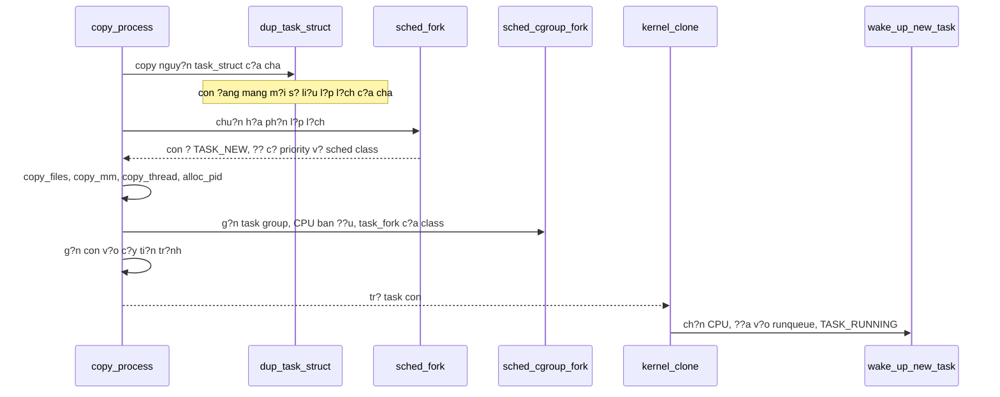
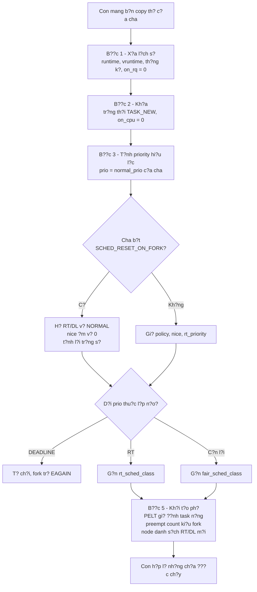
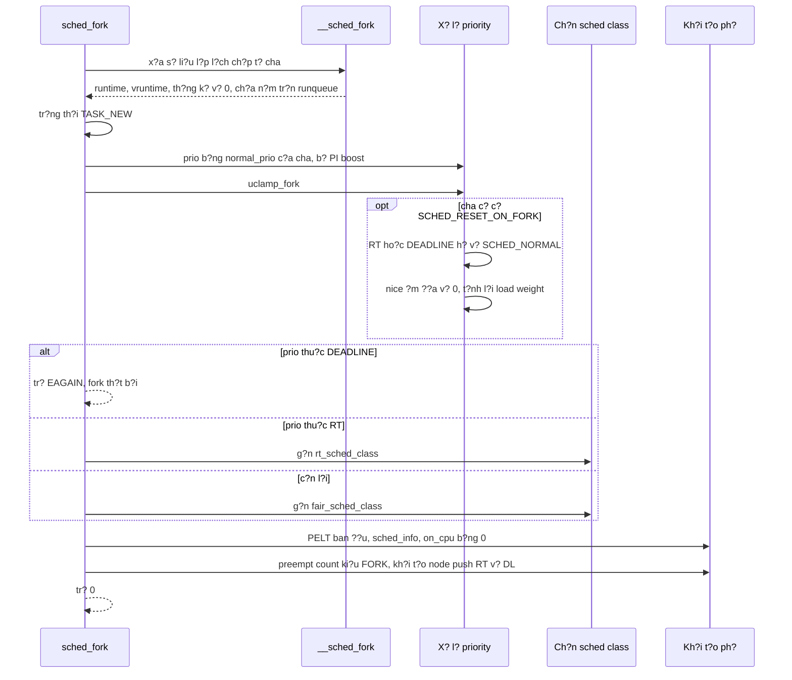
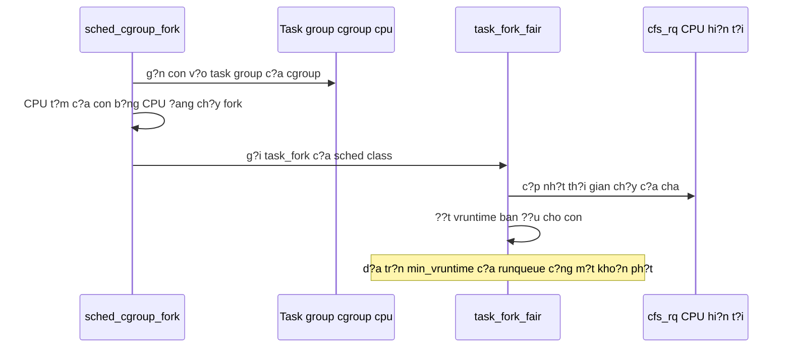
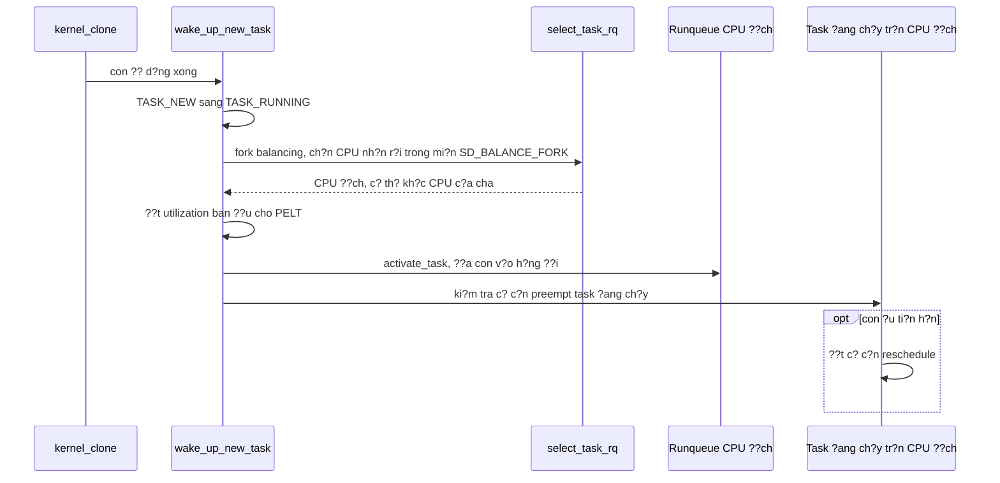

`sched_fork()` chu?n b? ph?n **l?p l?ch** cho task con trong l?c `copy_process()` ch?y. H?m l?m b?n vi?c ch?nh:

* X?a c?c s? li?u l?p l?ch m? con ch?p theo t? cha.
* Kh?a con ? tr?ng th?i **TASK\_NEW**, ?? kh?ng ai ch?y ho?c ??nh th?c n? khi n? ch?a d?ng xong.
* Quy?t ??nh ?? ?u ti?n v? ch?nh s?ch l?p l?ch m? con ???c k? th?a.
* Ch?n **scheduler class** cho con (CFS/EEVDF, RT, ho?c t? ch?i n?u l? DEADLINE).

Vi?c ??a con v?o h?ng ??i ?? ch?y **kh?ng** n?m ? ??y. Vi?c ?? do `wake_up_new_task()` l?m ? cu?i qu? tr?nh fork.

*N?i dung d?a tr?n ki?n th?c chung v? `kernel/sched/core.c` v? `kernel/sched/fair.c`. C?ch chia vi?c gi?a c?c h?m thay ??i kh? nhi?u theo phi?n b?n. M?nh ??nh d?u **[Phi?n b?n]** ? nh?ng ch? ??. B?n n?n ??i chi?u v?i source kernel c?a d? ?n (v? d? 5.10 so v?i 6.x).*

---

## 1. V? tr? trong lu?ng fork



**?n d?:** `dup_task_struct` photo nguy?n h? s? c?a anh trai. `sched_fork` l? b??c **x?a c?c ? th?nh t?ch c?** (th?i gian ?? ch?y, s? l?n chuy?n CPU�c), gi? l?i c?c ? **thu?c v? gia ??nh** (nice, ch?nh s?ch), v? ??ng d?u �gch?a ???c v?o l?p�h.

## 1.1. Chu?n h?a ph?n l?p l?ch

�gChu?n h?a ph?n l?p l?ch�h l? b??c `sched_fork()` bi?n **b?n photo th?** c?a task cha th?nh **tr?ng th?i l?p l?ch h?p l? cho m?t task m?i, ch?a t?ng ch?y**. M?i tr??ng ???c ch?p t? cha s? r?i v?o m?t trong 4 c?ch x? l?:


| Lo?i th?ng tin              | C?ch x? l?                | V? d?                                                                      |
| ----------------------------- | ---------------------------- | ---------------------------------------------------------------------------- |
| **L?ch s? ri?ng c?a cha** | X?a v? 0                   | Th?i gian ?? ch?y, s? l?n ??i CPU, th?ng k?                        |
| **C?u h?nh,**               | Gi? nguy?n                 | nice, policy, CPU affinity                                                   |
| **?**                        | B?, t?nh l?i              | ?u ti?n ???c n?ng do PI boost                                          |
| **Tr?ng th?i �g**           | Ng?t li?n k?t, kh?a l?i | `on_rq`,`on_cpu`, c?c node danh s?cs?ch#?1.1.1 V? sao ph?i chu?n h?a |

`dup_task_struct` copy **nguy?n kh?i b? nh?** c?a `task_struct` cha. Ngay sau b??c n?y, con �gt??ng�h m?nh ch?nh l? cha:


| Tr??ng                        | Gi? tr? con ?ang mang (ch?p t? cha) | N?u kh?ng s?a th? sao                                                                                  |
| ------------------------------- | ---------------------------------------- | ---------------------------------------------------------------------------------------------------------- |
| `se.on_rq`                      | 1 (cha ?ang tr?n runqueue)             | Scheduler t??ng con ?? ???c x?p h?ng, n?n enqueue l?n n?a s? h?ng c?y runqueue              |
| `on_cpu`                        | 1 (cha ?ang ch?y)                      | Code ch? �gtask r?i CPU�h s? ch? m?i                                                                  |
| Node`run_list`,`pushable_tasks` | Tr? v?o**danh s?ch c?a cha**         | Hai task c?ng chi?m m?t v? tr? trong danh s?ch li?n k?t, d?n t?i h?ng b? nh? v? kernel crash |
| `sum_exec_runtime`              | V? d? 120 gi?y                        | `top`b?o con ?? ch?y 120 gi?y d? v?a sinh ra                                                        |
| `vruntime`                      | Gi? tr? c?a cha                       | Con c? th? chen l?n ??u h?ng ch? ho?c b? ??y t?t qu? xa                                       |
| `prio`                          | C? th? ?ang ???c n?ng t?m do PI  | Con h??ng ??c quy?n m? n? kh?ng c? l? do ?? ???c h??ng                                    |

**?n d?:** photo h? s? c?a anh trai ?? l?m h? s? cho em. N?u kh?ng s?a, h? s? c?a em s? ghi �g?ang ng?i l?p 12A�h, �g?? h?c 3 n?m�h, �g?ang gi? ch?a kh?a ph?ng th? nghi?m�h. Chu?n h?a l? x?a c?c d?ng ??, gi? l?i ph?n �gh? kh?u, gia ??nh�h.

### 1.1.2. Lu?ng quy?t ??nh



**B??c 1. X?a l?ch s?.** C?c con s? t?ch l?y theo th?i gian ch?y c?a cha ??u kh?ng thu?c v? con, n?n ???c ??t l?i v? tr?ng th?i �gv?a sinh ra�h.

**B??c 2. Kh?a b?ng `TASK_NEW`.** T? th?i ?i?m n?y ??n khi fork xong, c?c ph?n kh?c c?a kernel c? th? nh?n th?y con, v? d? khi g?i signal ho?c duy?t danh s?ch task. `TASK_NEW` gi?ng bi?n �g?ang thi c?ng�h: `try_to_wake_up` s? b? qua con. Ch? `wake_up_new_task` m?i ???c g? bi?n n?y.

**B??c 3. T?nh priority hi?u l?c.** Kernel ph?n bi?t hai gi? tr?:

* `normal_prio`: m?c ?u ti?n **??ng theo c?u h?nh** (nice ho?c m?c RT).
* `prio`: m?c **?ang ?p d?ng**, c? th? cao h?n t?m th?i v? priority inheritance.

Con nh?n `prio = normal_prio` c?a cha. L? do: cha ???c n?ng ?u ti?n v? ?ang gi? m?t rt\_mutex m? task ?u ti?n cao ?ang ch?. Con kh?ng gi? lock n?o n?n kh?ng c? l? do g? ?? h??ng m?c n?ng ??.

**B??c 4. Reset-on-fork (t?y ch?n).** B??c n?y ch? ch?y khi cha t? y?u c?u: �g??c quy?n th?i gian th?c c?a t?i kh?ng truy?n cho con�h. Khi ?? con b? h? v? `SCHED_NORMAL`, nice ?m ???c ??a v? 0, v? c? n?y c?ng kh?ng truy?n ti?p sang con.

**B??c 5. Ch?n scheduler class theo d?i priority.**

* DEADLINE b? ch?n, v? b?ng th?ng c?a task DEADLINE ?? ???c duy?t tr??c. N?u cho fork, con s? nh?n ??i ng?n s?ch ??.
* RT d?ng `rt_sched_class`.
* C?n l?i d?ng `fair_sched_class`.

**B??c 6. Kh?i t?o ph?.**

* PELT ban ??u **gi? ??nh con l? task n?ng**, ?? b? c?n b?ng t?i kh?ng d?n qu? nhi?u task m?i l?n m?t CPU.
* Preempt count ???c ??t s?n ?? con �gsinh ra�h kh?p v?i ?i?m gi?a m?t l?n context switch.
* C?c node danh s?ch RT/DL ???c t?o m?i, kh?ng d?ng chung v?i cha.

### 1.1.3. V? d? c? th?

**Tr??ng h?p 1: process th??ng.**


| Tr??ng           | Cha            | Con sau chu?n h?a       |
| ------------------ | -------------- | ------------------------- |
| policy, nice       | NORMAL, nice 5 | NORMAL, nice 5 (**gi?**) |
| affinity           | CPU 0?1       | CPU 0?1 (**gi?**)       |
| sum\_exec\_runtime | 40 s           | 0 (**x?a**)              |
| on\_rq, on\_cpu    | 1, 1           | 0, 0 (**ng?t**)          |
| tr?ng th?i       | RUNNING        | TASK\_NEW (**kh?a**)     |
| class              | fair           | fair                      |

**Tr??ng h?p 2: thread RT ?ang ???c PI boost, c? b?t reset-on-fork.**


| Tr??ng        | Cha                                            | Con sau chu?n h?a                            |
| --------------- | ---------------------------------------------- | ---------------------------------------------- |
| policy          | SCHED\_FIFO, rt\_priority 50                   | **SCHED\_NORMAL**(do reset-on-fork)            |
| prio hi?u l?c | ???c n?ng l?n t??ng ???ng 90 (do PI) | B? m?c n?ng. Sau reset th? v? m?c nice 0 |
| nice            | -10                                            | **0**(nice ?m b? ??a v? 0)                |
| class           | rt                                             | **fair**                                       |

N?u **kh?ng** b?t reset-on-fork, con l? SCHED\_FIFO 50. Con v?n kh?ng nh?n m?c n?ng 90 v? PI boost lu?n b? b?.

**Tr??ng h?p 3: cha l? SCHED\_DEADLINE, kh?ng b?t reset-on-fork.** `sched_fork` tr? EAGAIN, `copy_process` d?n d?p v? user nh?n fork th?t b?i.

### 1.1.4. Nh?ng g? ch?a xong sau b??c chu?n h?a

Sau `sched_fork`, con **h?p l? nh?ng ch?a c? ch? trong h?ng ??i**. C?c b??c c?n l?i n?m ? n?i kh?c:

* **G?n task group c?a cgroup cpu, ch?n CPU t?m v? ??t vruntime ban ??u** (con ph?i x?p cu?i h?ng ?? ch?ng fork bomb) ???c l?m ? `sched_cgroup_fork` / `task_fork_fair`. **[Phi?n b?n]** Tr?n kernel c? (v? d? 5.10), c?c vi?c n?y v?n n?m b?n trong `sched_fork`.
* **Ch?n CPU th?t, ??t utilization ban ??u, ??a v?o runqueue, chuy?n sang `TASK_RUNNING` v? ki?m tra c? preempt task ?ang ch?y kh?ng** ???c l?m ? `wake_up_new_task`.

Nguy?n t?c ?? nh?: gi? nh?ng g? cha **ch?n** (ch?nh s?ch, c?u h?nh), x?a nh?ng g? cha **?? tr?i qua** (l?ch s?), b? nh?ng g? cha **t?m ???c h??ng** (PI boost), v? kh?a con l?i cho ??n khi d?ng xong.


---


## 2. B?n trong `sched_fork`



### 2.1 `__sched_fork`: x?a s? li?u ch?p t? cha


| Tr??ng                                                          | ??t v?                                            | T?i sao                                                                                                             |
| ----------------------------------------------------------------- | ---------------------------------------------------- | -------------------------------------------------------------------------------------------------------------------- |
| `se.on_rq`                                                        | 0                                                    | Con ch?a n?m tr?n runqueue n?o. N?u gi? gi? tr? c?a cha, scheduler s? t??ng con ?ang ???c x?p h?ng |
| `exec_start`,`sum_exec_runtime`,`prev_sum_exec_runtime`           | 0                                                    | Th?i gian CPU t?nh ri?ng cho con. ??y l? con s?`top`v?`/proc/<pid>/sched`hi?n th?                          |
| `nr_migrations`                                                   | 0                                                    | Th?ng k? s? l?n chuy?n CPU                                                                                      |
| `vruntime`                                                        | 0 (gi? tr? th?t ???c ??t sau, ?`task_fork`) | Tr?nh th?a h??ng �gth?i gian ?o�h c?a cha                                                                     |
| C?c ph?n c?a RT (`run_list`, timeout) v? DL (timer, tham s?) | Kh?i t?o l?i                                      | Kh?ng ???c d?ng chung danh s?ch hay timer v?i cha                                                             |
| NUMA balancing, preempt notifier, schedstats                      | Kh?i t?o l?i                                      | Con b?t ??u th?ng k? t? ??u                                                                                  |

### 2.2 `TASK_NEW`

* ??y l? tr?ng th?i ??c bi?t c? ngh?a �g?? c? `task_struct` nh?ng **c?m ch?y, c?m ??nh th?c**�h.
* L? do c?n tr?ng th?i n?y: t? ??y cho ??n cu?i `copy_process`, con c? th? b? n?i kh?c nh?n th?y, v? d? khi ?? ???c g?n v?o c?y ti?n tr?nh ho?c nh?n signal. N?u b? `try_to_wake_up` ??nh th?c trong l?c `mm`, `files`, thanh ghi�c c?n d?ng d?, h? th?ng s? crash.
* Ch? `wake_up_new_task` m?i ???c ph?p chuy?n con sang `TASK_RUNNING`.

### 2.3 Priority: k? th?a g?, b? g?


| Th?nh ph?n                                           | Con nh?n                                       | Gi?i th?ch                                                                                                                                                                                                                                           |
| ------------------------------------------------------ | ----------------------------------------------- | ------------------------------------------------------------------------------------------------------------------------------------------------------------------------------------------------------------------------------------------------------ |
| `static_prio`(nice),`policy`,`rt_priority`,`cpus_mask` | **Gi? nguy?n**c?a cha                        | ?? ???c ch?p t?`dup_task_struct`,`sched_fork`kh?ng ??ng t?i (tr? khi c? reset\_on\_fork)                                                                                                                                                  |
| `prio`(?? ?u ti?n ?ang hi?u l?c)                | B?ng`normal_prio` **c?a cha**                 | N?u cha ?ang ???c**n?ng ?u ti?n t?m th?i**do priority inheritance (?ang gi? rt\_mutex m? task ?u ti?n cao ch?), con**kh?ng**???c h??ng m?c n?ng ??. M?c n?ng ?? g?n v?i vi?c cha gi? lock, con kh?ng gi? lock n?o |
| uclamp (gi?i h?n utilization)                        | K? th?a, ho?c reset n?u c? reset\_on\_fork | Ph?c v? qu?n l? n?ng l??ng v? DVFS                                                                                                                                                                                                             |

### 2.4 `SCHED_RESET_ON_FORK`

* ??y l? c? t?y ch?n, ??t b?ng `sched_setscheduler` ho?c `sched_setattr` cho task cha.
* Khi c? ???c b?t, con ???c �gh? c?p�h nh? sau:
  * RT ho?c DEADLINE th?nh `SCHED_NORMAL`.
  * nice ?m th?nh nice 0. nice d??ng th? gi? nguy?n.
  * T?nh l?i `normal_prio` v? load weight.
  * B?n th?n c? kh?ng truy?n ti?p sang con.
* **?n d?:** quy?n ?u ti?n l? �gv? VIP c? nh?n�h c?a cha, kh?ng t? ??ng c?p cho con.
* **H? qu? embedded:** m?t thread `SCHED_FIFO` m? fork ho?c `system()` ch?y l?nh shell th? *m?c ??nh* ti?n tr?nh con c?ng l? FIFO. N?u ti?n tr?nh con b? k?t trong v?ng l?p, n? c? th? chi?m h?t m?t l?i CPU. B?t reset\_on\_fork ?? tr?nh t?nh hu?ng n?y.

### 2.5 Ch?n scheduler class


| Tr??ng h?p                 | K?t qu?                                                                                                                                                                                                                                                                       |
| ----------------------------- | ------------------------------------------------------------------------------------------------------------------------------------------------------------------------------------------------------------------------------------------------------------------------------- |
| prio thu?c d?i**DEADLINE**  | **Tr? EAGAIN**, fork th?t b?i. Task DEADLINE c? ng?n s?ch b?ng th?ng ???c duy?t tr??c (admission control). N?u fork t? do, con s? chia ho?c nh?n ??i ng?n s?ch ?? v? ph? v? ??m b?o th?i gian th?c. Mu?n fork th? ph?i b?t reset\_on\_fork |
| prio thu?c d?i**RT**(0?99) | `rt_sched_class`                                                                                                                                                                                                                                                                |
| C?n l?i                     | `fair_sched_class`(CFS, t? 6.6 l?**EEVDF**)                                                                                                                                                                                                                                   |
| L?p`idle`ho?c`ext`          | **[Phi?n b?n]** `SCHED_IDLE`v?n thu?c fair class.`sched_ext`(t? 6.12) c? x? l? ri?ng                                                                                                                                                                                   |

??y l? **nh?nh l?i duy nh?t** c?a `sched_fork`. Khi l?i, `copy_process` nh?y t?i nh?n d?n d?p (`bad_fork_cleanup_policy`�c) v? user nh?n **EAGAIN**.

### 2.6 C?c kh?i t?o ph?


| Vi?c                                         | ? ngh?a                                                                                                                                                                                                                                                                                                                                          |
| --------------------------------------------- | -------------------------------------------------------------------------------------------------------------------------------------------------------------------------------------------------------------------------------------------------------------------------------------------------------------------------------------------------- |
| **PELT ban ??u**(\`init\_entity\_runnable\_ | Con ch?a c? l?ch s? t?i, n?n kernel**gi? ??nh con l? task n?ng**(load\_avg b?ng tr?ng s? ??y ??). M?c ??ch l? ?? load balancing kh?ng d?n qu? nhi?u task m?i l?n m?t CPU. Gi? tr? utilization ban ??u ???c ??t sau, trong`wake_up_new_task`                                                                |
| `sched_info`                                  | X?a th?ng k? th?i gian ch? v? s? l?n ch?y (ph?c v? delay accounting)                                                                                                                                                                                                                                                                    |
| `on_cpu = 0`                                  | Con kh?ng ?ang ch?y tr?n CPU n?o                                                                                                                                                                                                                                                                                                              |
| **Preempt count ki?u FORK**                  | Con b?t ??u �gs?ng�h b?n trong`schedule_tail`, gi?a m?t l?n context switch. L?c ?? preemption ?ang b? t?t. ??t preempt count ? gi? tr? ?? ?? khi`finish_task_switch`b?t l?i preemption th? b? ??m c?n b?ng.**[Ki?n tr?c]**C?ch l?u preempt count kh?c nhau gi?a x86 (bi?n per-CPU) v? ARM64 (`thread_info`) |
| Node`pushable_tasks`/`pushable_dl_tasks`      | Danh s?ch d?ng khi ??y task RT ho?c DL sang CPU kh?c. Con kh?ng ???c n?m chung danh s?ch v?i cha                                                                                                                                                                                                                                      |

---

## 3. Ph?n ?? chuy?n ra ngo?i: CPU ban ??u v? vruntime

**[Phi?n b?n]** Tr??c kho?ng 5.16, c?c vi?c sau n?m **trong** `sched_fork`. T? ?? tr? v? sau, ch?ng ???c t?ch sang `sched_cgroup_fork`, g?i mu?n h?n trong `copy_process` (sau khi cgroup ?? ??ng ?), ?? con ???c g?n ??ng task group c?a cgroup.



### vruntime ban ??u: ch?ng �gsinh ra l? ???c ch?y ngay�h

**Tr?c gi?c.**

* CFS ?u ti?n task c? `vruntime` (th?i gian ch?y ?o) **nh? nh?t**.
* N?u con nh?n `vruntime = 0`, con s? v??t m?i task kh?c v? ch?y li?n t?c r?t l?u.
* M?t fork bomb khi ?? c? th? chi?m tr?n CPU.

**C? ch?.**

* CFS (??n 6.5):
  * `vruntime` c?a con ???c ??t b?ng m?c `min_vruntime` c?a runqueue **c?ng th?m m?t kho?ng b?ng m?t time slice**. ??y l? t?nh n?ng `START_DEBIT`.
  * Hi?u ??n gi?n: con ph?i x?p **cu?i h?ng**, ?i sau nh?ng task ?ang ch?.
* EEVDF (t? 6.6):
  * Con ???c ??t v?i �glag�h b?ng 0, t?c kh?ng n? v? kh?ng ???c n? CPU.
  * Deadline ?o ban ??u ???c t?nh t? slice. Kernel c? t?y ch?n ch? d?ng n?a slice cho l?n ??u ?? task m?i ph?n h?i nhanh h?n.

**[Phi?n b?n]**

* T?y ch?n `sched_child_runs_first` (cho con ch?y tr??c b?ng c?ch ??i vruntime gi?a cha v? con) ?? b? **lo?i b?** ? kernel g?n ??y.
* V? v?y kh?ng c? g? ??m b?o cha hay con ch?y tr??c.

---

## 4. B??c cu?i: `wake_up_new_task` (sau khi `copy_process` xong)



* **Fork balancing:** con c? th? ???c ??t ngay l?n **CPU kh?c** v? ch?y **song song** v?i cha.
* **Ki?m tra preempt:** n?u con l? RT c? ?u ti?n cao h?n task ?ang ch?y, task ?? b? ??t c? c?n reschedule. V? d?: cha l? FIFO 50, con ???c n?ng l?n FIFO 80 ngay tr??c khi ???c ??nh th?c. V?i task fair, nh? c? ch? ph?t vruntime n?n con th??ng **kh?ng** preempt ngay.

---

## 5. T?m t?t k? th?a v? reset


| Con**k? th?a**t? cha                | Con**b? reset**                                            |
| -------------------------------------- | ----------------------------------------------------------- |
| nice v?`static_prio`                  | Th?i gian ch?y v? c?c th?ng k?                        |
| policy (NORMAL, FIFO, RR, BATCH, IDLE) | `prio`b? PI boost (l?y`normal_prio`)                      |
| `rt_priority`                          | vruntime (??t l?i theo runqueue)                         |
| CPU affinity (`cpus_mask`)             | Tr?ng th?i runqueue (`on_rq`,`on_cpu`)                    |
| uclamp, cgroup cpu                     | L?ch s? t?i PELT (b?t ??u t? gi? ??nh task n?ng) |
|                                        | Policy RT/DL v? nice ?m,**n?u**cha b?t reset\_on\_fork  |

## 6. H? qu? th?c t? cho embedded/BSP

1. **Thread RT fork ra con c?ng l? RT.** G?i `system()` ho?c `popen()` t? thread FIFO s? t?o ra shell ch?y FIFO. C?ch x? l?: b?t `SCHED_RESET_ON_FORK`, ho?c t?o process con t? m?t thread kh?ng ph?i RT.
2. **Task SCHED\_DEADLINE kh?ng fork ???c** (EAGAIN). N?u g?p EAGAIN m? kh?ng ph?i do gi?i h?n s? process, h?y ki?m tra policy c?a task.
3. **CPU affinity ???c k? th?a.** Process cha b? pin v?o l?i 0 th? con c?ng ch? ch?y tr?n l?i 0, cho ??n khi con t? ??i affinity.
4. **Con th??ng kh?ng ch?y ngay** (do ph?t vruntime). Kh?ng n?n gi? ??nh th? t? ch?y, k? c? tr?n m?y m?t l?i.
5. **Quan s?t:**
   * `/proc/<pid>/sched`: xem `se.vruntime`, `nr_switches`, `policy`, `prio`.
   * `chrt -p <pid>`: xem policy hi?n t?i. `chrt -R`: b?t reset-on-fork khi ch?y l?nh.
   * ftrace v?i c?c event `sched_process_fork` v? `sched_wakeup_new`: bi?t con ???c ??nh th?c tr?n CPU n?o v? v?o l?c n?o.

## 7. Tra source

Theo th? t? ??c:

1. `kernel/sched/core.c`: `sched_fork`, `__sched_fork`, `sched_cgroup_fork`, `sched_post_fork`, `wake_up_new_task`, `select_task_rq`, `schedule_tail`, `init_task_preempt_count`.
2. `kernel/sched/fair.c`: `task_fork_fair`, `place_entity`, `init_entity_runnable_average`, `post_init_entity_util_avg`.
3. `kernel/sched/rt.c` v? `kernel/sched/deadline.c`: `init_dl_task_timer` v? ph?n x? l? DEADLINE.

N?u kernel c?a d? ?n l? 5.10, h?y t?m ph?n ch?n CPU v? `task_fork` ngay b?n trong `sched_fork`, v? khi ?? ch?ng ch?a ???c t?ch sang `sched_cgroup_fork`

S? ?? ?? l?u: [docs/diagrams/kernel-thread-arm64.md](vscode-webview://1v7kr62lml590cb3gndmegc6ml88sjdjv7262pvi3l6t2rv5t7fr/docs/diagrams/kernel-thread-arm64.md) (4 s? ??: d?y chuy?n t?o, `copy_thread` user vs kthread, `ret_from_fork` ng? r?, v? sao kh?ng c? user AS).

**File ngu?n**: `kernel/kthread.c` (`kthread_create_on_node`, `kthreadd`, `create_kthread`, `kthread` wrapper, `kthread_should_stop`, `kthread_stop`), `kernel/fork.c` (`kernel_thread`, `copy_mm`), `arch/arm64/kernel/process.c` (`copy_thread` ? nh?nh `PF_KTHREAD`), `arch/arm64/kernel/entry.S` (`ret_from_fork`), `kernel/sched/core.c` (`context_switch` ? nh?nh `!next->mm`), `init/main.c` (`rest_init` ? t?o PID 1 v? PID 2).

---

## 0. Ba c?u tr? l?i

**`ret_from_fork` ph?n bi?t user task vs kernel thread th? n?o?** B?ng `cbz x19` ? `copy_thread` ?? `cpu_context.x19 = 0` cho user task (do `memset`), `= fn` (kh?c 0) cho kernel thread. `x19 == 0` �¨ `b ret_to_user` �¨ `eret` v? EL0. `x19 != 0` �¨ `mov x0, x20; blr x19` �¨ g?i `fn(arg)` ? EL1.

**User process vs kernel thread ? `ret_from_fork`:**

- User:?`ret_from_fork`?�¨?`schedule_tail`?�¨?`ret_to_user`?�¨?`kernel_exit 0`?kh?i ph?c?`pt_regs`?(b?n sao c?a cha) �¨?`eret`?�¨?**EL0**, ti?p t?c l?nh sau?`clone()`,?`x0 = 0`.
- Kernel thread:?`ret_from_fork`?�¨?`schedule_tail`?�¨?`blr x19`?�¨ ch?y?`fn(arg)`?**? EL1**, kh?ng?`eret`, kh?ng bao gi? v? EL0.

**V? sao kernel thread kh?ng c? user address space?** V? (a) n? ch? ch?y code nh?n ? kh?ng c? user code/data/stack ?? c?n; (b) `copy_mm` ?? `mm == NULL` v? ng??i t?o (`kthreadd`) c?ng c? `mm == NULL`; (c) khi l?p l?ch, `context_switch` cho kthread **m??n `active_mm`** c?a task tr??c m? **kh?ng** ??i TTBR0 (lazy-TLB) ? kthread kh?ng bao gi? deref ??a ch? user n?n ?nh x? m??n kh?ng quan tr?ng, ch? ?? MMU c? g? ?? trong TTBR0.

---

## 1. Ngu?n g?c: PID 1 v? PID 2 sinh ra l?c boot

`init/main.c` �¨ `start_kernel` �¨ `arch_call_rest_init` �¨ `rest_init`:

```c
static noinline void __ref rest_init(void)
{
    ...
    pid = kernel_thread(kernel_init, NULL, CLONE_FS);        // �¨ PID 1  (init)
    ...
    pid = kernel_thread(kthreadd, NULL, CLONE_FS | CLONE_FILES);  // �¨ PID 2  (kthreadd)
    rcu_read_lock();
    kthreadd_task = find_task_by_pid_ns(pid, &init_pid_ns);
    rcu_read_unlock();
    ...
    cpu_startup_entry(CPUHP_ONLINE);   // PID 0 (swapper/init_task) tr? th?nh idle task
}
```

`current` ? ??y = **`init_task` (PID 0, swapper)** ? n? c? `flags = PF_KTHREAD` v? `mm == NULL` (`active_mm = &init_mm`). N?n c? hai `kernel_thread` t?o ra task v?i `PF_KTHREAD` + `mm == NULL`.

- **PID 1 (`kernel_init`)**: ch?y?`kernel_init()`?�¨ ho?n t?t init nh?n �¨?`kernel_execve("/sbin/init")`?�¨?**`execve`?c?p cho n? m?t?`mm_struct`**?�¨ t? ?? l? process th??ng (c? user AS). Kh?ng c?n l? kernel thread.
- **PID 2 (`kthreadd`)**: ch?y?`kthreadd()`?v?ng l?p v?nh vi?n ? EL1,?`mm == NULL`?m?i. N? l??**cha c?a m?i kernel thread kh?c**.

---

## 2.?`kthread_create()`?? driver x?p y?u c?u,?`kthreadd`?t?o h?

Driver (ch?y trong ng? c?nh process c?a **n?**) g?i:

```c
struct task_struct *k = kthread_create(threadfn, data, "myworker/%d", cpu);
// ho?c kthread_run(threadfn, data, "...") = kthread_create + wake_up_process
wake_up_process(k);   // b?t ??u ch?y threadfn
```

`kthread_create` �¨ `kthread_create_on_node` �¨ `__kthread_create_on_node`:

```c
struct kthread_create_info *create = kmalloc(sizeof(*create), GFP_KERNEL);
create->threadfn = threadfn;         // h?m TH?T c?a driver
create->data     = data;
create->node     = node;
create->done     = &done;

spin_lock(&kthread_create_lock);
list_add_tail(&create->list, &kthread_create_list);   // ?„Ÿ„Ÿ x?p v?o h?ng ??i
spin_unlock(&kthread_create_lock);

wake_up_process(kthreadd_task);       // ?„Ÿ„Ÿ ??nh th?c kthreadd
wait_for_completion_killable(&done->completion);   // ?„Ÿ„Ÿ BLOCK t?i khi kthreadd b?o v?
task = create->result;
return task;
```

**V? sao ?i v?ng qua `kthreadd`, kh?ng t? `kernel_thread`?**

1. `real_parent`?c?a kthread m?i =?**`kthreadd`**, kh?ng ph?i driver. Khi driver (process) exit, kthread?**kh?ng**?b? reparent/?nh h??ng.
2. Th?a?`PF_KTHREAD`?+?`mm == NULL`?t??`kthreadd`?(n?u t?o t? driver c??`mm`,?`copy_mm`?v?i?`CLONE_VM`?s??_chia s?_?user AS c?a driver ? sai).
3. `kthreadd`?ch?y v?i ??y ?? quy?n nh?n, kh?ng c? r?ng bu?c credential c?a driver.

---

## 3.?`kthreadd()`?daemon (`kernel/kthread.c`)

```c
int kthreadd(void *unused)
{
    struct task_struct *tsk = current;
    set_task_comm(tsk, "kthreadd");
    ignore_signals(tsk);
    set_cpus_allowed_ptr(tsk, housekeeping_cpumask(HK_FLAG_KTHREAD));
    set_mems_allowed(node_states[N_MEMORY]);

    current->flags |= PF_NOFREEZE;
    cgroup_init_kthreadd();

    for (;;) {
        set_current_state(TASK_INTERRUPTIBLE);
        if (list_empty(&kthread_create_list))
            schedule();                          // ?„Ÿ„Ÿ NG? khi kh?ng c? vi?c
        __set_current_state(TASK_RUNNING);

        spin_lock(&kthread_create_lock);
        while (!list_empty(&kthread_create_list)) {
            struct kthread_create_info *create;
            create = list_entry(kthread_create_list.next, struct kthread_create_info, list);
            list_del_init(&create->list);
            spin_unlock(&kthread_create_lock);

            create_kthread(create);              // ?„Ÿ„Ÿ t?o T?NG kthread, trong ng? c?nh kthreadd

            spin_lock(&kthread_create_lock);
        }
        spin_unlock(&kthread_create_lock);
    }
    return 0;
}
```

`create_kthread(create)`:

```c
static void create_kthread(struct kthread_create_info *create)
{
    int pid;
    ...
    pid = kernel_thread(kthread, create, CLONE_FS | CLONE_FILES | SIGCHLD);
    //                   ^^^^^^  ^^^^^^
    //                   fn = kthread (WRAPPER), KH?NG ph?i threadfn
    //                           arg = create
    if (pid < 0) {
        create->result = ERR_PTR(pid);
        complete(&create->done->completion);
    }
}
```

---

## 4.?`kernel_thread()`?(`kernel/fork.c`)

```c
pid_t kernel_thread(int (*fn)(void *), void *arg, unsigned long flags)
{
    struct kernel_clone_args args = {
        .flags       = (lower_32_bits(flags) | CLONE_VM | CLONE_UNTRACED) & ~CSIGNAL,
        .exit_signal = lower_32_bits(flags) & CSIGNAL,
        .stack       = (unsigned long)fn,      // ?„Ÿ„Ÿ OVERLOAD: 'stack' ch? fn
        .stack_size  = (unsigned long)arg,     // ?„Ÿ„Ÿ OVERLOAD: 'stack_size' ch? arg
    };
    return kernel_clone(&args);   // 5.4: _do_fork(&args)
}
```

- **`CLONE_VM`**?? kh?ng?`dup_mm`. (V?i?`kthreadd`?th??`current->mm == NULL`?n?n?`dup_mm`?kh?ng x?y ra d? sao, nh?ng ng? ngh?a l? "kh?ng c? user AS".)
- **`CLONE_UNTRACED`**?? d? ng??i t?o b??`ptrace`?(kh?ng bao gi?), kh?ng ?p?`CLONE_PTRACE`?l?n con.
- **`stack`/`stack_size`?b? m??n ngh?a**?? v?i kernel thread, ch?ng?**kh?ng**?l? "user stack + k?ch th??c" m? l??`fn`?+?`arg`.?`copy_thread`?bi?t ?i?u n?y nh??`PF_KTHREAD`.

---

## 5.?`copy_process`?�¨?`copy_mm`????`mm == NULL`

```c
static int copy_mm(unsigned long clone_flags, struct task_struct *tsk)
{
    tsk->mm = NULL;
    tsk->active_mm = NULL;

    oldmm = current->mm;         // current = kthreadd
    if (!oldmm)
        return 0;                // ?„Ÿ„Ÿ kthreadd->mm == NULL �¨ RETURN NGAY
                                 //     �¨ tsk->mm = tsk->active_mm = NULL

    if (clone_flags & CLONE_VM) { mmget(oldmm); mm = oldmm; goto good_mm; }
    mm = dup_mm(tsk, current->mm);
    ...
}
```

Ki?m `if (!oldmm) return 0` **tr??c** ki?m `CLONE_VM` ? n?n kernel thread lu?n k?t th?c v?i `mm == NULL, active_mm == NULL`.

`PF_KTHREAD` ???c **th?a k?** t? `kthreadd` qua `arch_dup_task_struct` (`*dst = *src` copy c? `flags`). `copy_process` kh?ng x?a c? n?y (n? ch? x?a `PF_SUPERPRIV | PF_WQ_WORKER | PF_IDLE`). (5.10+ ??t t??ng minh `p->flags |= PF_KTHREAD` khi `args->kthread`.)

---

## 6.?`copy_thread()`?? nh?nh?`PF_KTHREAD`?(`arch/arm64/kernel/process.c`)

```c
int copy_thread(unsigned long clone_flags, unsigned long stack_start,
                unsigned long stk_sz, struct task_struct *p, unsigned long tls)
{
    struct pt_regs *childregs = task_pt_regs(p);
    memset(&p->thread.cpu_context, 0, sizeof(struct cpu_context));

    if (likely(!(p->flags & PF_KTHREAD))) {
        // „Ÿ„Ÿ user task „Ÿ„Ÿ (Module 8)
        *childregs = *current_pt_regs();
        childregs->regs[0] = 0;
        ...
    } else {
        // „Ÿ„Ÿ KERNEL THREAD „Ÿ„Ÿ
        memset(childregs, 0, sizeof(struct pt_regs));   // ?„Ÿ„Ÿ pt_regs R?NG (kh?ng c? EL0 ?? v?)
        childregs->pstate = PSR_MODE_EL1h;              // (n?u l? c? eret �¨ ? EL1)
        spectre_v4_enable_task_mitigation(p);
        if (system_uses_irq_prio_masking())
            childregs->pmr_save = GIC_PRIO_IRQON;
        p->thread.cpu_context.x19 = stack_start;        // ?„Ÿ„Ÿ = fn
        p->thread.cpu_context.x20 = stk_sz;             // ?„Ÿ„Ÿ = arg
    }
    p->thread.cpu_context.pc = (unsigned long)ret_from_fork;   // gi?ng user
    p->thread.cpu_context.sp = (unsigned long)childregs;
    return 0;
}
```


| Tr??ng                         | User task                   | Kernel thread   |
| -------------------------------- | --------------------------- | --------------- |
| `pt_regs`?(??nh kernel stack) | b?n sao`pt_regs`?c?a cha | **memset 0**    |
| `cpu_context.x19`                | 0 (memset)                  | **`fn`**        |
| `cpu_context.x20`                | 0                           | **`arg`**       |
| `cpu_context.pc`                 | `ret_from_fork`             | `ret_from_fork` |
| `cpu_context.sp`                 | `childregs`                 | `childregs`     |

---

## 7. L?n ??u scheduler ch?n kthread �¨?`ret_from_fork`

`context_switch(rq, prev, next = kthread)` (`kernel/sched/core.c`):

```c
if (!next->mm) {                              // ?„Ÿ„Ÿ kthread: mm == NULL
    enter_lazy_tlb(prev->active_mm, next);
    next->active_mm = prev->active_mm;        // ?„Ÿ„Ÿ M??N active_mm c?a prev
    if (prev->mm)                             // prev l? user task
        mmgrab(prev->active_mm);              //   gi? mm kh?i b? free
    else
        prev->active_mm = NULL;
    // �¨ switch_mm() KH?NG ???c g?i �¨ TTBR0_EL1 + ASID GI? NGUY?N (lazy TLB) �¨ 0 chi ph? MMU
}
...
switch_to(prev, next, prev);                  // �¨ __switch_to �¨ cpu_switch_to
```

`cpu_switch_to(prev, kthread)`:

- l?u?`cpu_context`?c?a prev
- n?p c?a kthread:?`x19 = fn`,?`x20 = arg`,?`x21..x28 = 0`,?`fp = 0`,?`sp = childregs`?(??nh kernel stack kthread),?`lr = ret_from_fork`
- `mov sp, x9`?�¨ sp = kernel stack kthread
- `msr sp_el0, x1`?�¨?`current = kthread`
- `ret`?�¨ nh?y t?i?`lr = ret_from_fork`

`ret_from_fork` (`arch/arm64/kernel/entry.S`):

```asm
SYM_CODE_START(ret_from_fork)
    bl   schedule_tail          // finish_task_switch(prev): nh? rq->lock, preempt_count �¨ 0
    cbz  x19, 1f                // x19 = fn �‚ 0 �¨ KH?NG r?
    mov  x0, x20               // x0 = arg
    blr  x19                   // ?„Ÿ„Ÿ g?i fn(arg) = kthread(create)  ? ? EL1
1:  get_current_task tsk       // (ch? user task t?i ??y)
    b    ret_to_user
SYM_CODE_END(ret_from_fork)
```

`schedule_tail` (`kernel/sched/core.c`) ch?y **tr??c** cho m?i task m?i ? ho?n t?t context switch m? task kh?c ?? b?t ??u (Module 9). R?i `cbz x19` r?.

---

## 8.?`kthread()`?wrapper ? sleep, report, ch?y?`threadfn`

```c
static int kthread(void *_create)          // g?i b?i ret_from_fork's blr x19, x0 = create
{
    struct kthread_create_info *create = _create;
    int (*threadfn)(void *) = create->threadfn;   // h?m TH?T c?a driver
    void *data = create->data;
    struct kthread *self;

    self = kzalloc(sizeof(*self), GFP_KERNEL);
    set_kthread_struct(self);                // to_kthread(current) t? gi? tr? 'self'
    self->threadfn = threadfn;
    self->data     = data;
    init_completion(&self->exited);
    current->vfork_done = &self->exited;     // kthread_stop() ch? ? ??y

    __set_current_state(TASK_UNINTERRUPTIBLE);
    create->result = current;                // ?„Ÿ„Ÿ b?o task_struct v? cho kthread_create()
    preempt_disable();
    complete(done);                          // ?„Ÿ„Ÿ ??NH TH?C wait_for_completion() c?a driver
    schedule_preempt_disabled();             // ?„Ÿ„Ÿ NG? ? driver ph?i wake_up_process() ?? b?t ??u
    preempt_enable();

    ret = -EINTR;
    if (!test_bit(KTHREAD_SHOULD_STOP, &self->flags)) {
        cgroup_kthread_ready();
        __kthread_parkme(self);
        ret = threadfn(data);               // ?„Ÿ„Ÿ CU?I C?NG ch?y h?m c?a driver
    }
    do_exit(ret);                           // ?„Ÿ„Ÿ threadfn return �¨ do_exit
}
```

N?n:

- `kthread_create()`?tr? v??`task_struct`?nh?ng?`threadfn`?**ch?a**?ch?y ? thread ?ang ng??`TASK_UNINTERRUPTIBLE`.
- Driver g?i?`wake_up_process(k)`?(ho?c d?ng?`kthread_run`?= t?o + wake) �¨?`schedule_preempt_disabled()`?tr? v? �¨ ch?y?`threadfn(data)`.

### `threadfn`??i?n h?nh

```c
static int my_worker(void *data)
{
    while (!kthread_should_stop()) {
        // ... l?m vi?c ...
        set_current_state(TASK_INTERRUPTIBLE);
        schedule_timeout(HZ);               // ng? 1 gi?y
    }
    return 0;
}
```

Ch?y **ho?n to?n ? EL1**, tr?n kernel stack 16 KB c?a kthread, `mm == NULL`, d?ng `active_mm` m??n. `kthread_should_stop()` = `test_bit(KTHREAD_SHOULD_STOP, &to_kthread(current)->flags)`.

### K?t th?c

- `threadfn`?return �¨?`kthread()`?�¨?`do_exit(ret)`.
- `kthread_stop(k)`:?`set_bit(KTHREAD_SHOULD_STOP, ...)`,?`wake_up_process(k)`,?`wait_for_completion(&kthread->exited)`, tr??`ret`?c?a threadfn.

---

## 9. So s?nh EL0-return vs kernel-function


|                                        | User process                                             | Kernel thread                                             |
| -------------------------------------- | -------------------------------------------------------- | --------------------------------------------------------- |
| Sau`ret_from_fork`?+?`schedule_tail` | `cbz x19`?(x19==0) �¨?`b ret_to_user`                  | `cbz x19`?(x19�‚0) �¨?`mov x0,x20; blr x19`             |
| `ret_to_user`?�¨?`kernel_exit 0`     | kh?i ph?c`pt_regs`?(b?n sao cha,?`x0=0`) �¨?`eret` | _(kh?ng t?i ??y)_                                     |
| ?i?m h? c?nh cu?i                 | **EL0**, l?nh sau?`clone()`,?`x0 = 0`                 | `fn(arg)`???**EL1**                                    |
| `mm`                                   | user`mm_struct`;?`TTBR0 = pgd c?a n?`                 | **`NULL`**;?`active_mm`?m??n;?`TTBR0`?gi? nguy?n  |
| `pt_regs`???nh stack                | ng? c?nh EL0 h?p l?                                  | memset 0, kh?ng d?ng                                    |
| V? userspace                          | c?                                                      | **kh?ng bao gi?**                                       |
| B?`ptrace`                            | ???c                                                  | kh?ng (`CLONE_UNTRACED`)                                 |
| Nh?n signal th??ng                  | c?                                                      | th??ng`ignore_signals()`; ch? x? l? c?i m?nh ch?n |
| `ps`                                   | `program`                                                | `[kthreadd]`,?`[ksoftirqd/0]`,?`[kworker/1:2-events]`   |

---

## 10. V? sao kernel thread kh?ng c?n user address space

1. **Vi?c c?a n? to?n l? code nh?n.** `kswapd` (thu h?i b? nh?), `kcompactd` (n?n b? nh?), `pdflush`/`kworker` (ghi trang b?n), `ksoftirqd/N` (ch?y softirq b? d?n), `kblockd` (I/O kh?i), `rcu_sched`/`rcuos/N` (RCU callback), `migration/N` (di chuy?n task gi?a CPU), `watchdog/N` (lockup detector). T?t c? n?m ? **kernel VA** ? n?a `TTBR1_EL1` (`PAGE_OFFSET` tr? l?n: linear map, vmalloc, code nh?n). N?a n?y **chung m?i task**, lu?n ???c map. Kh?ng c? user code, user data, user stack, `argv`/`envp`.
2. **`mm == NULL` l? d?u hi?u.** `copy_mm` ?? n? NULL v? `kthreadd->mm == NULL`. Kh?p nh?n c? `if (current->mm)` ?? ph?n bi?t "?ang ch?y thay m?t m?t process" v?i "kernel thread". `get_user`/`put_user` v? ngh?a v?i kthread; `copy_from_user` t? kthread t?i ??a ch? TTBR0 s? fault ho?c ??c r?c.
3. **Lazy-TLB ? `active_mm`.** MMU lu?n c?n _m?t_ b?ng trang trong `TTBR0_EL1` (d? kh?ng d?ng). Khi switch sang kthread, `context_switch` ??t `next->active_mm = prev->active_mm` v? `mmgrab` ? kthread **m??n** user AS c?a task tr??c. `switch_mm` **kh?ng** ???c g?i �¨ `TTBR0_EL1` + ASID **kh?ng ??i** �¨ **0 chi ph? MMU** cho l?n switch. kthread kh?ng bao gi? deref ??a ch? user n?n ?nh x? m??n kh?ng quan tr?ng. Khi kthread sau ?? switch sang user task c? `mm` kh?c �¨ _l?n switch ??_ m?i g?i `switch_mm` v? `mmdrop(rq->prev_mm)` nh? c?i ?? m??n.
4. **Ch? n?a `TTBR1`.** V? kh?ng ??ng ??a ch? `TTBR0`, kthread th?c ch?t s?ng ho?n to?n ? n?a kernel VA.
5. **Bonus an to?n.** Kh?ng c? user AS �¨ kh?ng b? l?a deref con tr? do user ?i?u khi?n. `CLONE_UNTRACED` �¨ debugger kh?ng `ptrace` ???c kthread.

---

## 11. Kh?c bi?t 5.4 vs b?n m?i


| ?i?m                          | 5.4                                                 | B?n sau                                                           |
| ------------------------------- | --------------------------------------------------- | ------------------------------------------------------------------ |
| ??t`PF_KTHREAD`               | th?a k? t?`kthreadd`?qua?`*dst=*src`           | t??ng minh `p->flags                                             |
| `kthread()`?wrapper k?t th?c | `do_exit(ret)`                                      | `kthread_exit(ret)`?(5.17)                                        |
| `kernel_thread`                 | `_do_fork(&args)`?v?i?`stack=fn, stack_size=arg` | `kernel_clone`?v?i?`args.fn`/`args.fn_arg`?t??ng minh (5.17) |
| `ret_from_fork`                 | `bl schedule_tail; cbz x19,1f; mov x0,x20; blr x19` | y h?t (5.4?5.17); 5.18 chuy?n m?t ph?n sang C                 |
| kthread`mm`                     | `NULL`, m??n?`active_mm`                         | y h?t                                                             |

> Tree local `Kernel/K-S800/Src` = **5.10.241**: `copy_thread` c? nh?nh `PF_KTHREAD | PF_IO_WORKER`; `kthread()` v?n `do_exit`. C? ch? `cpu_context.x19=fn` + `ret_from_fork` `cbz x19` + `mm==NULL` + lazy-TLB ? **gi?ng h?t 5.4**.
