# Cơ chế fork trong Linux kernel — Giải thích high level

> Tài liệu giải thích ở mức khái niệm, không có code. Tên hàm, struct và cờ chỉ dùng làm nhãn để tra source sau.
> Nội dung dựa trên kiến thức chung về Linux kernel. Tên hàm có thể khác giữa các phiên bản, cần đối chiếu với source kernel đang dùng trong dự án.

**Nhãn dùng trong tài liệu:**

- **[Chuẩn]**: hành vi chung của Linux, không phụ thuộc kiến trúc.
- **[Kiến trúc]**: khác nhau giữa x86_64 và ARM64.
- **[Phiên bản]**: thay đổi theo phiên bản kernel hoặc glibc.

---

## Mục lục

- [Phần 1. Bức tranh tổng thể](#phần-1-bức-tranh-tổng-thể)
- [Phần 2. Các luồng xử lý](#phần-2-các-luồng-xử-lý)
  - [A. Toàn cảnh](#a-toàn-cảnh-từ-user-tới-kernel-và-quay-về)
  - [B. Bên trong copy_process](#b-bên-trong-copy_process)
  - [C. Chia sẻ hay sao chép](#c-chia-sẻ-hay-sao-chép-các-cờ-clone_)
  - [D. Copy-On-Write](#d-sao-chép-không-gian-địa-chỉ-với-copy-on-write)
  - [E. Page fault COW](#e-page-fault-khi-ghi-vào-trang-cow)
  - [F. Cấp PID](#f-cấp-pid-và-gắn-vào-cây-tiến-trình)
  - [G. Đánh thức con](#g-đánh-thức-con-và-lần-chạy-đầu-tiên)
  - [H. fork rồi exec](#h-fork-rồi-exec)
  - [I. vfork](#i-vfork)
  - [J. Thread](#j-tạo-thread-bằng-pthread_create)
  - [K. exit, zombie, wait](#k-kết-thúc-vòng-đời-exit-zombie-wait)
  - [L. Thất bại](#l-các-nhánh-thất-bại)
  - [M. Đa luồng](#m-fork-trong-chương-trình-đa-luồng)
- [Phần 3. Các khái niệm cần hiểu sâu](#phần-3-các-khái-niệm-cần-hiểu-sâu)
- [Phần 4. Liên hệ embedded và BSP](#phần-4-liên-hệ-thực-tế-cho-embedded-và-bsp)
- [Phần 5. Tổng kết](#phần-5-tổng-kết)

---

# Phần 1. Bức tranh tổng thể

## 1.1 Process, thread và task

**Trực giác.** Hãy hình dung một bếp ăn:

- **Process** giống một căn bếp riêng, có nồi niêu (bộ nhớ), tủ đồ (file đang mở) và sổ quy định (signal handler) của riêng nó.
- **Thread** là các đầu bếp làm chung trong một căn bếp.
- **Task** là kernel gọi chung *mọi đầu bếp*, bất kể họ đứng trong bếp riêng hay bếp chung.

**Cơ chế. [Chuẩn]**

- Kernel không có hai loại đối tượng riêng cho process và thread. Mọi đơn vị có thể được lập lịch đều là một **`task_struct`**.
- Khác biệt nằm ở chỗ task đó **trỏ tới tài nguyên riêng hay dùng chung**:
  - Không gian địa chỉ: `mm_struct`.
  - Bảng file descriptor: `files_struct`.
  - Signal handler: `sighand_struct`.
  - Trạng thái signal của nhóm: `signal_struct`.
  - Thông tin filesystem: `fs_struct`.
- Hai task trỏ chung một `mm_struct` thì là hai *thread*. Hai task có `mm_struct` riêng thì là hai *process*.
- Về định danh:
  - Mỗi task có một **PID** riêng.
  - Các thread trong cùng process có chung **TGID** (thread group ID).
  - Lệnh `getpid()` ở user space thực chất trả về TGID.

**Hệ quả thực tế.**

- Scheduler lập lịch từng task (từng thread) độc lập, chứ không lập lịch theo process.
- Trong `/proc/<pid>/task/` có một thư mục con cho mỗi thread.
- `ps -eLf` hiển thị từng task (LWP), còn `ps -ef` chỉ hiển thị mỗi process một dòng.

## 1.2 fork, vfork, clone, clone3, posix_spawn hội tụ thế nào

**Trực giác.** Đây là năm cách gọi món, nhưng chỉ có một nhà bếp nấu. Mỗi cách khác nhau ở danh sách “những gì được dùng chung”.

**Cơ chế.**

| API | Mức | Bản chất bên trong kernel |
|---|---|---|
| `fork()` | glibc | Gọi system call clone với tín hiệu báo khi kết thúc là SIGCHLD và không chia sẻ gì. Sao chép tất cả |
| `vfork()` | glibc/syscall | Như fork, cộng thêm **chia sẻ bộ nhớ** (`CLONE_VM`) và **cha phải chờ** (`CLONE_VFORK`) |
| `clone()` | syscall | Cổng tổng quát. Người gọi tự chọn từng cờ `CLONE_*` |
| `clone3()` | syscall | Phiên bản mới của clone, truyền tham số bằng struct nên mở rộng được. **[Phiên bản]** có từ kernel 5.3 |
| `pthread_create()` | glibc/NPTL | Gọi clone (hoặc clone3) với bộ cờ chia sẻ gần như toàn bộ |
| `posix_spawn()` | glibc | Tạo con rồi exec ngay. **[Phiên bản]** glibc hiện đại dùng clone kiểu vfork (`CLONE_VM` và `CLONE_VFORK`) trên một stack riêng |

Mọi đường trên đều đi vào **`kernel_clone`**, rồi tới **`copy_process`**.

- **[Phiên bản]** Trước kernel 5.10, hàm này tên là `_do_fork`.
- **[Kiến trúc]**
  - ARM64 **không có** system call `fork` và `vfork` riêng, chỉ có `clone` và `clone3`.
  - x86_64 vẫn giữ system call `fork` vì lý do tương thích, nhưng glibc hiện đại thường gọi `clone` ngay cả trên x86_64.

**Hệ quả.**

- Khi dùng `strace` để bắt lời gọi `fork()`, bạn thường thấy `clone(...)` chứ không thấy `fork`.
- Hiểu được `copy_process` là hiểu được cả fork, vfork, thread và posix_spawn, vì tất cả chỉ khác nhau ở bộ cờ.

## 1.3 “fork trả về hai lần”

**Trực giác.** Giống như photo một người đang nói dở câu “Kết quả là…”. Bản gốc nói tiếp “…con số 1234”, còn bản sao nói tiếp “…số 0”.

**Cơ chế. [Chuẩn]**

- Chỉ có **một** lời gọi system call, phát ra từ task cha.
- Kernel tạo task con có **bản sao trạng thái thanh ghi** tại đúng điểm “sắp quay về từ system call”.
- Kernel sửa **thanh ghi giá trị trả về** của task con thành 0. Thao tác này do `copy_thread` thực hiện. **[Kiến trúc]** Trên x86_64 là thanh ghi rax, trên ARM64 là x0.
- Task cha nhận về PID của con.

Kết quả là hai task cùng “quay về” từ một điểm trong code, nhưng mỗi bên nhận một giá trị trả về khác nhau.

**Hệ quả.** Chương trình phân biệt cha và con chỉ bằng giá trị trả về: 0 là con, số dương là cha, -1 là lỗi. Lỗi thì chỉ cha nhận, vì khi đó không có con nào được tạo ra.

---

# Phần 2. Các luồng xử lý

## A. Toàn cảnh: từ user tới kernel và quay về

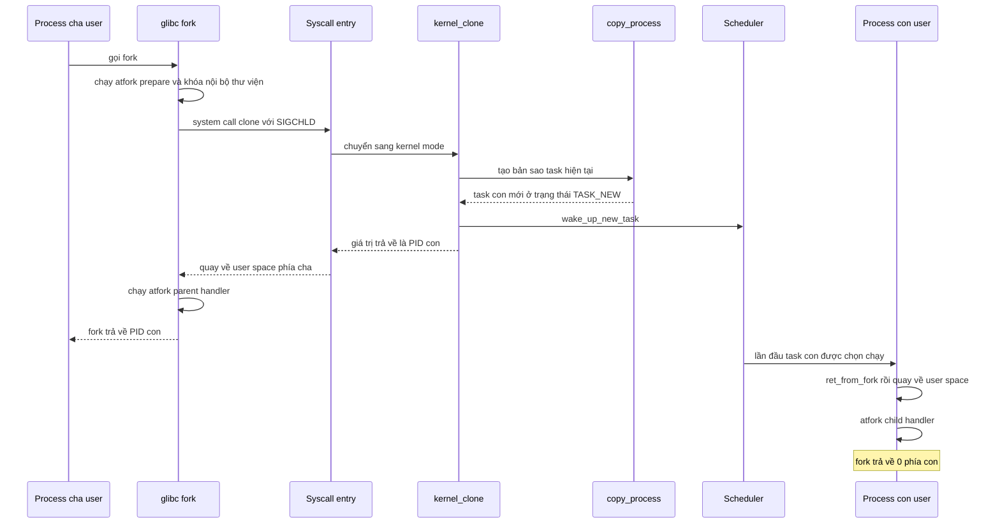

| Action | Ai làm, làm gì | Tại sao | Trạng thái thay đổi | Nếu thất bại |
|---|---|---|---|---|
| Atfork prepare | glibc khóa các lock nội bộ (ví dụ lock của malloc) và chạy handler do người dùng đăng ký | Đảm bảo không lock nào đang bị giữ dở khi bị sao chép sang con | Các lock bị giữ tạm thời | – |
| System call | glibc bẫy vào kernel | Chỉ kernel mới tạo được task | CPU chuyển sang kernel mode | – |
| `kernel_clone` | Điều phối toàn bộ quá trình | Một đường chung cho mọi biến thể | – | Trả mã lỗi âm về cho cha |
| `copy_process` | Dựng task con | Phần việc nặng nhất (xem luồng B) | Có `task_struct` mới, chưa chạy được | Dọn sạch phần đã tạo, trả EAGAIN hoặc ENOMEM |
| `wake_up_new_task` | Đưa con vào hàng đợi chạy | Từ thời điểm này con mới được lập lịch | TASK_NEW chuyển thành TASK_RUNNING | – |
| Cha quay về | Cha nhận PID con | Để quản lý con sau này (wait, kill) | Cha tiếp tục chạy | – |
| Con chạy lần đầu | Con bắt đầu từ `ret_from_fork` | Con chưa từng chạy nên cần một điểm khởi động riêng | Con xuất hiện ở user space với giá trị 0 | – |

**Ví dụ:** một shell chạy `ls`. Shell gọi fork, nhận PID con và chờ. Tiến trình con nhận 0 và chuyển sang exec `ls`.

## B. Bên trong `copy_process`

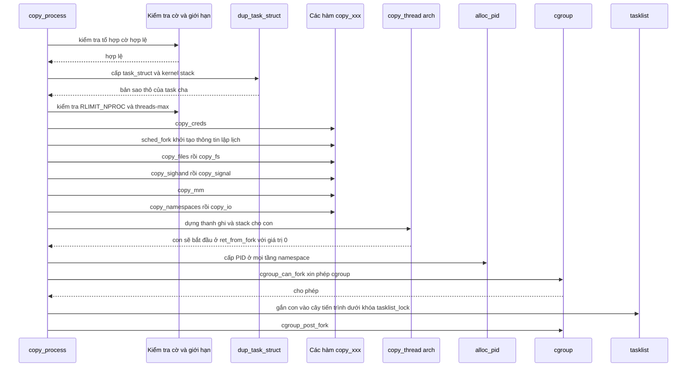

| Bước | Làm gì | Tại sao | Nếu thất bại |
|---|---|---|---|
| Kiểm tra cờ | Loại các tổ hợp vô nghĩa, ví dụ `CLONE_THREAD` mà không có `CLONE_SIGHAND`, hoặc `CLONE_SIGHAND` mà không có `CLONE_VM` | Thread phải dùng chung handler, và handler phải nằm trong cùng không gian địa chỉ | EINVAL |
| `dup_task_struct` | Cấp `task_struct`, cấp kernel stack và sao chép nguyên khối từ cha | Lấy nền là bản sao rồi sửa những phần khác biệt, nhanh hơn dựng từ đầu | ENOMEM |
| Kernel stack | **[Kiến trúc]** Thường 16 KB trên x86_64 và ARM64. Được cấp bằng vmalloc khi bật `CONFIG_VMAP_STACK` để bắt lỗi tràn stack | Mỗi task cần stack riêng khi chạy trong kernel | ENOMEM |
| Kiểm tra giới hạn | So số process của user với `RLIMIT_NPROC` và tổng số task với `threads-max` | Chống fork bomb | EAGAIN |
| `copy_creds` | Sao chép hoặc chia sẻ uid, gid, capability | Con mang cùng danh tính với cha | ENOMEM |
| `sched_fork` | Đặt trạng thái TASK_NEW, gán CPU ban đầu, kế thừa priority và nice | Con chưa được phép chạy khi chưa dựng xong | – |
| `copy_files`, `copy_fs` | Sao chép hoặc chia sẻ bảng fd, thư mục hiện hành và root | Xem luồng C | ENOMEM hoặc EMFILE |
| `copy_sighand`, `copy_signal` | Sao chép hoặc chia sẻ signal handler và trạng thái signal của nhóm | Xem luồng C | ENOMEM |
| `copy_mm` | Sao chép không gian địa chỉ theo kiểu COW, hoặc dùng chung | Xem luồng D | ENOMEM |
| `copy_namespaces` | Dùng chung namespace của cha hoặc tạo namespace mới (khi có `CLONE_NEWPID`, `CLONE_NEWNS`…) | Phục vụ container | EPERM nếu thiếu quyền |
| `copy_thread` | **[Kiến trúc]** Dựng frame thanh ghi để con bắt đầu ở `ret_from_fork`, đặt giá trị trả về bằng 0, đặt TLS nếu có `CLONE_SETTLS` | Giải thích hiện tượng “fork trả về hai lần” | – |
| `alloc_pid` | Cấp số PID (luồng F) | Định danh cho con | EAGAIN, hoặc ENOMEM khi hết PID |
| cgroup | Hỏi cgroup có cho phép không, ví dụ controller pids | Giới hạn tài nguyên theo nhóm | EAGAIN |
| Gắn vào cây | Thêm vào danh sách task và danh sách con của cha, có giữ khóa | Từ thời điểm này con mới “tồn tại” với phần còn lại của hệ thống | – |

**Ẩn dụ:** giống làm thủ tục nhập học. Trường lấy hồ sơ của anh trai làm mẫu, sửa lại những mục khác biệt, kiểm tra còn chỉ tiêu, cấp mã số học sinh, rồi mới ghi tên vào sổ lớp.

## C. Chia sẻ hay sao chép: các cờ CLONE_*

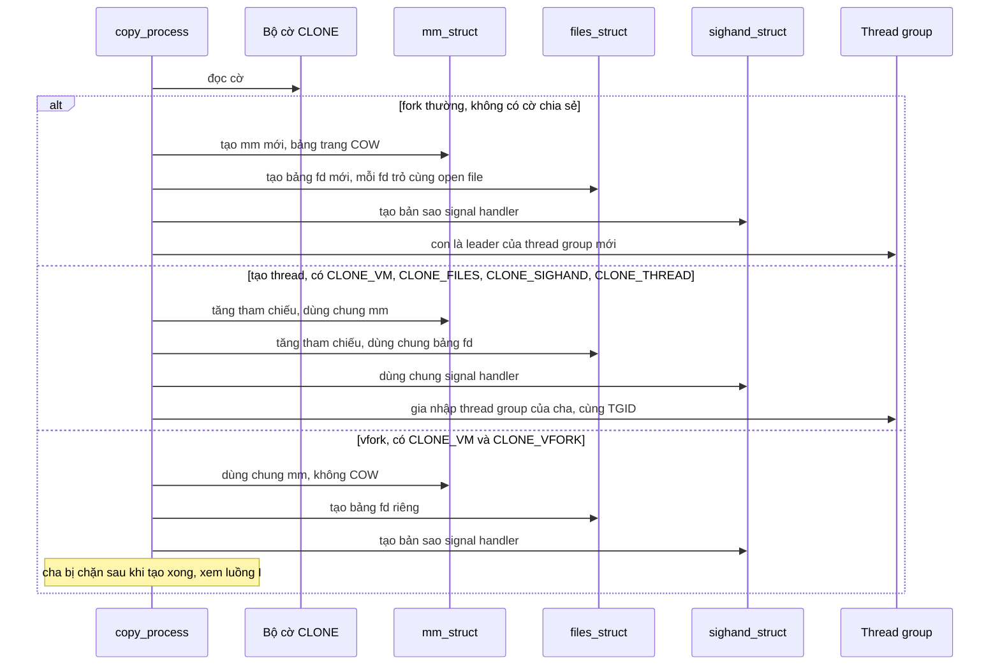

| Cờ | Nếu **có** cờ | Nếu **không** có cờ |
|---|---|---|
| `CLONE_VM` | Dùng chung bộ nhớ: con ghi thì cha thấy ngay | Bộ nhớ riêng, sao chép kiểu COW |
| `CLONE_FILES` | Dùng chung bảng fd: con đóng fd 3 thì fd 3 của cha cũng bị đóng | Bảng fd riêng, nhưng mỗi fd vẫn trỏ tới **cùng open file** với cha |
| `CLONE_FS` | Dùng chung cwd, root và umask | Bản sao riêng |
| `CLONE_SIGHAND` | Dùng chung bảng signal handler | Bản sao riêng |
| `CLONE_THREAD` | Cùng thread group, cùng TGID | Process mới |
| `CLONE_VFORK` | Cha chờ đến khi con exec hoặc exit | Cha chạy tiếp ngay |
| `CLONE_NEW*` | Tạo namespace mới | Dùng chung namespace của cha |

**Hệ quả:** “thread” và “process” chỉ là hai bộ cờ khác nhau. Về lý thuyết, có thể tạo ra những dạng lai, ví dụ dùng chung bộ nhớ nhưng có bảng fd riêng.

## D. Sao chép không gian địa chỉ với Copy-On-Write

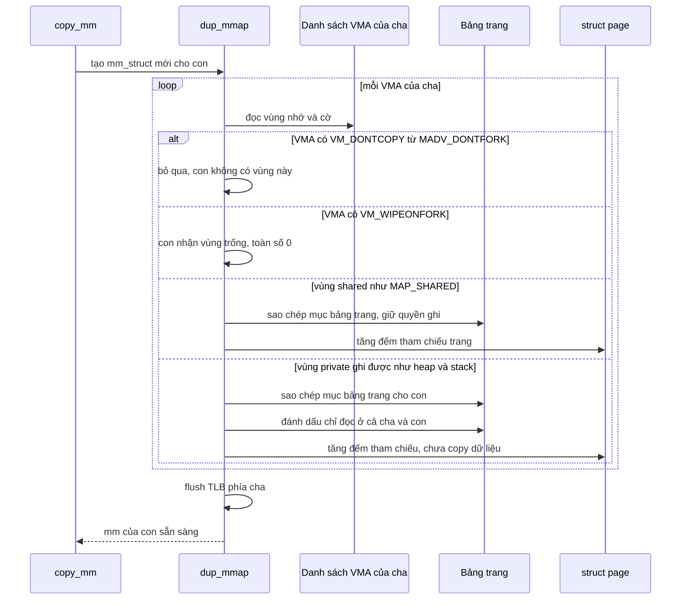

**Trực giác:**

- Hai anh em được giao chung một cuốn sách mẫu. Không ai photo cả cuốn ngay từ đầu.
- Sách được đóng dấu “chỉ đọc”. Ai muốn viết vào trang nào thì lúc đó mới photo **riêng trang đó**.

**Cơ chế. [Chuẩn]**

- Kernel sao chép **cấu trúc mô tả** (VMA và bảng trang), **không** sao chép dữ liệu.
- Các trang private và ghi được bị đổi sang chỉ đọc ở **cả hai phía**. Đó là lý do bảng trang của cha cũng bị sửa và TLB của cha phải được flush.
- Đếm tham chiếu và mapcount của trang tăng lên, để sau này kernel biết trang đang có bao nhiêu chủ.
- Vùng shared vẫn giữ quyền ghi, vì cha và con *muốn* thấy thay đổi của nhau.
- **[Phiên bản]** Kernel từ khoảng dòng 5.x sao chép **ngay** (không dùng COW) các trang đang được pin cho DMA. Mục đích là tránh lỗi DMA ghi vào trang mà về sau chỉ một bên còn thấy.

**Hệ quả.**

- fork không tốn thời gian tỉ lệ với *dung lượng dữ liệu*, nhưng **vẫn tốn thời gian tỉ lệ với số trang đang được map**, vì phải duyệt và sao chép bảng trang.
- Một process map 8 GB có thể mất vài mili giây đến hàng chục mili giây chỉ để fork.

## E. Page fault khi ghi vào trang COW

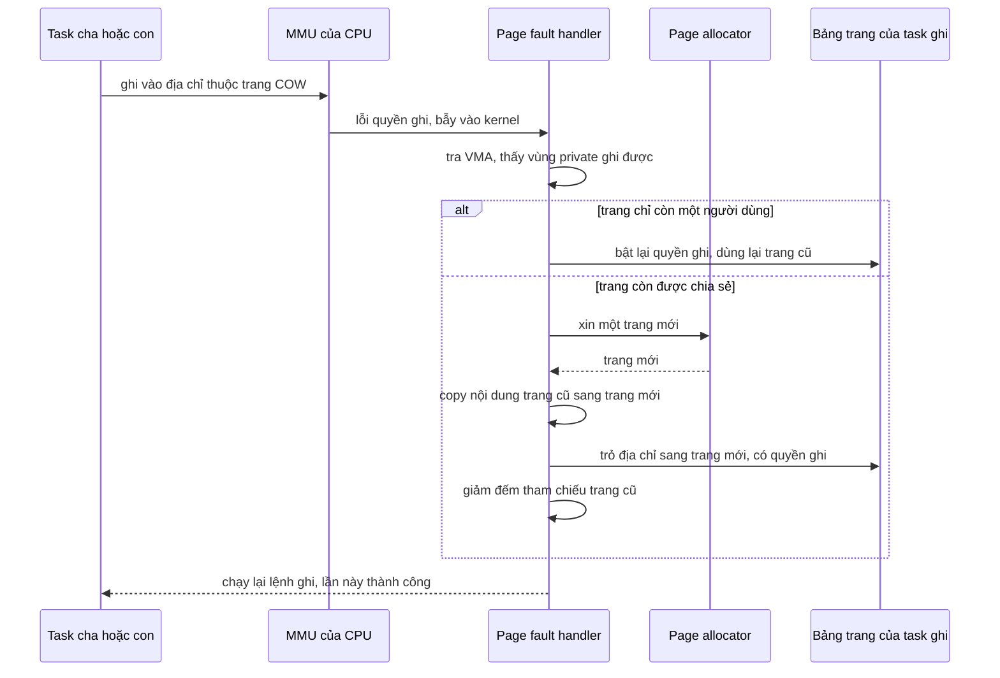

| Bước | Giải thích |
|---|---|
| Lỗi quyền ghi | Phần cứng thấy trang đang đánh dấu chỉ đọc nên phát sinh page fault. Đây là cơ chế bình thường, không phải lỗi chương trình |
| Tra VMA | Kernel kiểm tra vùng này *về logic* có được ghi không. Nếu vùng vốn chỉ đọc thì task nhận **SIGSEGV** |
| Chỉ còn một chủ | Bên kia đã exec, exit hoặc đã tự sao chép trước đó. Chỉ cần bật lại quyền ghi, không phải copy (thường gọi là “reuse”) |
| Còn chia sẻ | Cấp trang mới, copy 4 KB, trỏ sang trang mới. **Chỉ task đang ghi** đổi bảng trang, bên kia vẫn giữ trang cũ |
| Thất bại | Hết bộ nhớ thì OOM killer có thể được kích hoạt, hoặc task nhận SIGBUS hoặc bị kill |

**Ví dụ:** sau fork, con sửa một biến toàn cục. Chỉ trang 4 KB chứa biến đó bị copy. Cha vẫn thấy giá trị cũ.

**[Phiên bản]** Với Transparent Huge Page, kernel mới thường tách huge page rồi chỉ copy phần cần thiết. Với hugetlbfs, kernel copy nguyên cả huge page.

## F. Cấp PID và gắn vào cây tiến trình

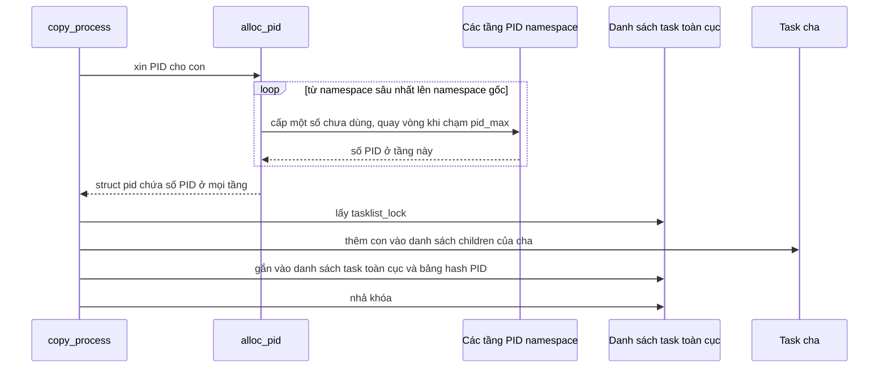

**Cơ chế. [Chuẩn]**

- Một process nằm trong container thấy mình là PID 1, nhưng ở host lại là PID 4527. Đó là vì con nhận **một số PID cho mỗi tầng namespace**.
- PID được cấp bằng cấu trúc IDR. Số được tăng dần rồi quay vòng khi chạm `/proc/sys/kernel/pid_max`.
- Cha của con thường là task gọi fork. Nếu có cờ `CLONE_PARENT` thì con được nhận làm con của *ông* (cha của task gọi).
- **[Phiên bản]** Cờ `CLONE_PIDFD` (từ kernel 5.2) trả thêm một **pidfd**. Đây là file descriptor đại diện cho con, giúp tránh lỗi PID đã bị tái sử dụng cho process khác.

**Hệ quả:** nếu hết PID, fork trả **EAGAIN**, kể cả khi RAM còn trống.

## G. Đánh thức con và lần chạy đầu tiên

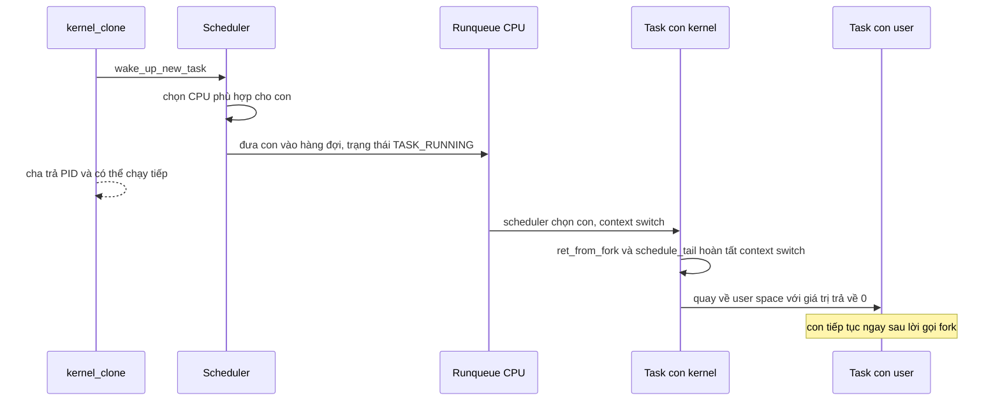

**Ai chạy trước? [Chuẩn]** **Không có gì đảm bảo.**

- Trên máy nhiều lõi, cha và con có thể chạy *đồng thời* trên hai CPU khác nhau.
- **[Phiên bản]** Trước đây có tham số sysctl `sched_child_runs_first`, nhưng tham số này đã bị loại bỏ ở các kernel gần đây.

**Hệ quả:** code không được giả định thứ tự giữa cha và con. Nếu cần đồng bộ thì phải dùng pipe, eventfd, signal hoặc `wait`.

## H. fork rồi exec

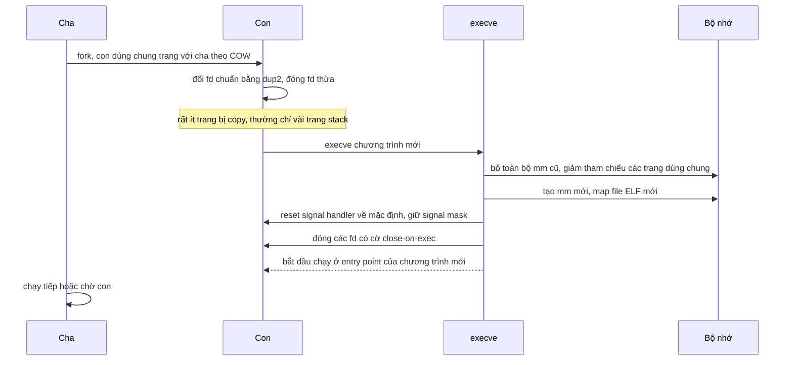

**Vì sao rẻ:** nhờ COW, khoảng thời gian giữa fork và exec gần như không phải copy trang nào. Đến khi exec thì toàn bộ bộ nhớ cũ bị bỏ đi luôn. Nếu fork mà copy toàn bộ dữ liệu thì phần copy đó lãng phí hoàn toàn.

| Khi exec, điều gì xảy ra | Chi tiết |
|---|---|
| **Bị bỏ** | Toàn bộ bộ nhớ cũ, các thread khác, signal handler tùy chỉnh (bị reset về mặc định), các fd có cờ `O_CLOEXEC` |
| **Được giữ** | PID, PPID, các fd không có cờ cloexec, cwd, rlimit, signal mask, tín hiệu đang chờ, nice, uid và gid (trừ trường hợp file có bit setuid) |

## I. vfork

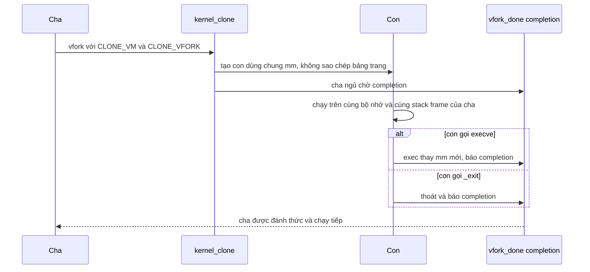

**Vì sao nhanh:** kernel không sao chép bảng trang và không phải ghi đè quyền trang. Chi phí gần như không phụ thuộc kích thước bộ nhớ của cha.

**Vì sao nguy hiểm. [Chuẩn]**

- Con chạy **trên stack của cha**. Nếu con return khỏi hàm, sửa biến hoặc gọi `exit()` (hàm này flush buffer stdio của cha), bộ nhớ của cha sẽ bị phá.
- Quy tắc an toàn: sau vfork, con **chỉ** được gọi exec hoặc `_exit`.
- Ẩn dụ: mượn xe của bố khi bố đang ngồi trong xe. Bố bị ngồi chờ, và mọi thứ con làm với chiếc xe, bố đều phải gánh hậu quả.

## J. Tạo thread bằng pthread_create

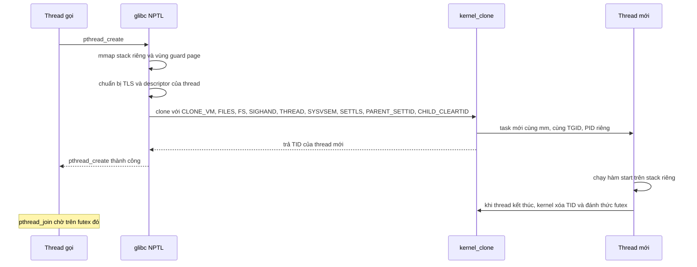

**Điểm chính:**

- Thread chỉ khác process ở bộ cờ clone.
- Stack của thread do **thư viện** tự `mmap`, không phải do kernel cấp.
- `CLONE_CHILD_CLEARTID` giúp `pthread_join` hoạt động mà không cần polling.
- Tín hiệu gửi tới *process* có thể được giao cho bất kỳ thread nào chưa chặn tín hiệu đó.

## K. Kết thúc vòng đời: exit, zombie, wait

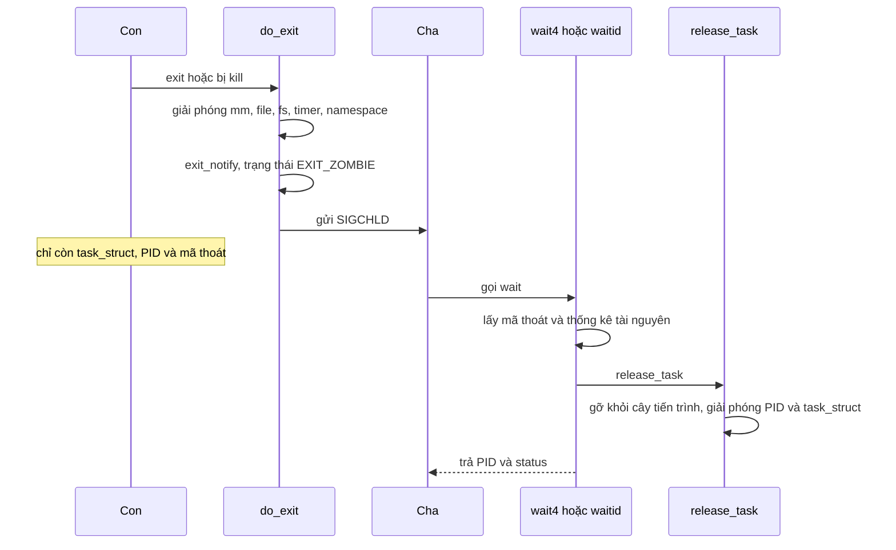

**Trường hợp cha chết trước (orphan):**

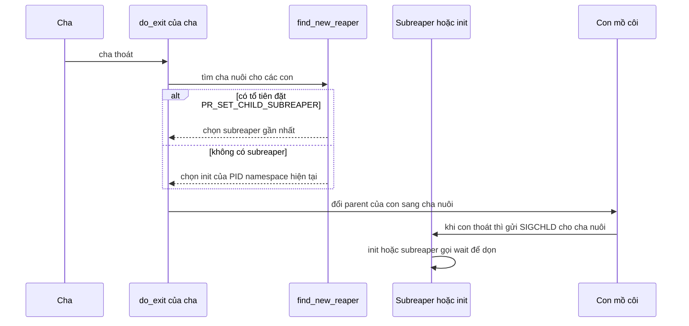

**Hệ quả:**

- Zombie không tốn RAM đáng kể nhưng **giữ một PID**. Nếu cha không bao giờ gọi `wait`, zombie tích tụ dần và có thể làm cạn PID.
- Cách khắc phục:
  - Cha xử lý SIGCHLD và gọi `wait`.
  - Hoặc đặt SIGCHLD thành SIG_IGN, khi đó kernel tự dọn con.
  - Hoặc dùng một init đúng nghĩa trong container (ví dụ tini hay systemd).
- Trong container, nếu PID 1 của namespace thoát thì mọi process trong namespace đó đều bị kill.

## L. Các nhánh thất bại

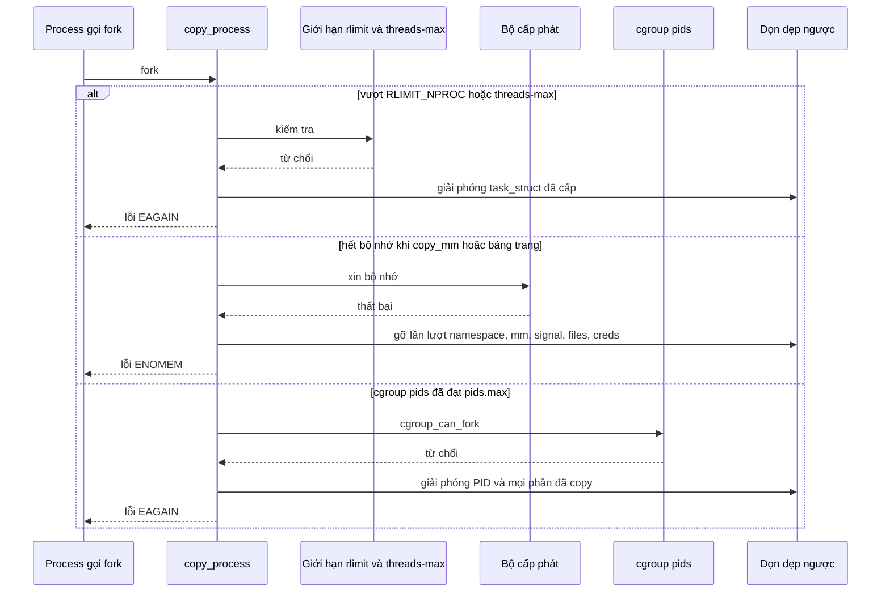

**Cơ chế dọn dẹp. [Chuẩn]**

- `copy_process` thực hiện tuần tự nhiều bước. Mỗi bước thành công đều có một bước “hoàn tác” tương ứng.
- Khi gặp lỗi, kernel chạy các bước hoàn tác **theo thứ tự ngược lại**: giải phóng thứ đã tạo sau cùng trước.
- Ẩn dụ: tháo đồ chơi Lego theo thứ tự ngược lúc lắp.
- Con **chưa bao giờ** được đưa vào cây tiến trình, nên phần còn lại của hệ thống không bao giờ thấy nó.

| Lỗi user nhận | Nguyên nhân thường gặp |
|---|---|
| EAGAIN | `RLIMIT_NPROC`, `threads-max`, `pid_max`, controller pids của cgroup |
| ENOMEM | Thiếu bộ nhớ, hoặc overcommit chế độ 2 từ chối commit |
| EINVAL | Tổ hợp cờ clone không hợp lệ |
| EPERM | Tạo namespace mới mà không có quyền |

## M. fork trong chương trình đa luồng

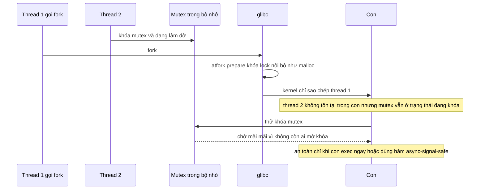

**Cơ chế. [Chuẩn]**

- Con chỉ có **một thread**, là bản sao của thread đã gọi fork.
- Toàn bộ bộ nhớ, kể cả mutex đang bị thread khác khóa, được sao chép nguyên trạng.
- **`pthread_atfork`** cho phép đăng ký 3 handler:
  - *prepare*: chạy ở cha trước fork, để khóa mọi lock.
  - *parent*: chạy ở cha sau fork, để mở khóa.
  - *child*: chạy ở con sau fork, để mở khóa hoặc khởi tạo lại lock.

  glibc dùng cơ chế này cho lock của malloc, nhưng thư viện bên thứ ba thường không đăng ký.

**Quy tắc thực tế:** trong chương trình đa luồng, sau fork chỉ nên exec ngay. Tốt nhất là dùng `posix_spawn`.

---

# Phần 3. Các khái niệm cần hiểu sâu

## 3.1 Copy-On-Write

- **Vì sao cần:** phần lớn lời gọi fork được theo sau bởi exec. Copy toàn bộ bộ nhớ là lãng phí cả thời gian lẫn RAM.
- **Cơ chế:** mỗi trang vật lý có bộ đếm tham chiếu (refcount và mapcount). Khi một bên ghi, page fault cho phép kernel quyết định: dùng lại trang nếu chỉ còn một chủ, hoặc copy nếu còn chia sẻ.
- **Chi phí ẩn:**
  - Phải sao chép bảng trang lúc fork.
  - Mỗi lần ghi lần đầu vào một trang đều gây một page fault.
  - Cha cũng phải chịu page fault, vì trang của cha cũng bị đổi sang chỉ đọc.
  - TLB phải được flush.
  - Ví dụ: cơ sở dữ liệu dùng fork để tạo snapshot, rồi cha tiếp tục ghi nhiều. Khi đó số trang bị copy có thể tăng gần tới **gấp đôi RAM**.

## 3.2 Ai chạy trước

Không có gì đảm bảo (xem luồng G). Ngoài ra, cha có thể bị preempt ngay sau fork, còn con có thể chạy xong và exit trước khi cha kịp lưu PID. Hệ quả: phải đăng ký xử lý SIGCHLD **trước** khi fork để không bỏ lỡ tín hiệu.

## 3.3 Con kế thừa gì và không kế thừa gì. [Chuẩn]

| Kế thừa | Không kế thừa |
|---|---|
| Bản sao bộ nhớ (COW) | PID (con có PID mới), PPID (là cha) |
| Bảng fd, mỗi fd trỏ cùng open file | **Tín hiệu đang chờ** (bị xóa) |
| Signal handler và signal mask | **Timer**: alarm, POSIX timer, itimer |
| cwd, root, umask, rlimit, môi trường | **Memory lock** (mlock, mlockall) |
| uid, gid, capability, nice, cgroup, namespace | **Record lock** của fcntl (POSIX lock) |
| Mapping shared vẫn dùng chung | Thống kê CPU và tài nguyên (reset về 0) |
| flock gắn với open file nên dùng chung | Các thread khác, async I/O đang chạy, semaphore undo |

## 3.4 File descriptor dùng chung offset và hiện tượng in hai lần

- **Offset dùng chung:**
  - fd của cha và con trỏ tới **cùng một open file description**, nên dùng chung offset.
  - Cha đọc 100 byte thì con đọc tiếp từ byte thứ 100.
  - Hai bên cùng ghi vào một file có thể bị xen kẽ dữ liệu.
- **In hai lần:**
  - `printf` ghi vào **buffer ở user space** (trong bộ nhớ), chưa ghi xuống fd.
  - Nếu fork khi buffer chưa được flush, buffer đó bị sao chép sang con.
  - Khi cả hai cùng flush, chuỗi xuất hiện **hai lần**.
  - Hiện tượng này hay gặp khi stdout được chuyển hướng vào file hoặc pipe, vì khi đó stdio dùng full buffering thay vì line buffering.
  - Cách tránh: flush trước khi fork, và ở con dùng `_exit` thay vì `exit`.

## 3.5 fork với process có bộ nhớ lớn

- **Thời gian:** tỉ lệ với số trang đang được map, do phải copy bảng trang.
- **Overcommit:**
  - Mỗi lần fork, kernel tính “cam kết” bộ nhớ cho các vùng private ghi được.
  - Với `vm.overcommit_memory=2` (chế độ strict), fork một process 6 GB trên máy 8 GB có thể bị từ chối với **ENOMEM**, dù con sẽ exec ngay.
  - Với chế độ heuristic mặc định (giá trị 0), fork thường được cho qua.
- **Huge page:**
  - Bảng trang ít mục hơn nên fork nhanh hơn.
  - **[Phiên bản]** Lần ghi đầu vào hugetlb page phải copy cả trang lớn. Trang THP thường được tách nhỏ trước khi copy.
- **Giải pháp:**
  - Dùng `posix_spawn` hoặc vfork, không phải copy bảng trang.
  - Đánh dấu `MADV_DONTFORK` cho các vùng con không cần.

---

# Phần 4. Liên hệ thực tế cho embedded và BSP

## 4.1 RAM ít và không có MMU

- **Có MMU, RAM ít:**
  - fork nhờ COW vẫn rẻ.
  - Rủi ro thật nằm ở **overcommit**: cha lớn, fork xong cả hai cùng ghi nhiều, bộ nhớ có thể cạn và kích hoạt OOM.
  - Daemon lớn nên dùng `posix_spawn` để chạy lệnh ngoài.
- **Không có MMU (NOMMU, ví dụ uClinux, một số MCU):**
  - **[Kiến trúc]** Không có bảng trang nên không thể có COW, và không thể cho hai process cùng địa chỉ ảo nhưng khác dữ liệu.
  - `fork()` **không được hỗ trợ**. Chỉ có `vfork` (hoặc clone có `CLONE_VM`), theo sau là exec.
  - BusyBox trên NOMMU được build theo mô hình vfork rồi exec.

## 4.2 Ảnh hưởng tới driver

- **fd của thiết bị:**
  - Sau fork, cha và con giữ cùng một `struct file`, chỉ tăng bộ đếm tham chiếu.
  - Hàm `.release` của driver **chỉ được gọi khi lần close cuối cùng** xảy ra, không phải khi cha close.
  - Dữ liệu private của driver gắn trên file (`private_data`) bị **dùng chung** giữa cha và con.
  - Hệ quả: driver nào giả định “mỗi open chỉ có một process” sẽ hỏng khi gặp fork.
- **Vùng mmap từ driver:**
  - Khi fork, VMA của vùng này được sao chép sang con và callback `vm_ops->open` được gọi.
  - Mapping kiểu PFN hoặc I/O (ví dụ thanh ghi thiết bị, DMA buffer) được sao chép theo cách đặc biệt, không đi qua COW thông thường.
  - Nếu driver không muốn con kế thừa mapping, driver có thể đặt cờ `VM_DONTCOPY` cho VMA.
  - DMA buffer lấy từ user space bằng cách pin trang: xem ghi chú **[Phiên bản]** ở luồng D về việc copy ngay thay vì dùng COW.
- **Lời khuyên:** mở thiết bị với cờ `O_CLOEXEC`, để chương trình con exec ra không vô tình giữ thiết bị (ví dụ làm `.release` không được gọi, hoặc ngăn power management của thiết bị).

## 4.3 Quan sát fork trong thực tế

| Công cụ | Cách dùng và ý nghĩa đầu ra |
|---|---|
| `strace -f` | Theo dõi cả các process con. Bạn sẽ thấy `clone(...)` hoặc `clone3(...)` kèm cờ và PID trả về, sau đó là `execve` trong con |
| `ps -o pid,ppid,stat,cmd`, `ps -eLf` | Cột STAT có chữ `Z` là zombie. `-L` liệt kê từng thread (LWP) |
| `/proc/<pid>/status` | Các trường `PPid`, `Tgid`, `NSpid` (PID ở các tầng namespace), `Threads` |
| `/proc/<pid>/task/` | Mỗi thư mục con là một thread |
| `/proc/sys/kernel/pid_max`, `threads-max` | Giới hạn toàn hệ thống. `ulimit -u` là giới hạn theo user |
| ftrace | Bật các event `sched_process_fork`, `sched_process_exec`, `sched_process_exit`, `sched_process_free`. Kết quả cho biết task cha, task con và thời điểm |
| `perf stat -e page-faults` | Đếm page fault. Số page fault tăng vọt sau fork là dấu hiệu COW đang làm việc |
| `perf trace` | Gần giống strace nhưng chi phí thấp hơn, kèm thời gian của từng system call |

---

# Phần 5. Tổng kết

## 5.1 Toàn bộ vòng đời

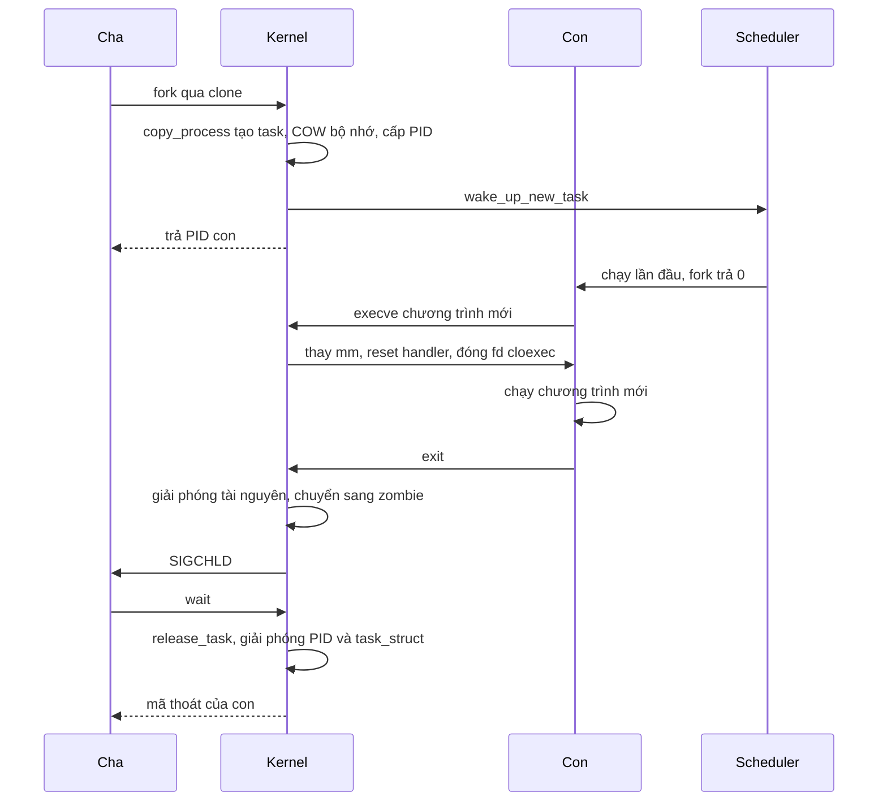

## 5.2 Bảng so sánh

| | fork | vfork | clone (thread) | posix_spawn |
|---|---|---|---|---|
| Bộ nhớ | Sao chép theo COW | **Dùng chung**, không COW | Dùng chung | Kiểu vfork, trên stack riêng **[Phiên bản glibc]** |
| Bảng fd | Bản sao (cùng open file) | Bản sao | Dùng chung | Bản sao, áp dụng thêm các file action |
| Signal handler | Bản sao | Bản sao | Dùng chung | Được reset theo thuộc tính spawn |
| Cha có bị chặn | Không | **Có**, đến khi con exec hoặc exit | Không | Ngắn, đến khi con exec |
| Chi phí | Tỉ lệ với số trang đang map | Rất thấp | Thấp | Rất thấp |
| An toàn | Cao | Thấp, dễ phá bộ nhớ của cha | – | Cao |
| Khi nào dùng | Cần process con độc lập, có code riêng | Hệ NOMMU, hoặc code cũ | Chạy song song trong cùng chương trình | Chạy lệnh ngoài, đặc biệt từ process lớn hoặc đa luồng |

## 5.3 Mười ý quan trọng nhất

1. Kernel chỉ biết **task**. Process và thread chỉ khác nhau ở việc dùng chung tài nguyên nào.
2. Mọi API tạo task đều hội tụ về `kernel_clone` rồi `copy_process`.
3. “Trả về hai lần” là nhờ `copy_thread` dựng thanh ghi cho con với giá trị trả về 0.
4. fork **không copy dữ liệu**, chỉ copy bảng trang và đánh dấu trang chỉ đọc. Dữ liệu chỉ được copy khi có ghi (COW).
5. Chi phí fork tỉ lệ với **số trang đang map**, không phải với lượng dữ liệu thực sự dùng.
6. Không có thứ tự chạy được đảm bảo giữa cha và con.
7. fd được dùng chung offset. Buffer stdio bị sao chép nên có thể in hai lần.
8. Trong chương trình đa luồng, con chỉ có một thread. Lock của thread khác có thể bị khóa vĩnh viễn trong con.
9. Con exit thành zombie cho đến khi cha gọi `wait`. Con mồ côi được subreaper hoặc init nhận nuôi.
10. Hệ NOMMU không có fork, chỉ có vfork rồi exec.

## 5.4 Mười hiểu lầm phổ biến

| # | Hiểu lầm | Sự thật |
|---|---|---|
| 1 | fork copy toàn bộ RAM của cha | Chỉ copy bảng trang. Dữ liệu được chia sẻ theo COW |
| 2 | fork luôn rẻ | Với process map nhiều GB, chỉ việc copy bảng trang cũng tốn nhiều mili giây. Overcommit có thể làm fork thất bại |
| 3 | Con luôn chạy trước (hoặc cha luôn chạy trước) | Không có gì đảm bảo, đặc biệt trên máy nhiều lõi |
| 4 | Thread là một đối tượng riêng biệt trong kernel | Thread cũng là task, chỉ dùng chung `mm` và các tài nguyên khác |
| 5 | Con có fd độc lập hoàn toàn với cha | Bảng fd riêng nhưng dùng chung open file, nên dùng chung offset và flock |
| 6 | Con kế thừa mọi thứ | Không kế thừa tín hiệu đang chờ, timer, mlock, POSIX lock, các thread khác |
| 7 | vfork chỉ là phiên bản fork nhanh hơn | Con chạy trên bộ nhớ và stack của cha. Dùng sai sẽ phá dữ liệu của cha |
| 8 | Zombie tốn bộ nhớ | Tốn rất ít RAM nhưng giữ một PID. Số lượng lớn có thể làm cạn PID |
| 9 | Có thể dùng fork an toàn trong chương trình đa luồng rồi chạy tiếp như bình thường | Chỉ an toàn khi con exec ngay hoặc chỉ gọi hàm async-signal-safe |
| 10 | EAGAIN nghĩa là hết RAM | EAGAIN thường do giới hạn số process, PID hoặc cgroup. Hết RAM là ENOMEM |

## 5.5 Thứ tự tra source kernel

1. Điểm vào system call: `fork`, `vfork`, `clone`, `clone3` (trong `kernel/fork.c`)
2. `kernel_clone` (trước 5.10 là `_do_fork`), `kernel_clone_args`
3. `copy_process`
4. `dup_task_struct`, `alloc_thread_stack_node`, `task_struct`, `thread_info`
5. `copy_creds` (trong `kernel/cred.c`)
6. `sched_fork` (trong `kernel/sched/core.c`)
7. `copy_files`, `dup_fd`, `files_struct`, `copy_fs`, `fs_struct`
8. `copy_sighand`, `copy_signal`, `sighand_struct`, `signal_struct`
9. `copy_mm`, `dup_mm`, `dup_mmap`, `copy_page_range`, `mm_struct`, `vm_area_struct`
10. `copy_namespaces`, `nsproxy`
11. `copy_thread`, `ret_from_fork` (theo từng kiến trúc, trong `arch/x86` và `arch/arm64`)
12. `alloc_pid`, `struct pid`, `pid_namespace`
13. `cgroup_can_fork`, `cgroup_post_fork`
14. `wake_up_new_task`, `schedule_tail`
15. COW fault: `handle_mm_fault`, `do_wp_page`, `wp_page_copy`
16. vfork: `vfork_done`, `wait_for_vfork_done`, `mm_release`
17. exec: `do_execveat_common`, `begin_new_exec`, `exec_mmap`
18. exit: `do_exit`, `exit_notify`, `forget_original_parent`, `find_new_reaper`
19. wait: `kernel_wait4`, `do_wait`, `wait_task_zombie`, `release_task`

**Cách tiếp cận gợi ý:** đọc `copy_process` từ đầu đến cuối một lượt, chỉ chú ý các lời gọi `copy_*` và các nhãn lỗi `bad_fork_*`. Hai thứ này chính là xương sống của cả luồng tạo task và luồng dọn dẹp khi thất bại.
