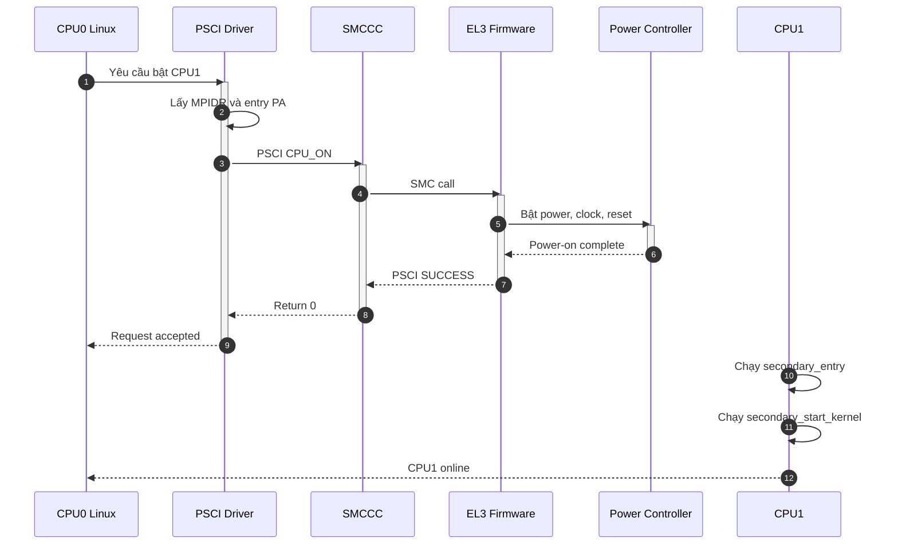

# Prompt tạo tài liệu HTML nghiên cứu PSCI chuyên sâu

Bạn hãy đóng vai đồng thời các vai trò sau:

1. Senior ARM64 Linux Kernel Engineer.
2. ARM Trusted Firmware-A Engineer.
3. SoC Power Management Engineer.
4. Technical Writer chuyên viết tài liệu cho người mới.
5. Senior Frontend Developer chuyên tạo tài liệu kỹ thuật HTML trực quan.
6. Technical Diagram Designer chuyên thiết kế sequence diagram, activity diagram và call graph.

Tôi đang nghiên cứu PSCI và quá trình Linux kernel khởi động secondary CPU, đặc biệt là lỗi:

```text
CPU1 failed to come online
```

Tôi muốn bạn tạo một file HTML hoàn chỉnh để chứa toàn bộ kết quả nghiên cứu.

Tài liệu phải đi từ Linux kernel xuống:

```text
Linux SMP initialization
    -> CPU operations
    -> PSCI Linux driver
    -> SMCCC
    -> SMC hoặc HVC
    -> EL3 Secure Monitor
    -> ARM Trusted Firmware-A hoặc vendor firmware
    -> Platform power management
    -> Power controller
    -> Clock controller
    -> Reset controller
    -> CPU physical core
    -> secondary_entry
    -> secondary_start_kernel
    -> CPU online
```

Mục tiêu chính là giúp một người mới có thể:

1. Hiểu PSCI là gì.
2. Hiểu từng thành phần tham gia.
3. Hiểu chính xác luồng bật CPU1.
4. Hiểu Linux kernel khác firmware và hardware như thế nào.
5. Truy code từ Linux xuống firmware và hardware.
6. Hiểu mọi điểm có thể gây ra lỗi CPU1 không online.
7. Biết chính xác cần thêm log ở đâu.
8. Biết source code nào chứng minh cho từng kết luận.
9. Không cần tự mở lại source chỉ để xem đoạn code đang được giải thích.

---

## I. YÊU CẦU ĐẦU RA

Hãy tạo một file HTML duy nhất, hoàn chỉnh, có thể mở trực tiếp bằng trình duyệt.

Tên file đề xuất:

```text
psci_deep_analysis.html
```

HTML phải bao gồm:

- HTML, CSS và JavaScript.
- Mermaid diagrams.
- Source code references.
- Search box.
- Sidebar navigation.
- Table of contents.
- Expand/collapse sections.
- Dark mode và light mode.
- Nút copy source code.
- Nút mở rộng diagram.
- Nút cuộn về đầu trang.
- Technical glossary.
- Debug checklist.
- Source index.
- Function index.

Không được chỉ trả về nội dung Markdown hoặc một HTML skeleton sơ sài. Phải trả về nội dung HTML hoàn chỉnh, bắt đầu bằng `<!DOCTYPE html>` và kết thúc bằng `</html>`.

---

## II. YÊU CẦU GIAO DIỆN

Bố cục chính:

```text
+------------------------------------------------------+
| Header                                               |
| PSCI Deep Analysis                                   |
| Search | Dark mode | Expand all | Collapse all      |
+----------------------+-------------------------------+
| Sidebar              | Main content                  |
| 1. Tổng quan         | Section content               |
| 2. ARM64             | Notes                         |
| 3. Linux PSCI        | Code references               |
| 4. SMCCC             | Diagrams                      |
| 5. Firmware          | Debug information             |
| 6. Hardware          |                               |
| 7. CPU startup       |                               |
| 8. Debug             |                               |
+----------------------+-------------------------------+
```

Yêu cầu:

1. Sidebar cố định khi cuộn trên màn hình lớn.
2. Sidebar chuyển thành menu đóng mở trên màn hình nhỏ.
3. Thanh header gọn và dễ nhìn.
4. Không để nội dung quá rộng.
5. Chiều rộng phần đọc chính khoảng 1100 đến 1300 px.
6. Code block cho phép cuộn ngang.
7. Diagram tự co giãn theo màn hình.
8. Table có wrapper cuộn ngang trên màn hình nhỏ.
9. Heading có anchor link.
10. Mục hiện tại trong sidebar được highlight.
11. Search tìm được function name, file path, register, log, PSCI error code và hardware block.
12. Search result highlight keyword.
13. Có nút xóa search.
14. Có Expand all và Collapse all.
15. Có nút Copy cho từng đoạn source.
16. Hiển thị “Đã copy” sau khi copy.
17. Không dùng quá nhiều animation.
18. Không làm giao diện nặng hoặc rối mắt.

---

## III. HỆ THỐNG MÀU SẮC VÀ NOTE

Màu sắc phải mang ý nghĩa:

### 1. Xanh dương, INFO

Dùng cho khái niệm, kiến thức nền, thông tin Linux kernel và normal flow.

Nhãn: `INFO`, `BEGINNER NOTE`, `LINUX KERNEL`.

### 2. Xanh lá, CONFIRMED

Dùng khi thông tin đã được xác nhận từ source, log, Device Tree, firmware source hoặc hardware manual.

Nhãn: `CONFIRMED`, `SOURCE VERIFIED`, `EXPECTED BEHAVIOR`.

### 3. Vàng hoặc cam, NEED TO VERIFY

Dùng cho thông tin còn thiếu, điểm cần kiểm tra, giả thuyết chưa đủ bằng chứng và platform-specific behavior.

Nhãn: `NEED TO VERIFY`, `PLATFORM-SPECIFIC`, `CHECK ON TARGET BOARD`.

### 4. Đỏ, ERROR hoặc RISK

Dùng cho error path, failure point, timeout, sai MPIDR, sai entry address, lỗi power/clock/reset, deadlock và CPU exception.

Nhãn: `ERROR PATH`, `FAILURE POINT`, `HIGH RISK`.

### 5. Tím, FIRMWARE

Dùng cho EL3, Secure Monitor, TF-A, vendor firmware và PSCI firmware handler.

### 6. Cyan, HARDWARE

Dùng cho power controller, clock controller, reset controller, PMIC, CPU core, coherent interconnect, GIC và PLL.

### 7. Xám, REFERENCE

Dùng cho file path, function signature, source location, specification reference và command line.

Mỗi note phải có icon hoặc ký hiệu, tiêu đề, nội dung, nền nhẹ, border trái đậm, độ tương phản tốt và hiển thị tốt trong light/dark mode.

---

## IV. CẤU TRÚC MỖI PHẦN GIẢI THÍCH

Mỗi khái niệm, function hoặc flow phải có:

1. Giải thích ngắn gọn bằng ngôn ngữ dễ hiểu.
2. Ví dụ đời thường.
3. Giải thích kỹ thuật.
4. Vị trí trong flow tổng thể.
5. Source code reference ngay bên dưới.
6. Input parameter.
7. Output hoặc return value.
8. CPU thực thi, CPU0 hay CPU1.
9. Exception Level nếu đã xác nhận.
10. Điều gì có thể sai.
11. Cách kiểm tra bằng lệnh, log hoặc checkpoint.
12. Trạng thái: CONFIRMED, INFERENCE, PLATFORM-SPECIFIC hoặc NEED TO VERIFY.

---

## V. SOURCE CODE PHẢI NẰM NGAY DƯỚI GIẢI THÍCH

Đây là yêu cầu bắt buộc. Không bắt người đọc tự tìm lại code.

Ví dụ:

```text
Giải thích cpu_online()

[Nội dung giải thích]

Source reference:
File: include/linux/cpumask.h
Symbol: cpu_online

[Code thực tế]
```

Sau code block, thêm bảng:

| Dòng hoặc biểu thức | Giải thích |
|---|---|
| `cpu_online(cpu)` | Macro kiểm tra CPU có trong online mask |
| `cpumask_test_cpu` | Kiểm tra bit tương ứng với CPU |
| `cpu_online_mask` | Bitmap lưu trạng thái online |

Source reference phải hiển thị file path, function/symbol, line number nếu có, architecture/subsystem, nút Copy, nút Collapse, syntax highlighting và chú thích các dòng quan trọng.

Nếu chưa có source thực tế, không được tự bịa. Hiển thị:

```text
NEED TO VERIFY
Chưa có source code thực tế cho function này.
Cần chạy:
git grep -n "<symbol>"
```

---

## VI. PHÂN BIỆT SOURCE THẬT VÀ PSEUDO-CODE

Mỗi code block phải có nhãn:

- ACTUAL SOURCE.
- SOURCE EXCERPT.
- PSEUDO-CODE.
- EXPECTED PATTERN.
- PLATFORM-SPECIFIC EXAMPLE.

Nếu dùng pseudo-code, hiển thị note vàng nói rõ đây chỉ là logic minh họa.

Nếu code do tôi cung cấp: `CONFIRMED SOURCE PROVIDED BY USER`.

Nếu tìm trong repository: `CONFIRMED FROM REPOSITORY`.

Nếu dùng upstream: `UPSTREAM REFERENCE`, cần so sánh với vendor kernel.

---

## VII. YÊU CẦU SEQUENCE DIAGRAM

Sử dụng Mermaid. Sequence diagram phải:

1. Dễ đọc, không chồng chữ.
2. Không có đường nối chéo lung tung.
3. Participant theo đúng tầng hệ thống.
4. Message đi ngang rõ ràng.
5. Có activation bar và autonumber.
6. Có thể dùng `rect`, `alt`, `else`, `opt`, `loop`, `Note over`.
7. Diagram dài phải chia nhỏ.
8. Tối đa khoảng 8 đến 10 participant khi có thể.
9. Không để label quá dài trên arrow.
10. Nội dung dài đặt trong Note.
11. Có title, mô tả và source mapping bên dưới.

Thứ tự participant khuyến nghị:

```text
CPU0 Linux EL1
PSCI Linux Driver
SMCCC
CPU0 EL3
PSCI Firmware
Platform Power Ops
Power Controller
CPU1 EL3
CPU1 Linux EL1
```

Cấu hình Mermaid gợi ý:

```javascript
mermaid.initialize({
  startOnLoad: true,
  securityLevel: "loose",
  theme: selectedTheme,
  sequence: {
    useMaxWidth: true,
    wrap: true,
    diagramMarginX: 40,
    diagramMarginY: 20,
    actorMargin: 50,
    width: 150,
    height: 50,
    boxMargin: 10,
    messageMargin: 35,
    noteMargin: 15,
    mirrorActors: false
  },
  flowchart: {
    useMaxWidth: true,
    htmlLabels: true,
    curve: "stepAfter",
    nodeSpacing: 45,
    rankSpacing: 60
  }
});
```

Ví dụ sequence:



---

## VIII. FLOWCHART VÀ ACTIVITY DIAGRAM PHẢI CÓ ĐƯỜNG VUÔNG

Bắt buộc dùng đường vuông góc hoặc bậc thang, không dùng đường cong:

```javascript
flowchart: {
  curve: "stepAfter"
}
```

Quy tắc:

1. Luồng chính từ trên xuống.
2. Yes/No tách rõ.
3. Nhánh lỗi sang phải, thành công đi xuống.
4. Không cho arrow cắt node.
5. Diagram lớn chia subgraph Linux, SMCCC, Firmware, Hardware và Secondary CPU.
6. Màu node theo tầng.
7. Error đỏ, success xanh lá, verify vàng, hardware cyan, firmware tím.

```text
classDef linux fill:#dbeafe,stroke:#2563eb,color:#172554;
classDef firmware fill:#f3e8ff,stroke:#9333ea,color:#3b0764;
classDef hardware fill:#cffafe,stroke:#0891b2,color:#164e63;
classDef success fill:#dcfce7,stroke:#16a34a,color:#14532d;
classDef error fill:#fee2e2,stroke:#dc2626,color:#7f1d1d;
classDef verify fill:#fef3c7,stroke:#d97706,color:#78350f;
```

---

## IX. DIAGRAM KHÔNG ĐƯỢC THAY THẾ SOURCE

Bên dưới mỗi diagram bắt buộc có:

1. Diagram explanation.
2. Danh sách bước.
3. Source mapping.
4. Function mapping.
5. File mapping.
6. Phần chưa xác nhận.
7. Debug checkpoints.

Nếu file chưa xác nhận, đánh dấu NEED TO VERIFY, không được trình bày như kết luận.

---

## X. CẤU TRÚC TÀI LIỆU HTML

### 1. Trang tổng quan

- PSCI là gì.
- Vấn đề PSCI giải quyết.
- Thành phần tham gia.
- Bản đồ toàn hệ thống.
- Ví dụ đời thường.
- Flow bật CPU1.
- Sáu trạng thái riêng biệt:
  1. Linux yêu cầu CPU_ON.
  2. Firmware chấp nhận CPU_ON.
  3. Hardware được bật.
  4. CPU bắt đầu chạy.
  5. CPU vào Linux.
  6. CPU được đánh dấu online.

Nhấn mạnh: **PSCI CPU_ON trả SUCCESS không có nghĩa CPU1 đã online.**

### 2. ARM64 Exception Level

Giải thích EL0, EL1, EL2, EL3, Secure/Non-secure, TrustZone, SMC, HVC và SMCCC. Đặt source/specification reference ngay dưới mỗi phần.

### 3. CPU mask và CPU state

Giải thích `cpu_possible_mask`, `cpu_present_mask`, `cpu_online_mask`, `cpu_active_mask`, boot CPU, secondary CPU, logical CPU ID, MPIDR và affinity.

Phân tích:

```c
#define cpu_online(cpu) \
    cpumask_test_cpu((cpu), cpu_online_mask)
```

Phân tích `boot_cpu_init()` và lý do `start_kernel()` chỉ chạy trên boot CPU.

### 4. Linux SMP initialization

Truy flow thực tế:

```text
start_kernel()
    -> rest_init()
    -> kernel_init()
    -> kernel_init_freeable()
    -> smp_init()
    -> cpu_up()
    -> architecture-specific bring-up
```

Mỗi function có code, file, caller, callee, CPU thực thi, return value và error path.

### 5. CPU operations

Phân tích:

```c
static int boot_secondary(unsigned int cpu,
                          struct task_struct *idle)
{
    const struct cpu_operations *ops = get_cpu_ops(cpu);

    if (ops->cpu_boot)
        return ops->cpu_boot(cpu);

    return -EOPNOTSUPP;
}
```

Giải thích `get_cpu_ops`, `struct cpu_operations`, function pointer `cpu_boot`, `.cpu_boot = cpu_psci_cpu_boot` và `-EOPNOTSUPP`.

### 6. PSCI CPU boot trong Linux

Phân tích từng dòng:

```c
static int cpu_psci_cpu_boot(unsigned int cpu)
{
    int err;

    err = psci_ops.cpu_on(
        cpu_logical_map(cpu),
        __pa_symbol(secondary_entry));

    if (err)
        pr_err("failed to boot CPU%d (%d)\n",
               cpu, err);

    return err;
}
```

Giải thích logical CPU ID, MPIDR, `cpu_logical_map`, `secondary_entry`, `__pa_symbol`, entry PA và PSCI return code.

### 7. PSCI initialization

Phân tích:

```c
static void __init psci_0_2_set_functions(void)
{
    psci_ops.get_version = psci_get_version;
    psci_ops.cpu_suspend = psci_cpu_suspend;
    psci_ops.cpu_off = psci_cpu_off;
    psci_ops.cpu_on = psci_cpu_on;
    psci_ops.migrate = psci_migrate;
    psci_ops.affinity_info = psci_affinity_info;
}
```

Giải thích thời điểm gọi, `psci_ops`, function pointer, PSCI version, function ID, Device Tree và SMC/HVC method.

### 8. psci_cpu_on

Phân tích implementation thật, function ID, target CPU, entry point, context ID, `invoke_psci_fn`, return mapping và Linux errno. Tạo bảng error code.

### 9. SMCCC và SMC/HVC

Truy:

```text
psci_cpu_on
    -> invoke_psci_fn
    -> arm_smccc_smc hoặc arm_smccc_hvc
    -> smc #0 hoặc hvc #0
```

Tạo bảng register:

| Register | Giá trị khi CPU_ON |
|---|---|
| x0 | PSCI function ID |
| x1 | Target CPU MPIDR |
| x2 | Entry point PA |
| x3 | Context ID |

### 10. EL3 và Trusted Firmware-A

Giải thích EL3 exception entry, runtime service dispatch, PSCI handler, CPU_ON handler, platform ops, `pwr_domain_on`, `pwr_domain_on_finish`, secure context, entry point storage và OFF/ON_PENDING/ON. Nếu không có firmware source, đánh dấu NEED TO VERIFY.

### 11. Hardware power-on sequence

Theo thứ tự:

1. Validate MPIDR.
2. Tìm power domain.
3. Lưu entry address.
4. Bật power/voltage.
5. Chờ power acknowledgment.
6. Bỏ isolation.
7. Bật clock.
8. Cấu hình reset vector.
9. Deassert reset.
10. Enable coherency.
11. CPU bắt đầu thực thi.
12. CPU đi qua firmware warm boot.

Mỗi bước có block liên quan, register nếu xác nhận, ai ghi, expected value, failure symptom, source và manual reference. Không bịa register.

### 12. Secondary CPU startup

Truy:

```text
CPU1 release reset
    -> firmware warm boot
    -> secondary_entry
    -> low-level setup
    -> MMU
    -> stack
    -> per-CPU data
    -> secondary_start_kernel
    -> CPU hotplug callbacks
    -> mark CPU online
    -> scheduler hoặc idle
```

Đặt Assembly/C code ngay dưới giải thích.

### 13. CPU1 failed to come online

Phân tích:

- A. Trước PSCI call.
- B. PSCI call return error.
- C. PSCI success nhưng hardware không bật.
- D. CPU1 bật nhưng không vào secondary entry.
- E. CPU1 vào Assembly nhưng không vào C.
- F. CPU1 vào `secondary_start_kernel` nhưng chưa online.
- G. CPU1 online rồi bị offline lại.

Tạo failure matrix.

### 14. Phân biệt hai log

So sánh:

```text
failed to boot CPU1 (-error)
CPU1 failed to come online
```

Có source tạo log, điều kiện, ý nghĩa, giới hạn kết luận và bước debug tiếp theo.

### 15. Debug checkpoint

CPU0 checkpoints:

- before/after `boot_secondary`.
- before/after `ops->cpu_boot`.
- before/after `psci_ops.cpu_on`.
- before waiting online.
- after timeout.

CPU1 checkpoints:

- `secondary_entry`.
- stack/page table/MMU.
- `secondary_start_kernel`.
- GIC/timer init.
- CPU hotplug callbacks.
- before/after mark online.
- idle loop.

Mỗi checkpoint có location, example log, expected result, failure interpretation và safety warning.

### 16. Source index

| Symbol | File | Section | Status |
|---|---|---|---|

Cho phép click symbol để nhảy tới giải thích.

### 17. Glossary

Bao gồm PSCI, SMCCC, SMC, HVC, EL1/EL2/EL3, MPIDR, affinity, power domain, reset vector, secondary entry, CPU hotplug, coherency, GIC, MMU, TF-A, SCP và PMIC. Mỗi mục có giải thích ngắn, giải thích kỹ thuật và link section.

---

## XI. SOURCE REFERENCE CARD

Tạo component `source-reference-card` hiển thị:

- Source status.
- File path.
- Function name.
- Architecture.
- Subsystem.
- Caller.
- Callee.
- CPU thực thi.
- Exception Level.
- Line number nếu có.
- Code block.
- Nút Copy.
- Nút Collapse.
- Ghi chú từng dòng.

Nếu chưa xác nhận file path, hiển thị NEED TO VERIFY và lệnh `git grep` gợi ý.

---

## XII. SEARCH VÀ FILTER

Search client-side phải tìm được text, function, path, log, error code, register và hardware block.

Filter:

- All.
- Linux.
- Firmware.
- Hardware.
- Diagram.
- Source.
- Debug.
- Error.

Khi search phải highlight, đếm kết quả, cho xóa search và không làm mất trạng thái expand/collapse.

---

## XIII. LIGHT MODE VÀ DARK MODE

Hỗ trợ Light, Dark và System mode. Lưu lựa chọn bằng `localStorage`. Mermaid phải render lại khi đổi theme. Code và note phải dễ đọc trong cả hai mode.

---

## XIV. ACCESSIBILITY

1. Semantic HTML.
2. `aria-label` cho button.
3. Focus style rõ.
4. Keyboard accessible.
5. Không dùng màu làm dấu hiệu duy nhất.
6. Note có label text.
7. Tương phản tốt.
8. Diagram có caption.
9. Table có caption nếu phù hợp.
10. Toggle có `aria-expanded`.

---

## XV. QUY TẮC KHÔNG ĐƯỢC VI PHẠM

1. Không bịa source, path, function, register hoặc hardware sequence.
2. Không coi upstream giống hoàn toàn vendor kernel.
3. Không coi TF-A chuẩn giống vendor firmware.
4. Không kết luận hardware lỗi chỉ từ `CPU1 failed to come online`.
5. Không coi PSCI SUCCESS là CPU online.
6. Không gộp Linux request, firmware acceptance, hardware power-on và Linux online.
7. Không để diagram thay source.
8. Không dùng một màu cho mọi note.
9. Không tạo diagram quá rộng.
10. Không dùng đường cong trong flowchart.
11. Không để code reference xa phần giải thích.
12. Không bắt người đọc tự tìm function vừa được giải thích.
13. Không hiển thị pseudo-code như actual source.
14. Không dùng quá nhiều animation.
15. Không phụ thuộc backend.
16. Không để placeholder chung chung nếu source đã được cung cấp.

---

## XVI. DỮ LIỆU TÔI SẼ CUNG CẤP

```text
Kernel version:
[Điền kernel version]

Architecture:
[ARM64 hoặc ARM32]

SoC:
[Điền tên SoC]

Board:
[Điền tên board]

Device Tree PSCI node:
[Dán source]

CPU Device Tree nodes:
[Dán source]

boot_cpu_init():
[Dán source]

smp_init():
[Dán source]

boot_secondary():
[Dán source]

get_cpu_ops():
[Dán source]

struct cpu_operations:
[Dán source]

cpu_psci_cpu_boot():
[Dán source]

psci_0_2_set_functions():
[Dán source]

struct psci_operations:
[Dán source]

psci_cpu_on():
[Dán source]

invoke_psci_fn:
[Dán source]

arm_smccc_smc hoặc arm_smccc_hvc:
[Dán source hoặc Assembly]

secondary_entry:
[Dán Assembly]

secondary_start_kernel():
[Dán source]

Function chứa log CPU failed to come online:
[Dán source]

set_cpu_online hoặc mechanism tương đương:
[Dán source]

Boot log:
[Dán log đầy đủ]

TF-A hoặc vendor firmware:
[Dán source hoặc ghi không có]

SoC manual:
[Dán thông tin register hoặc ghi không có]
```

---

## XVII. KHI THIẾU SOURCE

1. Không dừng tạo HTML.
2. Vẫn tạo section tương ứng.
3. Hiển thị NEED TO VERIFY.
4. Cho biết symbol cần tìm.
5. Cho lệnh `git grep`.
6. Giải thích vì sao cần source.
7. Không tự điền implementation giả.
8. Có thể dùng upstream example nhưng ghi UPSTREAM REFERENCE.
9. Platform-specific section có warning.
10. Ghi phần thiếu vào Investigation Gaps.

Ví dụ:

```text
NEED TO VERIFY

Chưa có implementation của invoke_psci_fn.

Hãy chạy:

git grep -n "invoke_psci_fn"

Cần function này để xác định PSCI sử dụng SMC hay HVC
và trace xuống arm_smccc_smc hoặc arm_smccc_hvc.
```

---

## XVIII. KIỂM TRA CHẤT LƯỢNG

Trước khi trả HTML, kiểm tra:

1. HTML mở được.
2. Không thiếu thẻ đóng.
3. CSS và JavaScript không lỗi.
4. Sidebar, search, dark mode, copy code và expand/collapse hoạt động.
5. Mermaid render và không có syntax error.
6. Sequence diagram dễ đọc.
7. Flowchart có đường bậc thang.
8. Diagram không quá rộng.
9. Code nằm ngay dưới giải thích.
10. Source chưa xác nhận không bị trình bày như sự thật.
11. Note colors đúng ý nghĩa.
12. Giao diện hoạt động ở màn hình 360 px.
13. Table cuộn ngang.
14. Xác định rõ khả năng offline.

Nếu Mermaid dùng CDN, ghi rõ trang cần mạng để render Mermaid. Nếu yêu cầu offline tuyệt đối, nhúng thư viện hoặc có phương án thay thế.

---

## XIX. KẾT QUẢ CUỐI CÙNG

Chỉ trả về một code block duy nhất chứa toàn bộ HTML hoàn chỉnh.

Không giải thích ngoài code block. Không rút gọn. Không thay source bằng dấu ba chấm nếu source đã có. Không bỏ CSS, JavaScript, diagram hoặc source reference.

HTML phải dễ mở rộng để bổ sung source, log, firmware code, register, diagram, debug result và kết luận mới.

Bắt đầu bằng bản đồ tổng quan cho người mới, rồi đi sâu theo thứ tự:

```text
Linux
    -> PSCI
    -> SMCCC
    -> EL3 firmware
    -> Hardware
    -> CPU1 startup
    -> CPU online
    -> Failure analysis
    -> Debug checklist
```
