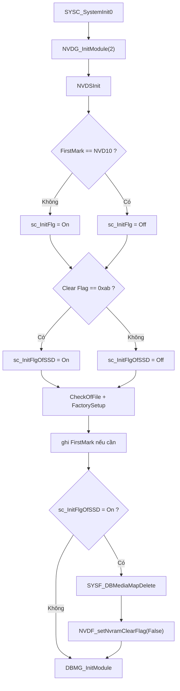

# Deep dive: `dbgAllClear`: NVRAM, SPI-Flash, SSD backup và boot initialization

> Báo cáo nghiên cứu, viết theo cấu trúc của prompt “DEEP-DIVE PROMPT”. Bản trình bày đầy đủ, có sơ đồ tương tác, nằm ở `../index.html`.
>
> Nhãn bằng chứng: **[V]** VERIFIED (đọc trực tiếp từ code) · **[I]** INFERRED (suy luận, có ghi cơ sở) · **[U]** UNVERIFIED/UNKNOWN (không xác định được từ repo).
>
> Đường dẫn rút gọn: `KM3/` = `IT6_Controller/KM3/application/mfp/`; `Subset/` = `Subset/S-S800/Src/`.

## 1. Executive Summary

1. `dbgAllClear` là hàm C++ thường, được bọc `#ifdef TORNADO`, gọi theo tên từ console debug. Repo không có bảng đăng ký lệnh nào. [V]
2. `TORNADO` vẫn được định nghĩa ở build Linux: `Subset/donau/Rule.makes:758` `-DCPU=$(CPU) -DTORNADO -DDEF_COLOR -DLINUX`. [V] Console trên Linux là `cuShell` (`KM3/Linux/Shell/shellLib.cpp`), một shell giả lập VxWorks tra symbol trong `<argv0>.map`. [V]
3. Có 3 bản:
   - Donau3 Subset (`void`, dòng 6842)
   - Donau3 KM3 (`void`, dòng 5404; chỉ build ở nhánh fallback của `KM3/system/nvd/Makefile:227–228`)
   - Zeus KM3 (`uchar uc_ClearCmdNo`, dòng 33433) [V]
4. Donau3 chạy `NVDF_memsetNvRam(NVDD_NVRam_Base, 0, 0x1ffef0)` rồi xoá backup. Trên Linux, `NVDD_NVRam_Base = DEVICE_CS1_BASE + 0x100` và `DEVICE_CS1_BASE = malloc(512*1024)` [V], nên lệnh ghi khoảng 2MB vào buffer 512KB, tức tràn heap. [I]
5. Subset gọi `EraseNvramBackupArea(0)` theo khai báo 1 tham số, trong khi bản được build (`Subset/application/mfp/Linux/Platform/Mediaif.cpp:1522`) nhận 2 tham số. Tham số thứ hai vì thế không xác định. [I]
6. `Set_Cs2()` (bật/tắt write-protect) có thân rỗng trên mọi `InitDevice*.cpp` của Linux. [V]
7. Zeus: “NVRAM” là vùng **SoftDipSW** trên SPI-Flash (16KB × 2 mặt). Lệnh zero `NVDD_SPI_Flash_SIZE = 16376` byte. Vùng này chứa FirstMark `"NVD10"`, Clear Flag và magic `"R1"` của các class SPI. [V]
8. Backup G1/G2 (SPI-Flash) bị xoá **logic**: ghi `0x0000` vào trường erase-flag. G3 (eMMC/SSD partition) bị ghi đè 0 (`DEF_SupportSSD`) hoặc `ioctl(MEMERASE)`. [V]
9. Clear Flag = `0xab` tại SoftDipSW offset 5. `NVDSInit()` đọc cờ → `sc_InitFlgOfSSD = On` → FactorySetup class SSD → `SYSF_DBMediaMapDelete()` → tắt cờ ở cuối, để mất nguồn giữa chừng thì lần boot sau làm lại. [V]
10. Chuỗi “omit the first 256byte” chỉ khớp với `NVDD_NVRam_Base = CS1 + 0x100`. Đường đi của Zeus ghi từ offset 0 của SoftDipSW. Không có bằng chứng U-Boot nằm trong 256 byte đó. [U]

## 2. Kiến thức nền tảng (cho người mới)

- **RAM thường (DRAM)** lưu bit bằng tụ điện, cần refresh, mất dữ liệu khi mất nguồn. **Non-volatile** nghĩa là dữ liệu còn sau khi mất nguồn.
- **NVRAM** đọc/ghi theo byte như RAM nhưng không bay hơi (SRAM nuôi pin, FRAM…). Dùng cho cài đặt, bộ đếm.
- **NOR Flash / SPI-Flash**: đọc theo byte; ghi (program) chỉ đổi 1 → 0; muốn về 1 phải erase cả sector (ở đây 4KB), mỗi lần erase làm mòn cell.
- **NAND / eMMC / SSD**: có controller + FTL, truy cập theo block qua file system hoặc block device.
- **EEPROM**: xoá/ghi theo byte, dung lượng nhỏ (repo có vùng backup “MachineInfo (EEPROM)” trên SPI-Flash).
- **Vì sao `memset` dùng được cho NVRAM mà không dùng được cho flash:** flash không ghi trực tiếp như RAM được; phải qua driver erase/program. Code dựa đúng vào điều này: `THRC_SPI_FlashCtrl::setEraseEnable()` ghi `0x0000` “vì mọi bit đều OFF nên không cần erase”, và bộ đếm erase có giá trị `0xFFFFFFFF`. [V]
- **Trong repo, tên “NVRAM” không đồng nghĩa với chip NVRAM.** Trên Linux, vùng đó là `malloc(512KB)`; comment gọi kiến trúc này là “NVRAMレス対応” (NVRAM-less). [V]

## 3. Storage Architecture

| Vùng | Physical | Logical / layout | Truy cập | Erase/Write | `dbgAllClear` tác động |
|---|---|---|---|---|---|
| “NVRAM” | RAM (Linux) | `CS1+0x100…` | `FUNCOFFSET`, `NVDF_*NvRam` | `NVDF_memsetNvRam` | Donau3 |
| SoftDipSW | SPI-Flash | 0x6E000 / 0x72000, 16KB/mặt (`KM3/Linux/Platform/Mediaif.cpp:115–117`) | `THRG_getSoftDipSw` | `THRG_setSoftDipSw` | Zeus 0,3,5 (zero) · 0,4,5 (cờ) |
| Backup G1 | SPI-Flash | 0x00000 / 0x19000, 25×4KB/mặt (127–129) | `c_NvramBackupGroup1` | `.erase()` logic | Donau3 KM3; Zeus 0,1,2 |
| Backup G2 | SPI-Flash | 0x32000 / 0x50000, 30×4KB/mặt (131–133) | `c_NvramBackupGroup2` | `.erase()` logic | Donau3 KM3; Zeus 0,1,2 |
| Backup G3 | eMMC/SSD partition (`/dev/kmsda11/12`, `crypt_*`) | ctrl sector 17/18, bank 2 và 4, 2×64KB (71–75) | `c_NvramBackup` (1432) | `eraseBackupData` → `raw_EraseFlash` | Zeus 0,1,2 |
| NVData | SSD file system | `"/NVData"` (`KM3/system/fil/filc/FILC_BaseDirColor.cpp:138`) | `NVDC_MediaAccessSSD` | `FILF_RemoveDirTree`, `SYSF_Remove` | Zeus 1 (ngay), 0/4/5 (lúc boot) |

“FlashROM” là thuật ngữ kế thừa: trên KM3, `FlashCtrlBackup` dùng `raw_*Flash` trên block device khi có `DEF_SupportSSD` (`raw_GetFlashFdSingleton`, `Mediaif.cpp:5717`). [V] Việc `DEF_SupportSSD` có được bật cho build KM3 hay không thì chưa xác định. [U]

## 4. VxWorks Debug Command

- `#ifdef TORNADO` là điều kiện lúc biên dịch: không có macro thì không có symbol, và shell báo `undefined symbol`. [V]
- `shellInit()` (`shellLib.cpp:59`) spawn task `"cuShell"`, stack 1MB. `SymbolMap::Regist()` (138) đọc file map dạng nm, lười (lần `Find()` đầu tiên, 246). `Find()` so khớp tuyệt đối. `Exec()` (1025) tách tham số, `GetArgValue()` (992) chuyển `"0x.."`/số thập phân bằng `strtoul`. Hàm được gọi qua `intptr_t(*)(...)` với 29 tham số. [V]
- Gọi `dbgAllClear` **không tham số** → `argv[1] == NULL` → `GetArgValue` trả 0 → Zeus chạy command 0. [V]
- Không bản nào là `extern "C"`. Gõ `dbgAllClear` có khớp tên trong file `.map` hay không tuỳ cách sinh map (mangled/demangled), mà quy tắc sinh map không có trong repo. [U] Kiểm tra bằng `lkup "dbgAll"` (`KM3/Linux/Shell/usrLib.cpp:397`).

## 5. Donau3 – Subset S-S800

```cpp
// Subset/application/mfp/system/nvd/nvdDonau3/NVDG_FuncDonau3.cpp:6840–6850
#ifdef TORNADO
void dbgAllClear(void)
{
	NVDF_memsetNvRam((void*)NVDD_NVRam_Base,0x0,0x1ffef0); /* NVRAM 2MB */
//	NVDF_memsetNvRam((void*)NVDD_NVRam_Base,0x0,0xffef0); /* NVRAM 1MB */
	EraseNvramBackupArea(0);
}
#endif
```

- Không tham số, không `if`, không return value, không kiểm tra lỗi, không log riêng. [V]
- `NVDD_NVRam_Base = ( DEVICE_CS1_BASE + 0x100 )` (`NVDG_FuncDonau3.h:124`). `0x1ffef0` = 2,096,880 byte, ghi tới `CS1+0x1FFFF0`. [V] Buffer thật chỉ 512KB (`Subset/application/mfp/Linux/Platform/InitDevice.cpp:207, 348`), nên tràn. [I]
- `NVDF_memsetNvRam` (`Subset/…/nvd/nvdg/NVDG_NVWrite.cpp:31`):
  1. Tạo semaphore lười.
  2. `semTake(WAIT_FOREVER)`.
  3. `Set_Cs2(2)`.
  4. `SYSF_memset`.
  5. `Set_Cs2(1)`.
  6. `semGive`.

  Điều kiện `#ifdef TORNADO && !defined(NVRAMLESS_PART_ONE)` có token thừa nên thực chất chỉ là `#ifdef TORNADO` [I], và `NVRAMLESS_PART_ONE` không được định nghĩa ở đâu trong repo. [V] `Set_Cs2` rỗng (`InitDevice.cpp:419`). [V]
- `EraseNvramBackupArea`: bản 1 tham số trong `Subset/bsp_donau/Donau/Mediaif.cpp:1481` **không được build** (không Makefile nào tham chiếu `bsp_donau`). [V] Bản được link là `Subset/application/mfp/Linux/Platform/Mediaif.cpp:1522` (2 tham số, `extern "C"` trong `Mediaif.h:104–123`, build khi `BASETYPE=hw`). [V] Kết quả: `si_area2` lấy giá trị rác. Với `DEF_Helios_PF` (`Rule.makes:505–524`), giá trị 0/1/2 xoá cả hai mặt G1/G2/G3; giá trị khác chỉ in “invalid area” và trả FALSE. [I]

## 6. Donau3 – KM3

```cpp
// KM3/system/nvd/nvdDonau3/NVDG_FuncDonau3.cpp:5402–5410
void dbgAllClear(void)
{
	NVDF_memsetNvRam((void*)NVDD_NVRam_Base,0x0,0x1ffef0); /* NVRAM 2MB */
	EraseNvramBackupArea(0, 0);		// group 1
	EraseNvramBackupArea(0, 1);		// group 2
}
```

- `ss_area1` = mặt (1, 2, khác = **cả hai**). `si_area2` = group (0 = G1, 1 = G2, 2 = G3). Vậy `(0,0)` = G1 cả hai mặt, `(0,1)` = G2 cả hai mặt, **G3 không bị xoá**. (`KM3/Linux/Platform/Mediaif.cpp:1592–1690`) [V]
- Khác Subset ở: khai báo 2 tham số (dòng 109); `NVDF_memsetNvRam` KM3 (`nvdg/NVDG_NVWrite.cpp:35`) tạo semaphore ngoài `#ifdef` và dùng `NVRAM_WRITE_UNLOCK` (= 0 nếu `FUM_LINUX`). [V]
- Build: chỉ nhánh `else` cuối của `nvd/Makefile` (227–228). [V] Vấn đề kích thước buffer giống Subset (`KM3/Linux/Platform/InitDevice.cpp:209`). [I]

## 7. Zeus – KM3

`KM3/system/nvd/nvdZeus/NVDG_FuncZeus.cpp:33431–33512`. `uchar uc_Buff[NVDD_SPI_Flash_SIZE]` được memset 0 trước `switch`. Không có validation; giá trị ngoài 0–5 → `default: break` (im lặng). [V]

| Cmd | SoftDipSW zero | NVData | G1 | G2 | G3 | Clear Flag | Detail code |
|---|---|---|---|---|---|---|---|
| 0 | ✓ | lúc boot | ✓ | ✓ | ✓ | ON | D390_004A |
| 1 | – | `FILF_RemoveDirTree` ngay | ✓ | ✓ | ✓ | – | – |
| 2 | – | – | ✓ | ✓ | ✓ | – | – |
| 3 | ✓ | – | – | – | – | bị zero (=0) | D390_004B |
| 4 | – | lúc boot | – | – | – | ON | (0047 trong setFlag) |
| 5 | ✓ | lúc boot | – | – | – | ON | D390_004C |

- Thứ tự của cmd 0: SoftDipSW → G1 → G2 → G3 → cờ. Cờ được ghi **sau** lệnh zero nên không bị xoá theo. [V]
- `THRG_setSoftDipSw` (`Mediaif.cpp:4846`) gọi `c_SoftDipSW.write()` (có mutex), khi lỗi thì dựng detail `0xD390` + `THRL_ThAssertLog2`. Mã trả về: 0 OK, 10, 20, 21, 30/31/32, 40/41 (`Mediaif.h:21–32`). [V]
- `NVDD_SPI_Flash_SIZE = (16*1024)-8` (`NVDG_FuncZeus.h:32`) bằng vùng dữ liệu SoftDipSW (16KB − 2 bộ đếm 4 byte, không có trường erase-flag). [V]
- Detail code định nghĩa ở `KM3/system/sys/APIC_FatalSignalDetailCode.h:11082–11087` (`0x06D39000000000xx`); `uc_Ret << 32` nằm ở chữ số hex 7–8. `APIC_setNewDetailCode` (`.cpp:346`) chỉ lưu khi `NVDC_isInitialization()` trả True. Nó gọi `SYSF_logMsg` + `APIC_LogThreadAssert::setLogThreadAssert`. [V] Nơi lưu vật lý và việc tra cứu sau reboot thì chưa xác định. [U]
- **256 byte / U-Boot:** chỉ là comment và printf. Không có đoạn code nào loại trừ 256 byte trong đường đi của Zeus. [V]

## 8. EraseNvramBackupArea Deep Dive (KM3)

- Chữ ký `BOOL EraseNvramBackupArea(short ss_area1, int si_area2)`. Có `logMsg` Start/End (`#ifdef TORNADO`) và printf khi lỗi. Giá trị trả về không được caller `dbgAllClear` nào kiểm tra. [V]
- **G1/G2:** `THRC_SPI_FlashCtrlBackup::erase(area)` → mutex → `eraseBackup()` (4710) → `setEraseEnable()` (3155): ghi `ushort 0x0000` tại `AreaAdress + 4 + DataSize` bằng `THRF_writeFlash`. Đây là xoá logic. [V]
- **G3:** `FlashCtrlBackup::eraseBackupData(1|2)` (1289) → `raw_EraseFlash(ctrl,1)` + `raw_EraseFlash(bank,2)` (945). Với `DEF_SupportSSD`: `malloc` + `memset 0` + `raw_WriteFlash`; nếu không: `ioctl(MEMERASE)`. Header quản lý bị xoá. [V]
- Group **không phải** bản sao giống nhau: mỗi class được gán vào một group (`getBackupDataGroupSettingData`); mỗi group có 2 mặt ghi luân phiên. [V/I]
- Khi đọc, `read()` có mã `THRD_GET_SPI_OK_ERS_OTHER_AREA1/2` (đọc mặt kia khi mặt đang dùng đã bị xoá), cho thấy lúc đọc có tôn trọng erase-flag. [I]

## 9. NVRAM Clear Flag Deep Dive

- `NVDF_setNvramClearFlag(Bool)` (`NVDG_FuncZeus.cpp:34042`, prototype `static` 387): `0xab` khi True, `0x00` khi False → `APIC_SPIFlashDataManage::setFlag(TYPE_FlagKind_NVClear, …)`. Chỉ chạy khi có `TORNADO` và không có `FUM_LINUX`. [V]
- `NVDC_SPIFlashDataManage::setFlag` (`KM3/system/nvd/nvdg/NVDC_Setting.cpp`, ~112755):
  1. Lấy offset bằng `getFlagOffset()` = `offsetof(NVDS_SPIFlashFlag, uc_NVClearFlag)` (= 0, thành viên đầu tiên; `NVDC_Setting_Other.h:3487`) + `NVDD_NVRam_FirstMarkLen` (5) = **5**.
  2. Gọi `THRG_setSoftDipSw(5, &flag, 1)`.
  3. Nếu lỗi: `SYSF_logMsg` + D390_0047 hai lần. [V]
- `TYPE_FlagKind_NVClear = 0`; `TYPE_FlagKind_NVClear_ONreboot = 99` (bật watch timer tự reboot) (`KM3/system/nvd/APIC_Setting_Other.h:5555–5559`). [V]
- `NVDF_checkNvramClearFlag()` (34018) so sánh `== 0xab`. Nếu đọc lỗi, giá trị mặc định 0 nghĩa là OFF. [V]
- Vì sao chọn `0xAB`: khác `0x00` (bị zero) và `0xFF` (flash vừa erase). [I] Không có comment giải thích.
- Vì sao tắt cờ ở cuối: comment `NVDG_FuncZeus.cpp:28759` (xét đến mất nguồn trong lúc khởi tạo, cờ được tắt ở thời điểm ghi MagicNo). [V] Hệ quả là quá trình chạy lại được. [I]

## 10. Boot Sequence

- `SYSC_SystemInit0()` (`KM3/system/sys/sysg/SYSC_SystemInit.cpp:940`) → `NVDG_InitModule(2)` (994) → `NVDSInit()` (`KM3/system/nvd/NVDG_InitModuleIf.cpp:61–64`, `NVDG_FuncZeus.cpp:28141`) → sau đó `DBMG_InitModule()` (998). [V]
- `NVDSInit`:
  1. `NV_AreaGet()` (30415) so FirstMark → `sc_InitFlg`.
  2. ROM version đổi và không có bảng backup → `EraseNvramBackupArea(0,0..2)` (28207–28209).
  3. `NVDF_checkNvramClearFlag()` → `sc_InitFlgOfSSD` (28233–28249).
  4. `CheckOfFile`: class NVRAM/SPI dùng `sc_InitFlg`, class khác dùng `sc_InitFlgOfSSD` (28316–28324).
  5. Vòng FactorySetup.
  6. Ghi FirstMark (28737–28754).
  7. Nếu `sc_InitFlgOfSSD` On: `SYSF_DBMediaMapDelete()`, `APIC_SaaSGWSetting::FactorySetup()`, `NVDF_setNvramClearFlag(False)` (28760–28768).

  Tất cả [V].

## 11. FactorySetup Deep Dive

- `CheckOfFile` của SSD (`NVDC_MediaAccessSSD.cpp:373`):
  - `InitFlg == On` → có backup (judgment && magic && class data) thì `SERR_Fatal` + `DeleteRecord()`, ngược lại `FactorySetRequest`.
  - Class SPI (`NVDC_MediaAccessSPIFlash.cpp:621`): thiếu magic `"R1"` thì `SERR_Fatal` hoặc `FactorySetRequest`. [V]
- Vòng lặp (28465–28725):
  - `FactorySetRequest` → `FactorySetup(e_SystemType)` (trừ khi `IsFactorySetupByParent()`), `WriteMagicNumber()`, `CheckOfFile`, `FlashData()`.
  - `SERR_Fatal` + không có backup → FactorySetup.
  - `SERR_Fatal` + có backup → `NVDC_setWakeUpFatal()`.
  - Giá trị trả về của `FactorySetup` không được kiểm tra.

  Tất cả [V]. Nội dung `NVDC_setWakeUpFatal` chưa được truy vết. [U]
- Vì sao cmd 0 xoá backup trước khi bật cờ: để class không đi nhánh `SERR_Fatal` (khôi phục) mà về giá trị xuất xưởng. [I]
- `e_SystemType = TYPE_SystemType_US` khi `sc_InitFlgOfSSD` On (28426). [V]
- Nhánh microSD (28241–28246) gọi `isBackupFlashMagicNumberToRam()`; tác dụng chưa được truy vết. [U]
- `s_StructClassArray[]` được khai báo rỗng (28222–28225) nên các vòng lặp trên mảng này không chạy. [V]

## 12. Database Initialization

`SYSF_DBMediaMapDelete()` (`KM3/system/sys/Database/SYSC_DBMediaMap.cpp:590–605`) xoá **file** DB của mọi entry trong media map. Đường dẫn = `SYSD_HeadPath_Ssd`/`Hdd` + tên file. Giá trị trả về của `SYSF_Remove` bị bỏ qua. [V] Không có nhánh else khi media type không phải SSD/HDD, nên `sc_Filename` giữ giá trị cũ. [I] DB được tạo lại bởi `DBMG_InitModule()` gọi ngay sau đó. [I]

## 13. Version Comparison

| Feature | Donau3 Subset | Donau3 KM3 | Zeus KM3 |
|---|---|---|---|
| Parameter | none | none | `uchar uc_ClearCmdNo` |
| NVRAM clear | memset 0x1ffef0 | memset 0x1ffef0 | – |
| SPI-Flash clear | – | – | SoftDipSW (0,3,5) |
| SSD NVData clear | – | – | 1 (ngay); 0,4,5 (boot) |
| Backup G1/G2/G3 | không xác định | G1, G2 | 0,1,2: cả ba |
| Clear Flag | – | – | 0,4,5 |
| FactorySetup sau clear | chưa truy vết | chưa truy vết | qua cờ + FirstMark |
| Database delete | – | – | lúc boot |
| Error handling | không | không | log + detail code cho bước SoftDipSW |

Lý do Zeus có nhiều command và cờ: chuyển sang kiến trúc NVRAM-less (SoftDipSW + SSD). Dữ liệu SSD do các class tự quản lý nên cần khởi tạo lại lúc boot thay vì memset. [I] Cùng tên hàm nhưng chữ ký `EraseNvramBackupArea` khác nhau giữa các cây, và `extern "C"` không bắt được lỗi này lúc link. [V]

## 14. Execution Diagrams



Xem `../index.html` để có đủ 20 sơ đồ: kiến trúc, call graph, sequence, flowchart từng command, state diagram của cờ.

## 15. Failure Analysis

| Failure | Cause | State | Consequence | Recovery |
|---|---|---|---|---|
| SPI-Flash write failed | mã 20–41 | SoftDipSW cũ | cmd 0 vẫn xoá backup + bật cờ → trạng thái lẫn lộn [V/I] | xem D390_004A/B/C, chạy lại |
| SSD dir delete failed | lstat/remove lỗi | NVData xoá một phần | return bị bỏ qua [V] | xoá tay |
| Backup erase failed | ghi flash lỗi, malloc lỗi | group còn hợp lệ | class đi `SERR_Fatal` thay vì FactorySetup [I] | cmd 2 |
| Power loss during clear | – | xoá một phần | không có rollback [V] | chạy lại |
| Power loss during FactorySetup | – | cờ còn 0xab | boot sau chạy lại [I] | tự động |
| Clear Flag write failed | SPI lỗi | cờ không đổi | không init / init mỗi lần boot [I] | cmd 4 |
| Database delete failed | SYSF_Remove lỗi | DB cũ còn | cờ vẫn bị tắt [I] | xoá tay |
| Semaphore | giữ vô hạn | cuShell treo | `WAIT_FOREVER`, không timeout [V] | – |

Concurrency: không có lock bao trùm `dbgAllClear`. Cache RAM của các class NVD có thể bị ghi ngược xuống storage trước khi reboot. [I] Nên reboot ngay sau khi chạy lệnh.

## 16. Debugging Guide

1. Xác định toolchain và `nvd/Makefile` để biết bản nào được build.
2. `lkup "dbgAll"` để xem tên symbol thật (`…v` = Donau3, `…h` = Zeus nếu mangled).
3. Luôn truyền tham số rõ ràng; không gõ lệnh trống.
4. Đặt breakpoint: `dbgAllClear`, `THRG_setSoftDipSw`, `EraseNvramBackupArea`, `NVDG_FuncZeus.cpp:33458` (bật cờ), `NVDSInit`, `:28234`, `:28742`, `SYSF_DBMediaMapDelete`, `:28767` (tắt cờ).
5. Theo dõi `uc_ClearCmdNo`, `uc_Ret`, `sc_InitFlg`, `sc_InitFlgOfSSD`.
6. Chạy `THRG_PrintSpiFlashBackupInfo` (`Mediaif.cpp:5437`) trước và sau lệnh.
7. Kiểm tra cờ bằng `NVDF_checkNvramClearFlag`.
8. Bật log bằng `NVDF_setLogOutFlgForNvd 1`, xem thời gian các pha bằng `NVDF_showNVDInitTime`.
9. Sau boot: cờ = 0, file DB tồn tại.

**Cảnh báo:** chỉ thực hiện trên thiết bị test đã được phê duyệt và có backup.

## 17. Knowledge Check

<!-- QUIZ:START (sinh tự động từ assets/js/quiz.js) -->
### Level – Beginner

1. **NVRAM (Non-Volatile RAM) khác RAM thông thường (DRAM) ở điểm nào?**
   - A. NVRAM nhanh hơn DRAM
   - B. NVRAM giữ dữ liệu khi mất nguồn, DRAM thì mất
   - C. NVRAM chỉ đọc, không ghi được
   - D. NVRAM chỉ dùng cho bootloader
   - *Đáp án:* **B**. Non-volatile nghĩa là dữ liệu còn sau khi mất nguồn. DRAM cần nguồn liên tục để giữ dữ liệu.

2. **Trên các build Linux trong repo, DEVICE_CS1_BASE (gốc của vùng “NVRAM”) trỏ tới đâu?**
   - A. Một chip NVRAM vật lý trên chip-select CS1
   - B. Một bộ đệm malloc(512 * 1024) trong RAM
   - C. Phân vùng /dev/kmsda12
   - D. Vùng SoftDipSW trên SPI-Flash
   - *Đáp án:* **B**. InitDevice.h định nghĩa DEVICE_CS1_BASE = ul_CS1_BaseAdr, và InitDevice.cpp gán ul_CS1_BaseAdr = malloc(512 * 1024) (KM3 dòng 209, Subset dòng 207/348). Tên “NVRAM” là di sản; dữ liệu bền vững nằm ở SPI-Flash/SSD.

3. **Hàm memset(ptr, 0, n) làm gì?**
   - A. Cấp phát n byte
   - B. Ghi byte 0 vào n byte liên tiếp bắt đầu từ ptr
   - C. Xoá file
   - D. Erase một sector flash
   - *Đáp án:* **B**. memset chỉ ghi giá trị lặp lại vào vùng nhớ có thể ghi trực tiếp. Nó không phải thao tác erase flash.

4. **Vì sao hệ thống cần NVRAM backup?**
   - A. Để tăng tốc boot
   - B. Để khôi phục dữ liệu thiết lập khi vùng chính bị hỏng/mất
   - C. Để lưu firmware
   - D. Để lưu log debug
   - *Đáp án:* **B**. Các class có dữ liệu backup sẽ đi vào nhánh SERR_Fatal (khôi phục) thay vì FactorySetup khi dữ liệu chính mất, xem CheckOfFile.

5. **dbgAllClear có phải lệnh shell mặc định của VxWorks không?**
   - A. Có, là lệnh built-in của VxWorks
   - B. Không, là hàm C++ của ứng dụng được gọi theo tên symbol
   - C. Có, là lệnh của U-Boot
   - D. Không, là script shell Linux
   - *Đáp án:* **B**. Shell (VxWorks hoặc cuShell giả lập trên Linux) tra tên symbol trong bảng symbol rồi gọi trực tiếp địa chỉ hàm.

6. **Phiên bản Zeus KM3 hỗ trợ bao nhiêu giá trị uc_ClearCmdNo có xử lý?**
   - A. 3
   - B. 4
   - C. 6 (0 đến 5)
   - D. 8
   - *Đáp án:* **C**. switch có case 0, 1, 2, 3, 4, 5; mọi giá trị khác rơi vào default: break (không làm gì, không in gì).

7. **Backup group nào KHÔNG nằm trên SPI-Flash trong bản KM3?**
   - A. Group 1
   - B. Group 2
   - C. Group 3
   - D. Cả ba đều trên SPI-Flash
   - *Đáp án:* **C**. Group 1/2 là THRC_SPI_FlashCtrlBackup (SPI-Flash). Group 3 là FlashCtrlBackup c_NvramBackup trên phân vùng eMMC/SSD (Mediaif.cpp:1428–1432).

8. **Giá trị byte của NVRAM Clear Flag khi bật là gì?**
   - A. 0x01
   - B. 0xFF
   - C. 0xAB
   - D. 0x55
   - *Đáp án:* **C**. NVDF_setNvramClearFlag(True) ghi 0xab; NVDF_checkNvramClearFlag() so sánh == 0xab.

9. **FirstMark là gì?**
   - A. Chuỗi "NVD10" (5 byte) ở offset 0 của vùng SoftDipSW
   - B. Magic number "R1" của mỗi class
   - C. Byte đầu tiên của U-Boot
   - D. Bộ đếm của backup group
   - *Đáp án:* **A**. NV_AreaGet() đọc 5 byte ở offset 0 qua THRG_getSoftDipSw và so với NVDD_NVRam_FirstMark = "NVD10".


### Level – Intermediate

10. **NVDF_memsetNvRam gọi Set_Cs2(UNLOCK) trước khi ghi. Trên các build Linux của repo, lời gọi này có tác dụng gì?**
   - A. Tắt write-protect của chip NVRAM
   - B. Không có tác dụng: Set_Cs2 có thân hàm rỗng
   - C. Khoá semaphore
   - D. Mở file thiết bị /dev/nvram
   - *Đáp án:* **B**. Set_Cs2() rỗng tại KM3 Linux/Platform/InitDevice.cpp:420, Subset InitDevice.cpp:419 và InitDeviceIt6.cpp:205. Bản VxWorks cũ (sysLib.c) nằm trong #if 0.

11. **Trong KM3 Mediaif.cpp, EraseNvramBackupArea(0, 1) làm gì?**
   - A. Xoá mặt 1 của group 1
   - B. Xoá cả hai mặt của group 2
   - C. Xoá mặt 1 của group 2
   - D. Trả FALSE vì 0 không hợp lệ
   - *Đáp án:* **B**. ss_area1 = 0 rơi vào default (“両面削除”, xoá cả hai mặt); si_area2 = 1 chọn group 2.

12. **“Xoá” backup group 1/2 trên SPI-Flash thực chất là gì?**
   - A. Erase vật lý các sector 4KB
   - B. Ghi 0x0000 vào trường erase-flag sau vùng dữ liệu (đánh dấu logic)
   - C. Ghi 0xFF toàn vùng
   - D. Xoá file trên SSD
   - *Đáp án:* **B**. eraseBackup() → setEraseEnable() ghi THRD_SPI_FlashEraseFuncEnable (0x0000), 2 byte, tại AreaAdress + 4 + DataSize. Comment trong code: không cần erase vì mọi bit đều OFF.

13. **Zeus command 2 tác động lên vùng nào?**
   - A. Chỉ SoftDipSW
   - B. Backup group 1, 2, 3
   - C. Thư mục NVData
   - D. Chỉ Clear Flag
   - *Đáp án:* **B**. case 2: EraseNvramBackupArea(0,0), (0,1), (0,2). Không đụng SoftDipSW và không đặt cờ.

14. **Command Zeus nào xoá thư mục NVData ngay trong lúc chạy lệnh?**
   - A. 0
   - B. 1
   - C. 4
   - D. 5
   - *Đáp án:* **B**. Chỉ case 1 gọi FILF_RemoveDirTree(FILC_BaseDirIf::newInstance(FILE_DirTypeNVData)->getPath()). Case 0/4/5 chỉ đặt cờ; dữ liệu SSD được khởi tạo lại ở lần boot sau.

15. **Clear Flag được tắt (ghi 0x00) ở đâu?**
   - A. Cuối dbgAllClear
   - B. Đầu NVDSInit
   - C. Cuối NVDSInit, sau vòng FactorySetup, ghi FirstMark và SYSF_DBMediaMapDelete
   - D. Trong U-Boot
   - *Đáp án:* **C**. NVDG_FuncZeus.cpp:28760–28768 (nhánh TORNADO && !FUM_LINUX): if sc_InitFlgOfSSD == NVDE_On → SYSF_DBMediaMapDelete(), APIC_SaaSGWSetting::FactorySetup(), NVDF_setNvramClearFlag(False).

16. **Vì sao cờ không được tắt ngay trong dbgAllClear?**
   - A. Do quên
   - B. Vì cờ là tín hiệu cho lần boot sau; tắt muộn để nếu mất nguồn giữa lúc khởi tạo thì lần boot sau làm lại
   - C. Vì SPI-Flash không ghi được hai lần
   - D. Vì cần chờ U-Boot
   - *Đáp án:* **B**. Comment tại 28758: “NVRAM初期化中での主電源断を考慮し…NVRAM MagicNo書込みタイミングで行う” (tính đến mất nguồn trong lúc khởi tạo).

17. **Trên build TORNADO, sc_InitFlgOfSSD được đặt NVDE_On khi nào?**
   - A. Khi FirstMark sai
   - B. Khi NVDF_checkNvramClearFlag() trả True (cờ == 0xab)
   - C. Khi ROM version thay đổi
   - D. Luôn luôn
   - *Đáp án:* **B**. NVDG_FuncZeus.cpp:28233–28236. FirstMark sai chỉ đặt sc_InitFlg (cho class NVRAM/SPI-Flash), đây là hai cơ chế tách biệt.

18. **Trên Zeus, gõ “dbgAllClear” không kèm tham số trong cuShell (giả sử symbol resolve được) sẽ chạy command nào?**
   - A. Không chạy gì
   - B. Command 0 (tác động nhiều nhất)
   - C. Command 5
   - D. Báo lỗi thiếu tham số
   - *Đáp án:* **B**. ShellCtrl::Exec khởi tạo argv[] = {cmdline,} nên argv[1] = NULL; GetArgValue(NULL) trả 0 → uc_ClearCmdNo = 0. Lệnh không hỏi xác nhận.


### Level – Advanced

19. **Donau3 dbgAllClear gọi NVDF_memsetNvRam(NVDD_NVRam_Base, 0, 0x1ffef0). Trên build Linux, điều gì xảy ra?**
   - A. Xoá đúng 2MB NVRAM vật lý
   - B. Ghi khoảng 2MB vào bộ đệm malloc 512KB, tràn heap khoảng 1.5MB
   - C. Không làm gì vì COSIM
   - D. Bị Set_Cs2 chặn lại
   - *Đáp án:* **B**. NVDD_NVRam_Base = DEVICE_CS1_BASE + 0x100 và DEVICE_CS1_BASE là malloc(512*1024). 0x100 + 0x1ffef0 = 0x1FFFF0, lớn hơn 0x80000 rất nhiều. Đây là kết luận INFERRED từ hai sự thật đã kiểm chứng.

20. **Subset S-S800 gọi EraseNvramBackupArea(0) theo khai báo extern "C" một tham số. Bản được build lại có hai tham số. Hệ quả?**
   - A. Trình biên dịch báo lỗi
   - B. Tham số si_area2 không xác định (giá trị rác trong thanh ghi), nên group bị xoá không xác định trước
   - C. Luôn xoá group 1
   - D. Linker chọn bản 1 tham số trong bsp_donau
   - *Đáp án:* **B**. Linkage C không mã hoá kiểu tham số, nên linker ghép hai khai báo khác chữ ký. bsp_donau không được Makefile nào tham chiếu; Linux/Platform/Mediaif.cpp (2 tham số) được build khi BASETYPE=hw.

21. **Sau command 3 (chỉ zero SoftDipSW) rồi reboot, trạng thái khởi tạo là gì?**
   - A. sc_InitFlg = On, sc_InitFlgOfSSD = Off: chỉ class NVRAM/SPI-Flash được kiểm tra lại
   - B. Cả hai cờ On
   - C. Không có gì thay đổi
   - D. Chỉ SSD được khởi tạo
   - *Đáp án:* **A**. Zero 16376 byte xoá cả FirstMark lẫn byte Clear Flag (offset 5 + offsetof). Class SPI-Flash mất magic "R1": FactorySetRequest, hoặc SERR_Fatal nếu còn backup.

22. **FactorySetup hoàn tất nhưng mất nguồn trước NVDF_setNvramClearFlag(False). Lần boot sau?**
   - A. Boot bình thường
   - B. Cờ vẫn 0xAB nên NVDSInit lại coi là NVRAM Clear: khởi tạo SSD lại và xoá DB lần nữa
   - C. Boot loop vĩnh viễn
   - D. Rơi vào U-Boot recovery
   - *Đáp án:* **B**. Đây chính là lý do cờ được tắt cuối cùng: quá trình được làm lại. Không có bằng chứng về boot loop trong code đã đọc.

23. **Command 0 bị mất nguồn sau khi xoá group 1 nhưng trước khi xoá group 2. Trạng thái nào đúng nhất?**
   - A. Toàn bộ đã bị xoá
   - B. SoftDipSW đã zero, G1 đã đánh dấu xoá, G2/G3 còn, cờ CHƯA bật
   - C. Chỉ cờ được bật
   - D. Không có gì thay đổi
   - *Đáp án:* **B**. Thứ tự case 0: setSoftDipSw (zero) → G1 → G2 → G3 → setNvramClearFlag(True). Không có transaction/rollback. Boot sau: FirstMark sai → sc_InitFlg On; cờ = 0 → SSD giữ nguyên (INFERRED).

24. **Detail code TYPD_NewDetailCode_Cmn_D390_004B được ghi khi nào?**
   - A. Command 0: zero SoftDipSW thất bại
   - B. Command 3: zero SoftDipSW thất bại
   - C. Command 5: zero SoftDipSW thất bại
   - D. Ghi Clear Flag thất bại
   - *Đáp án:* **B**. 004A ↔ case 0, 004B ↔ case 3, 004C ↔ case 5. Giá trị trả về của THRG_setSoftDipSw được OR vào bit 32–39. Lỗi ghi cờ dùng D390_0047 trong NVDC_SPIFlashDataManage::setFlag.

25. **EraseNvramBackupArea trả về BOOL. dbgAllClear (cả ba bản) xử lý giá trị này thế nào?**
   - A. Retry 3 lần
   - B. Bỏ qua: không kiểm tra giá trị trả về
   - C. Ghi detail code
   - D. Dừng lệnh và trả lỗi
   - *Đáp án:* **B**. Chỉ có printf “Fail to erase …” bên trong EraseNvramBackupArea. dbgAllClear vẫn tiếp tục và (case 0) vẫn bật cờ.

26. **Nếu chỉ chạy command 4 (bật cờ, không xoá backup), class SSD có dữ liệu backup hợp lệ sẽ đi theo nhánh nào khi boot?**
   - A. FactorySetRequest
   - B. SERR_Fatal + DeleteRecord, rồi NVDC_setWakeUpFatal() (đường khôi phục)
   - C. OK, giữ nguyên
   - D. Crash
   - *Đáp án:* **B**. NVDC_MediaAccessSSD::CheckOfFile (dòng 373): InitFlg On và có backup (judgment, magic, class data) → SERR_Fatal + DeleteRecord. Vòng FactorySetup gọi NVDC_setWakeUpFatal() cho SERR_Fatal có backup. Chi tiết hàm này chưa được truy vết (UNVERIFIED).

27. **Vì sao có thể nói chuỗi “omit the first 256byte” trong Zeus dbgAllClear không mô tả đúng thao tác thực tế?**
   - A. Vì Zeus xoá cả 256 byte đó
   - B. Vì Zeus zero vùng SoftDipSW từ offset 0 (16376 byte); 256 byte chỉ tương ứng với NVDD_NVRam_Base = CS1 + 0x100 của mô hình NVRAM cũ
   - C. Vì 256 byte là của U-Boot SPL
   - D. Vì THRG_setSoftDipSw tự bỏ qua 256 byte
   - *Đáp án:* **B**. THRG_setSoftDipSw(0, uc_Buff, sizeof(uc_Buff)) ghi từ offset 0 của vùng dữ liệu SoftDipSW. Không có đoạn code nào loại trừ 256 byte trong đường đi của Zeus.

<!-- QUIZ:END -->

## 18. Glossary

Xem chương 14 trong `../index.html`: 22 thuật ngữ, có ô lọc.

## 19. Source Code Reference Index

Xem chương 15 trong `../index.html`: bảng file/hàm/dòng/chương.
