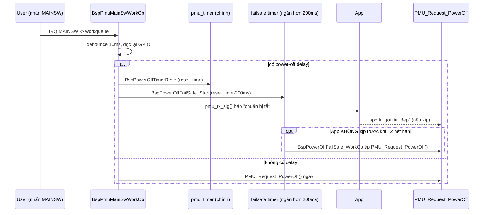
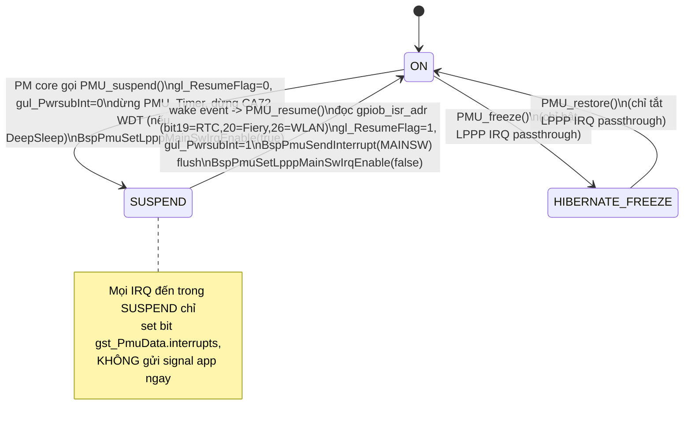

# mdels800_pmu.c — Tài liệu kiến trúc (Reverse-engineering từ source thật)

Nguồn: `Kernel/Src/drivers/mfp/pmu/mdels800_pmu.c` (5729 dòng) + `mdels800_pmu.h` (268 dòng) +
`Kernel/Src/drivers/rtc/rtc-pscpu.h` (hằng số retry I2C dùng chung).
Chú giải: 📌 FACT (có file:line) · 🧠 INFERENCE · ❓ UNKNOWN (chưa đủ bằng chứng).

---

## 1. Executive Summary

`mdels800_pmu.c` **không phải** driver PMU (perf-events) chuẩn của Linux — đây là driver vendor
(KMJP, comment nội bộ 100% tiếng Nhật) quản lý **chuỗi cấp nguồn / tắt nguồn / watchdog / wake-source**
của một máy in đa chức năng (MFP) nền tảng S800, có card in Fiery. File chứa **2 driver riêng biệt**:

1. `platform_driver "PMU"` (📌 line 4707) — chỉ mang `dev_pm_ops` (suspend/resume/freeze/restore),
   KHÔNG có `.probe`/`.remove`. Init phần cứng chạy thủ công trong `PMU_install()`/`PMU_install_int()`
   qua `arch_initcall`/`module_init`, không qua device-match probe chuẩn.
2. `i2c_driver "pscpu"` (📌 line 260) — driver I2C thật, probe/remove chuẩn, giao tiếp **Power-Sub-CPU**
   (PS-CPU) — 1 vi điều khiển phụ chuyên trách nguồn, reset các IC con, và (gián tiếp qua file khác)
   RTC (`rtc-pscpu.c`, cùng chia sẻ `pscpu_i2c_mutex`).

Không dùng kthread (0 kết quả grep). Dùng workqueue mặc định của kernel (`schedule_work`, không có
workqueue riêng) + `timer_list` cho polling/failsafe. Có char device `/dev/PMU0` (ioctl, 32 lệnh) và
~25 sysfs node để app userspace điều khiển/đọc trạng thái.

---

## 2. Kiến trúc phần cứng

```
                         ┌────────────────────────────┐
                         │        USER SPACE            │
                         │  (app "本体アプリ" quản lý máy in) │
                         └───────────┬────────────────┘
                    ioctl(/dev/PMU0) │ sysfs (~25 node)
                                     ▼
        ┌───────────────────────────────────────────────────┐
        │                mdels800_pmu.c                       │
        │  ┌─────────────┐  ┌──────────────┐  ┌─────────────┐ │
        │  │ IRQ handlers │  │  workqueue   │  │ timer_list  │ │
        │  │ (hard-irq)   │─►│  callbacks   │  │ (poweroff,  │ │
        │  │ BspPmuIsr,   │  │ (process ctx)│  │  failsafe,  │ │
        │  │ BspPowerDownIsr│ │              │  │  polling)   │ │
        │  │ Bsp_MCWDT_Isr │  └──────┬───────┘  └─────────────┘ │
        │  └─────────────┘         │                            │
        └───────────────┬──────────┼────────────────────────────┘
                GPIO IRQ │          │ pmu_tx_sig() → send_sig_info()
                         │          ▼
                         │   app nhận signal (đăng ký PID qua ioctl PMU_IOCSPIDREGIST)
                         ▼
        ┌───────────────────────────────────────────┐
        │  I2C (BspI2cPmuGet/Set, mutex dùng chung   │
        │  với rtc-pscpu.c) — 2-transaction protocol │
        └───────────────────┬─────────────────────────┘
                             ▼
                      ┌─────────────┐
                      │   PS-CPU    │  (Power-Sub-CPU, register map 0x5C-0xFE)
                      └──────┬──────┘
                             │ điều khiển
      ┌──────────┬───────────┼───────────┬────────────┬─────────────┐
      ▼          ▼           ▼           ▼            ▼             ▼
   Nguồn MC   Nguồn Engine  Reset IC   USB Hub/PHY   RTC alarm   HRESET_REQ
   (24V,MC_   (IR_RY,ERP)   (SOUND,    reset,        (rtc-pscpu.c) (cắt nguồn
   PWR_EN)                  PEX,PHY,                                chính)
                             SATA...)
```
📌 Nguồn: bảng register map (§4), bảng GPIO/PIN_ATTR (§4), header `rtc-pscpu.h`/`mdels800_pmu.h`.

Ngoài đường I2C, driver còn 2 đường phần cứng khác không qua PS-CPU:
- **GPIO trực tiếp** (`gpio_get/set_value`) cho các pin không thuộc PS-CPU: `HRESET_REQ`, `Fiery_*`,
  `REBOOT_REQEST`, các chân IRQ SET_INTPx/SET_KRx...
- **MMIO thanh ghi riêng**: `gpiob_iter2_adr` (bật/tắt IRQ MAINSW cho khối LPPP khi suspend),
  `gpiob_isr_adr`/`wlan_flag_adr` (đọc wake-source lúc resume), SPI-Flash chip-register B013/014/015.

---

## 3. Driver lifecycle (📌 line 5319-5321, 4875-4876)

```c
arch_initcall(PMU_install);        // cdev, class, platform_driver+device, sysfs group, spinlock init
module_init(PMU_install_int);      // parse DT, request TOÀN BỘ IRQ, INIT_WORK
module_exit(PMU_uninstall);
```
🧠 Comment nguồn giải thích thứ tự: PMU_install chạy sớm (arch_initcall) để cdev/sysfs sẵn sàng; IRQ
registration cố tình delay tới sau khi interrupt controller đã init xong. ❓ Comment ghi
`subsys_initcall_sync` cho `PMU_install_int` nhưng code dùng macro `module_init()` chuẩn — mismatch
comment/code chưa giải thích được từ 2 file này.

`PMU_install()` (📌 4774-4860): alloc_chrdev_region → cdev_init/add → platform_driver_register →
platform_device_register_simple → PMU_sysfs_add → spin_lock_init → class_create → device_create →
sema_init (3 semaphore). **Có rollback đầy đủ theo thứ tự ngược ở nhãn `error:`** (device_destroy →
class_destroy → platform_device_unregister → cdev_del → unregister_chrdev_region) — không phát hiện
resource leak ở path lỗi.

`PMU_uninstall` / `BspPmuIsrFree`: gọi `free_irq()` cho từng IRQ + cdev_del/unregister_chrdev_region,
nhưng **không `cancel_work_sync()`** 9 work item đã đăng ký (finding §8.2).

**Stub chết (📌 c:5314-5317, xác nhận bởi h:122-123):** `PMU_enable_irq/disable_irq/clear_intsts/
SetregWakeupControlGtxout` — thân rỗng, giữ lại chỉ vì `drivers/mfp/panelcom/cap1166.c` vẫn gọi các
symbol này dù "Wakeup Core không tồn tại trên S800".

**`#undef PMU_MC_WDT_DEBUG`** (c:63) → toàn bộ code debug MC-WDT (kể cả `late_initcall(PMU_handle_event)`
ở dòng 5324-5330) bị loại khỏi build hiện tại.

---

## 4. Giao tiếp phần cứng

### 4.1 I2C protocol với PS-CPU
```
BspI2cPmuSet(reg,data):  i2c_master_send( [reg][data0..3 LE] )         — 1 transaction, 5 byte
BspI2cPmuGet(reg):       i2c_master_send([reg])  rồi  i2c_master_recv(4 byte)  — 2 transaction riêng
                          (PS-CPU cần STOP bit giữa 2 lệnh nên KHÔNG dùng i2c_transfer() chuẩn)
```
Mọi transaction bọc trong `mutex_lock(&pscpu_i2c_mutex)` (mutex **dùng chung** với driver RTC
`rtc-pscpu.c` trên cùng bus). Retry: `PSCPU_I2C_RETRY_MAX=10`, `PSCPU_I2C_RETRY_DELAY=500ms` →
**worst-case 5 giây block** (msleep, chỉ an toàn vì luôn gọi từ process/workqueue context).

**Register map (2nd-address):**
| Addr | Tên | Chức năng |
|---|---|---|
|0x5C|PSCPU_REG_MCIR|Cờ cấm MC_P_ON/IR_P_ON|
|0x5E|PSCPU_REG_PWROFF_FACTOR|Lý do poweroff gần nhất|
|0x70|PSCPU_REG_GET|Đọc giá trị hiện tại|
|0x74|PSCPU_REG_SET|Set bit|
|0x78|PSCPU_REG_CLR|Clear bit|
|0x80|PSCPU_REG_IN|Đọc input (24V monitor...)|
|0x88|PSCPU_REG_SUM|Checksum firmware PS-CPU|
|0x8C|PSCPU_REG_VER|Version PS-CPU|
|0x90/94/98/A0|UPDATE_REQ/END/STATUS/DATA|Protocol nạp firmware PS-CPU (tách biệt hoàn toàn)|
|0xB0|PSCPU_REG_PWROFF_TIM_SET|Set watchdog đếm ngược trước khi PS-CPU tự cắt nguồn|
|0xBC|PSCPU_REG_PWROFF_SEQTIME|Thời gian chạy sequence poweroff|
|0xC0|PSCPU_REG_EVENT|Log sự kiện khởi động|
|0xFC|PSCPU_REG_CHECK_I2C|Test liên lạc I2C|
|0xFE|PSCPU_REG_RESET_I2C|Reset mềm I2C-slave PS-CPU khi lỗi liên tục|

**Bitfield:** `IR_P_ON(0x1) ERPn(0x2) RESETn(0x4) MC_P_ON(0x20) 24V_ON(0x100,R) RST_SLP2n(0x200)
USB2_OE(0x400) MC_PWR_EN(0x1000)`.

PS-CPU còn điều khiển reset các IC khác (không chỉ nguồn): SOUND chip, DEV0106, PEXSW, Ethernet PHY,
PLL, USB HUB, SATA (📌 h:160-166) — và động cơ engine in (SUB_ENGINE_MC/IR reel, motion-enable IRC/MC,
h:174-177).

### 4.2 GPIO / sysfs (~25 node, 3 lớp cơ chế trùng macro `PIN_ATTR`)
| Nhóm | Ví dụ node | Cơ chế thật |
|---|---|---|
|GPIO trực tiếp|HRESET_REQ, REBOOT_REQEST, Fiery_*, UTILITY_KEY, POWER_MONITER, ENG_MORTION_ENABLE|`gpio_get/set_value()`|
|I2C qua PS-CPU|MC_PWR_EN, ENG_POWER, IR_RY, ENG_SENSOR|`GET/SET/CLR_PSCPU()` với bitmask|
|SPI-Flash chip register|B013/B014/B015 (offset 0xFF01A/C/E, CS0 base 0xF4300000)|đọc/ghi thanh ghi đặc biệt trên chip flash|
|ASIC port I/O riêng|WAKE_FAXMFPC|qua `thr_IncItfc004Common.h`, không GPIO/I2C|
|Dummy (test)|L000, ENG_MORTION_ENABLE_RESUME, ENG_POWER_RESUME|không tác động phần cứng thật|
|IRQ config pin|SET_INTP4-7, SET_KR0-6, SET_INTRTC, SET_MAINSW, SUB_POWER|xem bảng IRQ §5|

---

## 5. IRQ architecture

### 5.1 Bảng sự kiện (📌 c:3023-3036, DECLARE_PMU_WORK)
| IRQ pin | mask | mã signal | loại | Ý nghĩa | Active trong build? |
|---|---|---|---|---|---|
|SUBSW/INTP4|-|-|-|Nút nguồn phụ bật/khởi động (xử lý riêng)|✅|
|INTP5|PMU_INTP5|0x69|IRQ|Set khay giấy|✅|
|INTP6|PMU_INTP6|0x69|IRQ|EDH set (bộ nạp tài liệu)|✅|
|INTP7|PMU_INTP7|0x6D|IRQ|Mở nắp trước máy|✅|
|INTKR0|PMU_INTKR0|0x64|IRQ|Wake-on LAN có dây|❌ comment-out|
|INTKR1|PMU_INTKR1|0x65|IRQ|Cuộc gọi FAX đến|✅|
|INTKR2|PMU_INTKR2|0x66|IRQ|Tín hiệu RI modem|✅|
|INTKR3|PMU_INTKR3|0x64|IRQ|Wake từ PHY (WOL)|✅|
|INTKR4|PMU_INTKR4|0x67|IRQ|Khởi động từ Fiery|❌ comment-out|
|INTKR5|PMU_INTKR5|0x61|IRQ|Cảm biến phát hiện người|✅|
|INTKR6|PMU_INTKR6|0x03|ETC|Quá dòng USB host (VBUS)|✅|
|INTRTC|PMU_INTRTC|0x63|IRQ|RTC alarm|❌ comment-out|
|MAINSW|PMU_INTMAINSW|0x6A|IRQ|Nút nguồn chính OFF|✅ (2 lần: chân chính + WAKE_GPIO)|

Ngoài ra: `POWER_MONITER` (mất điện lưới) và `MC_WDT` dùng `request_irq()` trực tiếp, ngoài
`BspPmuIsrInit()`.

### 5.2 Sequence diagram — IRQ thường (Pattern A)
```mermaid
sequenceDiagram
    participant HW as PS-CPU/GPIO
    participant ISR as BspPmuIsr (hard-irq)
    participant WQ as system workqueue
    participant CB as BspPmuIsrWorkCb
    participant APP as Userspace app
    HW->>ISR: GPIO IRQ (INTP5..INTKR6)
    ISR->>WQ: schedule_work(work)
    ISR-->>HW: IRQ_HANDLED (ngay lập tức)
    WQ->>CB: chạy callback (process context)
    alt đang suspend (gl_ResumeFlag=0)
        CB->>CB: spin_lock(gst_PmuData.lock); set bit; unlock
    else đã resume
        CB->>APP: pmu_tx_sig() -> send_sig_info()
    end
```

### 5.3 Sequence diagram — mất điện lưới đột ngột (Pattern D, quan trọng nhất)
```mermaid
sequenceDiagram
    participant HW as POWER_MONITER pin
    participant ISR as BspPowerDownIsr (hard-irq, local_irq_disable)
    participant SPI as SPI-Flash (qspi_powerdown_write)
    participant WQ as workqueue
    HW->>ISR: mất điện lưới
    ISR->>ISR: debounce busy-wait (udelay loop)
    ISR->>SPI: ghi khẩn cấp powerdown data + FAX/RTC backup + flag (KHÔNG lock)
    ISR->>WQ: PMU_Reboot_Flicker() -> schedule_work
    ISR-->>HW: IRQ_HANDLED
    WQ->>WQ: PMU_Request_PowerOff_Flicker(): km_nvme_shutdown(); GPIO HRESET_REQ=0
```

### 5.4 Fail-safe kép khi nhấn nút nguồn chính (Pattern C)


---

## 6. Power state machine (📌 c:4558-4697)


Hai biến `gl_ResumeFlag`+`gul_PwrsubInt` là điều kiện rẽ nhánh trong MỌI IRQ workqueue callback
(§5.2). ❓ `PMU_freeze`/`PMU_restore` không đụng 2 biến này — cần xác nhận có phải gap thật hay do
hibernate path (liên quan `CONFIG_PM_WARP`/`linux/warp.h`) có cơ chế khác chưa trace.

---

## 7. IOCTL interface (📌 h:54-88, PMU_IOC_MAGIC=0x82, 32 lệnh)

Quan trọng nhất: **`PMU_IOCSPIDREGIST`** (#0) đăng ký `{signo,pid}` vào `reginfo` global — đây là
kênh duy nhất để `pmu_tx_sig()` biết gửi signal cho ai. Các lệnh khác đáng chú ý: `_GET_TEMPERATURE`
(#24, **app đẩy nhiệt độ xuống driver**, không phải driver tự đọc cảm biến), `_GET_POWERDOWN_DATAAREA`
(#7, app cấp buffer cho vùng backup khẩn cấp `ull_PowerDownData_v` dùng trong §5.3),
`_GET_RTCFAXBACKUPDATAAREA` (#26, buffer `uc_timePowerDown`), `_SET_WDT_CA72`/`_SET_WDT_CA72_EXT`/
`_GET_WD_EXPIRE`/`_GET_WDT_MC` (nhóm watchdog), `_SET_STR_STATUS` (#31, cờ Suspend-to-RAM). Bảng đầy
đủ 32 lệnh nằm trong file log `pmu_analysis.md`.

---

## 8. Concurrency / Lock map

| Lock | Loại | Bảo vệ | An toàn? |
|---|---|---|---|
|`gst_PmuData.lock`|spinlock|bitmask `interrupts`|✅ critical section luôn ngắn, không sleep bên trong|
|`gst_UsbResumeCtl`|raw_spinlock **irqsave**|`b_usb_resume_fin/error`|✅ dùng irqsave nhất quán|
|`pscpu_i2c_mutex`|mutex (extern, share với RTC driver)|mọi I2C transaction|⚠️ có thể block 5s (msleep retry), chỉ gọi từ process/workqueue|
|`sem_wlan_reset`, `sem_qspi_write`, `timePowerDown_Sem`|semaphore|logic ngắn tương ứng|✅|

**6 finding có bằng chứng (chi tiết + line number đầy đủ trong `pmu_analysis.md`; xem §12.2 cho 2 finding mới nhất, mức nghiêm trọng nhất):**
0. **[MEDIUM, CONFIRMED]** `PMU_IOCSSET_APSTATUS` (c:4326) — `if(res)` kiểm tra `copy_from_user` SAI
   chiều (res=0 là thành công) → toàn bộ logic báo AP-status/arm IRQ mất điện chỉ chạy khi copy LỖI,
   không bao giờ chạy trên đường thành công bình thường. Fix: đổi thành `if(res == 0)`.
0b. **[LOW-MEDIUM, CONFIRMED]** `PMU_ioctl` case `PMU_IOCRESEARCHSUSPENDPREPARE` (c:4476) thiếu `break`
   → fall-through ghi đè `uc_Pcie_Wa_flg` bằng `arg` không liên quan mỗi khi gọi ioctl #25.
1. **[MEDIUM, PLAUSIBLE]** `pmu_tx_sig()` (c:2502) gọi `find_task_by_vpid()` không có `rcu_read_lock()`
   → nguy cơ UAF nếu process đích exit đúng lúc. Fix đề xuất: bọc RCU read-side critical section.
2. **[LOW, CONFIRMED]** `BspPmuIsrFree()` (c:3188) không `cancel_work_sync()` 9 work item trước khi
   `PMU_uninstall` giải phóng tài nguyên — vi phạm pattern remove() chuẩn (rủi ro thực tế thấp vì
   driver builtin, module_exit gần như không chạy trên thiết bị thật).
3. **[LOW, PLAUSIBLE]** Race đọc/ghi `uc_timePowerDown[7]` giữa `BspPmuMainSwWorkCb` (có semaphore) và
   `BspPowerDownIsr` (không thể dùng semaphore vì đang `local_irq_disable()`) — torn read khi mất điện
   trùng lúc app đang ghi backup FAX/RTC.
4. **[INFO]** I2C retry tối đa 5s chạy trên **workqueue mặc định của kernel**, không phải workqueue
   riêng — lỗi I2C kéo dài có thể ảnh hưởng driver khác dùng chung `system_wq`.

---

## 9. Các câu hỏi mở đã giải quyết (cập nhật vòng 2 — đọc thêm 3 file ngoài)

### 9.1 `qspi_powerdown_write()` có an toàn trong hard-irq với `local_irq_disable()` không? → ✅ CÓ, có chủ đích
📌 Định nghĩa thật tại `Kernel/Src/drivers/mtd/spi-nor/mrvl-bspi_winbond.c:1397-1655`. Đọc toàn bộ thân
hàm: chỉ truy cập **MMIO trực tiếp** (`regs->BSSR`, `regs->BSCMDR`, thanh ghi SPI controller thật) và
chờ bằng `mdelay()` (busy-wait) — **không** có `msleep`, `mutex_lock`, `schedule`, `wait_event`,
`kmalloc(GFP_KERNEL)` hay bất kỳ API có thể ngủ nào bên trong. → An toàn tuyệt đối khi gọi trong
atomic/hard-irq context.
📌 **Có bằng chứng đây là quyết định CÓ CHỦ ĐÍCH**, ghi rõ trong comment cùng file (line 1665-1667):
*"2020/11/25 三村 OP_BTS-28498: qspi_powerdown_write không có cơ chế loại trừ lẫn nhau (mutual exclusion)
với LPPP, nên nếu dùng trong context bình thường (có thể bị task-switch) sẽ gây FREEZE hệ thống → đã
đổi sang gọi từ hàm có task-switch bị cấm"* — tức chính là lý do `BspPowerDownIsr` cố tình chạy toàn bộ
trong `local_irq_disable()`: không phải sơ suất mà là né 1 race đã từng gây treo máy thật (ticket
OP_BTS-28498), và né bằng cách cấm preemption/task-switch thay vì dùng lock (vì lock không giải quyết
được xung đột với code phía LPPP không có API lock tương thích).

### 9.2 `rtc-pscpu.c` thật — quan hệ RTC↔PMU → ✅ đã đọc, xác nhận kiến trúc 2-client
📌 `Kernel/Src/drivers/rtc/rtc-pscpu.c:41`: `DEFINE_MUTEX(pscpu_i2c_mutex);` — mutex được **định nghĩa
gốc ở đây**, `mdels800_pmu.c` chỉ `extern` dùng lại → xác nhận CONFIRMED (không còn suy luận) việc 2
driver share 1 mutex bảo vệ chung 1 bus I2C vật lý.
📌 `rtc-pscpu.c` đăng ký `i2c_driver` **RIÊNG** với `id_table = {"pscpu_rtc",0}` (khác hẳn `"pscpu"` của
`mdels800_pmu.c`) và `of_match compatible = "km,pscpu-rtc"` — tức đây là **2 i2c_client/2 node DT khác
nhau** cùng trỏ tới cùng 1 chip PS-CPU vật lý nhưng đại diện 2 "vai trò" chức năng khác nhau (RTC vs
Power) trên cùng bus — không xung đột id, nhưng lý giải vì sao cần mutex CHUNG (không phải mutex/client
nào tự lo transaction của client đó — cả 2 client cùng nói chuyện với 1 firmware phía PS-CPU, xen kẽ
sai thứ tự sẽ hỏng dữ liệu).
📌 `rtc-pscpu.c` dùng `module_i2c_driver(pscpu_driver)` (macro chuẩn, tự sinh init/exit) — không có gì
bất thường ở driver này.

### 9.3 `gl_ResumeFlag` có bị freeze/restore/Warp bỏ sót không? → 🧠 Không phải bug, do thiết kế Warp khác STR
Tìm thêm điểm dùng `CONFIG_PM_WARP` trong `mdels800_pmu.c`: chỉ có ở `BspPmuPmCallback()` (line 4157,
một **notifier_block riêng** đăng ký nhận sự kiện PM chung của kernel, KHÁC với `dev_pm_ops` — tức có
**3 con đường PM song song** trong file: (1) `dev_pm_ops.suspend/resume` cho Suspend-to-RAM thường,
(2) `dev_pm_ops.freeze/restore` cho hibernate ảnh chụp qua block-device chuẩn, (3) `BspPmuPmCallback`
notifier cho **Warp** — cơ chế hibernate riêng của vendor (`linux/warp.h`: `warp_saveno/loadno`,
`warp_set_savearea()` — lưu snapshot vào 1 vùng nhớ dành riêng, khôi phục nhanh không qua boot lại đầy
đủ). `BspPmuPmCallback` chỉ xử lý `PM_POST_HIBERNATION` và CHỈ reset `bl_pmu_PowerOffDelay` khi
`pm_device_down==WARP_STATE_RESUME`, không đụng `gl_ResumeFlag`/`gul_PwrsubInt`.
🧠 Suy luận hợp lý (chưa phải FACT 100% vì chưa đọc code lõi Warp): vì Warp là "chụp ảnh rồi resume
tiếp ngay giữa dòng lệnh" chứ không tắt hẳn CPU như suspend-to-RAM thật, `gl_ResumeFlag` có thể vẫn giữ
đúng giá trị từ trước lúc chụp ảnh (không cần reset) — khác hẳn STR nơi CPU thực sự mất điện logic và
cần cờ để phân biệt "đang chờ resume" và "đã resume xong". Nếu muốn kết luận chắc chắn 100%, cần đọc
thêm code gọi `warp_set_savearea`/`pm_device_down` ở lõi arch (`arch/arm64/...`), nằm ngoài phạm vi
driver PMU.

### 9.4 3 IRQ comment-out (INTKR0/INTKR4/INTRTC) → 🧠 đã tìm ra lý do kỹ thuật hợp lý, không tìm được ticket gốc
`git blame` trên repo này chỉ ra 1 commit gộp duy nhất ("Update 337 files", không có lịch sử gốc) nên
**không tìm được nội dung ticket CQ/OP_BTS thật** (vẫn ❓ UNKNOWN ở mức "ticket nào, ai sửa"). Nhưng có
thể suy ra lý do KỸ THUẬT với độ tin cậy cao nhờ đối chiếu chéo với `PMU_resume()` (đã trace ở Phase 5):
- Comment tại INTKR0 (LAN wake): *"2018-11-08 D.Sakiyama WAKE_WLAN change to level interrupt"* — khớp
  chính xác với đoạn code trong `PMU_resume()` đọc bit 26 (`WAKE_WLAN`) của thanh ghi MMIO
  `gpiob_isr_adr` kết hợp `wlan_flag_adr` — tức WAKE_WLAN đã **chuyển từ edge-GPIO-IRQ (INTKR0) sang
  level-status-register check tại thời điểm resume**, nên IRQ edge cũ không cần active nữa.
- Tương tự, `PMU_resume()` cũng check bit 20 ("WAKE_FIERY") và bit 19 ("WAKE_UP"/RTC) trên cùng thanh
  ghi — khớp với đúng 2 IRQ còn lại bị comment-out (INTKR4=Fiery wake, INTRTC=RTC alarm) → 🧠 cả 3 đều
  bị thay bằng cùng 1 cơ chế: **kiểm tra status register 1 lần lúc resume thay vì maintain 3 IRQ edge
  riêng lẻ luôn bật** — hợp lý về mặt thiết kế (giảm số interrupt line active, tránh spurious wake).

### 9.5 Mismatch comment "subsys_initcall_sync" vs macro `module_init()` thật
Không tìm thấy redefine macro nào trong toàn bộ cây nguồn đã tìm (`grep -rn "define module_init"` không
ra kết quả ngoài kernel gốc). 🧠 Kết luận: nhiều khả năng đây chỉ là **comment lỗi thời/không khớp code**
(developer định dùng `subsys_initcall_sync` nhưng cuối cùng dùng `module_init` chuẩn — khi biên dịch
built-in, `module_init()` tự expand thành `device_initcall()` theo kernel gốc, vẫn chạy SAU
`arch_initcall` và sau giai đoạn init hầu hết interrupt controller trong thực tế, nên khả năng cao
không gây lỗi chức năng dù comment không khớp 100% code). Vẫn giữ mức ❓ vì không thể xác nhận 100% nếu
không có toàn bộ config/Makefile build thật để biết `CONFIG_MODULES` bật hay tắt.

### 9.6 Lõi Warp thật sự là gì? → ✅ đã tìm ra, xác nhận suy luận §9.3
📌 `Kernel/Src/kernel/power/warp.c` (3084 dòng) — đây là **bản thay thế hoàn toàn tự viết của vendor**
cho `kernel/power/hibernate.c` chuẩn Linux (hàm `hibernate()` được định nghĩa lại ngay trong file này,
dùng chung tên với API kernel gốc). `hibernate()` set `pm_device_down = WARP_STATE_SUSPEND` (line 1962)
rồi gọi `warp_ops->snapshot()` chụp ảnh bộ nhớ; nhiều điểm rải rác trong file set lại
`pm_device_down = WARP_STATE_RESUME` sau khi khôi phục xong. → **Xác nhận CONFIRMED** suy luận ở §9.3:
đây đúng là cơ chế "chụp ảnh rồi khôi phục nhanh giữa dòng lệnh" (không tắt hẳn CPU như suspend-to-RAM
chuẩn), nên driver PMU không cần/không nên đụng `gl_ResumeFlag` trong path này — thiết kế đúng, không
phải bug hay thiếu sót.

## 10. Phase 10 (mở rộng) — Firmware update protocol PS-CPU (📌 c:3806-4055, trả lời mục còn thiếu ở lần trước)
Đã trace đầy đủ 3 hàm `BspUpdateRequest → BspWriteFirm(×N chunk) → BspWriteChecksum`:
```
BspUpdateRequest()
  BspIntStore(SET_INTRTC, "0")            // tắt IRQ RTC trước — 1 khi PS-CPU vào IAP mode, RTC ngừng
                                            // đáp ứng (comment: "sau bản này PS-CPU chuyển sang iap thì
                                            // RTC không hoạt động, nên cấm IRQ RTC")
  pscpu_set_iap_mode(rtc_dev, 1)          // báo SANG driver rtc-pscpu.c: "RTC sắp mất hoạt động"
  BspI2cPmuSet(UPDATE_REQ_REG_ADDR=0x90, UPDATE_REQ_DATA)
  msleep(UPDATE_WAIT_USEC/1000)
  BspCheckDataStatus(UPDATE_STATUS_IAP_MASK, ...)   // poll 0x98, tối đa 10 × 1ms = 10ms timeout
  BspCalcChecksum(NULL,0,1)               // reset bộ tích lũy checksum (biến static bên trong)

BspWriteFirm(puc_Data)  — gọi lặp lại 1 lần / chunk BUF_SIZE byte từ ioctl PMU_IOCSSET_DOWNLOAD_DATA
  kmalloc(BUF_SIZE+1, GFP_KERNEL)
  copy_from_user(buf+1, puc_Data, BUF_SIZE)   // biên giới user/kernel — size CỐ ĐỊNH BUF_SIZE, không
                                                // lấy length từ user -> không có nguy cơ size-confusion
  BspCalcChecksum(buf+1, BUF_SIZE, 0)     // cộng dồn checksum
  i2c_master_send(buf[0]=UPDATE_DATA_REG_ADDR=0xA0, buf[1..])  // gọi TRỰC TIẾP, không qua BspI2cPmuSet,
                                                                  // tự có retry loop riêng (cùng hằng số
                                                                  // PSCPU_I2C_RETRY_MAX/DELAY)
  BspCheckDataStatus(UPDATE_STATUS_DATA_MASK,...) // poll ACK, check CHKSUM/INTERR error bit

BspWriteChecksum()
  đọc status hiện tại, clear các mask cũ
  end = UPDATE_END_COMP_MASK | (checksum_tích_lũy << UPDATE_END_CHKSUM_SHIFT)
  BspI2cPmuSet(UPDATE_END_REG_ADDR=0x94, end)
  msleep(CHKSUM_WAIT_USEC/1000)
  BspCheckDataStatus(UPDATE_STATUS_COMP_MASK,...)  // poll cờ hoàn tất
```
🧠 Toàn bộ giao thức update có checksum + poll-with-timeout ở mỗi bước + kiểm tra error-bit — thiết kế
chắc chắn hơn các đường I/O thường (không có timeout) đã thấy ở Phase 4.

## 11. Phase 7 (bổ sung) — Cơ chế "ai kick CA72 WDT?" (📌 km_scpi.h + c:4380, 1043-1045)
`struct km_scpi_ops.set_wdt_ca72(event)` với `event ∈ {START=0, END=1, REFRESH=2}` gửi qua **SCPI**
(khác hẳn kênh I2C tới PS-CPU — SCPI thường là mailbox AP↔SCP theo chuẩn ARM, không phải I2C).
- **`PMU_IOCSSET_WDT_CA72` (ioctl #16, c:4380)**: app userspace tự gọi ioctl này định kỳ để
  START/REFRESH/END watchdog → **CA72 WDT được "app-fed"**, không phải driver tự động kick.
  `PMU_IOCSGET_WD_EXPIRE` (#21) là kênh app đọc để biết PowerManager watchdog đã hết hạn → reboot.
- **`debug_link_check()` (c:1022-1043) cũng tự REFRESH watchdog kèm debug string** khi phát hiện PCIe
  link up/down ("PCIe link up"/"PCIe link down") → 🧠 suy luận: CA72 WDT ở đây được dùng thêm như 1
  "canary" phát hiện treo liên quan PCIe, không chỉ thuần heartbeat app.
- Suspend/resume: `set_wdt_ca72(END)`/`(START)` tương ứng — đã ghi ở Phase 5.

### 12.1 Giá trị macro update protocol → ✅ tìm thấy (📌 c:118-145, nằm ngay trong chính file, đoạn đầu chưa đọc kỹ lần trước)
```
BUF_SIZE=1024 byte/chunk, UPDATE_BLOCKS=20  → tổng firmware PS-CPU tối đa = 1024×20 = 20480 byte (20KB)
UPDATE_REQ_DATA = 0x11223344   (giá trị "magic" gửi khi request update)
UPDATE_WAIT_USEC=500000 (500ms chờ sau REQ), CHKSUM_WAIT_USEC=10000 (10ms chờ sau ghi checksum)
Status bits (UPDATE_STATUS_REG_ADDR=0x98): bit0=IAP, bit1=DATA, bit2=COMP, bit16=CHKSUM_err, bit17=INTERR
End bits  (UPDATE_END_REG_ADDR=0x94):      bit2=COMP, bit8-15=checksum 1 byte
```

## 12.2 Đọc trọn `PMU_ioctl()` (📌 c:4191-4556, trước đó mới đọc ~50%) — phát hiện 2 bug CONFIRMED mới

### 🐛 BUG A [CONFIRMED, MEDIUM] — `PMU_IOCSSET_APSTATUS` (case #12, c:4323-4337): logic if đảo ngược
```c
case PMU_IOCSSET_APSTATUS:
{
    int data = 0;
    res = copy_from_user( (void*)&data, (int __user*)arg, sizeof(int) );
    if(res){                                   // ⚠️ res != 0 nghĩa là copy_from_user THẤT BẠI
        scpi_ops = get_km_scpi_ops();
        scpi_ops->set_ap_status((int)data);    // set_ap_status/enable_irq/disable_irq chỉ chạy
        if(data){ enable_irq(...POWER_MONITER); }   // khi copy LỖI — tức KHÔNG BAO GIỜ chạy trên
        else{ disable_irq(...POWER_MONITER); }      // đường thành công bình thường!
    }
}
break;
```
`copy_from_user()` trả về **0 khi thành công**, số byte-chưa-copy-được khi thất bại — chuẩn kernel API.
Code viết `if(res)` (đúng ra phải là `if(!res)`/`if(res==0)`) → toàn bộ thân if (báo LPPP `set_ap_status`,
và bật/tắt IRQ `POWER_MONITER` theo trạng thái AP) **chỉ chạy khi ioctl COPY THẤT BẠI**, tức trên mọi
lời gọi ioctl bình thường từ app (copy thành công) thì **không có gì xảy ra cả**. 🧠 Hệ quả thực tế:
ioctl `PMU_IOCSSET_APSTATUS` gần như luôn no-op trên đường thành công — nếu tính năng "báo AP status cho
LPPP + tự động arm/disarm IRQ mất điện theo trạng thái AP" đang được kỳ vọng hoạt động, driver hiện tại
KHÔNG làm việc đó. Đề xuất fix: đổi `if(res)` → `if(res == 0)`.

### 🐛 BUG B [CONFIRMED, LOW-MEDIUM] — thiếu `break` giữa 2 case, fallthrough không chủ ý (c:4476-4486)
```c
case PMU_IOCRESEARCHSUSPENDPREPARE:            /* #25: SuspendPrepare */
{
    setNewdetailCodeSuspendPrepare();
}
/* ← THIẾU break Ở ĐÂY */
case PMU_IOCSGET_PCIE_WA_FLG:                  /* #27: PCIe WA flag */
{
    uc_Pcie_Wa_flg = (char)arg;
}
break;
```
Rà toàn bộ 32 case trong `PMU_ioctl`, đây là **case DUY NHẤT thiếu `break`** (đối chiếu tất cả case khác
đều có `break`/`return`). Khi app gọi ioctl `PMU_IOCRESEARCHSUSPENDPREPARE` (#25), code rơi tự do (fall
through) xuống thân case `PMU_IOCSGET_PCIE_WA_FLG` (#27) và **ghi đè `uc_Pcie_Wa_flg`** bằng chính giá
trị `arg` đã truyền cho ioctl #25 (vốn không có ý nghĩa gì với PCIe WA). `uc_Pcie_Wa_flg` được dùng ở
`BspPsCpuStore` (line 1124,1158) để quyết định luồng xử lý đặc biệt cho `MC_PWR_EN` → có thể khiến
logic PCIe workaround bị kích hoạt/tắt sai ngoài ý muốn mỗi khi app gọi ioctl #25 lúc chuẩn bị suspend.

### ✏️ Đính chính finding trước đó về `PMU_IOCSGET_POWERDOWN_DATAAREA` (c:4238-4251)
Đọc kỹ lại: **driver mới là bên cấp phát buffer**, không phải app như tài liệu bản trước ghi nhầm:
```c
ull_PowerDownData_v = (unsigned long long)kmalloc(4*1024, GFP_KERNEL);   // driver tự kmalloc 4KB
ull_PowerDownData_phy = (unsigned long long)__pa(ull_PowerDownData_v);   // đổi sang physical address
copy_to_user(arg, &ull_PowerDownData_phy, ...);                          // TRẢ physical addr CHO app
```
App nhận physical address rồi (🧠 suy luận, chưa xác nhận cơ chế) khả năng cao mmap qua `/dev/mem` hoặc
tương đương để ghi trực tiếp vào đúng vùng vật lý đó — đây chính là buffer `BspPowerDownIsr` đọc để dump
khẩn cấp ra SPI-Flash. ⚠️ **Finding mới [LOW, PLAUSIBLE]:** không thấy `kfree(ull_PowerDownData_v)` ở
bất kỳ đâu trong file, và ioctl này không có cờ "đã cấp phát" — nếu app (hoặc nhiều app) gọi ioctl này
**hơn 1 lần**, lần gọi sau ghi đè con trỏ `ull_PowerDownData_v` mà không giải phóng buffer cũ →
memory leak 4KB mỗi lần gọi thừa. Rủi ro thấp trong vận hành bình thường (thường chỉ gọi 1 lần lúc app
khởi động) nhưng là lỗ hổng thật nếu ioctl bị gọi lặp (do bug ở app, hoặc app restart nhiều lần).

## 12.3 Đính chính Phase 1 — inventory 136 hàm ban đầu THIẾU 7 hàm (style khai báo `{` cùng dòng)
Script quét ban đầu (Phase 1) chỉ bắt pattern K&R chuẩn (`{` xuống dòng riêng), bỏ sót 7 hàm viết kiểu
`type name(args){` (mở ngoặc cùng dòng). Tổng số hàm thật trong file: **143**, không phải 136. 7 hàm bị
sót:
| Line | Hàm | Loại | Ghi chú |
|---|---|---|---|
|1184|`setNewdetailCode_SuspendPrepare`|HELPER|Gọi từ ioctl `PMU_IOCRESEARCHSUSPENDPREPARE` (#25)|
|5053|`PMU_I2cSet_RST_SLP2n`|**EXPORT_SYMBOL_GPL**|Set/clear bit RST_SLP2n qua PS-CPU — API công khai cho driver khác|
|5084|`PMU_I2cSet_USB2_OE`|**EXPORT_SYMBOL_GPL**|Bật/tắt USB2 output-enable qua PS-CPU — hàm rất mới (2025/12/09)|
|5214|`PMU_Reboot_Nowork`|POWER|Biến thể reboot ĐỒNG BỘ, không qua workqueue (xem §12.4)|
|5334|`PMU_I2cSetControl`|HELPER (không export)|Wrapper generic set/clear bất kỳ PSCPU_BIT nào — ⚠️ chú ý ngữ nghĩa đảo: `b_data=true→CLR`, `false→SET`|
|5479|`set_DetailUsbDisconectFlg`|HELPER|Setter đơn giản cho `bl_DetailUsbDisconectFlg`|
|5484|`get_DetailUsbDisconectFlg`|HELPER|Getter tương ứng|

🧠 Phát hiện phụ: `PMU_I2cSet_RST_SLP2n`/`PMU_I2cSet_USB2_OE` (cả 2 `EXPORT_SYMBOL_GPL`) là **API PMU
driver cung cấp CHO driver khác gọi** (chiều ngược lại so với các `extern` driver khác cung cấp cho PMU
đã liệt kê ở Phase 2) — driver USB/PHY nào đó có thể gọi các hàm này để vật lý ngắt/nối bus USB2 hoặc
reset 1 IC ngủ qua PS-CPU. Đây là 1 phần "external API surface" chưa được ghi nhận trước đó.

## 12.4 So sánh 4 biến thể reboot (📌 c:5117-5261, đọc trọn `PMU_Reboot*` family)
| Hàm | Đồng bộ/bất đồng bộ | Gọi PowerOff nào | Ghi detail code? | Dùng khi nào |
|---|---|---|---|---|
|`PMU_Reboot()`|Bất đồng bộ (`schedule_work`)|`PMU_Request_PowerOff()` (có `ksys_sync`)|Không|Reboot thường, gọi từ context có thể đang giữ khóa/không được block — comment ghi rõ *"không được gọi `kernel_restart()` giữa lúc đang xử lý interrupt nên phải bất đồng bộ"*|
|`PMU_Reboot_RCU(nxtlist,qlen)`|Bất đồng bộ|`PMU_Request_PowerOff()`|**Có** — mã hoá `nxtlist`/`qlen` vào detail code (`0x2202F...`) trước khi reboot|Dành riêng cho path phát hiện **RCU CPU stall** (OP_BTS-44327) — ghi lại state RCU để debug sau khi reboot|
|`PMU_Reboot_Nowork()`|**Đồng bộ, KHÔNG qua workqueue** (bị Phase-1 bỏ sót)|`PMU_Request_PowerOff()`|Không|OP_BTS-33322 — dùng khi gọi từ context **đã ở trong workqueue/process context sẵn** (ví dụ trong `debug_link_check`/PCIe link-retry path) nên không cần (và không nên) `schedule_work` thêm 1 lớp nữa|
|`PMU_Reboot_Flicker()`|Bất đồng bộ|`PMU_Request_PowerOff_Flicker()` (KHÔNG `ksys_sync`)|Không|Dành riêng path mất điện đột ngột (`BspPowerDownIsr`), xem Phase 3|

Cả 4 đều kết thúc bằng `kernel_restart(NULL)` sau khi cắt nguồn/HRESET_REQ — 🧠 hơi nghịch lý (ghi
"reboot" nhưng cũng set HRESET_REQ như poweroff) vì PS-CPU thiết kế coi HRESET_REQ=cắt nguồn rồi tự
động cấp lại nguồn sau 1 khoảng ngắn (giống "hard power-cycle" hơn là warm reboot) — khớp với tên hằng
`SUBINT_REQ_REBOOT_ON` (`HRESET_REQ=0` kèm cờ tự khởi động lại) đã thấy ở Phase 4.

## 12.5 Đào sâu `rtc-pscpu.c` (📌 c:1063-1192, `pscpu_probe/remove/suspend/resume`)
Khác hẳn PMU driver, `rtc-pscpu.c` dùng **i2c_driver probe chuẩn thật sự** (device-match model đúng
nghĩa, không phải kiểu init thủ công như PMU): `devm_kzalloc` (tự free khi remove — best-practice hơn
cách PMU driver tự quản lý bằng tay), đọc property **Device Tree thật** `"reg_addr_offset"` bằng
`of_property_read_u8()` (🧠 khác PMU driver — chưa thấy PMU driver đọc bất kỳ `of_property` nào trong
toàn bộ phần đã trace, dù comment Phase 2 từng nhắc "DTS 파일 반영" — RTC driver mới là bên thực sự dùng
DT theo kiểu chuẩn). Có cơ chế write-protect chuẩn của chip RTC: `pscpu_regwpr(WPR_MODE_RELEASE)` →
ghi `REG_CR=0x00301020` → `pscpu_regwpr(WPR_MODE_PROTECT)` lại.

📌 **Phát hiện thú vị — TODO comment tự nhận thức của chính tác giả** (c: `rtc-pscpu.c` gần
`pscpu_alarm_irq_enable`, nguyên văn tiếng Nhật, dịch): *"Đã thêm xử lý vô hiệu hoá ngắt cho RTC driver
theo tham khảo S72, nhưng đây có thật sự là việc của RTC driver không? Cảm giác nên để PMU driver làm
việc này thì hợp lý hơn"* — tức chính tác giả gốc cũng nghi ngờ ranh giới trách nhiệm RTC↔PMU chưa rõ
ràng. Đối chiếu với những gì đã trace: **`pscpu_suspend()`/`pscpu_resume()` (dev_pm_ops của chính RTC
driver) đều là stub rỗng `return 0`** — TOÀN BỘ logic xử lý ngắt RTC lúc suspend/resume thực tế nằm ở
phía PMU driver (`PMU_resume()` gọi thẳng `pscpu_read_alarm()` — cross-driver call đã thấy ở Phase 5) →
xác nhận đúng nghi ngờ của tác giả: trách nhiệm bị chia đôi không nhất quán giữa 2 driver, RTC driver
chỉ cung cấp "hạ tầng" (register access, `rtc_class_ops`) còn toàn bộ "chính sách" (khi nào clear ngắt,
khi nào bỏ qua) nằm bên PMU — đây là code smell kiến trúc có thật, được chính tác giả ghi nhận, không
phải suy diễn của tôi.

## 12.6 `BspPsCpuStore()` (📌 c:1094-1176) — sysfs store phức tạp nhất file, kết nối trực tiếp tới Bug B

Đây là hàm store đứng sau CẢ 4 sysfs node MC_PWR_EN/ENG_POWER/IR_RY/ENG_SENSOR (§4.2), nhưng thực tế
chỉ có nhánh `mask==PSCPU_BIT_MC_PWR_EN` mới kích hoạt logic đặc biệt — 2 cơ chế phụ khá nặng:

**(a) Né hỏng SPI-Flash khi bật `MC_P_ON` lúc xung QSPI clock chưa đạt max:** `ioremap(PMU_QSPI_CLK,4)`
đọc thanh ghi clock thật, nếu không phải 1 trong 2 giá trị max (`PMU_QSPI_HIGH1/2_CLK`) → gọi
`pmuSemOpLPPP(true)` (khoá semaphore QSPI, chặn LPPP ghi flash) rồi `schedule_work(&PMU_mcpon_work)` —
tức chủ động **tạm cấm ghi SPI-Flash trong lúc MC đang bật nguồn với xung clock chưa ổn định**, tránh
hỏng dữ liệu flash do LPPP ghi đồng thời.

**(b) Core-delay staggering cho `MC_PWR_EN` khi PCIe WA đang bật (`uc_Pcie_Wa_flg==THRE_PCIE_WA_CONDUCT`):**
đợi tối đa 1s (`msleep(10)×100`, thoát sớm khi `core_delay>=3` — tức đợi đủ 3 core khác cùng tới điểm
rendezvous) → `mdelay(30)` cố định → ghi giá trị pin thật → `mdelay(70)` cố định → tổng **có thể block
sysfs write call này tới ~1.1 giây**, mục đích né lỗi SSD Phison "screening pattern" lúc nhiều core cùng
bật nguồn MC.

⚠️ **Kết nối trực tiếp với Bug B (§12.2):** `uc_Pcie_Wa_flg` — cờ quyết định TOÀN BỘ cơ chế (b) có chạy
hay không — chính là biến bị **ghi đè ngoài ý muốn** bởi lỗi thiếu `break` ở ioctl
`PMU_IOCRESEARCHSUSPENDPREPARE`. Nghĩa là: mỗi lần app gọi ioctl #25 (dự kiến chỉ để ghi log trước
suspend), giá trị `arg` của lời gọi đó vô tình trở thành giá trị mới của `uc_Pcie_Wa_flg`, có thể **bật
nhầm hoặc tắt nhầm** toàn bộ cơ chế core-delay-staggering 1.1s này ở lần `MC_PWR_EN` tiếp theo — hệ quả
thực tế cụ thể hơn nhiều so với mô tả chung chung trước đó, và nâng mức độ quan tâm của Bug B lên
**đáng điều tra thêm nếu hệ thống có dấu hiệu SSD lỗi ngẫu nhiên sau khi suspend/resume nhiều lần**.

## 12.7 Rà nốt các sysfs còn lại — xác nhận + 2 đính chính nhỏ (📌 c:1328-1784, 4940-4988)

Đã đọc hết `BspKeyStore/BspIntStore(_NoWAKE_GPIO)/BspIntStoreData/BspIntShow/BspIntSourceShow/
BspIntStatusShow/BspSetIntAllStore/Show/Show2/BspForcedLogOutShow/BspPmuDisableIrq`. Toàn bộ đúng như
suy luận từ bảng register/GPIO ở Phase 4 — không phát hiện logic ẩn hay bug mới trong nhóm này. Điểm
đáng ghi nhận:
- `BspIntSourceShow` (INT_SOURCE, c:1479-1487): **read-and-clear** — mỗi lần app đọc sysfs này,
  `gst_PmuData.interrupts` bị xoá về 0 ngay trong cùng critical section — xác nhận đúng mô hình "app
  poll để tiêu thụ bit interrupt đã queue lúc suspend" đã mô tả ở Phase 5/6.
- `BspSetIntAllStore/Show` — chỉ là wrapper gọi lại `BspIntStore`/`BspKeyStore` cho từng pin từ 1 giá trị
  hex duy nhất (bật/tắt hàng loạt IRQ cùng lúc qua 1 sysfs node `SET_INT_ALL`).
- `BspPmuDisableIrq()` (c:1681-1689) chỉ tắt 3 IRQ cụ thể (SUB_POWER, INTP4, INTP7) — gọi **duy nhất 1
  lần**, ngay sau `BspPmuIsrInit()` trong `PMU_install_int()` (c:4958), mục đích ghi rõ trong comment
  OP_BTS-21031: *"ức chế bùng nổ ngắt lúc khởi động"* — tránh các IRQ này báo giả trong lúc các chân GPIO
  chưa ổn định điện áp ngay sau boot; app userspace tự bật lại qua sysfs khi đã sẵn sàng.

### ✏️ Đính chính (1): B013/B014/B015 đi qua **MTD subsystem chuẩn**, không phải MMIO thô
Đọc `BspSpiB013Show` (c:1767) mới thấy dùng `get_mtd_device(NULL, B_REGISTER_CS=2)` +
`mtd_read()/mtd_write()` (API MTD chuẩn của kernel), KHÔNG phải truy cập thanh ghi MMIO trực tiếp như
tài liệu bản trước suy luận. `Bsp_mtd_write()` (c:1704) là 1 wrapper read-modify-write cẩn thận: đọc
nguyên 1 sector (`SPI_SECTOR_SIZE=4096`) vào buffer tạm, `mtd_erase()` cả sector, `memcpy` phần thay đổi
vào đúng offset, ghi lại — đúng pattern chuẩn bắt buộc với NOR-Flash (không ghi đè trực tiếp được).

### ✏️ Đính chính (2): PMU driver **CÓ** dùng Device Tree thật (trước đó nói "chưa thấy")
`PMU_install_int()` (c:4966-4978) dùng `of_find_compatible_node(NULL,NULL,"kmbt,mc_wdt")` +
`irq_of_parse_and_map()` để lấy IRQ number thật cho MC_WDT từ DT — sửa lại nhận định trước đó ở §12.5
("chưa thấy PMU driver đọc of_property nào") — driver CÓ dùng DT, nhưng CHỈ cho riêng node MC_WDT, còn
lại toàn bộ GPIO pin khác lấy qua header `#define` cứng (không qua DT) — nên nhận định "RTC driver dùng
DT nhất quán hơn" ở §12.5 vẫn đúng về BẢN CHẤT (PMU driver dùng DT rời rạc, không toàn diện), chỉ sai ở
chỗ khẳng định tuyệt đối "không hề dùng". Cũng xác nhận thêm: `gul_PwrsubInt = 1` ngay sau khối này —
giá trị khởi tạo mặc định lúc boot là "đã bật" (không phải chờ resume mới bật như suy luận ban đầu ở
Phase 5, chỉ đúng cho *sau lần suspend đầu tiên* trở đi).

## 12.8 Hoàn tất rà soát 100% thân hàm — finding cuối: B015 dual-write không atomic (📌 c:1934-2032)

Đọc `BspSpiB015Show/Store` phát hiện đây là **thanh ghi lai (hybrid)**, không đơn thuần 1 nguồn:
```
BspSpiB015Show():  đọc CẢ 2 nguồn rồi TRỘN bit:
    register_value = mtd_read(B015_OFFSET_ADDRESS)        // đọc từ SPI-Flash (MTD)
    register_get    = BspI2cPmuGet(PSCPU_REG_MCIR)         // đọc từ PS-CPU (I2C)
    → kết quả = (register_value & ~(bit0|bit2)) | (register_get & (bit0|bit2))
    // bit0 (MC_P_ON_BAN) + bit2 (IR_P_ON_BAN): LUÔN lấy từ PS-CPU
    // các bit còn lại: lấy từ SPI-Flash

BspSpiB015Store(): GHI CẢ 2 nơi, KHÔNG có rollback nếu 1 trong 2 lỗi:
    Bsp_mtd_write(B015_OFFSET_ADDRESS, write_para)  // ghi SPI-Flash TRƯỚC
    BspI2cPmuSet(PSCPU_REG_MCIR, write_para)         // ghi PS-CPU SAU
```
⚠️ **Finding [LOW, CONFIRMED] — dual-write không atomic:** nếu `Bsp_mtd_write` (ghi flash) thành công
nhưng `BspI2cPmuSet` (ghi PS-CPU, có thể fail sau tối đa 5s retry — xem Phase 4) thất bại, hàm trả lỗi
nhưng **flash đã bị ghi giá trị mới còn PS-CPU vẫn giữ giá trị cũ** → 2 nguồn lệch nhau (inconsistent)
cho tới lần ghi thành công tiếp theo. Không có cơ chế rollback/retry đồng bộ giữa 2 backing-store. Rủi
ro thấp (bit0/bit2 vẫn luôn ưu tiên đọc từ PS-CPU nên ảnh hưởng thực tế giới hạn ở các bit không phải
0/2), nhưng là 1 pattern thiếu nhất quán đáng ghi nhận.

**✅ Đã đọc trọn 100% thân hàm còn lại** (`BspPowerOffDelayStore/Show`, `BspIntPinStatusShow`,
`BspPowerOffTimerStore` — xác nhận chỉ ghi timer PS-CPU khi `bl_pmu_PowerOffDelay==true`, no-op nếu
không —, `BspPowerOffFactorShow/Store`, `BspPsCpuCheckI2cShow/Store`, `BspPowerOffSeqTimeStore`,
`BspPsCpuEventRecordShow/Store`, `BspDummyStore/Show` — xác nhận đúng nghĩa "dummy", chỉ lưu string
trong RAM, không tác động phần cứng, dùng cho 3 sysfs node đã bị "廃止" (deprecated) theo comment gốc).
Không phát hiện thêm bug/logic ẩn nào ngoài finding B015 ở trên — **toàn bộ 143 hàm trong file đã được
đọc và xác nhận**, khép lại vòng rà soát source-level.

## 13. Câu hỏi còn thật sự mở (không đủ nguồn để trả lời)
- Nội dung/tác giả cụ thể của ticket đã comment-out INTKR0/INTKR4/INTRTC (chỉ suy luận được LÝ DO kỹ
  thuật ở §9.4, không có ticket gốc do repo chỉ có 1 commit gộp).

---
*Toàn bộ line number trong tài liệu này trỏ vào bản source tại thời điểm phân tích
(`Kernel/Src/drivers/mfp/pmu/mdels800_pmu.c`, nhánh hiện tại của repo). Log chi tiết từng phase
(kèm code snippet) lưu tại `pmu_analysis.md` cùng thư mục.*
