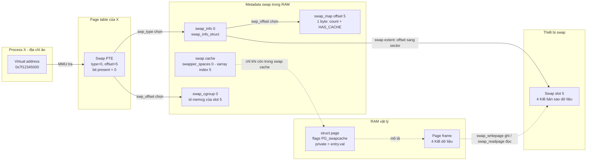

# 01 — Kiến thức nền tảng (Phần I: §3, §4)

> Mục tiêu file này: trước khi đọc một dòng code nào, bạn phải trả lời được: *"Dữ liệu của một biến trong chương trình
> thực sự nằm ở đâu, ai biết nó nằm ở đâu, và khi RAM hết thì nó đi đâu?"*

---

# §3. Swap là gì?

Mỗi khái niệm dưới đây đi theo 5 bước: **(1) Là gì · (2) Vì sao cần · (3) Hoạt động thế nào · (4) Liên quan swap · (5) Ví dụ**.

## 3.1. RAM là gì và Linux dùng RAM để làm gì?

1. **Là gì.** RAM là bộ nhớ vật lý mà CPU đọc/ghi trực tiếp, nhanh (cỡ chục–trăm nanogiây), nhưng mất dữ liệu khi tắt nguồn và có dung lượng giới hạn.
2. **Vì sao cần.** CPU chỉ thực thi lệnh và xử lý dữ liệu đang có trong RAM. Ổ đĩa chậm hơn hàng nghìn đến hàng triệu lần.
3. **Hoạt động.** Linux chia RAM thành các ô kích thước cố định gọi là **page frame** (trên board này 4 KiB `[CONFIG CONFIG_ARM64_4K_PAGES=y]`) và cấp phát từng ô cho: code + dữ liệu của process, page cache (bản sao nội dung file), cấu trúc dữ liệu của kernel (slab, page table…), buffer cho driver/DMA.
4. **Liên quan swap.** Swap chỉ tồn tại vì RAM có hạn: khi RAM bị chiếm hết, kernel cần một chỗ để "gửi tạm" dữ liệu.
5. **Ví dụ.** 1 GiB RAM = 262 144 page frame 4 KiB `[SIM tools/swap_numbers.out.txt §1]`.

## 3.2. Process sử dụng bộ nhớ như thế nào?

1. **Là gì.** Một process (chương trình đang chạy) nhìn thấy một **không gian địa chỉ** gồm nhiều vùng: code, dữ liệu tĩnh, heap (`malloc`), stack, thư viện, file được `mmap`.
2. **Vì sao cần.** Mỗi process cần ảo giác "toàn bộ bộ nhớ là của tôi" để không phải biết các process khác đang ở đâu.
3. **Hoạt động.** Kernel mô tả không gian đó bằng `struct mm_struct` (một process) và danh sách `struct vm_area_struct` (VMA, mỗi VMA là một vùng địa chỉ liên tục có cùng quyền) `[KIẾN THỨC NỀN]`. Khi `malloc` 100 MiB, kernel thường **chỉ tạo VMA**, *chưa* cấp page frame nào; page frame chỉ được cấp khi chương trình **chạm** vào từng page lần đầu (cơ chế page fault, mục 3.6 và §8).
4. **Liên quan swap.** Vì cấp phát lười (lazy) như vậy, "process dùng 600 MiB" thực chất là "600 MiB page frame đang được gắn vào địa chỉ của process". Swap gỡ bớt *một số* page frame đó ra, không gỡ cả process.
5. **Ví dụ.** `p = malloc(4096*3); p[0]=1;` → chỉ 1 page frame được cấp; 2 page còn lại chưa tồn tại trong RAM.

## 3.3. Virtual Memory là gì? Virtual address khác Physical address thế nào?

1. **Là gì.** *Virtual address* (địa chỉ ảo) là con số mà chương trình dùng (ví dụ con trỏ `0x7f12345000`). *Physical address* (địa chỉ vật lý) là vị trí thật trên chip RAM. **Virtual memory** là cơ chế phần cứng + kernel dịch địa chỉ ảo → địa chỉ vật lý cho từng truy cập.
2. **Vì sao cần.** (a) Cách ly: process A không thể đọc RAM của B. (b) Linh hoạt: dữ liệu có thể đổi chỗ trong RAM, hoặc **tạm thời không ở trong RAM** mà chương trình không biết.
3. **Hoạt động.** Bộ phận **MMU** trong CPU tra **page table** (bảng do kernel dựng, mục 3.5) để dịch. Kết quả dịch được nhớ trong **TLB** (cache dịch địa chỉ) `[KIẾN THỨC NỀN]`.
4. **Liên quan swap.** Chính vì chương trình chỉ cầm địa chỉ ảo, kernel có thể lấy page frame đi, ghi dữ liệu ra đĩa, rồi sau đó đưa dữ liệu về **một page frame khác** — chương trình vẫn dùng đúng địa chỉ ảo cũ.
5. **Ví dụ.** Địa chỉ ảo `0x7f12345000` hôm nay dịch tới frame vật lý số 0x2A000; sau khi swap out rồi swap in có thể dịch tới frame 0x31F00. Con trỏ trong chương trình không đổi.

## 3.4. Page là gì? Vì sao chia bộ nhớ thành page?

1. **Là gì.** **Page** = một khối 4 KiB *trong không gian địa chỉ ảo* (hoặc nói rộng hơn: một đơn vị dữ liệu 4 KiB). **Page frame** = một ô 4 KiB *trong RAM vật lý* (mục 4.1 làm rõ).
2. **Vì sao cần.** Quản lý từng byte là bất khả thi (bảng dịch sẽ to hơn cả RAM). Khối cố định 4 KiB giúp: bảng dịch nhỏ, cấp phát đơn giản, và mọi thao tác (dịch, bảo vệ, swap) làm theo đơn vị page.
3. **Hoạt động.** Địa chỉ ảo 39 bit được tách: 12 bit thấp = offset trong page; các bit cao = số hiệu page ảo dùng để tra page table.
4. **Liên quan swap.** **Swap làm theo đơn vị page**: mỗi lần swap out/in là 1 page (THP 2 MiB bị split thành page 4 KiB trước khi swap trên config này — `00` mục 0.2.3).
5. **Ví dụ.** Một mảng 10 000 byte chiếm 3 page; có thể page 1 nằm trong RAM còn page 2 đang ở swap.

## 3.5. Page Table làm nhiệm vụ gì?

1. **Là gì.** Cây bảng nhiều cấp (trên arm64 39-bit: 3 cấp PGD→PMD→PTE `[KIẾN THỨC NỀN]`) mà mỗi phần tử lá là một **PTE** (Page Table Entry) mô tả một page ảo.
2. **Vì sao cần.** MMU cần biết, cho mỗi page ảo: có frame không, frame nào, quyền gì.
3. **Hoạt động.** PTE "present" chứa số frame + bit quyền + bit Accessed/Dirty. PTE "không present" thì MMU **không dịch được** và sinh ra **page fault**. Trong trường hợp này, kernel được tự do dùng các bit còn lại của PTE để ghi thông tin riêng — đó chính là chỗ cất **swap entry** (mục 4.3).
4. **Liên quan swap.** Swap out = đổi PTE từ "present, trỏ tới frame X" thành "không present, chứa địa chỉ trên swap". Swap in = làm ngược lại.
5. **Ví dụ.** Trên arm64, PTE swap có bit 0–1 = 0 (không present), bit 2–7 = swap type, bit 8–57 = swap offset `[SOURCE arch/arm64/include/asm/pgtable.h:894-913]`.

## 3.6. Khi RAM còn ít, Linux phải đối mặt với vấn đề gì?

1. **Là gì.** Mọi yêu cầu cấp page frame (process chạm page mới, đọc file, driver cấp buffer) đều cần frame trống. Khi số frame trống xuống dưới các **watermark** (ngưỡng) của zone, kernel phải **thu hồi** (reclaim) frame đang dùng.
2. **Vì sao cần.** Nếu không thu hồi, yêu cầu cấp phát thất bại → chương trình bị kill (OOM) hoặc driver lỗi.
3. **Hoạt động.** `[SOURCE docs/vmscan/]` (đã nghiên cứu): `kswapd0` chạy nền khi free < low watermark; nếu không kịp, chính task đang xin bộ nhớ chạy **direct reclaim**. Cả hai vào `shrink_node()` → … → `shrink_page_list()` quyết định số phận từng page.
4. **Liên quan swap.** Reclaim có 2 loại "nguồn":
   - *page cache sạch* → bỏ luôn (đọc lại từ file khi cần);
   - *anonymous page* (heap/stack) → **không có file gốc** → chỉ thu hồi được nếu có **swap** để cất nội dung.
5. **Ví dụ.** Hệ thống không có swap: kernel chỉ có thể lấy lại page cache; nếu heap của các process chiếm gần hết RAM, reclaim thất bại → OOM killer. Trong code: nếu không còn swap thì vmscan **không quét anon list** (`scan_balance = SCAN_FILE`) `[SOURCE mm/vmscan.c:2267-2269]`.

## 3.7. Swap là gì và vì sao Linux cần nó?

1. **Là gì.** **Swap** là vùng lưu trữ trên thiết bị (đĩa, eMMC, file…) dùng làm **nơi cất tạm nội dung của anonymous page** (và page shmem/tmpfs) khi kernel muốn lấy lại page frame của chúng.
2. **Vì sao cần.** Không có swap thì anonymous page *không bao giờ* rời RAM được, kể cả khi đã nhiều giờ không ai chạm vào. Swap cho phép kernel đổi "RAM bị chiếm bởi dữ liệu lạnh" thành "RAM trống cho dữ liệu nóng".
3. **Hoạt động (tóm tắt, chi tiết ở `03`, `04`).** Chọn page lạnh → cấp một **swap slot** (ô 4 KiB trên thiết bị) → đưa page vào **swap cache** → sửa mọi PTE trỏ tới page thành **swap PTE** → ghi nội dung xuống slot → khi I/O xong và không ai giữ page, giải phóng page frame. Khi chương trình chạm lại → page fault → đọc slot vào một frame mới → khôi phục PTE.
4. **Liên quan.** Đây chính là chủ đề.
5. **Ví dụ.** Ứng dụng giữ một bảng 200 MiB chỉ dùng lúc khởi động; sau đó bảng này có thể nằm trong swap và RAM được dùng cho việc khác.

## 3.8. Swap partition và swap file là gì?

1. **Là gì.** *Swap partition*: một phân vùng block device chỉ dùng làm swap. *Swap file*: một file thường trên filesystem được dùng làm swap.
2. **Vì sao có 2 loại.** Partition đơn giản, nhanh; file linh hoạt (tạo/xoá không cần phân vùng lại).
3. **Hoạt động trong code.** Sau `swapon`, **cả hai được xử lý giống hệt nhau** nhờ **swap extent**: bảng ánh xạ "dải page trong swap area → dải block trên đĩa" `[SOURCE mm/swapfile.c:2418-2447 comment, :2448-2474 setup_swap_extents()]`. Partition = 1 extent duy nhất; file = có thể nhiều extent (lấy bằng `bmap()` trong `generic_swapfile_activate()` `[SOURCE mm/page_io.c:97-192]`, file có "lỗ" sẽ bị từ chối: `"swapon: swapfile has holes"` `:189`). Trang đầu tiên (offset 0) luôn là **swap header** chứa chữ ký `"SWAPSPACE2"` `[SOURCE mm/swapfile.c:3020]`.
4. **Liên quan swap.** Kiểu partition/file được hiển thị trong `/proc/swaps` (`"partition"` hay `"file"`) `[SOURCE mm/swapfile.c:2844-2846]`.
5. **Ví dụ.** `mkswap /dev/mmcblk0p9 && swapon /dev/mmcblk0p9` hoặc `dd if=/dev/zero of=/data/swapfile bs=1M count=2048 && mkswap /data/swapfile && swapon /data/swapfile` `[KIẾN THỨC NỀN]`.

## 3.9. Swap có làm tăng RAM vật lý không? Linux có đưa cả process ra swap không?

- **Không tăng RAM vật lý.** Số page frame vẫn là 262 144 (với 1 GiB). Swap tăng *tổng dung lượng dữ liệu có thể giữ*, nhưng dữ liệu ở swap **không dùng được trực tiếp**: CPU phải chờ đọc nó về RAM (page fault "major", chậm hơn RAM hàng nghìn lần).
- **Không đưa nguyên process.** Đơn vị là **từng page**. Trong code, `shrink_page_list()` xử lý một danh sách page lấy từ LRU, không có khái niệm "process" `[SOURCE mm/vmscan.c:1087-1514]`. Một process có thể có 30% page trong swap và 70% trong RAM cùng lúc. Một page anon được chia sẻ bởi nhiều process (sau `fork`) được xử lý một lần cho tất cả: `try_to_unmap()` sửa PTE của *mọi* process đang map nó `[SOURCE mm/rmap.c:1627-1716]`.

## 3.10. Vì sao có page swap được, có page không?

| Loại page | Có đi qua swap? | Lý do / bằng chứng |
|---|---|---|
| Anonymous page bình thường (heap, stack, `MAP_PRIVATE\|MAP_ANONYMOUS`) | **Có** | `PageAnon && PageSwapBacked` → `add_to_swap()` `[SOURCE mm/vmscan.c:1259-1279]` |
| shmem/tmpfs, `MAP_SHARED\|MAP_ANONYMOUS` | Có, nhưng qua đường `shmem_writepage()` (không đọc kỹ trong tài liệu này) | `[KIẾN THỨC NỀN]`; `try_to_unuse()` gọi `shmem_unuse()` trước `[SOURCE mm/swapfile.c:2209]` |
| Page cache của file (code, thư viện, file đọc) | **Không** — sạch thì bỏ, bẩn thì ghi về **file gốc** | nhánh `else` của `__remove_mapping()` dùng `__delete_from_page_cache()` `[SOURCE mm/vmscan.c:922-950]` |
| Anon page "lazyfree" (`MADV_FREE`) | Không — bỏ luôn nếu chưa bị ghi lại | `PageAnon && !PageSwapBacked` → `PGLAZYFREED` `[SOURCE mm/vmscan.c:1443-1453]`; `lru_lazyfree_fn()` xoá `PG_swapbacked` `[SOURCE mm/swap.c:594-618]` |
| Page bị `mlock` / unevictable | Không | `!page_evictable(page)` → `activate_locked` `[SOURCE mm/vmscan.c:1128-1129]` |
| Page đang bị DMA pin (`page_maybe_dma_pinned`) | Không (lần này) | `[SOURCE mm/vmscan.c:1263-1264]` |
| Khi `gfp_mask` không có `__GFP_IO` | Không (lần này) | `[SOURCE mm/vmscan.c:1261-1262]` |
| Bộ nhớ kernel (slab, page table, vmalloc của kernel) | Không bao giờ | không nằm trên LRU anon/file `[KIẾN THỨC NỀN]` |
| Khi WARP đặt `warp_swapout_disable=1` | Không cấp được slot | `[SOURCE mm/swapfile.c:794-797]` VENDOR |

## 3.11. Swap khác page cache của file thông thường ở điểm nào?

| | Page cache của file | Swap (swap cache + swap area) |
|---|---|---|
| "Bản gốc" của dữ liệu | File trên filesystem | **Không có bản gốc** — RAM là bản gốc cho tới khi được ghi xuống slot |
| Khoá tra cứu | `(inode->i_mapping, chỉ số page trong file)` | `(swapper_spaces[type][offset>>14], offset)` `[SOURCE include/linux/swap.h:407-412]` |
| `page->mapping` | trỏ tới `address_space` của file | swap cache **không** đặt `page->mapping`; dùng cờ `PG_swapcache` + `page->private = entry.val` `[SOURCE mm/swap_state.c:124-127 comment, :142, :159]` |
| Khi reclaim trang sạch | Bỏ, đọc lại từ file | Bỏ, nhưng **slot phải còn giữ** dữ liệu vì đó là bản duy nhất |
| Vòng đời | gắn với file | gắn với **số lượng PTE còn trỏ tới slot** (`swap_map`) |
| Ghi ra đĩa | flusher thread + `->writepage` của filesystem | `pageout()` trong reclaim → `swap_writepage()` `[SOURCE mm/page_io.c:198]` |

> Comment trong source gọi đúng bản chất: *"swapper_space is a fiction, retained to simplify the path through vmscan's shrink_page_list"* `[SOURCE mm/swap_state.c:27-30]`. Nghĩa là swap cache **mượn hình dạng** của page cache (cùng `address_space` + xarray) để code reclaim xử lý chung, nhưng không có file nào thật cả.

## 3.12. Ví dụ bắt buộc: RAM 1 GiB, swap 2 GiB, ứng dụng X đã chiếm nhiều RAM, cần chạy ứng dụng Y

> Các con số phân bổ dưới đây là **giả định minh họa**, không đo từ board. Kích thước metadata tính bởi `[SIM tools/swap_numbers.out.txt]`.

**Trạng thái ban đầu**

```
RAM 1 GiB = 262 144 frame
├── kernel + driver + page table ............ ~120 MiB   (không bao giờ swap)
├── page cache (thư viện, file đã đọc) ....... ~230 MiB   (bỏ được nếu sạch)
├── anon của ứng dụng X ...................... ~600 MiB   (chỉ thu hồi qua swap)
│     ├── "nóng": vòng lặp chính, buffer đang dùng ~150 MiB
│     └── "lạnh": dữ liệu khởi tạo, cache ít dùng   ~450 MiB
└── free ..................................... ~74 MiB
Swap 2 GiB: 524 287 slot trống (slot 0 = header)
Metadata swap trong RAM: swap_map 512 KiB + swap_cgroup 1 MiB (+16 KiB cluster_info nếu non-rotational)
```

**Bước 1 — Y bắt đầu chạm vào bộ nhớ.** Mỗi lần Y ghi vào một page chưa có frame → page fault → `do_anonymous_page()` xin 1 frame `[SOURCE mm/memory.c:4505-4507]`. Free giảm dần.

**Bước 2 — Free xuống dưới watermark.** Allocator đánh thức `kswapd0`; nếu tụt thấp hơn nữa, Y tự chạy direct reclaim (chi tiết: `docs/vmscan/02`). **Chưa có gì bị swap ở bước này** — đây chỉ là quyết định "phải thu hồi".

**Bước 3 — vmscan chọn *nguồn*.** `get_scan_count()` chia áp lực giữa file LRU và anon LRU theo `vm_swappiness` (mặc định 60 `[SOURCE mm/vmscan.c:180]`) và chi phí ghi nhận (`lru_note_cost()` `[SOURCE mm/swap.c:281-310]`). Vì có swap, anon **được phép** quét.

**Bước 4 — vmscan chọn *page*.** Mỗi page được lấy từ **đuôi inactive list** (danh sách page ít dùng). `page_check_references()` hỏi: "từ lần quét trước, có ai chạm page này không?" (bit Accessed trong PTE + cờ `PG_referenced`). Page nóng của X bị *đẩy lên active list* (`activate_locked`) thay vì bị swap. **Vì vậy page đang được dùng tích cực không phải là page bị chọn đầu tiên**: thuật toán LRU xấp xỉ ưu tiên page lâu không ai chạm.

**Bước 5 — Page cache sạch bị bỏ trước (thường rẻ hơn).** Các page thư viện/file không bẩn được `__remove_mapping()` gỡ khỏi page cache và giải phóng ngay, không cần I/O.

**Bước 6 — Page anon lạnh của X đi qua swap.** Với mỗi page (gọi là page A):
`add_to_swap(A)` cấp slot + đưa A vào swap cache → `try_to_unmap(A)` thay PTE của X bằng swap PTE → `pageout(A)` → `swap_writepage()` gửi I/O ghi → **lượt quét này A chưa được free** (đang writeback) → khi I/O xong, A được quay về đuôi inactive (`rotate_reclaimable_page()` `[SOURCE mm/swap.c:265-279]`) → lượt quét sau, A sạch, không còn ai map → `__remove_mapping()` xoá A khỏi swap cache → frame trống.
(Chi tiết từng bước: `03_flow_swap_out.md`.)

**Bước 7 — Y nhận frame.** Frame vừa thu hồi quay về buddy allocator và được cấp cho Y.

**Bước 8 — Kết quả.** X vẫn chạy bình thường. Khoảng 300 MiB "lạnh" của X giờ ở swap; 150 MiB nóng vẫn ở RAM. Nếu X chạm lại một page lạnh → major page fault → `do_swap_page()` đọc slot về (`04`). Nếu X và Y đều liên tục cần nhiều hơn 1 GiB *nóng*, hệ thống rơi vào **thrashing** (swap out/in liên tục) — swap không cứu được thiếu RAM *thực sự*.

**Phân biệt 3 việc hay bị gộp làm một:**

| Việc | Ai làm | Kết quả |
|---|---|---|
| (a) Chọn page có thể reclaim | `vmscan.c` (LRU, `page_check_references`) | danh sách ứng viên |
| (b) Đưa *dữ liệu* anon ra swap | `swap_state.c` + `swapfile.c` + `page_io.c` | dữ liệu có bản sao trên slot, PTE trỏ tới slot |
| (c) Thu hồi *page frame* | `vmscan.c` (`__remove_mapping` + `free_unref_page_list`) | frame về allocator |

(b) có thể xong mà (c) chưa xảy ra (page còn bị ai đó giữ reference, hoặc bị chạm lại → giữ trong swap cache).

---

# §4. Các khái niệm bắt buộc trước khi đọc source

Mỗi khái niệm theo khung **A. Hiểu đơn giản · B. Vấn đề · C. Ví dụ trực quan · D. Cách hoạt động · E. Source · F. Dễ nhầm · G. Tóm tắt**.

## 4.1. Page và Page Frame; `struct page`

**A. Hiểu đơn giản.** *Page frame* là "ô kệ" 4 KiB trong RAM. *Page* là "món hàng" 4 KiB (dữ liệu của một page ảo) — món hàng có thể đang nằm trên ô kệ nào đó, hoặc đang được gửi ở kho ngoài (swap). `struct page` là **phiếu quản lý** của từng ô kệ.

**B. Vấn đề.** Kernel cần biết với mỗi frame: ai đang dùng, mấy người tham chiếu, có bẩn không, đang ở danh sách LRU nào, có đang I/O không.

**C. Ví dụ.** Frame số 0x2A000 chứa page A của X. `struct page` của frame này ghi: refcount=2, mapcount=1, cờ `PG_anon`, `PG_lru`, `PG_swapbacked`… Sau khi swap in, page A có thể nằm ở frame 0x31F00 — `struct page` *của frame mới* mang thông tin của A.

**D. Hoạt động.** Mỗi frame có đúng một `struct page` (khoảng 64 byte) trong mảng `mem_map`/vmemmap `[KIẾN THỨC NỀN]`. `struct page` **chỉ chứa metadata**, không chứa 4 KiB dữ liệu. Dữ liệu nằm *trong chính frame*. Các trường quan trọng cho swap:
- `flags`: `PG_swapcache` (`= PG_owner_priv_1` `[SOURCE include/linux/page-flags.h:148]`), `PG_swapbacked`, `PG_dirty`, `PG_writeback`, `PG_locked`, `PG_uptodate`, `PG_reclaim`.
- `private`: khi page ở swap cache, chứa `swp_entry_t.val` `[SOURCE mm/swap_state.c:159 set_page_private(page + i, entry.val + i)]`.
- `_refcount` (số người giữ reference), `_mapcount` (số PTE trỏ tới).
- `mem_cgroup`: memcg đang bị tính tiền cho page này (5.10).

**E. Source.** `struct page` ở `include/linux/mm_types.h`; truy cập qua `page_private()`, `PageSwapCache()` `[SOURCE include/linux/page-flags.h:397]`.

**F. Dễ nhầm.**
- "Page đã swap out thì `struct page` của nó ở đâu?" → **Không ở đâu cả.** Khi frame được free, `struct page` đó thuộc về frame trống. Thông tin "dữ liệu A ở slot nào" khi đó nằm trong **PTE** (swap PTE) chứ không nằm trong `struct page` nào.
- `struct page` ≠ dữ liệu.

**G. Tóm tắt.**
- Page = dữ liệu/đơn vị địa chỉ ảo; page frame = ô RAM vật lý.
- `struct page` = metadata của một frame, không chứa dữ liệu.
- Page trên swap không có `struct page`; page trong RAM (kể cả trong swap cache) thì có.

## 4.2. Anonymous memory và File-backed memory

**A.** *File-backed*: page là bản sao của một đoạn file → luôn có "bản gốc" trên đĩa. *Anonymous*: page không thuộc file nào (heap, stack, `MAP_ANONYMOUS`) → **RAM là bản duy nhất**.

**B.** Khi cần thu hồi, kernel phải biết: bỏ đi có mất dữ liệu không?

**C.** Thư viện `libc.so` trong RAM: bỏ đi được, lần sau đọc lại từ file. Mảng `malloc` chứa kết quả tính toán: bỏ đi là mất; phải cất vào swap.

**D.** Phân loại trên LRU: 4 list evictable `inactive_anon`, `active_anon`, `inactive_file`, `active_file` (+ `unevictable`). `page_is_file_lru()` trả về list nào `[KIẾN THỨC NỀN]`. Khi đưa page vào LRU, `__pagevec_lru_add_fn()` chọn list theo `page_lru(page)` `[SOURCE mm/swap.c:1010-1062]`. Cặp cờ quyết định đường đi trong `shrink_page_list()`: `PageAnon && PageSwapBacked` → swap; `PageAnon && !PageSwapBacked` → lazyfree; còn lại → file.

**E.** `[SOURCE mm/vmscan.c:1259]`, `[SOURCE mm/swap.c:594-618 lru_lazyfree_fn]`.

**F.** "Anon = không bao giờ chia sẻ" → sai; sau `fork` anon page được chia sẻ copy-on-write giữa cha và con, và *một* swap slot có thể được nhiều PTE tham chiếu (mục 4.4). "shmem là file nên không dùng swap" → sai; shmem/tmpfs là `PageSwapBacked` và dùng swap.

**G.**
- File-backed: bỏ được (sạch) hoặc ghi về file (bẩn).
- Anonymous: chỉ thu hồi được nhờ swap.
- Ảnh hưởng reclaim: không có swap → vmscan bỏ qua anon list.

## 4.3. PTE và Swap Entry; `swp_entry_t`, `swp_type()`, `swp_offset()`

**A.** PTE là "dòng địa chỉ" của một page ảo. Khi dữ liệu ở RAM, dòng ghi "ở frame X". Khi dữ liệu ở swap, dòng ghi "ở **swap area số T, ô số O**" — cặp (T, O) gọi là **swap entry**.

**B.** Process vẫn giữ địa chỉ ảo; kernel cần nhớ *dữ liệu của địa chỉ đó đang ở đâu* mà không tốn thêm bộ nhớ. Giải pháp: nhét thông tin vào chính PTE không-present (MMU bỏ qua các bit này).

**C.** Page ảo `0x7f12345000`:
```
Trước:  PTE = [frame 0x2A000 | Valid=1 | AF | RW ...]          → MMU dịch được
Sau :   PTE = 0x0000000000000500  (type 0, offset 5, bit0..1=0) → MMU fault
```
`[SIM tools/swap_numbers.out.txt §3]`: type 0 offset 5 → `swp_entry.val = 0x5`, PTE arm64 = `0x500`.

**D. Hai dạng biểu diễn (quan trọng).**
1. **Dạng độc lập kiến trúc** `swp_entry_t` — `typedef struct { unsigned long val; } swp_entry_t;` `[SOURCE include/linux/mm_types.h:810-811]`. `val = (type << SWP_TYPE_SHIFT) | offset`, với `SWP_TYPE_SHIFT = BITS_PER_XA_VALUE - MAX_SWAPFILES_SHIFT` = 63 − 5 = 58 trên 64-bit `[SOURCE include/linux/swapops.h:23-24, :39-63]`. Comment: *"swp_entry_t's are never stored anywhere in their arch-dependent format"* `[:21]`.
2. **Dạng PTE của kiến trúc** — arm64: type ở bit 2–7, offset ở bit 8–57 `[SOURCE arch/arm64/include/asm/pgtable.h:894-913]`. Chuyển đổi bằng `pte_to_swp_entry()` / `swp_entry_to_pte()` `[SOURCE include/linux/swapops.h:75-94]`.

Kiểm tra "PTE này là swap PTE?": `is_swap_pte(pte) = !pte_none(pte) && !pte_present(pte)` `[SOURCE include/linux/swapops.h:66-69]`. Nhưng không phải mọi PTE không-present đều là swap thật: migration entry, device-private, hwpoison dùng **type ≥ MAX_SWAPFILES** — `do_swap_page()` lọc bằng `non_swap_entry()` `[SOURCE mm/memory.c:3380-3395]`; `MAX_SWAPFILES` = 32 − (số type đặc biệt) `[SOURCE include/linux/swap.h:94-96]` = 30 với config KM `[SIM §3]`.

**Cách source dùng `swp_type()`/`swp_offset()` (đếm được trong 5 file):**
- `swp_type(entry)` → chọn **swap area**: `swap_info[type]` (`swp_swap_info()` `[SOURCE mm/swapfile.c:3575-3578]`), `swapper_spaces[type]` (swap cache), `swap_cgroup_ctrl[type]` `[SOURCE mm/swap_cgroup.c:82]`.
- `swp_offset(entry)` → chọn **ô**: chỉ số trong `si->swap_map[]`, cluster `offset / SWAPFILE_CLUSTER` (`lock_cluster()` `[SOURCE mm/swapfile.c:357]`), xarray index trong swap cache `[SOURCE mm/swap_state.c:132]`, vị trí trong mảng `swap_cgroup` `[SOURCE mm/swap_cgroup.c:71-73]`, và block trên đĩa qua swap extent `[SOURCE mm/swapfile.c:2324-2336]`.

**E.** Bảng "từ offset tới mọi cấu trúc" — offset 300000, type 0 `[SIM §4]`:

| Cấu trúc | Vị trí |
|---|---|
| `swap_info[0]->swap_map[300000]` | 1 byte |
| cluster | `cluster_info[1171]` |
| swap cache | `swapper_spaces[0][18]`, xarray index 300000 |
| swap_cgroup | page 146 của map, phần tử 992 |
| đĩa (partition, 1 extent) | page 300000 = sector 2 400 000 |

**F. Dễ nhầm.**
- Swap entry **không phải** địa chỉ frame. Frame là chỉ số trong RAM; swap entry là chỉ số trong swap area. Hai không gian số hoàn toàn khác nhau.
- `type` không phải "loại page"; nó là **số thứ tự swap area** (comment gọi là *"strange name for an index"* `[SOURCE include/linux/swap.h:244]`).
- Offset 0 không bao giờ được cấp (là header, `swap_map[0] = SWAP_MAP_BAD` `[SOURCE mm/swapfile.c:3126]`). `entry.val == 0` được dùng như "không có entry/thất bại" (ví dụ `get_swap_page()` trả `entry.val = 0` `[SOURCE mm/swap_slots.c:311, :351]`) — an toàn vì (type 0, offset 0) không bao giờ là entry hợp lệ.
- Giới hạn phụ thuộc kiến trúc: số swap area tối đa bị giới hạn bởi số bit type trong PTE (`MAX_SWAPFILES_CHECK` `[SOURCE arch/arm64/include/asm/pgtable.h:924]`); kích thước tối đa một area bị giới hạn bởi số bit offset trong PTE — `generic_max_swapfile_size()` mã hoá entry offset ~0 rồi giải mã lại để biết còn bao nhiêu bit `[SOURCE mm/swapfile.c:2983-3003]`.

**G.**
- Swap entry = (type, offset) = (swap area nào, ô nào).
- Nằm trong PTE không-present; dạng chuẩn `swp_entry_t` khác dạng bit trong PTE.
- `swp_type` chọn area/address space/ctrl; `swp_offset` chọn ô trong mọi mảng per-slot.

## 4.4. Swap slot

**A.** Một **swap slot** là một ô 4 KiB trên swap area, đánh số bằng offset. Slot là **chỗ trên thiết bị**, không phải frame trong RAM.

**B.** Nhiều CPU/task cùng xin chỗ; cần biết ô nào trống, ô nào đang được bao nhiêu PTE tham chiếu, ô nào đang có bản sao trong RAM (swap cache), ô nào hỏng.

**C. Ví dụ slot 0..3.** (giá trị `swap_map` dạng hex; `40` = `SWAP_HAS_CACHE`)

| Sự kiện | slot0 | slot1 | slot2 | slot3 | Ghi chú |
|---|---|---|---|---|---|
| sau `swapon` | `3f` | `00` | `00` | `00` | slot 0 = header (`SWAP_MAP_BAD`) |
| cấp slot 1 cho page A | `3f` | `40` | `00` | `00` | cấp phát đặt luôn `SWAP_HAS_CACHE` |
| PTE của A chuyển thành swap PTE | `3f` | `41` | `00` | `00` | `swap_duplicate()` +1 |
| A ghi xong, rời swap cache | `3f` | `01` | `00` | `00` | `put_swap_page()` bỏ cờ cache |
| cấp slot 2 cho B, slot 3 cho C | `3f` | `01` | `40` | `40` | |
| process của A exit | `3f` | `40`→`00` | `40` | `40` | count về 0; slot qua per-CPU cache rồi mới về `00` |

(Chính xác hoá bởi mô phỏng `[SIM tools/swap_map_sim.out.txt, kịch bản 1]`.)

**D. Dữ liệu quản lý slot nằm ở đâu.**
- **Mỗi slot = 1 byte** trong `si->swap_map[]` (`unsigned char *swap_map; /* vmalloc'ed array of usage counts */` `[SOURCE include/linux/swap.h:246]`, cấp bằng `vzalloc(maxpages)` `[SOURCE mm/swapfile.c:3264]`). Byte này mã hoá: số PTE/tham chiếu (6 bit thấp, tối đa `SWAP_MAP_MAX = 0x3e`), cờ `SWAP_HAS_CACHE = 0x40`, cờ `COUNT_CONTINUED = 0x80`, giá trị đặc biệt `SWAP_MAP_BAD = 0x3f`, `SWAP_MAP_SHMEM = 0xbf` `[SOURCE include/linux/swap.h:186-196]`.
- Thống kê: `si->inuse_pages`, `si->lowest_bit`, `si->highest_bit` (khoảng có thể còn trống), toàn cục `nr_swap_pages` (slot còn trống, **đã trừ** cả slot đang nằm trong per-CPU cache) `[SOURCE mm/swapfile.c:54, :681-741, :1077]`.
- Với thiết bị non-rotational (SSD/eMMC): thêm `cluster_info[]` — 256 slot/cluster, đếm số slot dùng trong cluster + danh sách cluster trống `[SOURCE include/linux/swap.h:198-235]`.
- **Một slot chứa đúng 1 page** (4 KiB) — `bio_add_page(bio, page, thp_size(page), 0)` với THP_SWAP tắt thì luôn là 1 page `[SOURCE mm/page_io.c:43]`.

**Giải phóng.** Khi số tham chiếu về 0 **và** không còn swap cache, byte được đặt `SWAP_HAS_CACHE` tạm thời rồi slot đi qua `free_swap_slot()` → per-CPU `slots_ret[]` → `swapcache_free_entries()` → `swap_entry_free()` đặt byte về `0`, tăng `nr_swap_pages` `[SOURCE mm/swapfile.c:1238-1276, :1346-1377, :1466-1492; mm/swap_slots.c:274-304]`. Chi tiết ở `05`.

**E.** `swap_count(ent) = ent & ~SWAP_HAS_CACHE` `[SOURCE mm/swapfile.c:110-113]`. Bảng giải mã giá trị `[SIM §5]`.

**F. Dễ nhầm.**
- Slot ≠ page frame; slot ≠ swap cache.
- "Slot trống ⇔ `swap_map == 0`" đúng, nhưng "slot đã free ⇔ `swap_map == 0`" **sai trong khoảng trễ**: slot nằm trong `slots_ret[]` vẫn mang `0x40` cho đến khi batch được trả về pool (comment `[SOURCE mm/swap_slots.c:21-23, :288-292]`).
- Một slot **có thể** được nhiều PTE tham chiếu (sau `fork`): count = số PTE (+ các tham chiếu khác như shmem). Không phải 1 slot ↔ 1 process.

**G.**
- Slot = ô 4 KiB trên thiết bị, chỉ số = offset.
- Trạng thái slot = 1 byte trong `swap_map` (count + `SWAP_HAS_CACHE`).
- Cấp phát đặt `SWAP_HAS_CACHE`; về 0 hoàn toàn thì slot mới trống.

---

## Sơ đồ 8 — Quan hệ page / page frame / PTE / swap entry / swap slot / swap cache

**Cách đọc:** mỗi khối là *một nơi dữ liệu hoặc metadata thật sự nằm*. Mũi tên liền = "chứa/trỏ tới" trong trạng thái **đã swap out xong**; mũi tên đứt = quan hệ chỉ tồn tại **trong lúc page còn ở swap cache** (đang swap out hoặc vừa swap in).



**Giải thích từng mũi tên:**
1. *VA → Swap PTE*: MMU tra page table của X, gặp PTE không-present → page fault (§8).
2. *Swap PTE → swap_info 0*: `swp_type()` = 0 chọn `swap_info[0]` `[SOURCE mm/swapfile.c:101-108]`.
3. *swap_info → swap_map[5]*: `swp_offset()` = 5 chọn byte trạng thái của slot.
4. *swap_info → slot 5*: `map_swap_entry()` dùng cây extent để đổi offset sang block/sector trên đĩa `[SOURCE mm/swapfile.c:2324-2336]`.
5. *Swap PTE → swap_cgroup*: cùng (type, offset) tra memcg ID `[SOURCE mm/swap_cgroup.c:76-86]`.
6. *swap cache → struct page* (đứt): chỉ khi page còn trong RAM với `PG_swapcache`; tra bằng `find_get_page(swap_address_space(entry), offset)` `[SOURCE mm/swap_state.c:378]`.
7. *struct page → frame* (đứt): metadata mô tả frame chứa dữ liệu.
8. *frame ↔ slot* (đứt): I/O qua `page_io.c`.

**Ý chính:** sau khi swap out xong, **chỉ còn** các mũi tên liền: thông tin tìm lại dữ liệu nằm *duy nhất* trong swap PTE; dữ liệu nằm *duy nhất* trên slot; RAM chỉ giữ ~1–2 byte/slot metadata (`swap_map` + `swap_cgroup`).
