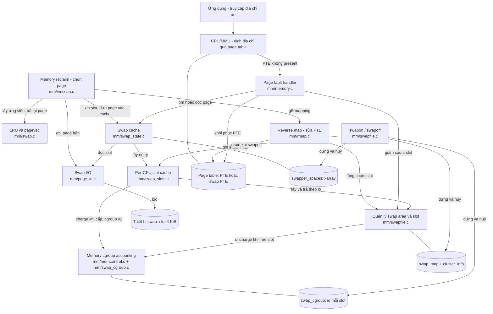

# 02 — Bức tranh tổng thể và phân tích 5 file (Phần II: §5, §6)

---

# §5. Các thành phần và trách nhiệm

## 5.1. Bốn câu hỏi phân chia trách nhiệm

Swap subsystem tách thành nhiều phần vì mỗi phần trả lời một câu hỏi khác nhau:

| Câu hỏi | Thành phần | Dữ liệu chính (nằm ở đâu) |
|---|---|---|
| *Page nào nên đi?* | Memory reclaim — `mm/vmscan.c` (+ LRU ở `mm/swap.c`) | LRU list trong `lruvec` (RAM) |
| *Cất vào ô nào trên thiết bị? Ô nào còn trống? Ô đang được bao nhiêu PTE tham chiếu?* | Quản lý swap area & slot — `mm/swapfile.c` (+ cache per-CPU ở `mm/swap_slots.c`) | `swap_info_struct`, `swap_map[]`, `cluster_info[]` (RAM, vmalloc/kvmalloc) |
| *Trong lúc I/O và ngay sau khi đọc về, page nằm ở đâu để mọi người tìm thấy cùng một bản?* | Swap cache — `mm/swap_state.c` | `swapper_spaces[type][]` (xarray), `page->private`, `PG_swapcache` (RAM) |
| *Ghi/đọc 4 KiB xuống đâu trên đĩa?* | Swap I/O — `mm/page_io.c` | bio, swap extent (RAM); **dữ liệu thật trên thiết bị** |
| *Process tìm lại dữ liệu bằng cách nào?* | Page table + fault — `mm/rmap.c` (gỡ), `mm/memory.c` (lấy lại) | swap PTE trong page table của từng process |
| *Cgroup nào chịu "tiền" cho slot này?* | Swap accounting — `mm/swap_cgroup.c` (+ `mm/memcontrol.c`) | `swap_cgroup_ctrl[type].map[]`: 2 byte/slot (RAM) |
| *Bật/tắt một vùng swap thế nào?* | `swapon`/`swapoff` — `mm/swapfile.c` | dựng/huỷ toàn bộ metadata trên |

> **Không đánh đồng:** (1) *nơi lưu dữ liệu* = slot trên thiết bị; (2) *nơi quản lý cấp phát slot* = `swap_map` + cluster + slot cache; (3) *nơi giữ page trong RAM phục vụ I/O* = swap cache; (4) *nơi ghi cgroup* = `swap_cgroup`. Bốn thứ này nằm ở bốn chỗ khác nhau và có vòng đời khác nhau.

## Sơ đồ 1 — Kiến trúc tổng thể Swap subsystem

**Cách đọc:** khối chữ nhật = thành phần (kèm file); khối trụ = dữ liệu. Mũi tên = "dùng/gọi vào" (đã kiểm chứng trong source, xem bảng dưới sơ đồ). Ít tên function, tập trung vào trách nhiệm.



**Bằng chứng cho từng mũi tên chính:**

| Mũi tên | Bằng chứng |
|---|---|
| MMU → fault handler khi PTE không present | `handle_pte_fault()` → `do_swap_page()` `[SOURCE mm/memory.c:4512-4513]` |
| reclaim → swap cache (xin slot) | `add_to_swap(page)` `[SOURCE mm/vmscan.c:1279]` |
| swap cache → slot cache → swapfile | `add_to_swap()` → `get_swap_page()` `[SOURCE mm/swap_state.c:224]` → `get_swap_pages()` `[SOURCE mm/swap_slots.c:268, :347]` |
| reclaim → rmap | `try_to_unmap(page, flags)` `[SOURCE mm/vmscan.c:1327]` |
| rmap → swapfile (tăng count), → page table | `swap_duplicate(entry)` rồi `set_pte_at(..., swp_pte)` `[SOURCE mm/rmap.c:1688, :1713]` |
| reclaim → I/O | `pageout()` → `mapping->a_ops->writepage` = `swap_writepage` `[SOURCE mm/vmscan.c:845; mm/swap_state.c:31-33]` |
| fault → swap cache | `lookup_swap_cache()`, `swapin_readahead()` `[SOURCE mm/memory.c:3399, :3435]` |
| swap cache → I/O | `swap_readpage()` `[SOURCE mm/swap_state.c:565, :692]` |
| fault → swapfile (giảm count) | `swap_free(entry)` `[SOURCE mm/memory.c:3545]` |
| slot cache → memcg | `mem_cgroup_try_charge_swap()` `[SOURCE mm/swap_slots.c:349]` |
| swapfile → memcg | `mem_cgroup_uncharge_swap()` trong `swap_entry_free()` `[SOURCE mm/swapfile.c:1375]` |
| swapoff → slot cache | `disable_swap_slots_cache_lock()` `[SOURCE mm/swapfile.c:2654]` |
| swapon dựng metadata | `vzalloc` swap_map `:3264`, `swap_cgroup_swapon` `:3321`, `init_swap_address_space` `:3367` `[SOURCE mm/swapfile.c]` |
| reclaim ↔ LRU | `rotate_reclaimable_page()` gọi từ `end_page_writeback()` `[SOURCE mm/filemap.c:1488]`; `lru_cache_add()` cho page vừa đọc về `[SOURCE mm/swap_state.c:541]` |

## 5.2. Giải thích từng thành phần bằng ngôn ngữ đơn giản

1. **Memory reclaim (`vmscan.c`)** — "người quyết định". Nó không biết ghi đĩa thế nào; nó chỉ nhìn LRU, chọn page, và lần lượt *nhờ* các thành phần khác: xin slot, gỡ PTE, ghi, rồi free frame.
2. **Cấp phát & quản lý slot (`swapfile.c`)** — "thủ kho". Giữ sổ `swap_map` (1 byte/ô), biết ô nào trống, ô nào bao nhiêu người dùng. Cũng giữ danh sách các swap area theo **priority** (`swap_avail_heads`, plist) để chọn area cao nhất còn chỗ `[SOURCE mm/swapfile.c:76-89, :1079-1130]`.
3. **Swap map** — mảng byte; không phải dữ liệu page; không phải danh sách trống (trống = byte 0, tìm bằng quét + cluster).
4. **Swap cache (`swap_state.c`)** — "phòng chờ" trong RAM. Một page đang trên đường ra/vào swap được đăng ký ở đây theo khoá (type, offset), để: ai fault vào cùng entry sẽ tìm thấy *cùng một page* thay vì đọc đĩa lần nữa; reclaim lần sau có thể bỏ page sạch mà không ghi lại.
5. **Swap I/O (`page_io.c`)** — "xe chở hàng". Đổi offset → sector qua swap extent, tạo `bio`, gửi xuống block layer, xử lý completion (`end_swap_bio_write/read`).
6. **Page table & fault** — "sổ địa chỉ của từng process". `rmap.c` ghi swap PTE khi gỡ; `memory.c` đọc swap PTE khi fault, và cũng tăng/giảm count khi `fork`/`munmap`/`exit`.
7. **Swap accounting (`swap_cgroup.c`)** — "sổ thu tiền". Ghi slot này thuộc memcg nào (2 byte ID), để khi slot được free hoặc page được đọc về thì tính đúng cgroup. Không chứa dữ liệu page.
8. **swapon/swapoff** — "mở/đóng kho": đọc header, dựng/huỷ mọi mảng; `swapoff` phải đọc mọi page còn trên area về RAM trước (`try_to_unuse()`).
9. **Giải phóng page và slot** — hai việc tách rời: frame do vmscan free; slot do `swap_map` về 0 qua `put_swap_page`/`swap_free`/`free_swap_and_cache` + `swap_slots.c`.
10. **Đồng bộ** — `swap_lock` (danh sách area), `swap_avail_lock`, `si->lock`, `ci->lock` (cluster), `si->cont_lock`, mutex/spinlock của slot cache, xarray lock của swap cache, `ctrl->lock` của swap_cgroup, page lock, PTE lock, RCU cho `get_swap_device()`. Chi tiết ở `06`.

---

# §6. Phân tích từng file

## 6.1. `mm/swap.c` — *không phải* "file swap"

**Điều quan trọng nhất:** tên file gây hiểu lầm. Comment đầu file: *"This file contains the default values for the operation of the Linux VM subsystem"* `[SOURCE mm/swap.c:8-15]`. Trong 1215 dòng, phần lớn là **quản lý LRU và giải phóng page**. Không có function nào cấp phát slot, ghi swap hay đọc swap.

**Nhóm chức năng (đã đọc toàn file):**

| Nhóm | Function/biến | Vai trò |
|---|---|---|
| Giải phóng page | `__put_page()` `:116`, `__put_single_page()` `:96`, `__page_cache_release()` `:79`, `release_pages()` `:870`, `__pagevec_release()` `:966`, `put_pages_list()` `:142` | refcount về 0 → gỡ khỏi LRU, uncharge memcg, trả frame về allocator |
| Batch per-CPU (pagevec) | `struct lru_pvecs` `:61-73` (lru_add, lru_deactivate_file, lru_deactivate, lru_lazyfree, activate_page), `struct lru_rotate` `:49-55`, `pagevec_lru_move_fn()` `:206` | gom page vào mảng per-CPU rồi mới lấy `pgdat->lru_lock` một lần cho cả lô — cùng ý tưởng "batch để giảm tranh chấp lock" mà `swap_slots.c` dùng cho slot |
| Thêm vào LRU | `lru_cache_add()` `:462`, `lru_cache_add_inactive_or_unevictable()` `:486`, `__pagevec_lru_add_fn()` `:1010` | page mới (kể cả page vừa đọc từ swap) vào LRU |
| Chuyển trạng thái LRU | `mark_page_accessed()` `:422` (inactive,unref → inactive,ref → active), `activate_page()` `:351`, `deactivate_page()` `:695`, `deactivate_file_page()` `:666`, `mark_page_lazyfree()` `:716` | tín hiệu "nóng/lạnh" cho reclaim |
| Hỗ trợ reclaim | `rotate_reclaimable_page()` `:265`, `lru_note_cost()` `:281` | page vừa ghi xong (`PG_reclaim`) được dời ra đuôi inactive để lượt sau thu hồi ngay; ghi chi phí anon/file để cân bằng quét |
| Drain | `lru_add_drain()` `:731`, `lru_add_drain_cpu()` `:625`, `lru_add_drain_all()` `:762` | đẩy các pagevec per-CPU vào LRU thật |
| Thiết lập swap | `page_cluster` `:46`, `swap_setup()` `:1179-1192` | `page_cluster = 2` nếu RAM < 16 MiB, ngược lại `3` → readahead tối đa `1 << 3 = 8` page; `swap_setup()` được gọi từ `kswapd_init()` `[SOURCE mm/vmscan.c:4108]` |
| Tra cứu page cache theo lô | `pagevec_lookup_entries()` `:1097`, `pagevec_lookup_range*()` | dùng cho truncate/writeback, không riêng swap |

**Điểm giao với swap (đã kiểm chứng call site):**
- Page vừa được đọc từ swap vào: `__read_swap_cache_async()` gọi `SetPageWorkingset(page); lru_cache_add(page);` `[SOURCE mm/swap_state.c:540-541]`; nhánh bỏ qua swap cache cũng `lru_cache_add(page)` `[SOURCE mm/memory.c:3431]`.
- Sau khi ghi swap xong: `end_page_writeback()` → `rotate_reclaimable_page()` nếu `PG_reclaim` `[SOURCE mm/filemap.c:1488]`.
- Lazyfree: `lru_lazyfree_fn()` xoá `PG_swapbacked` để page anon `MADV_FREE` **không** đi qua swap `[SOURCE mm/swap.c:594-618]` (điều kiện: `!PageSwapCache(page)`).
- `free_pages_and_swap_cache()` (swap_state.c) dùng `lru_add_drain()` + `release_pages()` từ swap.c `[SOURCE mm/swap_state.c:347-356]`.
- `swap_cluster_readahead()` gọi `lru_add_drain()` để đẩy các page readahead lên LRU `[SOURCE mm/swap_state.c:702]`.

**Kết luận:** `swap.c` cung cấp *hạ tầng LRU* mà swap dựa vào; nó **không** chứa logic swap subsystem.

## 6.2. `mm/swapfile.c` — trái tim quản lý swap area

### 6.2.1. Biến toàn cục

| Biến | Dòng | Ý nghĩa | Bảo vệ |
|---|---|---|---|
| `swap_info[MAX_SWAPFILES]` | `:91` | mảng con trỏ tới từng swap area; chỉ số = `type` | ghi dưới `swap_lock`; đọc qua `swap_type_to_swap_info()` với `smp_rmb()` `:101-108` |
| `nr_swapfiles` | `:53` | số phần tử đã dùng của mảng (không bao giờ giảm `:2926-2927`) | `swap_lock` |
| `nr_swap_pages` | `:54` | **tổng slot còn có thể cấp** (atomic) | atomic |
| `total_swap_pages` | `:62` | tổng slot của các area đang bật | `swap_lock` |
| `swap_active_head` | `:74` | plist mọi area đang active, theo priority | `swap_lock` |
| `swap_avail_heads[node]` | `:88` | plist area **còn chỗ**, theo priority (dùng khi cấp phát) | `swap_avail_lock` `:89` |
| `swapon_mutex` | `:93` | tuần tự hoá swapon/swapoff với `/proc/swaps` | mutex |
| `nr_rotate_swap` | `:99` | số area trên đĩa quay (HDD) → quyết định kiểu readahead | atomic |

### 6.2.2. `struct swap_info_struct` — một swap area `[SOURCE include/linux/swap.h:240-294]`

| Trường | Ý nghĩa |
|---|---|
| `flags` | `SWP_USED`, `SWP_WRITEOK` (được cấp slot mới), `SWP_VALID` (được thao tác qua `get_swap_device`), `SWP_SOLIDSTATE`, `SWP_BLKDEV`, `SWP_SYNCHRONOUS_IO`, `SWP_FS_OPS`, `SWP_*DISCARD*`, `SWP_CONTINUED`, `SWP_SCANNING` (dùng như **bộ đếm** người đang quét: `flags += SWP_SCANNING` `[SOURCE mm/swapfile.c:799, :947, :989]`) `[SOURCE include/linux/swap.h:164-181]` |
| `prio`, `list`, `avail_lists[]` | priority và nút trong 2 plist |
| `type` | chỉ số trong `swap_info[]` |
| `max` | kích thước `swap_map` (= số page kể cả header) |
| `swap_map` | **1 byte/slot** — xem 4.4 |
| `cluster_info`, `free_clusters`, `discard_clusters`, `percpu_cluster`, `cluster_next_cpu` | quản lý theo cluster 256 slot (chỉ khi non-rotational) |
| `lowest_bit`, `highest_bit` | giới hạn vùng có thể còn trống (thu hẹp vùng quét) |
| `pages`, `inuse_pages` | tổng slot dùng được, số slot đang dùng |
| `cluster_next`, `cluster_nr` | vị trí gợi ý cho lần cấp kế tiếp (HDD) |
| `swap_extent_root` | rbtree extent offset→block |
| `bdev`, `swap_file` | thiết bị / file |
| `lock` | spinlock bảo vệ các trường quét (comment `:265-277`) |
| `cont_lock` | bảo vệ danh sách continuation page |
| `discard_work` | worker discard cluster |

### 6.2.3. Nhóm function theo chức năng

**(1) Cấp phát slot**

```
get_swap_pages(n_goal, entries[], entry_size)          :1056   (gọi từ swap_slots.c)
 ├─ trừ trước nr_swap_pages theo n_goal                 :1069-1077
 ├─ duyệt swap_avail_heads[node] theo priority, requeue :1081-1083  (round-robin giữa area cùng prio)
 ├─ spin_lock(&si->lock)
 ├─ scan_swap_map_slots(si, SWAP_HAS_CACHE, n, slots)   :771
 │    ├─ [VENDOR] warp_swapout_disable → return 0       :794-797
 │    ├─ SSD: scan_swap_map_try_ssd_cluster()           :611  (mỗi CPU một cluster riêng)
 │    ├─ HDD: tìm cluster trống tuần tự từ lowest_bit   :815-852
 │    ├─ checks: !SWP_WRITEOK / !highest_bit → no_page  :865-868
 │    ├─ nếu vm_swap_full() và slot chỉ còn HAS_CACHE → __try_to_reclaim_swap() rồi dùng lại :873-884
 │    ├─ WRITE_ONCE(si->swap_map[offset], usage)         :893   ← đánh dấu đã dùng (usage = SWAP_HAS_CACHE)
 │    ├─ inc_cluster_info_page()                         :894
 │    └─ swap_range_alloc() → inuse_pages++, có thể del_from_avail_list :681-696
 └─ cộng lại nr_swap_pages phần không lấy được           :1134-1137
```
- `swap_alloc_cluster()` `:993` chỉ cho THP_SWAP (tắt trên board: `VM_WARN_ON_ONCE` và trả 0 `:1004-1007`).
- `get_swap_page_of_type()` `:1143` *"The only caller of this function is now suspend routine"* — dùng cho hibernation, cấp với usage=1 (không phải `SWAP_HAS_CACHE`).

**(2) Tăng tham chiếu**

| Function | Dòng | Dùng khi |
|---|---|---|
| `__swap_duplicate(entry, usage)` | `:3473-3535` | lõi: kiểm tra + cập nhật byte dưới `lock_cluster_or_swap_info()` |
| `swap_duplicate(entry)` | `:3553` | +1 count: `try_to_unmap_one()` (`rmap.c:1688`), `fork` (`memory.c:716`); nếu count đầy → `add_swap_count_continuation()` |
| `swapcache_prepare(entry)` | `:3570` | đặt `SWAP_HAS_CACHE` khi chuẩn bị đọc vào swap cache; `-EEXIST` nếu đã có người khác |
| `swap_shmem_alloc(entry)` | `:3541` | đánh dấu slot của shmem (`SWAP_MAP_SHMEM`) |
| `add_swap_count_continuation()` / `swap_count_continued()` | `:3617` / `:3729` | count > 62: "chữ số" cao lưu ở page phụ, *"Think of how you add 1 to 999"* `:3753` |

**(3) Giảm tham chiếu và giải phóng**

| Function | Dòng | Giảm gì | Khi nào |
|---|---|---|---|
| `__swap_entry_free_locked(p, off, usage)` | `:1238` | usage=1: count−1; usage=`SWAP_HAS_CACHE`: bỏ cờ cache. **Nếu kết quả = 0 thì ghi tạm `SWAP_HAS_CACHE`** `:1270-1273` | lõi |
| `swap_free(entry)` → `__swap_entry_free()` | `:1383` → `:1346` | count−1; nếu về 0 → `free_swap_slot()` | `do_swap_page` sau khi map lại `memory.c:3545`; `unuse_pte` |
| `put_swap_page(page, entry)` | `:1395` | bỏ `SWAP_HAS_CACHE`; nếu về 0 → `free_swap_slot()` | page rời swap cache (`__remove_mapping` `vmscan.c:921`, `delete_from_swap_cache` `swap_state.c:281`), hoặc `add_to_swap` thất bại |
| `free_swap_and_cache(entry)` | `:1802` | count−1; nếu chỉ còn cache → thử bỏ page cache `__try_to_reclaim_swap(TTRS_UNMAPPED\|TTRS_FULL)` | `zap_pte_range()` khi munmap/exit `memory.c:1342` |
| `try_to_free_swap(page)` | `:1763` | page đang ở swap cache, **không còn PTE nào trỏ slot** (`!page_swapped`) và không writeback → `delete_from_swap_cache()` + `SetPageDirty` | nhiều nơi: sau swap-in khi swap đầy, `swap_writepage`, swapoff |
| `swapcache_free_entries(entries, n)` → `swap_entry_free()` | `:1466` → `:1362` | **thật sự** đặt byte về 0, `dec_cluster_info_page`, `mem_cgroup_uncharge_swap`, `swap_range_free` (nr_swap_pages++, discard notify, xoá shadow) | gọi từ `swap_slots.c` theo lô |
| `reuse_swap_page(page, ...)` | `:1723` | nếu page chỉ có 1 người dùng → xoá khỏi swap cache, ghi được không cần COW | `do_swap_page` khi fault ghi `memory.c:3520` |

**(4) Kiểm tra/khóa an toàn với swapoff**

- `get_swap_device(entry)` / `put_swap_device(si)` `:1318-1344`, `include/linux/swap.h:489-492`: `rcu_read_lock()` + kiểm tra `SWP_VALID` và `offset < si->max`. Comment dài `:1278-1317` giải thích: giữa lúc đọc PTE và lúc dùng `si->swap_map`, `swapoff` có thể đã chạy; `swapoff` xoá `SWP_VALID` rồi `synchronize_rcu()` (`:2671-2678`) nên mọi đoạn đang trong RCU read-side sẽ xong trước khi metadata bị free.
- `__swap_info_get()` / `_swap_info_get()` / `swap_info_get()` `:1166-1220`: kiểm tra entry hợp lệ, in lỗi `"swap_info_get: Bad swap file entry"`, `"Unused swap offset entry"`… — đây là các log bạn sẽ thấy khi PTE bị hỏng.

**(5) Đổi offset → vị trí trên đĩa**

`struct swap_extent { start_page, nr_pages, start_block }` `[SOURCE include/linux/swap.h:150-155]`, lưu trong rbtree; `offset_to_swap_extent()` `:204`, `map_swap_entry()` `:2324`, `swap_page_sector()` `:223` (trả sector 512 byte), `add_swap_extent()` `:2378`, `setup_swap_extents()` `:2448`.

**(6) Cluster (thiết bị non-rotational)**

- `struct swap_cluster_info { spinlock_t lock; data:24; flags:8 }` `[SOURCE include/linux/swap.h:208-217]`: `data` = số slot đang dùng (nếu cluster bận) **hoặc** chỉ số cluster kế (nếu cluster nằm trong free list). Đây là danh sách liên kết "nhét vào mảng", không cần con trỏ.
- `lock_cluster()` `:350`, `lock_cluster_or_swap_info()` `:373`: với SSD khoá **mịn** theo cluster (`ci->lock`); với HDD (không có `cluster_info`) khoá **thô** `si->lock`.
- `inc_cluster_info_page()` / `dec_cluster_info_page()` `:547` / `:567`; về 0 → `free_cluster()` → nếu có `SWP_PAGE_DISCARD` thì lên lịch discard (đánh dấu cả cluster `SWAP_MAP_BAD` trong lúc discard để không bị cấp `:452-467`).
- `struct percpu_cluster` `[SOURCE include/linux/swap.h:227-230]`: mỗi CPU giữ một cluster hiện hành → các CPU ghi vào các vùng khác nhau, tăng tuần tự, ít đụng lock.

**(7) swapon/swapoff** — chi tiết ở `05`. `SYSCALL_DEFINE2(swapon)` `:3182`, `SYSCALL_DEFINE1(swapoff)` `:2582`, `try_to_unuse()` `:2190`, `unuse_*()` `:1932-2152`.

**(8) Thông tin** — `/proc/swaps` (`swap_show()` `:2825`), `si_swapinfo()` `:3445` (cho `free`/`/proc/meminfo`), `page_swapcount()` `:1499`, `__swap_count()` `:1518`, `swp_swapcount()` `:1566`.

### 6.2.4. Ý nghĩa của `SWAP_HAS_CACHE` (theo comment + logic)

Định nghĩa: `#define SWAP_HAS_CACHE 0x40 /* Flag page is cached, in first swap_map */` `[SOURCE include/linux/swap.h:187]`. Từ logic thực tế, cờ này đóng **ba vai trò**:

1. **"Có (hoặc sắp có) một page trong swap cache cho slot này."** `add_to_swap()` lấy slot đã có cờ (cấp phát với `usage = SWAP_HAS_CACHE` `[SOURCE mm/swapfile.c:1106]`), page vào swap cache; khi page rời swap cache thì `put_swap_page()` bỏ cờ.
2. **Khoá loại trừ cho việc "ai được đưa page vào swap cache".** `swapcache_prepare()` chỉ thành công nếu cờ chưa có và count > 0; nếu đã có → `-EEXIST` `[SOURCE mm/swapfile.c:3504-3512]`. Trong `__read_swap_cache_async()`, task thua sẽ `schedule_timeout_uninterruptible(1)` rồi thử lại, vì có thể đang đua với `__delete_from_swap_cache()` hoặc một `__read_swap_cache_async()` khác đã đặt cờ nhưng chưa thêm page `[SOURCE mm/swap_state.c:508-515]`. Nhờ vậy **không bao giờ có hai page khác nhau trong RAM cùng đại diện cho một slot**.
3. **Giữ slot "đã cấp" khi chưa (hoặc không còn) PTE nào tham chiếu.** Ngay sau cấp phát count = 0 nhưng slot không được cấp cho người khác; slot nằm trong per-CPU cache (cả `slots[]` lẫn `slots_ret[]`) cũng mang `SWAP_HAS_CACHE` — comment: *"The swap entry allocated is marked with SWAP_HAS_CACHE flag in map_count that prevents it from being allocated again from the global pool"* `[SOURCE mm/swap_slots.c:21-23]`; và `__swap_entry_free_locked()` ghi `SWAP_HAS_CACHE` khi kết quả = 0 `[SOURCE mm/swapfile.c:1270-1273]`.

Hệ quả thực tế: khi swap đầy hơn 50% (`vm_swap_full()` `[SOURCE include/linux/swap.h:447-451]`), bộ cấp phát coi các slot **chỉ còn `SWAP_HAS_CACHE`** là "có thể tái chế": gọi `__try_to_reclaim_swap(..., TTRS_ANYWAY)` để bỏ page khỏi swap cache và dùng lại slot `[SOURCE mm/swapfile.c:873-884, :957-961]`.

## 6.3. `mm/swap_state.c` — swap cache

**A. Hiểu đơn giản.** Swap cache là **một "page cache" giả** cho swap: một bảng tra (type, offset) → `struct page` đang ở RAM. **Page vẫn nằm trong RAM**; swap cache không lưu gì trên đĩa.

**B. Vì sao cần.** Ba vấn đề mà nếu không có swap cache sẽ rất khó:
1. *Nhiều PTE cùng trỏ một slot* (sau fork). Cha fault trước, đọc slot về page P. Con fault sau — phải tìm thấy **P**, không phải đọc ra P' khác (mất tính chia sẻ, tốn RAM, và hai bản có thể lệch nhau).
2. *Khoảng thời gian I/O*. Trong lúc đang ghi page ra slot, PTE đã là swap PTE. Nếu process fault đúng lúc đó, nó phải lấy lại *chính page trong RAM* (dữ liệu chưa chắc đã xuống đĩa).
3. *Tránh ghi lại.* Page vừa đọc về mà chưa bị sửa vẫn có bản trên slot; nếu bị reclaim lần nữa thì chỉ cần bỏ, không cần ghi lại.

**C. Cấu trúc dữ liệu.**
- `struct address_space *swapper_spaces[MAX_SWAPFILES]` `[SOURCE mm/swap_state.c:39]`: với mỗi swap area, một **mảng** `address_space`, mỗi phần tử phủ `SWAP_ADDRESS_SPACE_PAGES = 1 << 14` slot (64 MiB) — chia nhỏ để giảm tranh chấp lock xarray `[SOURCE include/linux/swap.h:406-412]`. Với 2 GiB: 32 address_space `[SIM §1]`. Tạo trong `init_swap_address_space()` `[SOURCE mm/swap_state.c:707-728]`, `a_ops = &swap_aops` (`writepage = swap_writepage`, `set_page_dirty = swap_set_page_dirty`) `:31-37`.
- Quan hệ page ↔ entry ↔ cache: `xarray[offset] = page`; `page->private = entry.val`; cờ `PG_swapcache`; refcount +1 (`page_ref_add(page, nr)`) `[SOURCE mm/swap_state.c:141-160]`. Swap cache tính vào `NR_FILE_PAGES` `[:165]`.
- *Shadow entry*: khi page bị reclaim khỏi swap cache, vị trí xarray có thể giữ một giá trị "bóng" (`workingset_eviction()`) để lúc đọc lại biết page bị đuổi bao lâu rồi (phát hiện thrashing) `[SOURCE mm/vmscan.c:917-919; mm/swap_state.c:154-157, :536-537]`.

**D. Các function chính.**

| Function | Dòng | Làm gì |
|---|---|---|
| `add_to_swap(page)` | `:216-264` | **cho swap out**: `get_swap_page()` → `add_to_swap_cache(page, entry, __GFP_HIGH\|__GFP_NOMEMALLOC\|__GFP_NOWARN)` → `set_page_dirty(page)` (luôn đánh dấu bẩn để chắc chắn được ghi — comment về `MADV_FREE` `:247-256`). Thất bại → `put_swap_page()` trả slot, return 0 |
| `add_to_swap_cache(page, entry, gfp, shadowp)` | `:128-177` | yêu cầu page đã lock, `PageSwapBacked`, chưa `PageSwapCache`; tăng ref, `SetPageSwapCache`, ghi xarray, `set_page_private`; trả shadow cũ nếu có; lỗi (thiếu bộ nhớ cho node xarray) → hoàn tác |
| `__delete_from_swap_cache(page, entry, shadow)` | `:183-207` | gỡ khỏi xarray (để lại shadow nếu có), `set_page_private(0)`, `ClearPageSwapCache`; **không** trả slot, **không** giảm ref — người gọi phải làm |
| `delete_from_swap_cache(page)` | `:272-283` | khoá xarray + `__delete_from_swap_cache` + `put_swap_page()` (bỏ `SWAP_HAS_CACHE`) + `page_ref_sub()`. Comment: *"It will never put the page into the free list, the caller has a reference"* |
| `lookup_swap_cache(entry, vma, addr)` | `:369-416` | `get_swap_device()` → `find_get_page()`; nếu thấy: cập nhật thống kê readahead (`PG_readahead`, `SWAP_RA_HIT`) |
| `__read_swap_cache_async(...)` | `:451-549` | tìm trong cache; nếu không có: cấp page mới, `swapcache_prepare()` (giành `SWAP_HAS_CACHE`), lock page, `add_to_swap_cache`, `mem_cgroup_charge`, `workingset_refault`, `lru_cache_add`; *chưa* đọc I/O, báo `new_page_allocated` |
| `read_swap_cache_async(...)` | `:557-568` | gọi hàm trên; nếu page mới thì `swap_readpage()` |
| `swapin_readahead()` | `:891-897` | chọn `swap_vma_readahead()` (theo địa chỉ ảo lân cận) hay `swap_cluster_readahead()` (theo offset lân cận trên đĩa) |
| `free_swap_cache()`, `free_page_and_swap_cache()`, `free_pages_and_swap_cache()` | `:324-356` | khi unmap: nếu page ở swap cache và không còn ai map → `try_to_free_swap()` |
| `clear_shadow_from_swap_cache()` | `:285` | xoá shadow khi slot được free (`swap_range_free` `swapfile.c:740`) |
| `get_shadow_from_swap_cache()` | `:110` | dùng ở nhánh bỏ qua swap cache của `do_swap_page` |
| `show_swap_cache_info()` | `:99-108` | in `"pages in swap cache"`, `"Swap cache stats: add/delete/find"` — xuất hiện trong log OOM/SysRq-m |

**E. Readahead khi swap in.**
- *Cluster readahead* `[SOURCE mm/swap_state.c:649-705]`: đọc khối offset căn chỉnh cỡ `swapin_nr_pages()` quanh offset bị fault (bỏ offset 0 = header); kích thước thích nghi theo số lần "trúng" readahead trước (`swapin_readahead_hits`) qua `__swapin_nr_pages()` `:570-608` (comment thật thà: *"please don't ask what the '+ 2' means"*). Ví dụ `[SIM §6]`: hits=0 & không liền kề → 1 page; hits=1 → 4; hits≥3 → 8 (max với `page_cluster=3`).
- *VMA readahead* `[SOURCE mm/swap_state.c:750-877]`: đọc các swap PTE **lân cận theo địa chỉ ảo** trong cùng VMA và cùng PMD, cửa sổ tối đa `1 << min(page_cluster, SWAP_RA_ORDER_CEILING=5)`, trạng thái lưu trong `vma->swap_readahead_info`.
- Lựa chọn: `swap_use_vma_readahead()` = `enable_vma_readahead && !nr_rotate_swap` `[SOURCE mm/swap_state.c:358-361]` → **có bất kỳ area nào trên HDD thì dùng cluster readahead**. Bật/tắt: `/sys/kernel/mm/swap/vma_ra_enabled` `[:899-952]`.
- Page readahead được đánh dấu `PG_readahead`; nếu sau đó thật sự được dùng (`lookup_swap_cache` thấy cờ) → tính "hit" để mở rộng cửa sổ.

**F. Dễ nhầm.** (1) Swap cache không phải vùng đĩa. (2) Xoá khỏi swap cache ≠ free frame (page vẫn có thể đang được map). (3) Có đường **bỏ qua swap cache** cho thiết bị `SWP_SYNCHRONOUS_IO` khi `__swap_count(entry) == 1` `[SOURCE mm/memory.c:3405-3433]` — xem `04`.

**G. Tóm tắt.** Swap cache = chỉ mục RAM theo (type, offset); giải quyết chia sẻ, đua I/O và tránh ghi lại; mọi đường swap in/out đi qua nó (trừ một đường tối ưu).

## 6.4. `mm/swap_slots.c` — per-CPU cache swap slot

**A. Hiểu đơn giản.** Thay vì mỗi lần cần một slot lại đến "quầy trung tâm" (`get_swap_pages()` + khoá `swap_avail_lock` và `si->lock`), mỗi CPU lấy sẵn **một lô 64 slot** (`SWAP_SLOTS_CACHE_SIZE = SWAP_BATCH = 64` `[SOURCE include/linux/swap_slots.h:9; include/linux/swap.h:33]`) cất trong túi riêng. Slot trả về cũng gom vào túi riêng rồi mới trả quầy một lần.

**B. Vấn đề.** Reclaim mạnh có thể cấp hàng chục nghìn slot mỗi giây trên mọi CPU; nếu lần nào cũng khoá toàn cục, các CPU xếp hàng chờ nhau (lock contention, cache line nhảy giữa các core). Comment đầu file: lợi ích là *"no needing to acquire the swap_info lock every time we need a new slot"*; trả slot theo lô *"allows the slots to coalesce and reduce fragmentation"* `[SOURCE mm/swap_slots.c:10-19]`.

**C. Cấu trúc.**

```c
struct swap_slots_cache {               /* include/linux/swap_slots.h:13-22 */
    bool         lock_initialized;
    struct mutex alloc_lock;   /* protects slots, nr, cur */
    swp_entry_t *slots;        /* lô slot để CẤP (đã đánh dấu SWAP_HAS_CACHE) */
    int          nr;           /* còn bao nhiêu */
    int          cur;          /* đang ở vị trí nào */
    spinlock_t   free_lock;    /* protects slots_ret, n_ret */
    swp_entry_t *slots_ret;    /* lô slot ĐÃ TRẢ, chờ trả về pool */
    int          n_ret;
};
static DEFINE_PER_CPU(struct swap_slots_cache, swp_slots);   /* swap_slots.c:37 */
```
"Global swap slot pool" trong ngôn ngữ của đề bài = **toàn bộ slot có `swap_map == 0` trong các swap area**, được cấp qua `get_swap_pages()` (swapfile.c). Không có một struct "pool" riêng.

**D. Các luồng.**

| Function | Dòng | Luồng |
|---|---|---|
| `get_swap_page(page)` | `:306-354` | THP (+THP_SWAP) → `get_swap_pages(1, &entry, HPAGE_PMD_NR)`; ngược lại: nếu `check_cache_active()` và `cache->slots` → `mutex_lock(&cache->alloc_lock)` → lấy `slots[cur++]`, nếu hết → `refill_swap_slots_cache()` rồi lấy lại; nếu vẫn không có → `get_swap_pages(1, &entry, 1)` trực tiếp. Cuối cùng `mem_cgroup_try_charge_swap()`; nếu memcg từ chối → `put_swap_page()` và trả entry 0 |
| `refill_swap_slots_cache(cache)` | `:261-272` | gọi khi đang giữ `alloc_lock`; chỉ nạp khi cache rỗng: `cache->nr = get_swap_pages(64, cache->slots, 1)` |
| `free_swap_slot(entry)` | `:274-304` | nếu cache dùng được: `spin_lock_irq(&cache->free_lock)`, kiểm tra lại (cache có thể vừa bị tắt), nếu `slots_ret` đầy 64 → `swapcache_free_entries(slots_ret, n_ret)` trả cả lô, rồi thêm entry; ngược lại `swapcache_free_entries(&entry, 1)` |
| `check_cache_active()` | `:92-112` | tắt cache khi `nr_swap_pages < ncpu × 2 × 64` (`THRESHOLD_DEACTIVATE`), bật lại khi `> ncpu × 5 × 64` (`THRESHOLD_ACTIVATE`) — **hysteresis** tránh bật/tắt liên tục. Với 4 CPU: tắt < 512, bật > 1280 `[SIM §2]` |
| `deactivate_swap_slots_cache()` | `:53-59` | `swap_slot_cache_active=false` + drain mọi CPU |
| `drain_slots_cache_cpu(cpu, type, free_slots)` | `:169-199` | trả `slots[cur..cur+nr)` (dưới `alloc_lock`) và `slots_ret[]` (dưới `free_lock`) về pool bằng `swapcache_free_entries()`; `free_slots=true` thì free luôn mảng (CPU offline) |
| `__drain_swap_slots_cache(type)` | `:201-230` | lặp `for_each_online_cpu`; comment giải thích vì sao **không** lấy cpu-hotplug lock ở đây (có thể bị gọi từ chính đường hotplug → reclaim) |
| `disable_swap_slots_cache_lock()` / `reenable_swap_slots_cache_unlock()` | `:69-90` | cặp dùng bởi `swapoff`: giữ `swap_slots_cache_enable_mutex` suốt quá trình, tắt + drain (dưới `get_online_cpus()`), bật lại theo `has_usable_swap()` |
| `enable_swap_slots_cache()` | `:240-258` | gọi cuối `swapon` thành công `[SOURCE mm/swapfile.c:3440-3441]`; lần đầu đăng ký CPU hotplug `cpuhp_setup_state(CPUHP_AP_ONLINE_DYN, "swap_slots_cache", alloc_swap_slot_cache, free_slot_cache)` |
| `alloc_swap_slot_cache(cpu)` / `free_slot_cache(cpu)` | `:114-167` / `:232-238` | CPU online: cấp 2 mảng 64 entry (cấp **ngoài** mutex vì `kvcalloc` có thể gây reclaim → `get_swap_page` → mutex — comment `:119-123`); CPU offline: drain + free mảng |

**Vì sao trả slot về pool theo nhóm?** (1) Mỗi lần trả là một lần lấy `si->lock` — gộp 64 lần thành 1. (2) Slot không được *dùng lại ngay* từ `slots_ret` (cấp phát chỉ lấy từ `slots[]`); dồn về pool một lượt giúp các slot liền kề trống cùng lúc → lần cấp sau dễ có dải liên tục (giảm phân mảnh) `[SOURCE mm/swap_slots.c:15-19]`.

**Vì sao phải quản lý cache khi swapoff / hotplug / swap thấp?**
- *swapoff*: slot của area sắp gỡ có thể đang nằm trong túi của CPU nào đó; nếu không drain, `try_to_unuse()` không bao giờ thấy `inuse_pages` về 0, hoặc tệ hơn, sau khi gỡ area một CPU vẫn cấp ra entry trỏ vào area đã chết. Comment `[SOURCE mm/swap_slots.c:205-212]`: *"during swapoff, when we have to make sure no left over slots are in cache when we remove a swap device"*.
- *CPU offline*: túi của CPU đó không còn ai dùng → `free_slot_cache()` trả về pool.
- *Swap thấp*: mỗi CPU có thể giữ tới 128 slot (64 cấp + 64 trả) → với 4 CPU tới 512 slot (2 MiB) không ai dùng được `[SIM §2]`. Khi pool sắp cạn, CPU A có thể thất bại trong khi CPU B đang ôm slot thừa — mô phỏng `[SIM kịch bản 3]`. Vì vậy cache tự tắt và drain dưới ngưỡng `[SIM kịch bản 4]`.

**Mutex và spinlock bảo vệ gì** (chi tiết `06` §13):

| Khoá | Loại | Bảo vệ | Vì sao loại đó |
|---|---|---|---|
| `cache->alloc_lock` | mutex | `slots`, `nr`, `cur` | đường cấp có thể **ngủ** trong `refill` → `get_swap_pages()` → `scan_swap_map_slots()` (`cond_resched()`) — comment `[SOURCE mm/swap_slots.c:25-27, :319-327]` |
| `cache->free_lock` | spinlock (`_irq`) | `slots_ret`, `n_ret` | đường trả slot có thể được gọi trong ngữ cảnh không được ngủ (đang giữ PTE lock, xarray lock…) |
| `swap_slots_cache_mutex` | mutex toàn cục | bật/tắt `swap_slot_cache_active`, cấp/free mảng per-CPU | |
| `swap_slots_cache_enable_mutex` | mutex toàn cục | tuần tự hoá enable/disable (swapon/swapoff) | |

Lưu ý: `get_swap_page()` dùng `raw_cpu_ptr()` và **cho phép preempt** — task có thể bị chuyển CPU giữa chừng, nhưng vẫn an toàn vì mọi truy cập được bảo vệ bởi `alloc_lock` của cache *mà nó đã chọn*, không phải bởi "đang chạy trên CPU đó" `[SOURCE mm/swap_slots.c:319-328]`.

## 6.5. `mm/swap_cgroup.c` — swap accounting theo memory cgroup

**A. Hiểu đơn giản.** *Memory cgroup* (memcg) là nhóm process bị giới hạn/đo lượng bộ nhớ (ví dụ một container được phép 200 MiB RAM + 100 MiB swap). Khi một page của nhóm bị đẩy ra swap, "tiền" của nó phải được ghi cho nhóm đó, kể cả khi page không còn trong RAM (không còn `struct page` để ghi `page->mem_cgroup`). `swap_cgroup` là **cuốn sổ 2 byte/slot** ghi *ID của memcg sở hữu slot*.

**B. Vì sao cần.** (1) Áp giới hạn swap theo nhóm (`memory.swap.max` ở v2, `memsw` ở v1). (2) Khi slot được free, biết uncharge nhóm nào. (3) Khi swap in, biết charge page mới cho nhóm nào (dù process fault có thể thuộc nhóm khác).

**C. Dữ liệu** `[SOURCE mm/swap_cgroup.c:9-20]`:
```c
struct swap_cgroup_ctrl { struct page **map; unsigned long length; spinlock_t lock; };
static struct swap_cgroup_ctrl swap_cgroup_ctrl[MAX_SWAPFILES];   /* 1 ctrl / swap area */
struct swap_cgroup { unsigned short id; };                        /* 2 byte / slot */
#define SC_PER_PAGE (PAGE_SIZE/sizeof(struct swap_cgroup))       /* 2048 */
```
`map` là mảng con trỏ tới các **page frame riêng lẻ** (không cần liên tục), mỗi page chứa 2048 ID. Với 2 GiB swap: 256 page = 1 MiB `[SIM §1]`.

Tra cứu: `lookup_swap_cgroup(ent)` → `ctrl = &swap_cgroup_ctrl[swp_type(ent)]` → `__lookup_swap_cgroup(ctrl, swp_offset(ent))` = `page_address(map[offset / 2048]) + offset % 2048` `[SOURCE mm/swap_cgroup.c:65-86]`.

**D. Function.**

| Function | Dòng | Làm gì | Ai gọi (đã kiểm chứng) |
|---|---|---|---|
| `swap_cgroup_record(ent, id, nr)` | `:126-154` | dưới `ctrl->lock` (irqsave), ghi `id` cho `nr` slot liên tiếp, trả ID cũ | `mem_cgroup_try_charge_swap()` (ghi id) `memcontrol.c:7331`; `mem_cgroup_swapout()` (ghi id) `:7259`; `mem_cgroup_uncharge_swap()` (ghi 0, lấy id cũ để uncharge) `:7348` |
| `lookup_swap_cgroup_id(ent)` | `:162-165` | đọc ID, **không** khoá | `mem_cgroup_charge()` khi page swap-in: charge vào memcg gốc của slot `memcontrol.c:6827` |
| `swap_cgroup_cmpxchg(ent, old, new)` | `:97-115` | dưới `ctrl->lock`: nếu id == old thì đổi thành new; trả old hoặc 0 | `mem_cgroup_move_swap_account()` `memcontrol.c:3315-3329` — chuyển charge khi task đổi cgroup (v1, `move_charge_at_immigrate`) |
| `swap_cgroup_swapon(type, max_pages)` | `:167-201` | `vzalloc` mảng con trỏ, `swap_cgroup_prepare()` cấp từng page `GFP_KERNEL\|__GFP_ZERO`, dưới `swap_cgroup_mutex` | `swapon` `swapfile.c:3321` |
| `swap_cgroup_swapoff(type)` | `:203-227` | tháo `map` dưới mutex, rồi free từng page (ngoài mutex, `cond_resched` mỗi 32 page) | `swapoff` `:2727`; lỗi swapon `:3419` |

**Thời điểm ghi sổ phụ thuộc cgroup v1/v2** `[SOURCE mm/memcontrol.c]`:

| Sự kiện | cgroup v2 (`cgroup_subsys_on_dfl`) | cgroup v1 |
|---|---|---|
| `get_swap_page()` cấp slot | `mem_cgroup_try_charge_swap()` charge `memcg->swap` + **ghi ID** `:7297-7336` | hàm trả 0 ngay `:7304-7305` |
| page rời swap cache khi reclaim (`__remove_mapping`) | `mem_cgroup_swapout()` return ngay `:7240-7241` | `mem_cgroup_swapout()` **ghi ID**, chuyển charge memory → memsw `:7231-7286` |
| page được đọc về (`mem_cgroup_charge`) | `lookup_swap_cgroup_id()` để chọn memcg | như v2, thêm: uncharge memsw ngay và xoá ID `:6862-6870` |
| slot free hẳn (`swap_entry_free`) | `mem_cgroup_uncharge_swap()` → `swap_cgroup_record(ent, 0)` | như v2 (nếu ID còn) |

Board dùng v1 hay v2: `[KIỂM TRA TRÊN BOARD]`.

**Khoá:**
- `ctrl->lock` (spinlock, irqsave) — bảo vệ đọc-sửa-ghi ID trong `record`/`cmpxchg`. Comment cũ `:22-34` nói "don't need lock around exchange" vì truy cập thường được tuần tự hoá bởi swap cache/page lock — nhưng code hiện tại **vẫn** khoá; `irqsave` vì `mem_cgroup_swapout()` chạy khi đang giữ xarray lock với IRQ tắt (`VM_BUG_ON(!irqs_disabled())` `memcontrol.c:7281`).
- `swap_cgroup_mutex` — tuần tự hoá dựng/huỷ `map` lúc swapon/swapoff (có thể ngủ khi cấp page).

**F. Nhấn mạnh.** `swap_cgroup` **chỉ chứa ID 16-bit**. Nó **không** chứa nội dung page, **không** chứa trạng thái slot (đó là `swap_map`), **không** quyết định slot trống hay không. Nếu bỏ `swap_cgroup` (không có MEMCG_SWAP), swap vẫn chạy đúng — chỉ mất phần tính tiền theo nhóm (`include/linux/swap_cgroup.h:17-43` cung cấp stub).

**Quan sát thêm:** thông báo lỗi `"swap_cgroup can be disabled by swapaccount=0 boot option"` `[SOURCE mm/swap_cgroup.c:199]`, nhưng `swap_cgroup_swapon()` trong cây này **không** kiểm tra `cgroup_memory_noswap` (biến mà `swapaccount=` đặt `[SOURCE mm/memcontrol.c:7403-7411]`) → `[SUY LUẬN]` với code 5.10 này, `swapaccount=0` không ngăn việc cấp mảng `swap_cgroup` lúc `swapon`; message là di sản từ phiên bản cũ.

**G. Tóm tắt.**
- 2 byte/slot, chỉ là ID memcg; dữ liệu page nằm trên slot.
- Ghi khi charge (v2: lúc cấp slot; v1: lúc rời swap cache), đọc khi swap in, xoá khi free slot.
- `cmpxchg` dùng để chuyển chủ sở hữu một cách nguyên tử.
