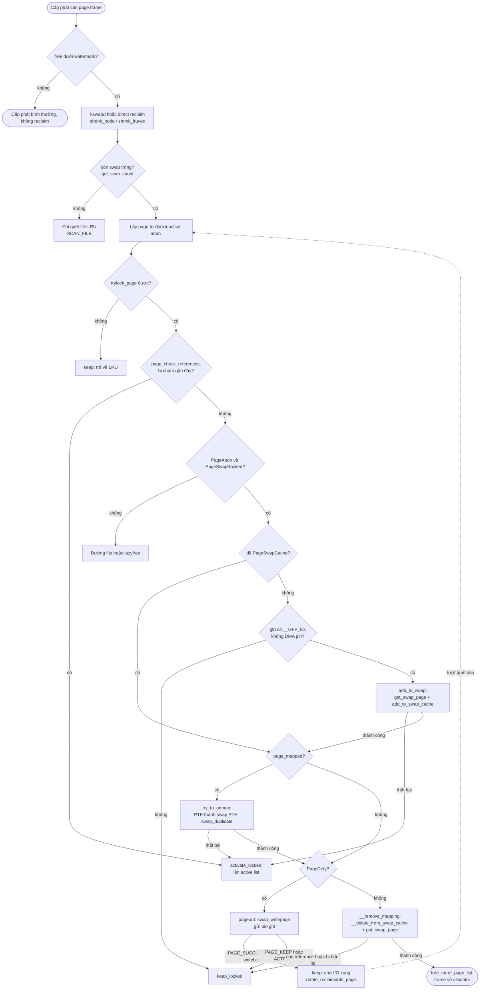
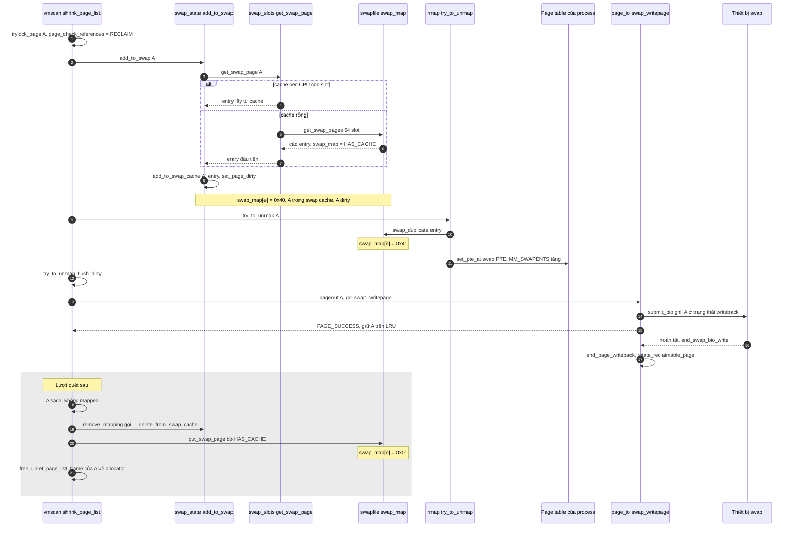

# 03 — Luồng 1: Từ áp lực bộ nhớ đến swap out (§7)

> Tình huống: một chương trình dùng nhiều RAM; kernel cần thêm page frame. Ta đi theo **một anonymous page A** từ lúc
> nằm yên trong RAM tới lúc frame của nó được trả về allocator.

---

## 7.0. Bản tóm tắt 10 dòng (đã kiểm chứng thứ tự trong `shrink_page_list()`)

```
shrink_page_list()                                         mm/vmscan.c:1087
  trylock_page(A)                                          :1118
  page_check_references(A)  → RECLAIM?                     :1240-1252
  PageAnon && PageSwapBacked && !PageSwapCache:            :1259-1297
      add_to_swap(A)                                       :1279   (swap_state.c:216)
         get_swap_page(A)          → slot (swap_slots.c:306)
         add_to_swap_cache(A, e)   → A vào swap cache
         set_page_dirty(A)
  page_mapped(A): try_to_unmap(A)  → PTE := swap PTE       :1320-1333 (rmap.c:1627-1716)
  PageDirty(A): pageout(A, mapping) → swap_writepage()     :1335-1399 (vmscan.c:795, page_io.c:198)
      PAGE_SUCCESS + PageWriteback → "keep": A về LRU, chờ I/O   :1382-1383
  ... I/O xong: end_swap_bio_write → end_page_writeback → rotate_reclaimable_page
lượt quét sau: A sạch, không mapped, PageSwapCache
  __remove_mapping(swap mapping, A)                        :1454   (vmscan.c:869-957)
      __delete_from_swap_cache + put_swap_page             :914-921
  free_unref_page_list(&free_pages)                        :1508   → frame của A về allocator
```

**Thứ tự thật khác với trực giác** "cấp slot → ghi → gỡ PTE": trong source, **gỡ PTE (try_to_unmap) xảy ra TRƯỚC khi ghi** (pageout). Có thể làm vậy vì page vẫn nằm trong swap cache: nếu process chạm lại trong lúc I/O, fault handler tìm thấy page ngay trong swap cache.

---

## 7.1. Mười lăm câu hỏi, trả lời theo source

### 1. Vì sao kernel nhận thấy cần reclaim?
Allocator (`mm/page_alloc.c`) so free page với watermark của zone. Dưới *low* → đánh thức `kswapd`; không cấp được ở *min* → task xin bộ nhớ tự chạy direct reclaim `[KIẾN THỨC NỀN; chi tiết docs/vmscan/02]`. Swap **không** quyết định khi nào reclaim; nó chỉ là *một cách* để reclaim thành công với anon page.

### 2. Memory reclaim là gì?
Là quá trình **biến page frame đang dùng thành page frame trống** mà không làm mất dữ liệu. Với page file sạch: bỏ. Với page file bẩn: ghi về file rồi bỏ. Với anon: ghi vào swap rồi bỏ. Với slab: shrinker. Trung tâm là `shrink_page_list()` `[SOURCE mm/vmscan.c:1087]`.

### 3. Vì sao phải *lựa chọn* page?
Vì thu hồi page *sắp được dùng lại* sẽ tạo ra I/O đọc ngay sau đó (refault) — tốn gấp đôi. Mục tiêu là thu hồi page **ít khả năng được dùng sớm** nhất.

### 4. LRU có vai trò gì?
LRU (Least Recently Used, xấp xỉ) gồm các list `active/inactive × anon/file` trong mỗi `lruvec`. Page mới vào inactive (thường) qua pagevec của `mm/swap.c` (`lru_cache_add()` `:462`); bị chạm nhiều thì `mark_page_accessed()` đưa lên active `[SOURCE mm/swap.c:412-450]`; reclaim lấy page từ **đuôi inactive**. `page_check_references()` kiểm tra bit Accessed trong mọi PTE (qua rmap) để quyết định `PAGEREF_ACTIVATE` / `KEEP` / `RECLAIM` `[SOURCE mm/vmscan.c:1240-1252]`. Đây là lý do page đang dùng tích cực **không** bị chọn trước.

### 5. Page nào có thể đưa ra swap?
`PageAnon(page) && PageSwapBacked(page)` `[SOURCE mm/vmscan.c:1259]` (anon thường; shmem đi đường `shmem_writepage`). Bảng loại trừ ở `01` §3.10.

### 6. Điều kiện cần kiểm tra trước khi đưa ra swap?

| Điều kiện | Dòng `mm/vmscan.c` | Nếu không thỏa |
|---|---|---|
| Lấy được page lock (`trylock_page`) | `:1118` | `keep` (thử lần sau) |
| `page_evictable()` (không mlock) | `:1128` | `activate_locked` |
| `sc->may_unmap` nếu page đang được map | `:1131` | `keep_locked` |
| Không đang writeback (3 case) | `:1204-1238` | activate / chờ |
| `page_check_references` = RECLAIM | `:1240-1252` | activate/keep |
| `sc->gfp_mask & __GFP_IO` (được phép làm I/O) | `:1261` | `keep_locked` |
| Không bị DMA pin | `:1263` | `keep_locked` |
| THP: split được | `:1265-1278` | `activate_locked` |
| `add_to_swap()` thành công | `:1279-1291` | `activate_locked_split` |
| `try_to_unmap()` thành công | `:1327` | `activate_locked` |
| Bẩn: `may_enter_fs`, `sc->may_writepage` | `:1363-1366` | `keep_locked` |

Ngoài ra trước đó, `get_scan_count()` chỉ cho quét anon nếu **còn swap**: `if (!sc->may_swap || mem_cgroup_get_nr_swap_pages(memcg) <= 0) scan_balance = SCAN_FILE;` `[SOURCE mm/vmscan.c:2267-2269]`.

### 7. Khi nào swap slot được cấp phát?
**Ngay trong `shrink_page_list()`**, khi page đã qua mọi kiểm tra ở trên và *chưa* ở swap cache: `add_to_swap(page)` `[SOURCE mm/vmscan.c:1279]`. Không cấp trước, không cấp lúc `malloc`. Nếu page *đã* ở swap cache (ví dụ vừa swap in, chưa sửa) thì **không cấp slot mới** — dùng lại slot cũ.

### 8. `get_swap_page()` có vai trò gì?
Cấp **một** swap entry (type, offset) cho page `[SOURCE mm/swap_slots.c:306-354]`: lấy từ per-CPU cache (nạp 64 slot/lần từ `get_swap_pages()`), hoặc trực tiếp từ swap area nếu cache tắt; sau đó charge memcg (v2). Slot trả về đã có `swap_map = SWAP_HAS_CACHE` (count 0). Trả `entry.val = 0` nếu thất bại.

### 9. `add_to_swap()` làm gì?
`[SOURCE mm/swap_state.c:216-264]`
1. Kiểm tra page đã lock và `PageUptodate`.
2. `entry = get_swap_page(page)`; 0 → return 0.
3. `add_to_swap_cache(page, entry, __GFP_HIGH|__GFP_NOMEMALLOC|__GFP_NOWARN, NULL)` — cờ cấp phát: được dùng một phần dự trữ (`__GFP_HIGH`), **không** được ăn vào dự trữ khẩn cấp (`__GFP_NOMEMALLOC`, vì reclaim chạy dưới `PF_MEMALLOC` có thể vét sạch) — comment `:228-235`.
4. Lỗi → `put_swap_page(page, entry)` trả slot, return 0.
5. `set_page_dirty(page)` — luôn đánh dấu bẩn để chắc chắn được ghi (trường hợp MADV_FREE race) `:247-257`. `set_page_dirty` của swap mapping là `swap_set_page_dirty()` → `__set_page_dirty_no_writeback()` `[SOURCE mm/page_io.c:405-417]`.
6. return 1.

### 10. `add_to_swap_cache()` làm gì?
`[SOURCE mm/swap_state.c:128-177]`: tăng refcount page thêm `nr` (swap cache giữ 1 reference), `SetPageSwapCache`, khoá xarray của `swap_address_space(entry)`, tạo node nếu cần, lưu page tại index `swp_offset(entry)`, `set_page_private(page, entry.val)`, tăng `nrpages`, `NR_FILE_PAGES`, thống kê `add_total`. Nếu xarray thiếu bộ nhớ → `xas_nomem()` thử cấp rồi lặp; vẫn lỗi → hoàn tác cờ và refcount.

Sau bước này, **page A có hai "danh tính"**: anon page được process map (qua `page->mapping` = anon_vma) **và** page trong swap cache (qua `page->private` = entry). `page_mapping(A)` lúc này trả về swap address space `[SOURCE mm/util.c:780-794]` — đó là lý do `mapping = page_mapping(page)` được cập nhật ngay sau `add_to_swap` `[SOURCE mm/vmscan.c:1295-1296]`.

### 11. Vì sao dữ liệu phải được ghi xuống thiết bị swap?
Vì anon page **không có bản gốc** nào khác. Khi frame bị free, nếu chưa ghi thì dữ liệu mất vĩnh viễn. Ghi do `pageout()` → `mapping->a_ops->writepage(page, &wbc)` = `swap_writepage()` `[SOURCE mm/vmscan.c:834-859; mm/swap_state.c:31-33]`:
- `try_to_free_swap(page)`: nếu **không còn PTE nào** trỏ slot (ví dụ process đã exit trong lúc này), xoá khỏi swap cache, khỏi phải ghi `[SOURCE mm/page_io.c:202-205]`.
- `arch_prepare_to_swap()`: lưu MTE tag nếu có `[SOURCE mm/page_io.c:210-215]`.
- `frontswap_store()`: stub vì FRONTSWAP tắt.
- `__swap_writepage()` `[SOURCE mm/page_io.c:253-322]`: `SWP_FS_OPS` → `direct_IO` của filesystem; nếu không: thử `bdev_write_page()` (thiết bị có `rw_page`, đồng bộ); nếu không: `get_swap_bio(GFP_NOIO, ...)` — sector = `map_swap_page()` qua extent — `set_page_writeback(page)`, `unlock_page(page)`, `submit_bio()`. Ghi **bất đồng bộ**: hàm trả về trước khi dữ liệu xuống đĩa. Đếm `PSWPOUT` trong `/proc/vmstat`.

### 12. Khi nào page frame có thể được thu hồi?
Khi đồng thời: không còn PTE nào map (`!page_mapped`), không bẩn, không writeback, và **refcount đúng bằng** `1 (của reclaim) + nr (của swap cache)`. `__remove_mapping()` kiểm tra bằng `page_ref_freeze(page, 1 + compound_nr(page))` rồi `PageDirty` `[SOURCE mm/vmscan.c:905-912]` — thứ tự này chống race với ai đó đang giữ reference rồi làm bẩn page (comment `:880-904`). Đạt → `__delete_from_swap_cache()` + `put_swap_page()` `[:914-921]` → page vào `free_pages` → `free_unref_page_list()` `[:1508]`.

Với ghi bất đồng bộ, việc này **không xảy ra trong cùng lượt quét**: `PAGE_SUCCESS` + `PageWriteback` → `goto keep` `[SOURCE mm/vmscan.c:1379-1383]`. Khi I/O xong, `end_swap_bio_write()` → `end_page_writeback()` `[SOURCE mm/page_io.c:48-70]` → do `PG_reclaim` đã đặt trong `pageout()` `[:844]`, `rotate_reclaimable_page()` đưa A ra **đuôi** inactive list `[SOURCE mm/filemap.c:1488; mm/swap.c:265-279]` để lượt quét kế tiếp gặp A sớm và free nó.

### 13. Page table được xử lý thế nào khi mapping bị gỡ?
`try_to_unmap(page, TTU_BATCH_FLUSH)` duyệt mọi VMA đang map A qua reverse map (anon_vma), với mỗi PTE gọi `try_to_unmap_one()`; nhánh anon `[SOURCE mm/rmap.c:1627-1716]`:
1. `entry = page_private(subpage)` — chính là swap entry vừa cấp.
2. Kiểm tra nhất quán: `PageSwapBacked != PageSwapCache` → WARN, bỏ cuộc `:1634-1642`.
3. Nhánh MADV_FREE (`!PageSwapBacked`) — không áp dụng cho A.
4. `swap_duplicate(entry)` — **count +1 cho mỗi PTE** `:1688`; lỗi → phục hồi PTE cũ, bỏ cuộc.
5. Đưa `mm` vào `init_mm.mmlist` nếu chưa có (để `swapoff` biết mm nào có thể chứa swap PTE) `:1700-1705`.
6. `MM_ANONPAGES--`, `MM_SWAPENTS++` (hiện trong `/proc/PID/status` dòng `VmSwap`) `:1706-1707`.
7. `swp_pte = swp_entry_to_pte(entry)` (giữ soft-dirty, uffd-wp) → `set_pte_at()` `:1708-1713`.
Trước nhánh này, PTE cũ đã bị xoá (`ptep_get_and_clear` / `ptep_clear_flush`) và bit Dirty của nó được chuyển sang page: `if (pte_dirty(pteval)) set_page_dirty(page);` `[SOURCE mm/rmap.c:1559-1566]`. TLB flush được gom (`TTU_BATCH_FLUSH`) và buộc thực hiện trước khi ghi: `try_to_unmap_flush_dirty()` `[SOURCE mm/vmscan.c:1373]` — nếu không, CPU khác có thể còn TLB entry ghi được và sửa page *trong lúc* đang ghi ra đĩa.

### 14. Vì sao ghi xuống swap và giải phóng frame là hai việc khác nhau?
- Ghi là **I/O bất đồng bộ**, kéo dài mili-giây; free frame là thao tác tức thời trên RAM.
- Sau khi ghi xong, có thể **không được free**: ai đó vừa fault vào (page lại được map), ai đó đang giữ reference (GUP, readahead), page bị làm bẩn lại → lần sau phải ghi lại.
- Ngược lại, có lúc **free mà không cần ghi**: page đã ở swap cache từ trước và còn sạch (ví dụ vừa swap in, chưa sửa) — slot vẫn giữ bản đúng (`[SIM tools/swap_map_sim.out.txt kịch bản 1 bước 8-9]`).
Tách hai việc giúp mỗi bước có điều kiện riêng và có thể thử lại độc lập.

### 15. Nếu không cấp được slot hoặc ghi thất bại?

**Không cấp được slot** (`add_to_swap` trả 0): page không THP → `goto activate_locked_split` `[SOURCE mm/vmscan.c:1279-1281]` → `activate_locked`: nếu page ở swap cache và swap đầy/mlock thì `try_to_free_swap()`; `SetPageActive` → page về active list `[:1485-1496]`. Reclaim **không** thành công với page này; nó thử page khác. Nếu toàn bộ swap đã hết, các lần sau `get_scan_count()` thậm chí không quét anon nữa. Nếu không đủ page file để bù → direct reclaim thất bại → (allocator) có thể OOM `[KIẾN THỨC NỀN]`. Lý do thất bại cụ thể của `get_swap_page()`: hết slot (`nr_swap_pages <= 0` `[SOURCE mm/swapfile.c:1069-1073]`), area không `SWP_WRITEOK`, WARP đang chặn `[:794-797]`, memcg v2 vượt `memory.swap.max` (`MEMCG_SWAP_MAX` event `[SOURCE mm/memcontrol.c:7320-7326]`).

**Thêm vào swap cache thất bại** (xarray thiếu bộ nhớ): `put_swap_page()` trả slot `[SOURCE mm/swap_state.c:261-263]` → như trên.

**`try_to_unmap()` thất bại** (ví dụ `swap_duplicate` cần continuation mà `GFP_ATOMIC` hết bộ nhớ): PTE được phục hồi; `activate_locked`. Page vẫn ở swap cache, slot vẫn giữ (`SWAP_HAS_CACHE`) — sẽ được dọn lần sau hoặc khi swap đầy.

**Ghi I/O lỗi**: `end_swap_bio_write()` → `SetPageError`, **`set_page_dirty(page)`** để page không bị reclaim, log `"Write-error on swap-device (%u:%u:%llu)"`, `ClearPageReclaim` `[SOURCE mm/page_io.c:52-67]`. Dữ liệu vẫn an toàn trong RAM (page vẫn ở swap cache, các PTE là swap PTE và fault sẽ tìm thấy page trong cache). Lần reclaim sau sẽ thử ghi lại. Với swap file qua `SWP_FS_OPS`, lỗi cũng re-dirty, log `"Write error on dio swapfile"` (ratelimited) `[:283-297]`. Không cấp được bio → `set_page_dirty`, `-ENOMEM` `[:308-313]`.

---

## Sơ đồ 2 — Flowchart: từ memory pressure đến swap out

**Cách đọc:** hình thoi = quyết định; nhãn mũi tên "không" dẫn tới **nhánh không reclaim được page này** (màu cam trong một số renderer không có — xem chữ). Khối có tên function = bước đã kiểm chứng trong source.



**Giải thích từng mũi tên/nhánh:**
1. *START → WM*: allocator so watermark; không cần reclaim thì không có swap nào (Ví dụ A trong `07`).
2. *WM → RECL*: kswapd/direct reclaim (`docs/vmscan`).
3. *RECL → SWAPQ*: `get_scan_count()` `[vmscan.c:2267-2269]`; hết swap → chỉ file.
4. *ISO → LOCK*: page bị lock bởi người khác → bỏ qua lần này `[:1118]`.
5. *LOCK → REF*: page được chạm gần đây → active `[:1240-1245]`.
6. *REF → ANON*: chỉ `PageAnon && PageSwapBacked` đi tiếp vào nhánh swap `[:1259]`.
7. *ANON → INSC*: page đã có swap entry (swap cache) → **không cấp slot mới**, nhảy thẳng tới kiểm tra mapping.
8. *INSC → IOOK → ADD*: `[:1261-1279]`; `add_to_swap` thất bại → activate.
9. *ADD → MAPPED → UNMAP*: `[:1320-1333]`; thất bại → activate.
10. *DIRTY → PO*: page bẩn (luôn đúng sau `add_to_swap`) → ghi `[:1335-1399]`.
11. *PO → WAITIO*: ghi bất đồng bộ; `goto keep` `[:1382-1383]`; khi xong, page về đuôi inactive (mũi tên đứt = vòng lặp sang lượt quét khác).
12. *DIRTY "không" → RM*: page sạch (lượt sau, hoặc page swap-in chưa sửa) → `__remove_mapping` `[:1454]`.
13. *RM → FREE*: refcount freeze thành công và không bẩn → frame free `[:1458-1474, :1508]`.

---

## Sơ đồ 3 — Sequence diagram: swap out của page A

**Cách đọc:** trục dọc là thời gian; mỗi cột là một thành phần (file). Khối `Note` mô tả trạng thái dữ liệu. Phần sau `rect` "Lượt quét sau" xảy ra ở một lần gọi `shrink_page_list()` khác.



**Giải thích các bước (số theo `autonumber`):**
1. Page A qua kiểm tra lock và references.
2–7. Cấp slot: nhánh `alt` cho thấy hai đường của `get_swap_page()` — (4) lấy từ túi per-CPU (không khoá toàn cục), hoặc (5–7) nạp lại 64 slot qua `get_swap_pages()` (khoá `swap_avail_lock` + `si->lock`). Slot mới có `swap_map = 0x40`. Renderer đánh số cả hai nhánh nên số nhảy.
8. `add_to_swap_cache` + `set_page_dirty` `[swap_state.c:239-257]`.
9–11. `try_to_unmap` → `swap_duplicate` làm byte thành `0x41` → ghi swap PTE.
12. Flush TLB trước khi I/O.
13–15. `pageout` → `swap_writepage` → `submit_bio`; trả `PAGE_SUCCESS`, A ở lại LRU (đang writeback).
16–17. I/O xong; A được đưa ra đuôi inactive.
18–21. Lượt sau: `__remove_mapping` → rời swap cache, `put_swap_page` bỏ cờ cache → byte `0x01` (1 PTE còn trỏ); frame được free.

---

## 7.2. Ví dụ trực quan: trạng thái trước và sau của page A

> Giá trị địa chỉ/frame/offset là **giả định minh họa**, không lấy từ board. Mã hoá PTE theo arm64 thật `[SIM tools/swap_numbers.out.txt §3]`. Byte `swap_map` theo `[SIM tools/swap_map_sim.out.txt kịch bản 1]`.
> Giả sử A thuộc process X, địa chỉ ảo `0x0000007f12345000`, ở frame PFN `0x2A000`, được cấp slot type 0 offset 1.

| Thời điểm | Page A (dữ liệu) | Page frame `0x2A000` | PTE của X | Swap entry | `swap_map[1]` | Swap cache | Thiết bị (slot 1) |
|---|---|---|---|---|---|---|---|
| T0: trước reclaim | trong frame | đang dùng, `PG_lru`, mapcount 1 | present → PFN `0x2A000` | chưa có | `00` (trống) | không có | rác cũ / trống |
| T1: sau `get_swap_page` | trong frame | như trên | present | (0, 1) đã cấp | `40` | không có | chưa ghi |
| T2: sau `add_to_swap_cache` | trong frame | +`PG_swapcache`, `private=0x1`, `PG_dirty`, ref +1 | present | (0, 1) | `40` | xarray[1] → A | chưa ghi |
| T3: sau `try_to_unmap` | trong frame | mapcount 0 | **swap PTE `0x100`** (not present) | (0, 1) | `41` | → A | chưa ghi |
| T4: `swap_writepage` gửi I/O | trong frame + đang chuyển | `PG_writeback`, `PG_reclaim` | swap PTE | (0, 1) | `41` | → A | **đang ghi** |
| T5: I/O xong | trong frame **và** trên slot | sạch, hết writeback, ở đuôi inactive | swap PTE | (0, 1) | `41` | → A | **bản sao đầy đủ** |
| T6: `__remove_mapping` + free | **chỉ trên slot** | **trống**, về allocator (có thể đã cấp cho Y) | swap PTE | (0, 1) — *chỉ còn trong PTE* | `01` | xarray[1] = shadow entry (nếu có) | bản duy nhất |

**Câu hỏi tự kiểm tra:** ở T3–T5, nếu X đọc A thì chuyện gì xảy ra? (Đáp: fault → `do_swap_page()` → `lookup_swap_cache()` **thấy A** → map lại, không đọc đĩa; nếu đang writeback thì vẫn map được vì dữ liệu trong RAM là đúng. Xem `04` §10.)

---

## 7.3. Những điểm dễ nhầm

1. **"Swap out = ghi page ra đĩa."** Chưa đủ: còn cấp slot, đăng ký swap cache, sửa *mọi* PTE, chờ I/O, rồi mới free frame — năm việc, nhiều lượt quét.
2. **"Slot được cấp lúc page được tạo."** Sai; cấp lúc reclaim quyết định swap page đó.
3. **"Sau khi ghi xong, frame lập tức được free."** Sai; cần lượt quét sau (ghi bất đồng bộ) và điều kiện refcount.
4. **"`swap_map` = 1 nghĩa là page đang ở swap cache."** Sai; `0x01` = 1 PTE trỏ, *không* có cache. `0x41` mới là "1 PTE + có cache".
5. **"Gỡ PTE sau khi ghi."** Source làm ngược: gỡ PTE trước, ghi sau; swap cache bảo đảm an toàn.
6. **"Linux luôn swap khi RAM đầy."** Không: phụ thuộc còn swap không, `swappiness`, tỉ lệ page file/anon, trạng thái LRU, `gfp_mask`, memcg limit, WARP… và reclaim có thể chỉ lấy page cache.

## 7.4. Tóm tắt

- Slot được cấp trong `shrink_page_list()` qua `add_to_swap()` → `get_swap_page()`; page vào swap cache và bị đánh dấu bẩn.
- `try_to_unmap()` thay mọi PTE bằng swap PTE, mỗi PTE +1 count trong `swap_map`.
- `pageout()` → `swap_writepage()` ghi bất đồng bộ; frame được free ở lượt quét sau qua `__remove_mapping()` + `put_swap_page()`.
- Thất bại ở bất kỳ bước nào → page quay về LRU (thường active), reclaim tìm page khác; ghi lỗi → page re-dirty, dữ liệu vẫn trong RAM.
