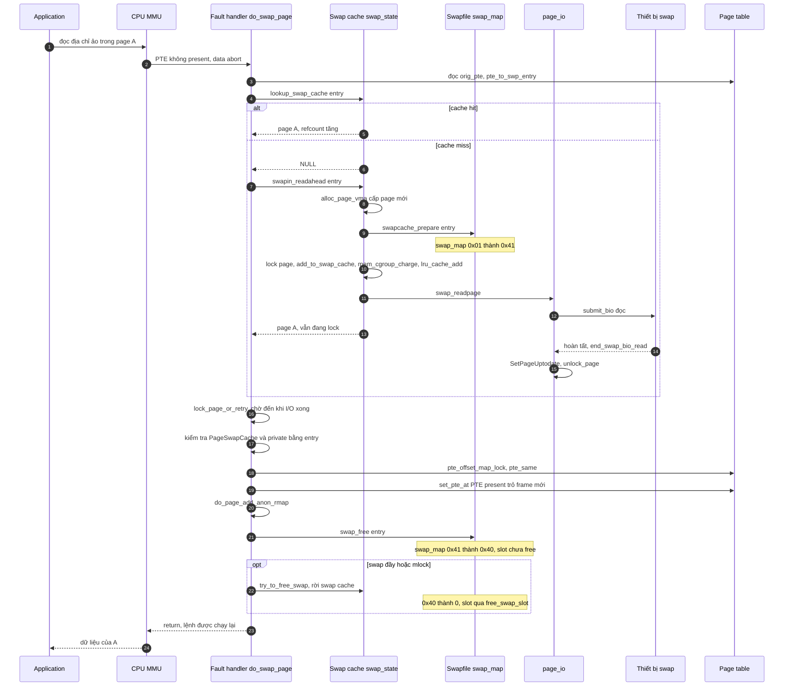
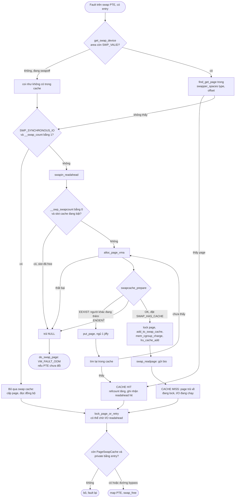

# 04 — Luồng 2: Swap in khi ứng dụng truy cập lại page (§8) · Luồng 4: Swap cache (§10)

> Tình huống: page A đã swap out xong (`03` §7.2, thời điểm T6): PTE của X là swap PTE type 0 offset 1, `swap_map[1] = 0x01`,
> không có page nào trong swap cache. Bây giờ X đọc một biến nằm trong A.

---

## 8.0. Bản tóm tắt call path (đã kiểm chứng)

```
CPU truy cập VA → MMU: PTE không present → exception (data abort)
arch/arm64/mm/fault.c   do_page_fault() :456 → __do_page_fault() :413 → handle_mm_fault() :439
mm/memory.c             handle_mm_fault() :4714 → __handle_mm_fault() :4558 → handle_pte_fault() :4465
                        pte không none, không present → do_swap_page(vmf)                 :4512-4513
do_swap_page()                                                                           :3366
  pte_unmap_same()                       PTE còn như lúc đọc?                            :3377
  entry = pte_to_swp_entry(orig_pte); non_swap_entry? → migration/device/hwpoison         :3380-3395
  page = lookup_swap_cache(entry)        (swap_state.c:369)                               :3399
  nếu miss:
     SWP_SYNCHRONOUS_IO && __swap_count==1 → cấp page, swap_readpage(page, true), KHÔNG vào swap cache :3405-3433
     ngược lại → swapin_readahead()  (swap_state.c:891) → __read_swap_cache_async + swap_readpage :3435
     VM_FAULT_MAJOR, PGMAJFAULT                                                            :3454-3456
  lock_page_or_retry(page)               ← CHỜ I/O ĐỌC XONG Ở ĐÂY                         :3467
  kiểm tra PageSwapCache && private == entry (đua với try_to_free_swap/swapoff)            :3481-3483
  pte_offset_map_lock + pte_same         (đua với thread khác fault cùng PTE)              :3497-3500
  PageUptodate? (I/O lỗi → SIGBUS)                                                         :3502-3505
  MM_ANONPAGES++, MM_SWAPENTS--; mk_pte; ghi + reuse_swap_page → writable, rời swap cache :3517-3525
  set_pte_at; do_page_add_anon_rmap                                                        :3533-3543
  swap_free(entry)                       count − 1                                         :3545
  swap đầy / VM_LOCKED / mlocked → try_to_free_swap(page)                                  :3546-3548
  unlock_page; nếu fault ghi → do_wp_page                                                  :3549-3568
```

---

## 8.1. Mười lăm câu hỏi

### 1. CPU thực hiện truy cập bộ nhớ thế nào?
Lệnh `ldr x0, [x1]` với `x1` = địa chỉ ảo. MMU tìm bản dịch trong TLB; trượt thì tự đi bộ (table walk) qua page table của process hiện tại. Gặp PTE hợp lệ → lấy PFN, ghép offset, truy cập RAM `[KIẾN THỨC NỀN]`.

### 2. Page fault là gì?
Một **ngoại lệ đồng bộ** CPU sinh ra khi bản dịch thất bại (PTE không present) hoặc sai quyền (ghi vào page chỉ đọc). CPU dừng lệnh, nhảy vào handler của kernel; sau khi handler sửa xong PTE, lệnh được **chạy lại** từ đầu — chương trình không hề biết.

### 3. Vì sao địa chỉ hợp lệ vẫn gây page fault?
"Hợp lệ" = nằm trong một VMA của process (handler kiểm tra `find_vma` trong `__do_page_fault` `[SOURCE arch/arm64/mm/fault.c:413-439]`). Nhưng PTE có thể chưa present vì: (a) chưa bao giờ chạm (PTE none) → cấp page mới; (b) **đã bị swap out** (swap PTE); (c) đang migrate; (d) page file chưa đọc; (e) COW (present nhưng chỉ đọc). Vậy **swap in chỉ là một loại page fault**; đa số fault không liên quan tới swap.

### 4. Handler xác định "page đã swap out" thế nào?
`handle_pte_fault()`: PTE **none** → `do_anonymous_page()`/`do_fault()`; **không none và không present** → `do_swap_page()` `[SOURCE mm/memory.c:4499-4513]`. Trong `do_swap_page()`, `non_swap_entry(entry)` lọc tiếp: migration entry → `migration_entry_wait()`; device-private → `migrate_to_ram()`; hwpoison → `VM_FAULT_HWPOISON`; còn lại không hợp lệ → `print_bad_pte` + `SIGBUS` `[SOURCE mm/memory.c:3380-3395]`. Chỉ swap entry thật (type < `MAX_SWAPFILES`) mới đi tiếp.

### 5. Swap entry lấy từ đâu?
Từ **chính PTE**: `entry = pte_to_swp_entry(vmf->orig_pte)` `[SOURCE mm/memory.c:3380]` — `orig_pte` là bản sao PTE đọc trong `handle_pte_fault()` `[:4488]`. Không có bảng nào khác lưu "page ảo X đang ở slot nào".

### 6. Xác định swap area và offset thế nào?
`swp_swap_info(entry)` = `swap_info[swp_type(entry)]` `[SOURCE mm/swapfile.c:3575-3578]`; offset = `swp_offset(entry)`. Mọi truy cập metadata được bảo vệ khỏi `swapoff` bằng `get_swap_device()`/`put_swap_device()` (RCU + `SWP_VALID`) trong `lookup_swap_cache()`, `__read_swap_cache_async()`, `__swap_count()`… `[SOURCE mm/swap_state.c:375-379, :468-473; mm/swapfile.c:1518-1530]`.

### 7. Kiểm tra swap cache thế nào?
`lookup_swap_cache(entry, vma, addr)` → `find_get_page(swap_address_space(entry), swp_offset(entry))` — tra xarray của `swapper_spaces[type][offset >> 14]`, tăng refcount nếu thấy `[SOURCE mm/swap_state.c:369-416]`. Đồng thời cập nhật thống kê `find_total`/`find_success` và trạng thái readahead.

### 8. Nếu chưa có trong swap cache?
Hai đường `[SOURCE mm/memory.c:3402-3438]`:
- **Đường nhanh bỏ qua swap cache:** nếu area có `SWP_SYNCHRONOUS_IO` (thiết bị có `rw_page` — ví dụ zram/brd; đặt lúc swapon `[SOURCE mm/swapfile.c:3273-3274]`) **và** `__swap_count(entry) == 1` (chỉ một PTE trỏ slot — không cần chia sẻ): cấp page, `__SetPageLocked`, `set_page_private(page, entry.val)`, tạm `SetPageSwapCache` chỉ để `mem_cgroup_charge()` tra `swap_cgroup`, rồi `ClearPageSwapCache`; đọc **đồng bộ** `swap_readpage(page, true)`. Trên board: không có zram theo config → `[SUY LUẬN]` đường này hiếm khi được dùng trừ khi block driver của eMMC/SSD cung cấp `rw_page` (`[KIỂM TRA TRÊN BOARD]`: `dmesg | grep "Adding .*swap"` không in cờ này; cần đọc driver).
- **Đường thường:** `swapin_readahead()` → (VMA hoặc cluster readahead) → `read_swap_cache_async()` cho chính entry, kèm vài entry lân cận.

### 9. Cấp page frame thế nào?
Trong `__read_swap_cache_async()`: `page = alloc_page_vma(gfp_mask, vma, addr)` với `GFP_HIGHUSER_MOVABLE` `[SOURCE mm/swap_state.c:493; mm/memory.c:3435-3436]`. Đây là cấp phát bình thường — **có thể kích hoạt reclaim** (và có thể swap out page *khác*). Cấp **trước** khi đặt `SWAP_HAS_CACHE`, để nếu task khác đang đua thì nó sẽ lặp chờ mà không phải cấp phát lúc đang giữ cờ (comment `:488-492`). Thất bại → `NULL` → `do_swap_page` trả `VM_FAULT_OOM` nếu PTE chưa đổi `[SOURCE mm/memory.c:3440-3451]`.

### 10. Dữ liệu được đọc từ thiết bị thế nào?
`swap_readpage(page, synchronous)` `[SOURCE mm/page_io.c:324-403]`:
1. `psi_memstall_enter()` (tính là "chờ bộ nhớ").
2. `frontswap_load()` — stub (FRONTSWAP tắt).
3. `SWP_FS_OPS` → `->readpage` của filesystem.
4. `SWP_SYNCHRONOUS_IO` → `bdev_read_page()`.
5. Còn lại: `get_swap_bio(GFP_KERNEL, page, end_swap_bio_read)` (sector từ extent), `REQ_OP_READ`, `submit_bio()`. Đếm `PSWPIN`.
6. Nếu `synchronous`: vòng `blk_poll()`/`blk_io_schedule()` tới khi `bio->bi_private == NULL`.

### 11. Chờ I/O và hoàn tất I/O thật sự diễn ra thế nào?
**Cơ chế chờ là page lock**, không phải một hàng đợi riêng:
- Page mới được lock ngay khi tạo: `__SetPageLocked(page)` `[SOURCE mm/swap_state.c:522]`.
- I/O hoàn tất → `end_swap_bio_read()`: thành công → `SetPageUptodate`; lỗi → `SetPageError`, `ClearPageUptodate`, log `"Read-error on swap-device (%u:%u:%llu)"`; **luôn** `unlock_page(page)` và đánh thức task đang poll `[SOURCE mm/page_io.c:72-95]`.
- Fault handler gọi `lock_page_or_retry(page, mm, flags)` `[SOURCE mm/memory.c:3467]` → **ngủ** cho đến khi bit `PG_locked` được nhả. Nếu fault cho phép retry, nó có thể nhả `mmap_lock` trong lúc chờ và trả `VM_FAULT_RETRY` → arch handler gọi lại toàn bộ fault (`__lock_page_or_retry()` `[SOURCE mm/filemap.c:1573]`).
- Sau khi lock được: `PageUptodate` = false → I/O lỗi → `VM_FAULT_SIGBUS` `[SOURCE mm/memory.c:3502-3505]`.

### 12. PTE được khôi phục thế nào?
`[SOURCE mm/memory.c:3497-3545]`
1. `pte_offset_map_lock()` lấy **PTE lock**; `pte_same(*pte, orig_pte)` — nếu thread khác đã xử lý fault này (PTE đổi) → bỏ (`out_nomap`).
2. `inc MM_ANONPAGES`, `dec MM_SWAPENTS`.
3. `pte = mk_pte(page, vma->vm_page_prot)`; nếu fault ghi và `reuse_swap_page()` đồng ý → `pte_mkdirty` + writable, page rời swap cache (§8.1 câu 14).
4. Giữ soft-dirty/uffd-wp từ swap PTE.
5. `set_pte_at()`; `arch_do_swap_page()` (MTE restore trên arm64).
6. `do_page_add_anon_rmap()` (hoặc `page_add_new_anon_rmap` nếu KSM đã copy).
7. `swap_free(entry)` — count − 1.
8. `update_mmu_cache()`; nhả PTE lock.

### 13. Page được đưa trở lại những cấu trúc nào?

| Cấu trúc | Bằng chứng |
|---|---|
| **LRU** (qua pagevec) — đã thêm ngay khi tạo page trong swap cache, với `PG_workingset` | `SetPageWorkingset(page); lru_cache_add(page);` `[SOURCE mm/swap_state.c:540-541]` |
| **Swap cache** (vẫn còn sau fault, trừ khi bị gỡ ở bước 3/7 của câu 12) | `add_to_swap_cache` `[:526]` |
| **memcg** (charge vào memcg chủ cũ của slot) | `mem_cgroup_charge()` → `lookup_swap_cgroup_id()` `[SOURCE mm/swap_state.c:531; mm/memcontrol.c:6827]` |
| **Reverse map** (anon_vma) | `do_page_add_anon_rmap` `[SOURCE mm/memory.c:3542]` |
| **Page table** | `set_pte_at` `[:3533]` |
| **Workingset** (phát hiện refault từ shadow entry) | `workingset_refault(page, shadow)` `[SOURCE mm/swap_state.c:536-537]` |
| Bộ đếm mm (`VmSwap` giảm, `RssAnon` tăng) | `[SOURCE mm/memory.c:3517-3518]` |

### 14. Khi nào swap entry/slot được giải phóng?
Slot chỉ thật sự trống khi **count = 0 và không còn `SWAP_HAS_CACHE`**. Sau `swap_free()` ở câu 12, count giảm nhưng **cờ cache thường vẫn còn** (page vẫn ở swap cache) → slot *chưa* free. Các trường hợp (đã kiểm chứng):

| Trường hợp | Khi nào slot free | Bằng chứng |
|---|---|---|
| Fault **ghi** và page chỉ có một người dùng | `reuse_swap_page()` → `delete_from_swap_cache` (bỏ cờ cache) rồi `swap_free` đưa count về 0 → `free_swap_slot()` | `[SOURCE mm/memory.c:3520-3525; mm/swapfile.c:1723-1757]` |
| Swap đầy > 50% (hoặc memcg v2 dùng ≥ 1/2 `swap.high/max`), hoặc VMA `VM_LOCKED`/page mlocked | `try_to_free_swap()` ngay sau `swap_free` | `[SOURCE mm/memory.c:3546-3548; mm/memcontrol.c:7377-7397]` |
| Đường bỏ qua swap cache (`SWP_SYNCHRONOUS_IO`) | ngay ở `swap_free` (không có cờ cache) | `[SOURCE mm/memory.c:3405-3433]` |
| Trường hợp thường (fault đọc, swap còn nhiều) | **muộn hơn**: khi page bị reclaim lại (sạch → bỏ, slot giữ, count do PTE mới tăng lại), khi process unmap/exit (`free_pages_and_swap_cache` → `free_swap_cache` → `try_to_free_swap`), khi COW sau này tạo bản sao và page cũ hết người map, hoặc khi bộ cấp phát tái chế slot "chỉ còn cache" lúc swap > 50% | `[SOURCE mm/swap_state.c:324-356; mm/mmu_gather.c:49; mm/swapfile.c:873-884]` |

**Vì sao giữ slot sau khi đọc về?** Vì page trong RAM và trên slot **đang giống hệt nhau**. Nếu page bị reclaim lại mà chưa sửa, kernel chỉ cần bỏ frame — **không cần ghi lại** (`[SIM tools/swap_map_sim.out.txt kịch bản 1 bước 7-9]`). Cái giá: slot bị chiếm thêm một thời gian; khi swap bắt đầu đầy (> 50%), kernel đổi chiến lược và giải phóng sớm.

> **Hệ quả tinh tế của 5.10** `[SOURCE + SUY LUẬN]`: nếu fault đầu tiên là **đọc**, page ở lại swap cache với refcount ≥ 2 (PTE + swap cache). Lần **ghi** sau đó vào `do_wp_page()`, nhánh anon chỉ "reuse" khi `page_count(page) == 1` `[SOURCE mm/memory.c:3198-3217]` → vì swap cache giữ thêm 1 ref, kernel **copy sang page mới** (`wp_page_copy`) dù chỉ có một process. Page cũ (vẫn trong swap cache, hết người map) sẽ được dọn sau. Phiên bản mainline mới hơn đã tối ưu trường hợp này; đừng mang hành vi mainline mới vào cây 5.10.

### 15. Nếu page đã có sẵn trong swap cache, luồng khác gì?
- Không cấp page, không I/O, **không** `VM_FAULT_MAJOR` (là minor fault) `[SOURCE mm/memory.c:3399-3402, :3453-3456 chỉ chạy khi miss]`.
- `lookup_swap_cache()` có thể ghi nhận "readahead hit" (`SWAP_RA_HIT` trong `/proc/vmstat`) nếu page được đọc trước nhờ readahead.
- **Vẫn phải `lock_page_or_retry()`**: page tìm thấy có thể là page readahead **đang được đọc** (còn lock) → fault vẫn phải chờ I/O, chỉ là chờ ít hơn.
- Phần còn lại (kiểm tra, map PTE, `swap_free`) giống hệt.
- Có thể gặp `PageHWPoison` → `VM_FAULT_HWPOISON` `[:3457-3465]` (MEMORY_FAILURE tắt trên board).

---

## Sơ đồ 4 — Sequence diagram: swap in và page fault

**Cách đọc:** mỗi cột là một thành phần thật; `alt` = rẽ nhánh cache hit / miss; khối `Note` mô tả trạng thái `swap_map`. Không có "một function làm tất cả": ranh giới là `do_swap_page` (memory.c), `swap_state.c`, `swapfile.c`, `page_io.c`.



**Giải thích:**
- (1–3) Truy cập → fault → handler đọc swap entry từ PTE.
- (4–5) **Hit**: có page ngay.
- (6–15) **Miss**: readahead cấp page, giành `SWAP_HAS_CACHE` (`0x01 → 0x41`), đưa vào swap cache + memcg + LRU, gửi bio; page trả về **khi I/O chưa xong** (vẫn lock). Completion (14–15) có thể chạy trên CPU/ngữ cảnh khác, bất cứ lúc nào sau khi bio được gửi.
- (16) Điểm hội tụ: `lock_page_or_retry` chờ completion.
- (17–21) Kiểm tra đua, map PTE, rmap, `swap_free` (`0x41 → 0x40`).
- `opt`: giải phóng slot sớm nếu swap đầy/mlock.
- (cuối) Return → CPU chạy lại lệnh, lần này MMU dịch được.

---

# §10. Luồng 4: Swap cache hoạt động thế nào?

## 10.1. Vì sao không phải lúc nào cũng đọc từ thiết bị?

Giả sử page A có swap entry (0, 1). Page A có thể **đã ở RAM** trong swap cache vì:
1. A đang trên đường **ra** (T2–T5 của `03` §7.2): đã có swap PTE nhưng frame chưa free.
2. A vừa được **readahead** do fault vào page lân cận.
3. A đã được đọc về bởi **một process khác** chia sẻ slot (sau fork).
4. A đã được đọc về trước đó và **chưa bị reclaim lại** (slot vẫn giữ, PTE nào đó vẫn trỏ — ví dụ process con).

Trong mọi trường hợp đó, đọc lại đĩa vừa tốn I/O vừa **sai** (tạo hai bản trong RAM cho cùng một dữ liệu).

## 10.2. Swap cache giảm công việc nào?
- I/O đọc trùng lặp (chia sẻ sau fork; readahead).
- I/O ghi lại page sạch (page đã có bản đúng trên slot).
- Cấp phát frame thừa.
- Đồng thời là **điểm đồng bộ**: mọi bên muốn page của entry X đều tìm ở cùng một chỗ.

## 10.3. Nhiều hoạt động cùng muốn một page — kernel xử lý gì?

| Đua | Ai thắng / cách xử lý | Bằng chứng |
|---|---|---|
| 2 task cùng fault cùng entry, cả hai miss | Chỉ một task `swapcache_prepare()` thành công (đặt `SWAP_HAS_CACHE`); task kia nhận `-EEXIST`, `put_page` page vừa cấp, ngủ 1 jiffy rồi lặp lại → lần sau `find_get_page` thấy page của task thắng | `[SOURCE mm/swap_state.c:461-516; mm/swapfile.c:3504-3512]` |
| Fault vs `delete_from_swap_cache` | Sau khi lock page, kiểm tra lại `PageSwapCache(page) && page_private(page) == entry.val`; sai → bỏ và fault lại | `[SOURCE mm/memory.c:3475-3483]` |
| 2 thread cùng fault cùng PTE | `pte_same()` dưới PTE lock; thread chậm thấy PTE đã đổi → thoát | `[SOURCE mm/memory.c:3497-3500]` |
| Fault vs `swapoff` (area bị gỡ) | `get_swap_device()` (RCU + `SWP_VALID`) trả NULL → coi như không có cache; cuối cùng `pte_same` phát hiện PTE đã bị `unuse_pte` sửa | `[SOURCE mm/swapfile.c:1278-1344]` |
| Slot vừa được free rồi tái cấp | `__read_swap_cache_async` kiểm tra `__swp_swapcount(entry)` trước; `swapcache_prepare` trả `-ENOENT` nếu count = 0 | `[SOURCE mm/swap_state.c:485-486, :500-506]` |

**Quan hệ page lock / refcount / swap entry / swap cache:**
- **Page lock (`PG_locked`)**: bắt buộc khi thêm/xoá khỏi swap cache (`VM_BUG_ON_PAGE(!PageLocked(page))` `[SOURCE mm/swap_state.c:137, :191]`), khi `try_to_free_swap`/`reuse_swap_page` (`:1727, :1765` swapfile.c), và là cơ chế chờ I/O đọc.
- **Refcount**: swap cache giữ `nr` reference (`page_ref_add` `:141`); lookup tăng thêm 1 cho người tìm; `delete_from_swap_cache` trả lại `page_ref_sub` `:282`. Reclaim chỉ free khi refcount = 1 + nr `[SOURCE mm/vmscan.c:905-907]`.
- **Swap entry ↔ page**: `page->private = entry.val` khi `PG_swapcache`; ngược lại tra `xarray[offset]`.
- **`SWAP_HAS_CACHE`** trong `swap_map`: phía "slot" của cùng quan hệ — slot biết mình có page trong cache.

## 10.4. Swap cache khác page cache của file ở điểm nào?
Xem bảng `01` §3.11. Thêm: page swap cache **không** có `page->mapping` của file (nó giữ `anon_vma`), **không** dùng writeback tag (`mapping_set_no_writeback_tags` `[SOURCE mm/swap_state.c:721-722]`), nhưng vẫn tính vào `NR_FILE_PAGES` `[:165]` (vì thế `/proc/meminfo` có dòng `SwapCached` riêng để trừ ra) `[KIẾN THỨC NỀN]`.

## 10.5. Khi nào page bị loại khỏi swap cache?

| Đường | Function | Điều kiện |
|---|---|---|
| Reclaim thành công | `__remove_mapping()` → `__delete_from_swap_cache()` + `put_swap_page()` | không mapped, sạch, refcount đúng `[SOURCE mm/vmscan.c:914-921]` |
| Không còn PTE nào trỏ slot | `try_to_free_swap()` → `delete_from_swap_cache()` | `!PageWriteback && !page_swapped` `[SOURCE mm/swapfile.c:1763-1796]` |
| Ghi vào page độc quyền | `reuse_swap_page()` → `delete_from_swap_cache()` + `SetPageDirty` | count == 1, không writeback `[:1734-1741]` |
| Swap đầy, cấp phát cần slot | `__try_to_reclaim_swap(TTRS_ANYWAY)` → `try_to_free_swap()` | `vm_swap_full()` `[:873-884]` |
| munmap/exit | `free_swap_and_cache()` (TTRS_UNMAPPED/FULL) hoặc `free_swap_cache()` | `[:1802-1825; mm/swap_state.c:324-330]` |
| swapoff | `try_to_unuse()` → `try_to_free_swap()` | `[SOURCE mm/swapfile.c:2246-2275]` |
| Đọc swap-in thất bại charge memcg | `delete_from_swap_cache()` | `[SOURCE mm/swap_state.c:531-533]` |

## 10.6. Xoá khỏi swap cache có đồng nghĩa với free frame ngay không?
**Không.** `delete_from_swap_cache()` *"will never put the page into the free list, the caller has a reference on the page"* `[SOURCE mm/swap_state.c:266-271]`. Nó chỉ: gỡ xarray, bỏ `PG_swapcache`, bỏ `SWAP_HAS_CACHE` (qua `put_swap_page`), trả 1 ref. Page vẫn có thể đang được map bởi process (ví dụ sau `reuse_swap_page`, page trở thành anon page "thường" có `PG_dirty`). Frame chỉ free khi refcount về 0 (hoặc khi reclaim freeze thành công).

## Sơ đồ 6 — Flowchart: swap cache hit và cache miss

**Cách đọc:** bắt đầu từ fault trên swap PTE. Nhánh trái = hit, nhánh phải = miss. Khối "vòng chờ" thể hiện đua `-EEXIST`.



**Giải thích:**
1. `get_swap_device` chặn đua với swapoff `[swapfile.c:1318]`.
2. `find_get_page` = tra cứu swap cache `[swap_state.c:378, :471]`.
3. Hit → không I/O; nhưng vẫn khóa page (có thể chờ readahead đang chạy).
4. Miss + `SWP_SYNCHRONOUS_IO` + count 1 → bypass `[memory.c:3405]`.
5. Miss thường: kiểm tra slot còn dùng `[swap_state.c:485]`, cấp page `[:493]`, giành cờ `[:500]`; `-EEXIST` → chờ và tìm lại `[:504-515]`.
6. Thành công → thêm vào cache, charge, LRU `[:522-542]` → đọc `[:565]`.
7. Hội tụ tại lock page; kiểm tra page vẫn đúng entry `[memory.c:3481]`.
8. Thất bại cấp phát → OOM fault (nếu PTE vẫn là swap PTE ban đầu) `[memory.c:3440-3451]`.

## 10.7. Tóm tắt

- Swap cache là chỉ mục RAM (type, offset) → page; dữ liệu vẫn trong RAM.
- Hit: không I/O, minor fault; miss: cấp page, giành `SWAP_HAS_CACHE`, đọc bio, chờ bằng page lock.
- Đua được giải quyết bằng `SWAP_HAS_CACHE` (ai thêm vào cache), page lock (ai sửa trạng thái), PTE lock + `pte_same` (ai map), RCU (`swapoff`).
- Xoá khỏi swap cache ≠ free frame; slot thường được giữ sau swap in để tránh ghi lại.
